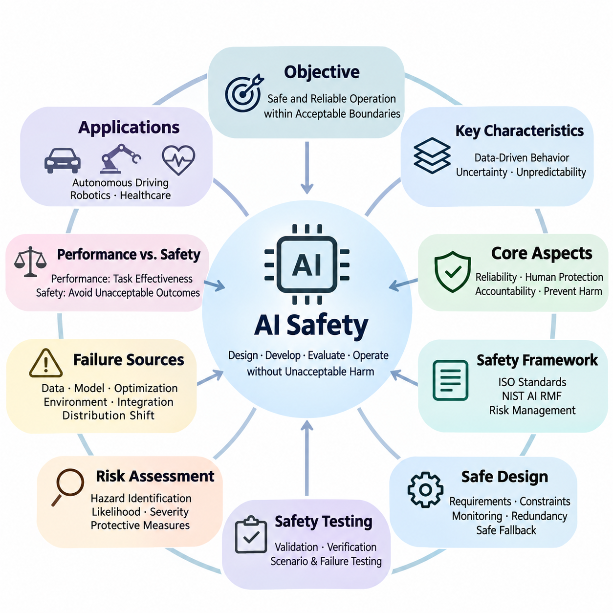
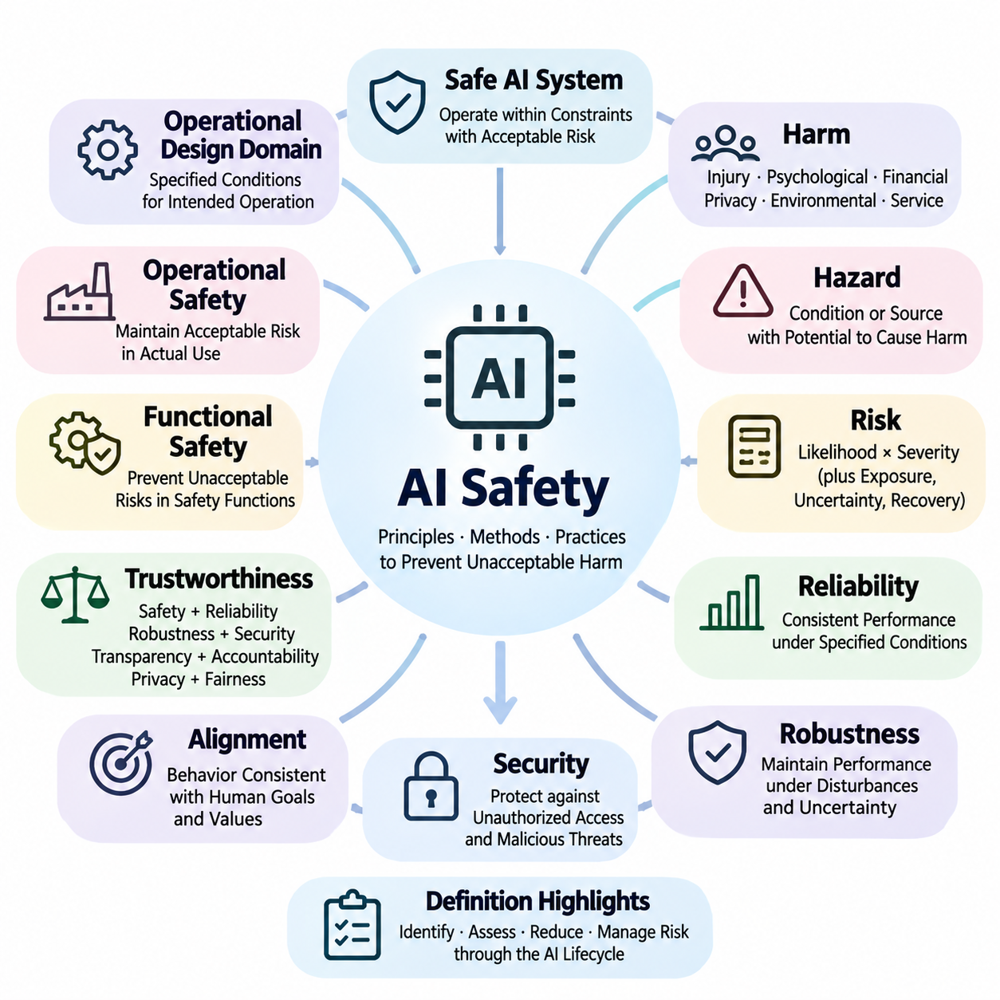
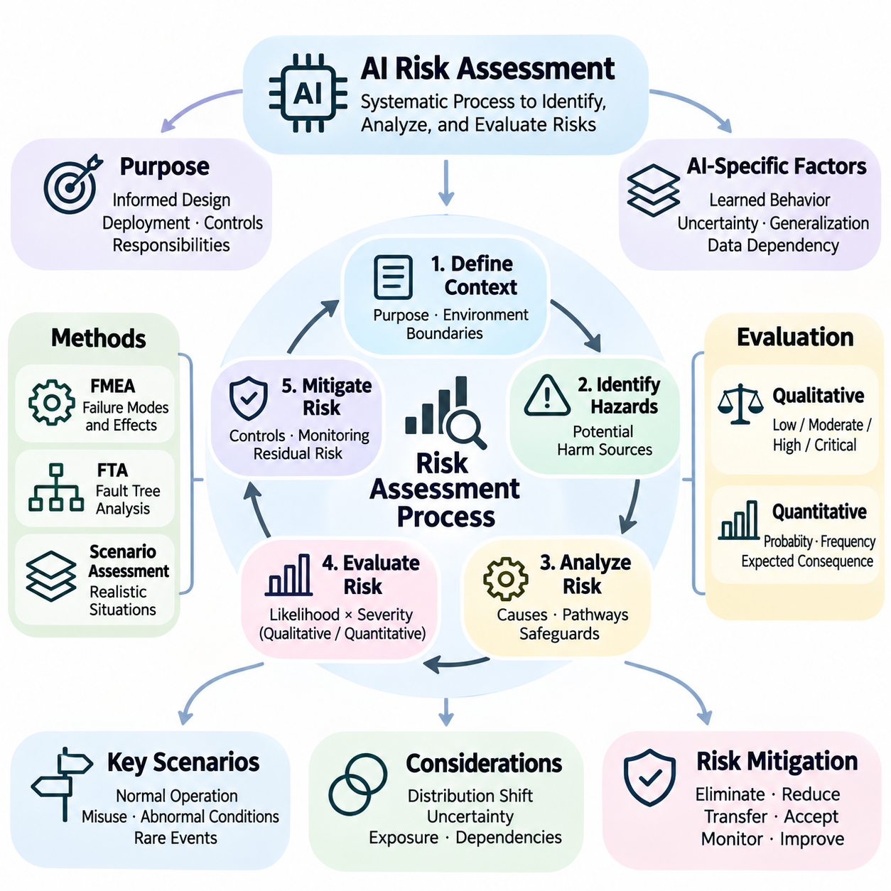
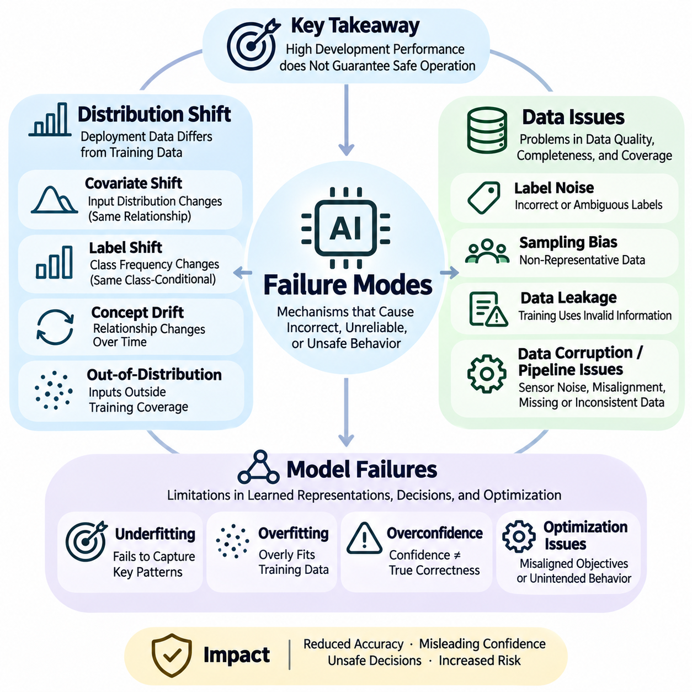
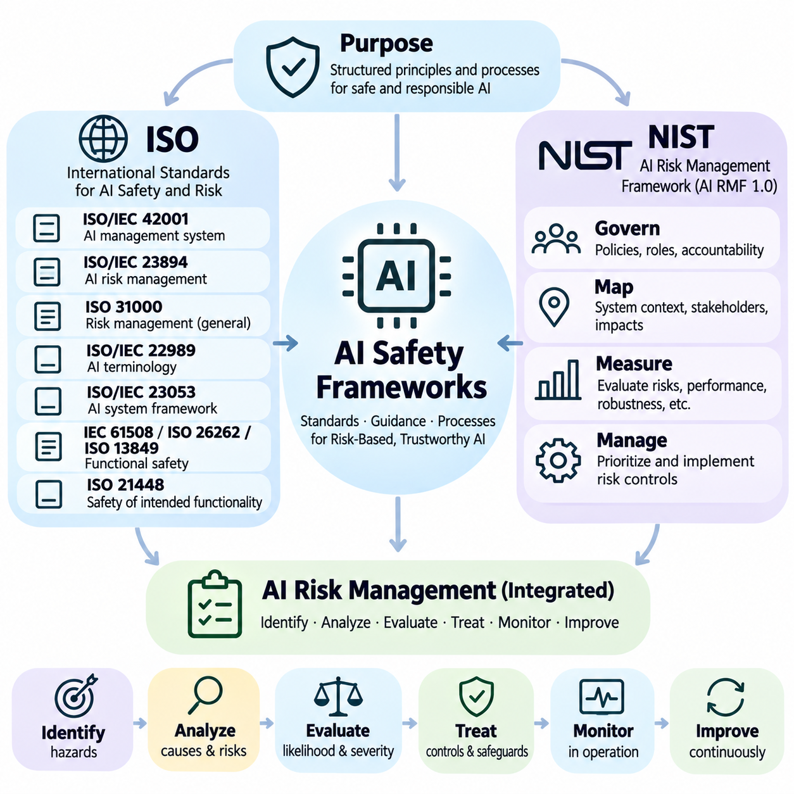
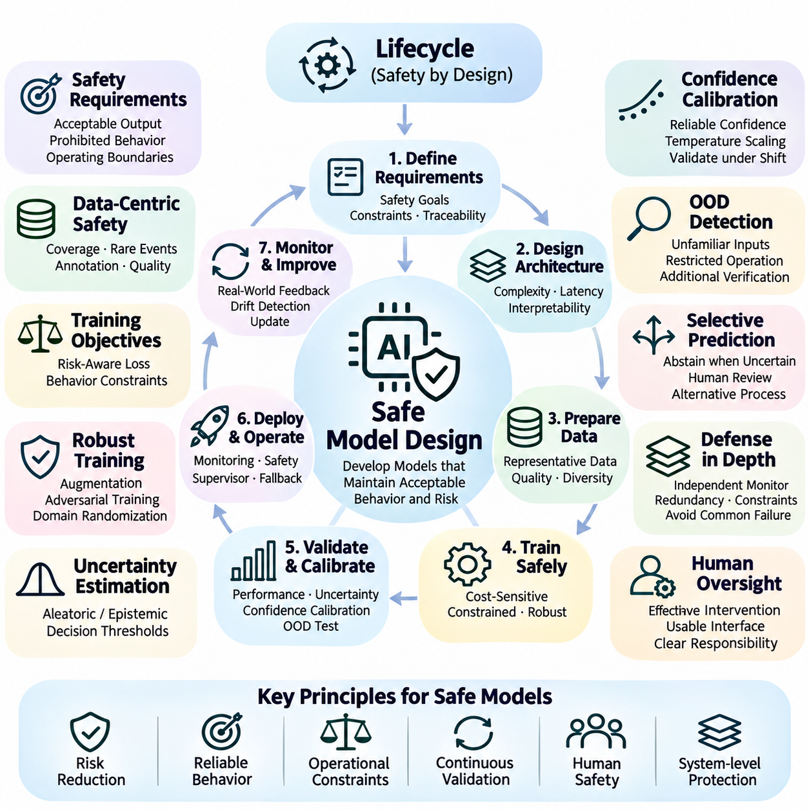
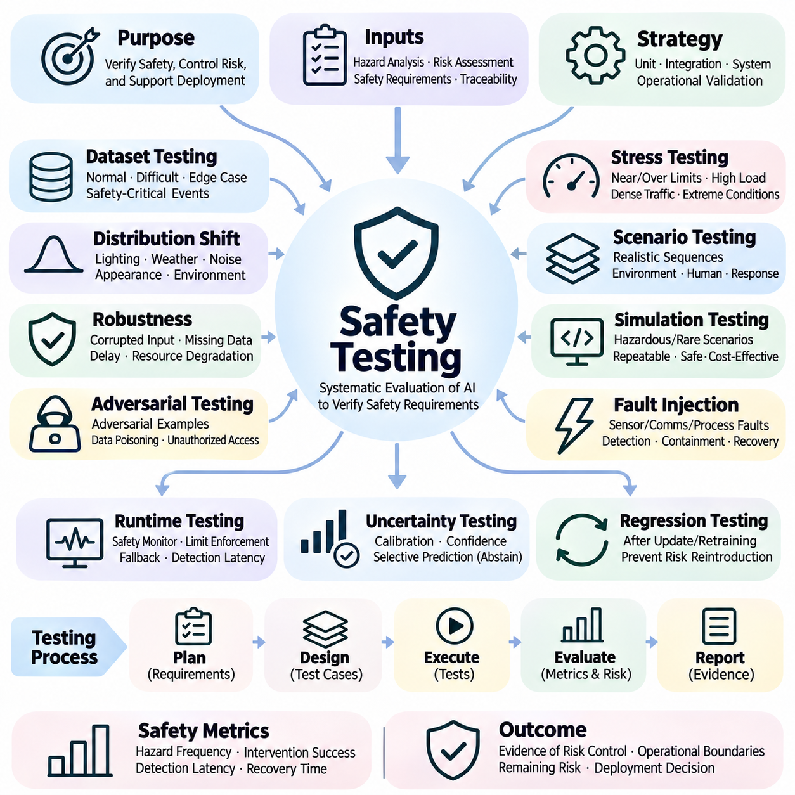
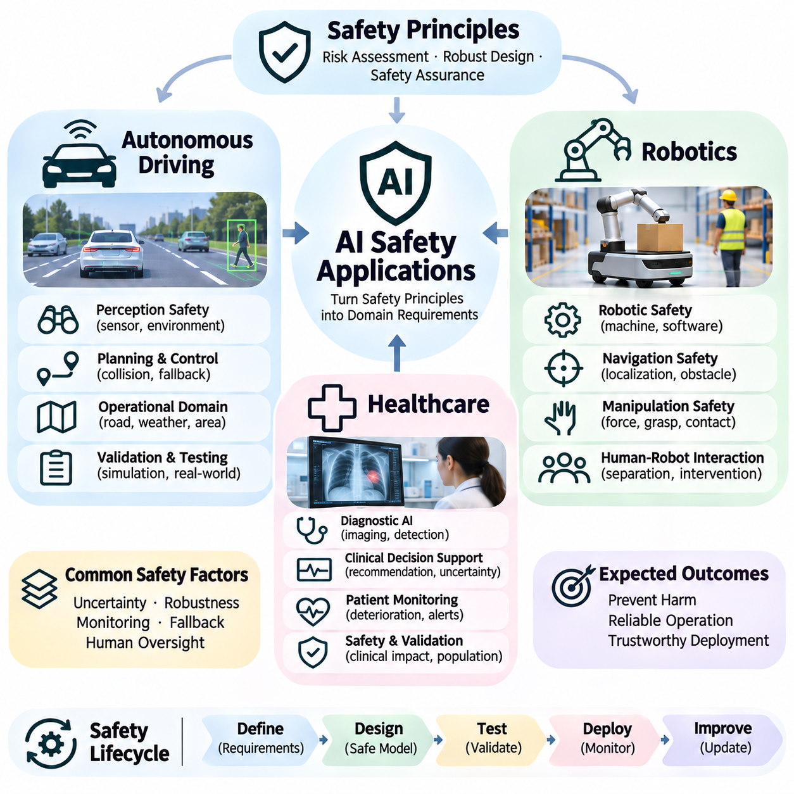

**Volume 42. AI Safety Alignment and Interpretability**


# 01. AI Safety

## 01.00 Overview

{width="7.268055555555556in" height="7.268055555555556in"}

Artificial Intelligence (AI) safety is the discipline of designing, developing, evaluating, and operating intelligent systems so that they behave reliably without causing unacceptable harm. As AI becomes increasingly integrated into critical infrastructure, autonomous machines, healthcare, and decision-making processes, safety must be treated as a fundamental engineering requirement rather than an optional feature added after development.

The central objective of AI safety is to ensure that intelligent systems operate within acceptable boundaries under both expected and unexpected conditions. Unlike conventional software, machine learning models derive behavior from data and optimization rather than exclusively from explicitly programmed rules. Consequently, their decisions may become difficult to predict when encountering unfamiliar environments, ambiguous instructions, or unusual combinations of inputs.

AI safety encompasses technical reliability, human protection, operational accountability, and the prevention of unintended consequences. A system may achieve excellent predictive accuracy while remaining unsafe because of unstable behavior, inappropriate actions, or insufficient safeguards. Safety evaluation must therefore extend beyond conventional performance metrics to examine potential hazards, failure severity, uncertainty, and the consequences of incorrect decisions.

A fundamental distinction exists between model performance and system safety. Performance measures how effectively an AI model accomplishes its intended task, whereas safety evaluates whether the system avoids unacceptable outcomes while performing that task. An autonomous vehicle may demonstrate high object detection accuracy yet remain unsafe if occasional perception failures cause dangerous steering decisions under critical operating conditions.

Safety requirements depend strongly on the application environment and the potential consequences of failure. Errors in a recommendation system may produce inconvenience or economic losses, while failures in surgical robotics, autonomous transportation, or industrial automation may cause physical injury. Accordingly, AI safety engineering must consider operational context, exposure to hazards, affected populations, and the severity of possible outcomes.

Risk assessment provides a systematic foundation for identifying and prioritizing AI safety concerns. Risk is commonly analyzed through the likelihood of harmful events and the severity of their consequences, although additional factors may influence practical evaluation. Effective assessment examines potential hazards, initiating conditions, system vulnerabilities, exposure pathways, and the effectiveness of existing protective measures.

AI failures can originate from multiple interacting sources, including training data, model architecture, optimization procedures, environmental changes, and system integration. These failures are not necessarily caused by defective algorithms alone. Even a correctly implemented model may produce unsafe behavior when deployed outside its validated operating conditions or when upstream sensors and downstream control components malfunction.

Distribution shift represents a major challenge because the statistical characteristics of deployment environments may differ from those encountered during training. Changes in lighting, weather, user behavior, sensor characteristics, or operational procedures can reduce model reliability. Safety-oriented systems must detect meaningful deviations, estimate uncertainty, and establish appropriate responses when unfamiliar conditions threaten dependable operation.

Data quality is equally important because machine learning systems inherit limitations from the information used during development. Incomplete coverage, incorrect labels, sampling bias, outdated observations, and corrupted measurements may introduce systematic weaknesses. Safety engineering therefore requires controlled data collection, dataset validation, representative scenario coverage, and procedures for identifying potentially hazardous data deficiencies.

Model failures may involve incorrect predictions, overconfident outputs, unstable decisions, or behavior inconsistent with intended operational constraints. Some failures arise from ordinary generalization limitations, while others emerge through interactions among complex components. Understanding these mechanisms requires structured error analysis, uncertainty evaluation, failure-mode classification, and investigation of conditions that trigger unsafe behavior.

A comprehensive safety framework connects hazard identification with engineering controls, validation evidence, operational responsibilities, and continuous improvement. International standards and risk management guidance provide structured approaches for organizing these activities. ISO-related standards, the NIST AI Risk Management Framework, and application-specific safety practices can support consistent documentation, governance, and evaluation.

Safe model design begins before training and continues throughout the system lifecycle. Developers must define operational requirements, identify unacceptable behaviors, establish measurable safety constraints, and determine how the system should respond to uncertainty. Architectural choices may incorporate constrained decision-making, independent monitoring, conservative action policies, redundancy, and mechanisms for transferring control to safer alternatives.

Safety mechanisms should not depend exclusively on the correctness of a single learned model. Defense-in-depth combines preventive controls, anomaly detection, runtime monitoring, and protective responses so that individual failures do not automatically produce hazardous outcomes. Depending on the application, these mechanisms may include independent safety controllers, operational boundaries, emergency shutdown procedures, and human intervention capabilities.

Uncertainty estimation plays an important role in determining when AI predictions should be trusted. Models may produce confident outputs even when presented with unfamiliar or ambiguous information, making confidence calibration and out-of-distribution detection important research areas. A safety-aware system should recognize limitations in its knowledge and reduce autonomy or request assistance when reliable operation cannot be established.

Safety testing must examine behavior under normal conditions, foreseeable disturbances, rare events, and combinations of failures. Conventional test datasets provide useful baseline measurements but cannot establish comprehensive safety by themselves. Robust evaluation requires scenario-based testing, stress testing, adversarial assessment, simulation, and carefully controlled real-world experiments that expose weaknesses before operational deployment.

Simulation enables developers to investigate hazardous scenarios without exposing people or equipment to unnecessary danger. Virtual environments can reproduce sensor degradation, environmental disturbances, component failures, and unusual interactions at scale. However, simulation results must be interpreted carefully because discrepancies between simulated and physical conditions may conceal important limitations in the deployed system.

Safety validation requires evidence that the implemented system satisfies defined requirements within a specified operational domain. Verification examines whether engineering specifications have been implemented correctly, while validation examines whether those specifications and their implementation adequately address intended use. Both activities benefit from traceable requirements, documented assumptions, measurable acceptance criteria, and reproducible testing procedures.

Runtime safety extends protective engineering into actual operation. Monitoring components observe system inputs, predictions, decisions, and environmental conditions to identify deviations from acceptable behavior. When predefined safety thresholds are exceeded, supervisory mechanisms may restrict available actions, initiate fallback procedures, request human oversight, or transition the system toward a minimum-risk condition.

Human oversight remains important when AI systems operate in environments involving uncertainty, ethical judgment, or potentially severe consequences. Effective oversight requires more than assigning responsibility to a human operator. Interfaces must communicate relevant system states, limitations, warnings, and intervention options while accounting for reaction time, workload, automation bias, and the practical ability to regain control.

Autonomous driving illustrates the interaction between perception reliability, decision-making, control stability, and environmental uncertainty. A vehicle must interpret dynamic road conditions while responding appropriately to pedestrians, obstacles, traffic signals, and unexpected events. Safety engineering therefore integrates sensing redundancy, operational design domains, scenario-based evaluation, fault detection, and fallback behavior.

Robotics introduces additional safety challenges because intelligent decisions directly influence physical motion and interaction forces. Manipulators, mobile robots, and collaborative machines must respect mechanical constraints, collision limits, and human proximity requirements. Safe robotic operation combines learned perception and planning with established control principles, protective sensing, constrained motion, and emergency response mechanisms.

Healthcare AI presents safety requirements involving clinical validity, patient protection, data quality, and human accountability. Diagnostic support models may produce misleading recommendations when patient characteristics or clinical conditions differ from their development populations. Appropriate safeguards include representative validation, uncertainty communication, workflow integration, monitoring for performance degradation, and qualified clinical oversight.

AI safety is closely connected to alignment, interpretability, fairness, robustness, and security, although these disciplines address different aspects of trustworthy behavior. Alignment examines whether system objectives correspond to intended human goals, while interpretability investigates how model behavior can be understood. Fairness considers unequal impacts, and robustness and security address disturbances, vulnerabilities, and adversarial interference.

Governance establishes organizational responsibilities for managing safety throughout development and deployment. Effective governance defines decision authority, documentation requirements, risk acceptance procedures, incident reporting, and independent review mechanisms. Technical evidence must support management decisions, while regulatory obligations and applicable standards help determine the controls necessary for particular applications and operational environments.

Safety engineering also requires continuous monitoring because deployment conditions, user populations, software dependencies, and threat environments evolve over time. A model that performs acceptably during initial validation may become less reliable as its environment changes. Operational monitoring, incident investigation, controlled updates, regression testing, and periodic reassessment help maintain safety throughout the deployed system\'s lifecycle.

Safety benchmarks provide standardized evidence for comparing models and identifying weaknesses, but benchmark scores should not be interpreted as unconditional guarantees. Evaluation quality depends on scenario relevance, test coverage, measurement validity, and reproducibility. A meaningful safety assessment combines quantitative performance indicators with hazard-specific analysis, documented limitations, and evidence from realistic operating conditions.

The broader purpose of AI safety is to make increasingly capable intelligent systems dependable, controllable, and compatible with human well-being. Achieving this objective requires coordinated advances in risk assessment, failure analysis, safety frameworks, model design, testing, deployment engineering, and operational governance. Safety must remain a continuous, evidence-based process as AI capabilities and applications expand.

인공지능 안전(AI Safety)은 지능형 시스템(Intelligent Systems)이 허용할 수 없는 피해(Unacceptable Harm)를 일으키지 않으면서 신뢰성 있게 작동하도록 설계, 개발, 평가 및 운영하는 학문 분야이다. 인공지능(AI)이 핵심 기반 시설(Critical Infrastructure), 자율 기계(Autonomous Machines), 의료(Healthcare), 의사결정(Decision-Making) 과정에 점점 더 광범위하게 통합됨에 따라, 안전은 개발 이후 추가되는 선택적 기능이 아니라 기본적인 공학적 요구사항(Engineering Requirement)으로 다루어져야 한다.

인공지능 안전(AI Safety)의 핵심 목표는 지능형 시스템이 예상된 조건과 예상하지 못한 조건 모두에서 허용 가능한 경계(Acceptable Boundaries) 내에서 작동하도록 보장하는 것이다. 기존 소프트웨어(Conventional Software)와 달리 기계학습 모델(Machine Learning Models)은 명시적으로 프로그래밍된 규칙뿐만 아니라 데이터(Data)와 최적화(Optimization)를 통해 동작을 학습한다. 따라서 익숙하지 않은 환경, 모호한 지시 또는 비정상적인 입력 조합을 접하면 시스템의 결정을 예측하기 어려워질 수 있다.

인공지능 안전(AI Safety)은 기술적 신뢰성(Technical Reliability), 인간 보호(Human Protection), 운영 책임성(Operational Accountability), 의도하지 않은 결과(Unintended Consequences)의 예방을 포괄한다. 시스템이 높은 예측 정확도(Predictive Accuracy)를 달성하더라도 불안정한 동작, 부적절한 행동 또는 불충분한 안전장치(Safeguards)로 인해 안전하지 않을 수 있다. 따라서 안전 평가(Safety Evaluation)는 기존 성능 지표(Performance Metrics)를 넘어 잠재적 위험, 실패 심각도, 불확실성 및 잘못된 결정의 결과까지 검토해야 한다.

모델 성능(Model Performance)과 시스템 안전(System Safety) 사이에는 근본적인 차이가 존재한다. 성능은 인공지능 모델이 의도된 작업을 얼마나 효과적으로 수행하는지를 측정하는 반면, 안전은 해당 작업을 수행하는 과정에서 허용할 수 없는 결과를 회피하는지를 평가한다. 자율주행 차량(Autonomous Vehicle)이 높은 객체 탐지 정확도(Object Detection Accuracy)를 보이더라도, 중요한 운행 상황에서 간헐적인 인식 실패(Perception Failure)가 위험한 조향 결정으로 이어진다면 안전하지 않은 시스템으로 평가될 수 있다.

안전 요구사항(Safety Requirements)은 적용 환경(Application Environment)과 실패로 인해 발생할 수 있는 결과에 따라 크게 달라진다. 추천 시스템(Recommendation System)의 오류는 불편이나 경제적 손실을 초래할 수 있지만, 수술 로봇(Surgical Robotics), 자율 교통(Autonomous Transportation), 산업 자동화(Industrial Automation)의 실패는 신체적 상해를 발생시킬 수 있다. 따라서 인공지능 안전 공학(AI Safety Engineering)은 운영 환경, 위험 노출, 영향을 받는 집단 및 잠재적 결과의 심각도를 함께 고려해야 한다.

위험 평가(Risk Assessment)는 인공지능 안전 문제를 식별하고 우선순위를 결정하기 위한 체계적인 기반을 제공한다. 위험(Risk)은 일반적으로 유해 사건의 발생 가능성(Likelihood)과 결과의 심각도(Severity)를 통해 분석되지만, 실제 평가에서는 추가적인 요인도 영향을 미칠 수 있다. 효과적인 위험 평가는 잠재적 위해요인(Hazards), 발생 조건(Initiating Conditions), 시스템 취약성(System Vulnerabilities), 노출 경로(Exposure Pathways), 기존 보호 조치의 효과성을 종합적으로 검토한다.

인공지능 실패(AI Failures)는 학습 데이터(Training Data), 모델 구조(Model Architecture), 최적화 절차(Optimization Procedures), 환경 변화(Environmental Changes), 시스템 통합(System Integration) 등 상호작용하는 다양한 원인에서 발생할 수 있다. 이러한 실패가 반드시 알고리즘 자체의 결함 때문에 발생하는 것은 아니다. 올바르게 구현된 모델이라도 검증된 운영 조건을 벗어나거나 상위 센서 및 하위 제어 구성요소가 오작동하면 안전하지 않은 행동을 보일 수 있다.

분포 이동(Distribution Shift)은 배포 환경(Deployment Environment)의 통계적 특성이 학습 과정에서 경험한 특성과 달라질 수 있기 때문에 중요한 안전 문제로 작용한다. 조명, 날씨, 사용자 행동, 센서 특성 또는 운영 절차의 변화는 모델 신뢰성을 저하시킬 수 있다. 안전 중심 시스템(Safety-Oriented Systems)은 의미 있는 분포 변화를 탐지하고 불확실성을 추정하며, 익숙하지 않은 조건이 안정적인 작동을 위협할 때 적절하게 대응할 수 있어야 한다.

데이터 품질(Data Quality) 역시 중요하다. 기계학습 시스템(Machine Learning Systems)은 개발에 사용된 정보의 한계를 그대로 반영할 수 있기 때문이다. 불완전한 데이터 범위(Incomplete Coverage), 잘못된 레이블(Incorrect Labels), 표본 편향(Sampling Bias), 오래된 관측값(Outdated Observations), 손상된 측정값(Corrupted Measurements)은 체계적인 취약성을 유발할 수 있다. 따라서 안전 공학(Safety Engineering)에는 통제된 데이터 수집, 데이터셋 검증(Dataset Validation), 대표적인 시나리오 범위 확보 및 위험한 데이터 결함을 식별하는 절차가 필요하다.

모델 실패(Model Failures)는 잘못된 예측(Incorrect Predictions), 과도한 확신(Overconfident Outputs), 불안정한 결정(Unstable Decisions), 의도된 운영 제약(Operational Constraints)과 일치하지 않는 행동으로 나타날 수 있다. 일부 실패는 일반화 한계(Generalization Limitations)에서 발생하며, 다른 실패는 복잡한 구성요소 사이의 상호작용에서 나타난다. 이러한 메커니즘을 이해하려면 체계적인 오류 분석(Error Analysis), 불확실성 평가(Uncertainty Evaluation), 실패 유형 분류(Failure-Mode Classification), 위험 행동을 유발하는 조건에 대한 조사가 필요하다.

포괄적인 안전 프레임워크(Safety Framework)는 위해요인 식별(Hazard Identification)을 공학적 통제(Engineering Controls), 검증 증거(Validation Evidence), 운영 책임(Operational Responsibilities), 지속적 개선(Continuous Improvement)과 연결한다. 국제 표준(International Standards)과 위험 관리 지침(Risk Management Guidance)은 이러한 활동을 체계적으로 구성하는 접근법을 제공한다. 국제표준화기구 관련 표준(ISO Standards), 미국 국립표준기술연구소 인공지능 위험관리 프레임워크(NIST AI Risk Management Framework), 응용 분야별 안전 관행(Application-Specific Safety Practices)은 일관된 문서화, 거버넌스 및 평가를 지원할 수 있다.

안전한 모델 설계(Safe Model Design)는 학습 이전에 시작되며 시스템 수명주기(System Lifecycle) 전반에 걸쳐 지속된다. 개발자는 운영 요구사항(Operational Requirements)을 정의하고, 허용할 수 없는 행동을 식별하며, 측정 가능한 안전 제약(Safety Constraints)을 설정하고, 불확실성에 대한 시스템 대응 방식을 결정해야 한다. 구조적 설계 선택에는 제약 기반 의사결정(Constrained Decision-Making), 독립적 모니터링(Independent Monitoring), 보수적 행동 정책(Conservative Action Policies), 중복성(Redundancy), 더 안전한 대안으로 제어를 전환하는 메커니즘이 포함될 수 있다.

안전 메커니즘(Safety Mechanisms)은 단일 학습 모델의 정확성에만 의존해서는 안 된다. 심층 방어(Defense-in-Depth)는 예방적 통제(Preventive Controls), 이상 탐지(Anomaly Detection), 실행 시점 모니터링(Runtime Monitoring), 보호 대응(Protective Responses)을 결합하여 개별 실패가 즉시 위험한 결과로 이어지지 않도록 한다. 응용 분야에 따라 독립 안전 제어기(Independent Safety Controllers), 운영 경계(Operational Boundaries), 비상 정지 절차(Emergency Shutdown Procedures), 인간 개입 기능(Human Intervention Capabilities)이 포함될 수 있다.

불확실성 추정(Uncertainty Estimation)은 인공지능 예측을 언제 신뢰할 수 있는지 판단하는 데 중요한 역할을 한다. 모델은 익숙하지 않거나 모호한 정보를 입력받더라도 높은 확신을 가진 출력을 생성할 수 있으므로, 신뢰도 보정(Confidence Calibration)과 분포 외 탐지(Out-of-Distribution Detection)가 중요한 연구 분야가 된다. 안전 인식 시스템(Safety-Aware System)은 자신의 지식 한계를 인식하고 신뢰할 수 있는 작동을 보장하기 어려울 때 자율성(Autonomy)을 낮추거나 외부 지원을 요청해야 한다.

안전 시험(Safety Testing)은 정상 조건, 예측 가능한 교란(Foreseeable Disturbances), 희귀 사건(Rare Events), 복합적인 실패 조건에서 시스템의 행동을 검토해야 한다. 기존 시험 데이터셋(Test Datasets)은 유용한 기준 측정값을 제공하지만, 그것만으로 포괄적인 안전성을 입증할 수는 없다. 강건한 평가(Robust Evaluation)에는 시나리오 기반 시험(Scenario-Based Testing), 스트레스 시험(Stress Testing), 적대적 평가(Adversarial Assessment), 시뮬레이션(Simulation), 신중하게 통제된 실제 환경 실험(Real-World Experiments)이 필요하다.

시뮬레이션(Simulation)은 사람이나 장비를 불필요한 위험에 노출하지 않으면서 위험한 시나리오를 조사할 수 있도록 한다. 가상 환경(Virtual Environments)은 센서 성능 저하(Sensor Degradation), 환경 교란(Environmental Disturbances), 구성요소 실패(Component Failures), 비정상적인 상호작용을 대규모로 재현할 수 있다. 그러나 시뮬레이션과 물리적 환경 사이의 차이가 실제 배포 시스템의 중요한 한계를 감출 수 있으므로 시뮬레이션 결과는 신중하게 해석해야 한다.

안전 타당성 확인(Safety Validation)은 구현된 시스템이 지정된 운영 영역(Operational Domain) 내에서 정의된 요구사항을 충족한다는 증거를 필요로 한다. 검증(Verification)은 공학적 명세(Engineering Specifications)가 올바르게 구현되었는지를 확인하고, 타당성 확인(Validation)은 해당 명세와 구현이 의도된 사용 목적을 적절하게 충족하는지를 평가한다. 두 활동 모두 추적 가능한 요구사항(Traceable Requirements), 문서화된 가정(Documented Assumptions), 측정 가능한 수용 기준(Acceptance Criteria), 재현 가능한 시험(Reproducible Testing)을 통해 강화될 수 있다.

실행 시점 안전(Runtime Safety)은 실제 운영 과정까지 보호 공학(Protective Engineering)을 확장한다. 모니터링 구성요소(Monitoring Components)는 시스템 입력, 예측, 결정 및 환경 조건을 관찰하여 허용 가능한 행동에서 벗어나는 상황을 식별한다. 사전에 정의된 안전 임계값(Safety Thresholds)을 초과하면 감독 메커니즘(Supervisory Mechanisms)은 가능한 행동을 제한하거나, 대체 안전 절차(Fallback Procedures)를 시작하거나, 인간 감독(Human Oversight)을 요청하거나, 시스템을 최소 위험 상태(Minimum-Risk Condition)로 전환할 수 있다.

인간 감독(Human Oversight)은 불확실성, 윤리적 판단 또는 심각한 결과가 발생할 수 있는 환경에서 인공지능 시스템이 작동할 때 여전히 중요하다. 효과적인 감독은 단순히 인간 운영자(Human Operator)에게 책임을 부여하는 것 이상을 요구한다. 인터페이스(Interfaces)는 시스템 상태, 한계, 경고 및 개입 선택지를 전달해야 하며, 반응 시간(Reaction Time), 작업 부담(Workload), 자동화 편향(Automation Bias), 제어권을 실제로 회복할 수 있는 능력을 고려해야 한다.

자율주행(Autonomous Driving)은 인식 신뢰성(Perception Reliability), 의사결정(Decision-Making), 제어 안정성(Control Stability), 환경 불확실성(Environmental Uncertainty) 사이의 상호작용을 보여준다. 차량은 보행자, 장애물, 교통 신호 및 예상하지 못한 사건에 적절히 대응하면서 동적인 도로 상황을 해석해야 한다. 따라서 안전 공학(Safety Engineering)은 센서 중복성(Sensing Redundancy), 운영 설계 영역(Operational Design Domain), 시나리오 기반 평가, 결함 탐지(Fault Detection), 대체 안전 행동(Fallback Behavior)을 통합한다.

로봇공학(Robotics)은 지능형 의사결정이 물리적 움직임과 상호작용하는 힘에 직접적인 영향을 미치기 때문에 추가적인 안전 문제를 발생시킨다. 로봇 조작기(Manipulators), 이동 로봇(Mobile Robots), 협동 로봇(Collaborative Robots)은 기계적 제약(Mechanical Constraints), 충돌 한계(Collision Limits), 인간과의 근접성에 관한 요구사항을 준수해야 한다. 안전한 로봇 운영은 학습 기반 인식 및 계획(Learned Perception and Planning)을 기존 제어 원리(Control Principles), 보호 센싱(Protective Sensing), 제약된 움직임(Constrained Motion), 비상 대응 메커니즘과 결합한다.

의료 인공지능(Healthcare AI)은 임상적 타당성(Clinical Validity), 환자 보호(Patient Protection), 데이터 품질(Data Quality), 인간 책임성(Human Accountability)과 관련된 안전 요구사항을 가진다. 진단 지원 모델(Diagnostic Support Models)은 환자 특성이나 임상 조건이 개발 과정에서 사용된 모집단과 다를 경우 잘못된 권고를 생성할 수 있다. 적절한 안전장치에는 대표성 있는 검증(Representative Validation), 불확실성 전달(Uncertainty Communication), 업무 흐름 통합(Workflow Integration), 성능 저하 모니터링, 자격을 갖춘 임상 전문가의 감독(Qualified Clinical Oversight)이 포함된다.

인공지능 안전(AI Safety)은 정렬(Alignment), 해석 가능성(Interpretability), 공정성(Fairness), 강건성(Robustness), 보안(Security)과 밀접하게 연결되지만, 각 분야는 신뢰할 수 있는 행동의 서로 다른 측면을 다룬다. 정렬은 시스템 목표가 의도된 인간의 목표와 일치하는지를 검토하고, 해석 가능성은 모델 행동을 이해하는 방법을 연구한다. 공정성은 불평등한 영향을 고려하며, 강건성과 보안은 교란, 취약성 및 적대적 간섭(Adversarial Interference)에 대응한다.

거버넌스(Governance)는 개발과 배포 전반에 걸쳐 안전을 관리하기 위한 조직적 책임을 확립한다. 효과적인 거버넌스는 의사결정 권한(Decision Authority), 문서화 요구사항(Documentation Requirements), 위험 수용 절차(Risk Acceptance Procedures), 사고 보고(Incident Reporting), 독립적 검토 메커니즘(Independent Review Mechanisms)을 정의한다. 기술적 증거(Technical Evidence)는 관리 의사결정을 뒷받침해야 하며, 규제 의무(Regulatory Obligations)와 적용 가능한 표준은 특정 응용 분야 및 운영 환경에 필요한 통제 조치를 결정하는 데 도움을 준다.

안전 공학(Safety Engineering)은 배포 조건, 사용자 집단, 소프트웨어 의존성(Software Dependencies), 위협 환경(Threat Environments)이 시간이 지남에 따라 변화하므로 지속적인 모니터링(Continuous Monitoring)을 필요로 한다. 초기 타당성 확인(Initial Validation)에서 허용 가능한 성능을 보인 모델도 환경이 변화하면 신뢰성이 저하될 수 있다. 운영 모니터링(Operational Monitoring), 사고 조사(Incident Investigation), 통제된 업데이트(Controlled Updates), 회귀 시험(Regression Testing), 정기적인 재평가(Periodic Reassessment)는 배포된 시스템의 수명주기 전반에 걸쳐 안전을 유지하는 데 기여한다.

안전 벤치마크(Safety Benchmarks)는 모델을 비교하고 취약성을 식별하기 위한 표준화된 증거를 제공하지만, 벤치마크 점수(Benchmark Scores)를 무조건적인 안전 보장으로 해석해서는 안 된다. 평가 품질(Evaluation Quality)은 시나리오 관련성(Scenario Relevance), 시험 범위(Test Coverage), 측정 타당성(Measurement Validity), 재현성(Reproducibility)에 따라 달라진다. 의미 있는 안전 평가(Safety Assessment)는 정량적 성능 지표(Quantitative Performance Indicators)를 위해요인별 분석(Hazard-Specific Analysis), 문서화된 한계(Documented Limitations), 현실적인 운영 조건에서 확보한 증거와 결합한다.

인공지능 안전(AI Safety)의 궁극적인 목적은 점점 더 높은 능력을 갖추는 지능형 시스템을 신뢰할 수 있고, 제어 가능하며, 인간의 복지(Human Well-Being)와 양립할 수 있도록 만드는 것이다. 이러한 목표를 달성하려면 위험 평가(Risk Assessment), 실패 분석(Failure Analysis), 안전 프레임워크(Safety Frameworks), 모델 설계(Model Design), 시험(Testing), 배포 공학(Deployment Engineering), 운영 거버넌스(Operational Governance)의 조화로운 발전이 필요하다. 인공지능의 능력과 응용 분야가 확장됨에 따라 안전은 지속적이고 증거에 기반한 과정(Evidence-Based Process)으로 유지되어야 한다.

## 01.01 Safety Definitions

{width="7.268055555555556in" height="7.268055555555556in"}

AI safety refers to the principles, methods, and engineering practices used to prevent artificial intelligence systems from causing unacceptable harm during development, deployment, and operation. It encompasses the protection of humans, physical environments, digital infrastructure, and societal interests. Safety is not defined solely by the absence of failures but by the systematic identification, reduction, and management of risks throughout the AI system lifecycle.

A safe AI system is one that operates within specified constraints while maintaining an acceptable level of risk under defined conditions. This definition recognizes that absolute safety cannot generally be guaranteed in complex environments. Instead, safety engineering establishes measurable requirements, evaluates foreseeable hazards, and implements protective mechanisms that reduce both the likelihood and consequences of harmful outcomes.

The concept of harm is central to AI safety because it determines which outcomes require prevention or mitigation. Harm may involve physical injury, psychological distress, financial loss, privacy violations, environmental damage, or disruption of essential services. Different applications assign different priorities to these consequences, making the definition of safety dependent on operational context, affected stakeholders, and the severity of potential impacts.

A hazard is a condition or source with the potential to cause harm, whereas risk describes the possibility and consequences of that harm occurring. In AI systems, hazards may arise from incorrect predictions, inappropriate actions, corrupted sensor inputs, or failures in communication and control. Risk assessment examines how such hazards can develop into harmful events and identifies measures for preventing or limiting their consequences.

Risk is commonly characterized through the likelihood of an adverse event and the severity of its consequences. However, practical AI risk evaluation may also consider exposure frequency, uncertainty, detectability, and the ability to recover from failures. These factors are particularly important when intelligent systems operate in dynamic environments where rare events can produce severe consequences despite otherwise reliable performance.

Safety and reliability are closely related but represent different engineering objectives. Reliability describes the ability of a system to perform its intended functions consistently over time under specified conditions. Safety concerns the avoidance of unacceptable harm, including situations where the system continues functioning as designed. A highly reliable AI system may therefore remain unsafe if its intended behavior creates hazardous consequences.

Robustness refers to the ability of an AI system to maintain acceptable performance when exposed to disturbances, uncertainty, or variations in operating conditions. Such disturbances may include noisy inputs, environmental changes, sensor degradation, or adversarial manipulation. Although robustness contributes to safety, a robust model is not necessarily safe unless its outputs and actions also satisfy relevant safety requirements.

Security addresses the protection of AI systems against unauthorized access, malicious interference, data manipulation, and other intentional threats. Safety and security intersect when cyberattacks can influence physical behavior or critical decisions. For example, manipulated sensor data may cause an autonomous robot to perform dangerous movements, demonstrating why safety engineering must account for both accidental failures and deliberate attacks.

Alignment describes the extent to which an AI system\'s objectives and behavior correspond to intended human goals, instructions, and values. Misalignment can produce unsafe outcomes even when a system performs its optimization task successfully. Safety therefore requires attention not only to technical failures but also to incorrectly specified objectives, unintended incentives, and behaviors that conflict with human expectations or operational constraints.

Trustworthiness is a broader concept that combines safety with reliability, robustness, security, transparency, accountability, privacy, and fairness. A trustworthy AI system should provide evidence that its behavior can be evaluated, monitored, and governed appropriately. However, trustworthiness is not a substitute for safety analysis because individual properties may conflict, and acceptable performance in one dimension does not guarantee acceptable outcomes in another.

Functional safety concerns the prevention of unacceptable risks arising from malfunctioning behavior in systems that perform safety-related functions. In AI-enabled machinery, functional safety may involve monitoring failures, enforcing operating limits, and initiating protective actions. Machine learning introduces additional challenges because unsafe behavior can emerge from imperfect generalization even when hardware and software components operate without conventional faults.

Operational safety focuses on maintaining acceptable risk during actual system use. It considers environmental conditions, human interaction, maintenance procedures, system configuration, and unexpected operational disturbances. A model that passes laboratory testing may still become unsafe when deployed in an unfamiliar environment, emphasizing the importance of clearly defined operating conditions and continuous safety monitoring.

An operational design domain defines the specific conditions under which an AI-enabled system is intended to function. These conditions may include geographic boundaries, environmental characteristics, speed limits, sensor availability, and interaction constraints. Explicit operational boundaries support meaningful safety claims because they distinguish validated operating conditions from situations requiring restricted behavior, human intervention, or controlled shutdown.

A safety constraint is a requirement that restricts system behavior to prevent hazardous outcomes. Constraints may define maximum operating speeds, minimum separation distances, prohibited actions, or acceptable uncertainty thresholds. Unlike ordinary performance objectives, safety constraints establish boundaries that should not be violated merely to improve efficiency, accuracy, productivity, or task completion.

Fail-safe behavior describes a system response intended to prevent or limit harm when faults or unsafe conditions occur. Depending on the application, this response may involve stopping motion, disabling an actuator, transferring control, or entering a protected operating mode. A fail-safe state must be defined through hazard analysis because immediate shutdown is not always the safest response in every environment.

Safety assurance is the structured process of developing justified confidence that a system satisfies its safety requirements. It combines hazard analysis, engineering controls, verification, validation, testing, and operational evidence. A safety case organizes claims, arguments, and supporting evidence to explain why identified risks are considered adequately controlled within the system\'s intended operating conditions.

Verification and validation are complementary concepts within safety engineering. Verification determines whether a system has been implemented according to its specified requirements, while validation evaluates whether the system is suitable for its intended use. For AI applications, these activities must consider data quality, model behavior, integration effects, environmental variation, and the consequences of incorrect predictions or decisions.

Safety monitoring involves observing system behavior and operating conditions to identify emerging hazards, abnormal states, or violations of predefined constraints. Monitoring may use uncertainty estimates, anomaly detection, diagnostic signals, or independent supervisory mechanisms. Effective monitoring should support timely intervention before hazardous conditions develop into unacceptable consequences.

Residual risk refers to the risk that remains after protective measures have been implemented. Because complex AI systems cannot generally eliminate every possible failure, residual risk must be evaluated against explicit acceptance criteria. Decisions about acceptable risk require consideration of application context, potential harm, regulatory requirements, stakeholder expectations, and the effectiveness of available safeguards.

The distinction between safety-critical and non-safety-critical applications reflects the consequences of system failure. Safety-critical AI systems can contribute directly to severe injury, loss of life, or major environmental damage if they malfunction or behave inappropriately. Such applications demand stronger assurance, more rigorous validation, independent protective mechanisms, and greater operational oversight than systems with comparatively limited consequences.

AI safety is ultimately a system-level property rather than an isolated characteristic of a machine learning model. Safe operation depends on interactions among data, algorithms, hardware, software, human operators, organizational procedures, and environmental conditions. Establishing consistent safety definitions enables engineers and stakeholders to communicate requirements, evaluate risks, and develop evidence-based approaches to responsible AI deployment.

인공지능 안전(AI Safety)은 인공지능 시스템(Artificial Intelligence Systems)이 개발, 배포 및 운영 과정에서 허용할 수 없는 피해(Unacceptable Harm)를 발생시키지 않도록 하기 위한 원칙, 방법론 및 공학적 실무(Engineering Practices)를 의미한다. 이는 인간, 물리적 환경(Physical Environments), 디지털 기반 시설(Digital Infrastructure), 사회적 이익(Societal Interests)의 보호를 포괄한다. 안전은 단순히 실패가 없는 상태가 아니라 인공지능 시스템 수명주기(AI System Lifecycle) 전반에 걸쳐 위험을 체계적으로 식별, 감소 및 관리하는 과정으로 정의된다.

안전한 인공지능 시스템(Safe AI System)은 정의된 조건에서 허용 가능한 위험 수준(Acceptable Level of Risk)을 유지하면서 지정된 제약조건(Specified Constraints) 내에서 작동하는 시스템이다. 이러한 정의는 복잡한 환경에서 절대적인 안전(Absolute Safety)을 일반적으로 보장할 수 없다는 점을 인정한다. 대신 안전 공학(Safety Engineering)은 측정 가능한 요구사항을 수립하고, 예측 가능한 위해요인(Foreseeable Hazards)을 평가하며, 유해한 결과의 발생 가능성과 영향을 줄이는 보호 메커니즘(Protective Mechanisms)을 구현한다.

피해(Harm)의 개념은 예방하거나 완화해야 할 결과를 결정하기 때문에 인공지능 안전(AI Safety)의 핵심 요소이다. 피해에는 신체적 상해(Physical Injury), 심리적 고통(Psychological Distress), 경제적 손실(Financial Loss), 개인정보 침해(Privacy Violations), 환경 피해(Environmental Damage), 필수 서비스 중단(Disruption of Essential Services) 등이 포함될 수 있다. 응용 분야마다 이러한 결과에 부여하는 우선순위가 다르므로 안전의 정의는 운영 환경(Operational Context), 영향을 받는 이해관계자(Affected Stakeholders), 잠재적 영향의 심각도(Severity)에 따라 달라진다.

위해요인(Hazard)은 피해를 발생시킬 가능성이 있는 조건이나 원인을 의미하며, 위험(Risk)은 그러한 피해가 발생할 가능성과 그 결과를 설명한다. 인공지능 시스템에서 위해요인은 잘못된 예측(Incorrect Predictions), 부적절한 행동(Inappropriate Actions), 손상된 센서 입력(Corrupted Sensor Inputs), 통신 및 제어 실패(Communication and Control Failures)에서 발생할 수 있다. 위험 평가(Risk Assessment)는 이러한 위해요인이 유해 사건(Harmful Events)으로 발전하는 과정을 분석하고 그 결과를 예방하거나 제한하기 위한 조치를 식별한다.

위험(Risk)은 일반적으로 부정적 사건(Adverse Event)의 발생 가능성(Likelihood)과 결과의 심각도(Severity)를 통해 특성화된다. 그러나 실제 인공지능 위험 평가(AI Risk Evaluation)에서는 노출 빈도(Exposure Frequency), 불확실성(Uncertainty), 탐지 가능성(Detectability), 실패 복구 능력(Recovery Capability)도 고려할 수 있다. 이러한 요소는 평상시 높은 신뢰성을 보이더라도 드문 사건이 심각한 결과를 초래할 수 있는 동적 환경(Dynamic Environments)에서 특히 중요하다.

안전(Safety)과 신뢰성(Reliability)은 밀접하게 관련되어 있지만 서로 다른 공학적 목표(Engineering Objectives)를 나타낸다. 신뢰성은 지정된 조건에서 시스템이 의도된 기능을 시간에 걸쳐 일관되게 수행하는 능력을 의미한다. 반면 안전은 시스템이 설계된 대로 작동하는 상황까지 포함하여 허용할 수 없는 피해를 회피하는 데 초점을 맞춘다. 따라서 높은 신뢰성을 가진 인공지능 시스템이라도 의도된 동작 자체가 위험한 결과를 발생시킨다면 안전하지 않을 수 있다.

강건성(Robustness)은 교란(Disturbances), 불확실성(Uncertainty), 운영 조건의 변화(Variations in Operating Conditions)에 노출되더라도 인공지능 시스템이 허용 가능한 성능을 유지하는 능력을 의미한다. 이러한 교란에는 잡음이 포함된 입력(Noisy Inputs), 환경 변화(Environmental Changes), 센서 성능 저하(Sensor Degradation), 적대적 조작(Adversarial Manipulation)이 포함될 수 있다. 강건성은 안전에 기여하지만 모델의 출력과 행동이 관련 안전 요구사항(Safety Requirements)을 충족하지 않는다면 강건한 모델이라고 해서 반드시 안전한 것은 아니다.

보안(Security)은 무단 접근(Unauthorized Access), 악의적 간섭(Malicious Interference), 데이터 조작(Data Manipulation), 기타 의도적인 위협(Intentional Threats)으로부터 인공지능 시스템을 보호하는 것을 의미한다. 사이버 공격(Cyberattacks)이 물리적 행동이나 중요한 의사결정에 영향을 미칠 수 있을 때 안전과 보안은 서로 연결된다. 예를 들어 조작된 센서 데이터(Manipulated Sensor Data)는 자율 로봇(Autonomous Robot)이 위험한 움직임을 수행하도록 만들 수 있으며, 이는 안전 공학이 우발적 실패(Accidental Failures)와 의도적 공격(Deliberate Attacks)을 모두 고려해야 하는 이유를 보여준다.

정렬(Alignment)은 인공지능 시스템의 목표와 행동이 의도된 인간의 목표(Human Goals), 지시(Instructions), 가치(Values)에 얼마나 부합하는지를 나타낸다. 정렬 실패(Misalignment)는 시스템이 최적화 작업(Optimization Task)을 성공적으로 수행하더라도 안전하지 않은 결과를 초래할 수 있다. 따라서 안전은 기술적 실패뿐만 아니라 잘못 명세된 목표(Incorrectly Specified Objectives), 의도하지 않은 유인(Unintended Incentives), 인간의 기대나 운영 제약조건과 충돌하는 행동까지 고려해야 한다.

신뢰할 수 있음(Trustworthiness)은 안전(Safety), 신뢰성(Reliability), 강건성(Robustness), 보안(Security), 투명성(Transparency), 책임성(Accountability), 개인정보 보호(Privacy), 공정성(Fairness)을 결합하는 보다 포괄적인 개념이다. 신뢰할 수 있는 인공지능 시스템(Trustworthy AI System)은 행동을 적절하게 평가, 모니터링 및 관리할 수 있다는 증거를 제공해야 한다. 그러나 개별 속성들이 서로 충돌할 수 있고 한 영역에서 허용 가능한 성능이 다른 영역의 안전을 보장하지 않으므로, 신뢰할 수 있음이 안전 분석(Safety Analysis)을 대체할 수는 없다.

기능 안전(Functional Safety)은 안전 관련 기능(Safety-Related Functions)을 수행하는 시스템의 오작동(Malfunctioning Behavior)으로 인해 발생하는 허용할 수 없는 위험을 예방하는 것을 의미한다. 인공지능 기반 기계(AI-Enabled Machinery)에서 기능 안전은 실패 모니터링(Failure Monitoring), 운영 한계(Operating Limits)의 강제 적용, 보호 행동(Protective Actions)의 실행을 포함할 수 있다. 기계학습(Machine Learning)은 하드웨어와 소프트웨어 구성요소가 기존의 결함 없이 작동하더라도 불완전한 일반화(Imperfect Generalization)로 인해 안전하지 않은 행동이 나타날 수 있다는 추가적인 문제를 제기한다.

운영 안전(Operational Safety)은 실제 시스템 사용 과정에서 허용 가능한 위험 수준을 유지하는 데 초점을 맞춘다. 이는 환경 조건(Environmental Conditions), 인간과의 상호작용(Human Interaction), 유지보수 절차(Maintenance Procedures), 시스템 구성(System Configuration), 예상하지 못한 운영 교란(Operational Disturbances)을 고려한다. 실험실 시험(Laboratory Testing)을 통과한 모델도 익숙하지 않은 환경에 배포되면 안전하지 않을 수 있으므로, 명확하게 정의된 운영 조건과 지속적인 안전 모니터링(Continuous Safety Monitoring)이 중요하다.

운영 설계 영역(Operational Design Domain)은 인공지능 기반 시스템(AI-Enabled System)이 작동하도록 의도된 구체적인 조건을 정의한다. 이러한 조건에는 지리적 경계(Geographic Boundaries), 환경 특성(Environmental Characteristics), 속도 제한(Speed Limits), 센서 가용성(Sensor Availability), 상호작용 제약조건(Interaction Constraints)이 포함될 수 있다. 명시적인 운영 경계(Operational Boundaries)는 검증된 운영 조건과 제한된 행동, 인간 개입 또는 통제된 종료가 필요한 상황을 구분하므로 의미 있는 안전 주장(Safety Claims)을 뒷받침한다.

안전 제약조건(Safety Constraint)은 위험한 결과를 예방하기 위해 시스템 행동을 제한하는 요구사항이다. 이러한 제약조건은 최대 운영 속도(Maximum Operating Speed), 최소 이격 거리(Minimum Separation Distance), 금지된 행동(Prohibited Actions), 허용 가능한 불확실성 임계값(Acceptable Uncertainty Thresholds)을 정의할 수 있다. 일반적인 성능 목표(Performance Objectives)와 달리 안전 제약조건은 효율성, 정확도, 생산성 또는 작업 완료율을 높이기 위해 위반해서는 안 되는 경계(Boundaries)를 설정한다.

고장 안전 동작(Fail-Safe Behavior)은 결함(Faults)이나 안전하지 않은 조건이 발생했을 때 피해를 예방하거나 제한하도록 설계된 시스템 대응을 의미한다. 응용 분야에 따라 이러한 대응에는 움직임 정지(Stopping Motion), 구동기 비활성화(Actuator Disabling), 제어권 이전(Control Transfer), 보호 운영 모드(Protected Operating Mode)로의 전환이 포함될 수 있다. 모든 환경에서 즉각적인 종료(Immediate Shutdown)가 가장 안전한 대응은 아니므로, 고장 안전 상태(Fail-Safe State)는 위해요인 분석(Hazard Analysis)을 통해 정의되어야 한다.

안전 보증(Safety Assurance)은 시스템이 안전 요구사항(Safety Requirements)을 충족한다는 정당화된 신뢰(Justified Confidence)를 확보하는 체계적인 과정이다. 이는 위해요인 분석(Hazard Analysis), 공학적 통제(Engineering Controls), 검증(Verification), 타당성 확인(Validation), 시험(Testing), 운영 증거(Operational Evidence)를 결합한다. 안전 사례(Safety Case)는 주장(Claims), 논증(Arguments), 뒷받침하는 증거(Supporting Evidence)를 체계화하여 식별된 위험이 의도된 운영 조건 내에서 적절하게 통제된다고 판단하는 근거를 설명한다.

검증(Verification)과 타당성 확인(Validation)은 안전 공학(Safety Engineering)에서 상호 보완적인 개념이다. 검증은 시스템이 명세된 요구사항(Specified Requirements)에 따라 구현되었는지를 판단하고, 타당성 확인은 시스템이 의도된 사용 목적(Intended Use)에 적합한지를 평가한다. 인공지능 응용 분야에서는 이러한 활동이 데이터 품질(Data Quality), 모델 행동(Model Behavior), 통합 효과(Integration Effects), 환경 변화(Environmental Variation), 잘못된 예측이나 결정의 결과를 고려해야 한다.

안전 모니터링(Safety Monitoring)은 시스템 행동(System Behavior)과 운영 조건(Operating Conditions)을 관찰하여 새롭게 나타나는 위해요인(Emerging Hazards), 비정상 상태(Abnormal States), 사전에 정의된 제약조건의 위반(Constraint Violations)을 식별하는 활동이다. 모니터링에는 불확실성 추정(Uncertainty Estimates), 이상 탐지(Anomaly Detection), 진단 신호(Diagnostic Signals), 독립적인 감독 메커니즘(Independent Supervisory Mechanisms)이 활용될 수 있다. 효과적인 모니터링은 위험한 조건이 허용할 수 없는 결과로 발전하기 전에 적시에 개입할 수 있도록 지원해야 한다.

잔여 위험(Residual Risk)은 보호 조치(Protective Measures)를 구현한 이후에도 남아 있는 위험을 의미한다. 복잡한 인공지능 시스템(Complex AI Systems)은 일반적으로 모든 가능한 실패를 제거할 수 없으므로, 잔여 위험은 명시적인 수용 기준(Acceptance Criteria)에 따라 평가되어야 한다. 허용 가능한 위험(Acceptable Risk)에 관한 결정에는 응용 환경(Application Context), 잠재적 피해(Potential Harm), 규제 요구사항(Regulatory Requirements), 이해관계자의 기대(Stakeholder Expectations), 사용 가능한 안전장치(Safeguards)의 효과성을 고려해야 한다.

안전 필수 응용 분야(Safety-Critical Applications)와 비안전 필수 응용 분야(Non-Safety-Critical Applications)의 구분은 시스템 실패의 결과를 반영한다. 안전 필수 인공지능 시스템(Safety-Critical AI Systems)은 오작동하거나 부적절하게 행동할 경우 심각한 상해, 인명 손실 또는 중대한 환경 피해에 직접적으로 기여할 수 있다. 이러한 응용 분야는 결과가 상대적으로 제한적인 시스템보다 더 강력한 안전 보증(Safety Assurance), 엄격한 타당성 확인(Rigorous Validation), 독립적인 보호 메커니즘(Independent Protective Mechanisms), 강화된 운영 감독(Operational Oversight)을 요구한다.

인공지능 안전(AI Safety)은 궁극적으로 기계학습 모델(Machine Learning Model)의 독립적인 특성이 아니라 시스템 수준의 속성(System-Level Property)이다. 안전한 운영(Safe Operation)은 데이터(Data), 알고리즘(Algorithms), 하드웨어(Hardware), 소프트웨어(Software), 인간 운영자(Human Operators), 조직적 절차(Organizational Procedures), 환경 조건(Environmental Conditions) 사이의 상호작용에 의해 결정된다. 일관된 안전 정의(Safety Definitions)를 확립하면 엔지니어와 이해관계자가 요구사항을 명확하게 전달하고 위험을 평가하며 책임 있는 인공지능 배포(Responsible AI Deployment)를 위한 증거 기반 접근법(Evidence-Based Approaches)을 개발할 수 있다.

## 01.02 Risk Assessment

{width="7.268055555555556in" height="7.268055555555556in"}

Risk assessment is a systematic process for identifying, analyzing, and evaluating potential harms associated with artificial intelligence systems. Its purpose is to determine how AI behavior, technical failures, environmental conditions, and human interactions may produce unacceptable consequences. Effective risk assessment supports informed decisions about system design, deployment readiness, protective controls, and operational responsibilities.

AI risk assessment differs from conventional software evaluation because machine learning behavior depends on statistical patterns learned from data. Models may produce unexpected outputs when encountering unfamiliar inputs, changing environments, or incomplete information. Consequently, risk assessment must examine not only component failures but also uncertainty, generalization limitations, data dependencies, and interactions between learned behavior and system-level constraints.

The assessment process begins by defining the system\'s intended purpose, operational environment, and boundaries of acceptable behavior. These definitions establish the context within which hazards can be identified and evaluated. Important considerations include user characteristics, deployment conditions, available sensors, decision authority, environmental variability, and the potential consequences of incorrect or delayed system responses.

Hazard identification examines conditions that could lead to injury, financial loss, privacy violations, environmental damage, or disruption of essential services. In AI systems, hazards may originate from incorrect predictions, misleading confidence estimates, inappropriate actions, sensor failures, or poorly specified objectives. Identifying hazards requires considering normal operation, foreseeable misuse, abnormal conditions, and interactions among system components.

Risk analysis investigates how identified hazards could develop into harmful events. It considers initiating conditions, causal mechanisms, exposure pathways, existing safeguards, and possible consequences. For example, an autonomous mobile robot may fail to detect a pedestrian because of sensor occlusion, leading to an unsafe navigation decision. The analysis must examine both the perception failure and the protective mechanisms intended to prevent collision.

Risk is commonly evaluated using the likelihood of a harmful event and the severity of its consequences. Likelihood represents the estimated possibility of occurrence, while severity describes the magnitude of potential harm. However, these dimensions may be difficult to quantify for rare AI failures. Practical assessment therefore combines quantitative evidence, engineering judgment, uncertainty analysis, and explicitly documented assumptions.

Qualitative risk assessment classifies risks using descriptive categories such as low, moderate, high, or critical. These categories help prioritize engineering attention when reliable numerical estimates are unavailable. Risk matrices may combine likelihood and severity ratings, but their results depend on category definitions and assessment assumptions. They should support structured judgment rather than replace detailed analysis of hazardous scenarios.

Quantitative risk assessment estimates risk using measurable probabilities, frequencies, exposure levels, or expected consequences. Historical incident records, simulation results, operational measurements, and controlled experiments may provide supporting evidence. Nevertheless, numerical estimates must account for limited observations, uncertain distributions, and differences between testing and deployment environments to avoid creating misleading confidence.

Failure Mode and Effects Analysis examines how individual components or functions may fail and how those failures affect the overall system. In AI applications, failure modes may include incorrect classification, delayed inference, sensor corruption, unstable control outputs, or communication interruptions. The analysis connects each failure mode to potential consequences, detection mechanisms, and corrective measures.

Fault Tree Analysis provides a complementary approach by examining combinations of events that could produce a specified hazardous outcome. It works backward from an undesirable event to identify contributing failures and dependencies. For AI-enabled systems, these dependencies may involve perception errors, decision failures, hardware faults, and ineffective safety monitors operating simultaneously or sequentially.

Scenario-based risk assessment evaluates AI behavior within realistic operational situations. Scenarios may represent routine activities, environmental disturbances, rare events, or combinations of unexpected conditions. Their value depends on how well they represent relevant hazards and operational boundaries. Carefully designed scenarios reveal interactions that isolated component tests may overlook.

Distribution shift introduces risk when deployment data differs from the information used during model training. Changes in lighting, weather, sensor characteristics, user behavior, or operating environments may degrade predictions. Risk assessment should identify conditions where model reliability becomes uncertain and determine whether monitoring, restricted operation, retraining, or human intervention is necessary.

Uncertainty assessment evaluates limitations in available knowledge and the variability of possible outcomes. Data uncertainty may arise from noisy measurements or ambiguous observations, while model uncertainty may reflect insufficient training coverage. These uncertainties influence confidence in risk estimates and safety decisions. Systems should communicate uncertainty appropriately and avoid treating unreliable predictions as established facts.

Risk mitigation involves selecting measures that eliminate hazards, reduce their likelihood, or limit their consequences. Possible controls include improved datasets, model constraints, redundant sensing, independent monitoring, restricted operating domains, and protective shutdown mechanisms. The effectiveness of each measure must be evaluated against the specific hazard it addresses rather than assumed from general performance improvements.

Residual risk is the level of risk remaining after mitigation measures have been implemented. Its acceptability depends on application requirements, regulatory obligations, stakeholder expectations, and potential consequences. Risk acceptance should be supported by documented evidence and clearly assigned decision authority. Unresolved high-severity hazards may require additional controls, restricted deployment, or postponement of operation.

Continuous risk assessment is necessary because AI systems and their operating environments evolve after deployment. Model updates, changing data distributions, new user behaviors, and emerging vulnerabilities can introduce previously unidentified hazards. Operational monitoring, incident reporting, periodic reassessment, and controlled change management help ensure that safety decisions remain valid throughout the system lifecycle.

Risk assessment for autonomous driving must consider interactions among perception, prediction, planning, and vehicle control. Hazards may arise from missed pedestrians, incorrect trajectory estimates, localization errors, or delayed braking decisions. Evaluation must account for traffic complexity, environmental uncertainty, operating speed, and available fallback capabilities because individual errors can propagate into safety-critical actions.

In robotics, risk assessment must connect intelligent decision-making with physical motion and environmental interaction. Relevant hazards include collisions, unstable manipulation, excessive force, unexpected movement, and loss of localization. Effective assessment examines mechanical limitations, sensor reliability, control response, human proximity, and the ability to transition safely when autonomy becomes unreliable.

Healthcare AI requires risk assessment that considers clinical consequences, patient variability, data representativeness, and human oversight. Incorrect predictions may contribute to delayed diagnosis, inappropriate treatment, or unnecessary intervention. Assessment must therefore examine clinical workflows, uncertainty communication, validation populations, and the responsibilities of healthcare professionals interpreting AI-generated recommendations.

Organizational governance determines how risk assessment findings influence engineering and deployment decisions. Responsibilities should include hazard ownership, documentation, independent review, mitigation verification, and formal acceptance of residual risks. Traceability between identified hazards, safety requirements, implemented controls, and validation evidence enables systematic auditing and supports accountability throughout development.

Effective AI risk assessment integrates technical analysis with operational understanding and continuous evidence collection. No single metric, testing method, or framework can capture every possible source of harm. A comprehensive approach combines hazard identification, qualitative and quantitative analysis, scenario evaluation, mitigation verification, and lifecycle monitoring to support safer and more responsible AI systems.

위험 평가(Risk Assessment)는 인공지능 시스템(Artificial Intelligence Systems)과 관련된 잠재적 피해(Potential Harms)를 식별, 분석 및 평가하는 체계적인 과정이다. 그 목적은 인공지능의 행동(AI Behavior), 기술적 실패(Technical Failures), 환경 조건(Environmental Conditions), 인간과의 상호작용(Human Interactions)이 어떻게 허용할 수 없는 결과를 발생시킬 수 있는지 판단하는 것이다. 효과적인 위험 평가는 시스템 설계(System Design), 배포 준비 상태(Deployment Readiness), 보호 통제(Protective Controls), 운영 책임(Operational Responsibilities)에 관한 합리적인 의사결정을 지원한다.

인공지능 위험 평가(AI Risk Assessment)는 기계학습(Machine Learning)의 행동이 데이터에서 학습한 통계적 패턴(Statistical Patterns)에 의존하기 때문에 기존 소프트웨어 평가(Conventional Software Evaluation)와 차이가 있다. 모델은 익숙하지 않은 입력, 변화하는 환경 또는 불완전한 정보를 접할 때 예상하지 못한 출력을 생성할 수 있다. 따라서 위험 평가는 구성요소의 실패뿐만 아니라 불확실성(Uncertainty), 일반화 한계(Generalization Limitations), 데이터 의존성(Data Dependencies), 학습된 행동과 시스템 수준 제약조건(System-Level Constraints) 사이의 상호작용까지 검토해야 한다.

평가 과정(Assessment Process)은 시스템의 의도된 목적(Intended Purpose), 운영 환경(Operational Environment), 허용 가능한 행동의 경계(Boundaries of Acceptable Behavior)를 정의하는 것에서 시작된다. 이러한 정의는 위해요인(Hazards)을 식별하고 평가하기 위한 맥락을 확립한다. 중요한 고려사항에는 사용자 특성(User Characteristics), 배포 조건(Deployment Conditions), 사용 가능한 센서(Available Sensors), 의사결정 권한(Decision Authority), 환경 변동성(Environmental Variability), 잘못되거나 지연된 시스템 대응의 잠재적 결과가 포함된다.

위해요인 식별(Hazard Identification)은 신체적 상해(Physical Injury), 경제적 손실(Financial Loss), 개인정보 침해(Privacy Violations), 환경 피해(Environmental Damage), 필수 서비스 중단(Disruption of Essential Services)으로 이어질 수 있는 조건을 검토한다. 인공지능 시스템에서 위해요인은 잘못된 예측(Incorrect Predictions), 부정확한 신뢰도 추정(Misleading Confidence Estimates), 부적절한 행동(Inappropriate Actions), 센서 실패(Sensor Failures), 잘못 명세된 목표(Poorly Specified Objectives)에서 발생할 수 있다. 위해요인 식별에는 정상 운영(Normal Operation), 예측 가능한 오용(Foreseeable Misuse), 비정상 조건(Abnormal Conditions), 시스템 구성요소 사이의 상호작용을 고려해야 한다.

위험 분석(Risk Analysis)은 식별된 위해요인(Hazards)이 어떻게 유해 사건(Harmful Events)으로 발전할 수 있는지 조사한다. 여기에는 발생 조건(Initiating Conditions), 인과 메커니즘(Causal Mechanisms), 노출 경로(Exposure Pathways), 기존 안전장치(Existing Safeguards), 가능한 결과(Possible Consequences)가 포함된다. 예를 들어 자율 이동 로봇(Autonomous Mobile Robot)은 센서 가림(Sensor Occlusion)으로 인해 보행자를 탐지하지 못하여 위험한 주행 결정(Unsafe Navigation Decision)을 내릴 수 있다. 분석에서는 인식 실패(Perception Failure)와 충돌을 방지하기 위한 보호 메커니즘(Protective Mechanisms)을 모두 검토해야 한다.

위험(Risk)은 일반적으로 유해 사건(Harmful Event)의 발생 가능성(Likelihood)과 결과의 심각도(Severity)를 사용하여 평가한다. 발생 가능성은 사건이 발생할 것으로 추정되는 가능성을 나타내며, 심각도는 잠재적 피해의 크기를 설명한다. 그러나 드물게 발생하는 인공지능 실패(Rare AI Failures)에 대해서는 이러한 차원을 정량화하기 어려울 수 있다. 따라서 실제 평가에서는 정량적 증거(Quantitative Evidence), 공학적 판단(Engineering Judgment), 불확실성 분석(Uncertainty Analysis), 명시적으로 문서화된 가정(Documented Assumptions)을 결합한다.

정성적 위험 평가(Qualitative Risk Assessment)는 위험을 낮음(Low), 보통(Moderate), 높음(High), 치명적(Critical)과 같은 서술적 범주로 분류한다. 이러한 범주는 신뢰할 수 있는 수치 추정값이 없는 경우 공학적 대응의 우선순위를 결정하는 데 도움을 준다. 위험 행렬(Risk Matrix)은 발생 가능성(Likelihood)과 심각도(Severity) 등급을 결합할 수 있지만, 그 결과는 범주 정의(Category Definitions)와 평가 가정(Assessment Assumptions)에 따라 달라진다. 따라서 위험 행렬은 구조화된 판단(Structured Judgment)을 지원해야 하며, 위험 시나리오(Hazardous Scenarios)에 대한 상세한 분석을 대체해서는 안 된다.

정량적 위험 평가(Quantitative Risk Assessment)는 측정 가능한 확률(Probabilities), 발생 빈도(Frequencies), 노출 수준(Exposure Levels), 예상 결과(Expected Consequences)를 사용하여 위험을 추정한다. 과거 사고 기록(Historical Incident Records), 시뮬레이션 결과(Simulation Results), 운영 측정값(Operational Measurements), 통제된 실험(Controlled Experiments)은 이를 뒷받침하는 증거를 제공할 수 있다. 그러나 수치 추정값은 제한된 관측(Limited Observations), 불확실한 분포(Uncertain Distributions), 시험 환경과 배포 환경의 차이를 고려해야 하며, 그렇지 않으면 잘못된 확신(Misleading Confidence)을 초래할 수 있다.

고장 형태 및 영향 분석(Failure Mode and Effects Analysis, FMEA)은 개별 구성요소나 기능이 어떻게 실패할 수 있으며, 그러한 실패가 전체 시스템에 어떤 영향을 미치는지 검토한다. 인공지능 응용 분야에서 고장 형태(Failure Modes)에는 잘못된 분류(Incorrect Classification), 추론 지연(Delayed Inference), 센서 데이터 손상(Sensor Corruption), 불안정한 제어 출력(Unstable Control Outputs), 통신 중단(Communication Interruptions)이 포함될 수 있다. 이 분석은 각 고장 형태를 잠재적 결과(Potential Consequences), 탐지 메커니즘(Detection Mechanisms), 시정 조치(Corrective Measures)와 연결한다.

결함 트리 분석(Fault Tree Analysis, FTA)은 특정 위험 결과(Hazardous Outcome)를 발생시킬 수 있는 사건의 조합을 검토하는 상호 보완적인 접근법이다. 이 방법은 바람직하지 않은 사건(Undesirable Event)에서 출발하여 기여하는 실패(Contributing Failures)와 의존 관계(Dependencies)를 역방향으로 식별한다. 인공지능 기반 시스템(AI-Enabled Systems)에서 이러한 의존 관계에는 동시에 또는 순차적으로 발생하는 인식 오류(Perception Errors), 의사결정 실패(Decision Failures), 하드웨어 결함(Hardware Faults), 비효과적인 안전 모니터(Safety Monitors)가 포함될 수 있다.

시나리오 기반 위험 평가(Scenario-Based Risk Assessment)는 현실적인 운영 상황(Operational Situations)에서 인공지능의 행동을 평가한다. 시나리오는 일상적인 활동(Routine Activities), 환경 교란(Environmental Disturbances), 희귀 사건(Rare Events), 예상하지 못한 조건의 조합을 나타낼 수 있다. 이러한 평가의 가치는 관련 위해요인(Relevant Hazards)과 운영 경계(Operational Boundaries)를 얼마나 잘 반영하는지에 따라 결정된다. 신중하게 설계된 시나리오는 개별 구성요소 시험(Component Tests)에서 놓칠 수 있는 상호작용을 드러낸다.

분포 이동(Distribution Shift)은 배포 데이터(Deployment Data)가 모델 학습(Model Training)에 사용된 정보와 다를 때 위험을 발생시킨다. 조명(Lighting), 날씨(Weather), 센서 특성(Sensor Characteristics), 사용자 행동(User Behavior), 운영 환경(Operating Environments)의 변화는 예측 성능을 저하시킬 수 있다. 위험 평가는 모델 신뢰성(Model Reliability)이 불확실해지는 조건을 식별하고, 모니터링(Monitoring), 제한된 운영(Restricted Operation), 재학습(Retraining), 인간 개입(Human Intervention)이 필요한지 판단해야 한다.

불확실성 평가(Uncertainty Assessment)는 이용 가능한 지식의 한계와 가능한 결과의 변동성(Variability)을 평가한다. 데이터 불확실성(Data Uncertainty)은 잡음이 포함된 측정값(Noisy Measurements)이나 모호한 관측(Ambiguous Observations)에서 발생할 수 있으며, 모델 불확실성(Model Uncertainty)은 불충분한 학습 범위(Insufficient Training Coverage)를 반영할 수 있다. 이러한 불확실성은 위험 추정(Risk Estimates)과 안전 결정(Safety Decisions)에 대한 신뢰도에 영향을 미친다. 시스템은 불확실성을 적절하게 전달하고 신뢰할 수 없는 예측을 확립된 사실처럼 취급하지 않아야 한다.

위험 완화(Risk Mitigation)는 위해요인(Hazards)을 제거하거나 발생 가능성을 줄이거나 결과를 제한하는 조치를 선택하는 과정이다. 가능한 통제 조치(Controls)에는 개선된 데이터셋(Improved Datasets), 모델 제약조건(Model Constraints), 중복 센싱(Redundant Sensing), 독립적 모니터링(Independent Monitoring), 제한된 운영 영역(Restricted Operating Domains), 보호 정지 메커니즘(Protective Shutdown Mechanisms)이 포함된다. 각 조치의 효과성(Effectiveness)은 일반적인 성능 향상만으로 가정해서는 안 되며, 해당 조치가 대응하는 구체적인 위해요인을 기준으로 평가해야 한다.

잔여 위험(Residual Risk)은 위험 완화 조치(Mitigation Measures)를 구현한 이후에도 남아 있는 위험 수준을 의미한다. 잔여 위험의 수용 가능성(Acceptability)은 응용 분야의 요구사항(Application Requirements), 규제 의무(Regulatory Obligations), 이해관계자의 기대(Stakeholder Expectations), 잠재적 결과(Potential Consequences)에 따라 달라진다. 위험 수용(Risk Acceptance)은 문서화된 증거(Documented Evidence)와 명확하게 지정된 의사결정 권한(Decision Authority)을 바탕으로 이루어져야 한다. 해결되지 않은 높은 심각도의 위해요인(High-Severity Hazards)은 추가 통제, 제한된 배포 또는 운영 연기를 필요로 할 수 있다.

지속적 위험 평가(Continuous Risk Assessment)는 인공지능 시스템과 운영 환경이 배포 이후에도 변화하기 때문에 필요하다. 모델 업데이트(Model Updates), 데이터 분포 변화(Changing Data Distributions), 새로운 사용자 행동(New User Behaviors), 새롭게 나타나는 취약성(Emerging Vulnerabilities)은 이전에 식별되지 않은 위해요인을 발생시킬 수 있다. 운영 모니터링(Operational Monitoring), 사고 보고(Incident Reporting), 정기적인 재평가(Periodic Reassessment), 통제된 변경 관리(Controlled Change Management)는 시스템 수명주기(System Lifecycle) 전반에 걸쳐 안전 관련 의사결정의 유효성을 유지하도록 지원한다.

자율주행(Autonomous Driving)의 위험 평가는 인식(Perception), 예측(Prediction), 경로 계획(Planning), 차량 제어(Vehicle Control) 사이의 상호작용을 고려해야 한다. 위해요인은 보행자 미탐지(Missed Pedestrians), 잘못된 궤적 추정(Incorrect Trajectory Estimates), 위치 추정 오류(Localization Errors), 제동 결정 지연(Delayed Braking Decisions)에서 발생할 수 있다. 개별 오류가 안전 필수 행동(Safety-Critical Actions)으로 전파될 수 있으므로, 평가에서는 교통 복잡성(Traffic Complexity), 환경 불확실성(Environmental Uncertainty), 주행 속도(Operating Speed), 사용 가능한 대체 안전 기능(Fallback Capabilities)을 고려해야 한다.

로봇공학(Robotics)에서 위험 평가는 지능형 의사결정(Intelligent Decision-Making)을 물리적 움직임(Physical Motion) 및 환경과의 상호작용(Environmental Interaction)과 연결해야 한다. 관련 위해요인에는 충돌(Collisions), 불안정한 조작(Unstable Manipulation), 과도한 힘(Excessive Force), 예상하지 못한 움직임(Unexpected Movement), 위치 추정 상실(Loss of Localization)이 포함된다. 효과적인 평가는 기계적 한계(Mechanical Limitations), 센서 신뢰성(Sensor Reliability), 제어 응답(Control Response), 인간과의 근접성(Human Proximity), 자율성이 신뢰할 수 없게 되었을 때 안전하게 전환하는 능력을 검토한다.

의료 인공지능(Healthcare AI)은 임상적 결과(Clinical Consequences), 환자 다양성(Patient Variability), 데이터 대표성(Data Representativeness), 인간 감독(Human Oversight)을 고려하는 위험 평가가 필요하다. 잘못된 예측(Incorrect Predictions)은 진단 지연(Delayed Diagnosis), 부적절한 치료(Inappropriate Treatment), 불필요한 의료 개입(Unnecessary Intervention)에 영향을 미칠 수 있다. 따라서 평가는 임상 업무 흐름(Clinical Workflows), 불확실성 전달(Uncertainty Communication), 검증 대상 집단(Validation Populations), 인공지능이 생성한 권고(AI-Generated Recommendations)를 해석하는 의료 전문가의 책임을 검토해야 한다.

조직 거버넌스(Organizational Governance)는 위험 평가 결과(Risk Assessment Findings)가 공학적 의사결정(Engineering Decisions)과 배포 결정(Deployment Decisions)에 어떻게 반영되는지를 결정한다. 책임에는 위해요인 관리 책임(Hazard Ownership), 문서화(Documentation), 독립적 검토(Independent Review), 위험 완화 검증(Mitigation Verification), 잔여 위험의 공식적 수용(Formal Acceptance of Residual Risks)이 포함되어야 한다. 식별된 위해요인, 안전 요구사항(Safety Requirements), 구현된 통제 조치(Implemented Controls), 타당성 확인 증거(Validation Evidence) 사이의 추적성(Traceability)은 체계적인 감사(Systematic Auditing)를 가능하게 하고 개발 전반에 걸친 책임성(Accountability)을 지원한다.

효과적인 인공지능 위험 평가(AI Risk Assessment)는 기술적 분석(Technical Analysis)을 운영 환경에 대한 이해(Operational Understanding) 및 지속적인 증거 수집(Continuous Evidence Collection)과 통합한다. 단일 지표(Single Metric), 시험 방법(Testing Method), 프레임워크(Framework)만으로 모든 잠재적 피해 원인을 포괄할 수는 없다. 포괄적인 접근법(Comprehensive Approach)은 위해요인 식별(Hazard Identification), 정성적 및 정량적 분석(Qualitative and Quantitative Analysis), 시나리오 평가(Scenario Evaluation), 위험 완화 검증(Mitigation Verification), 수명주기 모니터링(Lifecycle Monitoring)을 결합하여 더욱 안전하고 책임 있는 인공지능 시스템(Responsible AI Systems)의 개발과 운영을 지원한다.

## 01.03 Failure Modes

{width="7.268055555555556in" height="7.268055555555556in"}

Failure modes in artificial intelligence systems describe the mechanisms through which models or integrated applications produce incorrect, unreliable, or unsafe behavior. Understanding these mechanisms is essential because high performance during development does not guarantee dependable operation after deployment. AI failures commonly arise from distribution shift, data quality problems, model limitations, and interactions among these factors within complex operational environments.

Distribution shift occurs when the statistical characteristics of deployment data differ from those represented in training data. Machine learning models generally assume that learned relationships remain sufficiently stable during inference. When this assumption fails, prediction accuracy and confidence calibration may deteriorate. Distribution shift is particularly important in autonomous systems because environmental conditions can change continuously and unpredictably.

Covariate shift describes changes in the distribution of input features while the conditional relationship between inputs and target outputs remains stable. For example, a vision model trained under clear daylight may encounter nighttime images with substantially different visual characteristics. Although the underlying object categories remain unchanged, the model may struggle to recognize them because the observed feature distribution differs from its training experience.

Label shift occurs when the relative frequencies of target classes change between training and deployment, while the class-conditional input distributions remain stable. A medical diagnostic model may encounter a patient population with a different disease prevalence from its training population. Such changes can affect predicted probabilities and decision thresholds, requiring careful monitoring and potentially adjusted calibration.

Concept drift refers to changes in the relationship between input features and target outcomes over time. Unlike covariate shift, concept drift can invalidate previously learned decision boundaries even when input characteristics appear familiar. In industrial systems, equipment aging, modified operating procedures, or changing production processes may alter the relationship between sensor measurements and actual failure conditions.

Out-of-distribution inputs represent observations that fall outside the regions adequately represented by training data. These inputs may involve unfamiliar objects, unusual environmental conditions, or unexpected combinations of otherwise familiar features. Models can produce highly confident predictions for such observations, making uncertainty estimation and out-of-distribution detection important components of safety monitoring.

Data issues constitute another major category of AI failure modes because model behavior depends on the quality, completeness, and representativeness of training information. Incorrect labels, missing values, corrupted measurements, inconsistent preprocessing, and sampling bias can introduce systematic errors. These problems may remain hidden during development when training and validation datasets share the same underlying deficiencies.

Label noise occurs when training examples contain incorrect, inconsistent, or ambiguous target annotations. Such noise can distort learned decision boundaries and reduce the reliability of predictions. In safety-critical applications, mislabeled rare hazards are especially problematic because they may prevent models from recognizing dangerous situations. Label auditing, annotation guidelines, and targeted review can reduce these weaknesses.

Sampling bias arises when collected data does not adequately represent the population or operating conditions encountered during deployment. A dataset dominated by favorable weather, common object categories, or specific demographic groups may produce models that perform poorly elsewhere. Representative sampling and systematic coverage analysis are therefore essential for identifying underrepresented scenarios and preventing uneven reliability.

Data leakage occurs when information unavailable during legitimate inference improperly influences training or evaluation. Leakage may involve duplicated records, future observations, shared identities, or preprocessing performed across dataset boundaries. It can produce artificially optimistic validation results, concealing weaknesses that become apparent during deployment. Preventing leakage requires disciplined dataset separation and reproducible preprocessing procedures.

Data corruption and pipeline inconsistencies can introduce failures even when the original dataset is appropriate. Sensor noise, timestamp misalignment, unit conversion errors, missing records, and inconsistent normalization may alter the information received by a model. In multimodal systems, synchronization errors between cameras, LiDAR, and other sensors can produce incorrect environmental interpretations despite individually functioning components.

Model failures arise when learned representations, decision boundaries, or optimization objectives do not support reliable behavior under relevant conditions. Underfitting may prevent a model from capturing important relationships, while overfitting may cause excessive dependence on training-specific patterns. Both problems can reduce generalization, although their effects may become apparent under different evaluation conditions.

Overconfidence is a particularly dangerous model failure because predicted confidence may not reflect the actual probability of correctness. Neural networks can assign high confidence to incorrect predictions, including unfamiliar or ambiguous inputs. Poor calibration can mislead downstream decision systems into treating uncertain information as reliable, increasing the likelihood of unsafe actions.

Optimization-related failures occur when a model successfully minimizes its training objective without achieving the intended operational outcome. In reinforcement learning, reward hacking may encourage behavior that maximizes numerical rewards while violating practical expectations. Similar problems arise when surrogate objectives fail to represent safety constraints, long-term consequences, or the actual requirements of users and operators.

Error propagation becomes important when multiple AI components operate within a sequential decision pipeline. An incorrect perception output may influence localization, planning, and control, causing small initial errors to produce increasingly serious consequences. In autonomous robotics, a missed obstacle can affect trajectory selection and motion execution, demonstrating why system-level safety cannot be inferred from isolated model accuracy.

Temporal failures occur when AI systems cannot maintain consistent behavior across extended sequences of observations and actions. Problems may include accumulated localization errors, outdated memory, delayed responses, unstable control decisions, and failure to recognize changing objectives. Long-horizon autonomous tasks amplify these weaknesses because early mistakes can influence later decisions and reduce opportunities for recovery.

Interaction failures emerge when individually acceptable components behave incorrectly after integration. Differences in update frequency, communication latency, coordinate systems, or assumptions about uncertainty may create unsafe system behavior. These failures are particularly difficult to identify through isolated model testing, making integration testing, interface validation, and end-to-end scenario evaluation essential.

Failure detection requires monitoring mechanisms that recognize abnormal inputs, degraded performance, inconsistent predictions, and violations of operational constraints. Techniques may include statistical drift detection, uncertainty estimation, anomaly detection, sensor consistency checks, and runtime diagnostics. Detection thresholds must balance missed failures against unnecessary interventions while accounting for the consequences of each decision.

Failure mitigation combines preventive design with mechanisms that limit the consequences of unexpected behavior. Improved dataset coverage, robust training, calibrated confidence estimates, redundant sensing, and constrained decision-making can reduce specific vulnerabilities. When reliable operation cannot be maintained, supervisory controllers may restrict autonomy, initiate fallback procedures, or transition the system toward a safer operating state.

Evaluating failure modes requires testing beyond conventional accuracy benchmarks. Stress testing, controlled perturbations, rare-event simulation, corrupted-data experiments, and distribution-shift evaluations expose weaknesses that standard test sets may overlook. Meaningful evaluation should measure not only failure frequency but also severity, detection latency, recovery effectiveness, and the operational consequences of incorrect decisions.

A comprehensive understanding of AI failure modes connects distribution shift, data issues, and model failures within a unified safety engineering perspective. These categories frequently interact, making isolated explanations insufficient for complex deployed systems. Effective safety management therefore combines systematic failure analysis, representative validation, continuous monitoring, and protective mechanisms throughout the AI lifecycle.

인공지능 시스템(Artificial Intelligence Systems)의 실패 유형(Failure Modes)은 모델 또는 통합 응용 시스템이 부정확하거나 신뢰할 수 없거나 안전하지 않은 행동을 발생시키는 메커니즘을 설명한다. 개발 과정에서 높은 성능을 달성했다고 해서 배포 이후에도 안정적인 운영이 보장되는 것은 아니므로, 이러한 메커니즘을 이해하는 것이 중요하다. 인공지능 실패(AI Failures)는 일반적으로 분포 이동(Distribution Shift), 데이터 품질 문제(Data Quality Problems), 모델의 한계(Model Limitations), 그리고 복잡한 운영 환경에서 이러한 요인들 사이의 상호작용으로 인해 발생한다.

분포 이동(Distribution Shift)은 배포 데이터(Deployment Data)의 통계적 특성(Statistical Characteristics)이 학습 데이터(Training Data)에 나타난 특성과 달라질 때 발생한다. 기계학습 모델(Machine Learning Models)은 일반적으로 학습된 관계가 추론(Inference) 과정에서도 충분히 안정적으로 유지된다고 가정한다. 이러한 가정이 성립하지 않으면 예측 정확도(Prediction Accuracy)와 신뢰도 보정(Confidence Calibration)이 저하될 수 있다. 분포 이동은 환경 조건이 지속적이고 예측하기 어렵게 변화할 수 있는 자율 시스템(Autonomous Systems)에서 특히 중요하다.

공변량 이동(Covariate Shift)은 입력 특징(Input Features)의 분포가 변화하지만 입력과 목표 출력 사이의 조건부 관계(Conditional Relationship)는 안정적으로 유지되는 현상을 의미한다. 예를 들어 맑은 주간 환경에서 학습된 비전 모델(Vision Model)은 시각적 특성이 크게 다른 야간 영상(Nighttime Images)을 접할 수 있다. 기본적인 객체 범주(Object Categories)는 변하지 않더라도 관측된 특징 분포(Feature Distribution)가 학습 경험과 다르기 때문에 모델은 객체 인식(Object Recognition)에 어려움을 겪을 수 있다.

레이블 이동(Label Shift)은 학습과 배포 사이에서 목표 클래스(Target Classes)의 상대적 빈도가 변화하지만 클래스 조건부 입력 분포(Class-Conditional Input Distributions)는 안정적으로 유지되는 현상이다. 의료 진단 모델(Medical Diagnostic Model)은 학습 집단과 질병 유병률(Disease Prevalence)이 다른 환자 집단을 접할 수 있다. 이러한 변화는 예측 확률(Predicted Probabilities)과 의사결정 임계값(Decision Thresholds)에 영향을 미칠 수 있으므로 신중한 모니터링과 필요한 경우 보정 조정(Calibration Adjustment)이 요구된다.

개념 드리프트(Concept Drift)는 시간에 따라 입력 특징(Input Features)과 목표 결과(Target Outcomes) 사이의 관계가 변화하는 현상을 의미한다. 공변량 이동(Covariate Shift)과 달리 개념 드리프트는 입력 특성이 익숙하게 보이더라도 기존에 학습된 결정 경계(Decision Boundaries)를 무효화할 수 있다. 산업 시스템(Industrial Systems)에서는 장비 노후화(Equipment Aging), 변경된 운영 절차(Modified Operating Procedures), 생산 공정 변화(Changing Production Processes)가 센서 측정값과 실제 고장 조건 사이의 관계를 변화시킬 수 있다.

분포 외 입력(Out-of-Distribution Inputs)은 학습 데이터(Training Data)에 충분히 표현되지 않은 영역에 속하는 관측값을 의미한다. 이러한 입력에는 익숙하지 않은 객체(Unfamiliar Objects), 비정상적인 환경 조건(Unusual Environmental Conditions), 개별적으로는 익숙하지만 예상하지 못한 특징 조합(Unexpected Feature Combinations)이 포함될 수 있다. 모델은 이러한 관측값에 대해서도 높은 신뢰도의 예측(Highly Confident Predictions)을 생성할 수 있으므로, 불확실성 추정(Uncertainty Estimation)과 분포 외 탐지(Out-of-Distribution Detection)는 안전 모니터링(Safety Monitoring)의 중요한 구성요소가 된다.

데이터 문제(Data Issues)는 모델의 행동(Model Behavior)이 학습 정보의 품질(Quality), 완전성(Completeness), 대표성(Representativeness)에 의존하기 때문에 인공지능 실패 유형(AI Failure Modes)의 또 다른 주요 범주를 형성한다. 잘못된 레이블(Incorrect Labels), 결측값(Missing Values), 손상된 측정값(Corrupted Measurements), 일관되지 않은 전처리(Inconsistent Preprocessing), 표본 편향(Sampling Bias)은 체계적인 오류(Systematic Errors)를 유발할 수 있다. 학습 데이터셋과 검증 데이터셋이 동일한 근본적 결함을 공유하면 이러한 문제는 개발 과정에서 발견되지 않을 수 있다.

레이블 잡음(Label Noise)은 학습 예제(Training Examples)에 잘못되거나 일관되지 않거나 모호한 목표 주석(Target Annotations)이 포함되는 현상이다. 이러한 잡음은 학습된 결정 경계(Learned Decision Boundaries)를 왜곡하고 예측의 신뢰성(Prediction Reliability)을 저하시킬 수 있다. 안전 필수 응용 분야(Safety-Critical Applications)에서는 드문 위해 상황(Rare Hazards)에 잘못된 레이블이 부여되는 것이 특히 문제가 되며, 모델이 위험한 상황을 인식하지 못하게 만들 수 있다. 레이블 감사(Label Auditing), 주석 지침(Annotation Guidelines), 표적 검토(Targeted Review)는 이러한 취약성을 줄일 수 있다.

표본 편향(Sampling Bias)은 수집된 데이터가 배포 과정에서 접하게 되는 모집단(Population)이나 운영 조건(Operating Conditions)을 충분히 대표하지 못할 때 발생한다. 양호한 날씨(Favorable Weather), 일반적인 객체 범주(Common Object Categories), 특정 인구통계학적 집단(Specific Demographic Groups)에 편중된 데이터셋은 다른 환경에서 성능이 저하되는 모델을 만들 수 있다. 따라서 대표성 있는 표본 추출(Representative Sampling)과 체계적인 범위 분석(Systematic Coverage Analysis)은 충분히 표현되지 않은 시나리오(Underrepresented Scenarios)를 식별하고 불균등한 신뢰성(Uneven Reliability)을 예방하는 데 필수적이다.

데이터 누출(Data Leakage)은 정상적인 추론(Legitimate Inference) 과정에서는 이용할 수 없는 정보가 학습이나 평가에 부적절하게 영향을 미치는 현상이다. 데이터 누출에는 중복된 기록(Duplicated Records), 미래 관측값(Future Observations), 공유된 식별 정보(Shared Identities), 데이터셋 경계를 넘어 수행된 전처리(Preprocessing Across Dataset Boundaries)가 포함될 수 있다. 이는 실제보다 지나치게 낙관적인 검증 결과(Optimistic Validation Results)를 만들어 배포 과정에서 드러나는 취약성을 은폐할 수 있다. 데이터 누출을 방지하려면 엄격한 데이터셋 분리(Dataset Separation)와 재현 가능한 전처리 절차(Reproducible Preprocessing Procedures)가 필요하다.

데이터 손상(Data Corruption)과 파이프라인 불일치(Pipeline Inconsistencies)는 원본 데이터셋이 적절하더라도 실패를 유발할 수 있다. 센서 잡음(Sensor Noise), 타임스탬프 불일치(Timestamp Misalignment), 단위 변환 오류(Unit Conversion Errors), 누락된 기록(Missing Records), 일관되지 않은 정규화(Inconsistent Normalization)는 모델이 수신하는 정보를 변화시킬 수 있다. 다중모달 시스템(Multimodal Systems)에서는 카메라, 라이다(LiDAR), 기타 센서 사이의 동기화 오류(Synchronization Errors)가 개별 구성요소가 정상적으로 작동하더라도 잘못된 환경 해석(Environmental Interpretations)을 초래할 수 있다.

모델 실패(Model Failures)는 학습된 표현(Learned Representations), 결정 경계(Decision Boundaries), 최적화 목표(Optimization Objectives)가 관련 조건에서 신뢰할 수 있는 행동을 지원하지 못할 때 발생한다. 과소적합(Underfitting)은 모델이 중요한 관계를 충분히 학습하지 못하게 할 수 있으며, 과적합(Overfitting)은 학습 데이터에 특화된 패턴(Training-Specific Patterns)에 지나치게 의존하게 만들 수 있다. 두 문제 모두 일반화(Generalization)를 저하시킬 수 있지만, 그 영향은 서로 다른 평가 조건(Evaluation Conditions)에서 나타날 수 있다.

과신(Overconfidence)은 예측 신뢰도(Predicted Confidence)가 실제 정답 확률(Actual Probability of Correctness)을 반영하지 않을 수 있기 때문에 특히 위험한 모델 실패(Model Failure)이다. 신경망(Neural Networks)은 익숙하지 않거나 모호한 입력(Unfamiliar or Ambiguous Inputs)을 포함하여 잘못된 예측에 높은 신뢰도를 부여할 수 있다. 부정확한 신뢰도 보정(Poor Calibration)은 하위 의사결정 시스템(Downstream Decision Systems)이 불확실한 정보를 신뢰할 수 있는 정보로 취급하도록 오도하여 안전하지 않은 행동의 발생 가능성을 높일 수 있다.

최적화 관련 실패(Optimization-Related Failures)는 모델이 학습 목표(Training Objective)를 성공적으로 최소화하더라도 의도된 운영 결과(Intended Operational Outcome)를 달성하지 못할 때 발생한다. 강화학습(Reinforcement Learning)에서는 보상 해킹(Reward Hacking)이 실제 기대사항을 위반하면서 수치적 보상(Numerical Rewards)을 최대화하는 행동을 유도할 수 있다. 대리 목표(Surrogate Objectives)가 안전 제약조건(Safety Constraints), 장기적 결과(Long-Term Consequences), 사용자와 운영자의 실제 요구사항을 제대로 표현하지 못하는 경우에도 유사한 문제가 발생한다.

오류 전파(Error Propagation)는 여러 인공지능 구성요소(AI Components)가 순차적인 의사결정 파이프라인(Sequential Decision Pipeline)에서 작동할 때 중요해진다. 잘못된 인식 출력(Incorrect Perception Output)은 위치 추정(Localization), 경로 계획(Planning), 제어(Control)에 영향을 미쳐 작은 초기 오류가 점점 더 심각한 결과를 발생시키도록 만들 수 있다. 자율 로봇공학(Autonomous Robotics)에서 장애물 미탐지(Missed Obstacle)는 궤적 선택(Trajectory Selection)과 움직임 실행(Motion Execution)에 영향을 미칠 수 있으며, 이는 개별 모델의 정확도만으로 시스템 수준의 안전(System-Level Safety)을 판단할 수 없음을 보여준다.

시간적 실패(Temporal Failures)는 인공지능 시스템이 장기간에 걸친 관측과 행동의 연속 과정에서 일관된 행동을 유지하지 못할 때 발생한다. 이러한 문제에는 누적된 위치 추정 오류(Accumulated Localization Errors), 오래된 메모리(Outdated Memory), 지연된 응답(Delayed Responses), 불안정한 제어 결정(Unstable Control Decisions), 변화하는 목표를 인식하지 못하는 현상이 포함될 수 있다. 장기 자율 작업(Long-Horizon Autonomous Tasks)은 초기 실수가 이후 의사결정에 영향을 미치고 복구 기회를 줄일 수 있기 때문에 이러한 취약성을 더욱 증폭시킨다.

상호작용 실패(Interaction Failures)는 개별적으로는 허용 가능한 구성요소들이 통합된 이후 잘못된 행동을 나타낼 때 발생한다. 갱신 주기(Update Frequency), 통신 지연(Communication Latency), 좌표계(Coordinate Systems), 불확실성에 대한 가정(Assumptions About Uncertainty)의 차이는 안전하지 않은 시스템 행동을 유발할 수 있다. 이러한 실패는 개별 모델 시험(Isolated Model Testing)만으로 식별하기 어렵기 때문에 통합 시험(Integration Testing), 인터페이스 검증(Interface Validation), 종단 간 시나리오 평가(End-to-End Scenario Evaluation)가 필수적이다.

실패 탐지(Failure Detection)에는 비정상적인 입력(Abnormal Inputs), 성능 저하(Degraded Performance), 일관되지 않은 예측(Inconsistent Predictions), 운영 제약조건 위반(Operational Constraint Violations)을 인식하는 모니터링 메커니즘(Monitoring Mechanisms)이 필요하다. 활용 가능한 기술에는 통계적 드리프트 탐지(Statistical Drift Detection), 불확실성 추정(Uncertainty Estimation), 이상 탐지(Anomaly Detection), 센서 일관성 검사(Sensor Consistency Checks), 실행시간 진단(Runtime Diagnostics)이 포함된다. 탐지 임계값(Detection Thresholds)은 각 결정의 결과를 고려하면서 실패 미탐지(Missed Failures)와 불필요한 개입(Unnecessary Interventions) 사이의 균형을 유지해야 한다.

실패 완화(Failure Mitigation)는 예방적 설계(Preventive Design)와 예상하지 못한 행동의 결과를 제한하는 메커니즘을 결합한다. 개선된 데이터셋 범위(Improved Dataset Coverage), 강건한 학습(Robust Training), 보정된 신뢰도 추정(Calibrated Confidence Estimates), 중복 센싱(Redundant Sensing), 제약된 의사결정(Constrained Decision-Making)은 특정 취약성을 줄일 수 있다. 신뢰할 수 있는 운영을 유지할 수 없는 경우 감독 제어기(Supervisory Controllers)는 자율성을 제한하거나 대체 절차(Fallback Procedures)를 시작하거나 시스템을 더 안전한 운영 상태(Safer Operating State)로 전환할 수 있다.

실패 유형 평가(Failure Mode Evaluation)에는 기존의 정확도 벤치마크(Accuracy Benchmarks)를 넘어서는 시험이 필요하다. 스트레스 시험(Stress Testing), 통제된 교란(Controlled Perturbations), 희귀 사건 시뮬레이션(Rare-Event Simulation), 손상 데이터 실험(Corrupted-Data Experiments), 분포 이동 평가(Distribution-Shift Evaluations)는 표준 시험 데이터셋(Standard Test Sets)에서 놓칠 수 있는 취약성을 드러낸다. 의미 있는 평가는 실패 빈도(Failure Frequency)뿐만 아니라 심각도(Severity), 탐지 지연시간(Detection Latency), 복구 효과성(Recovery Effectiveness), 잘못된 의사결정의 운영상 결과(Operational Consequences)까지 측정해야 한다.

인공지능 실패 유형(AI Failure Modes)에 대한 포괄적인 이해는 분포 이동(Distribution Shift), 데이터 문제(Data Issues), 모델 실패(Model Failures)를 통합된 안전 공학 관점(Unified Safety Engineering Perspective)에서 연결한다. 이러한 범주는 빈번하게 상호작용하므로 복잡한 배포 시스템(Deployed Systems)을 설명할 때 개별적인 분석만으로는 충분하지 않다. 따라서 효과적인 안전 관리(Safety Management)는 인공지능 수명주기(AI Lifecycle) 전반에 걸쳐 체계적인 실패 분석(Systematic Failure Analysis), 대표성 있는 타당성 확인(Representative Validation), 지속적인 모니터링(Continuous Monitoring), 보호 메커니즘(Protective Mechanisms)을 결합해야 한다.

## 01.04 Safety Frameworks

{width="7.268055555555556in" height="7.268055555555556in"}

AI safety frameworks provide structured principles, processes, and requirements for identifying hazards, managing risks, and demonstrating responsible system development. They translate broad safety objectives into repeatable engineering and governance practices. International standards, national guidance, and organizational risk management processes complement one another by addressing technical reliability, operational accountability, and evidence-based safety assurance.

The International Organization for Standardization develops standards that support consistent approaches to quality, safety, governance, and risk management across industries. ISO standards provide common terminology, documented processes, and assessment criteria that organizations can adapt to their applications. Their relevance to AI extends from organizational management systems to specialized requirements for autonomous machines and safety-critical operations.

ISO/IEC 42001 establishes requirements for an artificial intelligence management system within an organization. It addresses policies, responsibilities, risk treatment, operational controls, performance evaluation, and continual improvement. Rather than certifying that an individual AI model is inherently safe, the standard supports systematic governance of AI-related activities, including the management of risks and impacts throughout the AI lifecycle.

ISO/IEC 23894 provides guidance for managing risks associated with artificial intelligence. It connects AI-specific characteristics with established risk management principles, including context definition, risk identification, analysis, evaluation, treatment, and monitoring. The guidance emphasizes that AI risks may arise from data dependencies, model uncertainty, changing environments, and interactions between technical systems and human stakeholders.

ISO 31000 provides general principles and guidelines for organizational risk management. Although it is not limited to artificial intelligence, its framework supports systematic identification and treatment of uncertainty affecting organizational objectives. When applied to AI, it helps connect technical hazards with business decisions, stakeholder expectations, accountability structures, and the acceptance of residual risks.

ISO/IEC 22989 establishes terminology and concepts for artificial intelligence, supporting consistent communication among engineers, researchers, auditors, and decision-makers. ISO/IEC 23053 describes a framework for AI systems using machine learning, including major system components and their relationships. Together, these standards help organizations define system boundaries, describe AI architectures, and establish a shared foundation for safety documentation.

Functional safety standards become particularly important when AI systems interact with physical equipment. IEC 61508 establishes a general framework for safety-related electrical, electronic, and programmable electronic systems. ISO 26262 addresses functional safety in road vehicles, while ISO 13849 supports the design of safety-related control systems for machinery. Their applicability depends on the system and its intended use.

ISO 21448 addresses safety of the intended functionality, particularly hazards arising from functional insufficiencies or reasonably foreseeable misuse rather than conventional component malfunctions. This perspective is important for perception-based automated driving systems, where incorrect environmental interpretation can occur without hardware failure. It complements functional safety analysis by examining limitations in intended system behavior.

The National Institute of Standards and Technology developed the AI Risk Management Framework to support trustworthy and responsible AI development and use. NIST AI RMF 1.0 is a voluntary, risk-based framework intended for organizations across sectors. It emphasizes practical management of AI risks while recognizing that trustworthy AI involves interacting properties such as safety, security, reliability, explainability, privacy, and fairness.

The NIST AI Risk Management Framework organizes its core activities around Govern, Map, Measure, and Manage. Govern establishes organizational structures and accountability for AI risks. Map identifies system context, stakeholders, and potential impacts. Measure evaluates risks and system characteristics, while Manage prioritizes responses and implements controls. These functions support continuous rather than one-time risk management.

The Govern function establishes the policies, responsibilities, resources, and organizational culture necessary for effective AI risk management. It includes leadership commitment, defined roles, documentation practices, and mechanisms for internal oversight. Effective governance ensures that safety decisions are not isolated technical judgments but are connected to organizational objectives, stakeholder responsibilities, and documented accountability.

The Map function develops an understanding of the AI system\'s intended purpose, operating environment, users, and affected stakeholders. It identifies possible benefits, limitations, and harmful consequences associated with system deployment. Mapping also examines how AI capabilities interact with human decisions and existing processes, providing the contextual foundation needed for meaningful risk identification and evaluation.

The Measure function evaluates AI risks through testing, monitoring, analysis, and evidence collection. Measurements may address predictive performance, robustness, security, fairness, explainability, and safety under relevant operating conditions. Because no single metric captures all dimensions of risk, organizations must combine quantitative measurements with qualitative assessments and document limitations in the available evidence.

The Manage function converts identified and measured risks into prioritized actions. These actions may include modifying system designs, restricting deployment conditions, strengthening monitoring, improving datasets, or implementing protective controls. Risk treatment decisions should consider severity, available resources, uncertainty, and stakeholder impacts. Remaining risks require documented acceptance, communication, and periodic reassessment.

AI risk management frameworks must address the complete lifecycle, beginning with system conception and continuing through development, validation, deployment, operation, modification, and retirement. Risks can change when training data is updated, models are retrained, interfaces are modified, or operating environments evolve. Lifecycle governance therefore requires version control, change impact analysis, monitoring, and reassessment of safety evidence.

Safety assurance connects framework requirements with demonstrable engineering evidence. Hazard analyses, safety requirements, verification results, validation reports, operational logs, and incident records provide support for safety claims. A structured safety case can organize these elements into a coherent argument explaining why identified risks are adequately controlled within specified operational boundaries.

For autonomous driving, safety frameworks must connect machine learning limitations with vehicle-level hazard analysis and operational design constraints. Perception errors, uncertain predictions, and planning failures require evaluation alongside braking, steering, communication, and fallback capabilities. Combining AI risk management guidance with relevant automotive safety standards supports a more complete assessment of intelligent vehicle behavior.

Robotics applications require frameworks that address both computational decisions and physical interactions. Mobile robots and manipulators introduce hazards involving collisions, unexpected motion, excessive forces, and failures in human-robot coordination. Appropriate machinery safety standards, system-level hazard analysis, runtime monitoring, and operational procedures help establish protective boundaries around learned autonomous behavior.

Healthcare AI frameworks must consider patient safety, clinical effectiveness, data quality, human oversight, and the consequences of incorrect recommendations. Relevant medical device standards and regulatory requirements may apply depending on intended use and jurisdiction. Risk management should examine clinical workflows, validation populations, uncertainty communication, and post-deployment monitoring to detect emerging safety concerns.

A practical AI safety framework integrates ISO standards, NIST guidance, and application-specific risk management into a coherent organizational process. These resources serve different purposes and should not be treated as interchangeable certifications or universal guarantees of safety. Effective implementation depends on selecting applicable requirements, documenting assumptions, assigning responsibilities, and verifying that controls address actual hazards.

The ultimate value of safety frameworks lies in their ability to make AI risk management systematic, transparent, and repeatable. Standards establish shared expectations, governance frameworks organize responsibilities, and engineering evidence demonstrates whether protective measures are effective. As AI capabilities and deployment environments evolve, continual assessment and improvement remain essential for maintaining acceptable risk and trustworthy operation.

인공지능 안전 프레임워크(AI Safety Frameworks)는 위해요인(Hazards)을 식별하고, 위험(Risks)을 관리하며, 책임 있는 시스템 개발(Responsible System Development)을 입증하기 위한 체계적인 원칙, 프로세스 및 요구사항을 제공한다. 이러한 프레임워크는 광범위한 안전 목표(Safety Objectives)를 반복 가능한 공학적 실무(Engineering Practices)와 거버넌스 실무(Governance Practices)로 구체화한다. 국제 표준(International Standards), 국가 지침(National Guidance), 조직의 위험 관리 프로세스(Organizational Risk Management Processes)는 기술적 신뢰성(Technical Reliability), 운영 책임성(Operational Accountability), 증거 기반 안전 보증(Evidence-Based Safety Assurance)을 다루면서 상호 보완적인 역할을 수행한다.

국제표준화기구(International Organization for Standardization, ISO)는 산업 전반에서 품질(Quality), 안전(Safety), 거버넌스(Governance), 위험 관리(Risk Management)에 대한 일관된 접근법을 지원하는 표준을 개발한다. ISO 표준은 조직이 응용 분야에 맞게 적용할 수 있는 공통 용어(Common Terminology), 문서화된 프로세스(Documented Processes), 평가 기준(Assessment Criteria)을 제공한다. 인공지능 분야에서 이러한 표준의 적용 범위는 조직 관리 시스템(Organizational Management Systems)부터 자율 기계(Autonomous Machines)와 안전 필수 운영(Safety-Critical Operations)에 대한 전문적인 요구사항까지 확장된다.

ISO/IEC 42001은 조직 내 인공지능 관리 시스템(Artificial Intelligence Management System)에 대한 요구사항을 수립한다. 이 표준은 정책(Policies), 책임(Responsibilities), 위험 처리(Risk Treatment), 운영 통제(Operational Controls), 성과 평가(Performance Evaluation), 지속적 개선(Continual Improvement)을 다룬다. 개별 인공지능 모델(AI Model)이 본질적으로 안전하다는 사실을 인증하는 것이 아니라, 인공지능 수명주기(AI Lifecycle) 전반에서 위험과 영향을 관리하는 것을 포함하여 인공지능 관련 활동을 체계적으로 관리하도록 지원한다.

ISO/IEC 23894는 인공지능과 관련된 위험을 관리하기 위한 지침(Guidance)을 제공한다. 이 표준은 인공지능의 고유한 특성(AI-Specific Characteristics)을 기존 위험 관리 원칙(Risk Management Principles)과 연결하며, 여기에는 맥락 정의(Context Definition), 위험 식별(Risk Identification), 분석(Analysis), 평가(Evaluation), 처리(Treatment), 모니터링(Monitoring)이 포함된다. 또한 인공지능 위험이 데이터 의존성(Data Dependencies), 모델 불확실성(Model Uncertainty), 변화하는 환경(Changing Environments), 기술 시스템과 인간 이해관계자 사이의 상호작용에서 발생할 수 있음을 강조한다.

ISO 31000은 조직의 위험 관리(Organizational Risk Management)를 위한 일반적인 원칙과 지침을 제공한다. 이 표준은 인공지능에만 국한되지 않지만, 조직의 목표에 영향을 미치는 불확실성(Uncertainty)을 체계적으로 식별하고 처리하는 프레임워크를 지원한다. 인공지능에 적용할 경우 기술적 위해요인(Technical Hazards)을 비즈니스 의사결정(Business Decisions), 이해관계자의 기대(Stakeholder Expectations), 책임 구조(Accountability Structures), 잔여 위험의 수용(Acceptance of Residual Risks)과 연결하는 데 도움을 준다.

ISO/IEC 22989는 인공지능의 용어와 개념(Terminology and Concepts)을 정립하여 엔지니어, 연구자, 감사자 및 의사결정자 사이의 일관된 의사소통을 지원한다. ISO/IEC 23053은 기계학습(Machine Learning)을 사용하는 인공지능 시스템의 프레임워크를 설명하며, 주요 시스템 구성요소(System Components)와 그 관계를 포함한다. 이러한 표준들은 조직이 시스템 경계(System Boundaries)를 정의하고, 인공지능 아키텍처(AI Architectures)를 설명하며, 안전 문서화(Safety Documentation)를 위한 공통 기반을 확립하도록 지원한다.

기능 안전 표준(Functional Safety Standards)은 인공지능 시스템이 물리적 장비(Physical Equipment)와 상호작용할 때 특히 중요해진다. IEC 61508은 안전 관련 전기·전자·프로그램 가능 전자 시스템(Safety-Related Electrical, Electronic, and Programmable Electronic Systems)에 대한 일반적인 프레임워크를 수립한다. ISO 26262는 도로 차량(Road Vehicles)의 기능 안전을 다루며, ISO 13849는 기계류의 안전 관련 제어 시스템(Safety-Related Control Systems) 설계를 지원한다. 이러한 표준의 적용 가능성(Applicability)은 시스템과 의도된 사용 목적(Intended Use)에 따라 달라진다.

ISO 21448은 의도된 기능의 안전성(Safety of the Intended Functionality, SOTIF)을 다루며, 특히 기존 구성요소의 오작동(Conventional Component Malfunctions)이 아니라 기능적 불충분성(Functional Insufficiencies)이나 합리적으로 예측 가능한 오용(Reasonably Foreseeable Misuse)에서 발생하는 위해요인에 초점을 맞춘다. 이러한 관점은 하드웨어 고장 없이도 잘못된 환경 해석(Incorrect Environmental Interpretation)이 발생할 수 있는 인식 기반 자율주행 시스템(Perception-Based Automated Driving Systems)에서 중요하다. 이는 의도된 시스템 행동의 한계를 검토함으로써 기능 안전 분석(Functional Safety Analysis)을 보완한다.

미국 국립표준기술연구소(National Institute of Standards and Technology, NIST)는 신뢰할 수 있고 책임 있는 인공지능(Trustworthy and Responsible AI)의 개발과 활용을 지원하기 위해 인공지능 위험 관리 프레임워크(AI Risk Management Framework)를 개발하였다. NIST AI RMF 1.0은 다양한 산업 분야의 조직을 대상으로 하는 자발적 위험 기반 프레임워크(Voluntary Risk-Based Framework)이다. 이 프레임워크는 신뢰할 수 있는 인공지능이 안전(Safety), 보안(Security), 신뢰성(Reliability), 설명 가능성(Explainability), 개인정보 보호(Privacy), 공정성(Fairness)과 같은 상호작용하는 속성으로 구성된다는 점을 인정하면서 실질적인 인공지능 위험 관리를 강조한다.

NIST 인공지능 위험 관리 프레임워크(NIST AI Risk Management Framework)는 핵심 활동을 거버넌스 수립(Govern), 맥락 파악(Map), 측정(Measure), 관리(Manage)를 중심으로 구성한다. 거버넌스 수립(Govern)은 인공지능 위험에 대한 조직 구조와 책임성을 확립한다. 맥락 파악(Map)은 시스템 맥락(System Context), 이해관계자(Stakeholders), 잠재적 영향(Potential Impacts)을 식별한다. 측정(Measure)은 위험과 시스템 특성을 평가하며, 관리(Manage)는 대응의 우선순위를 정하고 통제 조치를 구현한다. 이러한 기능들은 일회성이 아닌 지속적인 위험 관리(Continuous Risk Management)를 지원한다.

거버넌스 수립 기능(Govern Function)은 효과적인 인공지능 위험 관리(AI Risk Management)에 필요한 정책(Policies), 책임(Responsibilities), 자원(Resources), 조직 문화(Organizational Culture)를 확립한다. 여기에는 경영진의 의지(Leadership Commitment), 명확하게 정의된 역할(Defined Roles), 문서화 실무(Documentation Practices), 내부 감독 메커니즘(Internal Oversight Mechanisms)이 포함된다. 효과적인 거버넌스(Effective Governance)는 안전 관련 결정이 독립적인 기술적 판단에 머무르지 않고 조직의 목표, 이해관계자의 책임, 문서화된 책임성과 연결되도록 보장한다.

맥락 파악 기능(Map Function)은 인공지능 시스템의 의도된 목적(Intended Purpose), 운영 환경(Operating Environment), 사용자(Users), 영향을 받는 이해관계자(Affected Stakeholders)에 대한 이해를 발전시킨다. 이 기능은 시스템 배포(System Deployment)와 관련된 잠재적 이점(Potential Benefits), 한계(Limitations), 유해한 결과(Harmful Consequences)를 식별한다. 또한 인공지능 기능(AI Capabilities)이 인간의 의사결정(Human Decisions) 및 기존 프로세스(Existing Processes)와 어떻게 상호작용하는지 검토하여 의미 있는 위험 식별(Risk Identification)과 평가(Evaluation)에 필요한 맥락적 기반(Contextual Foundation)을 제공한다.

측정 기능(Measure Function)은 시험(Testing), 모니터링(Monitoring), 분석(Analysis), 증거 수집(Evidence Collection)을 통해 인공지능 위험을 평가한다. 측정 항목에는 예측 성능(Predictive Performance), 강건성(Robustness), 보안(Security), 공정성(Fairness), 설명 가능성(Explainability), 관련 운영 조건에서의 안전(Safety)이 포함될 수 있다. 단일 지표(Single Metric)만으로 위험의 모든 차원을 포착할 수 없으므로, 조직은 정량적 측정(Quantitative Measurements)과 정성적 평가(Qualitative Assessments)를 결합하고 이용 가능한 증거의 한계(Limitations of Available Evidence)를 문서화해야 한다.

관리 기능(Manage Function)은 식별되고 측정된 위험을 우선순위가 부여된 조치(Prioritized Actions)로 전환한다. 이러한 조치에는 시스템 설계 수정(System Design Modification), 배포 조건 제한(Restricting Deployment Conditions), 모니터링 강화(Strengthening Monitoring), 데이터셋 개선(Improving Datasets), 보호 통제 구현(Implementing Protective Controls)이 포함될 수 있다. 위험 처리 결정(Risk Treatment Decisions)은 심각도(Severity), 사용 가능한 자원(Available Resources), 불확실성(Uncertainty), 이해관계자에게 미치는 영향(Stakeholder Impacts)을 고려해야 한다. 남아 있는 위험(Remaining Risks)에 대해서는 문서화된 수용(Documented Acceptance), 의사소통(Communication), 정기적인 재평가(Periodic Reassessment)가 필요하다.

인공지능 위험 관리 프레임워크(AI Risk Management Frameworks)는 시스템 구상(System Conception)에서 시작하여 개발(Development), 타당성 확인(Validation), 배포(Deployment), 운영(Operation), 수정(Modification), 폐기(Retirement)에 이르는 전체 수명주기(Complete Lifecycle)를 다루어야 한다. 학습 데이터가 갱신되거나 모델이 재학습되고 인터페이스가 수정되거나 운영 환경이 변화하면 위험도 달라질 수 있다. 따라서 수명주기 거버넌스(Lifecycle Governance)에는 버전 관리(Version Control), 변경 영향 분석(Change Impact Analysis), 모니터링(Monitoring), 안전 증거의 재평가(Reassessment of Safety Evidence)가 필요하다.

안전 보증(Safety Assurance)은 프레임워크 요구사항(Framework Requirements)을 입증 가능한 공학적 증거(Demonstrable Engineering Evidence)와 연결한다. 위해요인 분석(Hazard Analyses), 안전 요구사항(Safety Requirements), 검증 결과(Verification Results), 타당성 확인 보고서(Validation Reports), 운영 로그(Operational Logs), 사고 기록(Incident Records)은 안전 주장(Safety Claims)을 뒷받침하는 근거를 제공한다. 구조화된 안전 사례(Structured Safety Case)는 이러한 요소를 일관된 논증(Coherent Argument)으로 구성하여 식별된 위험이 지정된 운영 경계(Operational Boundaries) 내에서 적절하게 통제되고 있는 이유를 설명할 수 있다.

자율주행(Autonomous Driving)에서 안전 프레임워크(Safety Frameworks)는 기계학습의 한계(Machine Learning Limitations)를 차량 수준의 위해요인 분석(Vehicle-Level Hazard Analysis) 및 운영 설계 제약조건(Operational Design Constraints)과 연결해야 한다. 인식 오류(Perception Errors), 불확실한 예측(Uncertain Predictions), 경로 계획 실패(Planning Failures)는 제동(Braking), 조향(Steering), 통신(Communication), 대체 안전 기능(Fallback Capabilities)과 함께 평가되어야 한다. 인공지능 위험 관리 지침(AI Risk Management Guidance)을 관련 자동차 안전 표준(Automotive Safety Standards)과 결합하면 지능형 차량 행동(Intelligent Vehicle Behavior)을 더욱 포괄적으로 평가할 수 있다.

로봇공학 응용 분야(Robotics Applications)에는 계산적 의사결정(Computational Decisions)과 물리적 상호작용(Physical Interactions)을 모두 다루는 프레임워크가 필요하다. 이동 로봇(Mobile Robots)과 매니퓰레이터(Manipulators)는 충돌(Collisions), 예상하지 못한 움직임(Unexpected Motion), 과도한 힘(Excessive Forces), 인간-로봇 협력(Human-Robot Coordination)의 실패와 관련된 위해요인을 발생시킨다. 적절한 기계류 안전 표준(Machinery Safety Standards), 시스템 수준 위해요인 분석(System-Level Hazard Analysis), 실행시간 모니터링(Runtime Monitoring), 운영 절차(Operational Procedures)는 학습 기반 자율 행동(Learned Autonomous Behavior)에 대한 보호 경계(Protective Boundaries)를 확립하는 데 도움을 준다.

의료 인공지능 프레임워크(Healthcare AI Frameworks)는 환자 안전(Patient Safety), 임상적 효과성(Clinical Effectiveness), 데이터 품질(Data Quality), 인간 감독(Human Oversight), 잘못된 권고(Incorrect Recommendations)의 결과를 고려해야 한다. 의도된 사용 목적(Intended Use)과 관할 지역(Jurisdiction)에 따라 관련 의료기기 표준(Medical Device Standards)과 규제 요구사항(Regulatory Requirements)이 적용될 수 있다. 위험 관리(Risk Management)는 임상 업무 흐름(Clinical Workflows), 검증 대상 집단(Validation Populations), 불확실성 전달(Uncertainty Communication), 새롭게 나타나는 안전 문제를 탐지하기 위한 배포 후 모니터링(Post-Deployment Monitoring)을 검토해야 한다.

실용적인 인공지능 안전 프레임워크(Practical AI Safety Framework)는 ISO 표준(ISO Standards), NIST 지침(NIST Guidance), 응용 분야별 위험 관리(Application-Specific Risk Management)를 일관된 조직 프로세스(Coherent Organizational Process)로 통합한다. 이러한 자원은 서로 다른 목적을 수행하므로 상호 교환 가능한 인증(Interchangeable Certifications)이나 보편적인 안전 보장(Universal Guarantees of Safety)으로 취급해서는 안 된다. 효과적인 구현(Effective Implementation)은 적용 가능한 요구사항(Applicable Requirements)을 선택하고, 가정(Assumptions)을 문서화하며, 책임(Responsibilities)을 지정하고, 통제 조치(Controls)가 실제 위해요인(Actual Hazards)에 대응하는지 검증하는 데 달려 있다.

안전 프레임워크(Safety Frameworks)의 궁극적인 가치는 인공지능 위험 관리(AI Risk Management)를 체계적(Systematic)이고 투명하며(Transparent) 반복 가능하게(Repeatable) 만드는 능력에 있다. 표준(Standards)은 공통의 기대사항(Shared Expectations)을 확립하고, 거버넌스 프레임워크(Governance Frameworks)는 책임을 조직화하며, 공학적 증거(Engineering Evidence)는 보호 조치(Protective Measures)가 효과적인지 입증한다. 인공지능의 능력(AI Capabilities)과 배포 환경(Deployment Environments)이 발전함에 따라 허용 가능한 위험(Acceptable Risk)과 신뢰할 수 있는 운영(Trustworthy Operation)을 유지하기 위해 지속적인 평가(Continual Assessment)와 개선(Improvement)이 필수적이다.

## 01.05 Safe Model Design

{width="7.268055555555556in" height="7.268055555555556in"}

Safe model design is the engineering discipline of developing artificial intelligence models that maintain acceptable behavior under expected operating conditions and foreseeable disturbances. It integrates safety requirements into architecture selection, data preparation, training, validation, and deployment. Rather than treating safety as a final testing activity, this approach establishes protective principles throughout the model development lifecycle.

Safety requirements must be defined before selecting algorithms or optimizing model performance. These requirements describe acceptable outputs, prohibited behaviors, operating boundaries, response deadlines, and consequences of incorrect decisions. In safety-critical applications, requirements should be measurable and traceable to identified hazards, enabling engineers to demonstrate how specific design choices contribute to risk reduction.

Model architecture influences safety through its complexity, computational demands, uncertainty characteristics, and interaction with surrounding systems. A highly accurate architecture may still be unsuitable if inference latency is unpredictable or failure behavior cannot be controlled. Architecture selection should therefore consider worst-case execution time, resource limitations, interpretability needs, and compatibility with independent safety mechanisms.

Data-centric safety design begins with representative training datasets that cover expected operating conditions and important hazardous scenarios. Dataset construction should account for environmental diversity, rare events, sensor limitations, and relevant population differences. Data provenance, annotation consistency, quality checks, and controlled preprocessing reduce the possibility that hidden dataset defects will become unsafe model behavior.

Training objectives should reflect operational requirements rather than optimize predictive accuracy alone. Cost-sensitive learning can assign greater penalties to errors with severe consequences, while constrained optimization can incorporate explicit behavioral restrictions. However, numerical loss functions cannot represent every safety obligation, making independent safety requirements and external protective controls necessary.

Robust training improves resistance to realistic disturbances that may occur during deployment. Data augmentation, noise injection, adversarial training, and domain randomization expose models to controlled variations during development. These techniques can reduce sensitivity to selected perturbations, but their effectiveness depends on whether the training disturbances adequately represent real operational hazards.

Uncertainty estimation enables models to express limitations in their predictions instead of presenting every output as equally reliable. Aleatoric uncertainty represents variability inherent in observations, while epistemic uncertainty reflects limitations in model knowledge. Both forms can inform decision thresholds, human intervention, and fallback behavior, although uncertainty estimates themselves require calibration and validation.

Confidence calibration examines whether predicted confidence corresponds to observed correctness across relevant operating conditions. A calibrated model should not systematically assign excessive confidence to unreliable predictions. Techniques such as temperature scaling can improve calibration on representative data, but calibration may deteriorate under distribution shift. Safety evaluation must therefore examine confidence reliability beyond ordinary test conditions.

Out-of-distribution detection helps identify inputs that differ substantially from the model\'s training experience. Such inputs may involve unfamiliar objects, unusual sensor patterns, or previously unseen environmental conditions. Detection mechanisms can trigger restricted operation or additional verification, but they cannot reliably identify every unknown situation. Their limitations must be incorporated into system-level safety analysis.

Selective prediction allows a model to abstain from making decisions when confidence or other reliability indicators are insufficient. Instead of forcing an output for every input, the system may request human review, activate a secondary model, or enter a restricted operating mode. Safe abstention requires explicit thresholds and a dependable alternative process because refusing a prediction may itself create operational risks.

Defense in depth combines multiple protective mechanisms so that a single model failure does not immediately produce a hazardous outcome. Independent monitors, redundant sensors, rule-based constraints, and supervisory controllers can provide additional protection. These mechanisms should avoid common-cause failures wherever practical, since multiple components sharing the same incorrect assumptions may fail simultaneously.

Runtime safety assurance separates performance-oriented intelligence from mechanisms responsible for enforcing critical safety constraints. A learning-based controller may generate candidate actions while an independent safety supervisor checks their admissibility. Unsafe actions can be rejected, modified, or replaced with protective responses. This separation helps prevent uncertain model outputs from directly controlling hazardous physical behavior.

Safe reinforcement learning addresses risks associated with exploration, reward optimization, and sequential decision-making. Agents may discover actions that maximize rewards while violating operational expectations or safety constraints. Constrained reinforcement learning, action shielding, and risk-sensitive objectives can reduce selected hazards. Nevertheless, learned policies require independent validation before operating in safety-critical environments.

Human oversight should be designed around the capabilities and limitations of both operators and AI systems. Effective interfaces communicate uncertainty, operating status, detected hazards, and reasons for intervention. Human supervision cannot be assumed to provide immediate protection when reaction time is insufficient. Consequently, automated protective mechanisms remain necessary for rapidly developing hazardous situations.

Safe model design also requires attention to integration with sensors, communication networks, control software, and physical actuators. Timing errors, inconsistent coordinate systems, stale observations, and interface mismatches can undermine an otherwise reliable model. System-level verification should confirm that model outputs remain meaningful and safe when transmitted through the complete operational pipeline.

Verification evaluates whether the implemented model satisfies specified technical and safety requirements, while validation determines whether it is suitable for intended operating conditions. Evaluation should include representative datasets, distribution shifts, rare hazards, stress conditions, and failure recovery scenarios. Aggregate accuracy alone is insufficient because severe failures may be hidden within otherwise strong average performance.

Safety-oriented testing should examine not only whether a model makes errors but also how those errors influence downstream decisions. Relevant measures include false-negative rates for critical hazards, confidence calibration, detection latency, intervention effectiveness, and residual risk. Scenario-based evaluation connects model behavior with operational consequences and provides stronger evidence than isolated prediction metrics.

Model updates introduce additional safety challenges because retraining, fine-tuning, or changing preprocessing may alter previously validated behavior. Controlled versioning, regression testing, dataset documentation, and change impact analysis help preserve safety evidence. Significant modifications should trigger reassessment of affected hazards, operational constraints, and protective mechanisms before deployment.

Continuous monitoring extends safe model design into real-world operation. Monitoring systems can track input distributions, prediction uncertainty, abnormal outputs, resource utilization, and intervention events. Operational evidence helps identify emerging failure modes and supports targeted improvements. Monitoring must be accompanied by defined response procedures because detecting degradation without corrective action provides limited protection.

In autonomous driving and robotics, safe model design must account for the connection between predictions and physical actions. Perception, localization, planning, and control models operate under strict timing and environmental constraints. Protective mechanisms may enforce speed limits, collision avoidance boundaries, and minimum-risk behavior. The complete system must remain controllable when learned components become unreliable.

Safe model design ultimately combines reliable learning with explicit constraints, independent protection, and continuous evidence-based evaluation. No training technique or architectural choice can guarantee safety across every possible environment. Effective engineering therefore establishes measurable requirements, limits model authority, validates critical behavior, and maintains mechanisms for detecting and controlling failures throughout the AI lifecycle.

안전한 모델 설계(Safe Model Design)는 예상되는 운영 조건(Expected Operating Conditions)과 예측 가능한 교란(Foreseeable Disturbances)에서도 허용 가능한 행동을 유지하는 인공지능 모델(Artificial Intelligence Models)을 개발하는 공학적 분야(Engineering Discipline)이다. 이는 안전 요구사항(Safety Requirements)을 아키텍처 선택(Architecture Selection), 데이터 준비(Data Preparation), 학습(Training), 타당성 확인(Validation), 배포(Deployment)에 통합한다. 안전을 최종 시험 활동(Final Testing Activity)으로 취급하는 대신 모델 개발 수명주기(Model Development Lifecycle) 전반에 걸쳐 보호 원칙(Protective Principles)을 확립한다.

안전 요구사항(Safety Requirements)은 알고리즘(Algorithms)을 선택하거나 모델 성능(Model Performance)을 최적화하기 전에 정의되어야 한다. 이러한 요구사항은 허용 가능한 출력(Acceptable Outputs), 금지된 행동(Prohibited Behaviors), 운영 경계(Operating Boundaries), 응답 시간 제한(Response Deadlines), 잘못된 의사결정의 결과를 설명한다. 안전 필수 응용 분야(Safety-Critical Applications)에서는 요구사항을 측정 가능(Measurable)하게 정의하고 식별된 위해요인(Identified Hazards)까지 추적할 수 있도록 하여, 엔지니어가 특정 설계 선택이 위험 감소(Risk Reduction)에 어떻게 기여하는지 입증할 수 있어야 한다.

모델 아키텍처(Model Architecture)는 복잡성(Complexity), 계산 요구사항(Computational Demands), 불확실성 특성(Uncertainty Characteristics), 주변 시스템과의 상호작용을 통해 안전에 영향을 미친다. 정확도가 높은 아키텍처라도 추론 지연시간(Inference Latency)을 예측할 수 없거나 실패 행동(Failure Behavior)을 제어할 수 없다면 적합하지 않을 수 있다. 따라서 아키텍처 선택에서는 최악 실행시간(Worst-Case Execution Time), 자원 제약(Resource Limitations), 해석 가능성 요구사항(Interpretability Needs), 독립적인 안전 메커니즘(Independent Safety Mechanisms)과의 호환성을 고려해야 한다.

데이터 중심 안전 설계(Data-Centric Safety Design)는 예상되는 운영 조건과 중요한 위험 시나리오(Hazardous Scenarios)를 포괄하는 대표성 있는 학습 데이터셋(Representative Training Datasets)에서 시작된다. 데이터셋 구축(Dataset Construction)에서는 환경 다양성(Environmental Diversity), 희귀 사건(Rare Events), 센서 한계(Sensor Limitations), 관련 집단 간 차이(Population Differences)를 고려해야 한다. 데이터 출처(Data Provenance), 주석 일관성(Annotation Consistency), 품질 검사(Quality Checks), 통제된 전처리(Controlled Preprocessing)는 숨겨진 데이터셋 결함이 안전하지 않은 모델 행동으로 이어질 가능성을 줄인다.

학습 목표(Training Objectives)는 예측 정확도(Predictive Accuracy)만을 최적화하는 것이 아니라 운영 요구사항(Operational Requirements)을 반영해야 한다. 비용 민감 학습(Cost-Sensitive Learning)은 심각한 결과를 초래하는 오류에 더 큰 페널티(Penalties)를 부여할 수 있으며, 제약 최적화(Constrained Optimization)는 명시적인 행동 제한(Behavioral Restrictions)을 포함할 수 있다. 그러나 수치적 손실 함수(Numerical Loss Functions)가 모든 안전 의무(Safety Obligations)를 표현할 수는 없으므로 독립적인 안전 요구사항과 외부 보호 통제(External Protective Controls)가 필요하다.

강건한 학습(Robust Training)은 배포 과정에서 발생할 수 있는 현실적인 교란(Realistic Disturbances)에 대한 저항성을 향상시킨다. 데이터 증강(Data Augmentation), 잡음 주입(Noise Injection), 적대적 학습(Adversarial Training), 도메인 무작위화(Domain Randomization)는 개발 과정에서 모델을 통제된 변화(Controlled Variations)에 노출시킨다. 이러한 기술은 특정 교란(Perturbations)에 대한 민감도를 줄일 수 있지만, 효과성은 학습 과정의 교란이 실제 운영 위해요인(Operational Hazards)을 얼마나 적절하게 반영하는지에 따라 달라진다.

불확실성 추정(Uncertainty Estimation)은 모델이 모든 출력을 동일하게 신뢰할 수 있는 것으로 제시하는 대신 예측의 한계(Limitations in Predictions)를 표현할 수 있도록 한다. 우연적 불확실성(Aleatoric Uncertainty)은 관측에 내재된 변동성(Inherent Variability)을 나타내며, 인식적 불확실성(Epistemic Uncertainty)은 모델 지식의 한계(Limitations in Model Knowledge)를 반영한다. 두 유형 모두 의사결정 임계값(Decision Thresholds), 인간 개입(Human Intervention), 대체 안전 동작(Fallback Behavior)을 결정하는 데 활용될 수 있지만, 불확실성 추정값 자체도 보정(Calibration)과 타당성 확인(Validation)이 필요하다.

신뢰도 보정(Confidence Calibration)은 예측된 신뢰도(Predicted Confidence)가 관련 운영 조건에서 관측된 정답률(Observed Correctness)과 일치하는지 검토한다. 보정된 모델(Calibrated Model)은 신뢰할 수 없는 예측에 체계적으로 과도한 신뢰도를 부여하지 않아야 한다. 온도 스케일링(Temperature Scaling)과 같은 기술은 대표성 있는 데이터에서 신뢰도 보정을 개선할 수 있지만, 분포 이동(Distribution Shift)이 발생하면 보정 성능이 저하될 수 있다. 따라서 안전 평가(Safety Evaluation)는 일반적인 시험 조건을 넘어 신뢰도의 신뢰성(Confidence Reliability)을 검토해야 한다.

분포 외 탐지(Out-of-Distribution Detection)는 모델의 학습 경험(Training Experience)과 상당히 다른 입력을 식별하는 데 도움을 준다. 이러한 입력에는 익숙하지 않은 객체(Unfamiliar Objects), 비정상적인 센서 패턴(Unusual Sensor Patterns), 이전에 관측되지 않은 환경 조건(Unseen Environmental Conditions)이 포함될 수 있다. 탐지 메커니즘(Detection Mechanisms)은 제한된 운영(Restricted Operation)이나 추가 검증(Additional Verification)을 실행하도록 할 수 있지만, 모든 알려지지 않은 상황을 신뢰성 있게 식별할 수는 없다. 이러한 한계는 시스템 수준 안전 분석(System-Level Safety Analysis)에 반영되어야 한다.

선택적 예측(Selective Prediction)은 신뢰도 또는 기타 신뢰성 지표(Reliability Indicators)가 충분하지 않을 때 모델이 의사결정을 보류(Abstention)할 수 있도록 한다. 모든 입력에 대해 강제로 출력을 생성하는 대신 시스템은 인간 검토(Human Review)를 요청하거나 보조 모델(Secondary Model)을 활성화하거나 제한된 운영 모드(Restricted Operating Mode)로 진입할 수 있다. 예측 보류 자체도 운영 위험(Operational Risks)을 발생시킬 수 있으므로 안전한 보류(Safe Abstention)에는 명시적인 임계값(Explicit Thresholds)과 신뢰할 수 있는 대체 절차(Dependable Alternative Process)가 필요하다.

다층 방어(Defense in Depth)는 단일 모델 실패(Single Model Failure)가 즉시 위험한 결과로 이어지지 않도록 여러 보호 메커니즘(Protective Mechanisms)을 결합한다. 독립적인 모니터(Independent Monitors), 중복 센서(Redundant Sensors), 규칙 기반 제약조건(Rule-Based Constraints), 감독 제어기(Supervisory Controllers)는 추가적인 보호를 제공할 수 있다. 동일한 잘못된 가정(Incorrect Assumptions)을 공유하는 여러 구성요소가 동시에 실패할 수 있으므로, 이러한 메커니즘은 가능한 범위에서 공통 원인 고장(Common-Cause Failures)을 방지하도록 설계되어야 한다.

실행시간 안전 보증(Runtime Safety Assurance)은 성능 중심의 지능(Performance-Oriented Intelligence)과 중요한 안전 제약조건(Critical Safety Constraints)을 강제하는 메커니즘을 분리한다. 학습 기반 제어기(Learning-Based Controller)는 후보 행동(Candidate Actions)을 생성하고, 독립적인 안전 감독기(Independent Safety Supervisor)는 해당 행동의 허용 가능성(Admissibility)을 검사할 수 있다. 안전하지 않은 행동은 거부, 수정 또는 보호 대응(Protective Responses)으로 대체될 수 있다. 이러한 분리는 불확실한 모델 출력이 위험한 물리적 행동을 직접 제어하는 것을 방지하는 데 도움을 준다.

안전 강화학습(Safe Reinforcement Learning)은 탐색(Exploration), 보상 최적화(Reward Optimization), 순차적 의사결정(Sequential Decision-Making)과 관련된 위험을 다룬다. 에이전트(Agents)는 운영상의 기대사항(Operational Expectations)이나 안전 제약조건(Safety Constraints)을 위반하면서 보상을 최대화하는 행동을 발견할 수 있다. 제약 강화학습(Constrained Reinforcement Learning), 행동 차폐(Action Shielding), 위험 민감 목표(Risk-Sensitive Objectives)는 특정 위해요인을 줄일 수 있다. 그러나 학습된 정책(Learned Policies)은 안전 필수 환경(Safety-Critical Environments)에서 작동하기 전에 독립적인 타당성 확인(Independent Validation)을 거쳐야 한다.

인간 감독(Human Oversight)은 운영자와 인공지능 시스템 모두의 능력(Capabilities)과 한계(Limitations)를 고려하여 설계되어야 한다. 효과적인 인터페이스(Effective Interfaces)는 불확실성(Uncertainty), 운영 상태(Operating Status), 탐지된 위해요인(Detected Hazards), 개입 이유(Reasons for Intervention)를 전달한다. 반응시간(Reaction Time)이 충분하지 않은 상황에서는 인간 감독이 즉각적인 보호를 제공한다고 가정할 수 없다. 따라서 빠르게 진행되는 위험 상황(Rapidly Developing Hazardous Situations)에 대응하기 위해 자동화된 보호 메커니즘(Automated Protective Mechanisms)이 필요하다.

안전한 모델 설계(Safe Model Design)는 센서(Sensors), 통신 네트워크(Communication Networks), 제어 소프트웨어(Control Software), 물리적 구동기(Physical Actuators)와의 통합에도 주의를 기울여야 한다. 타이밍 오류(Timing Errors), 일관되지 않은 좌표계(Inconsistent Coordinate Systems), 오래된 관측값(Stale Observations), 인터페이스 불일치(Interface Mismatches)는 원래 신뢰할 수 있는 모델의 안전성을 저하시킬 수 있다. 시스템 수준 검증(System-Level Verification)은 모델 출력이 전체 운영 파이프라인(Operational Pipeline)을 통해 전달될 때도 의미 있고 안전하게 유지되는지 확인해야 한다.

검증(Verification)은 구현된 모델이 명세된 기술적 요구사항(Technical Requirements)과 안전 요구사항(Safety Requirements)을 충족하는지 평가하며, 타당성 확인(Validation)은 모델이 의도된 운영 조건(Intended Operating Conditions)에 적합한지 판단한다. 평가에는 대표성 있는 데이터셋(Representative Datasets), 분포 이동(Distribution Shifts), 희귀 위해요인(Rare Hazards), 스트레스 조건(Stress Conditions), 실패 복구 시나리오(Failure Recovery Scenarios)가 포함되어야 한다. 심각한 실패가 높은 평균 성능 속에 숨겨질 수 있으므로 전체 정확도(Aggregate Accuracy)만으로는 충분하지 않다.

안전 중심 시험(Safety-Oriented Testing)은 모델이 오류를 발생시키는지뿐만 아니라 그러한 오류가 후속 의사결정(Downstream Decisions)에 어떤 영향을 미치는지도 검토해야 한다. 관련 측정 지표에는 중요 위해요인에 대한 거짓 음성률(False-Negative Rates), 신뢰도 보정(Confidence Calibration), 탐지 지연시간(Detection Latency), 개입 효과성(Intervention Effectiveness), 잔여 위험(Residual Risk)이 포함된다. 시나리오 기반 평가(Scenario-Based Evaluation)는 모델 행동을 운영상의 결과(Operational Consequences)와 연결하며, 개별 예측 지표(Isolated Prediction Metrics)보다 강력한 증거를 제공한다.

모델 업데이트(Model Updates)는 재학습(Retraining), 미세조정(Fine-Tuning), 전처리 변경(Changing Preprocessing)이 이전에 검증된 행동(Previously Validated Behavior)을 변화시킬 수 있기 때문에 추가적인 안전 문제를 발생시킨다. 통제된 버전 관리(Controlled Versioning), 회귀 시험(Regression Testing), 데이터셋 문서화(Dataset Documentation), 변경 영향 분석(Change Impact Analysis)은 안전 증거(Safety Evidence)를 보존하는 데 도움을 준다. 중요한 수정(Significant Modifications)이 발생하면 배포 전에 영향을 받는 위해요인(Affected Hazards), 운영 제약조건(Operational Constraints), 보호 메커니즘(Protective Mechanisms)을 재평가해야 한다.

지속적인 모니터링(Continuous Monitoring)은 안전한 모델 설계(Safe Model Design)를 실제 운영 환경으로 확장한다. 모니터링 시스템(Monitoring Systems)은 입력 분포(Input Distributions), 예측 불확실성(Prediction Uncertainty), 비정상 출력(Abnormal Outputs), 자원 사용률(Resource Utilization), 개입 사건(Intervention Events)을 추적할 수 있다. 운영 증거(Operational Evidence)는 새롭게 나타나는 실패 유형(Emerging Failure Modes)을 식별하고 목표 지향적인 개선(Targeted Improvements)을 지원한다. 성능 저하를 탐지하더라도 시정 조치(Corrective Action)가 없다면 보호 효과가 제한적이므로 모니터링에는 정의된 대응 절차(Response Procedures)가 수반되어야 한다.

자율주행(Autonomous Driving)과 로봇공학(Robotics)에서 안전한 모델 설계(Safe Model Design)는 예측(Predictions)과 물리적 행동(Physical Actions) 사이의 연결을 고려해야 한다. 인식(Perception), 위치 추정(Localization), 경로 계획(Planning), 제어 모델(Control Models)은 엄격한 시간 제약(Timing Constraints)과 환경 제약(Environmental Constraints) 아래에서 작동한다. 보호 메커니즘(Protective Mechanisms)은 속도 제한(Speed Limits), 충돌 회피 경계(Collision Avoidance Boundaries), 최소 위험 행동(Minimum-Risk Behavior)을 강제할 수 있다. 학습 기반 구성요소(Learned Components)의 신뢰성이 저하되더라도 전체 시스템은 제어 가능한 상태(Controllable State)를 유지해야 한다.

안전한 모델 설계(Safe Model Design)는 궁극적으로 신뢰할 수 있는 학습(Reliable Learning)을 명시적인 제약조건(Explicit Constraints), 독립적인 보호(Independent Protection), 지속적인 증거 기반 평가(Continuous Evidence-Based Evaluation)와 결합한다. 어떤 학습 기술(Training Technique)이나 아키텍처 선택(Architectural Choice)도 모든 가능한 환경에서 안전을 보장할 수는 없다. 따라서 효과적인 공학 설계(Effective Engineering)는 측정 가능한 요구사항(Measurable Requirements)을 확립하고, 모델의 권한(Model Authority)을 제한하며, 중요한 행동(Critical Behavior)을 검증하고, 인공지능 수명주기(AI Lifecycle) 전반에 걸쳐 실패를 탐지하고 통제하는 메커니즘을 유지해야 한다.

## 01.06 Safety Testing [w/Code]

{width="7.268055555555556in" height="7.268055555555556in"}

Safety testing is the systematic evaluation of artificial intelligence systems to determine whether they satisfy defined safety requirements under expected and foreseeable operating conditions. It examines how models, software components, hardware interfaces, and human interactions contribute to potential hazards. Effective testing provides evidence of risk control while recognizing that successful test results cannot guarantee the absence of every possible failure.

Safety testing begins with requirements derived from hazard identification and risk assessment. Each requirement should define observable behavior, acceptable limits, operating conditions, and measurable acceptance criteria. Traceability connects hazards to protective mechanisms and corresponding test cases. This relationship enables engineers to determine whether critical risks have been addressed and whether sufficient evidence supports deployment decisions.

A comprehensive testing strategy combines unit testing, integration testing, system testing, and operational validation. Unit tests examine individual functions, while integration tests evaluate interactions between components. System tests assess complete application behavior under representative conditions. Operational validation determines whether the integrated AI system performs safely within its intended deployment environment.

Dataset-based testing evaluates model behavior using examples that are separate from training information. Test datasets should represent normal conditions, difficult scenarios, underrepresented populations, and safety-critical events. Performance measures must reflect operational consequences rather than average accuracy alone. Rare but severe errors require targeted evaluation because aggregate metrics can conceal dangerous weaknesses.

Distribution-shift testing examines model performance when deployment conditions differ from training assumptions. Controlled variations in lighting, weather, sensor noise, object appearance, and operating environments can expose generalization limitations. Evaluation should measure changes in accuracy, confidence calibration, and failure severity. Testing must also determine whether the system recognizes conditions outside its validated operating domain.

Robustness testing introduces disturbances to determine whether an AI system maintains acceptable behavior. Perturbations may include corrupted inputs, missing sensor measurements, communication delays, or degraded computational resources. Tests should reflect plausible operational conditions rather than arbitrary changes alone. Robustness results help identify failure thresholds and guide the development of protective mechanisms.

Adversarial testing evaluates vulnerabilities that may be exploited through intentionally manipulated inputs or system interactions. Adversarial examples can reveal sensitivity to small changes that influence model predictions. Security-oriented testing may also examine data poisoning, unauthorized model access, and malicious interface behavior. Such testing should assess realistic threat models and the effectiveness of defensive controls.

Stress testing exposes systems to demanding conditions that approach or exceed normal operating limits. Examples include dense traffic, crowded robot workspaces, extreme environmental conditions, and unusually high computational loads. The objective is to observe degradation patterns, identify unsafe transitions, and verify protective responses. Stress tests are particularly useful for establishing operational boundaries and identifying hidden system dependencies.

Scenario-based testing organizes evaluation around realistic sequences of events rather than isolated predictions. Scenarios describe environmental conditions, system states, human actions, and expected responses. In autonomous robotics, a scenario may involve an unexpected pedestrian crossing while localization confidence decreases. Testing examines whether perception, planning, control, and safety supervision cooperate to prevent hazardous outcomes.

Simulation testing enables repeated evaluation of hazardous or rare scenarios without exposing people or equipment to unnecessary danger. Simulated environments can reproduce sensor observations, dynamic obstacles, environmental disturbances, and system failures. However, simulation fidelity is limited by modeling assumptions. Results must therefore be interpreted alongside evidence from controlled physical experiments and real-world validation.

Fault injection testing deliberately introduces failures to evaluate detection, containment, and recovery mechanisms. Injected faults may include sensor disconnection, delayed messages, corrupted measurements, unavailable processors, or actuator feedback errors. The system should respond according to defined safety requirements. Evaluation must verify that protective actions remain effective even when multiple components experience related failures.

Runtime safety testing evaluates protective mechanisms that monitor AI behavior during operation. Independent safety controllers may reject unsafe commands, enforce movement limits, or initiate fallback procedures. Tests should measure detection latency, intervention timing, and the reliability of transitions to safer states. A safety monitor must also be evaluated for failures that could prevent it from recognizing hazardous behavior.

Uncertainty testing examines whether confidence estimates accurately represent model reliability. Calibration experiments compare predicted probabilities with observed outcomes, while selective prediction tests evaluate decisions to abstain under uncertainty. Safety assessment should determine whether unreliable predictions trigger appropriate restrictions. Particular attention is required when uncertainty estimation becomes inaccurate under distribution shift.

Recovery testing evaluates how a system responds after detecting errors or entering degraded operating conditions. Recovery may involve restarting components, switching sensors, requesting human intervention, or entering a minimum-risk state. Successful recovery requires more than restoring functionality; it must avoid introducing additional hazards. Tests should also verify that normal operation resumes only when predefined safety conditions are satisfied.

Human-in-the-loop testing investigates how operators interact with AI systems during routine operation and emergencies. Important factors include warning clarity, interface usability, response time, workload, and automation bias. Testing should examine whether operators correctly understand system limitations and intervention requests. Human oversight must not be treated as a reliable safeguard when available reaction time is insufficient.

Safety metrics should quantify both model-level errors and their system-level consequences. Relevant measures include critical false-negative rates, hazardous event frequency, intervention success, detection latency, recovery time, and constraint violations. Statistical confidence intervals help communicate uncertainty in estimated performance. Rare-event evaluation requires particular care because observing no failures does not establish that the true risk is zero.

Regression testing ensures that software updates, model retraining, dataset changes, and configuration modifications do not reintroduce previously controlled hazards. Automated test suites should preserve representative safety scenarios and known failure cases. Significant changes require impact analysis and additional validation. Versioned test evidence supports traceability between deployed models, safety requirements, and approved operating conditions.

Continuous integration pipelines can automate selected safety checks during development. Automated workflows may execute dataset validation, model evaluation, interface tests, robustness experiments, and regression checks before deployment approval. Test results should be stored with model versions, configurations, and relevant environmental assumptions. Automation improves repeatability but cannot replace independent review of complex safety claims.

Real-world safety testing is necessary to examine interactions that simulations and laboratory experiments may not reproduce accurately. Controlled field trials should progress from restricted conditions toward increasingly representative operational scenarios. Safety observers, emergency controls, and clearly defined stopping criteria reduce exposure during testing. Field evidence should document both successful operation and unexpected events requiring investigation.

Safety testing ultimately provides structured evidence for determining whether identified risks are adequately controlled. No finite collection of tests can demonstrate complete safety across every possible situation. Effective assurance therefore combines requirement traceability, diverse testing methods, statistical analysis, independent review, and operational monitoring. Testing remains a continuous lifecycle activity as AI systems and their environments evolve.

안전 시험(Safety Testing)은 인공지능 시스템(Artificial Intelligence Systems)이 예상되는 운영 조건(Expected Operating Conditions)과 예측 가능한 운영 조건(Foreseeable Operating Conditions)에서 정의된 안전 요구사항(Safety Requirements)을 충족하는지 판단하기 위한 체계적인 평가 과정(Systematic Evaluation Process)이다. 이는 모델(Models), 소프트웨어 구성요소(Software Components), 하드웨어 인터페이스(Hardware Interfaces), 인간과의 상호작용(Human Interactions)이 잠재적 위해요인(Potential Hazards)에 어떻게 기여하는지 검토한다. 효과적인 시험은 위험 통제(Risk Control)에 대한 증거를 제공하지만, 성공적인 시험 결과가 모든 가능한 실패의 부재를 보장하지는 않는다는 점을 인정한다.

안전 시험(Safety Testing)은 위해요인 식별(Hazard Identification)과 위험 평가(Risk Assessment)에서 도출된 요구사항으로 시작된다. 각 요구사항은 관측 가능한 행동(Observable Behavior), 허용 가능한 한계(Acceptable Limits), 운영 조건(Operating Conditions), 측정 가능한 합격 기준(Measurable Acceptance Criteria)을 정의해야 한다. 추적성(Traceability)은 위해요인을 보호 메커니즘(Protective Mechanisms) 및 해당 시험 사례(Test Cases)와 연결한다. 이러한 관계를 통해 엔지니어는 중요한 위험이 적절하게 처리되었는지, 배포 결정(Deployment Decisions)을 뒷받침할 충분한 증거가 확보되었는지 판단할 수 있다.

포괄적인 시험 전략(Comprehensive Testing Strategy)은 단위 시험(Unit Testing), 통합 시험(Integration Testing), 시스템 시험(System Testing), 운영 타당성 확인(Operational Validation)을 결합한다. 단위 시험은 개별 기능(Individual Functions)을 검토하고, 통합 시험은 구성요소 사이의 상호작용(Interactions Between Components)을 평가한다. 시스템 시험은 대표적인 조건(Representative Conditions)에서 전체 응용 시스템의 행동을 평가한다. 운영 타당성 확인은 통합된 인공지능 시스템(Integrated AI System)이 의도된 배포 환경(Intended Deployment Environment)에서 안전하게 작동하는지 판단한다.

데이터셋 기반 시험(Dataset-Based Testing)은 학습 정보(Training Information)와 분리된 예제를 사용하여 모델 행동(Model Behavior)을 평가한다. 시험 데이터셋(Test Datasets)은 정상 조건(Normal Conditions), 어려운 시나리오(Difficult Scenarios), 충분히 대표되지 않은 집단(Underrepresented Populations), 안전 필수 사건(Safety-Critical Events)을 반영해야 한다. 성능 지표(Performance Measures)는 평균 정확도(Average Accuracy)만이 아니라 운영상의 결과(Operational Consequences)를 반영해야 한다. 드물지만 심각한 오류(Rare but Severe Errors)는 종합 지표(Aggregate Metrics)에 위험한 취약성이 숨겨질 수 있으므로 표적 평가(Targeted Evaluation)가 필요하다.

분포 이동 시험(Distribution-Shift Testing)은 배포 조건(Deployment Conditions)이 학습 가정(Training Assumptions)과 다를 때 모델 성능(Model Performance)을 검토한다. 조명(Lighting), 날씨(Weather), 센서 잡음(Sensor Noise), 객체 외형(Object Appearance), 운영 환경(Operating Environments)에 통제된 변화를 적용하면 일반화 한계(Generalization Limitations)를 드러낼 수 있다. 평가는 정확도(Accuracy), 신뢰도 보정(Confidence Calibration), 실패 심각도(Failure Severity)의 변화를 측정해야 한다. 또한 시스템이 검증된 운영 영역(Validated Operating Domain)을 벗어난 조건을 인식하는지 판단해야 한다.

강건성 시험(Robustness Testing)은 교란(Disturbances)을 도입하여 인공지능 시스템이 허용 가능한 행동(Acceptable Behavior)을 유지하는지 판단한다. 교란에는 손상된 입력(Corrupted Inputs), 누락된 센서 측정값(Missing Sensor Measurements), 통신 지연(Communication Delays), 계산 자원의 성능 저하(Degraded Computational Resources)가 포함될 수 있다. 시험은 임의적인 변화만이 아니라 실제 발생 가능한 운영 조건(Plausible Operational Conditions)을 반영해야 한다. 강건성 시험 결과는 실패 임계값(Failure Thresholds)을 식별하고 보호 메커니즘(Protective Mechanisms)의 개발 방향을 설정하는 데 도움을 준다.

적대적 시험(Adversarial Testing)은 의도적으로 조작된 입력(Intentionally Manipulated Inputs)이나 시스템 상호작용(System Interactions)을 통해 악용될 수 있는 취약성(Vulnerabilities)을 평가한다. 적대적 예제(Adversarial Examples)는 모델 예측(Model Predictions)에 영향을 미치는 작은 변화에 대한 민감성을 드러낼 수 있다. 보안 중심 시험(Security-Oriented Testing)은 데이터 오염(Data Poisoning), 무단 모델 접근(Unauthorized Model Access), 악의적인 인터페이스 행동(Malicious Interface Behavior)도 검토할 수 있다. 이러한 시험은 현실적인 위협 모델(Realistic Threat Models)과 방어 통제(Defensive Controls)의 효과성을 평가해야 한다.

스트레스 시험(Stress Testing)은 시스템을 정상 운영 한계(Normal Operating Limits)에 근접하거나 이를 초과하는 가혹한 조건(Demanding Conditions)에 노출시킨다. 예로는 복잡한 교통 상황(Dense Traffic), 혼잡한 로봇 작업 공간(Crowded Robot Workspaces), 극한 환경 조건(Extreme Environmental Conditions), 비정상적으로 높은 계산 부하(Computational Loads)가 있다. 목적은 성능 저하 양상(Degradation Patterns)을 관찰하고, 안전하지 않은 상태 전이(Unsafe Transitions)를 식별하며, 보호 대응(Protective Responses)을 검증하는 것이다. 스트레스 시험은 운영 경계(Operational Boundaries)를 설정하고 숨겨진 시스템 의존성(System Dependencies)을 식별하는 데 특히 유용하다.

시나리오 기반 시험(Scenario-Based Testing)은 개별 예측(Isolated Predictions)이 아니라 현실적인 사건의 연속(Realistic Sequences of Events)을 중심으로 평가를 구성한다. 시나리오는 환경 조건(Environmental Conditions), 시스템 상태(System States), 인간 행동(Human Actions), 예상 대응(Expected Responses)을 설명한다. 자율 로봇공학(Autonomous Robotics)에서는 위치 추정 신뢰도(Localization Confidence)가 감소하는 동안 예상하지 못한 보행자가 횡단하는 상황이 하나의 시나리오가 될 수 있다. 시험은 인식(Perception), 경로 계획(Planning), 제어(Control), 안전 감독(Safety Supervision)이 위험한 결과를 예방하기 위해 협력하는지 검토한다.

시뮬레이션 시험(Simulation Testing)은 사람이나 장비를 불필요한 위험에 노출시키지 않으면서 위험하거나 드문 시나리오(Hazardous or Rare Scenarios)를 반복적으로 평가할 수 있도록 한다. 시뮬레이션 환경(Simulated Environments)은 센서 관측(Sensor Observations), 동적 장애물(Dynamic Obstacles), 환경 교란(Environmental Disturbances), 시스템 실패(System Failures)를 재현할 수 있다. 그러나 시뮬레이션 충실도(Simulation Fidelity)는 모델링 가정(Modeling Assumptions)에 의해 제한된다. 따라서 결과는 통제된 물리적 실험(Controlled Physical Experiments)과 실제 환경 타당성 확인(Real-World Validation)에서 확보한 증거와 함께 해석해야 한다.

결함 주입 시험(Fault Injection Testing)은 탐지(Detection), 격리(Containment), 복구 메커니즘(Recovery Mechanisms)을 평가하기 위해 의도적으로 실패를 발생시킨다. 주입되는 결함(Injected Faults)에는 센서 연결 해제(Sensor Disconnection), 메시지 지연(Delayed Messages), 손상된 측정값(Corrupted Measurements), 프로세서 사용 불가(Unavailable Processors), 구동기 피드백 오류(Actuator Feedback Errors)가 포함될 수 있다. 시스템은 정의된 안전 요구사항(Safety Requirements)에 따라 대응해야 한다. 또한 여러 구성요소에서 관련된 실패가 발생하더라도 보호 행동(Protective Actions)이 효과적으로 유지되는지 검증해야 한다.

실행시간 안전 시험(Runtime Safety Testing)은 운영 중 인공지능 행동(AI Behavior)을 모니터링하는 보호 메커니즘(Protective Mechanisms)을 평가한다. 독립적인 안전 제어기(Independent Safety Controllers)는 안전하지 않은 명령(Unsafe Commands)을 거부하거나 움직임 제한(Movement Limits)을 강제하거나 대체 절차(Fallback Procedures)를 시작할 수 있다. 시험에서는 탐지 지연시간(Detection Latency), 개입 시점(Intervention Timing), 더 안전한 상태로의 전환 신뢰성(Reliability of Transitions to Safer States)을 측정해야 한다. 안전 모니터(Safety Monitor) 자체가 위험한 행동을 인식하지 못하게 만드는 실패에 대해서도 평가해야 한다.

불확실성 시험(Uncertainty Testing)은 신뢰도 추정값(Confidence Estimates)이 모델 신뢰성(Model Reliability)을 정확하게 나타내는지 검토한다. 보정 실험(Calibration Experiments)은 예측 확률(Predicted Probabilities)과 관측된 결과(Observed Outcomes)를 비교하며, 선택적 예측 시험(Selective Prediction Tests)은 불확실한 상황에서 예측을 보류하는 결정(Abstention Decisions)을 평가한다. 안전 평가(Safety Assessment)는 신뢰할 수 없는 예측(Unreliable Predictions)이 적절한 제한 조치(Appropriate Restrictions)를 실행하도록 하는지 판단해야 한다. 특히 분포 이동(Distribution Shift)으로 불확실성 추정(Uncertainty Estimation)이 부정확해지는 상황에 주의해야 한다.

복구 시험(Recovery Testing)은 오류를 탐지하거나 성능이 저하된 운영 조건(Degraded Operating Conditions)에 진입한 이후 시스템이 어떻게 대응하는지 평가한다. 복구에는 구성요소 재시작(Restarting Components), 센서 전환(Switching Sensors), 인간 개입 요청(Requesting Human Intervention), 최소 위험 상태(Minimum-Risk State)로의 진입이 포함될 수 있다. 성공적인 복구(Successful Recovery)는 단순히 기능을 복원하는 것 이상을 의미하며, 추가적인 위해요인(Additional Hazards)을 발생시키지 않아야 한다. 또한 사전에 정의된 안전 조건(Predefined Safety Conditions)이 충족된 경우에만 정상 운영(Normal Operation)을 재개하는지 검증해야 한다.

인간 참여형 시험(Human-in-the-Loop Testing)은 일상적인 운영과 비상 상황(Emergencies)에서 운영자가 인공지능 시스템과 어떻게 상호작용하는지 조사한다. 중요한 요소에는 경고의 명확성(Warning Clarity), 인터페이스 사용성(Interface Usability), 응답시간(Response Time), 작업 부하(Workload), 자동화 편향(Automation Bias)이 포함된다. 시험은 운영자가 시스템의 한계(System Limitations)와 개입 요청(Intervention Requests)을 올바르게 이해하는지 검토해야 한다. 이용 가능한 반응시간(Available Reaction Time)이 충분하지 않을 때 인간 감독(Human Oversight)을 신뢰할 수 있는 안전장치(Reliable Safeguard)로 취급해서는 안 된다.

안전 지표(Safety Metrics)는 모델 수준 오류(Model-Level Errors)와 시스템 수준 결과(System-Level Consequences)를 모두 정량화해야 한다. 관련 측정 항목에는 중요 위해요인에 대한 거짓 음성률(Critical False-Negative Rates), 위험 사건 발생 빈도(Hazardous Event Frequency), 개입 성공률(Intervention Success), 탐지 지연시간(Detection Latency), 복구 시간(Recovery Time), 제약조건 위반(Constraint Violations)이 포함된다. 통계적 신뢰구간(Statistical Confidence Intervals)은 추정된 성능의 불확실성(Uncertainty)을 전달하는 데 도움을 준다. 실패가 관측되지 않았다는 사실이 실제 위험이 0이라는 것을 의미하지 않으므로 희귀 사건 평가(Rare-Event Evaluation)에는 특별한 주의가 필요하다.

회귀 시험(Regression Testing)은 소프트웨어 업데이트(Software Updates), 모델 재학습(Model Retraining), 데이터셋 변경(Dataset Changes), 구성 변경(Configuration Modifications)이 이전에 통제된 위해요인(Previously Controlled Hazards)을 다시 발생시키지 않는지 확인한다. 자동화된 시험 모음(Automated Test Suites)은 대표적인 안전 시나리오(Representative Safety Scenarios)와 알려진 실패 사례(Known Failure Cases)를 보존해야 한다. 중요한 변경(Significant Changes)에는 영향 분석(Impact Analysis)과 추가적인 타당성 확인(Additional Validation)이 필요하다. 버전이 관리된 시험 증거(Versioned Test Evidence)는 배포된 모델(Deployed Models), 안전 요구사항(Safety Requirements), 승인된 운영 조건(Approved Operating Conditions) 사이의 추적성(Traceability)을 지원한다.

지속적 통합 파이프라인(Continuous Integration Pipelines)은 개발 과정에서 일부 안전 검사를 자동화할 수 있다. 자동화된 작업 흐름(Automated Workflows)은 배포 승인(Deployment Approval) 전에 데이터셋 검증(Dataset Validation), 모델 평가(Model Evaluation), 인터페이스 시험(Interface Tests), 강건성 실험(Robustness Experiments), 회귀 검사(Regression Checks)를 실행할 수 있다. 시험 결과(Test Results)는 모델 버전(Model Versions), 구성 정보(Configurations), 관련 환경 가정(Environmental Assumptions)과 함께 저장되어야 한다. 자동화(Automation)는 반복 가능성(Repeatability)을 향상시키지만 복잡한 안전 주장(Safety Claims)에 대한 독립적인 검토(Independent Review)를 대체할 수는 없다.

실제 환경 안전 시험(Real-World Safety Testing)은 시뮬레이션(Simulation)과 실험실 실험(Laboratory Experiments)이 정확하게 재현하지 못할 수 있는 상호작용을 검토하기 위해 필요하다. 통제된 현장 시험(Controlled Field Trials)은 제한된 조건(Restricted Conditions)에서 시작하여 점차 실제 운영을 대표하는 시나리오(Representative Operational Scenarios)로 확대되어야 한다. 안전 관찰자(Safety Observers), 비상 제어 장치(Emergency Controls), 명확하게 정의된 중단 기준(Stopping Criteria)은 시험 중 위험 노출(Risk Exposure)을 줄인다. 현장 증거(Field Evidence)는 성공적인 운영뿐만 아니라 조사가 필요한 예상하지 못한 사건(Unexpected Events)도 문서화해야 한다.

안전 시험(Safety Testing)은 궁극적으로 식별된 위험(Identified Risks)이 적절하게 통제되고 있는지 판단하기 위한 구조화된 증거(Structured Evidence)를 제공한다. 유한한 시험 집합(Finite Collection of Tests)만으로 모든 가능한 상황에서 완전한 안전(Complete Safety)을 입증할 수는 없다. 따라서 효과적인 안전 보증(Effective Safety Assurance)은 요구사항 추적성(Requirement Traceability), 다양한 시험 방법(Diverse Testing Methods), 통계적 분석(Statistical Analysis), 독립적인 검토(Independent Review), 운영 모니터링(Operational Monitoring)을 결합한다. 인공지능 시스템과 운영 환경이 변화함에 따라 시험은 전체 수명주기에 걸친 지속적인 활동(Continuous Lifecycle Activity)으로 유지되어야 한다.

## 01.07 Applications

{width="7.268055555555556in" height="7.268055555555556in"}

AI safety applications translate general principles of risk assessment, robust design, and safety assurance into operational requirements for specific industries. Autonomous driving, robotics, and healthcare present different hazards, but all require reliable decisions under uncertainty. Their safety engineering processes must account for environmental complexity, human interaction, system limitations, and the consequences of incorrect or delayed AI behavior.

Autonomous driving systems integrate perception, localization, prediction, planning, and vehicle control to navigate complex road environments. AI safety focuses on preventing hazardous decisions that may result from missed obstacles, incorrect traffic interpretation, or unreliable trajectory predictions. Safety requirements must address interactions among software, sensors, actuators, and surrounding road users rather than evaluating individual models independently.

Perception safety is fundamental to autonomous driving because vehicles depend on cameras, radar, LiDAR, and other sensors to interpret their surroundings. Adverse weather, sensor occlusion, unusual objects, and changing illumination can degrade detection performance. Robust perception requires representative training data, sensor consistency checks, uncertainty estimation, and mechanisms that recognize when environmental understanding becomes unreliable.

Motion planning and control introduce additional safety challenges because perception errors can propagate directly into physical vehicle actions. Unsafe lane changes, delayed braking, and incorrect trajectory selection may produce severe consequences. Safety-oriented planning incorporates collision constraints, vehicle dynamics, uncertainty margins, and fallback strategies that preserve controllability when the autonomous driving system encounters unexpected conditions.

Operational design domains establish the conditions under which autonomous driving functions are intended to operate. These boundaries may specify road types, speed ranges, weather conditions, geographic regions, and required sensor capabilities. When conditions exceed validated limits, the system must respond according to its automation responsibilities, potentially restricting functionality or initiating a minimum-risk maneuver.

Autonomous driving validation combines simulation, scenario-based testing, closed-course experiments, and controlled public-road evaluation. Rare events such as unexpected pedestrian movements or unusual vehicle behavior require targeted testing beyond ordinary driving datasets. Safety evidence should address hazardous event frequency, intervention performance, uncertainty, and the effectiveness of fallback mechanisms under representative operational conditions.

Robotics safety applies AI risk management to machines that physically interact with people, equipment, and changing environments. Industrial manipulators, autonomous mobile robots, service robots, and humanoid systems exhibit different motion capabilities and hazards. Safety design must consider mechanical constraints, actuator forces, sensor reliability, control latency, and the possibility that learned decisions may produce unexpected physical behavior.

Autonomous mobile robots depend on localization, obstacle detection, path planning, and motion control to operate safely. Localization drift, dynamic obstacles, slippery surfaces, and communication failures can compromise navigation. Protective mechanisms may enforce speed limits, minimum separation distances, emergency stopping conditions, and restricted operating modes when environmental uncertainty exceeds acceptable thresholds.

Manipulation safety becomes important when robots grasp objects, operate tools, or interact directly with humans. Incorrect force estimation, unstable grasps, unexpected contact, and inaccurate object localization may cause injury or equipment damage. Safe manipulation combines force and torque sensing, collision detection, motion constraints, compliant control, and task-specific validation to limit the consequences of perception or planning errors.

Human-robot collaboration requires careful coordination between autonomous behavior and human activity. Robots must account for unpredictable human movements, shared workspaces, and variations in operator awareness. Safety mechanisms should prioritize protective separation, controlled motion, clear status communication, and dependable intervention. Human supervision alone cannot compensate for hazardous movements occurring faster than human reaction capabilities.

Learning-enabled robots introduce challenges because policies trained in simulation or controlled environments may behave differently during real-world deployment. Changes in friction, payload, terrain, lighting, and sensor characteristics can reduce reliability. Sim-to-real validation, domain randomization, uncertainty monitoring, and independent safety supervision help reduce these risks while supporting gradual expansion of operational capabilities.

Healthcare AI safety concerns the prevention of patient harm when intelligent systems support diagnosis, treatment, monitoring, or clinical decision-making. Errors may contribute to missed diagnoses, inappropriate interventions, delayed care, or unnecessary procedures. Safety assessment must consider clinical consequences, patient characteristics, data limitations, workflow integration, and the responsibilities of healthcare professionals using AI-generated information.

Diagnostic AI systems analyze medical images, physiological signals, laboratory results, and clinical records to identify patterns associated with disease. Their safety depends on representative datasets, reliable annotations, appropriate sensitivity, and calibrated predictions. False negatives may delay necessary treatment, while false positives can cause unnecessary examinations or interventions. Evaluation must reflect the clinical significance of each error.

Clinical decision support systems provide recommendations that may influence medical judgment without necessarily controlling treatment directly. Safety risks arise when recommendations are inaccurate, poorly explained, or applied outside validated patient populations. Effective design communicates uncertainty, intended use, contraindications, and model limitations. Human oversight should be supported by usable interfaces and clearly defined responsibilities.

Patient monitoring applications use AI to identify deterioration, detect abnormal physiological patterns, or prioritize clinical alerts. Safety depends on reliable sensor measurements, timely processing, appropriate alert thresholds, and integration with clinical response procedures. Excessive false alarms may contribute to alarm fatigue, while missed events can delay intervention. Testing must examine both predictive performance and operational response effectiveness.

Healthcare AI requires particular attention to distribution shift because patient populations, clinical practices, medical devices, and disease prevalence may vary across institutions. Models validated at one hospital may not perform equally well elsewhere. External validation, subgroup analysis, calibration assessment, and post-deployment monitoring help identify performance degradation and support decisions about restricted use or model updates.

Regulatory and organizational requirements influence how AI safety is implemented across these application domains. Autonomous vehicles, industrial robots, and medical technologies may be subject to different standards, conformity procedures, and documentation obligations. Safety management should connect applicable requirements with hazard analysis, verification evidence, operational controls, and clearly assigned responsibility for residual risks.

Across autonomous driving, robotics, and healthcare, effective safety engineering requires defense in depth rather than exclusive reliance on model accuracy. Independent monitoring, operating constraints, human oversight, fault detection, and recovery procedures provide complementary protection. The selection of safeguards must reflect the speed of hazardous events, severity of potential harm, and practical opportunities for intervention.

Application-specific safety testing must evaluate complete operational workflows and not merely isolated AI predictions. Vehicle tests should examine driving decisions, robot tests should measure physical interactions, and healthcare tests should assess clinical consequences. Scenario coverage, rare-event evaluation, failure injection, and field monitoring help establish whether safety requirements remain satisfied under realistic conditions.

The deployment of AI in safety-critical environments requires continuous monitoring and controlled system evolution. Model updates, sensor replacements, workflow modifications, and changing environmental conditions can invalidate earlier safety assumptions. Incident analysis, regression testing, documented change management, and periodic reassessment support ongoing risk control throughout the operational lifecycle.

The central objective of AI safety applications is to ensure that intelligent capabilities produce useful outcomes without introducing unacceptable risks. Autonomous driving emphasizes safe mobility, robotics emphasizes controlled physical interaction, and healthcare emphasizes patient protection and clinical reliability. Although their technical requirements differ, all three depend on systematic risk assessment, validated safeguards, and continuous evidence-based safety management.

인공지능 안전 응용(AI Safety Applications)은 위험 평가(Risk Assessment), 강건한 설계(Robust Design), 안전 보증(Safety Assurance)의 일반적인 원칙을 특정 산업의 운영 요구사항(Operational Requirements)으로 전환한다. 자율주행(Autonomous Driving), 로봇공학(Robotics), 헬스케어(Healthcare)는 서로 다른 위해요인(Hazards)을 가지고 있지만, 모두 불확실성(Uncertainty) 속에서 신뢰할 수 있는 의사결정(Reliable Decision-Making)을 요구한다. 각 분야의 안전 공학 프로세스(Safety Engineering Processes)는 환경의 복잡성(Environmental Complexity), 인간과의 상호작용(Human Interaction), 시스템의 한계(System Limitations), 잘못되거나 지연된 인공지능 행동의 결과를 고려해야 한다.

자율주행 시스템(Autonomous Driving Systems)은 복잡한 도로 환경(Road Environments)을 주행하기 위해 인식(Perception), 위치 추정(Localization), 예측(Prediction), 경로 계획(Planning), 차량 제어(Vehicle Control)를 통합한다. 인공지능 안전(AI Safety)은 장애물 탐지 실패(Missed Obstacles), 잘못된 교통 상황 해석(Incorrect Traffic Interpretation), 신뢰할 수 없는 궤적 예측(Unreliable Trajectory Predictions)으로 인해 발생할 수 있는 위험한 의사결정(Hazardous Decisions)을 예방하는 데 중점을 둔다. 안전 요구사항(Safety Requirements)은 개별 모델(Individual Models)을 독립적으로 평가하는 데 그치지 않고 소프트웨어(Software), 센서(Sensors), 구동기(Actuators), 주변 도로 이용자(Surrounding Road Users) 사이의 상호작용을 다루어야 한다.

인식 안전(Perception Safety)은 자율주행의 기본 요소이다. 차량은 카메라(Cameras), 레이더(Radar), 라이다(LiDAR), 기타 센서를 사용하여 주변 환경을 해석하기 때문이다. 악천후(Adverse Weather), 센서 가림(Sensor Occlusion), 비정상적인 객체(Unusual Objects), 조명 변화(Changing Illumination)는 탐지 성능(Detection Performance)을 저하시킬 수 있다. 강건한 인식(Robust Perception)을 위해서는 대표성 있는 학습 데이터(Representative Training Data), 센서 일관성 검사(Sensor Consistency Checks), 불확실성 추정(Uncertainty Estimation), 환경 이해(Environmental Understanding)의 신뢰성이 저하되는 상황을 인식하는 메커니즘이 필요하다.

동작 계획(Motion Planning)과 제어(Control)는 인식 오류(Perception Errors)가 차량의 물리적 행동(Physical Vehicle Actions)으로 직접 전파될 수 있기 때문에 추가적인 안전 문제를 발생시킨다. 안전하지 않은 차선 변경(Unsafe Lane Changes), 제동 지연(Delayed Braking), 잘못된 궤적 선택(Incorrect Trajectory Selection)은 심각한 결과를 초래할 수 있다. 안전 중심 경로 계획(Safety-Oriented Planning)은 충돌 제약조건(Collision Constraints), 차량 동역학(Vehicle Dynamics), 불확실성 여유 범위(Uncertainty Margins), 예상하지 못한 조건에서 차량의 제어 가능성(Controllability)을 유지하는 대체 안전 전략(Fallback Strategies)을 포함한다.

운행 설계 영역(Operational Design Domain, ODD)은 자율주행 기능(Autonomous Driving Functions)이 작동하도록 의도된 조건을 규정한다. 이러한 경계에는 도로 유형(Road Types), 속도 범위(Speed Ranges), 기상 조건(Weather Conditions), 지리적 영역(Geographic Regions), 필수 센서 성능(Required Sensor Capabilities)이 포함될 수 있다. 조건이 검증된 한계(Validated Limits)를 초과하면 시스템은 해당 자동화 기능의 책임 범위(Automation Responsibilities)에 따라 대응해야 하며, 필요한 경우 기능을 제한하거나 최소 위험 기동(Minimum-Risk Maneuver)을 시작해야 한다.

자율주행 타당성 확인(Autonomous Driving Validation)은 시뮬레이션(Simulation), 시나리오 기반 시험(Scenario-Based Testing), 폐쇄 시험장 실험(Closed-Course Experiments), 통제된 공공도로 평가(Controlled Public-Road Evaluation)를 결합한다. 예상하지 못한 보행자 움직임(Unexpected Pedestrian Movements)이나 비정상적인 차량 행동(Unusual Vehicle Behavior)과 같은 희귀 사건(Rare Events)은 일반적인 주행 데이터셋(Driving Datasets)을 넘어서는 표적 시험(Targeted Testing)이 필요하다. 안전 증거(Safety Evidence)는 대표적인 운영 조건에서 위험 사건 발생 빈도(Hazardous Event Frequency), 개입 성능(Intervention Performance), 불확실성(Uncertainty), 대체 안전 메커니즘(Fallback Mechanisms)의 효과성을 다루어야 한다.

로봇 안전(Robotics Safety)은 사람, 장비, 변화하는 환경과 물리적으로 상호작용하는 기계에 인공지능 위험 관리(AI Risk Management)를 적용한다. 산업용 매니퓰레이터(Industrial Manipulators), 자율이동로봇(Autonomous Mobile Robots), 서비스 로봇(Service Robots), 휴머노이드 시스템(Humanoid Systems)은 서로 다른 운동 능력(Motion Capabilities)과 위해요인(Hazards)을 가진다. 안전 설계(Safety Design)는 기계적 제약조건(Mechanical Constraints), 구동기 힘(Actuator Forces), 센서 신뢰성(Sensor Reliability), 제어 지연시간(Control Latency), 학습된 의사결정(Learned Decisions)이 예상하지 못한 물리적 행동을 발생시킬 가능성을 고려해야 한다.

자율이동로봇(Autonomous Mobile Robots)은 안전한 작동을 위해 위치 추정(Localization), 장애물 탐지(Obstacle Detection), 경로 계획(Path Planning), 운동 제어(Motion Control)에 의존한다. 위치 추정 오차 누적(Localization Drift), 동적 장애물(Dynamic Obstacles), 미끄러운 표면(Slippery Surfaces), 통신 장애(Communication Failures)는 주행 안전(Navigation Safety)을 저하시킬 수 있다. 보호 메커니즘(Protective Mechanisms)은 속도 제한(Speed Limits), 최소 이격 거리(Minimum Separation Distances), 비상 정지 조건(Emergency Stopping Conditions), 환경 불확실성(Environmental Uncertainty)이 허용 임계값(Acceptable Thresholds)을 초과할 때의 제한 운영 모드(Restricted Operating Modes)를 강제할 수 있다.

조작 안전(Manipulation Safety)은 로봇이 물체를 파지하거나 도구를 사용하거나 인간과 직접 상호작용할 때 중요해진다. 잘못된 힘 추정(Incorrect Force Estimation), 불안정한 파지(Unstable Grasps), 예상하지 못한 접촉(Unexpected Contact), 부정확한 객체 위치 추정(Inaccurate Object Localization)은 부상이나 장비 손상을 초래할 수 있다. 안전한 조작(Safe Manipulation)은 힘 및 토크 감지(Force and Torque Sensing), 충돌 탐지(Collision Detection), 운동 제약조건(Motion Constraints), 순응 제어(Compliant Control), 작업별 타당성 확인(Task-Specific Validation)을 결합하여 인식 또는 경로 계획 오류의 결과를 제한한다.

인간-로봇 협업(Human-Robot Collaboration)은 자율적 행동(Autonomous Behavior)과 인간 활동(Human Activity) 사이의 신중한 조정을 요구한다. 로봇은 예측하기 어려운 인간의 움직임(Unpredictable Human Movements), 공유 작업 공간(Shared Workspaces), 작업자 인식 수준의 차이(Variations in Operator Awareness)를 고려해야 한다. 안전 메커니즘(Safety Mechanisms)은 보호 이격(Protective Separation), 통제된 움직임(Controlled Motion), 명확한 상태 전달(Clear Status Communication), 신뢰할 수 있는 개입(Dependable Intervention)을 우선해야 한다. 인간 감독(Human Supervision)만으로는 인간의 반응 능력보다 빠르게 발생하는 위험한 움직임을 보완할 수 없다.

학습 기반 로봇(Learning-Enabled Robots)은 시뮬레이션(Simulation)이나 통제된 환경(Controlled Environments)에서 학습된 정책(Policies)이 실제 배포(Real-World Deployment) 과정에서 다르게 행동할 수 있기 때문에 새로운 문제를 발생시킨다. 마찰(Friction), 적재하중(Payload), 지형(Terrain), 조명(Lighting), 센서 특성(Sensor Characteristics)의 변화는 신뢰성(Reliability)을 저하시킬 수 있다. 시뮬레이션-현실 전이 검증(Sim-to-Real Validation), 도메인 무작위화(Domain Randomization), 불확실성 모니터링(Uncertainty Monitoring), 독립적인 안전 감독(Independent Safety Supervision)은 이러한 위험을 줄이면서 운영 능력(Operational Capabilities)의 점진적인 확장을 지원한다.

헬스케어 인공지능 안전(Healthcare AI Safety)은 지능형 시스템(Intelligent Systems)이 진단(Diagnosis), 치료(Treatment), 모니터링(Monitoring), 임상 의사결정(Clinical Decision-Making)을 지원할 때 환자 피해(Patient Harm)를 예방하는 데 중점을 둔다. 오류는 진단 누락(Missed Diagnoses), 부적절한 개입(Inappropriate Interventions), 치료 지연(Delayed Care), 불필요한 의료 절차(Unnecessary Procedures)로 이어질 수 있다. 안전 평가(Safety Assessment)는 임상적 결과(Clinical Consequences), 환자 특성(Patient Characteristics), 데이터 한계(Data Limitations), 업무 흐름 통합(Workflow Integration), 인공지능이 생성한 정보를 사용하는 의료 전문가(Healthcare Professionals)의 책임을 고려해야 한다.

진단 인공지능 시스템(Diagnostic AI Systems)은 의료 영상(Medical Images), 생리학적 신호(Physiological Signals), 검사실 결과(Laboratory Results), 임상 기록(Clinical Records)을 분석하여 질병과 관련된 패턴(Patterns Associated with Disease)을 식별한다. 이러한 시스템의 안전성은 대표성 있는 데이터셋(Representative Datasets), 신뢰할 수 있는 주석(Reliable Annotations), 적절한 민감도(Appropriate Sensitivity), 보정된 예측(Calibrated Predictions)에 의존한다. 거짓 음성(False Negatives)은 필요한 치료를 지연시킬 수 있으며, 거짓 양성(False Positives)은 불필요한 검사나 개입을 초래할 수 있다. 평가는 각 오류의 임상적 중요성(Clinical Significance)을 반영해야 한다.

임상 의사결정 지원 시스템(Clinical Decision Support Systems)은 치료를 반드시 직접 제어하지는 않지만 의료적 판단(Medical Judgment)에 영향을 미칠 수 있는 권고사항(Recommendations)을 제공한다. 권고사항이 부정확하거나 설명이 부족하거나 검증된 환자 집단(Validated Patient Populations) 외부에 적용될 때 안전 위험(Safety Risks)이 발생한다. 효과적인 설계(Effective Design)는 불확실성(Uncertainty), 의도된 사용 목적(Intended Use), 금기사항(Contraindications), 모델 한계(Model Limitations)를 전달한다. 인간 감독(Human Oversight)은 사용하기 쉬운 인터페이스(Usable Interfaces)와 명확하게 정의된 책임(Clearly Defined Responsibilities)에 의해 지원되어야 한다.

환자 모니터링 응용(Patient Monitoring Applications)은 인공지능을 사용하여 상태 악화(Deterioration)를 식별하고, 비정상적인 생리학적 패턴(Abnormal Physiological Patterns)을 탐지하며, 임상 경고(Clinical Alerts)의 우선순위를 결정한다. 안전성은 신뢰할 수 있는 센서 측정값(Reliable Sensor Measurements), 적시 처리(Timely Processing), 적절한 경고 임계값(Appropriate Alert Thresholds), 임상 대응 절차(Clinical Response Procedures)와의 통합에 의존한다. 과도한 거짓 경보(False Alarms)는 경보 피로(Alarm Fatigue)를 유발할 수 있으며, 사건 탐지 실패(Missed Events)는 개입을 지연시킬 수 있다. 시험은 예측 성능(Predictive Performance)과 운영 대응 효과성(Operational Response Effectiveness)을 모두 검토해야 한다.

헬스케어 인공지능(Healthcare AI)은 환자 집단(Patient Populations), 임상 관행(Clinical Practices), 의료기기(Medical Devices), 질병 유병률(Disease Prevalence)이 의료기관마다 다를 수 있으므로 분포 이동(Distribution Shift)에 특별한 주의를 기울여야 한다. 한 병원에서 검증된 모델(Validated Model)이 다른 병원에서도 동일한 성능을 나타내는 것은 아니다. 외부 타당성 확인(External Validation), 하위집단 분석(Subgroup Analysis), 보정 평가(Calibration Assessment), 배포 후 모니터링(Post-Deployment Monitoring)은 성능 저하(Performance Degradation)를 식별하고 사용 제한(Restricted Use)이나 모델 업데이트(Model Updates)에 관한 의사결정을 지원한다.

규제 및 조직 요구사항(Regulatory and Organizational Requirements)은 이러한 응용 분야에서 인공지능 안전(AI Safety)이 구현되는 방식에 영향을 미친다. 자율주행 차량(Autonomous Vehicles), 산업용 로봇(Industrial Robots), 의료 기술(Medical Technologies)에는 서로 다른 표준(Standards), 적합성 평가 절차(Conformity Procedures), 문서화 의무(Documentation Obligations)가 적용될 수 있다. 안전 관리(Safety Management)는 적용 가능한 요구사항(Applicable Requirements)을 위해요인 분석(Hazard Analysis), 검증 증거(Verification Evidence), 운영 통제(Operational Controls), 잔여 위험(Residual Risks)에 대한 명확한 책임 배분과 연결해야 한다.

자율주행(Autonomous Driving), 로봇공학(Robotics), 헬스케어(Healthcare) 전반에서 효과적인 안전 공학(Effective Safety Engineering)은 모델 정확도(Model Accuracy)에만 의존하지 않고 다층 방어(Defense in Depth)를 요구한다. 독립적인 모니터링(Independent Monitoring), 운영 제약조건(Operating Constraints), 인간 감독(Human Oversight), 결함 탐지(Fault Detection), 복구 절차(Recovery Procedures)는 상호 보완적인 보호를 제공한다. 안전장치(Safeguards)의 선택은 위험 사건(Hazardous Events)의 발생 속도, 잠재적 피해의 심각도(Severity of Potential Harm), 실질적인 개입 가능성(Practical Opportunities for Intervention)을 반영해야 한다.

응용 분야별 안전 시험(Application-Specific Safety Testing)은 개별 인공지능 예측(Isolated AI Predictions)만이 아니라 완전한 운영 작업 흐름(Complete Operational Workflows)을 평가해야 한다. 차량 시험(Vehicle Tests)은 주행 의사결정(Driving Decisions)을 검토하고, 로봇 시험(Robot Tests)은 물리적 상호작용(Physical Interactions)을 측정하며, 헬스케어 시험(Healthcare Tests)은 임상적 결과(Clinical Consequences)를 평가해야 한다. 시나리오 포괄성(Scenario Coverage), 희귀 사건 평가(Rare-Event Evaluation), 결함 주입(Failure Injection), 현장 모니터링(Field Monitoring)은 현실적인 조건에서 안전 요구사항(Safety Requirements)이 지속적으로 충족되는지 확인하는 데 도움을 준다.

안전 필수 환경(Safety-Critical Environments)에 인공지능을 배포하려면 지속적인 모니터링(Continuous Monitoring)과 통제된 시스템 진화(Controlled System Evolution)가 필요하다. 모델 업데이트(Model Updates), 센서 교체(Sensor Replacements), 업무 흐름 변경(Workflow Modifications), 변화하는 환경 조건(Changing Environmental Conditions)은 이전의 안전 가정(Safety Assumptions)을 무효화할 수 있다. 사고 분석(Incident Analysis), 회귀 시험(Regression Testing), 문서화된 변경 관리(Documented Change Management), 주기적인 재평가(Periodic Reassessment)는 운영 수명주기(Operational Lifecycle) 전반에 걸쳐 지속적인 위험 통제(Ongoing Risk Control)를 지원한다.

인공지능 안전 응용(AI Safety Applications)의 핵심 목표는 지능형 기능(Intelligent Capabilities)이 허용할 수 없는 위험(Unacceptable Risks)을 초래하지 않으면서 유용한 결과(Useful Outcomes)를 생성하도록 보장하는 것이다. 자율주행(Autonomous Driving)은 안전한 이동(Safe Mobility)을, 로봇공학(Robotics)은 통제된 물리적 상호작용(Controlled Physical Interaction)을, 헬스케어(Healthcare)는 환자 보호(Patient Protection)와 임상적 신뢰성(Clinical Reliability)을 강조한다. 기술적 요구사항(Technical Requirements)은 서로 다르지만, 세 분야 모두 체계적인 위험 평가(Systematic Risk Assessment), 검증된 안전장치(Validated Safeguards), 지속적인 증거 기반 안전 관리(Continuous Evidence-Based Safety Management)에 의존한다.
