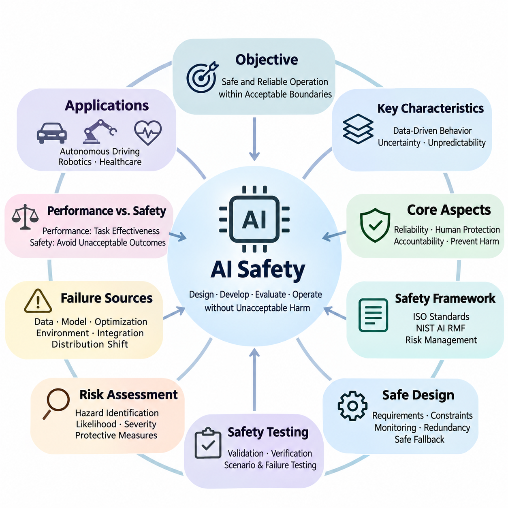
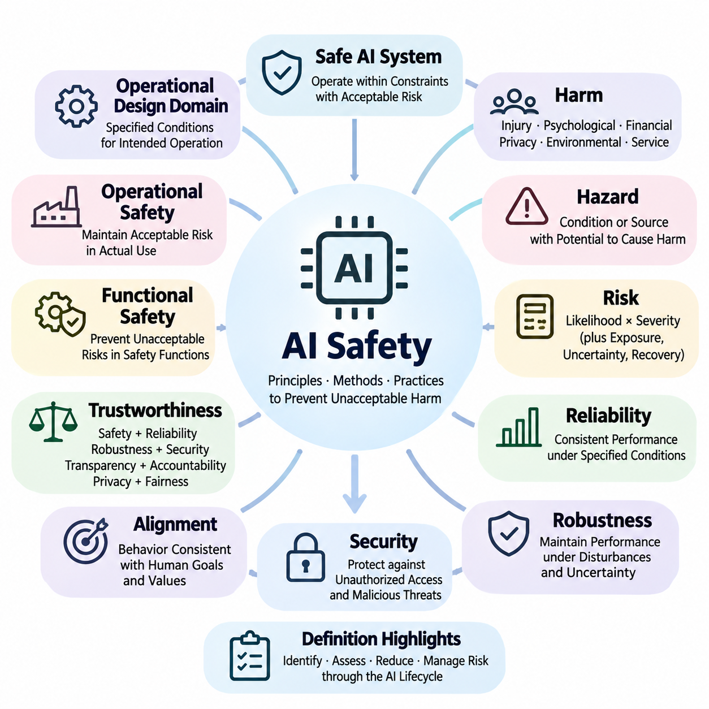
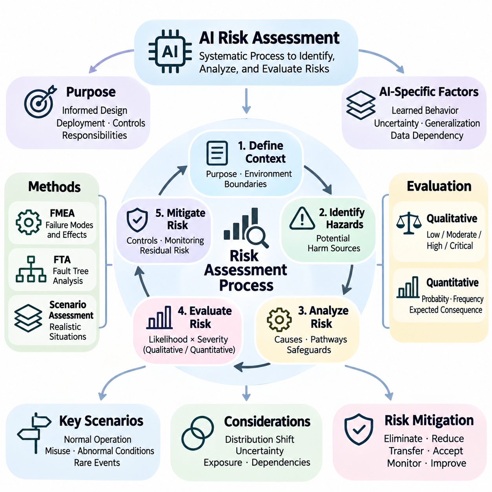
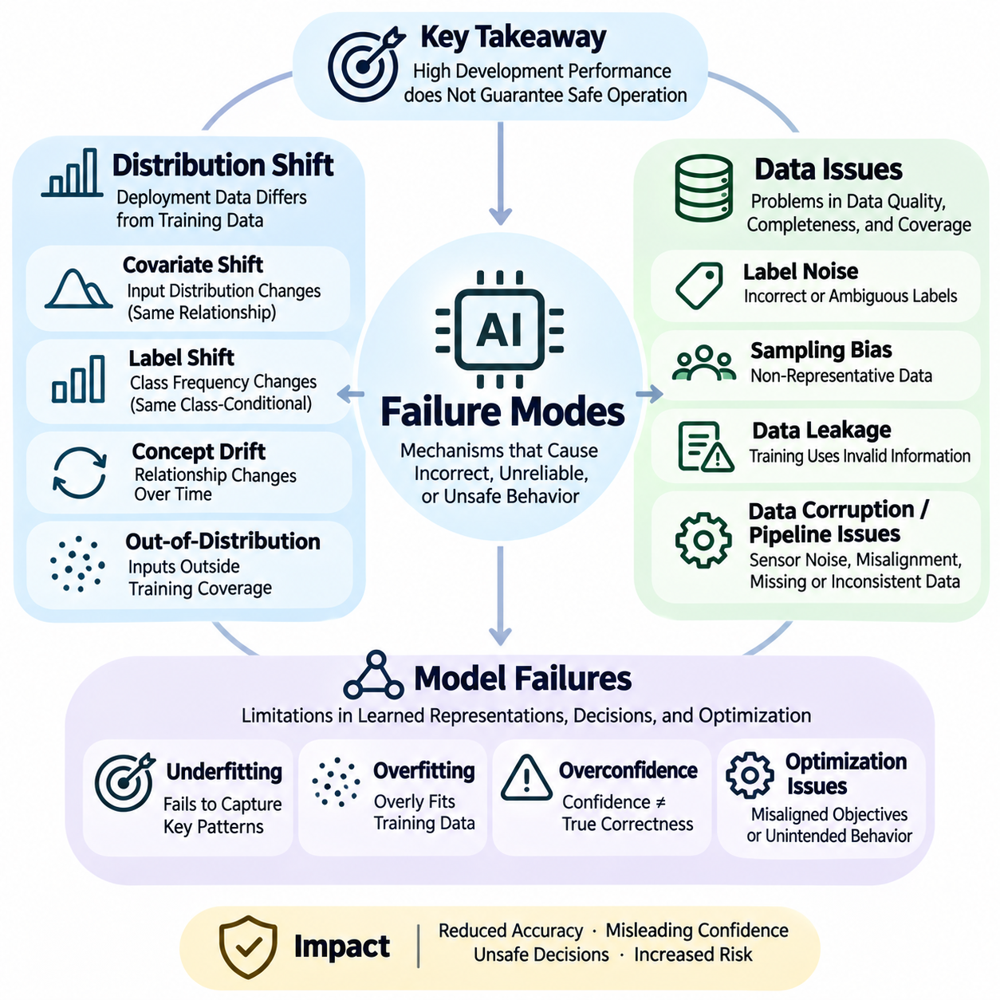
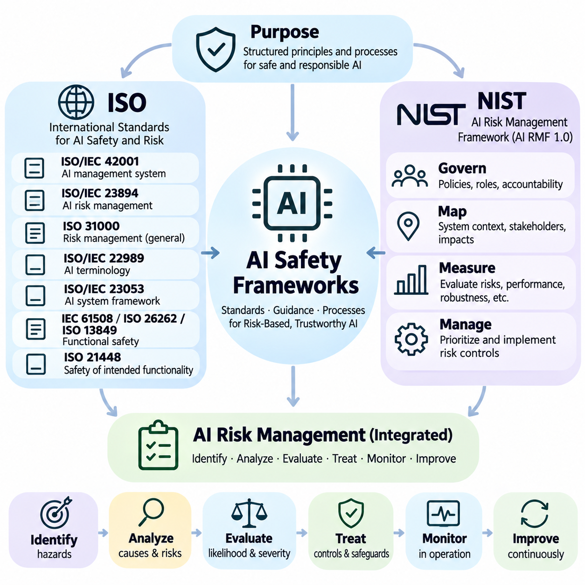
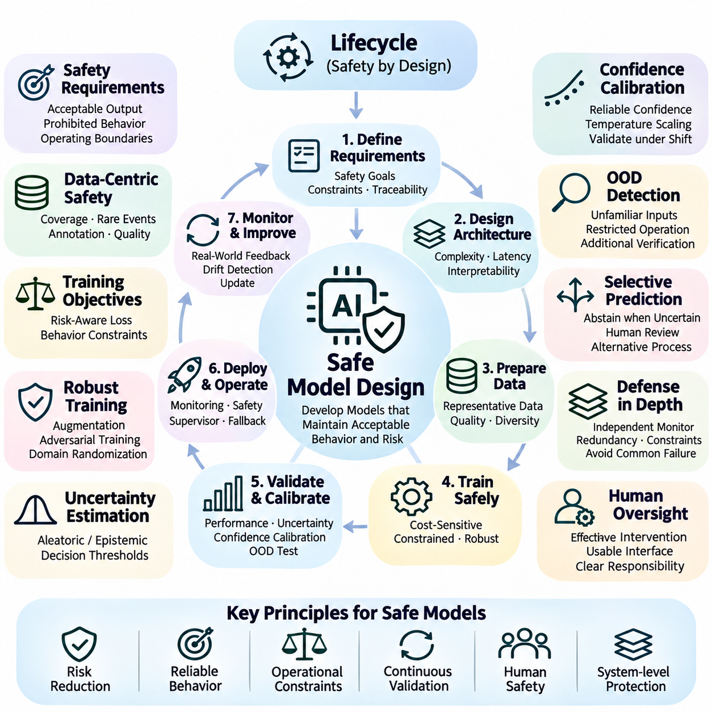
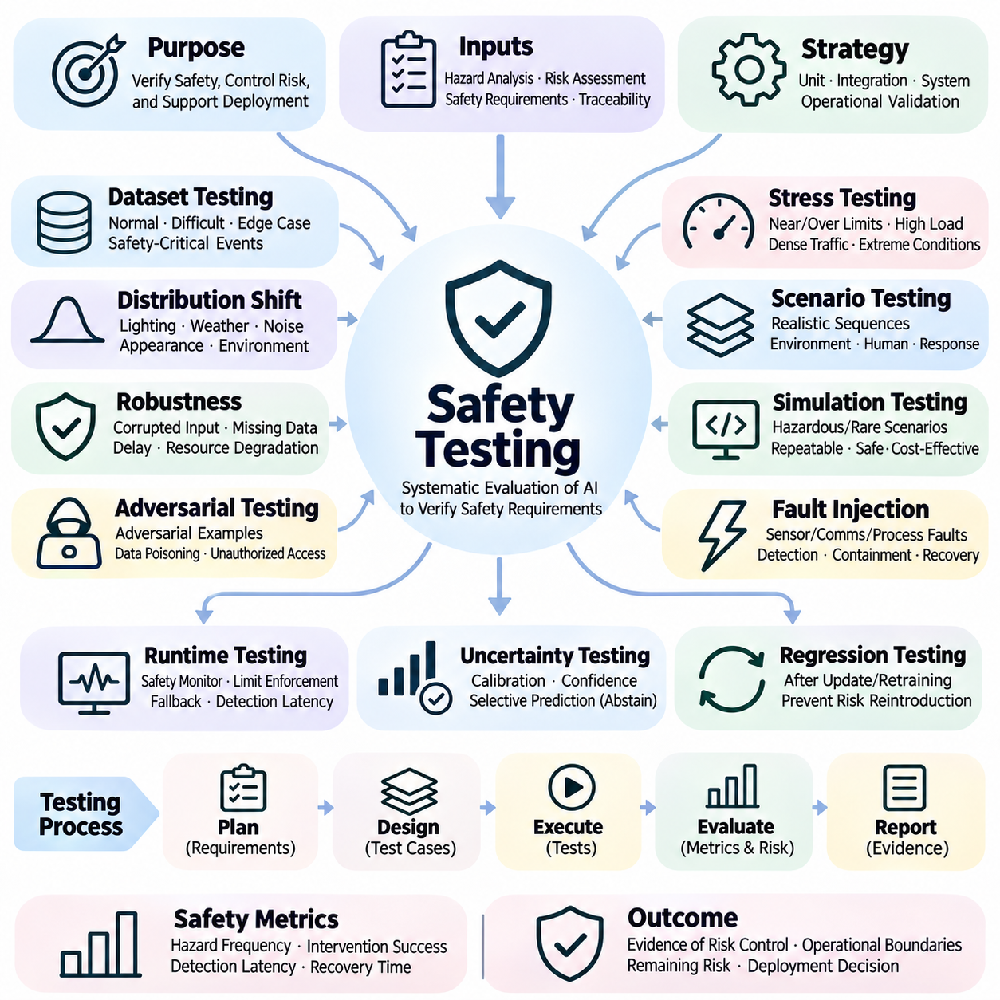
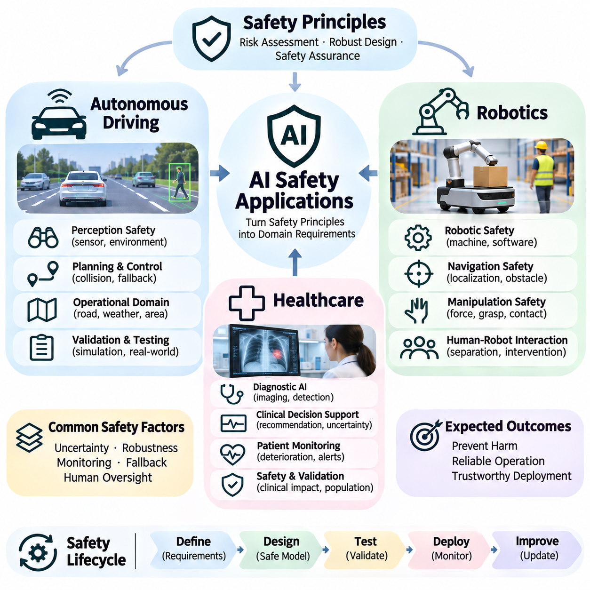

**Volume 42. AI Safety Alignment and Interpretability**

# 01. AI Safety

## 01.00 Overview

{width="7.268055555555556in" height="7.268055555555556in"}

Artificial Intelligence (AI) safety is the discipline of designing, developing, evaluating, and operating intelligent systems so that they behave reliably without causing unacceptable harm. As AI becomes increasingly integrated into critical infrastructure, autonomous machines, healthcare, and decision-making processes, safety must be treated as a fundamental engineering requirement rather than an optional feature added after development.

The central objective of AI safety is to ensure that intelligent systems operate within acceptable boundaries under both expected and unexpected conditions. Unlike conventional software, machine learning models derive behavior from data and optimization rather than exclusively from explicitly programmed rules. Consequently, their decisions may become difficult to predict when encountering unfamiliar environments, ambiguous instructions, or unusual combinations of inputs.

AI safety encompasses technical reliability, human protection, operational accountability, and the prevention of unintended consequences. A system may achieve excellent predictive accuracy while remaining unsafe because of unstable behavior, inappropriate actions, or insufficient safeguards. Safety evaluation must therefore extend beyond conventional performance metrics to examine potential hazards, failure severity, uncertainty, and the consequences of incorrect decisions.

A fundamental distinction exists between model performance and system safety. Performance measures how effectively an AI model accomplishes its intended task, whereas safety evaluates whether the system avoids unacceptable outcomes while performing that task. An autonomous vehicle may demonstrate high object detection accuracy yet remain unsafe if occasional perception failures cause dangerous steering decisions under critical operating conditions.

Safety requirements depend strongly on the application environment and the potential consequences of failure. Errors in a recommendation system may produce inconvenience or economic losses, while failures in surgical robotics, autonomous transportation, or industrial automation may cause physical injury. Accordingly, AI safety engineering must consider operational context, exposure to hazards, affected populations, and the severity of possible outcomes.

Risk assessment provides a systematic foundation for identifying and prioritizing AI safety concerns. Risk is commonly analyzed through the likelihood of harmful events and the severity of their consequences, although additional factors may influence practical evaluation. Effective assessment examines potential hazards, initiating conditions, system vulnerabilities, exposure pathways, and the effectiveness of existing protective measures.

AI failures can originate from multiple interacting sources, including training data, model architecture, optimization procedures, environmental changes, and system integration. These failures are not necessarily caused by defective algorithms alone. Even a correctly implemented model may produce unsafe behavior when deployed outside its validated operating conditions or when upstream sensors and downstream control components malfunction.

Distribution shift represents a major challenge because the statistical characteristics of deployment environments may differ from those encountered during training. Changes in lighting, weather, user behavior, sensor characteristics, or operational procedures can reduce model reliability. Safety-oriented systems must detect meaningful deviations, estimate uncertainty, and establish appropriate responses when unfamiliar conditions threaten dependable operation.

Data quality is equally important because machine learning systems inherit limitations from the information used during development. Incomplete coverage, incorrect labels, sampling bias, outdated observations, and corrupted measurements may introduce systematic weaknesses. Safety engineering therefore requires controlled data collection, dataset validation, representative scenario coverage, and procedures for identifying potentially hazardous data deficiencies.

Model failures may involve incorrect predictions, overconfident outputs, unstable decisions, or behavior inconsistent with intended operational constraints. Some failures arise from ordinary generalization limitations, while others emerge through interactions among complex components. Understanding these mechanisms requires structured error analysis, uncertainty evaluation, failure-mode classification, and investigation of conditions that trigger unsafe behavior.

A comprehensive safety framework connects hazard identification with engineering controls, validation evidence, operational responsibilities, and continuous improvement. International standards and risk management guidance provide structured approaches for organizing these activities. ISO-related standards, the NIST AI Risk Management Framework, and application-specific safety practices can support consistent documentation, governance, and evaluation.

Safe model design begins before training and continues throughout the system lifecycle. Developers must define operational requirements, identify unacceptable behaviors, establish measurable safety constraints, and determine how the system should respond to uncertainty. Architectural choices may incorporate constrained decision-making, independent monitoring, conservative action policies, redundancy, and mechanisms for transferring control to safer alternatives.

Safety mechanisms should not depend exclusively on the correctness of a single learned model. Defense-in-depth combines preventive controls, anomaly detection, runtime monitoring, and protective responses so that individual failures do not automatically produce hazardous outcomes. Depending on the application, these mechanisms may include independent safety controllers, operational boundaries, emergency shutdown procedures, and human intervention capabilities.

Uncertainty estimation plays an important role in determining when AI predictions should be trusted. Models may produce confident outputs even when presented with unfamiliar or ambiguous information, making confidence calibration and out-of-distribution detection important research areas. A safety-aware system should recognize limitations in its knowledge and reduce autonomy or request assistance when reliable operation cannot be established.

Safety testing must examine behavior under normal conditions, foreseeable disturbances, rare events, and combinations of failures. Conventional test datasets provide useful baseline measurements but cannot establish comprehensive safety by themselves. Robust evaluation requires scenario-based testing, stress testing, adversarial assessment, simulation, and carefully controlled real-world experiments that expose weaknesses before operational deployment.

Simulation enables developers to investigate hazardous scenarios without exposing people or equipment to unnecessary danger. Virtual environments can reproduce sensor degradation, environmental disturbances, component failures, and unusual interactions at scale. However, simulation results must be interpreted carefully because discrepancies between simulated and physical conditions may conceal important limitations in the deployed system.

Safety validation requires evidence that the implemented system satisfies defined requirements within a specified operational domain. Verification examines whether engineering specifications have been implemented correctly, while validation examines whether those specifications and their implementation adequately address intended use. Both activities benefit from traceable requirements, documented assumptions, measurable acceptance criteria, and reproducible testing procedures.

Runtime safety extends protective engineering into actual operation. Monitoring components observe system inputs, predictions, decisions, and environmental conditions to identify deviations from acceptable behavior. When predefined safety thresholds are exceeded, supervisory mechanisms may restrict available actions, initiate fallback procedures, request human oversight, or transition the system toward a minimum-risk condition.

Human oversight remains important when AI systems operate in environments involving uncertainty, ethical judgment, or potentially severe consequences. Effective oversight requires more than assigning responsibility to a human operator. Interfaces must communicate relevant system states, limitations, warnings, and intervention options while accounting for reaction time, workload, automation bias, and the practical ability to regain control.

Autonomous driving illustrates the interaction between perception reliability, decision-making, control stability, and environmental uncertainty. A vehicle must interpret dynamic road conditions while responding appropriately to pedestrians, obstacles, traffic signals, and unexpected events. Safety engineering therefore integrates sensing redundancy, operational design domains, scenario-based evaluation, fault detection, and fallback behavior.

Robotics introduces additional safety challenges because intelligent decisions directly influence physical motion and interaction forces. Manipulators, mobile robots, and collaborative machines must respect mechanical constraints, collision limits, and human proximity requirements. Safe robotic operation combines learned perception and planning with established control principles, protective sensing, constrained motion, and emergency response mechanisms.

Healthcare AI presents safety requirements involving clinical validity, patient protection, data quality, and human accountability. Diagnostic support models may produce misleading recommendations when patient characteristics or clinical conditions differ from their development populations. Appropriate safeguards include representative validation, uncertainty communication, workflow integration, monitoring for performance degradation, and qualified clinical oversight.

AI safety is closely connected to alignment, interpretability, fairness, robustness, and security, although these disciplines address different aspects of trustworthy behavior. Alignment examines whether system objectives correspond to intended human goals, while interpretability investigates how model behavior can be understood. Fairness considers unequal impacts, and robustness and security address disturbances, vulnerabilities, and adversarial interference.

Governance establishes organizational responsibilities for managing safety throughout development and deployment. Effective governance defines decision authority, documentation requirements, risk acceptance procedures, incident reporting, and independent review mechanisms. Technical evidence must support management decisions, while regulatory obligations and applicable standards help determine the controls necessary for particular applications and operational environments.

Safety engineering also requires continuous monitoring because deployment conditions, user populations, software dependencies, and threat environments evolve over time. A model that performs acceptably during initial validation may become less reliable as its environment changes. Operational monitoring, incident investigation, controlled updates, regression testing, and periodic reassessment help maintain safety throughout the deployed system\'s lifecycle.

Safety benchmarks provide standardized evidence for comparing models and identifying weaknesses, but benchmark scores should not be interpreted as unconditional guarantees. Evaluation quality depends on scenario relevance, test coverage, measurement validity, and reproducibility. A meaningful safety assessment combines quantitative performance indicators with hazard-specific analysis, documented limitations, and evidence from realistic operating conditions.

The broader purpose of AI safety is to make increasingly capable intelligent systems dependable, controllable, and compatible with human well-being. Achieving this objective requires coordinated advances in risk assessment, failure analysis, safety frameworks, model design, testing, deployment engineering, and operational governance. Safety must remain a continuous, evidence-based process as AI capabilities and applications expand.

## 01.01 Safety Definitions

{width="7.268055555555556in" height="7.268055555555556in"}

AI safety refers to the principles, methods, and engineering practices used to prevent artificial intelligence systems from causing unacceptable harm during development, deployment, and operation. It encompasses the protection of humans, physical environments, digital infrastructure, and societal interests. Safety is not defined solely by the absence of failures but by the systematic identification, reduction, and management of risks throughout the AI system lifecycle.

A safe AI system is one that operates within specified constraints while maintaining an acceptable level of risk under defined conditions. This definition recognizes that absolute safety cannot generally be guaranteed in complex environments. Instead, safety engineering establishes measurable requirements, evaluates foreseeable hazards, and implements protective mechanisms that reduce both the likelihood and consequences of harmful outcomes.

The concept of harm is central to AI safety because it determines which outcomes require prevention or mitigation. Harm may involve physical injury, psychological distress, financial loss, privacy violations, environmental damage, or disruption of essential services. Different applications assign different priorities to these consequences, making the definition of safety dependent on operational context, affected stakeholders, and the severity of potential impacts.

A hazard is a condition or source with the potential to cause harm, whereas risk describes the possibility and consequences of that harm occurring. In AI systems, hazards may arise from incorrect predictions, inappropriate actions, corrupted sensor inputs, or failures in communication and control. Risk assessment examines how such hazards can develop into harmful events and identifies measures for preventing or limiting their consequences.

Risk is commonly characterized through the likelihood of an adverse event and the severity of its consequences. However, practical AI risk evaluation may also consider exposure frequency, uncertainty, detectability, and the ability to recover from failures. These factors are particularly important when intelligent systems operate in dynamic environments where rare events can produce severe consequences despite otherwise reliable performance.

Safety and reliability are closely related but represent different engineering objectives. Reliability describes the ability of a system to perform its intended functions consistently over time under specified conditions. Safety concerns the avoidance of unacceptable harm, including situations where the system continues functioning as designed. A highly reliable AI system may therefore remain unsafe if its intended behavior creates hazardous consequences.

Robustness refers to the ability of an AI system to maintain acceptable performance when exposed to disturbances, uncertainty, or variations in operating conditions. Such disturbances may include noisy inputs, environmental changes, sensor degradation, or adversarial manipulation. Although robustness contributes to safety, a robust model is not necessarily safe unless its outputs and actions also satisfy relevant safety requirements.

Security addresses the protection of AI systems against unauthorized access, malicious interference, data manipulation, and other intentional threats. Safety and security intersect when cyberattacks can influence physical behavior or critical decisions. For example, manipulated sensor data may cause an autonomous robot to perform dangerous movements, demonstrating why safety engineering must account for both accidental failures and deliberate attacks.

Alignment describes the extent to which an AI system\'s objectives and behavior correspond to intended human goals, instructions, and values. Misalignment can produce unsafe outcomes even when a system performs its optimization task successfully. Safety therefore requires attention not only to technical failures but also to incorrectly specified objectives, unintended incentives, and behaviors that conflict with human expectations or operational constraints.

Trustworthiness is a broader concept that combines safety with reliability, robustness, security, transparency, accountability, privacy, and fairness. A trustworthy AI system should provide evidence that its behavior can be evaluated, monitored, and governed appropriately. However, trustworthiness is not a substitute for safety analysis because individual properties may conflict, and acceptable performance in one dimension does not guarantee acceptable outcomes in another.

Functional safety concerns the prevention of unacceptable risks arising from malfunctioning behavior in systems that perform safety-related functions. In AI-enabled machinery, functional safety may involve monitoring failures, enforcing operating limits, and initiating protective actions. Machine learning introduces additional challenges because unsafe behavior can emerge from imperfect generalization even when hardware and software components operate without conventional faults.

Operational safety focuses on maintaining acceptable risk during actual system use. It considers environmental conditions, human interaction, maintenance procedures, system configuration, and unexpected operational disturbances. A model that passes laboratory testing may still become unsafe when deployed in an unfamiliar environment, emphasizing the importance of clearly defined operating conditions and continuous safety monitoring.

An operational design domain defines the specific conditions under which an AI-enabled system is intended to function. These conditions may include geographic boundaries, environmental characteristics, speed limits, sensor availability, and interaction constraints. Explicit operational boundaries support meaningful safety claims because they distinguish validated operating conditions from situations requiring restricted behavior, human intervention, or controlled shutdown.

A safety constraint is a requirement that restricts system behavior to prevent hazardous outcomes. Constraints may define maximum operating speeds, minimum separation distances, prohibited actions, or acceptable uncertainty thresholds. Unlike ordinary performance objectives, safety constraints establish boundaries that should not be violated merely to improve efficiency, accuracy, productivity, or task completion.

Fail-safe behavior describes a system response intended to prevent or limit harm when faults or unsafe conditions occur. Depending on the application, this response may involve stopping motion, disabling an actuator, transferring control, or entering a protected operating mode. A fail-safe state must be defined through hazard analysis because immediate shutdown is not always the safest response in every environment.

Safety assurance is the structured process of developing justified confidence that a system satisfies its safety requirements. It combines hazard analysis, engineering controls, verification, validation, testing, and operational evidence. A safety case organizes claims, arguments, and supporting evidence to explain why identified risks are considered adequately controlled within the system\'s intended operating conditions.

Verification and validation are complementary concepts within safety engineering. Verification determines whether a system has been implemented according to its specified requirements, while validation evaluates whether the system is suitable for its intended use. For AI applications, these activities must consider data quality, model behavior, integration effects, environmental variation, and the consequences of incorrect predictions or decisions.

Safety monitoring involves observing system behavior and operating conditions to identify emerging hazards, abnormal states, or violations of predefined constraints. Monitoring may use uncertainty estimates, anomaly detection, diagnostic signals, or independent supervisory mechanisms. Effective monitoring should support timely intervention before hazardous conditions develop into unacceptable consequences.

Residual risk refers to the risk that remains after protective measures have been implemented. Because complex AI systems cannot generally eliminate every possible failure, residual risk must be evaluated against explicit acceptance criteria. Decisions about acceptable risk require consideration of application context, potential harm, regulatory requirements, stakeholder expectations, and the effectiveness of available safeguards.

The distinction between safety-critical and non-safety-critical applications reflects the consequences of system failure. Safety-critical AI systems can contribute directly to severe injury, loss of life, or major environmental damage if they malfunction or behave inappropriately. Such applications demand stronger assurance, more rigorous validation, independent protective mechanisms, and greater operational oversight than systems with comparatively limited consequences.

AI safety is ultimately a system-level property rather than an isolated characteristic of a machine learning model. Safe operation depends on interactions among data, algorithms, hardware, software, human operators, organizational procedures, and environmental conditions. Establishing consistent safety definitions enables engineers and stakeholders to communicate requirements, evaluate risks, and develop evidence-based approaches to responsible AI deployment.

## 01.02 Risk Assessment

{width="7.268055555555556in" height="7.268055555555556in"}

Risk assessment is a systematic process for identifying, analyzing, and evaluating potential harms associated with artificial intelligence systems. Its purpose is to determine how AI behavior, technical failures, environmental conditions, and human interactions may produce unacceptable consequences. Effective risk assessment supports informed decisions about system design, deployment readiness, protective controls, and operational responsibilities.

AI risk assessment differs from conventional software evaluation because machine learning behavior depends on statistical patterns learned from data. Models may produce unexpected outputs when encountering unfamiliar inputs, changing environments, or incomplete information. Consequently, risk assessment must examine not only component failures but also uncertainty, generalization limitations, data dependencies, and interactions between learned behavior and system-level constraints.

The assessment process begins by defining the system\'s intended purpose, operational environment, and boundaries of acceptable behavior. These definitions establish the context within which hazards can be identified and evaluated. Important considerations include user characteristics, deployment conditions, available sensors, decision authority, environmental variability, and the potential consequences of incorrect or delayed system responses.

Hazard identification examines conditions that could lead to injury, financial loss, privacy violations, environmental damage, or disruption of essential services. In AI systems, hazards may originate from incorrect predictions, misleading confidence estimates, inappropriate actions, sensor failures, or poorly specified objectives. Identifying hazards requires considering normal operation, foreseeable misuse, abnormal conditions, and interactions among system components.

Risk analysis investigates how identified hazards could develop into harmful events. It considers initiating conditions, causal mechanisms, exposure pathways, existing safeguards, and possible consequences. For example, an autonomous mobile robot may fail to detect a pedestrian because of sensor occlusion, leading to an unsafe navigation decision. The analysis must examine both the perception failure and the protective mechanisms intended to prevent collision.

Risk is commonly evaluated using the likelihood of a harmful event and the severity of its consequences. Likelihood represents the estimated possibility of occurrence, while severity describes the magnitude of potential harm. However, these dimensions may be difficult to quantify for rare AI failures. Practical assessment therefore combines quantitative evidence, engineering judgment, uncertainty analysis, and explicitly documented assumptions.

Qualitative risk assessment classifies risks using descriptive categories such as low, moderate, high, or critical. These categories help prioritize engineering attention when reliable numerical estimates are unavailable. Risk matrices may combine likelihood and severity ratings, but their results depend on category definitions and assessment assumptions. They should support structured judgment rather than replace detailed analysis of hazardous scenarios.

Quantitative risk assessment estimates risk using measurable probabilities, frequencies, exposure levels, or expected consequences. Historical incident records, simulation results, operational measurements, and controlled experiments may provide supporting evidence. Nevertheless, numerical estimates must account for limited observations, uncertain distributions, and differences between testing and deployment environments to avoid creating misleading confidence.

Failure Mode and Effects Analysis examines how individual components or functions may fail and how those failures affect the overall system. In AI applications, failure modes may include incorrect classification, delayed inference, sensor corruption, unstable control outputs, or communication interruptions. The analysis connects each failure mode to potential consequences, detection mechanisms, and corrective measures.

Fault Tree Analysis provides a complementary approach by examining combinations of events that could produce a specified hazardous outcome. It works backward from an undesirable event to identify contributing failures and dependencies. For AI-enabled systems, these dependencies may involve perception errors, decision failures, hardware faults, and ineffective safety monitors operating simultaneously or sequentially.

Scenario-based risk assessment evaluates AI behavior within realistic operational situations. Scenarios may represent routine activities, environmental disturbances, rare events, or combinations of unexpected conditions. Their value depends on how well they represent relevant hazards and operational boundaries. Carefully designed scenarios reveal interactions that isolated component tests may overlook.

Distribution shift introduces risk when deployment data differs from the information used during model training. Changes in lighting, weather, sensor characteristics, user behavior, or operating environments may degrade predictions. Risk assessment should identify conditions where model reliability becomes uncertain and determine whether monitoring, restricted operation, retraining, or human intervention is necessary.

Uncertainty assessment evaluates limitations in available knowledge and the variability of possible outcomes. Data uncertainty may arise from noisy measurements or ambiguous observations, while model uncertainty may reflect insufficient training coverage. These uncertainties influence confidence in risk estimates and safety decisions. Systems should communicate uncertainty appropriately and avoid treating unreliable predictions as established facts.

Risk mitigation involves selecting measures that eliminate hazards, reduce their likelihood, or limit their consequences. Possible controls include improved datasets, model constraints, redundant sensing, independent monitoring, restricted operating domains, and protective shutdown mechanisms. The effectiveness of each measure must be evaluated against the specific hazard it addresses rather than assumed from general performance improvements.

Residual risk is the level of risk remaining after mitigation measures have been implemented. Its acceptability depends on application requirements, regulatory obligations, stakeholder expectations, and potential consequences. Risk acceptance should be supported by documented evidence and clearly assigned decision authority. Unresolved high-severity hazards may require additional controls, restricted deployment, or postponement of operation.

Continuous risk assessment is necessary because AI systems and their operating environments evolve after deployment. Model updates, changing data distributions, new user behaviors, and emerging vulnerabilities can introduce previously unidentified hazards. Operational monitoring, incident reporting, periodic reassessment, and controlled change management help ensure that safety decisions remain valid throughout the system lifecycle.

Risk assessment for autonomous driving must consider interactions among perception, prediction, planning, and vehicle control. Hazards may arise from missed pedestrians, incorrect trajectory estimates, localization errors, or delayed braking decisions. Evaluation must account for traffic complexity, environmental uncertainty, operating speed, and available fallback capabilities because individual errors can propagate into safety-critical actions.

In robotics, risk assessment must connect intelligent decision-making with physical motion and environmental interaction. Relevant hazards include collisions, unstable manipulation, excessive force, unexpected movement, and loss of localization. Effective assessment examines mechanical limitations, sensor reliability, control response, human proximity, and the ability to transition safely when autonomy becomes unreliable.

Healthcare AI requires risk assessment that considers clinical consequences, patient variability, data representativeness, and human oversight. Incorrect predictions may contribute to delayed diagnosis, inappropriate treatment, or unnecessary intervention. Assessment must therefore examine clinical workflows, uncertainty communication, validation populations, and the responsibilities of healthcare professionals interpreting AI-generated recommendations.

Organizational governance determines how risk assessment findings influence engineering and deployment decisions. Responsibilities should include hazard ownership, documentation, independent review, mitigation verification, and formal acceptance of residual risks. Traceability between identified hazards, safety requirements, implemented controls, and validation evidence enables systematic auditing and supports accountability throughout development.

Effective AI risk assessment integrates technical analysis with operational understanding and continuous evidence collection. No single metric, testing method, or framework can capture every possible source of harm. A comprehensive approach combines hazard identification, qualitative and quantitative analysis, scenario evaluation, mitigation verification, and lifecycle monitoring to support safer and more responsible AI systems.

## 01.03 Failure Modes

{width="7.268055555555556in" height="7.268055555555556in"}

Failure modes in artificial intelligence systems describe the mechanisms through which models or integrated applications produce incorrect, unreliable, or unsafe behavior. Understanding these mechanisms is essential because high performance during development does not guarantee dependable operation after deployment. AI failures commonly arise from distribution shift, data quality problems, model limitations, and interactions among these factors within complex operational environments.

Distribution shift occurs when the statistical characteristics of deployment data differ from those represented in training data. Machine learning models generally assume that learned relationships remain sufficiently stable during inference. When this assumption fails, prediction accuracy and confidence calibration may deteriorate. Distribution shift is particularly important in autonomous systems because environmental conditions can change continuously and unpredictably.

Covariate shift describes changes in the distribution of input features while the conditional relationship between inputs and target outputs remains stable. For example, a vision model trained under clear daylight may encounter nighttime images with substantially different visual characteristics. Although the underlying object categories remain unchanged, the model may struggle to recognize them because the observed feature distribution differs from its training experience.

Label shift occurs when the relative frequencies of target classes change between training and deployment, while the class-conditional input distributions remain stable. A medical diagnostic model may encounter a patient population with a different disease prevalence from its training population. Such changes can affect predicted probabilities and decision thresholds, requiring careful monitoring and potentially adjusted calibration.

Concept drift refers to changes in the relationship between input features and target outcomes over time. Unlike covariate shift, concept drift can invalidate previously learned decision boundaries even when input characteristics appear familiar. In industrial systems, equipment aging, modified operating procedures, or changing production processes may alter the relationship between sensor measurements and actual failure conditions.

Out-of-distribution inputs represent observations that fall outside the regions adequately represented by training data. These inputs may involve unfamiliar objects, unusual environmental conditions, or unexpected combinations of otherwise familiar features. Models can produce highly confident predictions for such observations, making uncertainty estimation and out-of-distribution detection important components of safety monitoring.

Data issues constitute another major category of AI failure modes because model behavior depends on the quality, completeness, and representativeness of training information. Incorrect labels, missing values, corrupted measurements, inconsistent preprocessing, and sampling bias can introduce systematic errors. These problems may remain hidden during development when training and validation datasets share the same underlying deficiencies.

Label noise occurs when training examples contain incorrect, inconsistent, or ambiguous target annotations. Such noise can distort learned decision boundaries and reduce the reliability of predictions. In safety-critical applications, mislabeled rare hazards are especially problematic because they may prevent models from recognizing dangerous situations. Label auditing, annotation guidelines, and targeted review can reduce these weaknesses.

Sampling bias arises when collected data does not adequately represent the population or operating conditions encountered during deployment. A dataset dominated by favorable weather, common object categories, or specific demographic groups may produce models that perform poorly elsewhere. Representative sampling and systematic coverage analysis are therefore essential for identifying underrepresented scenarios and preventing uneven reliability.

Data leakage occurs when information unavailable during legitimate inference improperly influences training or evaluation. Leakage may involve duplicated records, future observations, shared identities, or preprocessing performed across dataset boundaries. It can produce artificially optimistic validation results, concealing weaknesses that become apparent during deployment. Preventing leakage requires disciplined dataset separation and reproducible preprocessing procedures.

Data corruption and pipeline inconsistencies can introduce failures even when the original dataset is appropriate. Sensor noise, timestamp misalignment, unit conversion errors, missing records, and inconsistent normalization may alter the information received by a model. In multimodal systems, synchronization errors between cameras, LiDAR, and other sensors can produce incorrect environmental interpretations despite individually functioning components.

Model failures arise when learned representations, decision boundaries, or optimization objectives do not support reliable behavior under relevant conditions. Underfitting may prevent a model from capturing important relationships, while overfitting may cause excessive dependence on training-specific patterns. Both problems can reduce generalization, although their effects may become apparent under different evaluation conditions.

Overconfidence is a particularly dangerous model failure because predicted confidence may not reflect the actual probability of correctness. Neural networks can assign high confidence to incorrect predictions, including unfamiliar or ambiguous inputs. Poor calibration can mislead downstream decision systems into treating uncertain information as reliable, increasing the likelihood of unsafe actions.

Optimization-related failures occur when a model successfully minimizes its training objective without achieving the intended operational outcome. In reinforcement learning, reward hacking may encourage behavior that maximizes numerical rewards while violating practical expectations. Similar problems arise when surrogate objectives fail to represent safety constraints, long-term consequences, or the actual requirements of users and operators.

Error propagation becomes important when multiple AI components operate within a sequential decision pipeline. An incorrect perception output may influence localization, planning, and control, causing small initial errors to produce increasingly serious consequences. In autonomous robotics, a missed obstacle can affect trajectory selection and motion execution, demonstrating why system-level safety cannot be inferred from isolated model accuracy.

Temporal failures occur when AI systems cannot maintain consistent behavior across extended sequences of observations and actions. Problems may include accumulated localization errors, outdated memory, delayed responses, unstable control decisions, and failure to recognize changing objectives. Long-horizon autonomous tasks amplify these weaknesses because early mistakes can influence later decisions and reduce opportunities for recovery.

Interaction failures emerge when individually acceptable components behave incorrectly after integration. Differences in update frequency, communication latency, coordinate systems, or assumptions about uncertainty may create unsafe system behavior. These failures are particularly difficult to identify through isolated model testing, making integration testing, interface validation, and end-to-end scenario evaluation essential.

Failure detection requires monitoring mechanisms that recognize abnormal inputs, degraded performance, inconsistent predictions, and violations of operational constraints. Techniques may include statistical drift detection, uncertainty estimation, anomaly detection, sensor consistency checks, and runtime diagnostics. Detection thresholds must balance missed failures against unnecessary interventions while accounting for the consequences of each decision.

Failure mitigation combines preventive design with mechanisms that limit the consequences of unexpected behavior. Improved dataset coverage, robust training, calibrated confidence estimates, redundant sensing, and constrained decision-making can reduce specific vulnerabilities. When reliable operation cannot be maintained, supervisory controllers may restrict autonomy, initiate fallback procedures, or transition the system toward a safer operating state.

Evaluating failure modes requires testing beyond conventional accuracy benchmarks. Stress testing, controlled perturbations, rare-event simulation, corrupted-data experiments, and distribution-shift evaluations expose weaknesses that standard test sets may overlook. Meaningful evaluation should measure not only failure frequency but also severity, detection latency, recovery effectiveness, and the operational consequences of incorrect decisions.

A comprehensive understanding of AI failure modes connects distribution shift, data issues, and model failures within a unified safety engineering perspective. These categories frequently interact, making isolated explanations insufficient for complex deployed systems. Effective safety management therefore combines systematic failure analysis, representative validation, continuous monitoring, and protective mechanisms throughout the AI lifecycle.

## 01.04 Safety Frameworks

{width="7.268055555555556in" height="7.268055555555556in"}

AI safety frameworks provide structured principles, processes, and requirements for identifying hazards, managing risks, and demonstrating responsible system development. They translate broad safety objectives into repeatable engineering and governance practices. International standards, national guidance, and organizational risk management processes complement one another by addressing technical reliability, operational accountability, and evidence-based safety assurance.

The International Organization for Standardization develops standards that support consistent approaches to quality, safety, governance, and risk management across industries. ISO standards provide common terminology, documented processes, and assessment criteria that organizations can adapt to their applications. Their relevance to AI extends from organizational management systems to specialized requirements for autonomous machines and safety-critical operations.

ISO/IEC 42001 establishes requirements for an artificial intelligence management system within an organization. It addresses policies, responsibilities, risk treatment, operational controls, performance evaluation, and continual improvement. Rather than certifying that an individual AI model is inherently safe, the standard supports systematic governance of AI-related activities, including the management of risks and impacts throughout the AI lifecycle.

ISO/IEC 23894 provides guidance for managing risks associated with artificial intelligence. It connects AI-specific characteristics with established risk management principles, including context definition, risk identification, analysis, evaluation, treatment, and monitoring. The guidance emphasizes that AI risks may arise from data dependencies, model uncertainty, changing environments, and interactions between technical systems and human stakeholders.

ISO 31000 provides general principles and guidelines for organizational risk management. Although it is not limited to artificial intelligence, its framework supports systematic identification and treatment of uncertainty affecting organizational objectives. When applied to AI, it helps connect technical hazards with business decisions, stakeholder expectations, accountability structures, and the acceptance of residual risks.

ISO/IEC 22989 establishes terminology and concepts for artificial intelligence, supporting consistent communication among engineers, researchers, auditors, and decision-makers. ISO/IEC 23053 describes a framework for AI systems using machine learning, including major system components and their relationships. Together, these standards help organizations define system boundaries, describe AI architectures, and establish a shared foundation for safety documentation.

Functional safety standards become particularly important when AI systems interact with physical equipment. IEC 61508 establishes a general framework for safety-related electrical, electronic, and programmable electronic systems. ISO 26262 addresses functional safety in road vehicles, while ISO 13849 supports the design of safety-related control systems for machinery. Their applicability depends on the system and its intended use.

ISO 21448 addresses safety of the intended functionality, particularly hazards arising from functional insufficiencies or reasonably foreseeable misuse rather than conventional component malfunctions. This perspective is important for perception-based automated driving systems, where incorrect environmental interpretation can occur without hardware failure. It complements functional safety analysis by examining limitations in intended system behavior.

The National Institute of Standards and Technology developed the AI Risk Management Framework to support trustworthy and responsible AI development and use. NIST AI RMF 1.0 is a voluntary, risk-based framework intended for organizations across sectors. It emphasizes practical management of AI risks while recognizing that trustworthy AI involves interacting properties such as safety, security, reliability, explainability, privacy, and fairness.

The NIST AI Risk Management Framework organizes its core activities around Govern, Map, Measure, and Manage. Govern establishes organizational structures and accountability for AI risks. Map identifies system context, stakeholders, and potential impacts. Measure evaluates risks and system characteristics, while Manage prioritizes responses and implements controls. These functions support continuous rather than one-time risk management.

The Govern function establishes the policies, responsibilities, resources, and organizational culture necessary for effective AI risk management. It includes leadership commitment, defined roles, documentation practices, and mechanisms for internal oversight. Effective governance ensures that safety decisions are not isolated technical judgments but are connected to organizational objectives, stakeholder responsibilities, and documented accountability.

The Map function develops an understanding of the AI system\'s intended purpose, operating environment, users, and affected stakeholders. It identifies possible benefits, limitations, and harmful consequences associated with system deployment. Mapping also examines how AI capabilities interact with human decisions and existing processes, providing the contextual foundation needed for meaningful risk identification and evaluation.

The Measure function evaluates AI risks through testing, monitoring, analysis, and evidence collection. Measurements may address predictive performance, robustness, security, fairness, explainability, and safety under relevant operating conditions. Because no single metric captures all dimensions of risk, organizations must combine quantitative measurements with qualitative assessments and document limitations in the available evidence.

The Manage function converts identified and measured risks into prioritized actions. These actions may include modifying system designs, restricting deployment conditions, strengthening monitoring, improving datasets, or implementing protective controls. Risk treatment decisions should consider severity, available resources, uncertainty, and stakeholder impacts. Remaining risks require documented acceptance, communication, and periodic reassessment.

AI risk management frameworks must address the complete lifecycle, beginning with system conception and continuing through development, validation, deployment, operation, modification, and retirement. Risks can change when training data is updated, models are retrained, interfaces are modified, or operating environments evolve. Lifecycle governance therefore requires version control, change impact analysis, monitoring, and reassessment of safety evidence.

Safety assurance connects framework requirements with demonstrable engineering evidence. Hazard analyses, safety requirements, verification results, validation reports, operational logs, and incident records provide support for safety claims. A structured safety case can organize these elements into a coherent argument explaining why identified risks are adequately controlled within specified operational boundaries.

For autonomous driving, safety frameworks must connect machine learning limitations with vehicle-level hazard analysis and operational design constraints. Perception errors, uncertain predictions, and planning failures require evaluation alongside braking, steering, communication, and fallback capabilities. Combining AI risk management guidance with relevant automotive safety standards supports a more complete assessment of intelligent vehicle behavior.

Robotics applications require frameworks that address both computational decisions and physical interactions. Mobile robots and manipulators introduce hazards involving collisions, unexpected motion, excessive forces, and failures in human-robot coordination. Appropriate machinery safety standards, system-level hazard analysis, runtime monitoring, and operational procedures help establish protective boundaries around learned autonomous behavior.

Healthcare AI frameworks must consider patient safety, clinical effectiveness, data quality, human oversight, and the consequences of incorrect recommendations. Relevant medical device standards and regulatory requirements may apply depending on intended use and jurisdiction. Risk management should examine clinical workflows, validation populations, uncertainty communication, and post-deployment monitoring to detect emerging safety concerns.

A practical AI safety framework integrates ISO standards, NIST guidance, and application-specific risk management into a coherent organizational process. These resources serve different purposes and should not be treated as interchangeable certifications or universal guarantees of safety. Effective implementation depends on selecting applicable requirements, documenting assumptions, assigning responsibilities, and verifying that controls address actual hazards.

The ultimate value of safety frameworks lies in their ability to make AI risk management systematic, transparent, and repeatable. Standards establish shared expectations, governance frameworks organize responsibilities, and engineering evidence demonstrates whether protective measures are effective. As AI capabilities and deployment environments evolve, continual assessment and improvement remain essential for maintaining acceptable risk and trustworthy operation.

## 01.05 Safe Model Design

{width="7.268055555555556in" height="7.268055555555556in"}

Safe model design is the engineering discipline of developing artificial intelligence models that maintain acceptable behavior under expected operating conditions and foreseeable disturbances. It integrates safety requirements into architecture selection, data preparation, training, validation, and deployment. Rather than treating safety as a final testing activity, this approach establishes protective principles throughout the model development lifecycle.

Safety requirements must be defined before selecting algorithms or optimizing model performance. These requirements describe acceptable outputs, prohibited behaviors, operating boundaries, response deadlines, and consequences of incorrect decisions. In safety-critical applications, requirements should be measurable and traceable to identified hazards, enabling engineers to demonstrate how specific design choices contribute to risk reduction.

Model architecture influences safety through its complexity, computational demands, uncertainty characteristics, and interaction with surrounding systems. A highly accurate architecture may still be unsuitable if inference latency is unpredictable or failure behavior cannot be controlled. Architecture selection should therefore consider worst-case execution time, resource limitations, interpretability needs, and compatibility with independent safety mechanisms.

Data-centric safety design begins with representative training datasets that cover expected operating conditions and important hazardous scenarios. Dataset construction should account for environmental diversity, rare events, sensor limitations, and relevant population differences. Data provenance, annotation consistency, quality checks, and controlled preprocessing reduce the possibility that hidden dataset defects will become unsafe model behavior.

Training objectives should reflect operational requirements rather than optimize predictive accuracy alone. Cost-sensitive learning can assign greater penalties to errors with severe consequences, while constrained optimization can incorporate explicit behavioral restrictions. However, numerical loss functions cannot represent every safety obligation, making independent safety requirements and external protective controls necessary.

Robust training improves resistance to realistic disturbances that may occur during deployment. Data augmentation, noise injection, adversarial training, and domain randomization expose models to controlled variations during development. These techniques can reduce sensitivity to selected perturbations, but their effectiveness depends on whether the training disturbances adequately represent real operational hazards.

Uncertainty estimation enables models to express limitations in their predictions instead of presenting every output as equally reliable. Aleatoric uncertainty represents variability inherent in observations, while epistemic uncertainty reflects limitations in model knowledge. Both forms can inform decision thresholds, human intervention, and fallback behavior, although uncertainty estimates themselves require calibration and validation.

Confidence calibration examines whether predicted confidence corresponds to observed correctness across relevant operating conditions. A calibrated model should not systematically assign excessive confidence to unreliable predictions. Techniques such as temperature scaling can improve calibration on representative data, but calibration may deteriorate under distribution shift. Safety evaluation must therefore examine confidence reliability beyond ordinary test conditions.

Out-of-distribution detection helps identify inputs that differ substantially from the model\'s training experience. Such inputs may involve unfamiliar objects, unusual sensor patterns, or previously unseen environmental conditions. Detection mechanisms can trigger restricted operation or additional verification, but they cannot reliably identify every unknown situation. Their limitations must be incorporated into system-level safety analysis.

Selective prediction allows a model to abstain from making decisions when confidence or other reliability indicators are insufficient. Instead of forcing an output for every input, the system may request human review, activate a secondary model, or enter a restricted operating mode. Safe abstention requires explicit thresholds and a dependable alternative process because refusing a prediction may itself create operational risks.

Defense in depth combines multiple protective mechanisms so that a single model failure does not immediately produce a hazardous outcome. Independent monitors, redundant sensors, rule-based constraints, and supervisory controllers can provide additional protection. These mechanisms should avoid common-cause failures wherever practical, since multiple components sharing the same incorrect assumptions may fail simultaneously.

Runtime safety assurance separates performance-oriented intelligence from mechanisms responsible for enforcing critical safety constraints. A learning-based controller may generate candidate actions while an independent safety supervisor checks their admissibility. Unsafe actions can be rejected, modified, or replaced with protective responses. This separation helps prevent uncertain model outputs from directly controlling hazardous physical behavior.

Safe reinforcement learning addresses risks associated with exploration, reward optimization, and sequential decision-making. Agents may discover actions that maximize rewards while violating operational expectations or safety constraints. Constrained reinforcement learning, action shielding, and risk-sensitive objectives can reduce selected hazards. Nevertheless, learned policies require independent validation before operating in safety-critical environments.

Human oversight should be designed around the capabilities and limitations of both operators and AI systems. Effective interfaces communicate uncertainty, operating status, detected hazards, and reasons for intervention. Human supervision cannot be assumed to provide immediate protection when reaction time is insufficient. Consequently, automated protective mechanisms remain necessary for rapidly developing hazardous situations.

Safe model design also requires attention to integration with sensors, communication networks, control software, and physical actuators. Timing errors, inconsistent coordinate systems, stale observations, and interface mismatches can undermine an otherwise reliable model. System-level verification should confirm that model outputs remain meaningful and safe when transmitted through the complete operational pipeline.

Verification evaluates whether the implemented model satisfies specified technical and safety requirements, while validation determines whether it is suitable for intended operating conditions. Evaluation should include representative datasets, distribution shifts, rare hazards, stress conditions, and failure recovery scenarios. Aggregate accuracy alone is insufficient because severe failures may be hidden within otherwise strong average performance.

Safety-oriented testing should examine not only whether a model makes errors but also how those errors influence downstream decisions. Relevant measures include false-negative rates for critical hazards, confidence calibration, detection latency, intervention effectiveness, and residual risk. Scenario-based evaluation connects model behavior with operational consequences and provides stronger evidence than isolated prediction metrics.

Model updates introduce additional safety challenges because retraining, fine-tuning, or changing preprocessing may alter previously validated behavior. Controlled versioning, regression testing, dataset documentation, and change impact analysis help preserve safety evidence. Significant modifications should trigger reassessment of affected hazards, operational constraints, and protective mechanisms before deployment.

Continuous monitoring extends safe model design into real-world operation. Monitoring systems can track input distributions, prediction uncertainty, abnormal outputs, resource utilization, and intervention events. Operational evidence helps identify emerging failure modes and supports targeted improvements. Monitoring must be accompanied by defined response procedures because detecting degradation without corrective action provides limited protection.

In autonomous driving and robotics, safe model design must account for the connection between predictions and physical actions. Perception, localization, planning, and control models operate under strict timing and environmental constraints. Protective mechanisms may enforce speed limits, collision avoidance boundaries, and minimum-risk behavior. The complete system must remain controllable when learned components become unreliable.

Safe model design ultimately combines reliable learning with explicit constraints, independent protection, and continuous evidence-based evaluation. No training technique or architectural choice can guarantee safety across every possible environment. Effective engineering therefore establishes measurable requirements, limits model authority, validates critical behavior, and maintains mechanisms for detecting and controlling failures throughout the AI lifecycle.

## 01.06 Safety Testing [w/Code]

{width="7.268055555555556in" height="7.268055555555556in"}

Safety testing is the systematic evaluation of artificial intelligence systems to determine whether they satisfy defined safety requirements under expected and foreseeable operating conditions. It examines how models, software components, hardware interfaces, and human interactions contribute to potential hazards. Effective testing provides evidence of risk control while recognizing that successful test results cannot guarantee the absence of every possible failure.

Safety testing begins with requirements derived from hazard identification and risk assessment. Each requirement should define observable behavior, acceptable limits, operating conditions, and measurable acceptance criteria. Traceability connects hazards to protective mechanisms and corresponding test cases. This relationship enables engineers to determine whether critical risks have been addressed and whether sufficient evidence supports deployment decisions.

A comprehensive testing strategy combines unit testing, integration testing, system testing, and operational validation. Unit tests examine individual functions, while integration tests evaluate interactions between components. System tests assess complete application behavior under representative conditions. Operational validation determines whether the integrated AI system performs safely within its intended deployment environment.

Dataset-based testing evaluates model behavior using examples that are separate from training information. Test datasets should represent normal conditions, difficult scenarios, underrepresented populations, and safety-critical events. Performance measures must reflect operational consequences rather than average accuracy alone. Rare but severe errors require targeted evaluation because aggregate metrics can conceal dangerous weaknesses.

Distribution-shift testing examines model performance when deployment conditions differ from training assumptions. Controlled variations in lighting, weather, sensor noise, object appearance, and operating environments can expose generalization limitations. Evaluation should measure changes in accuracy, confidence calibration, and failure severity. Testing must also determine whether the system recognizes conditions outside its validated operating domain.

Robustness testing introduces disturbances to determine whether an AI system maintains acceptable behavior. Perturbations may include corrupted inputs, missing sensor measurements, communication delays, or degraded computational resources. Tests should reflect plausible operational conditions rather than arbitrary changes alone. Robustness results help identify failure thresholds and guide the development of protective mechanisms.

Adversarial testing evaluates vulnerabilities that may be exploited through intentionally manipulated inputs or system interactions. Adversarial examples can reveal sensitivity to small changes that influence model predictions. Security-oriented testing may also examine data poisoning, unauthorized model access, and malicious interface behavior. Such testing should assess realistic threat models and the effectiveness of defensive controls.

Stress testing exposes systems to demanding conditions that approach or exceed normal operating limits. Examples include dense traffic, crowded robot workspaces, extreme environmental conditions, and unusually high computational loads. The objective is to observe degradation patterns, identify unsafe transitions, and verify protective responses. Stress tests are particularly useful for establishing operational boundaries and identifying hidden system dependencies.

Scenario-based testing organizes evaluation around realistic sequences of events rather than isolated predictions. Scenarios describe environmental conditions, system states, human actions, and expected responses. In autonomous robotics, a scenario may involve an unexpected pedestrian crossing while localization confidence decreases. Testing examines whether perception, planning, control, and safety supervision cooperate to prevent hazardous outcomes.

Simulation testing enables repeated evaluation of hazardous or rare scenarios without exposing people or equipment to unnecessary danger. Simulated environments can reproduce sensor observations, dynamic obstacles, environmental disturbances, and system failures. However, simulation fidelity is limited by modeling assumptions. Results must therefore be interpreted alongside evidence from controlled physical experiments and real-world validation.

Fault injection testing deliberately introduces failures to evaluate detection, containment, and recovery mechanisms. Injected faults may include sensor disconnection, delayed messages, corrupted measurements, unavailable processors, or actuator feedback errors. The system should respond according to defined safety requirements. Evaluation must verify that protective actions remain effective even when multiple components experience related failures.

Runtime safety testing evaluates protective mechanisms that monitor AI behavior during operation. Independent safety controllers may reject unsafe commands, enforce movement limits, or initiate fallback procedures. Tests should measure detection latency, intervention timing, and the reliability of transitions to safer states. A safety monitor must also be evaluated for failures that could prevent it from recognizing hazardous behavior.

Uncertainty testing examines whether confidence estimates accurately represent model reliability. Calibration experiments compare predicted probabilities with observed outcomes, while selective prediction tests evaluate decisions to abstain under uncertainty. Safety assessment should determine whether unreliable predictions trigger appropriate restrictions. Particular attention is required when uncertainty estimation becomes inaccurate under distribution shift.

Recovery testing evaluates how a system responds after detecting errors or entering degraded operating conditions. Recovery may involve restarting components, switching sensors, requesting human intervention, or entering a minimum-risk state. Successful recovery requires more than restoring functionality; it must avoid introducing additional hazards. Tests should also verify that normal operation resumes only when predefined safety conditions are satisfied.

Human-in-the-loop testing investigates how operators interact with AI systems during routine operation and emergencies. Important factors include warning clarity, interface usability, response time, workload, and automation bias. Testing should examine whether operators correctly understand system limitations and intervention requests. Human oversight must not be treated as a reliable safeguard when available reaction time is insufficient.

Safety metrics should quantify both model-level errors and their system-level consequences. Relevant measures include critical false-negative rates, hazardous event frequency, intervention success, detection latency, recovery time, and constraint violations. Statistical confidence intervals help communicate uncertainty in estimated performance. Rare-event evaluation requires particular care because observing no failures does not establish that the true risk is zero.

Regression testing ensures that software updates, model retraining, dataset changes, and configuration modifications do not reintroduce previously controlled hazards. Automated test suites should preserve representative safety scenarios and known failure cases. Significant changes require impact analysis and additional validation. Versioned test evidence supports traceability between deployed models, safety requirements, and approved operating conditions.

Continuous integration pipelines can automate selected safety checks during development. Automated workflows may execute dataset validation, model evaluation, interface tests, robustness experiments, and regression checks before deployment approval. Test results should be stored with model versions, configurations, and relevant environmental assumptions. Automation improves repeatability but cannot replace independent review of complex safety claims.

Real-world safety testing is necessary to examine interactions that simulations and laboratory experiments may not reproduce accurately. Controlled field trials should progress from restricted conditions toward increasingly representative operational scenarios. Safety observers, emergency controls, and clearly defined stopping criteria reduce exposure during testing. Field evidence should document both successful operation and unexpected events requiring investigation.

Safety testing ultimately provides structured evidence for determining whether identified risks are adequately controlled. No finite collection of tests can demonstrate complete safety across every possible situation. Effective assurance therefore combines requirement traceability, diverse testing methods, statistical analysis, independent review, and operational monitoring. Testing remains a continuous lifecycle activity as AI systems and their environments evolve.

## 01.07 Applications

{width="7.268055555555556in" height="7.268055555555556in"}

AI safety applications translate general principles of risk assessment, robust design, and safety assurance into operational requirements for specific industries. Autonomous driving, robotics, and healthcare present different hazards, but all require reliable decisions under uncertainty. Their safety engineering processes must account for environmental complexity, human interaction, system limitations, and the consequences of incorrect or delayed AI behavior.

Autonomous driving systems integrate perception, localization, prediction, planning, and vehicle control to navigate complex road environments. AI safety focuses on preventing hazardous decisions that may result from missed obstacles, incorrect traffic interpretation, or unreliable trajectory predictions. Safety requirements must address interactions among software, sensors, actuators, and surrounding road users rather than evaluating individual models independently.

Perception safety is fundamental to autonomous driving because vehicles depend on cameras, radar, LiDAR, and other sensors to interpret their surroundings. Adverse weather, sensor occlusion, unusual objects, and changing illumination can degrade detection performance. Robust perception requires representative training data, sensor consistency checks, uncertainty estimation, and mechanisms that recognize when environmental understanding becomes unreliable.

Motion planning and control introduce additional safety challenges because perception errors can propagate directly into physical vehicle actions. Unsafe lane changes, delayed braking, and incorrect trajectory selection may produce severe consequences. Safety-oriented planning incorporates collision constraints, vehicle dynamics, uncertainty margins, and fallback strategies that preserve controllability when the autonomous driving system encounters unexpected conditions.

Operational design domains establish the conditions under which autonomous driving functions are intended to operate. These boundaries may specify road types, speed ranges, weather conditions, geographic regions, and required sensor capabilities. When conditions exceed validated limits, the system must respond according to its automation responsibilities, potentially restricting functionality or initiating a minimum-risk maneuver.

Autonomous driving validation combines simulation, scenario-based testing, closed-course experiments, and controlled public-road evaluation. Rare events such as unexpected pedestrian movements or unusual vehicle behavior require targeted testing beyond ordinary driving datasets. Safety evidence should address hazardous event frequency, intervention performance, uncertainty, and the effectiveness of fallback mechanisms under representative operational conditions.

Robotics safety applies AI risk management to machines that physically interact with people, equipment, and changing environments. Industrial manipulators, autonomous mobile robots, service robots, and humanoid systems exhibit different motion capabilities and hazards. Safety design must consider mechanical constraints, actuator forces, sensor reliability, control latency, and the possibility that learned decisions may produce unexpected physical behavior.

Autonomous mobile robots depend on localization, obstacle detection, path planning, and motion control to operate safely. Localization drift, dynamic obstacles, slippery surfaces, and communication failures can compromise navigation. Protective mechanisms may enforce speed limits, minimum separation distances, emergency stopping conditions, and restricted operating modes when environmental uncertainty exceeds acceptable thresholds.

Manipulation safety becomes important when robots grasp objects, operate tools, or interact directly with humans. Incorrect force estimation, unstable grasps, unexpected contact, and inaccurate object localization may cause injury or equipment damage. Safe manipulation combines force and torque sensing, collision detection, motion constraints, compliant control, and task-specific validation to limit the consequences of perception or planning errors.

Human-robot collaboration requires careful coordination between autonomous behavior and human activity. Robots must account for unpredictable human movements, shared workspaces, and variations in operator awareness. Safety mechanisms should prioritize protective separation, controlled motion, clear status communication, and dependable intervention. Human supervision alone cannot compensate for hazardous movements occurring faster than human reaction capabilities.

Learning-enabled robots introduce challenges because policies trained in simulation or controlled environments may behave differently during real-world deployment. Changes in friction, payload, terrain, lighting, and sensor characteristics can reduce reliability. Sim-to-real validation, domain randomization, uncertainty monitoring, and independent safety supervision help reduce these risks while supporting gradual expansion of operational capabilities.

Healthcare AI safety concerns the prevention of patient harm when intelligent systems support diagnosis, treatment, monitoring, or clinical decision-making. Errors may contribute to missed diagnoses, inappropriate interventions, delayed care, or unnecessary procedures. Safety assessment must consider clinical consequences, patient characteristics, data limitations, workflow integration, and the responsibilities of healthcare professionals using AI-generated information.

Diagnostic AI systems analyze medical images, physiological signals, laboratory results, and clinical records to identify patterns associated with disease. Their safety depends on representative datasets, reliable annotations, appropriate sensitivity, and calibrated predictions. False negatives may delay necessary treatment, while false positives can cause unnecessary examinations or interventions. Evaluation must reflect the clinical significance of each error.

Clinical decision support systems provide recommendations that may influence medical judgment without necessarily controlling treatment directly. Safety risks arise when recommendations are inaccurate, poorly explained, or applied outside validated patient populations. Effective design communicates uncertainty, intended use, contraindications, and model limitations. Human oversight should be supported by usable interfaces and clearly defined responsibilities.

Patient monitoring applications use AI to identify deterioration, detect abnormal physiological patterns, or prioritize clinical alerts. Safety depends on reliable sensor measurements, timely processing, appropriate alert thresholds, and integration with clinical response procedures. Excessive false alarms may contribute to alarm fatigue, while missed events can delay intervention. Testing must examine both predictive performance and operational response effectiveness.

Healthcare AI requires particular attention to distribution shift because patient populations, clinical practices, medical devices, and disease prevalence may vary across institutions. Models validated at one hospital may not perform equally well elsewhere. External validation, subgroup analysis, calibration assessment, and post-deployment monitoring help identify performance degradation and support decisions about restricted use or model updates.

Regulatory and organizational requirements influence how AI safety is implemented across these application domains. Autonomous vehicles, industrial robots, and medical technologies may be subject to different standards, conformity procedures, and documentation obligations. Safety management should connect applicable requirements with hazard analysis, verification evidence, operational controls, and clearly assigned responsibility for residual risks.

Across autonomous driving, robotics, and healthcare, effective safety engineering requires defense in depth rather than exclusive reliance on model accuracy. Independent monitoring, operating constraints, human oversight, fault detection, and recovery procedures provide complementary protection. The selection of safeguards must reflect the speed of hazardous events, severity of potential harm, and practical opportunities for intervention.

Application-specific safety testing must evaluate complete operational workflows and not merely isolated AI predictions. Vehicle tests should examine driving decisions, robot tests should measure physical interactions, and healthcare tests should assess clinical consequences. Scenario coverage, rare-event evaluation, failure injection, and field monitoring help establish whether safety requirements remain satisfied under realistic conditions.

The deployment of AI in safety-critical environments requires continuous monitoring and controlled system evolution. Model updates, sensor replacements, workflow modifications, and changing environmental conditions can invalidate earlier safety assumptions. Incident analysis, regression testing, documented change management, and periodic reassessment support ongoing risk control throughout the operational lifecycle.

The central objective of AI safety applications is to ensure that intelligent capabilities produce useful outcomes without introducing unacceptable risks. Autonomous driving emphasizes safe mobility, robotics emphasizes controlled physical interaction, and healthcare emphasizes patient protection and clinical reliability. Although their technical requirements differ, all three depend on systematic risk assessment, validated safeguards, and continuous evidence-based safety management.
