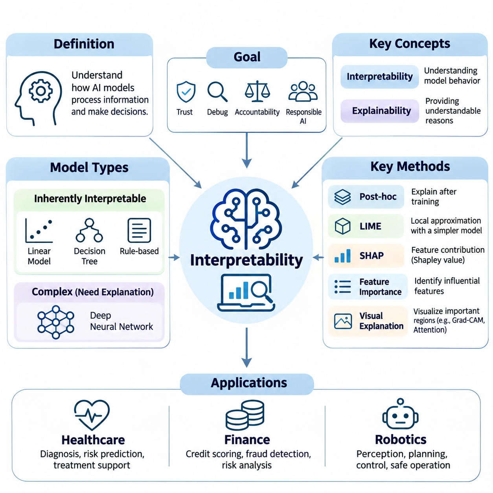
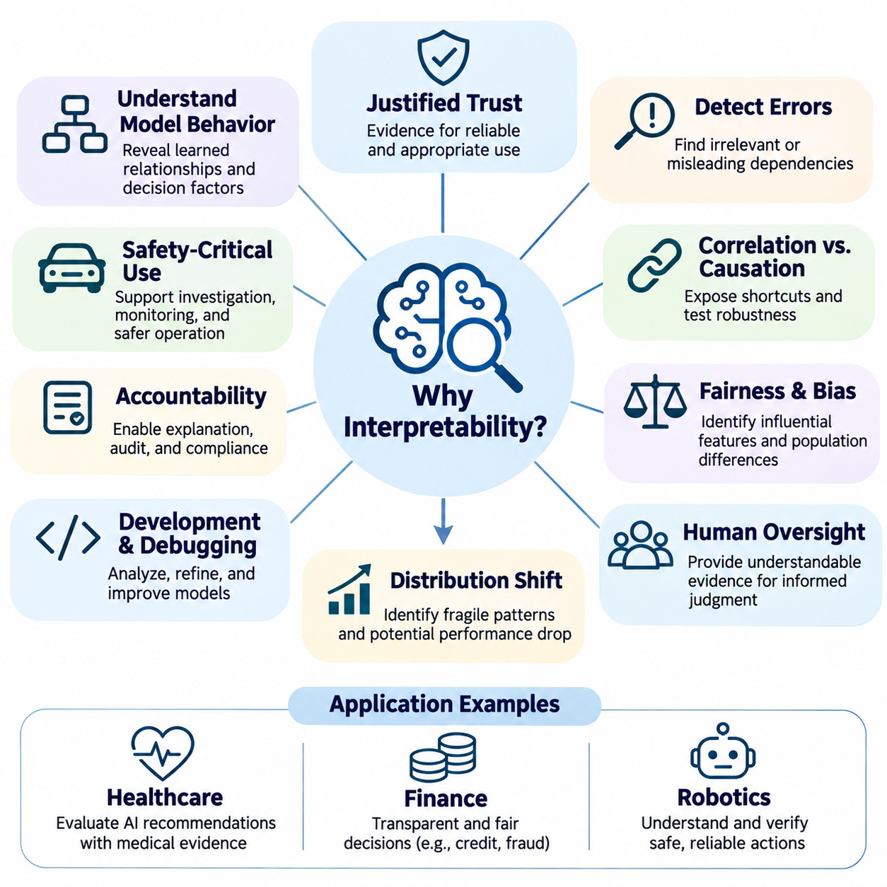
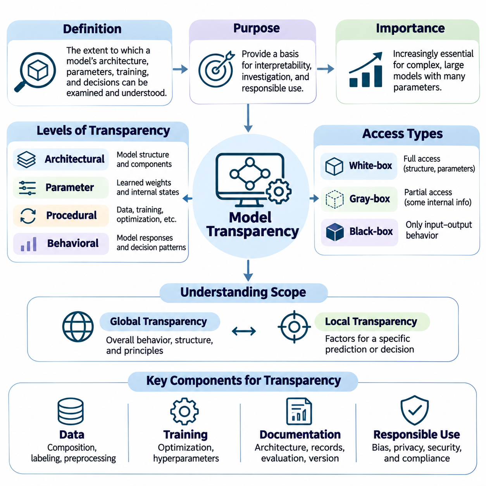
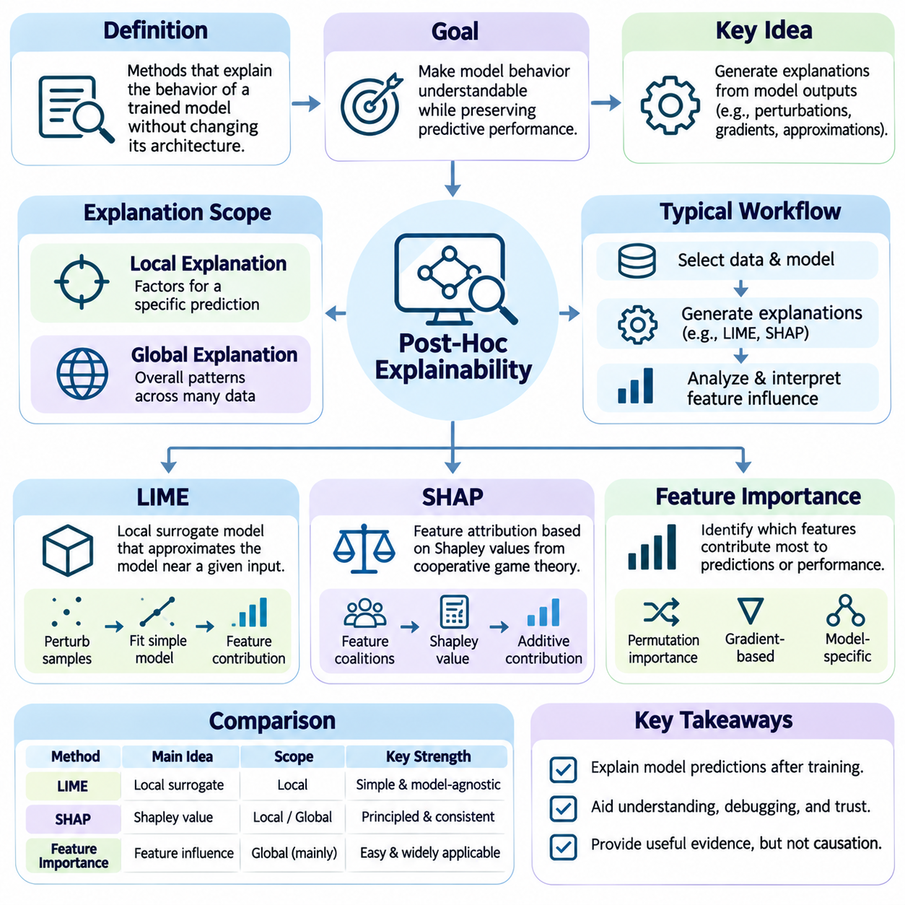
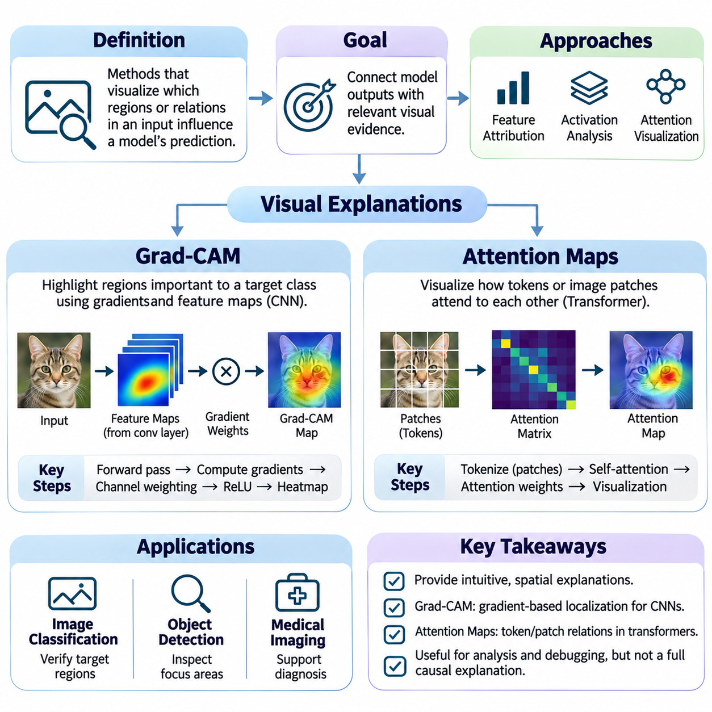
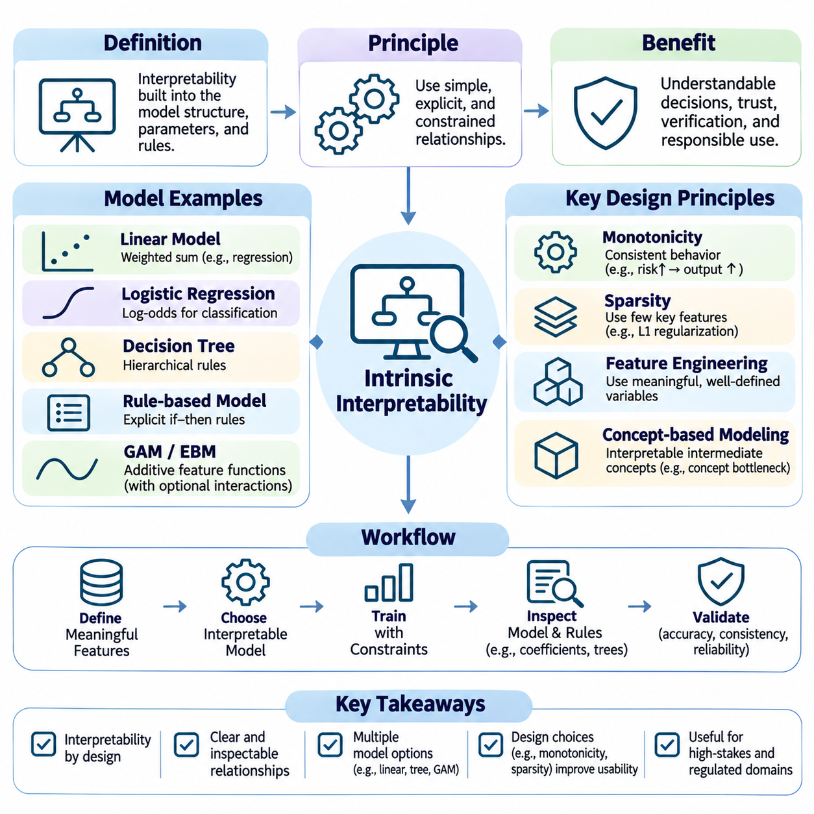
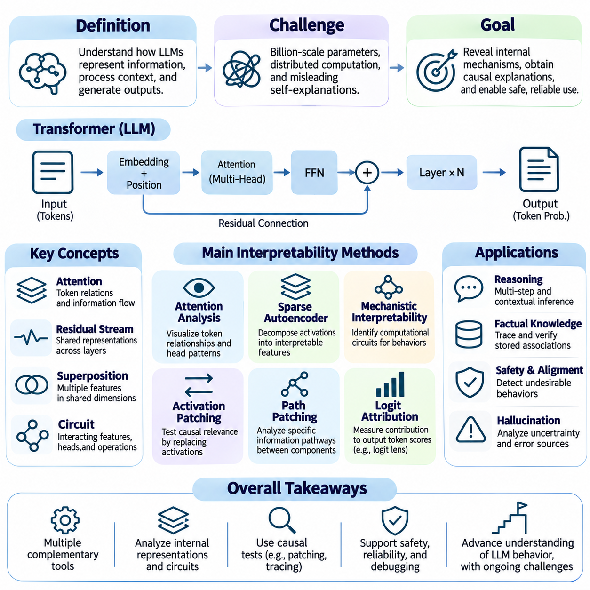
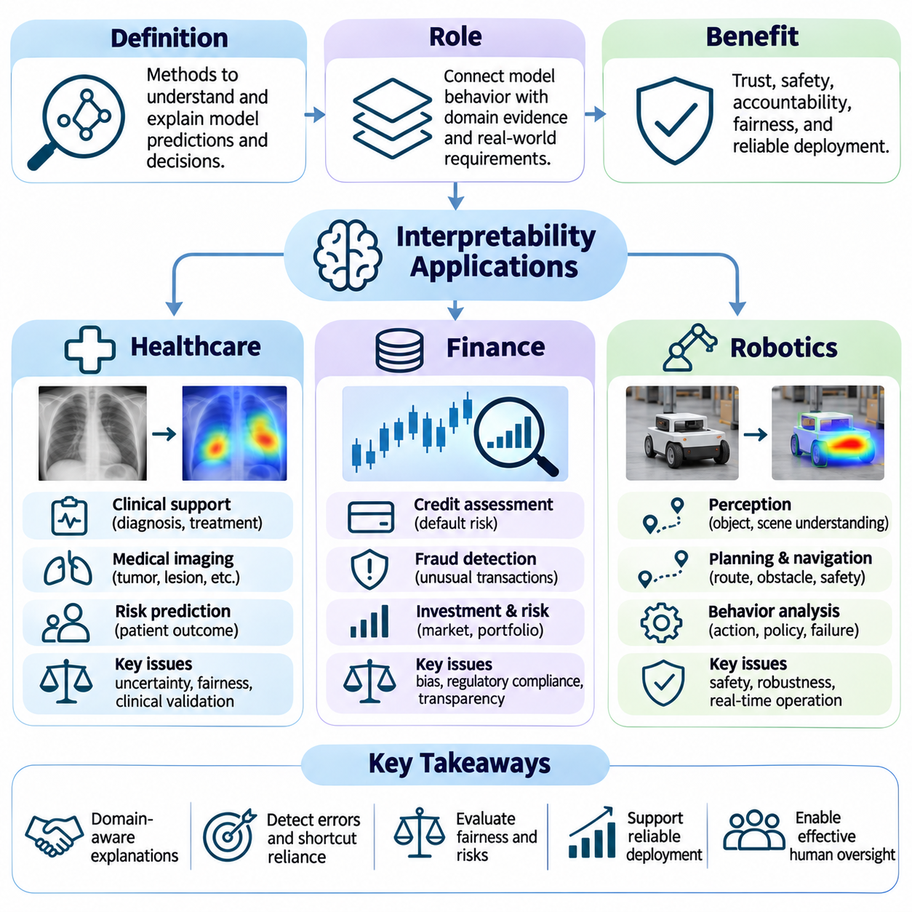

**Volume 42. AI Safety Alignment and Interpretability**

# 03. Interpretability

## 03.00 Overview

{width="7.268055555555556in" height="7.268055555555556in"}

Interpretability is a fundamental discipline in artificial intelligence that investigates how computational models process information, form internal representations, and produce predictions or decisions. As machine learning systems become increasingly complex, understanding their behavior becomes essential for establishing trust, identifying limitations, and supporting responsible deployment. Interpretability connects mathematical model analysis with human understanding.

Modern artificial intelligence frequently relies on deep neural networks containing millions or billions of parameters. Although these systems can achieve remarkable predictive performance, their internal computations are often difficult to understand directly. Interpretability research addresses this challenge by developing methods that reveal influential features, intermediate representations, decision pathways, and relationships between model inputs and outputs.

Interpretability and explainability are closely related but represent distinct perspectives on understanding artificial intelligence. Interpretability generally concerns the extent to which model behavior can be understood through its structure or computational mechanisms. Explainability emphasizes producing understandable accounts of particular predictions or decisions. Both approaches contribute to transparency, accountability, debugging, and meaningful human oversight.

The importance of interpretability extends beyond satisfying intellectual curiosity about machine learning algorithms. Organizations increasingly depend on automated decisions in environments where errors may have financial, physical, or social consequences. Understanding why a system produces a particular result helps engineers detect unreliable correlations, investigate unexpected behavior, evaluate potential biases, and determine whether model outputs deserve confidence.

A central distinction exists between inherently interpretable models and complex models requiring additional explanation techniques. Linear models, small decision trees, and carefully designed rule-based systems often provide relatively direct relationships between inputs and outputs. Deep neural networks generally require specialized analytical methods because their predictions emerge from distributed representations and nonlinear transformations across multiple computational layers.

Model transparency concerns the accessibility and comprehensibility of a system\'s architecture, parameters, computational operations, and learned relationships. Structural transparency may allow researchers to inspect how information flows through a model, while functional transparency concerns understanding how inputs influence outputs. Access to model weights alone does not guarantee meaningful understanding, particularly when knowledge is distributed across many interacting components.

Post-hoc explainability provides methods for investigating models after training without necessarily modifying their internal architecture. These techniques construct explanations from observed model behavior, input perturbations, gradients, or approximations of decision boundaries. Post-hoc methods are especially useful when high-performing models cannot easily be replaced with simpler alternatives, although their explanations may not fully represent the original model\'s reasoning.

Local Interpretable Model-agnostic Explanations, commonly known as LIME, approximates a complex model\'s behavior near a selected prediction using a simpler surrogate model. By generating perturbed examples and observing corresponding predictions, LIME estimates which input features influence the local decision. Its usefulness depends on the quality of the perturbations, neighborhood definition, and fidelity of the surrogate approximation.

SHapley Additive exPlanations, or SHAP, applies concepts from cooperative game theory to estimate feature contributions toward individual predictions. Shapley values distribute changes in model output among input features according to their marginal contributions across feature combinations. SHAP offers a systematic attribution framework, although computational approximations and assumptions about feature dependence can affect interpretation.

Feature importance methods examine which variables contribute most strongly to model predictions or predictive performance. Common approaches include permutation importance, gradient-based attribution, and model-specific importance measures. These methods support feature selection, error investigation, and the identification of suspicious dependencies. However, importance scores do not automatically establish causal relationships or demonstrate that a model uses features appropriately.

Visual explanation methods translate computational evidence into spatial representations that humans can inspect. In computer vision, these techniques help researchers examine which image regions contribute to classification or detection results. Visual explanations can reveal reliance on backgrounds, irrelevant objects, or unexpected visual patterns. Their effectiveness depends on whether the highlighted regions accurately reflect the model\'s computational behavior.

Gradient-weighted Class Activation Mapping, commonly called Grad-CAM, generates class-related localization maps by combining feature activations with gradient-derived weights. It is frequently applied to convolutional neural networks to highlight image regions associated with particular predictions. Although Grad-CAM can provide intuitive visual evidence, its maps are generally coarse and should not be interpreted as complete explanations of model decision processes.

Attention maps provide another approach to examining information processing, particularly in transformer-based architectures. They visualize relationships between tokens, image patches, or other representation elements through attention weights. Such maps can reveal patterns of information exchange, but attention weights alone do not necessarily establish feature importance or causal influence. Reliable interpretation often requires additional experimental validation.

Intrinsic interpretability seeks to make model behavior understandable through architectural choices, explicit constraints, or structured representations. Examples include sparse linear models, compact decision trees, generalized additive models, and selected concept-based architectures. These approaches attempt to integrate comprehensibility into model design rather than relying exclusively on explanations generated after training.

The relationship between interpretability and predictive performance involves important engineering considerations. Simpler models may be easier to inspect, but they are not always sufficiently expressive for complex tasks. Conversely, highly expressive models may achieve strong predictive accuracy while remaining difficult to analyze. Model selection therefore requires evaluating interpretability alongside accuracy, robustness, computational efficiency, and the consequences of incorrect decisions.

Interpretability in large language models introduces additional challenges because language understanding and generation emerge from interactions among extensive parameter networks. Transformer layers, attention mechanisms, residual streams, and distributed representations jointly influence generated tokens. Researchers investigate these systems through activation analysis, probing methods, feature decomposition, and interventions designed to identify computational mechanisms associated with particular behaviors.

Mechanistic interpretability attempts to explain neural network behavior by identifying internal features, computational circuits, and causal interactions. Instead of merely describing correlations between inputs and outputs, it investigates how specific internal components contribute to model computations. Techniques such as activation patching and causal interventions can test proposed mechanisms, although comprehensive understanding of large models remains an open research challenge.

Interpretability is particularly relevant to artificial intelligence safety and alignment. A model may produce acceptable outputs during routine testing while relying on unstable heuristics, unintended shortcuts, or misleading internal representations. Interpretability techniques can help identify such vulnerabilities and support investigations into reward hacking, specification gaming, and other undesirable behaviors. Nevertheless, interpretability evidence alone cannot guarantee safety or alignment.

Reliable interpretability requires distinguishing descriptive explanations from causal explanations. A descriptive method may identify features correlated with a prediction, whereas causal analysis investigates whether changing a feature or internal mechanism actually changes the model\'s behavior. Controlled interventions, counterfactual experiments, and carefully designed perturbation studies provide stronger evidence about computational dependencies than visualization alone.

Evaluating explanation quality presents a substantial methodological challenge. An explanation may appear convincing to a human observer without faithfully representing the model\'s actual computation. Consequently, interpretability research considers fidelity, stability, consistency, sensitivity, and usefulness. Explanations should be assessed against explicit objectives rather than judged solely by their visual appeal or apparent simplicity.

Interpretability also plays an important role in healthcare, where machine learning systems may assist with diagnosis, risk estimation, and clinical decision support. Clinicians need to understand the evidence influencing predictions and recognize circumstances in which model recommendations may be unreliable. Explanation methods can support clinical review, but their outputs must be evaluated against medical evidence and should not substitute for independent clinical judgment.

In financial applications, interpretability supports credit assessment, fraud detection, risk modeling, and regulatory accountability. Financial institutions may need to investigate which factors influence automated decisions and whether model behavior remains consistent with applicable policies. Explanation techniques can reveal potentially problematic dependencies, support audits, and improve communication between model developers, risk managers, and decision makers.

Robotics introduces additional interpretability requirements because artificial intelligence decisions can directly affect physical environments. Autonomous robots combine perception, planning, control, and feedback to generate actions under uncertainty. Understanding why a robot selects a movement, identifies an obstacle, or changes its trajectory can support fault diagnosis, operator intervention, and safety analysis during real-world deployment.

Effective interpretability must account for the needs of different stakeholders. Researchers may require detailed information about internal representations, engineers may prioritize debugging and reliability, and domain experts may need explanations connected to operational concepts. End users often require concise descriptions of influential factors and uncertainty. A single explanation format is therefore unlikely to satisfy every interpretability objective.

The practical integration of interpretability into artificial intelligence development requires continuous evaluation throughout the model lifecycle. Explanations can inform dataset inspection, architecture selection, training diagnostics, validation, deployment monitoring, and incident investigation. Combining multiple complementary techniques provides stronger evidence than relying on one attribution method, especially when models operate in complex or safety-critical environments.

Ultimately, interpretability provides a bridge between computational intelligence and responsible human understanding. Its purpose is not merely to generate plausible descriptions of artificial intelligence decisions, but to establish experimentally supported knowledge about model behavior and limitations. As increasingly capable systems enter consequential applications, interpretability will remain essential to transparency, trustworthy evaluation, human oversight, and the broader development of safe artificial intelligence.

## 03.01 Why Interpretability

{width="7.268055555555556in" height="7.268055555555556in"}

Interpretability is essential because artificial intelligence systems increasingly influence decisions that affect individuals, organizations, and society. As machine learning models become more complex, their predictions may be accurate without being understandable. This creates a fundamental challenge: users must determine whether a model\'s outputs are reliable, appropriate, and consistent with intended objectives, even when its internal decision processes remain difficult to examine.

Traditional software systems generally follow explicitly programmed rules, allowing developers to trace how particular inputs produce corresponding outputs. Machine learning systems instead acquire decision patterns from training data through optimization. These learned relationships may involve complex interactions among thousands or billions of parameters. Interpretability provides methods for investigating these relationships and understanding how models transform information into decisions.

One major motivation for interpretability is establishing justified trust in artificial intelligence. Users should not trust a system merely because it produces convincing answers or achieves high benchmark accuracy. Trust should depend on evidence that the model behaves consistently, recognizes relevant information, and operates within acceptable limitations. Interpretability helps reveal whether predictions arise from meaningful patterns or from accidental correlations that may fail in unfamiliar situations.

Interpretability is also critical for detecting hidden errors and unexpected model behavior. A system may perform well on evaluation datasets while relying on irrelevant features, misleading statistical relationships, or artifacts introduced during data collection. Such dependencies can remain undetected until deployment conditions change. Explanation techniques allow researchers to investigate influential features and identify suspicious decision patterns before they produce significant operational failures.

The distinction between correlation and causation is particularly important when interpreting machine learning models. A model may associate a feature with a particular outcome without understanding the underlying causal relationship. For example, an image classifier might recognize an animal primarily through background scenery rather than its physical characteristics. Interpretability can expose these shortcuts and motivate experiments that determine whether the learned relationships are robust.

Safety-critical applications create especially strong requirements for understandable artificial intelligence. Autonomous vehicles, medical decision-support systems, industrial robots, and infrastructure controllers may generate outputs with direct physical consequences. When unexpected behavior occurs, engineers must identify contributing factors and determine whether corrective action is necessary. Interpretability supports failure investigation, operational monitoring, and the development of more reliable safety mechanisms.

Interpretability contributes to accountability by making automated decisions more accessible to human examination. Organizations deploying artificial intelligence may need to explain how decisions are made, identify responsible processes, and demonstrate compliance with applicable requirements. Meaningful explanations support internal audits, external assessments, and communication with affected individuals. However, explanation tools must be validated because plausible descriptions do not necessarily represent actual model computations.

Fairness and bias assessment provide another important motivation for interpretability. Machine learning systems may reproduce historical inequalities or develop dependencies on variables correlated with protected characteristics. Interpretability methods can help identify influential features and investigate whether predictions differ systematically across populations. Nevertheless, feature attribution alone cannot establish fairness, making complementary statistical evaluations and contextual analysis necessary.

Interpretability also improves model development and debugging. During training, researchers may observe unexpected changes in accuracy, unstable optimization, or inconsistent predictions across related examples. Investigating feature contributions, intermediate activations, and learned representations can reveal potential causes. These insights help developers refine datasets, modify architectures, adjust training procedures, and evaluate whether proposed improvements address the underlying problem.

Understanding model behavior becomes particularly important under distribution shift, where deployment data differs from the information encountered during training. A model may depend on patterns that are predictive in its original environment but unreliable elsewhere. Interpretability can help identify these dependencies and reveal potential sources of performance degradation. Combined with uncertainty estimation and out-of-distribution testing, it supports more informed deployment decisions.

Interpretability strengthens human oversight by enabling operators to examine the evidence associated with automated recommendations. Human supervisors require more than numerical predictions when deciding whether to accept, reject, or modify system outputs. Explanations can communicate influential factors, potential limitations, and relevant uncertainties. Effective oversight nevertheless requires that explanations be understandable, appropriately calibrated, and supported by mechanisms for meaningful human intervention.

In healthcare, interpretability helps clinicians evaluate artificial intelligence recommendations in relation to medical evidence and patient circumstances. A diagnostic model may identify patterns in medical images or clinical records that contribute to a predicted condition. Understanding these factors can support professional review and reveal possible data-related errors. However, explanations should complement clinical expertise rather than create unjustified confidence in automated conclusions.

Financial applications similarly benefit from interpretable decision processes. Credit scoring, fraud detection, insurance risk assessment, and investment analysis frequently involve complex relationships among economic and behavioral variables. Interpretability helps analysts investigate why particular outcomes are predicted and whether the model depends on inappropriate or unstable factors. These capabilities support risk management, auditing, and the responsible use of automated financial decisions.

In robotics and autonomous systems, interpretability extends beyond explaining static predictions to understanding sequences of actions. Robots continuously integrate sensory observations, internal state estimates, planning objectives, and control commands. When a robot changes direction or selects an unexpected action, engineers need to investigate the information and mechanisms influencing that behavior. Such analysis supports debugging, safety assessment, and more effective human-robot collaboration.

Large language models introduce distinctive interpretability challenges because their outputs emerge from distributed representations and complex interactions across transformer layers. A generated explanation of a model\'s own behavior may sound coherent without accurately describing the computations that produced its answer. Researchers therefore examine activations, attention patterns, learned features, and causal interventions to investigate internal mechanisms rather than relying exclusively on verbal explanations.

Mechanistic interpretability aims to identify the computational structures responsible for specific model behaviors. By studying internal features and their interactions, researchers attempt to understand how neural networks represent concepts, retrieve information, and transform representations into outputs. This approach can provide stronger evidence about internal computation than surface-level explanations, although scaling such analysis to large models remains technically challenging.

Interpretability is closely connected to artificial intelligence alignment because observable performance does not always reveal whether a system pursues intended objectives. A model may achieve favorable evaluation results through shortcuts, reward exploitation, or strategies inconsistent with human expectations. Investigating internal mechanisms and behavioral dependencies can provide additional evidence about these risks. However, interpretability remains one component of alignment evaluation rather than a complete solution.

An important limitation is that explanations can be misleading even when they appear intuitive. Feature importance scores may vary across methods, visualizations may emphasize irrelevant regions, and simplified surrogate models may fail to reproduce the original system accurately. Consequently, explanation quality must be evaluated through fidelity tests, perturbation experiments, stability analysis, and comparisons with observable model behavior.

Different stakeholders also require different forms of interpretability. Machine learning researchers may investigate internal representations and computational circuits, while software engineers focus on debugging and reliability. Domain specialists need explanations connected to meaningful operational concepts, whereas end users may require concise reasons for individual decisions. Effective interpretability therefore depends on matching explanation methods to the audience, application, and decision context.

Interpretability supports scientific understanding by transforming trained models into objects of systematic investigation. Researchers can formulate hypotheses about learned representations, test them through controlled interventions, and compare observed behavior with theoretical expectations. This process helps distinguish genuine computational mechanisms from superficial correlations. It also contributes to broader knowledge about representation learning, generalization, and the emergence of complex model capabilities.

The economic value of interpretability arises from reducing uncertainty during model development, validation, and deployment. Better understanding can shorten debugging cycles, improve error diagnosis, and help organizations identify unsuitable models before costly failures occur. Interpretability may also facilitate communication between technical teams and decision makers. Its practical value depends on whether explanations produce actionable insights rather than merely increasing the amount of information presented.

Ultimately, interpretability matters because increasingly capable artificial intelligence must remain subject to meaningful human understanding and evaluation. High predictive performance alone cannot establish reliability, fairness, safety, or alignment with intended goals. By revealing important features, computational dependencies, and behavioral limitations, interpretability provides evidence that supports responsible development, informed oversight, and more trustworthy artificial intelligence systems.

## 03.02 Model Transparency

{width="7.268055555555556in" height="7.268055555555556in"}

Model transparency refers to the extent to which an artificial intelligence system\'s architecture, parameters, learning procedures, and decision processes can be examined and understood. It provides a foundation for interpretability by making the components responsible for model behavior accessible to researchers and engineers. Transparency does not necessarily imply complete understanding, but it enables systematic investigation of how computational mechanisms produce predictions.

The need for model transparency has increased as machine learning systems have evolved from relatively simple statistical models into complex neural architectures. Modern deep learning systems may contain billions of parameters distributed across interconnected layers. Although their mathematical operations are explicitly defined, the relationships between individual computations and meaningful decisions can remain difficult to identify without specialized analytical techniques.

Transparency can be examined at several levels, including architectural transparency, parameter transparency, procedural transparency, and behavioral transparency. Architectural transparency concerns the organization of computational components, while parameter transparency provides access to learned weights and internal states. Procedural transparency addresses training and optimization processes, whereas behavioral transparency focuses on observable responses under different input conditions.

Architectural transparency begins with understanding how a model organizes and processes information. In a neural network, this includes identifying layers, activation functions, normalization mechanisms, attention operations, and connections between computational modules. Such knowledge helps researchers trace information flow and identify potential sources of unexpected behavior, although architectural documentation alone cannot fully explain learned representations.

Parameter transparency concerns the accessibility and analysis of learned model weights, biases, embeddings, and other internal variables. These parameters encode statistical relationships acquired during training and influence how inputs are transformed into outputs. However, individual parameter values rarely provide meaningful explanations in large neural networks because computational functions are distributed across many interacting parameters.

Procedural transparency examines how models are developed, trained, validated, and modified throughout their lifecycle. Important information includes training datasets, preprocessing procedures, optimization algorithms, objective functions, hyperparameters, and evaluation protocols. Documenting these elements allows researchers to investigate the origins of model behavior and distinguish architectural limitations from problems introduced during training.

Data transparency is particularly important because machine learning systems acquire much of their behavior from training examples. Dataset composition, labeling procedures, sampling strategies, and preprocessing decisions can influence learned relationships. Understanding these factors helps identify potential sources of bias, data leakage, and distribution mismatch. Transparency must nevertheless respect privacy, confidentiality, intellectual property, and security constraints.

Behavioral transparency focuses on examining how a model responds to different inputs, environmental conditions, and operational constraints. Researchers may evaluate predictions across representative examples, unusual scenarios, and deliberately modified inputs. These observations help characterize decision boundaries, sensitivity, and failure patterns. Behavioral analysis remains valuable even when direct access to model architecture or parameters is unavailable.

A fundamental distinction exists between white-box, black-box, and gray-box models. White-box access allows inspection of internal structures and parameters, while black-box analysis relies primarily on input-output observations. Gray-box settings provide partial information about internal operations. These categories describe levels of access rather than guaranteed levels of understanding, since even fully accessible neural networks may remain difficult to interpret.

White-box transparency enables detailed investigation of computational mechanisms through gradients, intermediate activations, parameter analysis, and controlled interventions. Researchers can examine how internal representations change across layers and how specific components influence outputs. Nevertheless, large-scale distributed computation creates substantial analytical challenges, making complete explanations difficult even when all model parameters are available.

Black-box transparency relies on systematic experimentation rather than direct inspection of internal computations. Researchers can perturb inputs, compare predictions, construct surrogate models, and estimate feature importance. Such techniques reveal aspects of observable behavior and support practical evaluation. However, multiple internal mechanisms may produce similar outputs, limiting conclusions about the model\'s actual computational processes.

Transparency should also distinguish global understanding from local understanding. Global transparency concerns the overall behavior, structure, and operating principles of a model across many inputs. Local transparency focuses on the factors influencing a particular prediction or decision. Both perspectives are necessary because a model may behave consistently in general while producing individual outputs through unexpected or unreliable dependencies.

Model documentation provides an operational mechanism for improving transparency across development teams. Architecture specifications, training records, dataset descriptions, evaluation reports, and version histories preserve information needed for investigation. Documentation frameworks such as model cards and dataset datasheets can communicate intended uses, known limitations, and evaluation conditions. Their usefulness depends on accuracy, completeness, and continuous maintenance.

Transparency plays an important role in debugging and model validation. When predictions become unstable or performance deteriorates, engineers need evidence about data transformations, learned representations, and computational operations. Access to intermediate outputs and training records can help identify numerical instability, preprocessing errors, and unexpected feature dependencies. These investigations support targeted corrections rather than relying exclusively on repeated training.

In transformer-based systems, transparency requires examining token embeddings, attention mechanisms, residual connections, feedforward networks, and output projections. These components interact to produce contextual representations and generated sequences. Although attention matrices provide useful information about computational interactions, they do not independently establish causal explanations. Additional interventions are often necessary to identify mechanisms responsible for specific outputs.

Large language models introduce further challenges because meaningful functions may emerge from distributed representations across numerous layers and attention heads. Access to weights and activations provides substantial information but does not automatically reveal how concepts, factual associations, or reasoning-related computations are implemented. Mechanistic interpretability investigates these questions through feature analysis, circuit identification, and causal experiments.

Transparency is closely connected to explainability, but the two concepts should not be treated as interchangeable. Transparency concerns the availability and comprehensibility of model information, whereas explainability concerns producing understandable accounts of behavior or decisions. A transparent architecture may still require explanation methods, and a black-box model may support useful post-hoc explanations without revealing its underlying computational mechanisms.

The relationship between transparency and trust requires careful evaluation. Greater access to internal information can support auditing, debugging, and independent verification, but disclosure alone does not establish reliability or safety. A system may be extensively documented while still containing biased representations or unstable decision rules. Trustworthy assessment therefore combines transparency with empirical testing, robustness evaluation, and evidence of appropriate behavior.

Transparency also introduces practical tradeoffs involving intellectual property, privacy, security, and operational complexity. Publishing complete model weights or sensitive training records may expose confidential information or enable misuse. Consequently, transparency mechanisms should be designed according to stakeholder needs and applicable constraints. Controlled access, independent auditing, and structured documentation can sometimes provide meaningful accountability without unrestricted disclosure.

In safety-critical systems, transparency supports the investigation of decisions that may affect physical environments or human well-being. Autonomous vehicles and robots combine perception, localization, planning, and control components that operate under uncertainty. Recording sensor inputs, intermediate estimates, selected actions, and safety interventions helps engineers reconstruct incidents and evaluate whether system behavior remained consistent with operational requirements.

Effective model transparency requires more than collecting technical information. The available evidence must be organized so that relevant stakeholders can interpret it and connect it to practical decisions. Researchers may need detailed computational traces, while operators require understandable diagnostic information. Regulators and auditors may prioritize documented procedures and reproducible evaluations. Transparency therefore depends on both technical accessibility and meaningful communication.

Ultimately, model transparency establishes the informational foundation for investigating artificial intelligence behavior throughout development and deployment. It enables researchers to examine computational structures, trace learning processes, evaluate decisions, and identify potential limitations. Although transparency cannot independently guarantee interpretability, fairness, or safety, it strengthens the evidence required for responsible oversight and trustworthy artificial intelligence engineering.

## 03.03 Post Hoc Explainability

{width="7.268055555555556in" height="7.268055555555556in"}

Post-hoc explainability refers to methods that investigate the behavior of trained machine learning models without requiring fundamental changes to their architectures or learning procedures. These methods generate explanations after predictions have been produced, helping researchers understand which inputs influence particular outcomes. They are especially valuable for complex models whose internal computations cannot be interpreted directly.

The primary objective of post-hoc explainability is to make model behavior accessible to human analysis while preserving the predictive capabilities of the original system. Instead of replacing a complex neural network with a simpler model, researchers construct explanations using observed predictions, input perturbations, gradients, or statistical approximations. These explanations provide useful evidence but may not fully reproduce internal decision mechanisms.

Post-hoc methods can be categorized according to whether they explain individual predictions or overall model behavior. Local explanations identify factors influencing a specific output, whereas global explanations characterize broader patterns across many observations. Both perspectives are important because a model may rely on different features in different regions of its input space, making individual decisions difficult to understand through aggregate statistics alone.

Local Interpretable Model-agnostic Explanations, commonly known as LIME, explains individual predictions by approximating complex model behavior within a neighborhood of a selected input. The method constructs a simpler surrogate model that reproduces the original model\'s predictions locally. This allows users to examine influential features without requiring direct access to the original model\'s internal parameters or computational structure.

LIME begins by selecting an input instance and generating modified samples around it. These samples are evaluated by the original model, producing predictions that describe its behavior near the selected instance. A simple interpretable model, often a sparse linear regression, is then fitted using proximity-weighted observations. The resulting coefficients estimate which features contribute most strongly to the local prediction.

The quality of a LIME explanation depends heavily on how neighboring samples are generated and weighted. Perturbations should represent meaningful variations rather than unrealistic combinations of features. The neighborhood size and distance metric also influence the resulting surrogate model. Consequently, explanations may change when sampling strategies, random seeds, or local approximation parameters are modified.

LIME can be implemented using Python libraries that support tabular, textual, and image-based explanations. For tabular classification, a typical workflow initializes LimeTabularExplainer with training features and class information, then calls explain_instance using a selected observation and prediction function. The resulting explanation provides feature contributions and local fidelity information that can be examined programmatically.

In image classification, LIME commonly perturbs groups of pixels represented as superpixels and observes how masking selected regions affects predictions. For text classification, it may remove or modify words to estimate their influence on predicted categories. These approaches provide intuitive local explanations, although the interpretation depends on whether the perturbations preserve meaningful relationships in the original data.

SHapley Additive exPlanations, or SHAP, provides a feature attribution framework based on cooperative game theory. It interprets model predictions by assigning contributions to individual features relative to a reference expectation. SHAP connects explanation methods with Shapley values, which distribute the difference between a prediction and a baseline according to contributions evaluated across feature coalitions.

The Shapley value of a feature represents its average marginal contribution when added to different subsets of available features. This formulation provides a principled allocation mechanism under a specified cooperative game. SHAP explanations are commonly expressed as a baseline prediction plus additive feature contributions. The interpretation depends on the chosen background distribution and the definition of missing features.

SHAP includes several computational approaches designed for different model families and performance requirements. KernelExplainer provides a model-agnostic approximation, TreeExplainer supports efficient explanations for many tree-based models, and gradient-based approaches can analyze compatible neural networks. Selecting an appropriate explainer requires considering model architecture, computational cost, background data, and the desired explanation properties.

A practical SHAP implementation in Python typically constructs an explainer using a trained model and suitable background data. The explainer evaluates selected observations and returns attribution values for their features. Developers can inspect individual predictions or aggregate attribution magnitudes across datasets. These analyses should account for feature dependence, baseline selection, and approximation uncertainty when interpreting results.

LIME and SHAP share the objective of explaining complex predictions, but their mathematical foundations differ. LIME constructs a locally weighted surrogate model, while SHAP estimates additive contributions associated with Shapley-value principles. LIME emphasizes local approximation, whereas SHAP emphasizes contribution allocation under a defined game. Neither method automatically establishes causal relationships between features and outcomes.

Feature importance provides a broader perspective on identifying variables that influence model predictions or predictive performance. Importance can be evaluated globally across a dataset or locally for individual observations. Different importance measures answer different questions, making it necessary to distinguish predictive dependence, attribution magnitude, and performance degradation rather than treating all importance scores as equivalent.

Permutation feature importance measures how predictive performance changes when the values of a selected feature are shuffled across observations. A substantial performance decrease suggests that the model depends on information associated with that feature. This method can be applied to many trained models without inspecting internal parameters. However, correlated features and unrealistic feature combinations may distort importance estimates.

Model-specific importance methods exploit information available within particular learning algorithms. Decision trees may report impurity-based importance derived from feature splits, while linear models provide coefficients describing feature relationships under their parameterization. Neural networks support gradient-based attribution methods. Each approach has limitations, and scores should not be compared without considering their underlying definitions.

Gradient-based feature importance examines how model outputs respond to changes in input variables. Saliency maps use input gradients to identify sensitive dimensions, while Integrated Gradients accumulates gradients along a path from a reference input to the observation. These methods can reveal influential input regions, but gradient saturation, baseline selection, and local sensitivity may complicate interpretation.

Feature importance analysis is particularly useful for detecting shortcut learning and unintended dependencies. A model may rely on background textures, data collection artifacts, or variables indirectly associated with protected characteristics. By examining influential features, engineers can identify suspicious patterns and design targeted validation experiments. However, high importance does not prove that a feature causes the predicted outcome.

Correlated features create substantial challenges for post-hoc explanations because multiple variables may contain overlapping predictive information. Attribution methods can distribute importance differently depending on assumptions about feature dependence and perturbation procedures. Removing one feature may leave equivalent information available through another. Therefore, explanations should be interpreted in relation to the dataset\'s statistical structure.

Explanation fidelity describes how accurately an explanation represents the behavior of the model being analyzed. For surrogate approaches, fidelity can be measured by comparing surrogate predictions with original model outputs within a defined neighborhood. Stability examines whether similar inputs or repeated explanation procedures produce consistent results. These properties help distinguish useful explanations from attractive but unreliable descriptions.

Post-hoc explainability also involves computational and operational tradeoffs. Model-agnostic methods may require numerous prediction queries, making them expensive for large datasets or complex models. Specialized explainers can improve efficiency but introduce model-specific assumptions. Practical deployments must balance explanation accuracy, latency, computational resources, and the level of detail required by different stakeholders.

In healthcare, finance, and robotics, post-hoc explanations can support expert review, error analysis, and operational accountability. Clinicians may inspect factors associated with diagnostic predictions, financial analysts may investigate risk scores, and robotics engineers may examine perception outputs. Explanations should remain supplementary evidence rather than definitive proof that a system is safe, fair, or causally correct.

Ultimately, LIME, SHAP, and feature importance methods provide complementary tools for investigating trained artificial intelligence systems. Their value lies in exposing influential relationships, supporting debugging, and enabling more informed human oversight. Reliable application requires appropriate background data, carefully designed perturbations, fidelity evaluation, and recognition that explanatory attribution is not equivalent to a complete causal account of model behavior.

## 03.04 Visual Explanations

{width="7.268055555555556in" height="7.268055555555556in"}

Visual explanations provide methods for understanding how artificial intelligence models process visual information and identify the regions or relationships influencing their predictions. These techniques translate complex computational behavior into spatial representations that humans can examine. They are particularly useful in computer vision, where neural networks extract hierarchical features from images, videos, and other visual inputs.

The primary objective of visual explainability is to connect model outputs with relevant input regions or internal representations. A classification model may identify an object correctly, but its prediction does not reveal which visual evidence influenced the decision. Visual explanation methods help investigate whether the model focuses on meaningful object characteristics, contextual information, or irrelevant background patterns.

Visual explanation techniques generally operate through feature attribution, activation analysis, or attention visualization. Feature attribution estimates how strongly input elements contribute to an output, while activation analysis examines responses within neural network layers. Attention visualization represents relationships among information elements. These approaches offer complementary perspectives but should not automatically be interpreted as complete causal explanations.

Gradient-weighted Class Activation Mapping, commonly known as Grad-CAM, is a technique for identifying image regions associated with a selected prediction in convolutional neural networks. It combines gradients of a target output with activation maps from a selected convolutional layer. The resulting spatial representation highlights regions that positively influence the target score under the method\'s approximation.

Grad-CAM begins with a forward pass through the neural network to obtain a target class score and intermediate feature maps. During backpropagation, gradients of the selected score are calculated with respect to those feature maps. The gradients are spatially averaged to estimate the importance of each activation channel. These weights are then combined with the corresponding feature maps to construct a class-specific localization map.

The standard Grad-CAM formulation applies a rectified linear unit to the weighted combination of activation maps. This operation emphasizes positive contributions to the selected target score while suppressing negative values. The resulting map is typically resized to the original image dimensions for spatial comparison. Its resolution depends on the selected layer, and resizing cannot recover details absent from the underlying feature maps.

Layer selection significantly affects the interpretation of Grad-CAM results. Earlier convolutional layers preserve relatively fine spatial details but often represent lower-level visual patterns. Deeper layers contain more abstract semantic information but generally have lower spatial resolution. Selecting an appropriate layer requires balancing localization precision with the relevance of learned representations to the target prediction.

Grad-CAM can be implemented in PyTorch by registering hooks that capture intermediate activations and their gradients. After performing a forward pass and selecting a target score, backpropagation provides the gradients needed for channel weighting. The weighted activation maps are combined, rectified, and normalized for inspection. Implementations must handle tensor dimensions, gradient state, and model architecture correctly.

A practical implementation may use a pretrained convolutional network such as ResNet and select its final convolutional stage as the target layer. The input image undergoes the same preprocessing used during model training. The explanation is generated for a specified class rather than assuming that the highest-scoring class is always the desired target. This distinction is important when investigating incorrect predictions or competing hypotheses.

Grad-CAM is useful for identifying potential shortcut learning in visual recognition systems. For example, an animal classifier might rely on environmental backgrounds rather than the animal itself, or an industrial inspection model might focus on irrelevant surface markings. Examining localization maps can reveal suspicious dependencies and motivate controlled tests. However, visually plausible heatmaps do not establish that the highlighted regions are causally necessary.

Several extensions of Grad-CAM have been proposed to address localization and attribution limitations. Grad-CAM++ modifies weighting calculations to better accommodate certain spatial contribution patterns, while Score-CAM uses changes in model scores associated with activation-derived masks. These methods differ in computational requirements and attribution assumptions. Their performance should be evaluated against the intended explanation objective rather than visual appearance alone.

Attention maps provide another important approach to visual explanation, particularly in transformer-based architectures. Attention mechanisms compute relationships between query and key representations, producing weights used to combine value representations. These weights can be organized into matrices describing interactions among tokens or spatial patches. Visualization helps researchers examine information routing within attention layers.

In vision transformers, input images are divided into patches that are converted into token representations. Self-attention mechanisms allow each token to incorporate information from other tokens, supporting the modeling of long-range spatial relationships. Attention maps can indicate which patches receive higher attention weights from a selected query token. However, high attention weight does not necessarily imply a proportionally large contribution to the final prediction.

Attention visualization in language models reveals relationships among tokens during contextual processing. Individual attention heads may exhibit patterns associated with positional relationships, repeated tokens, or syntactic structures. Researchers can inspect these patterns to generate hypotheses about internal information flow. Nevertheless, the actual effect of an attention connection also depends on value vectors, projections, residual pathways, and downstream computations.

Attention rollout attempts to summarize information propagation across multiple transformer layers by combining attention matrices. This approach can provide an approximate view of token interactions beyond a single layer. However, aggregation introduces assumptions about residual connections and information mixing. Consequently, rollout maps should be understood as analytical approximations rather than definitive measurements of causal influence.

The distinction between attention and explanation is essential. Attention weights describe aspects of a model\'s computational routing, but they do not independently establish why a prediction occurred. Different attention configurations may sometimes produce similar outputs, and important information may flow through pathways not captured by a selected visualization. Causal interventions, activation patching, and output sensitivity tests can provide stronger evidence about functional importance.

Grad-CAM and attention maps differ in the information they represent and the architectures they typically analyze. Grad-CAM uses target gradients and convolutional activations to estimate spatial relevance, whereas attention maps display learned interaction weights among representations. Both methods can produce intuitive visualizations, but their numerical meanings are different. Direct comparisons require careful consideration of model structure and explanation objectives.

Visual explanation quality can be evaluated through faithfulness, localization accuracy, stability, and sensitivity to meaningful input changes. Faithfulness tests examine whether removing or modifying highly attributed regions affects model predictions as expected. Localization assessments compare highlighted regions with relevant annotations when suitable ground truth exists. Stability analysis investigates whether small, irrelevant input changes produce unreasonable explanation differences.

Perturbation-based evaluation is particularly important because visually convincing explanations may not accurately represent model behavior. Researchers can mask selected regions, replace image patches, or intervene on internal activations and measure changes in target scores. These experiments help test attribution hypotheses, although perturbations may introduce unrealistic inputs. Evaluation procedures must therefore consider distribution shift and the semantic validity of modified observations.

Visual explanations are valuable in healthcare applications involving radiology, pathology, and medical image classification. Localization maps can help specialists investigate whether diagnostic predictions are associated with anatomically relevant regions. However, a heatmap overlapping a suspected lesion does not establish diagnostic correctness or clinical reliability. Explanations must be evaluated alongside validated medical evidence, uncertainty estimates, and professional judgment.

In autonomous robotics, visual explanations can support the investigation of perception systems responsible for object detection, scene understanding, and navigation decisions. Engineers may examine whether models attend to pedestrians, obstacles, road boundaries, or irrelevant environmental features. Such analysis can reveal weaknesses in perception pipelines and support safety testing. Explanations of perception alone, however, do not fully explain downstream planning and control actions.

Operational deployment introduces additional challenges involving computational latency, visualization consistency, and explanation management. Gradient-based techniques may require backward passes that increase processing time, while attention analysis can produce large matrices across layers and heads. Real-time systems must balance diagnostic detail with computational constraints. Explanation records should also preserve model versions, input conditions, and target definitions to support reproducibility.

Ultimately, Grad-CAM and attention maps provide complementary methods for examining visual and representational behavior in artificial intelligence systems. They help researchers identify influential regions, investigate information interactions, and detect potentially unreliable dependencies. Their responsible use requires understanding mathematical assumptions, validating explanation fidelity, and distinguishing visually persuasive patterns from experimentally supported causal mechanisms.

## 03.05 Intrinsic Interpretability

{width="7.268055555555556in" height="7.268055555555556in"}

Intrinsic interpretability refers to the ability to understand a machine learning model directly through its structure, parameters, and decision rules without relying primarily on external explanation methods. Unlike post-hoc explainability, which analyzes trained models after predictions are generated, intrinsic interpretability is incorporated into model design. Its objective is to make the reasoning process accessible while maintaining useful predictive performance.

The fundamental principle of intrinsic interpretability is that model behavior should be understandable through a limited set of meaningful computational relationships. Simple mathematical structures, explicit decision rules, and constrained feature interactions can make predictions easier to examine. However, structural simplicity does not automatically guarantee meaningful explanations, particularly when input features are poorly defined or strongly correlated.

Linear models provide one of the most familiar examples of intrinsic interpretability. In linear regression, predictions are expressed as weighted combinations of input features and an intercept. Each coefficient represents the expected change in the prediction associated with a unit change in its feature while other variables remain fixed. This interpretation depends on feature scaling, model specification, and the assumptions underlying the regression.

Logistic regression extends this principle to classification by modeling the logarithm of the odds of an outcome as a linear function of input features. Its coefficients describe changes in log-odds, while exponentiated coefficients represent multiplicative changes in odds. These relationships offer relatively direct interpretations, although interactions, correlated variables, and nonlinear transformations can complicate their practical meaning.

Decision trees offer another intrinsically interpretable approach by representing predictions through hierarchical conditional rules. Each internal node evaluates a feature threshold, and each branch corresponds to a possible decision outcome. A prediction can be traced along a sequence of conditions from the root to a terminal leaf. This structure allows users to examine the logical pathway responsible for individual predictions.

The interpretability of decision trees depends strongly on their depth, number of branches, and complexity of decision conditions. Shallow trees with meaningful features can provide concise explanations, while large trees may become difficult to inspect despite their explicit structure. Pruning, minimum leaf-size constraints, and depth restrictions can improve comprehensibility, although excessive simplification may reduce predictive accuracy.

Rule-based models express learned relationships through explicit logical statements, often using conditions resembling human decision procedures. A rule may specify that a particular outcome is predicted when selected feature thresholds are satisfied. Rule lists, rule sets, and decision tables provide different organizational structures for these relationships. Their interpretability depends on the number of rules, their overlap, and the clarity of their conditions.

Generalized additive models, commonly called GAMs, extend linear modeling by representing predictions as sums of individual feature functions. Each function describes how a particular variable contributes to the output, allowing nonlinear relationships to be modeled without requiring unrestricted interactions. Researchers can inspect these functions independently, making GAMs useful when flexibility and interpretability must be balanced.

Explainable Boosting Machines, or EBMs, are a practical family of generalized additive models that use machine learning techniques to estimate flexible feature functions. Some configurations also include selected pairwise interactions. Their structure enables inspection of global feature effects and individual prediction contributions. However, numerous interactions or complicated feature shapes can reduce the clarity of the resulting explanations.

Monotonic models incorporate constraints requiring predictions to move consistently in a specified direction as selected features increase. For example, a risk model may be constrained so that increasing a known risk factor cannot decrease the predicted risk when other variables remain fixed. Such constraints can improve consistency with domain knowledge and simplify behavioral verification, provided that the assumed relationships are justified.

Sparsity is another important design principle for intrinsic interpretability. Sparse models use relatively few active features, coefficients, or rules, reducing the amount of information required to understand predictions. Regularization methods such as L1 penalties can encourage sparse parameter representations. Nevertheless, sparse solutions may become unstable when several features contain similar information, and fewer parameters do not always imply greater semantic clarity.

Feature engineering plays a central role because interpretable structures require meaningful input representations. A simple model trained on obscure numerical embeddings may be less understandable than a more complex model using clinically or physically meaningful variables. Feature definitions, measurement units, transformations, and data provenance should therefore be documented. Interpretability depends on both the model structure and the semantics of its inputs.

Concept-based modeling attempts to represent predictions through intermediate variables corresponding to human-understandable concepts. Concept bottleneck models, for example, predict selected concepts before using them to generate final outputs. This design can support inspection and correction of intermediate reasoning stages. However, its reliability depends on concept quality, annotation accuracy, and whether the model bypasses intended conceptual constraints.

Prototype-based models explain predictions by comparing new observations with representative examples or learned prototypes. In image classification, a model may associate an input region with a previously learned visual pattern representing a particular category. Such comparisons can provide intuitive evidence for decisions. Their explanatory value depends on whether prototypes are representative, understandable, and genuinely connected to the model\'s computations.

Intrinsic interpretability should distinguish between transparency of model structure and transparency of individual predictions. A model may expose all its mathematical operations while remaining difficult to understand because its variables lack meaningful interpretations. Conversely, a compact rule system can provide understandable local decisions while concealing important dataset limitations. Both structural clarity and empirical validation are necessary.

The relationship between interpretability and predictive accuracy is not necessarily a simple tradeoff. In some structured problems, interpretable models can achieve performance comparable to complex alternatives, particularly when meaningful features and sufficient training data are available. In other settings, restrictive model assumptions may limit representation capacity. Model selection should therefore compare predictive quality, interpretability, robustness, and operational requirements empirically.

Intrinsic interpretability can support fairness analysis by exposing the variables and conditions influencing automated decisions. Analysts may identify direct dependencies on sensitive attributes or questionable proxy variables within explicit model structures. However, interpretable models can still produce discriminatory outcomes through biased data or inappropriate objectives. Fairness requires separate evaluation across relevant populations and decision contexts.

In safety-critical applications, intrinsically interpretable models can simplify verification, debugging, and operational oversight. Explicit rules and constrained relationships allow engineers to examine expected behavior under specified conditions. For autonomous robotics, interpretable decision modules may be useful for safety supervision, risk assessment, and fallback control. Nevertheless, transparent components do not automatically establish the safety of an entire integrated system.

Intrinsic interpretability also supports regulatory accountability and communication among stakeholders. Decision makers can review model assumptions, auditors can inspect decision criteria, and domain specialists can assess whether learned relationships are plausible. Documentation should describe model structure, feature definitions, training procedures, and known limitations. Clear explanations are valuable only when they accurately reflect the implemented decision process.

Evaluating intrinsic interpretability requires more than counting coefficients, tree nodes, or decision rules. Researchers should examine cognitive complexity, semantic clarity, stability, and the effort required to understand predictions. Human-centered evaluations can assess whether intended users correctly interpret model behavior and recognize limitations. These assessments help distinguish genuinely understandable models from systems that merely appear simple.

Hybrid architectures offer a practical approach when complex perception must be combined with transparent decision making. A deep neural network may extract visual features, while an interpretable rule-based or additive module performs subsequent risk assessment. This separation can improve inspection of selected decisions, although errors or hidden dependencies in the perception module remain important. End-to-end transparency requires examining interactions across components.

Ultimately, intrinsic interpretability treats understandability as a fundamental model design objective rather than an explanation added after training. Linear models, decision trees, rule systems, additive models, constrained architectures, and concept-based approaches provide different mechanisms for achieving this objective. Their effective use requires meaningful features, controlled complexity, empirical validation, and careful consideration of the decisions they are intended to support.

## 03.06 Interpretability in LLMs

{width="7.268055555555556in" height="7.268055555555556in"}

Interpretability in large language models concerns understanding how transformer-based neural networks represent information, process context, and generate linguistic outputs. Unlike traditional machine learning systems with relatively compact feature spaces, large language models distribute knowledge and computational functions across billions of parameters. This complexity makes it difficult to identify the mechanisms responsible for specific predictions, reasoning patterns, and generated responses.

Large language models operate by transforming input tokens into contextual representations through successive neural network layers. Token embeddings, positional information, attention mechanisms, feedforward networks, and residual connections collectively determine the resulting output distributions. Although these mathematical operations are accessible, their interactions create distributed computational structures that are difficult to translate into human-understandable explanations.

A central challenge is distinguishing observable model behavior from the internal mechanisms producing that behavior. A language model may generate a convincing explanation of its answer without accurately describing the computations that generated it. Such explanations can reflect learned linguistic patterns rather than faithful internal traces. Consequently, interpretability research examines activations, learned features, and causal interventions alongside generated text.

Attention analysis provides an initial approach to investigating information interactions within transformer architectures. Attention matrices describe how query representations weight information associated with key and value representations. Researchers can visualize relationships among tokens and examine patterns across attention heads and layers. However, attention weights alone cannot establish which computations causally determine a model\'s final output.

Individual attention heads may exhibit recognizable behaviors, including positional tracking, repeated-token detection, or relationships between distant elements of a sequence. Induction heads, for example, have been studied for their role in recognizing repeated patterns and supporting sequence continuation. Such findings suggest that identifiable computational functions can emerge within transformer components, although individual heads rarely operate independently of broader networks.

Residual streams provide another important perspective on transformer interpretability. Information is repeatedly transformed and combined through attention and feedforward operations, creating shared representations across layers. Researchers can inspect these intermediate states to investigate how information evolves during processing. However, a single residual representation may contain numerous overlapping features, making direct interpretation challenging.

The superposition hypothesis proposes that neural networks can represent more features than the number of available representation dimensions by encoding them in overlapping directions. This complicates the assumption that individual neurons correspond to individual concepts. A neuron may respond to several unrelated patterns, while a meaningful concept may be distributed across many neurons. Interpretability therefore increasingly focuses on identifying features rather than assigning fixed meanings to neurons.

Sparse autoencoders provide one approach to decomposing complex activations into more interpretable feature representations. These models learn sparse combinations of latent features that approximately reconstruct internal neural activations. Researchers can inspect when individual features activate and investigate their relationships with recognizable concepts. However, feature interpretability, reconstruction accuracy, and computational scalability remain important limitations.

Mechanistic interpretability aims to identify the computational circuits responsible for particular model behaviors. A circuit can be understood as a collection of interacting features, attention heads, and transformations that contribute to a specific computation. Researchers investigate these structures through activation analysis and controlled interventions. The objective is to move beyond descriptive correlations toward explanations supported by causal evidence.

Activation patching is a widely used technique for testing the causal relevance of internal representations. Researchers compare model executions under different inputs and replace selected activations from one execution with those from another. Changes in output behavior reveal whether the intervened components contribute to the investigated computation. Interpretation nevertheless depends on experimental design and the possibility of interactions with other components.

Path patching extends intervention-based analysis by investigating specific information pathways between model components. Rather than replacing broad activation states, researchers attempt to isolate selected computational connections. This can help identify how information travels through attention heads and intermediate representations. However, computational interactions and alternative pathways may complicate attempts to assign responsibility to a single circuit.

Logit attribution examines how internal representations contribute to the scores assigned to possible output tokens. By projecting selected activations into vocabulary-related directions, researchers can estimate their contributions to token predictions. Techniques such as the logit lens provide approximate views of information represented at intermediate layers. These projections are useful diagnostic tools but do not necessarily describe the full downstream computation.

Causal tracing is particularly valuable for investigating factual associations stored within language models. Researchers may introduce controlled changes to prompts or internal states and examine how factual predictions respond. Such experiments can help identify components involved in retrieving or transforming particular information. However, factual knowledge is often distributed, and localized interventions should not be interpreted as proving that an entire fact resides in one location.

Interpretability also investigates how language models perform multi-step reasoning and contextual inference. Researchers examine intermediate representations, token dependencies, and computational pathways associated with problem solving. Generated reasoning traces may provide useful behavioral evidence, but they are not guaranteed to faithfully describe internal processing. Distinguishing actual computation from plausible verbal justification remains a major research challenge.

The distinction between faithful reasoning explanations and generated rationalizations becomes especially important in safety-sensitive applications. A model may produce a coherent sequence of reasoning statements while relying on different internal information to reach its conclusion. Researchers therefore compare verbal explanations with interventions, counterfactual inputs, and observable behavioral changes. These methods help assess whether explanations reflect mechanisms or merely accompany outputs.

Interpretability contributes to the investigation of hallucinations, where language models generate unsupported or incorrect information. Researchers may examine uncertainty-related representations, retrieval behavior, and internal signals associated with factual consistency. Understanding these mechanisms could improve error detection and calibration. Nevertheless, current interpretability methods cannot reliably identify every hallucination or guarantee factual correctness.

Safety and alignment research uses interpretability to investigate whether language models develop internal patterns associated with undesirable behaviors. Researchers may study representations related to instruction following, refusal behavior, deceptive outputs, or reward-driven strategies. Such investigations can provide evidence about potential risks, but observed features do not automatically establish stable intentions or hidden objectives.

Prompt injection and adversarial inputs introduce additional interpretability challenges. Malicious instructions embedded in retrieved documents or external content may influence how models prioritize information and generate responses. Examining attention patterns, internal activations, and behavioral changes can support investigation of these failures. However, robust protection requires system-level security controls rather than relying exclusively on explanatory analysis.

Multimodal language models extend interpretability beyond textual representations by integrating images, audio, video, and other sensory inputs. Researchers must investigate how modality-specific features are transformed into shared representations and how information is combined during generation. Cross-modal attention and feature attribution can reveal potential interactions, although understanding the causal integration of different modalities remains difficult.

Interpretability evaluation requires careful consideration of fidelity, reproducibility, and generalization. A proposed circuit or feature explanation should predict behavior under relevant interventions and remain meaningful across representative inputs. Researchers must also examine whether identified mechanisms persist across prompts, model versions, and training conditions. Explanations that work only for isolated examples provide limited evidence about general model behavior.

Scaling interpretability research to frontier language models introduces substantial computational and methodological challenges. Large networks contain numerous interacting components, and exhaustive analysis may be impractical. Automated feature discovery, circuit analysis, and intervention testing can improve coverage, but these methods introduce additional assumptions. Efficient tools and standardized evaluations are necessary for comparing findings across architectures.

Interpretability also supports practical model engineering by helping developers diagnose unexpected outputs, evaluate fine-tuning effects, and investigate changes caused by alignment procedures. Comparing internal representations before and after training modifications may reveal altered computational patterns. Such evidence can complement benchmark evaluations and behavioral testing, although internal similarity or difference alone does not determine deployment readiness.

Ultimately, interpretability in large language models seeks to transform complex neural computations into experimentally supported explanations of model behavior. Attention analysis, sparse feature discovery, activation patching, causal tracing, and circuit identification provide complementary investigative tools. Their combined value lies in improving scientific understanding, supporting safety evaluation, and strengthening human oversight while recognizing that complete mechanistic understanding remains an open research challenge.

## 03.07 Applications

{width="7.268055555555556in" height="7.268055555555556in"}

Interpretability plays an essential role in deploying artificial intelligence systems across healthcare, finance, and robotics, where automated predictions can influence safety, economic outcomes, and human well-being. These domains require more than accurate outputs because decision makers must understand model limitations, investigate failures, and establish accountability. Interpretability connects computational behavior with domain-specific evidence and operational requirements.

The practical value of interpretability depends on the decisions being supported and the consequences of incorrect predictions. Healthcare emphasizes clinical validity and patient safety, finance prioritizes risk transparency and regulatory accountability, and robotics requires reliable behavior in dynamic physical environments. Although explanation techniques can be shared across domains, their evaluation must reflect different risks, stakeholders, and operational constraints.

In healthcare, interpretable artificial intelligence supports clinical decision assistance, diagnostic imaging, patient risk prediction, and treatment planning. Machine learning models may analyze medical images, laboratory measurements, electronic health records, and physiological signals. Explanations help clinicians investigate which observations influence predictions and whether those relationships are consistent with established medical knowledge and clinical context.

Medical image interpretation frequently uses visual attribution methods such as Grad-CAM, saliency maps, and feature importance analysis. These techniques highlight image regions associated with predictions involving tumors, fractures, or other abnormalities. Clinicians can examine whether model attention corresponds to anatomically relevant structures. However, visual agreement with suspected pathology does not independently establish diagnostic accuracy or causal relevance.

Clinical risk prediction often benefits from intrinsically interpretable models, including logistic regression, decision trees, and generalized additive models. These approaches can expose relationships between patient characteristics and predicted outcomes. For example, risk estimates may depend on age, laboratory values, medical history, and physiological measurements. Interpretation must consider confounding, correlated variables, and the difference between predictive association and causation.

Electronic health record analysis introduces additional challenges involving missing data, inconsistent documentation, and temporal dependencies. A model may rely on treatment patterns or administrative variables that indirectly reflect clinical severity. Feature attribution can identify suspicious dependencies, while counterfactual testing can examine prediction sensitivity. Such investigations help detect shortcut learning but cannot replace prospective clinical validation.

Explainability in healthcare must also account for uncertainty, fairness, and patient communication. A model may perform differently across demographic groups, institutions, or imaging devices because of differences in data collection and population characteristics. Explanations should therefore accompany uncertainty estimates and subgroup evaluations. Clinical deployment requires ongoing monitoring, professional oversight, and clear procedures for challenging automated recommendations.

In finance, interpretable artificial intelligence supports credit assessment, fraud detection, investment risk analysis, insurance underwriting, and financial compliance. Models process transaction histories, income information, market indicators, and behavioral patterns to estimate probabilities or expected outcomes. Explanations help analysts understand influential variables, investigate unexpected decisions, and communicate the limitations of automated assessments.

Credit scoring illustrates the importance of transparent decision criteria. An automated lending system may estimate default risk using repayment history, debt obligations, and financial stability indicators. Interpretable models can expose these relationships directly, while SHAP or other attribution techniques can provide approximate explanations for complex models. Such explanations must be tested for faithfulness and consistency before being used in consequential decisions.

Financial models may unintentionally depend on proxy variables associated with protected characteristics or socioeconomic disadvantage. Removing explicit sensitive attributes does not necessarily eliminate discriminatory patterns. Interpretability can reveal potentially problematic dependencies, but fairness assessment requires separate statistical testing and examination of decision outcomes. Regulatory compliance also depends on applicable laws, documentation, and organizational governance.

Fraud detection systems face a different interpretability challenge because suspicious behavior evolves over time. Models may identify unusual transaction sequences, abnormal locations, or deviations from historical spending patterns. Explanations help investigators distinguish plausible anomalies from false positives and prioritize manual review. However, exposing detailed detection logic can create security risks by helping adversaries adapt their behavior.

Investment and market risk applications require explanations that distinguish statistical relationships from economic mechanisms. A model may associate market volatility, liquidity conditions, and macroeconomic indicators with future losses. Feature attribution can describe predictive influence within the trained model, but it cannot establish that a variable causes market movements. Stress testing and scenario analysis provide complementary evidence about model behavior under changing conditions.

Financial interpretability must also consider temporal instability and distribution shift. Relationships learned during stable economic periods may deteriorate during crises, policy changes, or unusual market events. Explanation monitoring can reveal changes in feature influence, while backtesting and out-of-sample evaluation assess predictive reliability. Effective governance combines interpretability with model validation, audit trails, and human accountability.

In robotics, interpretability extends beyond explaining predictions to understanding perception, planning, control, and physical interaction. Autonomous systems must transform sensor observations into actions while responding to uncertainty and environmental changes. Explanations can help engineers determine why a robot detected an obstacle, selected a route, reduced speed, or initiated a safety maneuver. Such analysis supports debugging and operational assurance.

Robot perception systems integrate information from cameras, LiDAR, radar, ultrasonic sensors, and inertial measurements. Visual attribution and attention analysis can investigate which observations influence object recognition or scene understanding. Sensor-level explanations can also reveal inconsistent measurements or excessive dependence on individual modalities. However, identifying influential sensor inputs does not fully explain downstream decisions or physical actions.

Navigation and motion planning require explanations involving objectives, constraints, and environmental representations. A mobile robot may choose a longer route because of obstacle clearance, uncertainty, traffic restrictions, or energy considerations. Interpretable planning modules can expose these factors through explicit cost functions and decision rules. Engineers can then examine whether selected actions satisfy operational requirements and safety constraints.

Reinforcement learning introduces additional interpretability challenges because robot policies may encode complex relationships between observations, actions, and long-term rewards. Policy explanations may use state attribution, trajectory analysis, or simplified surrogate models. Counterfactual simulations can test how actions change under modified conditions. Nevertheless, surrogate explanations may omit important policy behavior, and simulated results require real-world validation.

Safety-critical robotic systems benefit from interpretable supervisory logic and runtime assurance mechanisms. Explicit safety constraints can define conditions for emergency braking, obstacle avoidance, reduced-speed operation, or transition to a minimum-risk state. These rules provide auditable decision boundaries even when perception or navigation uses complex neural networks. Their effectiveness still depends on sensor reliability, timing guarantees, and correct system integration.

Interpretability becomes especially important in multi-robot systems and autonomous fleets, where individual decisions affect shared resources and coordinated missions. Engineers may need to explain task allocation, route conflicts, communication failures, and changes in mission priorities. Transparent scheduling rules and event histories can support fleet-level diagnosis. However, explanations must distinguish local robot behavior from decisions made by centralized coordination systems.

Across healthcare, finance, and robotics, explanation quality should be evaluated through faithfulness, stability, relevance, and practical usefulness. A technically accurate explanation may still be ineffective if its intended audience cannot understand it or act upon it. Domain experts should participate in evaluation, while controlled interventions and operational tests verify claimed relationships. Explanation methods must be matched to the model, decision context, and associated risks.

Deployment also requires reproducible explanation records, including model versions, input conditions, relevant features, and decision timestamps. Monitoring should detect changes in model behavior, explanation patterns, and operational performance. Human review procedures must define when explanations are insufficient or decisions require escalation. These practices transform interpretability from an isolated analytical technique into part of continuous system governance.

Ultimately, interpretability enables more informed oversight of artificial intelligence in domains where errors have meaningful consequences. Healthcare applications emphasize clinical evidence, financial systems require accountable risk decisions, and robotics demands understandable interactions between computation and physical behavior. Reliable deployment depends on combining interpretable models, validated explanations, domain expertise, and systematic testing rather than treating explanations as proof of correctness.
