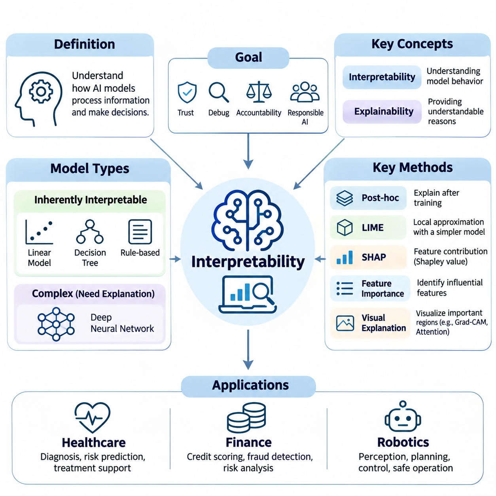
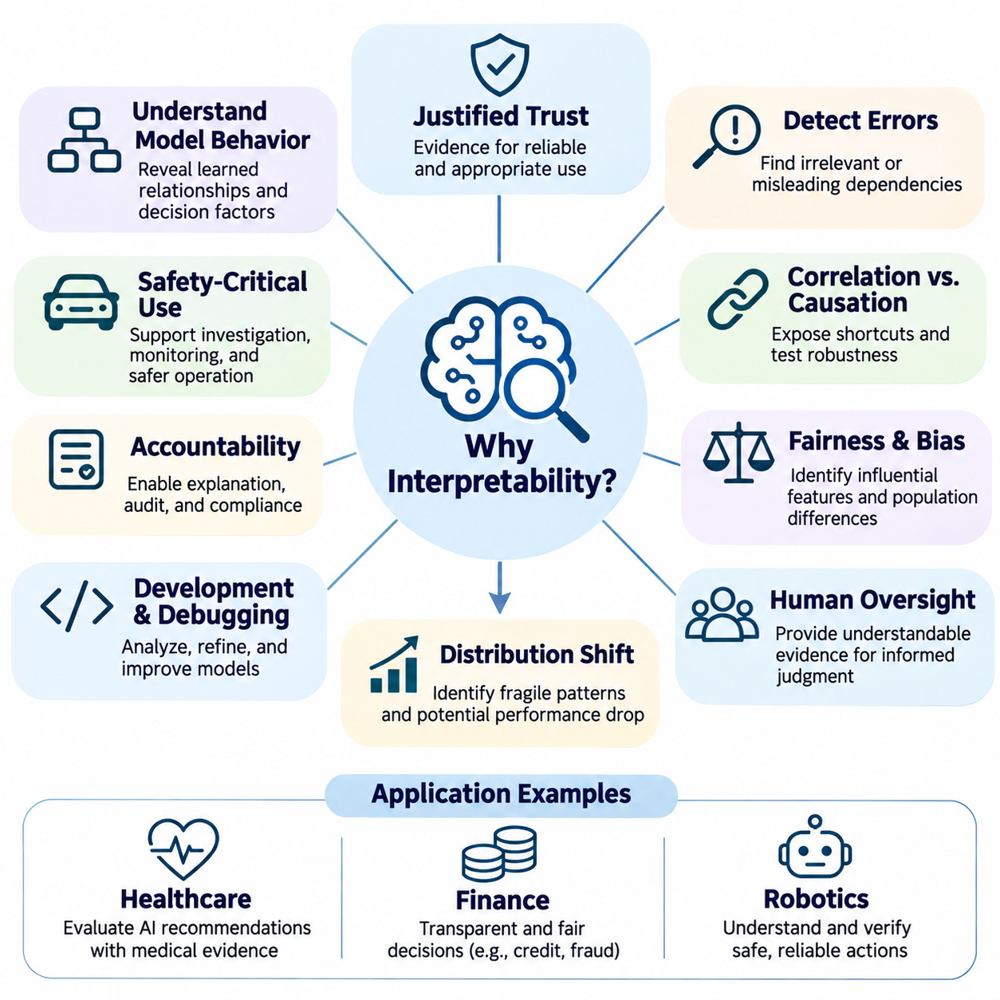
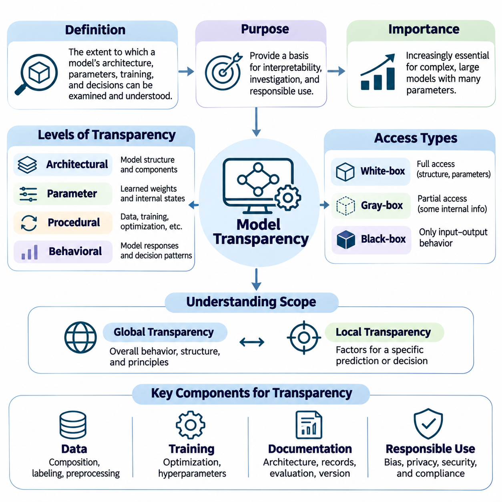
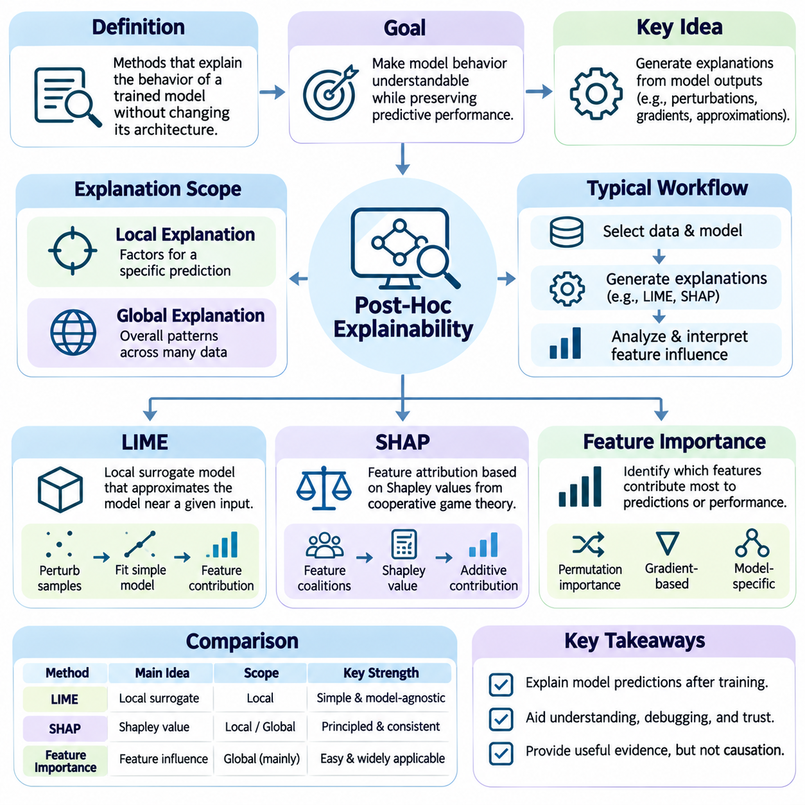
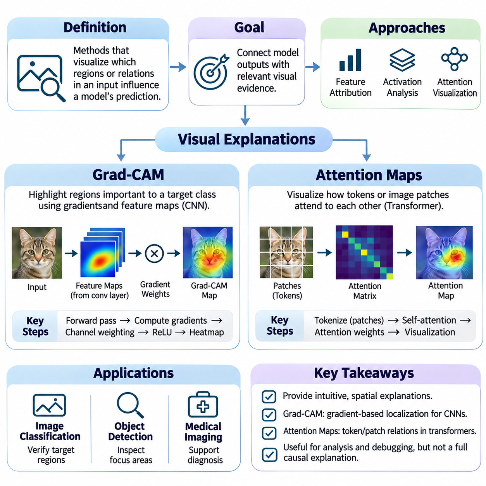
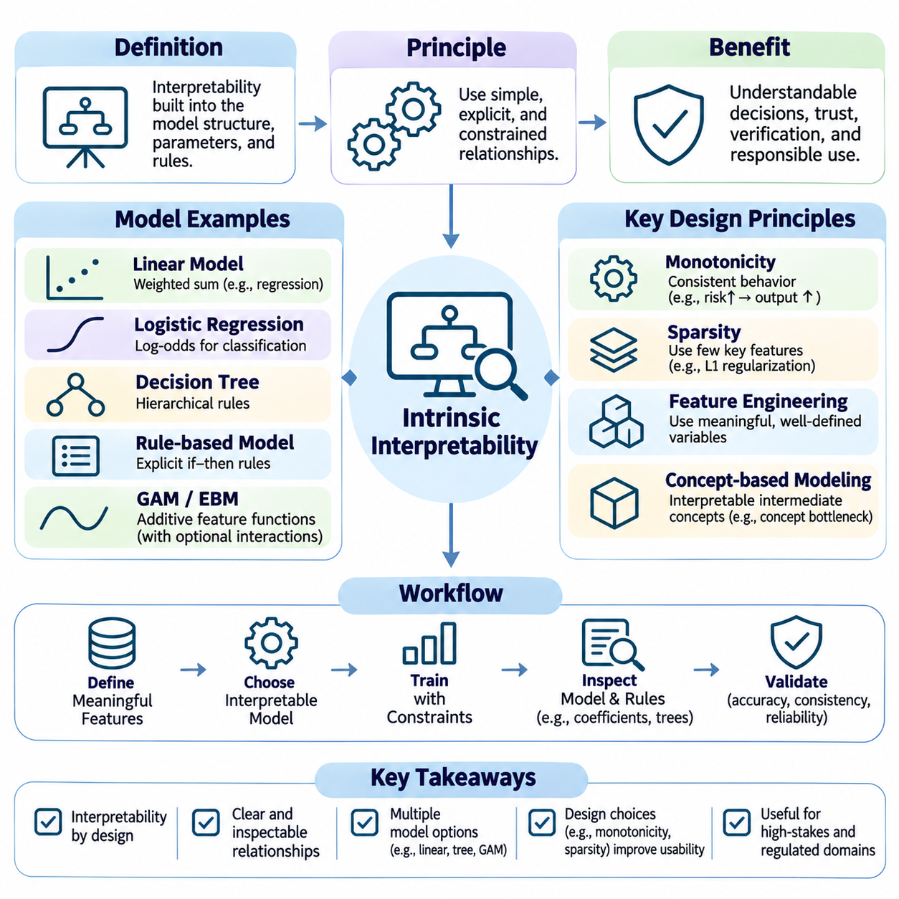
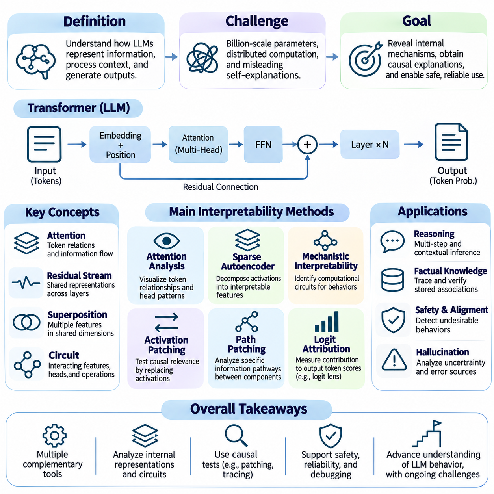
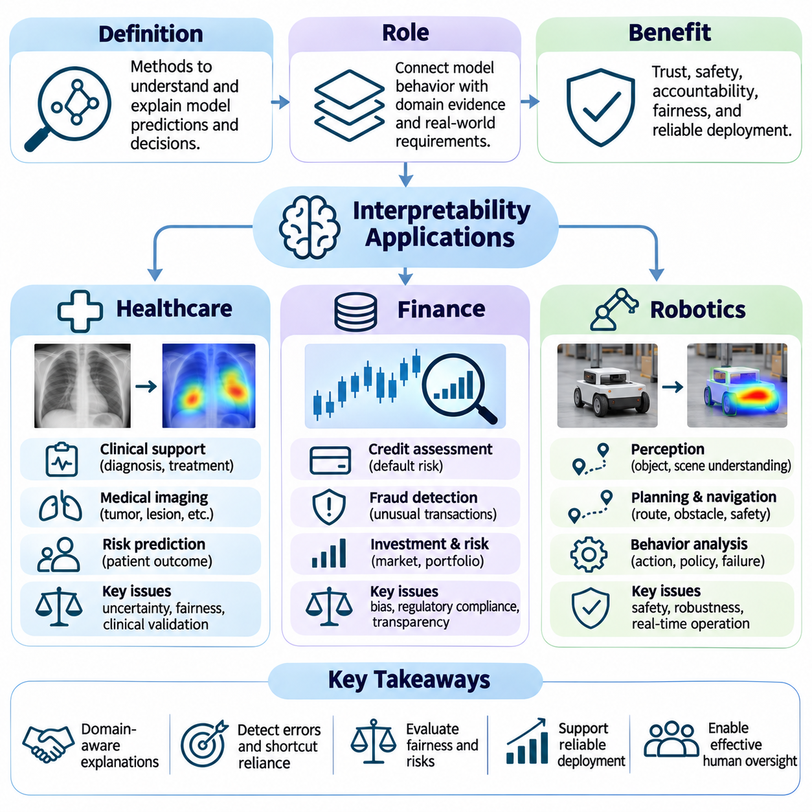

**Volume 42. AI Safety Alignment and Interpretability**

# 03. Interpretability

## 03.00 Overview

{width="7.268055555555556in" height="7.268055555555556in"}

해석 가능성(Interpretability)은 계산 모델(Computational Model)이 정보를 처리하고, 내부 표현(Internal Representation)을 형성하며, 예측(Prediction)이나 의사결정(Decision)을 생성하는 방식을 연구하는 인공지능(Artificial Intelligence)의 핵심 분야이다. 기계학습(Machine Learning) 시스템이 점점 복잡해짐에 따라 그 동작을 이해하는 것은 신뢰(Trust)를 확보하고, 한계(Limitation)를 식별하며, 책임 있는 배포(Responsible Deployment)를 지원하는 데 필수적이다. 해석 가능성은 수학적 모델 분석(Mathematical Model Analysis)과 인간의 이해(Human Understanding)를 연결한다.

현대 인공지능(Modern Artificial Intelligence)은 수백만 또는 수십억 개의 매개변수(Parameter)를 포함하는 심층 신경망(Deep Neural Network)에 크게 의존한다. 이러한 시스템은 뛰어난 예측 성능(Predictive Performance)을 달성할 수 있지만, 내부 계산 과정(Internal Computation)을 직접 이해하기는 어려운 경우가 많다. 해석 가능성 연구(Interpretability Research)는 영향력 있는 특징(Influential Feature), 중간 표현(Intermediate Representation), 의사결정 경로(Decision Pathway), 모델 입력과 출력 사이의 관계를 밝혀내는 방법을 개발하여 이러한 문제를 해결한다.

해석 가능성(Interpretability)과 설명 가능성(Explainability)은 밀접하게 관련되어 있지만, 인공지능을 이해하는 서로 다른 관점을 나타낸다. 해석 가능성은 일반적으로 모델의 구조(Structure)나 계산 메커니즘(Computational Mechanism)을 통해 모델 동작을 이해할 수 있는 정도를 의미한다. 설명 가능성은 특정 예측이나 의사결정에 대해 인간이 이해할 수 있는 설명을 생성하는 데 중점을 둔다. 두 접근 방식 모두 투명성(Transparency), 책임성(Accountability), 디버깅(Debugging), 의미 있는 인간 감독(Human Oversight)에 기여한다.

해석 가능성의 중요성은 기계학습 알고리즘(Machine Learning Algorithm)에 대한 지적 호기심을 충족하는 수준을 넘어선다. 조직은 오류가 재정적, 물리적 또는 사회적 결과를 초래할 수 있는 환경에서 자동화된 의사결정(Automated Decision)에 점점 더 의존하고 있다. 시스템이 특정 결과를 생성하는 이유를 이해하면 엔지니어가 신뢰할 수 없는 상관관계(Unreliable Correlation)를 탐지하고, 예상하지 못한 동작을 조사하며, 잠재적 편향(Potential Bias)을 평가하고, 모델 출력을 신뢰할 수 있는지 판단하는 데 도움이 된다.

본질적으로 해석 가능한 모델(Inherently Interpretable Model)과 추가적인 설명 기법(Explanation Technique)이 필요한 복잡한 모델 사이에는 중요한 차이가 존재한다. 선형 모델(Linear Model), 소규모 의사결정 트리(Decision Tree), 체계적으로 설계된 규칙 기반 시스템(Rule-Based System)은 입력과 출력 사이의 관계를 비교적 직접적으로 제공한다. 반면 심층 신경망은 여러 계산 계층(Computational Layer)에 걸친 분산 표현(Distributed Representation)과 비선형 변환(Nonlinear Transformation)을 통해 예측을 생성하므로 전문적인 분석 방법이 필요하다.

모델 투명성(Model Transparency)은 시스템의 아키텍처(Architecture), 매개변수(Parameter), 계산 연산(Computational Operation), 학습된 관계(Learned Relationship)에 접근하고 이를 이해할 수 있는 정도와 관련된다. 구조적 투명성(Structural Transparency)은 연구자가 모델 내부에서 정보가 흐르는 방식을 조사하도록 지원하며, 기능적 투명성(Functional Transparency)은 입력이 출력에 영향을 미치는 방식을 이해하는 데 중점을 둔다. 모델 가중치(Model Weight)에 접근할 수 있다는 사실만으로 의미 있는 이해가 보장되지는 않는다.

사후 설명 가능성(Post-Hoc Explainability)은 학습이 완료된 모델의 내부 아키텍처를 반드시 변경하지 않고 모델을 분석하는 방법을 제공한다. 이러한 기법은 관찰된 모델 동작(Model Behavior), 입력 교란(Input Perturbation), 기울기(Gradient), 의사결정 경계(Decision Boundary)의 근사치를 활용하여 설명을 구성한다. 사후 설명 방법은 높은 성능을 가진 모델을 단순한 대안으로 대체하기 어려울 때 특히 유용하지만, 생성된 설명이 원래 모델의 판단 과정을 완전하게 표현하지 못할 수도 있다.

국소 해석 가능 모델 불가지론적 설명(Local Interpretable Model-agnostic Explanations, LIME)은 선택된 예측 주변에서 복잡한 모델의 동작을 단순한 대리 모델(Surrogate Model)로 근사한다. 교란된 예제(Perturbed Example)를 생성하고 해당 예측을 관찰함으로써 어떤 입력 특징이 국소적인 의사결정(Local Decision)에 영향을 미치는지 추정한다. LIME의 유용성은 입력 교란의 품질, 국소 영역(Neighborhood)의 정의, 대리 모델 근사의 충실도(Fidelity)에 따라 달라진다.

샤플리 가법 설명(SHapley Additive exPlanations, SHAP)은 협력 게임 이론(Cooperative Game Theory)의 개념을 적용하여 개별 예측에 대한 특징 기여도(Feature Contribution)를 추정한다. 샤플리 값(Shapley Value)은 다양한 특징 조합에서 나타나는 한계 기여도(Marginal Contribution)를 바탕으로 모델 출력의 변화를 입력 특징에 분배한다. SHAP은 체계적인 기여도 분석 프레임워크(Attribution Framework)를 제공하지만, 계산 근사(Computational Approximation)와 특징 간 의존성(Feature Dependence)에 관한 가정이 해석 결과에 영향을 줄 수 있다.

특징 중요도(Feature Importance) 방법은 어떤 변수가 모델 예측이나 예측 성능에 가장 크게 기여하는지 분석한다. 대표적인 접근 방식에는 순열 중요도(Permutation Importance), 기울기 기반 기여도 분석(Gradient-Based Attribution), 모델별 중요도 측정(Model-Specific Importance Measure)이 포함된다. 이러한 방법은 특징 선택(Feature Selection), 오류 조사(Error Investigation), 의심스러운 의존성(Suspicious Dependency)의 식별을 지원한다. 그러나 중요도 점수만으로 인과관계(Causal Relationship)가 입증되거나 모델이 특징을 적절하게 활용한다고 보장되지는 않는다.

시각적 설명(Visual Explanation) 방법은 계산적 증거(Computational Evidence)를 인간이 조사할 수 있는 공간적 표현(Spatial Representation)으로 변환한다. 컴퓨터 비전(Computer Vision)에서는 이러한 기법을 통해 어떤 이미지 영역이 분류(Classification)나 객체 탐지(Object Detection) 결과에 기여하는지 분석할 수 있다. 시각적 설명은 배경, 관련 없는 객체, 예상하지 못한 시각적 패턴에 대한 의존성을 드러낼 수 있다. 효과적인 활용을 위해서는 강조된 영역이 모델의 실제 계산 동작을 정확하게 반영하는지 확인해야 한다.

기울기 가중 클래스 활성화 매핑(Gradient-weighted Class Activation Mapping, Grad-CAM)은 특징 활성화(Feature Activation)와 기울기 기반 가중치(Gradient-Derived Weight)를 결합하여 클래스 관련 위치 지도(Class-Related Localization Map)를 생성한다. 이 방법은 특정 예측과 관련된 이미지 영역을 강조하기 위해 합성곱 신경망(Convolutional Neural Network)에 자주 적용된다. Grad-CAM은 직관적인 시각적 증거를 제공하지만, 생성된 지도는 일반적으로 공간적 해상도가 낮으며 모델 의사결정 과정 전체를 설명하는 것으로 해석해서는 안 된다.

어텐션 맵(Attention Map)은 특히 트랜스포머 기반 아키텍처(Transformer-Based Architecture)에서 정보 처리 과정을 분석하는 또 다른 접근 방식이다. 어텐션 가중치(Attention Weight)를 통해 토큰(Token), 이미지 패치(Image Patch), 기타 표현 요소 사이의 관계를 시각화한다. 이러한 지도는 정보 교환(Information Exchange)의 패턴을 보여줄 수 있지만, 어텐션 가중치만으로 특징 중요도나 인과적 영향(Causal Influence)이 입증되는 것은 아니다. 신뢰할 수 있는 해석을 위해서는 추가적인 실험적 검증(Experimental Validation)이 필요하다.

내재적 해석 가능성(Intrinsic Interpretability)은 아키텍처 선택(Architectural Choice), 명시적 제약(Explicit Constraint), 구조화된 표현(Structured Representation)을 통해 모델 동작을 이해할 수 있도록 설계하는 접근 방식이다. 대표적인 사례로 희소 선형 모델(Sparse Linear Model), 간결한 의사결정 트리(Compact Decision Tree), 일반화 가법 모델(Generalized Additive Model), 특정 개념 기반 아키텍처(Concept-Based Architecture)가 있다. 이러한 방법은 학습 이후의 설명에만 의존하지 않고 모델 설계 자체에 이해 가능성을 통합한다.

해석 가능성과 예측 성능(Predictive Performance)의 관계에는 중요한 공학적 고려사항(Engineering Consideration)이 존재한다. 단순한 모델은 조사하기 쉽지만 복잡한 작업을 수행하기에 충분한 표현력(Expressiveness)을 갖추지 못할 수 있다. 반대로 표현력이 높은 모델은 뛰어난 예측 정확도(Predictive Accuracy)를 달성하면서도 분석하기 어려울 수 있다. 따라서 모델 선택(Model Selection)에서는 해석 가능성과 함께 정확도(Accuracy), 견고성(Robustness), 계산 효율성(Computational Efficiency), 잘못된 의사결정의 결과를 종합적으로 평가해야 한다.

대규모 언어 모델(Large Language Model, LLM)의 해석 가능성은 광범위한 매개변수 네트워크(Parameter Network)의 상호작용을 통해 언어 이해와 생성이 이루어진다는 점에서 추가적인 어려움을 제기한다. 트랜스포머 계층(Transformer Layer), 어텐션 메커니즘(Attention Mechanism), 잔차 스트림(Residual Stream), 분산 표현(Distributed Representation)은 생성되는 토큰에 공동으로 영향을 미친다. 연구자들은 활성화 분석(Activation Analysis), 프로빙 기법(Probing Method), 특징 분해(Feature Decomposition), 개입 실험(Intervention)을 통해 이러한 시스템을 조사한다.

기계론적 해석 가능성(Mechanistic Interpretability)은 내부 특징(Internal Feature), 계산 회로(Computational Circuit), 인과적 상호작용(Causal Interaction)을 식별하여 신경망 동작을 설명하려는 접근 방식이다. 단순히 입력과 출력 사이의 상관관계를 설명하는 대신, 특정 내부 구성요소가 모델 계산에 어떻게 기여하는지 조사한다. 활성화 패칭(Activation Patching)과 인과적 개입(Causal Intervention) 같은 기법은 제안된 메커니즘을 검증할 수 있지만, 대규모 모델을 포괄적으로 이해하는 것은 여전히 해결되지 않은 연구 과제이다.

해석 가능성은 인공지능 안전성(AI Safety)과 정렬(Alignment)에 특히 중요하다. 모델은 일반적인 테스트에서 적절한 출력을 생성하면서도 불안정한 휴리스틱(Unstable Heuristic), 의도하지 않은 지름길(Unintended Shortcut), 오해를 유발하는 내부 표현(Misleading Internal Representation)에 의존할 수 있다. 해석 가능성 기법은 이러한 취약점을 식별하고 보상 해킹(Reward Hacking), 명세 악용(Specification Gaming), 기타 바람직하지 않은 동작을 조사하는 데 도움이 된다. 그러나 해석 가능성 증거만으로 안전성이나 정렬을 보장할 수는 없다.

신뢰할 수 있는 해석 가능성(Reliable Interpretability)을 확보하려면 기술적 설명(Descriptive Explanation)과 인과적 설명(Causal Explanation)을 구분해야 한다. 기술적 방법은 예측과 상관관계가 있는 특징을 식별하지만, 인과 분석(Causal Analysis)은 특정 특징이나 내부 메커니즘을 변경했을 때 모델 동작이 실제로 달라지는지 조사한다. 통제된 개입(Controlled Intervention), 반사실적 실험(Counterfactual Experiment), 체계적인 교란 연구(Perturbation Study)는 단순한 시각화보다 계산적 의존성에 대한 강력한 증거를 제공한다.

설명 품질(Explanation Quality)을 평가하는 것은 중요한 방법론적 과제(Methodological Challenge)이다. 설명이 인간 관찰자에게 설득력 있게 보이더라도 모델의 실제 계산 과정을 충실하게 반영하지 않을 수 있다. 따라서 해석 가능성 연구에서는 충실도(Fidelity), 안정성(Stability), 일관성(Consistency), 민감도(Sensitivity), 유용성(Usefulness)을 고려한다. 설명은 시각적 매력이나 겉으로 드러나는 단순성만으로 판단하기보다 명시적인 평가 목표(Evaluation Objective)에 따라 검증해야 한다.

해석 가능성은 기계학습 시스템이 진단(Diagnosis), 위험 추정(Risk Estimation), 임상 의사결정 지원(Clinical Decision Support)을 보조하는 의료(Healthcare) 분야에서 중요한 역할을 한다. 임상의(Clinician)는 예측에 영향을 미치는 증거를 이해하고 모델 권고가 신뢰하기 어려운 상황을 인식해야 한다. 설명 방법은 임상 검토(Clinical Review)를 지원할 수 있지만, 그 결과는 의학적 증거(Medical Evidence)에 비추어 평가해야 하며 독립적인 임상적 판단(Clinical Judgment)을 대체해서는 안 된다.

금융(Finance) 분야에서 해석 가능성은 신용 평가(Credit Assessment), 사기 탐지(Fraud Detection), 위험 모델링(Risk Modeling), 규제 책임성(Regulatory Accountability)을 지원한다. 금융기관(Financial Institution)은 자동화된 의사결정에 영향을 미치는 요인을 조사하고 모델 동작이 관련 정책과 일치하는지 확인해야 할 수 있다. 설명 기법은 잠재적으로 문제가 되는 의존성을 드러내고, 감사(Audit)를 지원하며, 모델 개발자와 위험 관리자 및 의사결정자 사이의 의사소통을 개선할 수 있다.

로보틱스(Robotics)는 인공지능의 의사결정이 물리적 환경(Physical Environment)에 직접 영향을 미칠 수 있기 때문에 추가적인 해석 가능성 요구사항을 가진다. 자율 로봇(Autonomous Robot)은 인지(Perception), 계획(Planning), 제어(Control), 피드백(Feedback)을 결합하여 불확실성(Uncertainty) 속에서 행동을 생성한다. 로봇이 특정 움직임을 선택하거나 장애물을 식별하고 이동 경로(Trajectory)를 변경하는 이유를 이해하면 실제 환경 배포(Real-World Deployment)에서 결함 진단(Fault Diagnosis), 운영자 개입(Operator Intervention), 안전성 분석(Safety Analysis)을 지원할 수 있다.

효과적인 해석 가능성(Effective Interpretability)은 서로 다른 이해관계자(Stakeholder)의 요구를 고려해야 한다. 연구자는 내부 표현에 관한 상세한 정보가 필요할 수 있고, 엔지니어는 디버깅과 신뢰성(Reliability)을 우선시할 수 있으며, 도메인 전문가(Domain Expert)는 운영 개념(Operational Concept)과 연결된 설명을 요구할 수 있다. 최종 사용자(End User)는 주요 영향 요인과 불확실성에 대한 간결한 설명을 필요로 하는 경우가 많다. 따라서 하나의 설명 형식이 모든 해석 가능성 목표를 충족하기는 어렵다.

인공지능 개발에 해석 가능성을 실질적으로 통합하려면 모델 수명주기(Model Lifecycle) 전반에 걸친 지속적인 평가(Continuous Evaluation)가 필요하다. 설명은 데이터셋 검사(Dataset Inspection), 아키텍처 선택(Architecture Selection), 학습 진단(Training Diagnostics), 검증(Validation), 배포 모니터링(Deployment Monitoring), 사고 조사(Incident Investigation)에 활용될 수 있다. 특히 복잡하거나 안전이 중요한 환경(Safety-Critical Environment)에서는 하나의 기여도 분석 방법에 의존하기보다 상호 보완적인 여러 기법을 결합하는 것이 더 강력한 증거를 제공한다.

궁극적으로 해석 가능성(Interpretability)은 계산 지능(Computational Intelligence)과 책임 있는 인간의 이해(Responsible Human Understanding)를 연결하는 가교 역할을 한다. 그 목적은 단순히 인공지능 의사결정에 대해 그럴듯한 설명을 생성하는 것이 아니라, 모델 동작과 한계에 관한 실험적으로 뒷받침된 지식(Experimentally Supported Knowledge)을 확립하는 데 있다. 더욱 높은 능력을 가진 시스템이 중요한 응용 분야에 도입됨에 따라 해석 가능성은 투명성(Transparency), 신뢰할 수 있는 평가(Trustworthy Evaluation), 인간 감독(Human Oversight), 안전한 인공지능(Safe Artificial Intelligence)의 발전을 위한 핵심 요소로 남을 것이다.

## 03.01 Why Interpretability

{width="7.268055555555556in" height="7.268055555555556in"}

해석 가능성(Interpretability)은 인공지능(Artificial Intelligence) 시스템이 개인, 조직, 사회에 영향을 미치는 의사결정(Decision)에 점점 더 깊이 관여하고 있기 때문에 필수적이다. 기계학습(Machine Learning) 모델이 복잡해질수록 예측 결과는 정확하더라도 그 과정을 이해하기 어려울 수 있다. 이는 모델의 내부 의사결정 과정(Internal Decision Process)을 조사하기 어려운 상황에서도 사용자가 출력의 신뢰성(Reliability), 적절성(Appropriateness), 의도된 목표(Intended Objective)와의 일치 여부를 판단해야 한다는 근본적인 과제를 제기한다.

전통적인 소프트웨어 시스템(Traditional Software System)은 일반적으로 명시적으로 프로그래밍된 규칙(Explicitly Programmed Rule)을 따르므로 개발자가 특정 입력이 해당 출력으로 이어지는 과정을 추적할 수 있다. 반면 기계학습 시스템은 최적화(Optimization)를 통해 학습 데이터(Training Data)에서 의사결정 패턴(Decision Pattern)을 습득한다. 이러한 학습된 관계(Learned Relationship)는 수천 개에서 수십억 개의 매개변수(Parameter) 사이의 복잡한 상호작용을 포함할 수 있다. 해석 가능성은 이러한 관계를 조사하고 모델이 정보를 의사결정으로 변환하는 방식을 이해하기 위한 방법을 제공한다.

해석 가능성의 주요 목적 중 하나는 인공지능에 대한 정당화된 신뢰(Justified Trust)를 확립하는 것이다. 사용자는 시스템이 설득력 있는 답변을 생성하거나 높은 벤치마크 정확도(Benchmark Accuracy)를 달성한다는 이유만으로 이를 신뢰해서는 안 된다. 신뢰는 모델이 일관되게 동작하고, 관련 정보를 인식하며, 허용 가능한 한계(Acceptable Limitation) 내에서 작동한다는 증거에 기반해야 한다. 해석 가능성은 예측이 의미 있는 패턴(Meaningful Pattern)에서 비롯되는지, 아니면 익숙하지 않은 상황에서 실패할 수 있는 우연한 상관관계(Accidental Correlation)에 의존하는지 밝혀내는 데 도움이 된다.

해석 가능성은 숨겨진 오류(Hidden Error)와 예상하지 못한 모델 동작(Unexpected Model Behavior)을 탐지하는 데도 중요하다. 시스템은 평가 데이터셋(Evaluation Dataset)에서 우수한 성능을 보이면서도 관련 없는 특징(Irrelevant Feature), 잘못된 통계적 관계(Misleading Statistical Relationship), 데이터 수집 과정에서 발생한 인공적 패턴(Artifact)에 의존할 수 있다. 이러한 의존성은 배포 환경(Deployment Environment)이 변화할 때까지 발견되지 않을 수 있다. 설명 기법(Explanation Technique)은 연구자가 영향력 있는 특징을 조사하고 심각한 운영 장애가 발생하기 전에 의심스러운 의사결정 패턴을 식별하도록 지원한다.

기계학습 모델을 해석할 때 상관관계(Correlation)와 인과관계(Causation)의 구분은 특히 중요하다. 모델은 근본적인 인과관계를 이해하지 못하면서도 특정 특징을 결과와 연관시킬 수 있다. 예를 들어 이미지 분류기(Image Classifier)는 동물의 신체적 특징(Physical Characteristic)보다 배경 풍경(Background Scenery)을 주요 근거로 동물을 인식할 수 있다. 해석 가능성은 이러한 지름길 학습(Shortcut Learning)을 드러내고 학습된 관계의 견고성(Robustness)을 확인하기 위한 실험을 설계하도록 돕는다.

안전 필수 응용 분야(Safety-Critical Application)에서는 이해 가능한 인공지능(Understandable Artificial Intelligence)에 대한 요구가 특히 강하다. 자율주행차(Autonomous Vehicle), 의료 의사결정 지원 시스템(Medical Decision-Support System), 산업용 로봇(Industrial Robot), 기반시설 제어기(Infrastructure Controller)는 직접적인 물리적 결과를 초래하는 출력을 생성할 수 있다. 예상하지 못한 동작이 발생하면 엔지니어는 그 원인을 파악하고 시정 조치(Corrective Action)의 필요성을 판단해야 한다. 해석 가능성은 고장 조사(Failure Investigation), 운영 모니터링(Operational Monitoring), 신뢰성 높은 안전 메커니즘(Safety Mechanism)의 개발을 지원한다.

해석 가능성은 자동화된 의사결정(Automated Decision)을 인간이 조사할 수 있도록 함으로써 책임성(Accountability)을 강화한다. 인공지능을 배포하는 조직은 의사결정이 이루어지는 방식을 설명하고, 책임이 있는 프로세스(Responsible Process)를 식별하며, 적용 가능한 요구사항에 대한 준수(Compliance)를 입증해야 할 수 있다. 의미 있는 설명(Meaningful Explanation)은 내부 감사(Internal Audit), 외부 평가(External Assessment), 영향을 받는 개인과의 의사소통을 지원한다. 그러나 그럴듯한 설명이 실제 모델 계산을 반드시 반영하는 것은 아니므로 설명 도구의 검증이 필요하다.

공정성(Fairness)과 편향 평가(Bias Assessment)는 해석 가능성이 필요한 또 다른 중요한 이유이다. 기계학습 시스템은 역사적 불평등(Historical Inequality)을 재현하거나 보호 특성(Protected Characteristic)과 상관관계가 있는 변수에 대한 의존성을 형성할 수 있다. 해석 가능성 방법은 영향력 있는 특징을 식별하고 집단 간 예측이 체계적으로 달라지는지 조사하는 데 도움이 된다. 그러나 특징 기여도(Feature Attribution)만으로 공정성을 입증할 수는 없으므로 보완적인 통계적 평가(Statistical Evaluation)와 맥락 분석(Contextual Analysis)이 필요하다.

해석 가능성은 모델 개발(Model Development)과 디버깅(Debugging)의 효율성도 향상시킨다. 학습 과정에서 연구자는 정확도(Accuracy)의 예상하지 못한 변화, 불안정한 최적화(Unstable Optimization), 관련 예제 사이의 일관되지 않은 예측(Inconsistent Prediction)을 관찰할 수 있다. 특징 기여도, 중간 활성화(Intermediate Activation), 학습된 표현(Learned Representation)을 조사하면 잠재적인 원인을 발견할 수 있다. 이러한 통찰은 데이터셋을 개선하고, 아키텍처(Architecture)를 수정하며, 학습 절차(Training Procedure)를 조정하고, 제안된 개선책이 근본적인 문제를 해결하는지 평가하는 데 도움이 된다.

배포 데이터(Deployment Data)가 학습 과정에서 접한 정보와 달라지는 분포 변화(Distribution Shift) 상황에서는 모델 동작을 이해하는 것이 특히 중요하다. 모델은 원래 환경에서는 예측력이 높지만 다른 환경에서는 신뢰할 수 없는 패턴에 의존할 수 있다. 해석 가능성은 이러한 의존성을 식별하고 성능 저하(Performance Degradation)의 잠재적 원인을 밝혀내는 데 도움이 된다. 불확실성 추정(Uncertainty Estimation) 및 분포 외 데이터 테스트(Out-of-Distribution Testing)와 결합하면 더욱 근거 있는 배포 의사결정을 지원할 수 있다.

해석 가능성은 운영자가 자동화된 권고(Automated Recommendation)와 관련된 증거를 조사할 수 있도록 하여 인간 감독(Human Oversight)을 강화한다. 인간 감독자(Human Supervisor)는 시스템 출력을 수용하거나 거부하거나 수정할 때 단순한 수치 예측 이상의 정보를 필요로 한다. 설명은 주요 영향 요인(Influential Factor), 잠재적 한계(Potential Limitation), 관련 불확실성(Uncertainty)을 전달할 수 있다. 그러나 효과적인 감독을 위해서는 설명이 이해 가능하고, 적절하게 보정(Calibration)되어 있으며, 실질적인 인간 개입(Human Intervention)을 위한 메커니즘이 뒷받침되어야 한다.

의료(Healthcare) 분야에서 해석 가능성은 임상의(Clinician)가 의학적 증거(Medical Evidence)와 환자의 상황(Patient Circumstance)을 고려하여 인공지능 권고를 평가하도록 지원한다. 진단 모델(Diagnostic Model)은 의료 영상(Medical Image)이나 임상 기록(Clinical Record)에서 특정 질환의 예측에 기여하는 패턴을 식별할 수 있다. 이러한 요인을 이해하면 전문적인 검토(Professional Review)를 지원하고 데이터 관련 오류(Data-Related Error)를 발견할 수 있다. 그러나 설명은 임상 전문성(Clinical Expertise)을 보완해야 하며 자동화된 결론에 대한 근거 없는 확신을 만들어서는 안 된다.

금융 응용 분야(Financial Application)에서도 해석 가능한 의사결정 과정(Interpretable Decision Process)은 중요한 이점을 제공한다. 신용 평가(Credit Scoring), 사기 탐지(Fraud Detection), 보험 위험 평가(Insurance Risk Assessment), 투자 분석(Investment Analysis)은 경제적 변수와 행동 변수 사이의 복잡한 관계를 포함하는 경우가 많다. 해석 가능성은 분석가가 특정 결과가 예측된 이유를 조사하고 모델이 부적절하거나 불안정한 요인에 의존하는지 확인하도록 돕는다. 이러한 기능은 위험 관리(Risk Management), 감사(Auditing), 책임 있는 자동화 금융 의사결정을 지원한다.

로보틱스(Robotics)와 자율 시스템(Autonomous System)에서 해석 가능성은 정적인 예측을 설명하는 수준을 넘어 일련의 행동(Action Sequence)을 이해하는 영역으로 확장된다. 로봇은 감각 관측(Sensory Observation), 내부 상태 추정(Internal State Estimation), 계획 목표(Planning Objective), 제어 명령(Control Command)을 지속적으로 통합한다. 로봇이 방향을 변경하거나 예상하지 못한 행동을 선택하면 엔지니어는 해당 동작에 영향을 미친 정보와 메커니즘을 조사해야 한다. 이러한 분석은 디버깅, 안전성 평가(Safety Assessment), 효과적인 인간-로봇 협업(Human-Robot Collaboration)을 지원한다.

대규모 언어 모델(Large Language Model, LLM)은 출력이 분산 표현(Distributed Representation)과 트랜스포머 계층(Transformer Layer) 전반의 복잡한 상호작용에서 생성되기 때문에 독특한 해석 가능성 문제를 제기한다. 모델이 자신의 동작에 대해 생성한 설명은 일관되고 설득력 있게 들리더라도 실제 답변을 생성한 계산 과정을 정확하게 설명하지 못할 수 있다. 따라서 연구자들은 언어적 설명(Verbal Explanation)에만 의존하지 않고 활성화(Activation), 어텐션 패턴(Attention Pattern), 학습된 특징(Learned Feature), 인과적 개입(Causal Intervention)을 조사하여 내부 메커니즘을 분석한다.

기계론적 해석 가능성(Mechanistic Interpretability)은 특정 모델 동작을 담당하는 계산 구조(Computational Structure)를 식별하는 것을 목표로 한다. 연구자들은 내부 특징(Internal Feature)과 그 상호작용을 분석하여 신경망(Neural Network)이 개념을 표현하고, 정보를 검색하며, 표현을 출력으로 변환하는 방식을 이해하려고 한다. 이러한 접근 방식은 표면적 설명(Surface-Level Explanation)보다 내부 계산에 대한 강력한 증거를 제공할 수 있지만, 분석을 대규모 모델로 확장하는 것은 여전히 기술적으로 어려운 과제이다.

해석 가능성은 관찰 가능한 성능(Observable Performance)만으로 시스템이 의도된 목표(Intended Objective)를 추구하는지 항상 확인할 수 없기 때문에 인공지능 정렬(AI Alignment)과 밀접하게 연결된다. 모델은 지름길(Shortcut), 보상 악용(Reward Exploitation), 인간의 기대(Human Expectation)와 일치하지 않는 전략을 통해 좋은 평가 결과를 얻을 수 있다. 내부 메커니즘과 행동 의존성(Behavioral Dependency)을 조사하면 이러한 위험에 대한 추가적인 증거를 확보할 수 있다. 그러나 해석 가능성은 정렬 평가(Alignment Evaluation)의 한 구성요소이지 완전한 해결책은 아니다.

중요한 한계는 설명이 직관적으로 보이더라도 오해를 유발할 수 있다는 점이다. 특징 중요도 점수(Feature Importance Score)는 방법에 따라 달라질 수 있고, 시각화(Visualization)는 관련 없는 영역을 강조할 수 있으며, 단순화된 대리 모델(Surrogate Model)은 원래 시스템의 동작을 정확하게 재현하지 못할 수 있다. 따라서 설명 품질(Explanation Quality)은 충실도 테스트(Fidelity Test), 교란 실험(Perturbation Experiment), 안정성 분석(Stability Analysis), 관찰 가능한 모델 동작과의 비교를 통해 평가해야 한다.

서로 다른 이해관계자(Stakeholder)는 서로 다른 형태의 해석 가능성을 요구한다. 기계학습 연구자(Machine Learning Researcher)는 내부 표현(Internal Representation)과 계산 회로(Computational Circuit)를 조사할 수 있으며, 소프트웨어 엔지니어(Software Engineer)는 디버깅과 신뢰성(Reliability)에 집중한다. 도메인 전문가(Domain Specialist)는 의미 있는 운영 개념(Operational Concept)과 연결된 설명을 필요로 하고, 최종 사용자(End User)는 개별 의사결정에 대한 간결한 이유를 요구할 수 있다. 따라서 효과적인 해석 가능성은 설명 방법을 대상 사용자, 응용 분야, 의사결정 맥락(Decision Context)에 맞추는 데 달려 있다.

해석 가능성은 학습된 모델(Trained Model)을 체계적인 연구 대상으로 전환함으로써 과학적 이해(Scientific Understanding)를 지원한다. 연구자들은 학습된 표현에 대한 가설(Hypothesis)을 수립하고, 통제된 개입(Controlled Intervention)을 통해 이를 검증하며, 관찰된 동작을 이론적 기대(Theoretical Expectation)와 비교할 수 있다. 이러한 과정은 실제 계산 메커니즘(Computational Mechanism)과 표면적 상관관계(Superficial Correlation)를 구분하는 데 도움이 된다. 또한 표현 학습(Representation Learning), 일반화(Generalization), 복잡한 모델 능력의 출현(Emergence)에 관한 폭넓은 지식의 발전에도 기여한다.

해석 가능성의 경제적 가치(Economic Value)는 모델 개발, 검증(Validation), 배포(Deployment) 과정에서 불확실성을 줄이는 데서 발생한다. 모델에 대한 이해가 향상되면 디버깅 주기(Debugging Cycle)를 단축하고, 오류 진단(Error Diagnosis)을 개선하며, 비용이 큰 장애가 발생하기 전에 부적절한 모델을 식별하는 데 도움이 된다. 해석 가능성은 기술팀(Technical Team)과 의사결정자(Decision Maker) 사이의 의사소통도 촉진할 수 있다. 그러나 실질적인 가치는 단순히 제공되는 정보량을 늘리는 것이 아니라 실행 가능한 통찰(Actionable Insight)을 생성하는지에 달려 있다.

궁극적으로 해석 가능성(Interpretability)이 중요한 이유는 점점 더 높은 능력을 갖춘 인공지능이 의미 있는 인간의 이해(Human Understanding)와 평가(Evaluation)의 대상이어야 하기 때문이다. 높은 예측 성능(Predictive Performance)만으로 신뢰성(Reliability), 공정성(Fairness), 안전성(Safety), 의도된 목표와의 정렬(Alignment)을 확립할 수는 없다. 해석 가능성은 중요한 특징(Important Feature), 계산적 의존성(Computational Dependency), 행동상의 한계(Behavioral Limitation)를 밝혀냄으로써 책임 있는 개발(Responsible Development), 충분한 정보에 기반한 감독(Informed Oversight), 더욱 신뢰할 수 있는 인공지능 시스템(Trustworthy Artificial Intelligence System)을 지원하는 증거를 제공한다.

## 03.02 Model Transparency

{width="7.268055555555556in" height="7.268055555555556in"}

모델 투명성(Model Transparency)은 인공지능(Artificial Intelligence) 시스템의 아키텍처(Architecture), 매개변수(Parameter), 학습 절차(Learning Procedure), 의사결정 과정(Decision Process)을 조사하고 이해할 수 있는 정도를 의미한다. 모델 투명성은 모델 동작(Model Behavior)을 담당하는 구성요소를 연구자와 엔지니어가 분석할 수 있도록 함으로써 해석 가능성(Interpretability)의 기반을 제공한다. 투명성이 반드시 완전한 이해를 의미하는 것은 아니지만, 계산 메커니즘(Computational Mechanism)이 예측을 생성하는 방식을 체계적으로 조사할 수 있게 한다.

기계학습(Machine Learning) 시스템이 비교적 단순한 통계 모델(Statistical Model)에서 복잡한 신경망 아키텍처(Neural Architecture)로 발전함에 따라 모델 투명성의 필요성도 증가하였다. 현대 딥러닝(Deep Learning) 시스템은 상호 연결된 계층에 분산된 수십억 개의 매개변수를 포함할 수 있다. 수학적 연산(Mathematical Operation)이 명시적으로 정의되어 있더라도 개별 계산과 의미 있는 의사결정 사이의 관계는 전문적인 분석 기법(Analytical Technique) 없이는 식별하기 어려울 수 있다.

투명성은 아키텍처 투명성(Architectural Transparency), 매개변수 투명성(Parameter Transparency), 절차적 투명성(Procedural Transparency), 행동 투명성(Behavioral Transparency)을 포함하는 여러 수준에서 검토할 수 있다. 아키텍처 투명성은 계산 구성요소의 조직 구조를 다루며, 매개변수 투명성은 학습된 가중치(Weight)와 내부 상태(Internal State)에 대한 접근을 제공한다. 절차적 투명성은 학습 및 최적화 과정(Optimization Process)을 다루고, 행동 투명성은 다양한 입력 조건에서 관찰되는 반응에 초점을 맞춘다.

아키텍처 투명성(Architectural Transparency)은 모델이 정보를 구성하고 처리하는 방식을 이해하는 것에서 시작된다. 신경망(Neural Network)에서는 계층(Layer), 활성화 함수(Activation Function), 정규화 메커니즘(Normalization Mechanism), 어텐션 연산(Attention Operation), 계산 모듈(Computational Module) 사이의 연결 관계를 식별하는 작업이 포함된다. 이러한 지식은 연구자가 정보 흐름(Information Flow)을 추적하고 예상하지 못한 동작의 잠재적 원인을 식별하는 데 도움이 되지만, 아키텍처 문서만으로 학습된 표현(Learned Representation)을 완전히 설명할 수는 없다.

매개변수 투명성(Parameter Transparency)은 학습된 모델 가중치(Model Weight), 편향(Bias), 임베딩(Embedding), 기타 내부 변수(Internal Variable)에 대한 접근과 분석을 의미한다. 이러한 매개변수는 학습 과정에서 획득한 통계적 관계(Statistical Relationship)를 인코딩하며, 입력이 출력으로 변환되는 방식에 영향을 미친다. 그러나 대규모 신경망에서는 계산 기능이 상호작용하는 여러 매개변수에 분산되어 있으므로 개별 매개변수 값만으로 의미 있는 설명을 제공하기는 어렵다.

절차적 투명성(Procedural Transparency)은 모델 수명주기(Model Lifecycle) 전반에서 모델이 개발, 학습, 검증, 수정되는 방식을 조사한다. 중요한 정보에는 학습 데이터셋(Training Dataset), 전처리 절차(Preprocessing Procedure), 최적화 알고리즘(Optimization Algorithm), 목적 함수(Objective Function), 하이퍼파라미터(Hyperparameter), 평가 프로토콜(Evaluation Protocol)이 포함된다. 이러한 요소를 문서화하면 연구자는 모델 동작의 원인을 조사하고 아키텍처 자체의 한계와 학습 과정에서 발생한 문제를 구분할 수 있다.

데이터 투명성(Data Transparency)은 기계학습 시스템이 학습 예제(Training Example)로부터 많은 동작 특성을 획득한다는 점에서 특히 중요하다. 데이터셋 구성(Dataset Composition), 레이블링 절차(Labeling Procedure), 샘플링 전략(Sampling Strategy), 전처리 결정(Preprocessing Decision)은 학습된 관계에 영향을 미칠 수 있다. 이러한 요소를 이해하면 잠재적인 편향(Bias), 데이터 누출(Data Leakage), 분포 불일치(Distribution Mismatch)의 원인을 식별하는 데 도움이 된다. 다만 투명성은 개인정보 보호(Privacy), 기밀성(Confidentiality), 지식재산권(Intellectual Property), 보안(Security) 제약을 존중해야 한다.

행동 투명성(Behavioral Transparency)은 모델이 다양한 입력, 환경 조건(Environmental Condition), 운영 제약(Operational Constraint)에 어떻게 반응하는지 조사하는 데 중점을 둔다. 연구자는 대표적인 예제(Representative Example), 비정상적인 시나리오(Unusual Scenario), 의도적으로 수정된 입력에 대한 예측을 평가할 수 있다. 이러한 관찰은 의사결정 경계(Decision Boundary), 민감도(Sensitivity), 실패 패턴(Failure Pattern)을 특성화하는 데 도움이 된다. 행동 분석(Behavioral Analysis)은 모델 아키텍처나 매개변수에 직접 접근할 수 없는 경우에도 유용하다.

화이트박스 모델(White-Box Model), 블랙박스 모델(Black-Box Model), 그레이박스 모델(Gray-Box Model) 사이에는 근본적인 차이가 존재한다. 화이트박스 접근(White-Box Access)은 내부 구조와 매개변수를 조사할 수 있도록 하며, 블랙박스 분석(Black-Box Analysis)은 주로 입력과 출력의 관찰에 의존한다. 그레이박스 환경(Gray-Box Setting)은 내부 연산에 대한 부분적인 정보를 제공한다. 이러한 분류는 이해 수준을 보장하는 것이 아니라 접근 수준(Access Level)을 나타내며, 완전히 접근 가능한 신경망도 해석하기 어려울 수 있다.

화이트박스 투명성(White-Box Transparency)은 기울기(Gradient), 중간 활성화(Intermediate Activation), 매개변수 분석(Parameter Analysis), 통제된 개입(Controlled Intervention)을 통해 계산 메커니즘을 상세하게 조사할 수 있도록 한다. 연구자는 내부 표현(Internal Representation)이 계층을 거치면서 어떻게 변화하는지, 특정 구성요소가 출력에 어떤 영향을 미치는지 분석할 수 있다. 그러나 대규모 분산 계산(Distributed Computation)은 상당한 분석적 어려움을 발생시키므로 모든 모델 매개변수에 접근할 수 있더라도 완전한 설명을 도출하기는 어렵다.

블랙박스 투명성(Black-Box Transparency)은 내부 계산을 직접 조사하는 대신 체계적인 실험(Systematic Experimentation)에 의존한다. 연구자는 입력을 교란(Perturbation)하고, 예측을 비교하며, 대리 모델(Surrogate Model)을 구성하고, 특징 중요도(Feature Importance)를 추정할 수 있다. 이러한 기법은 관찰 가능한 동작(Observable Behavior)의 일부 특성을 밝혀내고 실용적인 평가를 지원한다. 그러나 서로 다른 내부 메커니즘이 유사한 출력을 생성할 수 있으므로 모델의 실제 계산 과정에 대한 결론에는 한계가 있다.

투명성을 평가할 때는 전역적 이해(Global Understanding)와 국소적 이해(Local Understanding)를 구분해야 한다. 전역적 투명성(Global Transparency)은 다양한 입력 전반에서 나타나는 모델의 전체적인 동작, 구조, 작동 원리(Operating Principle)를 다룬다. 국소적 투명성(Local Transparency)은 특정 예측이나 의사결정에 영향을 미치는 요인에 초점을 맞춘다. 모델이 전반적으로 일관된 동작을 보이더라도 개별 출력은 예상하지 못하거나 신뢰하기 어려운 의존성에 의해 생성될 수 있으므로 두 관점 모두 필요하다.

모델 문서화(Model Documentation)는 개발팀 전반에서 투명성을 향상시키는 운영적 메커니즘(Operational Mechanism)을 제공한다. 아키텍처 명세서(Architecture Specification), 학습 기록(Training Record), 데이터셋 설명(Dataset Description), 평가 보고서(Evaluation Report), 버전 이력(Version History)은 조사에 필요한 정보를 보존한다. 모델 카드(Model Card)와 데이터셋 데이터시트(Dataset Datasheet) 같은 문서화 프레임워크(Documentation Framework)는 의도된 사용 목적(Intended Use), 알려진 한계(Known Limitation), 평가 조건(Evaluation Condition)을 전달할 수 있다. 이러한 문서의 유용성은 정확성, 완전성, 지속적인 유지관리에 달려 있다.

투명성은 디버깅(Debugging)과 모델 검증(Model Validation)에서 중요한 역할을 한다. 예측이 불안정해지거나 성능이 저하되면 엔지니어는 데이터 변환(Data Transformation), 학습된 표현(Learned Representation), 계산 연산(Computational Operation)에 관한 증거를 필요로 한다. 중간 출력(Intermediate Output)과 학습 기록에 접근하면 수치적 불안정성(Numerical Instability), 전처리 오류(Preprocessing Error), 예상하지 못한 특징 의존성(Feature Dependency)을 식별하는 데 도움이 된다. 이러한 조사는 반복적인 재학습에만 의존하지 않고 문제에 맞는 수정 조치(Targeted Correction)를 수행하도록 지원한다.

트랜스포머 기반 시스템(Transformer-Based System)에서 투명성을 확보하려면 토큰 임베딩(Token Embedding), 어텐션 메커니즘(Attention Mechanism), 잔차 연결(Residual Connection), 피드포워드 네트워크(Feedforward Network), 출력 투영(Output Projection)을 조사해야 한다. 이러한 구성요소는 상호작용을 통해 문맥 표현(Contextual Representation)과 생성 시퀀스(Generated Sequence)를 만들어낸다. 어텐션 행렬(Attention Matrix)은 계산적 상호작용(Computational Interaction)에 관한 유용한 정보를 제공하지만, 그 자체만으로 인과적 설명(Causal Explanation)을 확립하지는 못한다. 특정 출력을 담당하는 메커니즘을 식별하려면 추가적인 개입 실험(Intervention Experiment)이 필요한 경우가 많다.

대규모 언어 모델(Large Language Model, LLM)은 의미 있는 기능이 수많은 계층과 어텐션 헤드(Attention Head)에 걸친 분산 표현(Distributed Representation)에서 나타날 수 있기 때문에 추가적인 어려움을 제기한다. 가중치와 활성화(Activation)에 접근하면 상당한 정보를 얻을 수 있지만, 개념(Concept), 사실적 연관성(Factual Association), 추론 관련 계산(Reasoning-Related Computation)이 어떻게 구현되는지 자동으로 밝혀지는 것은 아니다. 기계론적 해석 가능성(Mechanistic Interpretability)은 특징 분석(Feature Analysis), 회로 식별(Circuit Identification), 인과적 실험(Causal Experiment)을 통해 이러한 문제를 조사한다.

투명성(Transparency)은 설명 가능성(Explainability)과 밀접하게 연결되어 있지만 두 개념을 동일하게 취급해서는 안 된다. 투명성은 모델 정보의 접근 가능성(Accessibility)과 이해 가능성(Comprehensibility)에 관한 것이며, 설명 가능성은 동작이나 의사결정에 대해 이해할 수 있는 설명을 생성하는 데 관한 것이다. 투명한 아키텍처도 별도의 설명 방법을 필요로 할 수 있으며, 블랙박스 모델도 내부 계산 메커니즘을 공개하지 않고 유용한 사후 설명(Post-Hoc Explanation)을 제공할 수 있다.

투명성과 신뢰(Trust)의 관계는 신중하게 평가해야 한다. 내부 정보에 대한 접근성이 높아지면 감사(Auditing), 디버깅, 독립적인 검증(Independent Verification)을 지원할 수 있지만, 정보 공개(Disclosure)만으로 신뢰성(Reliability)이나 안전성(Safety)이 확립되는 것은 아니다. 시스템이 광범위하게 문서화되어 있더라도 편향된 표현(Biased Representation)이나 불안정한 의사결정 규칙(Unstable Decision Rule)을 포함할 수 있다. 따라서 신뢰할 수 있는 평가(Trustworthy Assessment)는 투명성을 실증적 테스트(Empirical Testing), 견고성 평가(Robustness Evaluation), 적절한 동작에 관한 증거와 결합해야 한다.

투명성은 지식재산권(Intellectual Property), 개인정보 보호(Privacy), 보안(Security), 운영 복잡성(Operational Complexity)과 관련된 실질적인 상충관계(Tradeoff)도 발생시킨다. 완전한 모델 가중치(Model Weight)나 민감한 학습 기록(Sensitive Training Record)을 공개하면 기밀 정보(Confidential Information)가 노출되거나 오용(Misuse)이 가능해질 수 있다. 따라서 투명성 메커니즘(Transparency Mechanism)은 이해관계자의 요구와 적용 가능한 제약을 고려하여 설계해야 한다. 통제된 접근(Controlled Access), 독립적인 감사(Independent Auditing), 구조화된 문서화(Structured Documentation)는 무제한적인 정보 공개 없이도 의미 있는 책임성(Accountability)을 제공할 수 있다.

안전 필수 시스템(Safety-Critical System)에서 투명성은 물리적 환경(Physical Environment)이나 인간의 안녕(Human Well-Being)에 영향을 미칠 수 있는 의사결정을 조사하도록 지원한다. 자율주행차(Autonomous Vehicle)와 로봇(Robot)은 불확실성(Uncertainty) 속에서 작동하는 인지(Perception), 위치 추정(Localization), 계획(Planning), 제어(Control) 구성요소를 결합한다. 센서 입력(Sensor Input), 중간 추정값(Intermediate Estimate), 선택된 행동(Selected Action), 안전 개입(Safety Intervention)을 기록하면 엔지니어가 사고를 재구성하고 시스템 동작이 운영 요구사항(Operational Requirement)에 부합했는지 평가하는 데 도움이 된다.

효과적인 모델 투명성(Effective Model Transparency)을 확보하려면 단순히 기술 정보를 수집하는 것 이상의 노력이 필요하다. 이용 가능한 증거는 관련 이해관계자가 이를 해석하고 실질적인 의사결정과 연결할 수 있도록 체계적으로 구성되어야 한다. 연구자는 상세한 계산 추적 정보(Computational Trace)를 필요로 할 수 있으며, 운영자는 이해하기 쉬운 진단 정보(Diagnostic Information)를 요구한다. 규제기관(Regulator)과 감사자(Auditor)는 문서화된 절차(Documented Procedure)와 재현 가능한 평가(Reproducible Evaluation)를 우선시할 수 있다. 따라서 투명성은 기술적 접근 가능성과 의미 있는 의사소통 모두에 달려 있다.

궁극적으로 모델 투명성(Model Transparency)은 인공지능의 개발과 배포 전반에서 동작을 조사하기 위한 정보적 기반(Informational Foundation)을 확립한다. 이를 통해 연구자는 계산 구조(Computational Structure)를 조사하고, 학습 과정(Learning Process)을 추적하며, 의사결정을 평가하고, 잠재적인 한계를 식별할 수 있다. 투명성만으로 해석 가능성(Interpretability), 공정성(Fairness), 안전성(Safety)을 보장할 수는 없지만, 책임 있는 감독(Responsible Oversight)과 신뢰할 수 있는 인공지능 엔지니어링(Trustworthy Artificial Intelligence Engineering)에 필요한 증거를 강화한다.

## 03.03 Post Hoc Explainability

{width="7.268055555555556in" height="7.268055555555556in"}

사후 설명 가능성(Post-Hoc Explainability)은 학습된 기계학습(Machine Learning) 모델의 아키텍처(Architecture)나 학습 절차(Learning Procedure)를 근본적으로 변경하지 않고 모델의 동작을 조사하는 방법을 의미한다. 이러한 방법은 예측이 생성된 이후 설명을 제공하여 연구자가 특정 결과에 어떤 입력이 영향을 미쳤는지 이해하도록 돕는다. 사후 설명 가능성은 내부 계산 과정(Internal Computation)을 직접 해석하기 어려운 복잡한 모델에서 특히 유용하다.

사후 설명 가능성의 주요 목적은 원래 시스템의 예측 능력(Predictive Capability)을 유지하면서 모델 동작(Model Behavior)을 인간이 분석할 수 있도록 만드는 것이다. 연구자는 복잡한 신경망(Neural Network)을 단순한 모델로 대체하는 대신 관찰된 예측(Observed Prediction), 입력 교란(Input Perturbation), 기울기(Gradient), 통계적 근사(Statistical Approximation)를 활용하여 설명을 구성한다. 이러한 설명은 유용한 증거를 제공하지만 내부 의사결정 메커니즘(Internal Decision Mechanism)을 완전히 재현하지는 못할 수 있다.

사후 설명 방법(Post-Hoc Explanation Method)은 개별 예측을 설명하는지 또는 모델의 전반적인 동작을 설명하는지에 따라 분류할 수 있다. 국소적 설명(Local Explanation)은 특정 출력에 영향을 미치는 요인을 식별하는 반면, 전역적 설명(Global Explanation)은 여러 관측값(Observation)에 걸친 광범위한 패턴을 특성화한다. 모델은 입력 공간(Input Space)의 서로 다른 영역에서 다른 특징(Feature)에 의존할 수 있으므로 두 관점 모두 중요하며, 집계 통계(Aggregate Statistics)만으로 개별 의사결정을 이해하기는 어렵다.

국소적 해석 가능 모델 불가지론적 설명(Local Interpretable Model-agnostic Explanations, LIME)은 선택된 입력 주변의 국소 영역(Local Neighborhood)에서 복잡한 모델의 동작을 근사하여 개별 예측을 설명한다. 이 방법은 원래 모델의 예측을 국소적으로 재현하는 단순한 대리 모델(Surrogate Model)을 구성한다. 이를 통해 사용자는 원래 모델의 내부 매개변수(Internal Parameter)나 계산 구조(Computational Structure)에 직접 접근하지 않고도 영향력 있는 특징을 조사할 수 있다.

LIME은 입력 인스턴스(Input Instance)를 선택하고 그 주변에 수정된 샘플(Modified Sample)을 생성하는 것으로 시작한다. 이러한 샘플을 원래 모델에 입력하여 선택된 인스턴스 주변에서 모델이 어떻게 동작하는지 나타내는 예측을 얻는다. 이후 근접도 가중 관측값(Proximity-Weighted Observation)을 사용하여 희소 선형 회귀(Sparse Linear Regression)와 같은 단순하고 해석 가능한 모델을 적합(Fitting)한다. 결과적으로 얻어진 계수(Coefficient)는 국소 예측에 가장 강하게 기여하는 특징을 추정한다.

LIME 설명의 품질(Explanation Quality)은 주변 샘플을 생성하고 가중치를 부여하는 방식에 크게 의존한다. 교란(Perturbation)은 비현실적인 특징 조합이 아니라 의미 있는 변화를 나타내야 한다. 주변 영역의 크기(Neighborhood Size)와 거리 척도(Distance Metric) 역시 대리 모델의 결과에 영향을 미친다. 따라서 샘플링 전략(Sampling Strategy), 난수 시드(Random Seed), 국소 근사 매개변수(Local Approximation Parameter)가 변경되면 설명도 달라질 수 있다.

LIME은 표 형식 데이터(Tabular Data), 텍스트(Text), 이미지(Image)에 대한 설명을 지원하는 파이썬(Python) 라이브러리를 사용하여 구현할 수 있다. 표 형식 분류(Tabular Classification)의 일반적인 작업 흐름(Workflow)은 학습 특징(Training Feature)과 클래스 정보(Class Information)를 사용하여 LimeTabularExplainer를 초기화한 다음, 선택된 관측값과 예측 함수(Prediction Function)를 이용하여 explain_instance를 호출하는 것이다. 결과 설명은 프로그램으로 조사할 수 있는 특징 기여도(Feature Contribution)와 국소 충실도(Local Fidelity) 정보를 제공한다.

이미지 분류(Image Classification)에서 LIME은 일반적으로 슈퍼픽셀(Superpixel)로 표현되는 픽셀 그룹(Pixel Group)을 교란하고 선택된 영역을 마스킹(Masking)했을 때 예측이 어떻게 변하는지 관찰한다. 텍스트 분류(Text Classification)에서는 단어를 제거하거나 수정하여 예측 범주(Predicted Category)에 미치는 영향을 추정할 수 있다. 이러한 접근 방식은 직관적인 국소 설명을 제공하지만, 해석 결과는 교란이 원래 데이터의 의미 있는 관계를 보존하는지에 따라 달라진다.

샤플리 가산 설명(SHapley Additive exPlanations, SHAP)은 협력 게임 이론(Cooperative Game Theory)에 기반한 특징 기여도 분석 프레임워크(Feature Attribution Framework)를 제공한다. SHAP은 기준 기대값(Reference Expectation)을 바탕으로 개별 특징에 기여도를 할당하여 모델 예측을 해석한다. SHAP은 예측값과 기준값(Baseline) 사이의 차이를 특징 연합(Feature Coalition) 전반에서 평가된 기여도에 따라 분배하는 샤플리 값(Shapley Value)과 설명 방법을 연결한다.

특징의 샤플리 값(Shapley Value)은 사용 가능한 특징의 여러 부분집합(Subset)에 해당 특징을 추가했을 때 나타나는 평균 한계 기여도(Average Marginal Contribution)를 의미한다. 이러한 공식화(Formulation)는 정의된 협력 게임(Cooperative Game) 아래에서 원칙적인 기여도 할당 메커니즘(Contribution Allocation Mechanism)을 제공한다. SHAP 설명은 일반적으로 기준 예측값(Baseline Prediction)과 가산적 특징 기여도(Additive Feature Contribution)의 합으로 표현된다. 해석은 선택된 배경 분포(Background Distribution)와 누락된 특징(Missing Feature)의 정의에 따라 달라진다.

SHAP에는 다양한 모델 계열(Model Family)과 성능 요구사항(Performance Requirement)에 맞게 설계된 여러 계산 접근 방식(Computational Approach)이 포함된다. KernelExplainer는 모델 불가지론적 근사(Model-Agnostic Approximation)를 제공하고, TreeExplainer는 여러 트리 기반 모델(Tree-Based Model)에 대한 효율적인 설명을 지원하며, 기울기 기반 접근 방식(Gradient-Based Approach)은 호환 가능한 신경망을 분석할 수 있다. 적절한 설명기(Explainer)를 선택하려면 모델 아키텍처, 계산 비용(Computational Cost), 배경 데이터(Background Data), 원하는 설명 속성(Explanation Property)을 고려해야 한다.

파이썬에서 SHAP을 실용적으로 구현할 때는 일반적으로 학습된 모델(Trained Model)과 적절한 배경 데이터를 사용하여 설명기를 구성한다. 설명기는 선택된 관측값을 평가하고 각 특징에 대한 기여도 값(Attribution Value)을 반환한다. 개발자는 개별 예측을 조사하거나 데이터셋 전반에서 기여도 크기(Attribution Magnitude)를 집계할 수 있다. 이러한 분석 결과를 해석할 때는 특징 의존성(Feature Dependence), 기준값 선택(Baseline Selection), 근사 불확실성(Approximation Uncertainty)을 고려해야 한다.

LIME과 SHAP은 복잡한 예측을 설명한다는 공통 목표를 가지고 있지만 수학적 기반(Mathematical Foundation)은 서로 다르다. LIME은 국소 가중 대리 모델(Locally Weighted Surrogate Model)을 구성하는 반면, SHAP은 샤플리 값 원리(Shapley-Value Principle)와 관련된 가산적 기여도(Additive Contribution)를 추정한다. LIME은 국소 근사(Local Approximation)를 강조하고, SHAP은 정의된 게임 아래에서 기여도 할당(Contribution Allocation)을 강조한다. 어느 방법도 특징과 결과 사이의 인과관계(Causal Relationship)를 자동으로 확립하지는 않는다.

특징 중요도(Feature Importance)는 모델 예측이나 예측 성능(Predictive Performance)에 영향을 미치는 변수를 식별하기 위한 보다 폭넓은 관점을 제공한다. 중요도는 데이터셋 전체에 걸쳐 전역적으로 평가하거나 개별 관측값에 대해 국소적으로 평가할 수 있다. 서로 다른 중요도 척도(Importance Measure)는 서로 다른 질문에 답하므로 예측 의존성(Predictive Dependence), 기여도 크기(Attribution Magnitude), 성능 저하(Performance Degradation)를 구분해야 하며, 모든 중요도 점수를 동일하게 취급해서는 안 된다.

순열 특징 중요도(Permutation Feature Importance)는 선택된 특징의 값을 관측값 사이에서 무작위로 섞었을 때 예측 성능이 어떻게 변하는지 측정한다. 성능이 크게 감소하면 모델이 해당 특징과 관련된 정보에 의존한다는 것을 시사한다. 이 방법은 내부 매개변수를 조사하지 않고도 다양한 학습된 모델에 적용할 수 있다. 그러나 상관관계가 있는 특징(Correlated Feature)과 비현실적인 특징 조합(Unrealistic Feature Combination)은 중요도 추정(Importance Estimation)을 왜곡할 수 있다.

모델 특화 중요도 방법(Model-Specific Importance Method)은 특정 학습 알고리즘(Learning Algorithm)에서 이용할 수 있는 정보를 활용한다. 의사결정 트리(Decision Tree)는 특징 분할(Feature Split)에서 도출한 불순도 기반 중요도(Impurity-Based Importance)를 제공할 수 있으며, 선형 모델(Linear Model)은 해당 매개변수화(Parameterization) 아래에서 특징 관계를 설명하는 계수(Coefficient)를 제공한다. 신경망은 기울기 기반 기여도 분석 방법(Gradient-Based Attribution Method)을 지원한다. 각 접근 방식에는 한계가 있으므로 기본 정의를 고려하지 않고 점수를 비교해서는 안 된다.

기울기 기반 특징 중요도(Gradient-Based Feature Importance)는 입력 변수(Input Variable)의 변화에 모델 출력이 어떻게 반응하는지 조사한다. 현저성 맵(Saliency Map)은 입력 기울기(Input Gradient)를 사용하여 민감한 차원(Sensitive Dimension)을 식별하며, 적분 기울기(Integrated Gradients)는 기준 입력(Reference Input)에서 관측값까지의 경로를 따라 기울기를 누적한다. 이러한 방법은 영향력 있는 입력 영역을 밝혀낼 수 있지만, 기울기 포화(Gradient Saturation), 기준값 선택, 국소 민감도(Local Sensitivity)로 인해 해석이 복잡해질 수 있다.

특징 중요도 분석(Feature Importance Analysis)은 지름길 학습(Shortcut Learning)과 의도하지 않은 의존성(Unintended Dependency)을 탐지하는 데 특히 유용하다. 모델은 배경 질감(Background Texture), 데이터 수집 과정의 인공적 패턴(Data Collection Artifact), 보호 특성(Protected Characteristic)과 간접적으로 연관된 변수에 의존할 수 있다. 엔지니어는 영향력 있는 특징을 조사하여 의심스러운 패턴을 식별하고 목표 지향적 검증 실험(Targeted Validation Experiment)을 설계할 수 있다. 그러나 높은 중요도가 해당 특징이 예측 결과를 인과적으로 발생시킨다는 사실을 증명하지는 않는다.

상관관계가 있는 특징(Correlated Feature)은 여러 변수가 중복된 예측 정보(Overlapping Predictive Information)를 포함할 수 있기 때문에 사후 설명(Post-Hoc Explanation)에 상당한 어려움을 발생시킨다. 기여도 분석 방법(Attribution Method)은 특징 의존성에 관한 가정(Assumption)과 교란 절차(Perturbation Procedure)에 따라 중요도를 다르게 분배할 수 있다. 하나의 특징을 제거하더라도 다른 특징을 통해 동등한 정보가 여전히 제공될 수 있다. 따라서 설명은 데이터셋의 통계적 구조(Statistical Structure)를 고려하여 해석해야 한다.

설명 충실도(Explanation Fidelity)는 설명이 분석 대상 모델의 동작을 얼마나 정확하게 나타내는지를 의미한다. 대리 모델 접근 방식(Surrogate Approach)에서는 정의된 주변 영역 내에서 대리 모델의 예측과 원래 모델의 출력을 비교하여 충실도를 측정할 수 있다. 안정성(Stability)은 유사한 입력이나 반복된 설명 절차가 일관된 결과를 생성하는지 조사한다. 이러한 속성은 유용한 설명과 매력적으로 보이지만 신뢰하기 어려운 설명을 구분하는 데 도움이 된다.

사후 설명 가능성(Post-Hoc Explainability)에는 계산 및 운영상의 상충관계(Computational and Operational Tradeoff)도 존재한다. 모델 불가지론적 방법(Model-Agnostic Method)은 수많은 예측 질의(Prediction Query)를 필요로 할 수 있으므로 대규모 데이터셋이나 복잡한 모델에서는 계산 비용이 높아질 수 있다. 특화된 설명기(Specialized Explainer)는 효율성을 높일 수 있지만 모델별 가정(Model-Specific Assumption)을 도입한다. 실제 배포에서는 설명 정확도(Explanation Accuracy), 지연시간(Latency), 계산 자원(Computational Resource), 이해관계자가 요구하는 세부 수준(Level of Detail) 사이의 균형을 고려해야 한다.

의료(Healthcare), 금융(Finance), 로보틱스(Robotics) 분야에서 사후 설명은 전문가 검토(Expert Review), 오류 분석(Error Analysis), 운영 책임성(Operational Accountability)을 지원할 수 있다. 임상의(Clinician)는 진단 예측(Diagnostic Prediction)과 관련된 요인을 조사하고, 금융 분석가(Financial Analyst)는 위험 점수(Risk Score)를 분석하며, 로보틱스 엔지니어(Robotics Engineer)는 인지 출력(Perception Output)을 검토할 수 있다. 그러나 설명은 보완적인 증거(Supplementary Evidence)로 활용해야 하며 시스템의 안전성(Safety), 공정성(Fairness), 인과적 정확성(Causal Correctness)에 대한 결정적인 증거로 간주해서는 안 된다.

궁극적으로 LIME, SHAP, 특징 중요도(Feature Importance) 방법은 학습된 인공지능 시스템(Trained Artificial Intelligence System)을 조사하기 위한 상호보완적인 도구(Complementary Tool)를 제공한다. 이들의 가치는 영향력 있는 관계(Influential Relationship)를 드러내고, 디버깅(Debugging)을 지원하며, 충분한 정보에 기반한 인간 감독(Informed Human Oversight)을 가능하게 하는 데 있다. 신뢰할 수 있는 적용을 위해서는 적절한 배경 데이터(Background Data), 신중하게 설계된 교란(Perturbation), 충실도 평가(Fidelity Evaluation), 설명적 기여도(Explanatory Attribution)가 모델 동작에 대한 완전한 인과적 설명(Complete Causal Account)과 동일하지 않다는 인식이 필요하다.

## 03.04 Visual Explanations

{width="7.268055555555556in" height="7.268055555555556in"}

시각적 설명(Visual Explanation)은 인공지능(Artificial Intelligence) 모델이 시각 정보를 처리하는 방식과 예측에 영향을 미치는 영역 또는 관계를 이해하기 위한 방법을 제공한다. 이러한 기법은 복잡한 계산 동작(Computational Behavior)을 인간이 조사할 수 있는 공간적 표현(Spatial Representation)으로 변환한다. 특히 신경망(Neural Network)이 이미지(Image), 비디오(Video), 기타 시각적 입력(Visual Input)에서 계층적 특징(Hierarchical Feature)을 추출하는 컴퓨터 비전(Computer Vision) 분야에서 유용하다.

시각적 설명 가능성(Visual Explainability)의 주요 목적은 모델 출력(Model Output)을 관련 입력 영역(Input Region) 또는 내부 표현(Internal Representation)과 연결하는 것이다. 분류 모델(Classification Model)은 객체를 정확하게 식별할 수 있지만, 예측 결과만으로는 어떤 시각적 증거(Visual Evidence)가 의사결정에 영향을 미쳤는지 알 수 없다. 시각적 설명 방법은 모델이 의미 있는 객체 특성(Object Characteristic), 문맥 정보(Contextual Information), 관련 없는 배경 패턴(Irrelevant Background Pattern) 중 무엇에 집중하는지 조사하도록 돕는다.

시각적 설명 기법(Visual Explanation Technique)은 일반적으로 특징 기여도 분석(Feature Attribution), 활성화 분석(Activation Analysis), 어텐션 시각화(Attention Visualization)를 통해 작동한다. 특징 기여도 분석은 입력 요소(Input Element)가 출력에 얼마나 강하게 기여하는지 추정하며, 활성화 분석은 신경망 계층(Neural Network Layer) 내부의 반응을 조사한다. 어텐션 시각화는 정보 요소 사이의 관계를 표현한다. 이러한 접근 방식은 상호보완적인 관점을 제공하지만, 이를 자동으로 완전한 인과적 설명(Causal Explanation)으로 해석해서는 안 된다.

기울기 가중 클래스 활성화 매핑(Gradient-weighted Class Activation Mapping, Grad-CAM)은 합성곱 신경망(Convolutional Neural Network, CNN)에서 선택된 예측과 관련된 이미지 영역을 식별하는 기법이다. 이 방법은 목표 출력(Target Output)의 기울기(Gradient)와 선택된 합성곱 계층(Convolutional Layer)의 활성화 맵(Activation Map)을 결합한다. 결과적으로 생성되는 공간적 표현(Spatial Representation)은 해당 방법의 근사(Approximation) 아래에서 목표 점수(Target Score)에 긍정적인 영향을 미치는 영역을 강조한다.

Grad-CAM은 신경망의 순전파(Forward Pass)를 수행하여 목표 클래스 점수(Target Class Score)와 중간 특징 맵(Intermediate Feature Map)을 얻는 것으로 시작한다. 역전파(Backpropagation) 과정에서는 선택된 점수에 대한 특징 맵의 기울기를 계산한다. 이후 기울기를 공간적으로 평균화(Spatial Averaging)하여 각 활성화 채널(Activation Channel)의 중요도를 추정한다. 이러한 가중치를 해당 특징 맵과 결합하여 클래스별 위치 맵(Class-Specific Localization Map)을 구성한다.

표준 Grad-CAM 공식(Standard Grad-CAM Formulation)은 활성화 맵의 가중 결합(Weighted Combination)에 정류 선형 유닛(Rectified Linear Unit, ReLU)을 적용한다. 이 연산은 선택된 목표 점수에 대한 양의 기여(Positive Contribution)를 강조하고 음의 값(Negative Value)을 억제한다. 생성된 맵은 일반적으로 공간적 비교(Spatial Comparison)를 위해 원본 이미지 크기로 조정된다. 맵의 해상도(Resolution)는 선택된 계층에 따라 달라지며, 크기 조정(Resizing)만으로는 기본 특징 맵에 존재하지 않는 세부 정보를 복원할 수 없다.

계층 선택(Layer Selection)은 Grad-CAM 결과의 해석에 상당한 영향을 미친다. 초기 합성곱 계층(Early Convolutional Layer)은 비교적 세밀한 공간 정보(Spatial Detail)를 보존하지만 주로 저수준 시각 패턴(Low-Level Visual Pattern)을 표현한다. 깊은 계층(Deeper Layer)은 보다 추상적인 의미 정보(Abstract Semantic Information)를 포함하지만 일반적으로 공간 해상도가 낮다. 적절한 계층을 선택하려면 위치 추정 정밀도(Localization Precision)와 목표 예측에 대한 학습된 표현의 관련성(Relevance) 사이에서 균형을 고려해야 한다.

Grad-CAM은 중간 활성화(Intermediate Activation)와 그 기울기를 수집하는 훅(Hook)을 등록하여 파이토치(PyTorch)에서 구현할 수 있다. 순전파를 수행하고 목표 점수를 선택한 후 역전파를 통해 채널 가중치(Channel Weighting)에 필요한 기울기를 얻는다. 가중치가 적용된 활성화 맵을 결합하고, 정류(Rectification)와 정규화(Normalization)를 수행하여 분석한다. 구현 과정에서는 텐서 차원(Tensor Dimension), 기울기 상태(Gradient State), 모델 아키텍처(Model Architecture)를 정확하게 처리해야 한다.

실제 구현에서는 ResNet과 같은 사전 학습된 합성곱 네트워크(Pretrained Convolutional Network)를 사용하고 마지막 합성곱 단계(Final Convolutional Stage)를 목표 계층(Target Layer)으로 선택할 수 있다. 입력 이미지에는 모델 학습 과정에서 사용한 것과 동일한 전처리(Preprocessing)를 적용한다. 설명은 최고 점수를 받은 클래스가 항상 원하는 목표라고 가정하지 않고 지정된 클래스(Specified Class)에 대해 생성한다. 이러한 구분은 잘못된 예측(Incorrect Prediction)이나 경쟁 가설(Competing Hypothesis)을 조사할 때 중요하다.

Grad-CAM은 시각 인식 시스템(Visual Recognition System)에서 발생할 수 있는 지름길 학습(Shortcut Learning)을 식별하는 데 유용하다. 예를 들어 동물 분류기(Animal Classifier)는 동물 자체보다 주변 환경의 배경에 의존할 수 있으며, 산업 검사 모델(Industrial Inspection Model)은 관련 없는 표면 표시(Surface Marking)에 집중할 수 있다. 위치 맵(Localization Map)을 조사하면 의심스러운 의존성(Suspicious Dependency)을 발견하고 통제된 테스트(Controlled Test)를 설계할 수 있다. 그러나 시각적으로 그럴듯한 히트맵(Heatmap)이 강조된 영역의 인과적 필요성(Causal Necessity)을 입증하는 것은 아니다.

위치 추정(Localization)과 기여도 분석(Attribution)의 한계를 개선하기 위해 Grad-CAM의 여러 확장 기법(Extension Technique)이 제안되었다. Grad-CAM++는 특정 공간적 기여 패턴(Spatial Contribution Pattern)을 더 잘 처리하도록 가중치 계산(Weighting Calculation)을 수정하며, Score-CAM은 활성화 기반 마스크(Activation-Derived Mask)에 따른 모델 점수의 변화를 활용한다. 이러한 방법은 계산 요구사항(Computational Requirement)과 기여도 가정(Attribution Assumption)이 서로 다르다. 따라서 시각적 외형만이 아니라 의도된 설명 목표(Explanation Objective)를 기준으로 성능을 평가해야 한다.

어텐션 맵(Attention Map)은 특히 트랜스포머 기반 아키텍처(Transformer-Based Architecture)에서 중요한 또 다른 시각적 설명 방법을 제공한다. 어텐션 메커니즘(Attention Mechanism)은 쿼리 표현(Query Representation)과 키 표현(Key Representation) 사이의 관계를 계산하고, 값 표현(Value Representation)을 결합하는 데 사용되는 가중치를 생성한다. 이러한 가중치는 토큰(Token)이나 공간 패치(Spatial Patch) 사이의 상호작용을 설명하는 행렬(Matrix)로 구성할 수 있다. 시각화는 연구자가 어텐션 계층 내부의 정보 전달(Information Routing)을 조사하도록 돕는다.

비전 트랜스포머(Vision Transformer, ViT)에서는 입력 이미지를 패치(Patch)로 분할한 다음 토큰 표현(Token Representation)으로 변환한다. 자기 어텐션 메커니즘(Self-Attention Mechanism)은 각 토큰이 다른 토큰의 정보를 통합할 수 있도록 하여 장거리 공간 관계(Long-Range Spatial Relationship)의 모델링을 지원한다. 어텐션 맵은 선택된 쿼리 토큰(Query Token)으로부터 더 높은 어텐션 가중치(Attention Weight)를 받는 패치를 나타낼 수 있다. 그러나 높은 어텐션 가중치가 최종 예측(Final Prediction)에 대한 비례적으로 큰 기여를 반드시 의미하지는 않는다.

언어 모델(Language Model)의 어텐션 시각화(Attention Visualization)는 문맥 처리(Contextual Processing) 과정에서 토큰 사이의 관계를 보여준다. 개별 어텐션 헤드(Attention Head)는 위치 관계(Positional Relationship), 반복 토큰(Repeated Token), 구문 구조(Syntactic Structure)와 관련된 패턴을 나타낼 수 있다. 연구자는 이러한 패턴을 조사하여 내부 정보 흐름(Internal Information Flow)에 관한 가설을 수립할 수 있다. 그러나 어텐션 연결(Attention Connection)의 실제 효과는 값 벡터(Value Vector), 투영(Projection), 잔차 경로(Residual Pathway), 후속 계산(Downstream Computation)에도 의존한다.

어텐션 롤아웃(Attention Rollout)은 여러 트랜스포머 계층(Transformer Layer)의 어텐션 행렬(Attention Matrix)을 결합하여 정보 전파(Information Propagation)를 요약하려는 방법이다. 이 접근 방식은 단일 계층을 넘어서는 토큰 상호작용(Token Interaction)에 대한 근사적인 관점을 제공할 수 있다. 그러나 집계(Aggregation) 과정에서는 잔차 연결(Residual Connection)과 정보 혼합(Information Mixing)에 관한 가정이 도입된다. 따라서 롤아웃 맵(Rollout Map)은 인과적 영향(Causal Influence)에 대한 확정적인 측정값이 아니라 분석적 근사(Analytical Approximation)로 이해해야 한다.

어텐션(Attention)과 설명(Explanation)의 구분은 필수적이다. 어텐션 가중치(Attention Weight)는 모델의 계산적 정보 전달(Computational Routing)의 일부 측면을 나타내지만, 특정 예측이 발생한 이유를 독립적으로 입증하지는 않는다. 서로 다른 어텐션 구성(Attention Configuration)이 유사한 출력을 생성할 수 있으며, 선택된 시각화에 포착되지 않는 경로를 통해 중요한 정보가 전달될 수도 있다. 인과적 개입(Causal Intervention), 활성화 패칭(Activation Patching), 출력 민감도 테스트(Output Sensitivity Test)는 기능적 중요성(Functional Importance)에 대한 더 강력한 증거를 제공할 수 있다.

Grad-CAM과 어텐션 맵(Attention Map)은 표현하는 정보와 일반적으로 분석하는 아키텍처가 서로 다르다. Grad-CAM은 목표 기울기(Target Gradient)와 합성곱 활성화(Convolutional Activation)를 사용하여 공간적 관련성(Spatial Relevance)을 추정하는 반면, 어텐션 맵은 표현 사이의 학습된 상호작용 가중치(Learned Interaction Weight)를 표시한다. 두 방법 모두 직관적인 시각화를 생성할 수 있지만 수치적 의미(Numerical Meaning)는 서로 다르다. 직접적인 비교를 위해서는 모델 구조(Model Structure)와 설명 목표(Explanation Objective)를 신중하게 고려해야 한다.

시각적 설명 품질(Visual Explanation Quality)은 충실도(Faithfulness), 위치 추정 정확도(Localization Accuracy), 안정성(Stability), 의미 있는 입력 변화에 대한 민감도(Sensitivity)를 통해 평가할 수 있다. 충실도 테스트(Faithfulness Test)는 높은 기여도가 부여된 영역을 제거하거나 수정했을 때 모델 예측이 예상대로 변하는지 조사한다. 위치 추정 평가(Localization Assessment)는 적절한 정답 데이터(Ground Truth)가 존재하는 경우 강조된 영역을 관련 주석(Annotation)과 비교한다. 안정성 분석(Stability Analysis)은 작고 관련 없는 입력 변화가 불합리한 설명 차이를 발생시키는지 조사한다.

교란 기반 평가(Perturbation-Based Evaluation)는 시각적으로 설득력 있는 설명이 모델 동작을 정확하게 나타내지 못할 수 있기 때문에 특히 중요하다. 연구자는 선택된 영역을 마스킹하거나 이미지 패치(Image Patch)를 교체하거나 내부 활성화(Internal Activation)에 개입한 다음 목표 점수(Target Score)의 변화를 측정할 수 있다. 이러한 실험은 기여도 가설(Attribution Hypothesis)을 검증하는 데 도움이 되지만, 교란으로 인해 비현실적인 입력이 생성될 수 있다. 따라서 평가 절차(Evaluation Procedure)는 분포 변화(Distribution Shift)와 수정된 관측값의 의미적 타당성(Semantic Validity)을 고려해야 한다.

시각적 설명은 영상의학(Radiology), 병리학(Pathology), 의료 영상 분류(Medical Image Classification)를 포함하는 의료 응용 분야(Healthcare Application)에서 유용하다. 위치 맵(Localization Map)은 전문가가 진단 예측(Diagnostic Prediction)이 해부학적으로 관련된 영역(Anatomically Relevant Region)과 연관되어 있는지 조사하도록 도울 수 있다. 그러나 의심되는 병변(Suspected Lesion)과 겹치는 히트맵이 진단의 정확성(Diagnostic Correctness)이나 임상적 신뢰성(Clinical Reliability)을 입증하는 것은 아니다. 설명은 검증된 의학적 증거(Validated Medical Evidence), 불확실성 추정(Uncertainty Estimation), 전문가 판단(Professional Judgment)과 함께 평가해야 한다.

자율 로보틱스(Autonomous Robotics)에서 시각적 설명은 객체 탐지(Object Detection), 장면 이해(Scene Understanding), 내비게이션 의사결정(Navigation Decision)을 담당하는 인지 시스템(Perception System)의 분석을 지원할 수 있다. 엔지니어는 모델이 보행자(Pedestrian), 장애물(Obstacle), 도로 경계(Road Boundary), 관련 없는 환경적 특징(Environmental Feature) 중 어디에 주의를 기울이는지 조사할 수 있다. 이러한 분석은 인지 파이프라인(Perception Pipeline)의 약점을 드러내고 안전성 테스트(Safety Testing)를 지원한다. 그러나 인지에 대한 설명만으로 후속 계획(Downstream Planning)과 제어 행동(Control Action)을 완전히 설명할 수는 없다.

운영 환경 배포(Operational Deployment)에서는 계산 지연시간(Computational Latency), 시각화 일관성(Visualization Consistency), 설명 관리(Explanation Management)와 관련된 추가적인 문제가 발생한다. 기울기 기반 기법(Gradient-Based Technique)은 처리 시간을 증가시키는 역전파(Backward Pass)를 필요로 할 수 있으며, 어텐션 분석(Attention Analysis)은 여러 계층과 헤드에 걸쳐 대규모 행렬을 생성할 수 있다. 실시간 시스템(Real-Time System)은 진단의 세부 수준(Diagnostic Detail)과 계산 제약(Computational Constraint) 사이의 균형을 고려해야 한다. 또한 설명 기록(Explanation Record)에는 재현성(Reproducibility)을 지원하기 위해 모델 버전(Model Version), 입력 조건(Input Condition), 목표 정의(Target Definition)를 보존해야 한다.

궁극적으로 Grad-CAM과 어텐션 맵(Attention Map)은 인공지능 시스템의 시각적 동작(Visual Behavior)과 표현적 동작(Representational Behavior)을 조사하기 위한 상호보완적인 방법(Complementary Method)을 제공한다. 이러한 방법은 연구자가 영향력 있는 영역(Influential Region)을 식별하고, 정보 상호작용(Information Interaction)을 조사하며, 잠재적으로 신뢰할 수 없는 의존성(Unreliable Dependency)을 탐지하도록 돕는다. 책임 있는 활용을 위해서는 수학적 가정(Mathematical Assumption)을 이해하고, 설명 충실도(Explanation Fidelity)를 검증하며, 시각적으로 설득력 있는 패턴과 실험적으로 뒷받침된 인과적 메커니즘(Experimentally Supported Causal Mechanism)을 구분해야 한다.

## 03.05 Intrinsic Interpretability

{width="7.268055555555556in" height="7.268055555555556in"}

내재적 해석 가능성(Intrinsic Interpretability)은 외부 설명 방법(External Explanation Method)에 주로 의존하지 않고 모델의 구조(Structure), 매개변수(Parameter), 의사결정 규칙(Decision Rule)을 통해 기계학습(Machine Learning) 모델을 직접 이해할 수 있는 능력을 의미한다. 예측이 생성된 이후 학습된 모델을 분석하는 사후 설명 가능성(Post-Hoc Explainability)과 달리, 내재적 해석 가능성은 모델 설계(Model Design) 단계에 포함된다. 그 목적은 유용한 예측 성능(Predictive Performance)을 유지하면서 의사결정 과정(Reasoning Process)을 이해할 수 있도록 만드는 것이다.

내재적 해석 가능성의 기본 원칙(Fundamental Principle)은 제한된 수의 의미 있는 계산 관계(Computational Relationship)를 통해 모델 동작(Model Behavior)을 이해할 수 있어야 한다는 것이다. 단순한 수학적 구조(Mathematical Structure), 명시적인 의사결정 규칙(Explicit Decision Rule), 제약된 특징 상호작용(Constrained Feature Interaction)은 예측을 더 쉽게 조사할 수 있도록 한다. 그러나 구조적 단순성(Structural Simplicity)이 의미 있는 설명을 자동으로 보장하는 것은 아니며, 특히 입력 특징(Input Feature)이 명확하게 정의되지 않았거나 강한 상관관계(Correlation)를 갖는 경우에는 더욱 그렇다.

선형 모델(Linear Model)은 내재적 해석 가능성의 가장 대표적인 사례 중 하나이다. 선형 회귀(Linear Regression)에서는 예측값을 입력 특징의 가중 결합(Weighted Combination)과 절편(Intercept)의 합으로 표현한다. 각 계수(Coefficient)는 다른 변수를 일정하게 유지했을 때 해당 특징이 한 단위 변화함에 따라 예측값이 얼마나 변할 것으로 예상되는지를 나타낸다. 이러한 해석은 특징 스케일링(Feature Scaling), 모델 명세(Model Specification), 회귀 분석(Regression Analysis)의 기본 가정(Underlying Assumption)에 따라 달라진다.

로지스틱 회귀(Logistic Regression)는 결과의 오즈(Odds)에 로그를 취한 값인 로그 오즈(Log-Odds)를 입력 특징의 선형 함수(Linear Function)로 모델링하여 이러한 원칙을 분류(Classification) 문제로 확장한다. 계수는 로그 오즈의 변화를 설명하며, 지수화된 계수(Exponentiated Coefficient)는 오즈의 배수 변화(Multiplicative Change)를 나타낸다. 이러한 관계는 비교적 직접적인 해석을 제공하지만, 특징 간 상호작용(Interaction), 상관관계가 있는 변수(Correlated Variable), 비선형 변환(Nonlinear Transformation)은 실제 의미를 복잡하게 만들 수 있다.

의사결정 트리(Decision Tree)는 계층적 조건 규칙(Hierarchical Conditional Rule)을 통해 예측을 표현하는 또 다른 내재적 해석 가능 접근 방식이다. 각 내부 노드(Internal Node)는 특징 임계값(Feature Threshold)을 평가하며, 각 분기(Branch)는 가능한 의사결정 결과(Decision Outcome)에 대응한다. 예측은 루트 노드(Root Node)에서 말단 리프(Terminal Leaf)까지 이어지는 조건의 순서를 따라 추적할 수 있다. 이러한 구조를 통해 사용자는 개별 예측을 생성한 논리적 경로(Logical Pathway)를 조사할 수 있다.

의사결정 트리의 해석 가능성은 트리 깊이(Tree Depth), 분기 수(Number of Branches), 의사결정 조건의 복잡성(Complexity of Decision Conditions)에 크게 의존한다. 의미 있는 특징을 사용하는 얕은 트리(Shallow Tree)는 간결한 설명을 제공할 수 있지만, 큰 트리는 명시적인 구조를 갖더라도 조사하기 어려워질 수 있다. 가지치기(Pruning), 최소 리프 크기 제약(Minimum Leaf-Size Constraint), 깊이 제한(Depth Restriction)은 이해 가능성(Comprehensibility)을 향상시킬 수 있지만, 지나친 단순화는 예측 정확도(Predictive Accuracy)를 낮출 수 있다.

규칙 기반 모델(Rule-Based Model)은 일반적으로 인간의 의사결정 절차(Human Decision Procedure)와 유사한 조건을 사용하여 학습된 관계를 명시적인 논리문(Logical Statement)으로 표현한다. 특정 특징 임계값이 충족되면 특정 결과를 예측하도록 규칙을 정의할 수 있다. 규칙 목록(Rule List), 규칙 집합(Rule Set), 의사결정 테이블(Decision Table)은 이러한 관계를 구성하는 서로 다른 구조를 제공한다. 해석 가능성은 규칙의 수, 규칙 간 중복(Overlap), 조건의 명확성(Clarity)에 따라 달라진다.

일반화 가법 모델(Generalized Additive Model, GAM)은 예측을 개별 특징 함수(Feature Function)의 합으로 표현하여 선형 모델링(Linear Modeling)을 확장한다. 각 함수는 특정 변수가 출력에 어떻게 기여하는지 설명하며, 제한 없는 상호작용(Unrestricted Interaction)을 요구하지 않고도 비선형 관계(Nonlinear Relationship)를 모델링할 수 있다. 연구자는 이러한 함수를 독립적으로 조사할 수 있으므로 GAM은 유연성(Flexibility)과 해석 가능성(Interpretability) 사이의 균형이 필요한 상황에서 유용하다.

설명 가능한 부스팅 머신(Explainable Boosting Machine, EBM)은 기계학습 기법을 사용하여 유연한 특징 함수(Flexible Feature Function)를 추정하는 실용적인 일반화 가법 모델 계열이다. 일부 구성(Configuration)에는 선택된 쌍별 상호작용(Pairwise Interaction)도 포함된다. 이러한 구조를 통해 전역적 특징 효과(Global Feature Effect)와 개별 예측 기여도(Individual Prediction Contribution)를 조사할 수 있다. 그러나 상호작용이 많아지거나 특징 함수의 형태가 복잡해지면 결과 설명의 명확성이 감소할 수 있다.

단조 모델(Monotonic Model)은 선택된 특징이 증가할 때 예측이 지정된 방향으로 일관되게 변화하도록 요구하는 제약(Constraint)을 포함한다. 예를 들어 위험 모델(Risk Model)은 다른 변수를 일정하게 유지한 상태에서 알려진 위험 요인(Risk Factor)이 증가하더라도 예측 위험(Predicted Risk)이 감소하지 않도록 제한할 수 있다. 이러한 제약은 가정된 관계가 타당하다는 전제 아래 도메인 지식(Domain Knowledge)과의 일관성을 높이고 행동 검증(Behavioral Verification)을 단순화할 수 있다.

희소성(Sparsity)은 내재적 해석 가능성을 위한 또 다른 중요한 설계 원칙(Design Principle)이다. 희소 모델(Sparse Model)은 상대적으로 적은 수의 활성 특징(Active Feature), 계수(Coefficient), 규칙(Rule)을 사용하여 예측을 이해하는 데 필요한 정보량을 줄인다. L1 페널티(L1 Penalty)와 같은 정규화 방법(Regularization Method)은 희소 매개변수 표현(Sparse Parameter Representation)을 유도할 수 있다. 그러나 여러 특징이 유사한 정보를 포함하면 희소 해(Sparse Solution)가 불안정해질 수 있으며, 매개변수가 적다고 해서 항상 의미적 명확성(Semantic Clarity)이 높아지는 것은 아니다.

특징 공학(Feature Engineering)은 해석 가능한 구조에 의미 있는 입력 표현(Input Representation)이 필요하다는 점에서 핵심적인 역할을 한다. 이해하기 어려운 수치 임베딩(Numerical Embedding)으로 학습된 단순한 모델은 임상적 또는 물리적으로 의미 있는 변수(Meaningful Variable)를 사용하는 복잡한 모델보다 이해하기 어려울 수 있다. 따라서 특징 정의(Feature Definition), 측정 단위(Measurement Unit), 변환(Transformation), 데이터 출처(Data Provenance)를 문서화해야 한다. 해석 가능성은 모델 구조와 입력의 의미론(Semantics) 모두에 의존한다.

개념 기반 모델링(Concept-Based Modeling)은 인간이 이해할 수 있는 개념(Human-Understandable Concept)에 대응하는 중간 변수(Intermediate Variable)를 통해 예측을 표현하려는 접근 방식이다. 예를 들어 개념 병목 모델(Concept Bottleneck Model)은 최종 출력을 생성하기 전에 선택된 개념을 예측한다. 이러한 설계는 중간 추론 단계(Intermediate Reasoning Stage)의 조사와 수정을 지원할 수 있다. 그러나 신뢰성은 개념 품질(Concept Quality), 주석 정확도(Annotation Accuracy), 모델이 의도된 개념적 제약(Conceptual Constraint)을 우회하는지 여부에 따라 달라진다.

프로토타입 기반 모델(Prototype-Based Model)은 새로운 관측값(New Observation)을 대표적인 예제(Representative Example) 또는 학습된 프로토타입(Learned Prototype)과 비교하여 예측을 설명한다. 이미지 분류(Image Classification)에서는 입력 영역(Input Region)을 특정 범주(Category)를 나타내는 이전에 학습된 시각 패턴(Visual Pattern)과 연관시킬 수 있다. 이러한 비교는 의사결정에 대한 직관적인 증거(Intuitive Evidence)를 제공할 수 있다. 설명적 가치는 프로토타입이 대표성을 갖고, 이해 가능하며, 모델의 실제 계산과 연결되어 있는지에 따라 달라진다.

내재적 해석 가능성은 모델 구조의 투명성(Transparency of Model Structure)과 개별 예측의 투명성(Transparency of Individual Prediction)을 구분해야 한다. 모델은 모든 수학적 연산(Mathematical Operation)을 공개하더라도 변수가 의미 있는 해석을 제공하지 못하면 이해하기 어려울 수 있다. 반대로 간결한 규칙 시스템(Compact Rule System)은 이해 가능한 국소적 의사결정(Local Decision)을 제공하면서도 중요한 데이터셋의 한계(Dataset Limitation)를 드러내지 못할 수 있다. 따라서 구조적 명확성(Structural Clarity)과 실증적 검증(Empirical Validation)이 모두 필요하다.

해석 가능성과 예측 정확도(Predictive Accuracy)의 관계가 반드시 단순한 상충관계(Tradeoff)인 것은 아니다. 일부 구조화된 문제(Structured Problem)에서는 의미 있는 특징과 충분한 학습 데이터(Training Data)가 제공될 경우 해석 가능한 모델이 복잡한 대안 모델(Complex Alternative Model)에 필적하는 성능을 달성할 수 있다. 반면 다른 환경에서는 제한적인 모델 가정(Restrictive Model Assumption)이 표현 능력(Representation Capacity)을 제약할 수 있다. 따라서 모델 선택(Model Selection)은 예측 품질(Predictive Quality), 해석 가능성, 견고성(Robustness), 운영 요구사항(Operational Requirement)을 실증적으로 비교하여 이루어져야 한다.

내재적 해석 가능성은 자동화된 의사결정(Automated Decision)에 영향을 미치는 변수와 조건을 드러냄으로써 공정성 분석(Fairness Analysis)을 지원할 수 있다. 분석가는 명시적인 모델 구조에서 민감 속성(Sensitive Attribute)에 대한 직접적인 의존성이나 문제가 될 수 있는 대리 변수(Proxy Variable)를 식별할 수 있다. 그러나 해석 가능한 모델도 편향된 데이터(Biased Data)나 부적절한 목적 함수(Inappropriate Objective)로 인해 차별적인 결과(Discriminatory Outcome)를 생성할 수 있다. 공정성을 확보하려면 관련 집단(Relevant Population)과 의사결정 맥락(Decision Context)에 대한 별도의 평가가 필요하다.

안전 필수 응용 분야(Safety-Critical Application)에서 내재적으로 해석 가능한 모델(Intrinsically Interpretable Model)은 검증(Verification), 디버깅(Debugging), 운영 감독(Operational Oversight)을 단순화할 수 있다. 명시적인 규칙(Explicit Rule)과 제약된 관계(Constrained Relationship)는 엔지니어가 지정된 조건에서 예상되는 동작(Expected Behavior)을 조사할 수 있도록 한다. 자율 로보틱스(Autonomous Robotics)에서는 해석 가능한 의사결정 모듈(Interpretable Decision Module)이 안전 감독(Safety Supervision), 위험 평가(Risk Assessment), 대체 제어(Fallback Control)에 유용할 수 있다. 그러나 투명한 구성요소가 전체 통합 시스템(Integrated System)의 안전성을 자동으로 보장하는 것은 아니다.

내재적 해석 가능성은 규제 책임성(Regulatory Accountability)과 이해관계자(Stakeholder) 사이의 의사소통도 지원한다. 의사결정자(Decision Maker)는 모델 가정(Model Assumption)을 검토하고, 감사자(Auditor)는 의사결정 기준(Decision Criteria)을 조사하며, 도메인 전문가(Domain Specialist)는 학습된 관계의 타당성(Plausibility)을 평가할 수 있다. 문서화(Documentation)에는 모델 구조(Model Structure), 특징 정의(Feature Definition), 학습 절차(Training Procedure), 알려진 한계(Known Limitation)가 포함되어야 한다. 명확한 설명은 실제 구현된 의사결정 과정(Implemented Decision Process)을 정확하게 반영할 때에만 가치가 있다.

내재적 해석 가능성을 평가하려면 계수(Coefficient), 트리 노드(Tree Node), 의사결정 규칙(Decision Rule)의 수를 계산하는 것 이상의 분석이 필요하다. 연구자는 인지적 복잡성(Cognitive Complexity), 의미적 명확성(Semantic Clarity), 안정성(Stability), 예측을 이해하는 데 필요한 노력(Effort)을 조사해야 한다. 인간 중심 평가(Human-Centered Evaluation)는 의도된 사용자(Intended User)가 모델 동작을 올바르게 해석하고 한계를 인식하는지 평가할 수 있다. 이러한 평가는 실제로 이해 가능한 모델과 단순해 보이기만 하는 시스템을 구분하는 데 도움이 된다.

하이브리드 아키텍처(Hybrid Architecture)는 복잡한 인지(Complex Perception)와 투명한 의사결정(Transparent Decision Making)을 결합해야 할 때 실용적인 접근 방식을 제공한다. 심층 신경망(Deep Neural Network)이 시각적 특징(Visual Feature)을 추출하고, 이후 해석 가능한 규칙 기반 모듈(Rule-Based Module)이나 가법 모듈(Additive Module)이 위험 평가(Risk Assessment)를 수행할 수 있다. 이러한 분리는 선택된 의사결정에 대한 조사를 개선할 수 있지만, 인지 모듈의 오류(Error)나 숨겨진 의존성(Hidden Dependency)은 여전히 중요하다. 종단 간 투명성(End-to-End Transparency)을 확보하려면 구성요소 간 상호작용(Component Interaction)을 조사해야 한다.

궁극적으로 내재적 해석 가능성(Intrinsic Interpretability)은 이해 가능성(Understandability)을 학습 이후에 추가되는 설명이 아니라 모델 설계의 근본적인 목표(Fundamental Model Design Objective)로 취급한다. 선형 모델(Linear Model), 의사결정 트리(Decision Tree), 규칙 시스템(Rule System), 가법 모델(Additive Model), 제약 기반 아키텍처(Constrained Architecture), 개념 기반 접근 방식(Concept-Based Approach)은 이러한 목표를 달성하기 위한 서로 다른 메커니즘을 제공한다. 효과적인 활용을 위해서는 의미 있는 특징(Meaningful Feature), 통제된 복잡성(Controlled Complexity), 실증적 검증(Empirical Validation), 지원하려는 의사결정에 대한 신중한 고려가 필요하다.

## 03.06 Interpretability in LLMs

{width="7.268055555555556in" height="7.268055555555556in"}

대규모 언어 모델(Large Language Model, LLM)의 해석 가능성(Interpretability)은 트랜스포머 기반 신경망(Transformer-Based Neural Network)이 정보를 표현하고, 문맥(Context)을 처리하며, 언어적 출력(Linguistic Output)을 생성하는 방식을 이해하는 것과 관련된다. 비교적 작은 특징 공간(Feature Space)을 사용하는 전통적인 기계학습 시스템(Traditional Machine Learning System)과 달리, 대규모 언어 모델은 수십억 개의 매개변수(Parameter)에 지식과 계산 기능(Computational Function)을 분산하여 저장한다. 이러한 복잡성으로 인해 특정 예측(Prediction), 추론 패턴(Reasoning Pattern), 생성된 응답(Generated Response)을 담당하는 메커니즘(Mechanism)을 식별하기 어렵다.

대규모 언어 모델은 연속적인 신경망 계층(Neural Network Layer)을 통해 입력 토큰(Input Token)을 문맥적 표현(Contextual Representation)으로 변환하는 방식으로 작동한다. 토큰 임베딩(Token Embedding), 위치 정보(Positional Information), 어텐션 메커니즘(Attention Mechanism), 피드포워드 네트워크(Feedforward Network), 잔차 연결(Residual Connection)이 함께 최종 출력 분포(Output Distribution)를 결정한다. 이러한 수학적 연산(Mathematical Operation)은 확인할 수 있지만, 연산 사이의 상호작용은 인간이 이해할 수 있는 설명으로 변환하기 어려운 분산 계산 구조(Distributed Computational Structure)를 형성한다.

핵심적인 과제는 관찰 가능한 모델 동작(Observable Model Behavior)과 해당 동작을 생성하는 내부 메커니즘(Internal Mechanism)을 구분하는 것이다. 언어 모델은 자신의 답변에 대해 설득력 있는 설명을 생성할 수 있지만, 실제로 해당 답변을 생성한 계산 과정을 정확하게 설명하지 못할 수 있다. 이러한 설명은 충실한 내부 추적(Faithful Internal Trace)이 아니라 학습된 언어 패턴(Learned Linguistic Pattern)을 반영할 수 있다. 따라서 해석 가능성 연구(Interpretability Research)는 생성된 텍스트와 함께 활성화(Activation), 학습된 특징(Learned Feature), 인과적 개입(Causal Intervention)을 조사한다.

어텐션 분석(Attention Analysis)은 트랜스포머 아키텍처(Transformer Architecture) 내부의 정보 상호작용(Information Interaction)을 조사하는 초기 접근 방식을 제공한다. 어텐션 행렬(Attention Matrix)은 쿼리 표현(Query Representation)이 키 표현(Key Representation) 및 값 표현(Value Representation)과 관련된 정보에 어떤 가중치를 부여하는지 설명한다. 연구자는 토큰 사이의 관계를 시각화하고 여러 어텐션 헤드(Attention Head)와 계층에 걸친 패턴을 조사할 수 있다. 그러나 어텐션 가중치(Attention Weight)만으로는 어떤 계산이 모델의 최종 출력을 인과적으로 결정하는지 입증할 수 없다.

개별 어텐션 헤드(Attention Head)는 위치 추적(Positional Tracking), 반복 토큰 탐지(Repeated-Token Detection), 시퀀스(Sequence) 내 멀리 떨어진 요소 사이의 관계와 같은 인식 가능한 동작을 나타낼 수 있다. 예를 들어 귀납 헤드(Induction Head)는 반복 패턴(Repeated Pattern)을 인식하고 시퀀스 연속 생성(Sequence Continuation)을 지원하는 역할과 관련하여 연구되어 왔다. 이러한 발견은 트랜스포머 구성요소(Transformer Component) 내부에서 식별 가능한 계산 기능(Computational Function)이 나타날 수 있음을 시사하지만, 개별 헤드가 더 넓은 네트워크와 독립적으로 작동하는 경우는 드물다.

잔차 스트림(Residual Stream)은 트랜스포머 해석 가능성(Transformer Interpretability)에 대한 또 다른 중요한 관점을 제공한다. 정보는 어텐션 연산(Attention Operation)과 피드포워드 연산(Feedforward Operation)을 통해 반복적으로 변환되고 결합되면서 계층 전반에 걸쳐 공유되는 표현(Shared Representation)을 형성한다. 연구자는 이러한 중간 상태(Intermediate State)를 조사하여 처리 과정에서 정보가 어떻게 변화하는지 분석할 수 있다. 그러나 하나의 잔차 표현(Residual Representation)에 수많은 중첩 특징(Overlapping Feature)이 포함될 수 있어 직접적인 해석이 어렵다.

중첩 표현 가설(Superposition Hypothesis)은 신경망이 서로 겹치는 방향(Overlapping Direction)에 특징을 인코딩함으로써 사용 가능한 표현 차원(Representation Dimension)의 수보다 많은 특징을 표현할 수 있다고 제안한다. 이는 개별 뉴런(Neuron)이 개별 개념(Concept)에 대응한다는 가정을 복잡하게 만든다. 하나의 뉴런이 서로 관련 없는 여러 패턴에 반응할 수 있으며, 의미 있는 개념이 다수의 뉴런에 분산될 수도 있다. 따라서 해석 가능성 연구는 뉴런에 고정된 의미를 부여하기보다 특징(Feature)을 식별하는 방향으로 점차 발전하고 있다.

희소 오토인코더(Sparse Autoencoder, SAE)는 복잡한 활성화(Complex Activation)를 보다 해석 가능한 특징 표현(Interpretable Feature Representation)으로 분해하는 접근 방식 중 하나이다. 이러한 모델은 내부 신경 활성화(Internal Neural Activation)를 근사적으로 재구성하는 잠재 특징(Latent Feature)의 희소 결합(Sparse Combination)을 학습한다. 연구자는 개별 특징이 언제 활성화되는지 조사하고, 인식 가능한 개념과의 관계를 분석할 수 있다. 그러나 특징 해석 가능성(Feature Interpretability), 재구성 정확도(Reconstruction Accuracy), 계산 확장성(Computational Scalability)은 여전히 중요한 한계로 남아 있다.

기계론적 해석 가능성(Mechanistic Interpretability)은 특정 모델 동작을 담당하는 계산 회로(Computational Circuit)를 식별하는 것을 목표로 한다. 회로(Circuit)는 특정 계산에 기여하는 상호작용 특징(Interacting Feature), 어텐션 헤드(Attention Head), 변환(Transformation)의 집합으로 이해할 수 있다. 연구자는 활성화 분석(Activation Analysis)과 통제된 개입(Controlled Intervention)을 통해 이러한 구조를 조사한다. 그 목적은 기술적 상관관계(Descriptive Correlation)를 넘어 인과적 증거(Causal Evidence)로 뒷받침되는 설명을 확보하는 것이다.

활성화 패칭(Activation Patching)은 내부 표현(Internal Representation)의 인과적 관련성(Causal Relevance)을 검증하는 데 널리 사용되는 기법이다. 연구자는 서로 다른 입력에 대한 모델 실행(Model Execution)을 비교하고, 한 실행에서 얻은 선택된 활성화를 다른 실행의 활성화로 대체한다. 출력 동작(Output Behavior)의 변화는 개입한 구성요소가 조사 대상 계산에 기여하는지 보여준다. 그러나 해석은 실험 설계(Experimental Design)와 다른 구성요소 사이의 상호작용 가능성(Interaction Possibility)에 따라 달라진다.

경로 패칭(Path Patching)은 모델 구성요소 사이의 특정 정보 경로(Information Pathway)를 조사함으로써 개입 기반 분석(Intervention-Based Analysis)을 확장한다. 연구자는 광범위한 활성화 상태(Activation State)를 대체하는 대신 선택된 계산 연결(Computational Connection)을 분리하려고 시도한다. 이는 정보가 어텐션 헤드와 중간 표현(Intermediate Representation)을 통해 어떻게 전달되는지 식별하는 데 도움이 된다. 그러나 계산적 상호작용(Computational Interaction)과 대체 경로(Alternative Pathway)는 단일 회로에 책임을 부여하려는 시도를 복잡하게 만들 수 있다.

로짓 기여도 분석(Logit Attribution)은 내부 표현(Internal Representation)이 가능한 출력 토큰(Output Token)에 부여되는 점수에 어떻게 기여하는지 조사한다. 연구자는 선택된 활성화를 어휘 관련 방향(Vocabulary-Related Direction)으로 투영하여 토큰 예측(Token Prediction)에 대한 기여도를 추정할 수 있다. 로짓 렌즈(Logit Lens)와 같은 기법은 중간 계층(Intermediate Layer)에 표현된 정보를 근사적으로 보여준다. 이러한 투영은 유용한 진단 도구(Diagnostic Tool)이지만, 반드시 전체 후속 계산(Downstream Computation)을 설명하는 것은 아니다.

인과적 추적(Causal Tracing)은 언어 모델 내부에 저장된 사실적 연관성(Factual Association)을 조사하는 데 특히 유용하다. 연구자는 프롬프트(Prompt)나 내부 상태(Internal State)에 통제된 변화를 도입하고 사실적 예측(Factual Prediction)이 어떻게 반응하는지 조사할 수 있다. 이러한 실험은 특정 정보를 검색하거나 변환하는 데 관여하는 구성요소를 식별하는 데 도움이 된다. 그러나 사실적 지식(Factual Knowledge)은 흔히 분산되어 있으며, 국소적 개입(Localized Intervention)이 하나의 사실 전체가 특정 위치에 저장되어 있음을 입증하는 것으로 해석해서는 안 된다.

해석 가능성 연구는 언어 모델이 다단계 추론(Multi-Step Reasoning)과 문맥적 추론(Contextual Inference)을 수행하는 방식도 조사한다. 연구자는 문제 해결(Problem Solving)과 관련된 중간 표현(Intermediate Representation), 토큰 의존성(Token Dependency), 계산 경로(Computational Pathway)를 분석한다. 생성된 추론 과정(Generated Reasoning Trace)은 유용한 행동적 증거(Behavioral Evidence)를 제공할 수 있지만, 내부 처리 과정을 충실하게 설명한다고 보장할 수는 없다. 실제 계산(Actual Computation)과 그럴듯한 언어적 정당화(Plausible Verbal Justification)를 구분하는 것은 여전히 중요한 연구 과제이다.

충실한 추론 설명(Faithful Reasoning Explanation)과 생성된 합리화(Generated Rationalization)의 구분은 안전에 민감한 응용 분야(Safety-Sensitive Application)에서 특히 중요하다. 모델은 일관된 추론 문장(Reasoning Statement)을 생성하면서도 실제 결론에 도달할 때는 다른 내부 정보(Internal Information)에 의존할 수 있다. 따라서 연구자는 언어적 설명(Verbal Explanation)을 개입(Intervention), 반사실적 입력(Counterfactual Input), 관찰 가능한 행동 변화(Observable Behavioral Change)와 비교한다. 이러한 방법은 설명이 실제 메커니즘을 반영하는지, 아니면 단순히 출력에 수반되는지를 평가하는 데 도움이 된다.

해석 가능성은 언어 모델이 근거가 없거나 잘못된 정보를 생성하는 환각(Hallucination) 현상을 조사하는 데 기여한다. 연구자는 불확실성 관련 표현(Uncertainty-Related Representation), 정보 검색 동작(Retrieval Behavior), 사실적 일관성(Factual Consistency)과 관련된 내부 신호(Internal Signal)를 조사할 수 있다. 이러한 메커니즘을 이해하면 오류 탐지(Error Detection)와 보정(Calibration)을 개선할 가능성이 있다. 그러나 현재의 해석 가능성 방법으로 모든 환각을 신뢰성 있게 식별하거나 사실적 정확성(Factual Correctness)을 보장할 수는 없다.

안전성 및 정렬 연구(Safety and Alignment Research)는 해석 가능성을 활용하여 언어 모델이 바람직하지 않은 동작(Undesirable Behavior)과 관련된 내부 패턴(Internal Pattern)을 형성하는지 조사한다. 연구자는 지시 따르기(Instruction Following), 거부 동작(Refusal Behavior), 기만적 출력(Deceptive Output), 보상 중심 전략(Reward-Driven Strategy)과 관련된 표현을 분석할 수 있다. 이러한 조사는 잠재적 위험(Potential Risk)에 관한 증거를 제공할 수 있지만, 관찰된 특징만으로 안정적인 의도(Stable Intention)나 숨겨진 목표(Hidden Objective)가 존재한다고 단정할 수는 없다.

프롬프트 인젝션(Prompt Injection)과 적대적 입력(Adversarial Input)은 추가적인 해석 가능성 문제를 발생시킨다. 검색된 문서(Retrieved Document)나 외부 콘텐츠(External Content)에 포함된 악의적인 지시(Malicious Instruction)는 모델이 정보의 우선순위를 결정하고 응답을 생성하는 방식에 영향을 미칠 수 있다. 어텐션 패턴(Attention Pattern), 내부 활성화(Internal Activation), 행동 변화(Behavioral Change)를 조사하면 이러한 실패를 분석하는 데 도움이 된다. 그러나 강건한 보호(Robust Protection)를 위해서는 설명 분석(Explanatory Analysis)에만 의존하지 않고 시스템 수준의 보안 통제(System-Level Security Control)가 필요하다.

멀티모달 언어 모델(Multimodal Language Model)은 이미지(Image), 오디오(Audio), 비디오(Video), 기타 감각 입력(Sensory Input)을 통합함으로써 해석 가능성의 범위를 텍스트 표현(Textual Representation) 너머로 확장한다. 연구자는 모달리티별 특징(Modality-Specific Feature)이 공유 표현(Shared Representation)으로 변환되는 방식과 생성 과정에서 정보가 결합되는 방식을 조사해야 한다. 교차 모달 어텐션(Cross-Modal Attention)과 특징 기여도 분석(Feature Attribution)은 잠재적 상호작용을 드러낼 수 있지만, 서로 다른 모달리티의 인과적 통합(Causal Integration)을 이해하는 것은 여전히 어렵다.

해석 가능성 평가(Interpretability Evaluation)에서는 충실도(Fidelity), 재현성(Reproducibility), 일반화(Generalization)를 신중하게 고려해야 한다. 제안된 회로(Circuit)나 특징 설명(Feature Explanation)은 관련 개입 상황에서 모델 동작을 예측할 수 있어야 하며, 대표적인 입력(Representative Input) 전반에서 의미를 유지해야 한다. 연구자는 식별된 메커니즘이 서로 다른 프롬프트, 모델 버전(Model Version), 학습 조건(Training Condition)에서도 유지되는지 조사해야 한다. 일부 고립된 사례(Isolated Example)에서만 작동하는 설명은 일반적인 모델 동작에 대한 제한적인 증거만 제공한다.

최첨단 언어 모델(Frontier Language Model)로 해석 가능성 연구를 확장하는 과정에서는 상당한 계산적 및 방법론적 과제(Computational and Methodological Challenge)가 발생한다. 대규모 네트워크에는 수많은 상호작용 구성요소(Interacting Component)가 포함되어 있어 전수 분석(Exhaustive Analysis)이 현실적으로 어려울 수 있다. 자동화된 특징 발견(Automated Feature Discovery), 회로 분석(Circuit Analysis), 개입 테스트(Intervention Testing)는 분석 범위를 넓힐 수 있지만 추가적인 가정을 도입한다. 서로 다른 아키텍처 사이의 연구 결과를 비교하려면 효율적인 도구(Efficient Tool)와 표준화된 평가(Standardized Evaluation)가 필요하다.

해석 가능성은 개발자가 예상하지 못한 출력(Unexpected Output)을 진단하고, 미세조정(Fine-Tuning)의 영향을 평가하며, 정렬 절차(Alignment Procedure)로 인한 변화를 조사하도록 지원함으로써 실용적인 모델 엔지니어링(Model Engineering)에도 기여한다. 학습 수정(Training Modification) 전후의 내부 표현을 비교하면 변화된 계산 패턴(Computational Pattern)을 발견할 수 있다. 이러한 증거는 벤치마크 평가(Benchmark Evaluation)와 행동 테스트(Behavioral Testing)를 보완할 수 있지만, 내부 표현의 유사성이나 차이만으로 배포 준비 상태(Deployment Readiness)를 결정할 수는 없다.

궁극적으로 대규모 언어 모델의 해석 가능성(Interpretability in Large Language Models)은 복잡한 신경망 계산(Neural Computation)을 모델 동작에 대한 실험적으로 뒷받침된 설명(Experimentally Supported Explanation)으로 변환하는 것을 목표로 한다. 어텐션 분석(Attention Analysis), 희소 특징 발견(Sparse Feature Discovery), 활성화 패칭(Activation Patching), 인과적 추적(Causal Tracing), 회로 식별(Circuit Identification)은 상호보완적인 조사 도구(Complementary Investigative Tool)를 제공한다. 이러한 방법의 결합된 가치는 완전한 기계론적 이해(Complete Mechanistic Understanding)가 여전히 해결되지 않은 연구 과제(Open Research Challenge)임을 인정하면서, 과학적 이해(Scientific Understanding)를 높이고 안전성 평가(Safety Evaluation)를 지원하며 인간의 감독(Human Oversight)을 강화하는 데 있다.

## 03.07 Applications

{width="7.268055555555556in" height="7.268055555555556in"}

해석 가능성(Interpretability)은 자동화된 예측(Automated Prediction)이 안전성(Safety), 경제적 결과(Economic Outcome), 인간의 복지(Human Well-Being)에 영향을 미칠 수 있는 의료(Healthcare), 금융(Finance), 로보틱스(Robotics) 분야에 인공지능 시스템(Artificial Intelligence System)을 배포하는 데 필수적인 역할을 한다. 이러한 분야에서는 의사결정자가 모델의 한계(Model Limitation)를 이해하고, 실패(Failure)를 조사하며, 책임성(Accountability)을 확립해야 하므로 정확한 출력만으로는 충분하지 않다. 해석 가능성은 계산적 동작(Computational Behavior)을 도메인별 증거(Domain-Specific Evidence) 및 운영 요구사항(Operational Requirement)과 연결한다.

해석 가능성의 실질적인 가치(Practical Value)는 지원하려는 의사결정과 잘못된 예측이 초래하는 결과에 따라 달라진다. 의료 분야는 임상적 타당성(Clinical Validity)과 환자 안전(Patient Safety)을 강조하고, 금융 분야는 위험 투명성(Risk Transparency)과 규제 책임성(Regulatory Accountability)을 우선하며, 로보틱스 분야는 동적인 물리적 환경(Dynamic Physical Environment)에서 신뢰할 수 있는 동작(Reliable Behavior)을 요구한다. 설명 기법(Explanation Technique)은 여러 분야에서 공유할 수 있지만, 평가는 서로 다른 위험(Risk), 이해관계자(Stakeholder), 운영 제약(Operational Constraint)을 반영해야 한다.

의료 분야에서 해석 가능한 인공지능(Interpretable Artificial Intelligence)은 임상 의사결정 지원(Clinical Decision Assistance), 진단 영상(Diagnostic Imaging), 환자 위험 예측(Patient Risk Prediction), 치료 계획(Treatment Planning)을 지원한다. 기계학습 모델(Machine Learning Model)은 의료 영상(Medical Image), 검사실 측정값(Laboratory Measurement), 전자의무기록(Electronic Health Record), 생리학적 신호(Physiological Signal)를 분석할 수 있다. 설명은 임상의(Clinician)가 어떤 관측값(Observation)이 예측에 영향을 미치는지, 그리고 이러한 관계가 확립된 의학 지식(Medical Knowledge)과 임상적 맥락(Clinical Context)에 부합하는지 조사하도록 돕는다.

의료 영상 해석(Medical Image Interpretation)에서는 Grad-CAM, 현저성 맵(Saliency Map), 특징 중요도 분석(Feature Importance Analysis)과 같은 시각적 기여도 분석 방법(Visual Attribution Method)을 자주 사용한다. 이러한 기법은 종양(Tumor), 골절(Fracture), 기타 이상(Abnormality)에 관한 예측과 관련된 이미지 영역을 강조한다. 임상의는 모델의 주의 집중(Model Attention)이 해부학적으로 관련된 구조(Anatomically Relevant Structure)와 일치하는지 조사할 수 있다. 그러나 의심되는 병리학적 이상(Suspected Pathology)과 시각적으로 일치한다는 사실만으로 진단 정확도(Diagnostic Accuracy)나 인과적 관련성(Causal Relevance)이 독립적으로 입증되는 것은 아니다.

임상 위험 예측(Clinical Risk Prediction)에는 로지스틱 회귀(Logistic Regression), 의사결정 트리(Decision Tree), 일반화 가법 모델(Generalized Additive Model)과 같은 내재적으로 해석 가능한 모델(Intrinsically Interpretable Model)이 유용한 경우가 많다. 이러한 접근 방식은 환자 특성(Patient Characteristic)과 예측 결과(Predicted Outcome) 사이의 관계를 드러낼 수 있다. 예를 들어 위험 추정(Risk Estimate)은 나이(Age), 검사실 수치(Laboratory Value), 병력(Medical History), 생리학적 측정값(Physiological Measurement)에 따라 달라질 수 있다. 해석 과정에서는 교란 요인(Confounding Factor), 상관관계가 있는 변수(Correlated Variable), 예측적 연관성(Predictive Association)과 인과관계(Causation)의 차이를 고려해야 한다.

전자의무기록(Electronic Health Record, EHR) 분석에서는 결측 데이터(Missing Data), 일관되지 않은 문서화(Inconsistent Documentation), 시간적 의존성(Temporal Dependency)과 관련된 추가적인 문제가 발생한다. 모델은 임상적 중증도(Clinical Severity)를 간접적으로 반영하는 치료 패턴(Treatment Pattern)이나 행정적 변수(Administrative Variable)에 의존할 수 있다. 특징 기여도 분석(Feature Attribution)은 의심스러운 의존성(Suspicious Dependency)을 식별할 수 있으며, 반사실적 테스트(Counterfactual Testing)는 예측 민감도(Prediction Sensitivity)를 조사할 수 있다. 이러한 분석은 지름길 학습(Shortcut Learning)을 탐지하는 데 도움이 되지만 전향적 임상 검증(Prospective Clinical Validation)을 대체할 수는 없다.

의료 분야의 설명 가능성(Explainability)은 불확실성(Uncertainty), 공정성(Fairness), 환자와의 의사소통(Patient Communication)도 고려해야 한다. 데이터 수집(Data Collection)과 모집단 특성(Population Characteristic)의 차이로 인해 모델은 인구통계학적 집단(Demographic Group), 의료기관(Institution), 영상 장비(Imaging Device)에 따라 서로 다른 성능을 보일 수 있다. 따라서 설명에는 불확실성 추정(Uncertainty Estimate)과 하위 집단 평가(Subgroup Evaluation)가 함께 제공되어야 한다. 임상 환경 배포(Clinical Deployment)에는 지속적인 모니터링(Ongoing Monitoring), 전문가 감독(Professional Oversight), 자동화된 권고(Automated Recommendation)에 이의를 제기할 수 있는 명확한 절차가 필요하다.

금융 분야에서 해석 가능한 인공지능(Interpretable Artificial Intelligence)은 신용 평가(Credit Assessment), 사기 탐지(Fraud Detection), 투자 위험 분석(Investment Risk Analysis), 보험 인수 심사(Insurance Underwriting), 금융 규제 준수(Financial Compliance)를 지원한다. 모델은 거래 이력(Transaction History), 소득 정보(Income Information), 시장 지표(Market Indicator), 행동 패턴(Behavioral Pattern)을 처리하여 확률(Probability)이나 기대 결과(Expected Outcome)를 추정한다. 설명은 분석가가 영향력 있는 변수(Influential Variable)를 이해하고, 예상하지 못한 의사결정을 조사하며, 자동화된 평가의 한계를 전달하도록 돕는다.

신용 점수 산정(Credit Scoring)은 투명한 의사결정 기준(Transparent Decision Criteria)의 중요성을 보여준다. 자동화된 대출 시스템(Automated Lending System)은 상환 이력(Repayment History), 부채 부담(Debt Obligation), 재무 안정성 지표(Financial Stability Indicator)를 사용하여 채무불이행 위험(Default Risk)을 추정할 수 있다. 해석 가능한 모델은 이러한 관계를 직접 드러낼 수 있으며, SHAP 또는 다른 기여도 분석 기법(Attribution Technique)은 복잡한 모델에 대한 근사적 설명(Approximate Explanation)을 제공할 수 있다. 이러한 설명을 중대한 의사결정(Consequential Decision)에 사용하기 전에는 충실도(Faithfulness)와 일관성(Consistency)을 검증해야 한다.

금융 모델(Financial Model)은 보호 대상 특성(Protected Characteristic)이나 사회경제적 불이익(Socioeconomic Disadvantage)과 관련된 대리 변수(Proxy Variable)에 의도하지 않게 의존할 수 있다. 명시적인 민감 속성(Sensitive Attribute)을 제거한다고 해서 차별적인 패턴(Discriminatory Pattern)이 반드시 사라지는 것은 아니다. 해석 가능성은 잠재적으로 문제가 되는 의존성을 드러낼 수 있지만, 공정성 평가(Fairness Assessment)에는 별도의 통계적 검정(Statistical Testing)과 의사결정 결과(Decision Outcome)에 대한 조사가 필요하다. 규제 준수(Regulatory Compliance)는 적용 가능한 법률(Applicable Law), 문서화(Documentation), 조직 거버넌스(Organizational Governance)에도 의존한다.

사기 탐지 시스템(Fraud Detection System)은 의심스러운 행동(Suspicious Behavior)이 시간에 따라 변화하기 때문에 다른 형태의 해석 가능성 문제에 직면한다. 모델은 비정상적인 거래 순서(Unusual Transaction Sequence), 비정상적인 위치(Abnormal Location), 과거 지출 패턴(Historical Spending Pattern)에서 벗어난 행동을 식별할 수 있다. 설명은 조사자가 그럴듯한 이상 징후(Plausible Anomaly)와 오탐(False Positive)을 구분하고 수동 검토(Manual Review)의 우선순위를 정하도록 돕는다. 그러나 상세한 탐지 로직(Detection Logic)을 공개하면 공격자(Adversary)가 자신의 행동을 조정할 수 있어 보안 위험(Security Risk)이 발생할 수 있다.

투자 및 시장 위험 응용 분야(Investment and Market Risk Application)에서는 통계적 관계(Statistical Relationship)와 경제적 메커니즘(Economic Mechanism)을 구분하는 설명이 필요하다. 모델은 시장 변동성(Market Volatility), 유동성 조건(Liquidity Condition), 거시경제 지표(Macroeconomic Indicator)를 미래 손실(Future Loss)과 연관시킬 수 있다. 특징 기여도 분석(Feature Attribution)은 학습된 모델 내부의 예측적 영향(Predictive Influence)을 설명할 수 있지만, 특정 변수가 시장 움직임(Market Movement)을 유발한다는 사실을 입증할 수는 없다. 스트레스 테스트(Stress Testing)와 시나리오 분석(Scenario Analysis)은 변화하는 조건에서 모델 동작에 대한 보완적인 증거를 제공한다.

금융 분야의 해석 가능성은 시간적 불안정성(Temporal Instability)과 분포 변화(Distribution Shift)도 고려해야 한다. 안정적인 경제 상황(Stable Economic Period)에서 학습된 관계는 위기(Crisis), 정책 변화(Policy Change), 비정상적인 시장 사건(Unusual Market Event)이 발생하면 악화될 수 있다. 설명 모니터링(Explanation Monitoring)은 특징 영향력(Feature Influence)의 변화를 드러낼 수 있으며, 백테스팅(Backtesting)과 표본 외 평가(Out-of-Sample Evaluation)는 예측 신뢰성(Predictive Reliability)을 평가한다. 효과적인 거버넌스(Effective Governance)는 해석 가능성을 모델 검증(Model Validation), 감사 추적(Audit Trail), 인간의 책임성(Human Accountability)과 결합한다.

로보틱스(Robotics)에서 해석 가능성은 예측을 설명하는 수준을 넘어 인지(Perception), 계획(Planning), 제어(Control), 물리적 상호작용(Physical Interaction)을 이해하는 것으로 확장된다. 자율 시스템(Autonomous System)은 불확실성(Uncertainty)과 환경 변화(Environmental Change)에 대응하면서 센서 관측값(Sensor Observation)을 행동(Action)으로 변환해야 한다. 설명은 엔지니어가 로봇이 장애물을 탐지하거나, 경로를 선택하거나, 속도를 줄이거나, 안전 기동(Safety Maneuver)을 시작한 이유를 파악하도록 돕는다. 이러한 분석은 디버깅(Debugging)과 운영 보증(Operational Assurance)을 지원한다.

로봇 인지 시스템(Robot Perception System)은 카메라(Camera), 라이다(LiDAR), 레이더(Radar), 초음파 센서(Ultrasonic Sensor), 관성 측정값(Inertial Measurement)에서 얻은 정보를 통합한다. 시각적 기여도 분석(Visual Attribution)과 어텐션 분석(Attention Analysis)은 어떤 관측값이 객체 인식(Object Recognition)이나 장면 이해(Scene Understanding)에 영향을 미치는지 조사할 수 있다. 센서 수준의 설명(Sensor-Level Explanation)은 일관되지 않은 측정값(Inconsistent Measurement)이나 특정 모달리티(Modality)에 대한 과도한 의존성도 드러낼 수 있다. 그러나 영향력 있는 센서 입력을 식별하는 것만으로 후속 의사결정(Downstream Decision)이나 물리적 행동(Physical Action)을 완전히 설명할 수는 없다.

내비게이션(Navigation)과 동작 계획(Motion Planning)에는 목표(Objective), 제약 조건(Constraint), 환경 표현(Environmental Representation)에 관한 설명이 필요하다. 이동 로봇(Mobile Robot)은 장애물과의 안전거리(Obstacle Clearance), 불확실성(Uncertainty), 교통 제한(Traffic Restriction), 에너지 고려사항(Energy Consideration) 때문에 더 긴 경로를 선택할 수 있다. 해석 가능한 계획 모듈(Interpretable Planning Module)은 명시적인 비용 함수(Cost Function)와 의사결정 규칙(Decision Rule)을 통해 이러한 요인을 드러낼 수 있다. 엔지니어는 선택된 행동이 운영 요구사항(Operational Requirement)과 안전 제약(Safety Constraint)을 충족하는지 조사할 수 있다.

강화학습(Reinforcement Learning)은 로봇 정책(Robot Policy)이 관측값(Observation), 행동(Action), 장기 보상(Long-Term Reward) 사이의 복잡한 관계를 인코딩할 수 있기 때문에 추가적인 해석 가능성 문제를 발생시킨다. 정책 설명(Policy Explanation)에는 상태 기여도 분석(State Attribution), 궤적 분석(Trajectory Analysis), 단순화된 대리 모델(Simplified Surrogate Model)을 사용할 수 있다. 반사실적 시뮬레이션(Counterfactual Simulation)은 조건이 변경되었을 때 행동이 어떻게 달라지는지 검증할 수 있다. 그러나 대리 설명(Surrogate Explanation)은 중요한 정책 동작을 누락할 수 있으며, 시뮬레이션 결과(Simulation Result)는 실제 환경 검증(Real-World Validation)이 필요하다.

안전 필수 로봇 시스템(Safety-Critical Robotic System)은 해석 가능한 감독 로직(Interpretable Supervisory Logic)과 런타임 보증 메커니즘(Runtime Assurance Mechanism)의 이점을 얻을 수 있다. 명시적인 안전 제약(Explicit Safety Constraint)은 비상 제동(Emergency Braking), 장애물 회피(Obstacle Avoidance), 감속 운행(Reduced-Speed Operation), 최소 위험 상태(Minimum-Risk State)로의 전환 조건을 정의할 수 있다. 이러한 규칙은 인지나 내비게이션에 복잡한 신경망(Neural Network)을 사용하더라도 감사 가능한 의사결정 경계(Auditable Decision Boundary)를 제공한다. 그러나 그 효과는 센서 신뢰성(Sensor Reliability), 타이밍 보장(Timing Guarantee), 올바른 시스템 통합(Correct System Integration)에 따라 달라진다.

해석 가능성은 개별 의사결정이 공유 자원(Shared Resource)과 협력 임무(Coordinated Mission)에 영향을 미치는 다중 로봇 시스템(Multi-Robot System)과 자율 로봇 군집(Autonomous Fleet)에서 특히 중요하다. 엔지니어는 작업 할당(Task Allocation), 경로 충돌(Route Conflict), 통신 장애(Communication Failure), 임무 우선순위(Mission Priority)의 변경을 설명해야 할 수 있다. 투명한 스케줄링 규칙(Transparent Scheduling Rule)과 이벤트 이력(Event History)은 군집 수준 진단(Fleet-Level Diagnosis)을 지원할 수 있다. 그러나 설명에서는 개별 로봇의 국소적 동작(Local Robot Behavior)과 중앙 집중식 조정 시스템(Centralized Coordination System)의 의사결정을 구분해야 한다.

의료, 금융, 로보틱스 전반에서 설명 품질(Explanation Quality)은 충실도(Faithfulness), 안정성(Stability), 관련성(Relevance), 실질적 유용성(Practical Usefulness)을 통해 평가해야 한다. 기술적으로 정확한 설명이라도 의도된 사용자(Intended Audience)가 이해하거나 활용할 수 없다면 효과적이지 않을 수 있다. 도메인 전문가(Domain Expert)는 평가에 참여해야 하며, 통제된 개입(Controlled Intervention)과 운영 테스트(Operational Test)를 통해 주장된 관계를 검증해야 한다. 설명 방법은 모델(Model), 의사결정 맥락(Decision Context), 관련 위험(Associated Risk)에 맞게 선택해야 한다.

배포(Deployment)에는 모델 버전(Model Version), 입력 조건(Input Condition), 관련 특징(Relevant Feature), 의사결정 타임스탬프(Decision Timestamp)를 포함하는 재현 가능한 설명 기록(Reproducible Explanation Record)도 필요하다. 모니터링(Monitoring)은 모델 동작(Model Behavior), 설명 패턴(Explanation Pattern), 운영 성능(Operational Performance)의 변화를 탐지해야 한다. 인간 검토 절차(Human Review Procedure)는 설명이 불충분하거나 의사결정에 상위 단계 검토(Escalation)가 필요한 상황을 정의해야 한다. 이러한 관행은 해석 가능성을 독립적인 분석 기법(Isolated Analytical Technique)에서 지속적인 시스템 거버넌스(Continuous System Governance)의 일부로 전환한다.

궁극적으로 해석 가능성(Interpretability)은 오류가 중대한 결과(Meaningful Consequence)를 초래하는 분야에서 인공지능에 대한 더욱 정보에 기반한 감독(Informed Oversight)을 가능하게 한다. 의료 응용 분야(Healthcare Application)는 임상적 증거(Clinical Evidence)를 강조하고, 금융 시스템(Financial System)은 책임 있는 위험 의사결정(Accountable Risk Decision)을 요구하며, 로보틱스는 계산과 물리적 동작 사이의 이해 가능한 상호작용(Understandable Interaction)을 필요로 한다. 신뢰할 수 있는 배포(Reliable Deployment)는 설명을 정확성의 증거(Proof of Correctness)로 취급하기보다 해석 가능한 모델(Interpretable Model), 검증된 설명(Validated Explanation), 도메인 전문성(Domain Expertise), 체계적인 테스트(Systematic Testing)를 결합하는 데 달려 있다.
