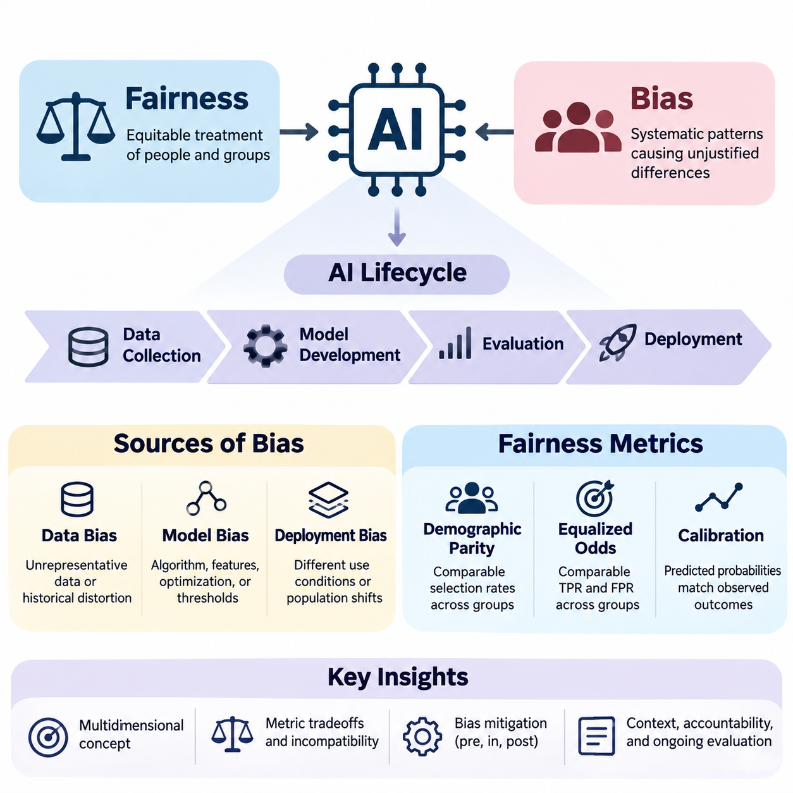
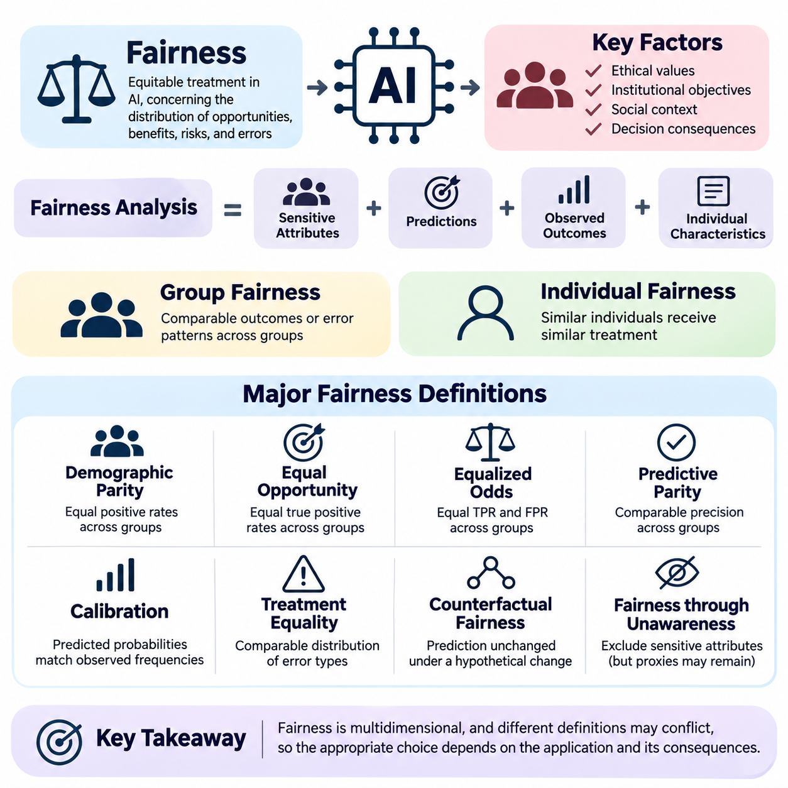
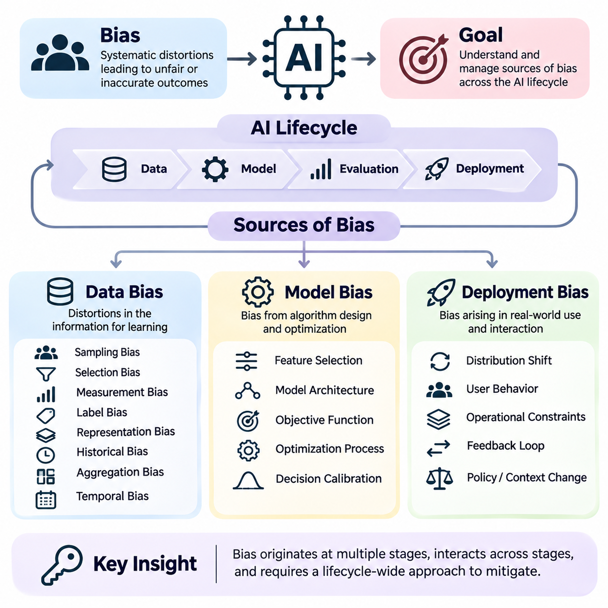
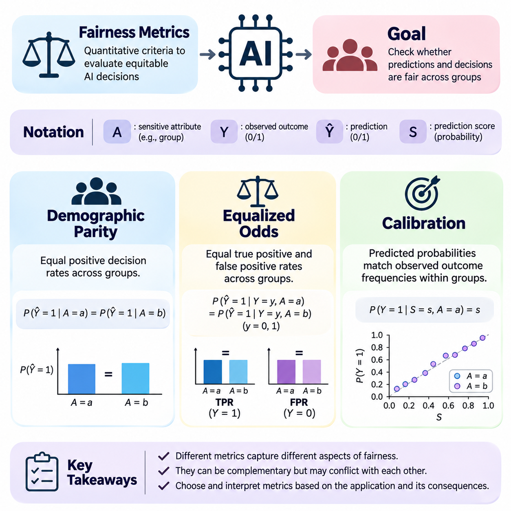
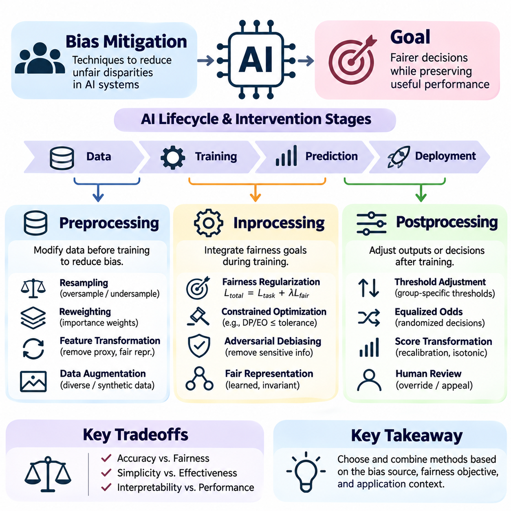
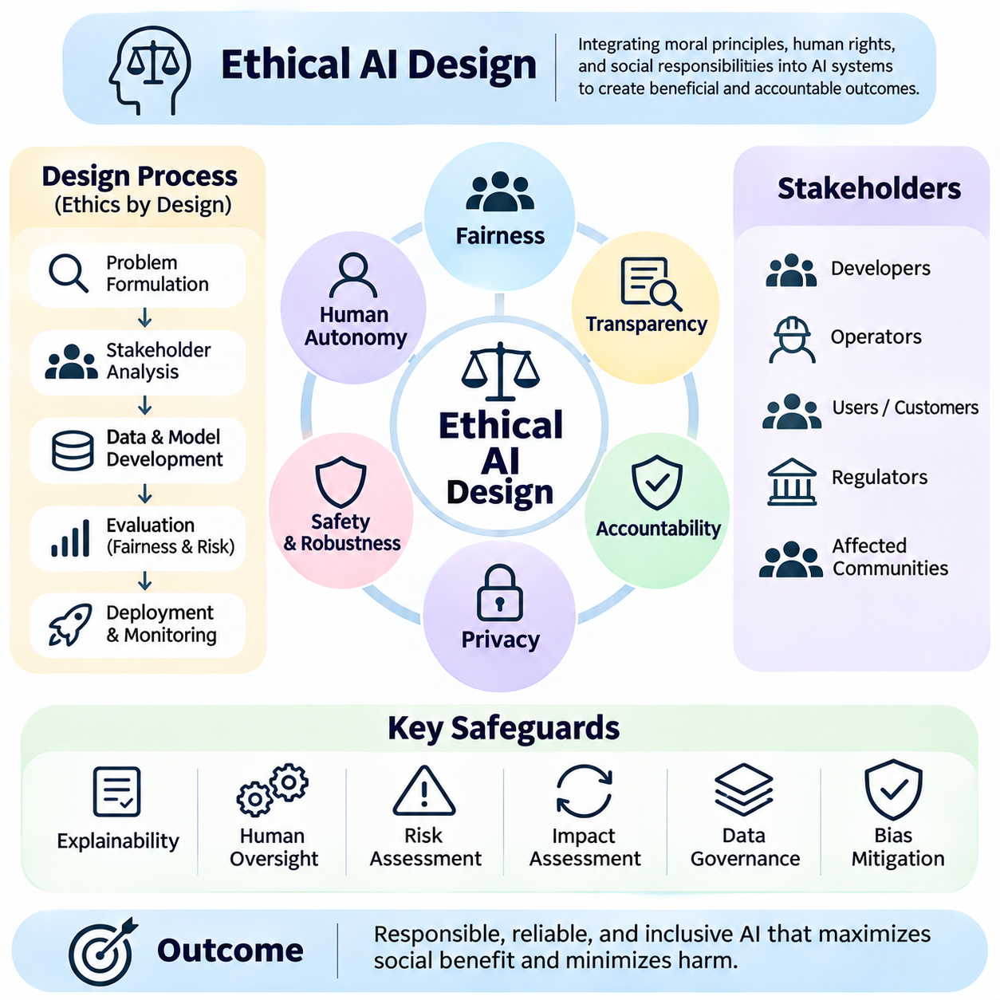
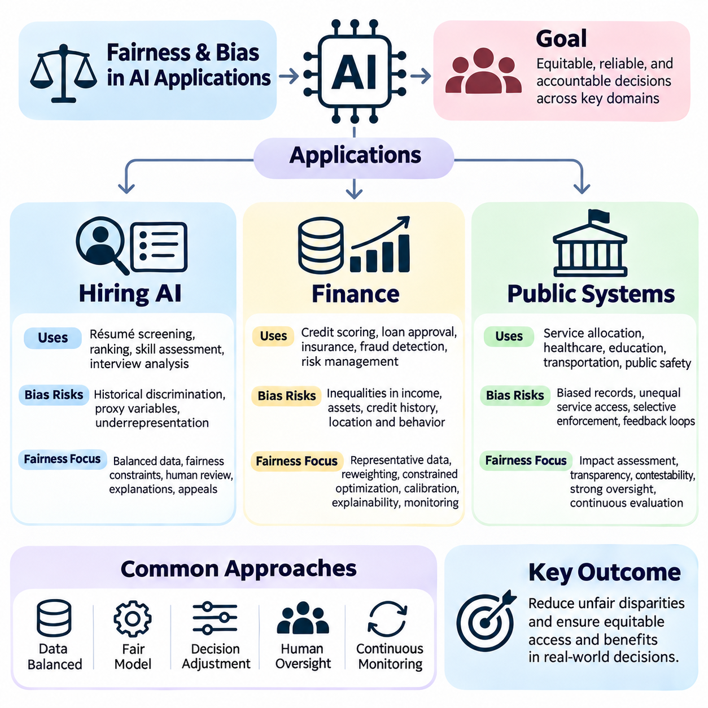

**Volume 42. AI Safety Alignment and Interpretability**


# 04. Fairness and Bias

## 04.00 Overview

{width="7.268055555555556in" height="7.268055555555556in"}

Fairness and bias are fundamental concerns in artificial intelligence because automated systems increasingly influence decisions affecting individuals, organizations, and society. Fairness refers to the equitable treatment of people and groups, while bias describes systematic patterns that may produce unjustified differences in outcomes. Understanding these concepts is essential for developing AI systems that are reliable, accountable, and socially responsible.

Artificial intelligence systems learn patterns from data and translate those patterns into predictions, recommendations, or decisions. Although mathematical optimization can improve predictive accuracy, it does not automatically guarantee equitable outcomes. Models may reproduce historical inequalities, amplify existing disadvantages, or create new forms of discrimination when their training objectives and deployment conditions overlook social consequences.

Fairness is a multidimensional concept involving statistical properties, ethical principles, legal expectations, and contextual judgments. Different stakeholders may interpret fairness according to equal treatment, equal opportunity, proportional outcomes, or protection against discrimination. Consequently, designing fair AI requires explicit consideration of the decision context, affected populations, institutional responsibilities, and potential conflicts between competing fairness objectives.

Bias in AI systems can originate throughout the machine learning lifecycle, beginning with data collection and continuing through model development, evaluation, and deployment. These sources interact rather than operating independently. A dataset containing historical discrimination may influence learned representations, while inappropriate optimization objectives or deployment practices can further magnify unequal outcomes across demographic or socioeconomic groups.

Data bias emerges when training datasets inadequately represent relevant populations or encode systematic distortions in observed outcomes. Sampling procedures, measurement instruments, labeling practices, and historical records can all introduce disparities. For example, recruitment datasets reflecting past hiring preferences may cause automated screening systems to reproduce patterns that disadvantage qualified applicants from underrepresented groups.

Model bias occurs when algorithmic assumptions, feature representations, optimization procedures, or decision thresholds generate systematic performance differences. Even when sensitive attributes are excluded, correlated variables may function as proxies for protected characteristics. Complex models can also learn interactions that are difficult to identify through conventional accuracy measurements, making subgroup evaluation and interpretability important components of fairness assessment.

Deployment bias arises when an AI system is applied under conditions that differ from those anticipated during development. Changes in population characteristics, institutional practices, user behavior, or decision procedures may alter the distribution of benefits and harms. A model evaluated as fair in one environment may produce unequal outcomes elsewhere, demonstrating why fairness must be continuously assessed under realistic operating conditions.

Fairness metrics provide quantitative methods for examining disparities between groups and evaluating whether model behavior satisfies specified criteria. However, no single metric captures every ethical or operational dimension of fairness. Different measures emphasize different relationships among predictions, actual outcomes, and population characteristics. Their interpretation therefore depends on the application, underlying data distributions, and consequences of incorrect decisions.

Demographic parity evaluates whether favorable prediction rates are comparable across defined demographic groups. This criterion emphasizes the distribution of model decisions without necessarily accounting for differences in observed target outcomes. Although useful for identifying unequal selection rates, demographic parity does not independently establish whether decisions are justified, especially when observed labels reflect historical discrimination or measurement limitations.

Equalized odds examines whether true positive rates and false positive rates are comparable across groups. This approach emphasizes differences in error behavior conditional on observed outcomes and can be especially relevant when incorrect classifications impose unequal costs. Nevertheless, satisfying equalized odds may require tradeoffs with predictive accuracy, calibration, or other fairness criteria, particularly when outcome prevalence differs across populations.

Calibration evaluates whether predicted probabilities correspond to observed outcome frequencies within relevant groups. A calibrated model assigning a risk score of 0.7 should produce approximately 70 percent positive outcomes among individuals receiving that score, subject to sufficient observations. Calibration supports meaningful risk interpretation, but it cannot always be simultaneously satisfied with equalized odds when group outcome distributions differ.

Fairness criteria may be mathematically incompatible under certain conditions, creating unavoidable tensions between desirable statistical properties. This means fairness cannot be reduced to maximizing a universal numerical score. Developers must determine which constraints best reflect the application and its consequences, document the reasoning behind those choices, and evaluate whether the resulting tradeoffs are acceptable to affected stakeholders.

Bias mitigation encompasses technical interventions designed to reduce undesirable disparities before, during, or after model training. These approaches are commonly categorized as preprocessing, inprocessing, and postprocessing methods. Each category targets different mechanisms through which bias enters automated decisions, and each introduces practical considerations involving data integrity, predictive performance, computational requirements, and institutional accountability.

Preprocessing methods modify training data or its representation before learning begins. Techniques may include sample reweighting, targeted resampling, feature transformation, and carefully designed data augmentation. Their objective is to reduce the influence of problematic distributions or representations while preserving information necessary for accurate predictions. However, preprocessing alone cannot resolve every source of discrimination embedded in labels or deployment practices.

Inprocessing methods incorporate fairness considerations directly into model training. Fairness-aware regularization, constrained optimization, adversarial representation learning, and modified objective functions can discourage specified disparities while optimizing predictive performance. These methods provide opportunities to balance fairness and utility during learning, but their effectiveness depends on selecting appropriate constraints and validating behavior across relevant populations.

Postprocessing methods adjust model predictions or decision policies after training without necessarily modifying the underlying model. Examples include group-aware threshold selection, score adjustment, and randomized decision rules designed to satisfy specified fairness constraints. Such approaches can be useful when retraining is impractical, although they may introduce interpretability challenges and require careful legal and ethical examination.

Ethical AI design extends fairness beyond numerical optimization by considering human rights, transparency, accountability, participation, and institutional responsibility. A technically compliant model may still create unacceptable consequences when its intended purpose, decision authority, or operational environment is inappropriate. Responsible development therefore requires interdisciplinary collaboration among engineers, domain experts, legal specialists, policymakers, and representatives of affected communities.

Fairness evaluation should consider both group-level disparities and individual circumstances. Group fairness examines statistical relationships across populations, whereas individual fairness seeks consistent treatment of sufficiently similar individuals. These perspectives can expose different problems and may lead to different interventions. Their practical application requires defensible similarity criteria, appropriate comparison groups, and awareness of intersectional disadvantages.

Intersectional fairness addresses the possibility that individuals belonging to multiple demographic categories experience disparities not visible in broad group comparisons. Evaluating only one attribute at a time may conceal concentrated errors affecting smaller subpopulations. Effective analysis therefore examines meaningful combinations of characteristics while accounting for sample size limitations, statistical uncertainty, privacy risks, and the possibility of unstable subgroup estimates.

Fairness assessment must also distinguish observed statistical disparities from causal explanations. Differences in prediction rates do not automatically establish discrimination, while similar aggregate outcomes do not guarantee the absence of discriminatory mechanisms. Causal reasoning, counterfactual analysis, and careful examination of institutional processes can help identify how sensitive characteristics, historical conditions, and decision pathways influence model behavior.

Hiring AI illustrates the importance of fairness because automated screening and candidate ranking directly influence access to employment opportunities. Models trained on historical recruitment records may reproduce occupational stereotypes or institutional preferences. Fairness evaluation should examine selection rates, qualification-related performance, subgroup error patterns, and the role of human oversight throughout recruitment and employment decisions.

Financial AI systems apply predictive models to credit scoring, lending, insurance, and fraud detection. Unequal error rates or poorly justified risk assessments can restrict access to essential financial services. Fairness analysis must therefore consider the relationship between legitimate risk factors, potentially discriminatory proxies, historical financial exclusion, and regulatory requirements while preserving the reliability of financial decision-making.

Public systems increasingly use AI to support resource allocation, eligibility assessment, service prioritization, and administrative decisions. Errors or disparities in these applications can affect access to public benefits and essential services. Responsible deployment requires transparent decision procedures, appropriate human review, accessible appeal mechanisms, and continuous evaluation of whether automated recommendations produce equitable outcomes.

Fairness monitoring must continue after deployment because demographic composition, economic conditions, data quality, and institutional behavior evolve over time. Monitoring systems should track subgroup performance, decision distributions, calibration, and emerging disparities while protecting sensitive information. When significant problems are detected, organizations need documented procedures for investigation, corrective action, reassessment, and responsible model updates.

Ultimately, fairness and bias management are continuous responsibilities rather than isolated technical tasks. Effective AI governance combines explicit fairness objectives, representative data practices, rigorous evaluation, appropriate mitigation strategies, ethical design, and operational oversight. Integrating these elements throughout the system lifecycle helps organizations develop AI technologies that are not only accurate and efficient but also trustworthy, accountable, and equitable.

공정성(Fairness)과 편향(Bias)은 자동화 시스템(Automated Systems)이 개인, 조직, 사회에 영향을 미치는 의사결정(Decision-Making)에 점점 더 많이 관여하면서 인공지능(Artificial Intelligence)의 핵심적인 문제로 부상하고 있다. 공정성은 개인과 집단에 대한 공평한 대우를 의미하며, 편향은 정당화되지 않은 결과 차이를 발생시킬 수 있는 체계적인 패턴을 의미한다. 이러한 개념을 이해하는 것은 신뢰성과 책임성을 갖춘 사회적으로 책임 있는 인공지능 시스템을 개발하는 데 필수적이다.

인공지능 시스템(AI Systems)은 데이터(Data)에서 패턴을 학습하고 이를 예측(Prediction), 추천(Recommendation), 의사결정(Decision)으로 변환한다. 수학적 최적화(Mathematical Optimization)는 예측 정확도(Predictive Accuracy)를 향상시킬 수 있지만, 공평한 결과를 자동으로 보장하지는 않는다. 학습 목표(Training Objectives)와 배포 환경(Deployment Conditions)이 사회적 영향을 충분히 고려하지 않으면 기존의 불평등을 재생산하거나 불이익을 확대하고 새로운 형태의 차별을 발생시킬 수 있다.

공정성은 통계적 속성(Statistical Properties), 윤리적 원칙(Ethical Principles), 법적 요구사항(Legal Requirements), 맥락적 판단(Contextual Judgments)을 포함하는 다차원적 개념(Multidimensional Concept)이다. 이해관계자(Stakeholders)는 동등한 대우(Equal Treatment), 기회의 평등(Equal Opportunity), 비례적 결과(Proportional Outcomes), 차별 방지(Protection Against Discrimination)에 따라 공정성을 다르게 해석할 수 있다. 따라서 공정한 인공지능 설계에는 의사결정 맥락, 영향을 받는 집단, 제도적 책임, 공정성 목표 사이의 충돌에 대한 명시적인 고려가 필요하다.

인공지능 시스템의 편향은 데이터 수집(Data Collection)에서 시작하여 모델 개발(Model Development), 평가(Evaluation), 배포(Deployment)에 이르는 기계학습 생명주기(Machine Learning Lifecycle) 전반에서 발생할 수 있다. 이러한 원인들은 독립적으로 작용하기보다 상호작용한다. 역사적 차별(Historical Discrimination)을 포함한 데이터셋(Dataset)은 학습된 표현(Learned Representations)에 영향을 미치며, 부적절한 최적화 목표나 배포 관행은 인구통계학적 집단과 사회경제적 집단 사이의 불평등을 더욱 확대할 수 있다.

데이터 편향(Data Bias)은 학습 데이터셋(Training Dataset)이 관련 모집단(Population)을 충분히 대표하지 못하거나 관측 결과에 체계적인 왜곡을 포함할 때 발생한다. 표본 추출(Sampling), 측정 도구(Measurement Instruments), 레이블링(Labeling), 과거 기록(Historical Records)은 모두 불균형을 유발할 수 있다. 예를 들어 과거 채용 선호도가 반영된 데이터는 자동화된 지원자 선별 시스템이 소수 집단의 자격 있는 지원자에게 불리한 판단을 반복하도록 만들 수 있다.

모델 편향(Model Bias)은 알고리즘의 가정(Algorithmic Assumptions), 특징 표현(Feature Representations), 최적화 절차(Optimization Procedures), 의사결정 임계값(Decision Thresholds)이 체계적인 성능 차이를 발생시킬 때 나타난다. 민감 속성(Sensitive Attributes)을 제외하더라도 상관관계가 있는 변수는 보호 특성(Protected Characteristics)의 대리 변수(Proxy Variables)로 작용할 수 있다. 복잡한 모델은 일반적인 정확도 측정으로 식별하기 어려운 상호작용을 학습할 수 있으므로 하위 집단 평가(Subgroup Evaluation)와 해석 가능성(Interpretability)이 중요하다.

배포 편향(Deployment Bias)은 인공지능 시스템이 개발 과정에서 예상한 조건과 다른 환경에 적용될 때 발생한다. 모집단 특성, 제도적 관행, 사용자 행동, 의사결정 절차의 변화는 혜택과 피해의 분포를 바꿀 수 있다. 특정 환경에서 공정하다고 평가된 모델도 다른 환경에서는 불평등한 결과를 생성할 수 있다. 따라서 공정성은 실제 운영 조건(Realistic Operating Conditions)에서 지속적으로 평가되어야 한다.

공정성 지표(Fairness Metrics)는 집단 간 격차를 조사하고 모델의 행동이 지정된 기준을 충족하는지 평가하는 정량적 방법(Quantitative Methods)을 제공한다. 그러나 단일 지표가 공정성의 모든 윤리적·운영적 측면을 포괄할 수는 없다. 서로 다른 지표는 예측값(Predictions), 실제 결과(Actual Outcomes), 모집단 특성(Population Characteristics) 사이의 관계를 다르게 강조한다. 따라서 지표의 해석은 적용 분야, 데이터 분포, 잘못된 의사결정의 결과에 따라 달라진다.

인구통계학적 동등성(Demographic Parity)은 정의된 인구통계학적 집단 사이에서 긍정적 예측 비율(Favorable Prediction Rates)이 유사한지를 평가한다. 이 기준은 관측된 실제 결과의 차이를 반드시 고려하지 않고 모델 결정의 분포에 초점을 맞춘다. 불평등한 선발 비율을 식별하는 데 유용하지만, 관측된 레이블(Observed Labels)에 역사적 차별이나 측정상의 한계가 반영되어 있다면 의사결정의 정당성을 독립적으로 입증하지는 못한다.

균등화된 오즈(Equalized Odds)는 집단 간 참양성률(True Positive Rate)과 거짓양성률(False Positive Rate)이 유사한지를 평가한다. 이 접근법은 관측된 실제 결과를 조건으로 오류 행동(Error Behavior)의 차이를 분석하며, 잘못된 분류가 불균등한 비용을 발생시키는 상황에서 특히 중요하다. 그러나 실제 결과의 유병률 또는 발생 비율(Outcome Prevalence)이 집단마다 다르면 균등화된 오즈를 충족하는 과정에서 예측 정확도, 보정, 다른 공정성 기준과 상충관계(Tradeoffs)가 발생할 수 있다.

보정(Calibration)은 예측 확률(Predicted Probabilities)이 관련 집단에서 관측된 결과 빈도(Observed Outcome Frequencies)와 일치하는지를 평가한다. 적절하게 보정된 모델이 위험 점수(Risk Score) 0.7을 부여했다면, 해당 점수를 받은 사람들 중 약 70%에서 긍정적 결과가 나타나야 한다. 다만 충분한 관측치가 필요하다. 보정은 위험 해석의 의미를 높이지만 집단별 결과 분포가 다르면 균등화된 오즈와 항상 동시에 충족될 수는 없다.

공정성 기준(Fairness Criteria)은 특정 조건에서 수학적으로 양립할 수 없으며, 바람직한 통계적 속성 사이에 불가피한 긴장을 발생시킨다. 이는 공정성을 보편적인 단일 수치 점수의 최대화로 환원할 수 없음을 의미한다. 개발자는 적용 분야와 결과를 가장 적절하게 반영하는 제약조건(Constraints)을 결정하고, 선택 근거를 문서화하며, 발생하는 상충관계가 영향을 받는 이해관계자에게 수용 가능한지 평가해야 한다.

편향 완화(Bias Mitigation)는 모델 학습 전후와 학습 과정에서 바람직하지 않은 격차를 줄이기 위한 기술적 개입(Technical Interventions)을 포함한다. 이러한 접근법은 일반적으로 전처리(Preprocessing), 학습 중 처리(Inprocessing), 후처리(Postprocessing)로 구분된다. 각 범주는 자동화된 의사결정에 편향이 유입되는 서로 다른 메커니즘을 대상으로 하며, 데이터 무결성(Data Integrity), 예측 성능, 계산 요구사항, 제도적 책임과 관련된 실질적인 고려사항을 수반한다.

전처리 방법(Preprocessing Methods)은 학습이 시작되기 전에 학습 데이터나 데이터 표현을 수정한다. 표본 재가중치(Sample Reweighting), 표적 재표본추출(Targeted Resampling), 특징 변환(Feature Transformation), 신중하게 설계된 데이터 증강(Data Augmentation) 등이 포함된다. 이러한 방법은 정확한 예측에 필요한 정보를 유지하면서 문제가 있는 데이터 분포나 표현의 영향을 줄이는 것을 목표로 한다. 그러나 전처리만으로 레이블이나 배포 관행에 내재된 모든 차별 문제를 해결할 수는 없다.

학습 중 처리 방법(Inprocessing Methods)은 공정성 고려사항을 모델 학습(Model Training)에 직접 통합한다. 공정성 인식 정규화(Fairness-Aware Regularization), 제약 최적화(Constrained Optimization), 적대적 표현 학습(Adversarial Representation Learning), 수정된 목적함수(Modified Objective Functions)는 예측 성능을 최적화하면서 특정 격차를 억제할 수 있다. 이러한 방법의 효과는 적절한 제약조건의 선택과 관련 모집단 전반에 걸친 행동 검증에 달려 있다.

후처리 방법(Postprocessing Methods)은 기본 모델을 반드시 수정하지 않고 학습 완료 후 모델 예측이나 의사결정 정책(Decision Policies)을 조정한다. 집단별 임계값 선택(Group-Aware Threshold Selection), 점수 조정(Score Adjustment), 무작위 의사결정 규칙(Randomized Decision Rules) 등이 포함된다. 이러한 접근법은 재학습이 어려운 상황에서 유용하지만 해석 가능성 문제를 발생시킬 수 있으며, 법적·윤리적 측면에 대한 신중한 검토가 필요하다.

윤리적 인공지능 설계(Ethical AI Design)는 인권(Human Rights), 투명성(Transparency), 책임성(Accountability), 참여(Participation), 제도적 책임(Institutional Responsibility)을 고려함으로써 수치적 최적화를 넘어 공정성을 확장한다. 기술적으로 기준을 충족하는 모델도 목적이나 의사결정 권한, 운영 환경이 부적절하면 수용하기 어려운 결과를 초래할 수 있다. 따라서 책임 있는 개발에는 엔지니어, 분야별 전문가, 법률 전문가, 정책 입안자, 영향을 받는 공동체 대표 사이의 학제 간 협력(Interdisciplinary Collaboration)이 필요하다.

공정성 평가(Fairness Evaluation)는 집단 수준의 격차(Group-Level Disparities)와 개인적 상황(Individual Circumstances)을 모두 고려해야 한다. 집단 공정성(Group Fairness)은 모집단 사이의 통계적 관계를 조사하며, 개인 공정성(Individual Fairness)은 충분히 유사한 개인에 대한 일관된 대우를 추구한다. 두 관점은 서로 다른 문제를 드러내고 다른 개입으로 이어질 수 있다. 실제 적용에는 타당한 유사성 기준(Similarity Criteria), 적절한 비교 집단, 교차적 불이익에 대한 이해가 필요하다.

교차적 공정성(Intersectional Fairness)은 여러 인구통계학적 범주에 동시에 속한 개인이 광범위한 집단 비교에서는 드러나지 않는 격차를 경험할 수 있다는 점을 다룬다. 하나의 속성만 평가하면 작은 하위 모집단(Subpopulations)에 집중된 오류를 놓칠 수 있다. 따라서 효과적인 분석은 표본 크기의 한계(Sample Size Limitations), 통계적 불확실성(Statistical Uncertainty), 개인정보 보호 위험(Privacy Risks), 불안정한 하위 집단 추정치를 고려하면서 의미 있는 특성 조합을 조사해야 한다.

공정성 평가는 관측된 통계적 격차(Statistical Disparities)와 인과적 설명(Causal Explanations)을 구분해야 한다. 예측 비율의 차이가 자동으로 차별을 입증하는 것은 아니며, 유사한 전체 결과가 차별적 메커니즘의 부재를 보장하지도 않는다. 인과 추론(Causal Reasoning), 반사실적 분석(Counterfactual Analysis), 제도적 절차에 대한 면밀한 검토는 민감 특성, 역사적 조건, 의사결정 경로가 모델 행동에 영향을 미치는 방식을 식별하는 데 도움이 된다.

채용 인공지능(Hiring AI)은 자동화된 지원자 선별과 순위 결정이 고용 기회에 직접 영향을 미치므로 공정성의 중요성을 보여주는 대표적인 사례이다. 과거 채용 기록으로 학습한 모델은 직업적 고정관념(Occupational Stereotypes)이나 제도적 선호를 재생산할 수 있다. 공정성 평가는 선발 비율(Selection Rates), 자격 관련 성능(Qualification-Related Performance), 하위 집단 오류 패턴, 채용과 고용 결정 전반에 걸친 인간 감독(Human Oversight)의 역할을 검토해야 한다.

금융 인공지능(Financial AI)은 신용평가(Credit Scoring), 대출(Lending), 보험(Insurance), 사기 탐지(Fraud Detection)에 예측 모델을 적용한다. 불균등한 오류율이나 정당성이 부족한 위험 평가는 필수 금융 서비스에 대한 접근을 제한할 수 있다. 따라서 공정성 분석은 정당한 위험 요인(Legitimate Risk Factors), 잠재적으로 차별적인 대리 변수, 역사적 금융 소외(Historical Financial Exclusion), 규제 요구사항 사이의 관계를 고려하면서 금융 의사결정의 신뢰성을 유지해야 한다.

공공 시스템(Public Systems)은 자원 배분(Resource Allocation), 자격 심사(Eligibility Assessment), 서비스 우선순위 결정(Service Prioritization), 행정 의사결정(Administrative Decisions)을 지원하기 위해 인공지능을 점점 더 많이 활용한다. 이러한 분야의 오류나 격차는 공공 혜택과 필수 서비스에 대한 접근에 영향을 미칠 수 있다. 책임 있는 배포에는 투명한 의사결정 절차, 적절한 인간 검토, 접근 가능한 이의제기 절차(Appeal Mechanisms), 자동화된 권고가 공평한 결과를 생성하는지에 대한 지속적인 평가가 필요하다.

공정성 모니터링(Fairness Monitoring)은 인구통계학적 구성, 경제적 조건, 데이터 품질, 제도적 행동이 시간에 따라 변화하므로 배포 이후에도 지속되어야 한다. 모니터링 시스템은 민감 정보를 보호하면서 하위 집단 성능, 의사결정 분포, 보정 상태, 새롭게 나타나는 격차를 추적해야 한다. 중대한 문제가 탐지되면 조직은 조사, 시정 조치(Corrective Action), 재평가(Reassessment), 책임 있는 모델 업데이트(Model Updates)를 위한 문서화된 절차를 갖추어야 한다.

궁극적으로 공정성과 편향 관리(Fairness and Bias Management)는 일회성 기술 작업이 아니라 지속적인 책임이다. 효과적인 인공지능 거버넌스(AI Governance)는 명시적인 공정성 목표, 대표성 있는 데이터 관리, 엄격한 평가, 적절한 편향 완화 전략, 윤리적 설계, 운영 감독을 결합한다. 이러한 요소를 시스템 생명주기(System Lifecycle) 전반에 통합하면 조직은 정확하고 효율적일 뿐만 아니라 신뢰할 수 있고 책임성과 공정성을 갖춘 인공지능 기술을 개발할 수 있다.

## 04.01 Definitions of Fairness

{width="7.268055555555556in" height="7.268055555555556in"}

Fairness in artificial intelligence refers to the principles and measurable conditions under which automated systems treat individuals and groups equitably. It concerns how opportunities, benefits, risks, and errors are distributed across populations. Unlike predictive accuracy, fairness cannot be defined solely through technical performance because its interpretation depends on ethical values, institutional objectives, social circumstances, and the consequences of decisions.

The concept of fairness originates from philosophical discussions of justice, equality, rights, and legitimate differences in treatment. In artificial intelligence, these ideas must be translated into operational criteria that can guide system design and evaluation. Such translation is challenging because mathematical definitions capture selected aspects of fairness rather than its complete ethical meaning, and different definitions may produce conflicting conclusions.

Formal fairness definitions generally examine relationships among sensitive attributes, model predictions, observed outcomes, and relevant individual characteristics. Sensitive attributes may include race, gender, age, disability, or other legally protected characteristics. Their relevance depends on the application and jurisdiction. Fairness analysis must also consider indirect discrimination caused by features that correlate with protected attributes.

Group fairness evaluates whether an automated system produces comparable outcomes or error patterns across demographic groups. It typically relies on statistical comparisons involving selection rates, prediction accuracy, or conditional error probabilities. Group fairness is particularly relevant when AI systems influence access to employment, credit, education, healthcare, or public services, where systematic disparities may create substantial social consequences.

Individual fairness follows the principle that similar individuals should receive similar treatment. This approach requires defining a meaningful similarity measure based on legitimate task-related characteristics. For example, applicants with comparable qualifications should receive comparable evaluations. However, constructing an appropriate similarity metric is difficult because judgments about relevant differences often involve ethical and institutional assumptions.

Demographic parity, also called statistical parity, requires positive decision rates to be equal across specified demographic groups. In a hiring system, this criterion compares the proportion of applicants selected from each group. It can reveal disparities in access to favorable decisions, but it does not directly account for differences in observed qualifications, outcome prevalence, or the reliability of historical labels.

Equal opportunity focuses on equality of true positive rates across groups. Under this definition, individuals who satisfy the observed positive outcome condition should have comparable probabilities of receiving favorable predictions. In employment screening, qualified applicants from different groups should have similar chances of selection. This criterion emphasizes avoiding unequal exclusion of individuals who meet the relevant qualification standard.

Equalized odds extends equal opportunity by requiring comparable true positive rates and false positive rates across demographic groups. It therefore examines whether a classifier distributes both successful detections and incorrect positive predictions equitably. This definition is useful when classification errors create significant consequences, although its implementation may involve tradeoffs with overall accuracy and other fairness requirements.

Predictive parity requires the positive predictive value to be comparable across groups. When an AI system produces a positive classification, the probability that the observed outcome is actually positive should be similar regardless of group membership. This criterion emphasizes the reliability of favorable or high-risk classifications, but it does not guarantee equal selection rates or equivalent error distributions.

Calibration requires predicted probabilities to correspond to observed outcome frequencies within relevant groups. For example, among individuals assigned a predicted probability of 0.8, approximately 80 percent should experience the predicted outcome. Groupwise calibration supports consistent interpretation of risk scores, yet it may conflict with equalized odds when outcome prevalence differs and predictions are imperfect.

Treatment equality examines the relative distribution of different error types across groups. Some formulations compare false positive and false negative counts or rates, depending on the evaluation framework. The underlying concern is whether the burdens of incorrect decisions are distributed acceptably. Because false positives and false negatives can produce different harms, their relative importance must be established through domain-specific analysis.

Counterfactual fairness introduces a causal perspective by asking whether a prediction would remain unchanged if an individual\'s sensitive attribute were different in a hypothetical causal scenario. This approach requires a structural causal model describing relationships among attributes, circumstances, and outcomes. Its validity depends on causal assumptions that may be difficult to establish or verify using observational data alone.

Fairness through unawareness proposes excluding sensitive attributes from model inputs. Although conceptually straightforward, this strategy does not guarantee nondiscrimination because other variables may encode similar information. Geographic location, educational history, purchasing behavior, or employment patterns can act as proxies for protected characteristics. Consequently, removing explicit demographic variables does not eliminate the need for fairness evaluation.

Procedural fairness concerns whether decisions are produced through consistent, transparent, and justifiable processes. It emphasizes appropriate decision rules, accountability, opportunities for review, and protection against arbitrary treatment. An AI system may satisfy statistical fairness criteria while remaining procedurally unfair if affected individuals cannot understand, contest, or obtain meaningful review of consequential decisions.

Distributive fairness addresses how benefits, opportunities, resources, and burdens are allocated among individuals and groups. Different distributive principles emphasize equality, need, merit, or the reduction of disadvantage. AI applications frequently require balancing these perspectives. For example, healthcare allocation may prioritize clinical need, while employment decisions may emphasize job-related qualifications and equal access to consideration.

Substantive fairness evaluates whether an AI system contributes to genuinely equitable conditions rather than merely satisfying formal rules. Equal treatment under existing procedures may perpetuate historical disadvantages when individuals begin from unequal circumstances. Substantive fairness therefore considers structural inequalities, barriers to participation, and the long-term consequences of automated decisions within their broader institutional environments.

Intersectional fairness examines disparities affecting people who belong to multiple demographic categories simultaneously. A model may appear fair when evaluated separately by gender and age while performing poorly for a particular combination of these attributes. Intersectional analysis helps reveal hidden disadvantages, although smaller subgroup sizes introduce statistical uncertainty and require careful handling of privacy and measurement limitations.

Fairness definitions are not universally compatible. When outcome prevalence differs across groups, calibration, predictive parity, and equalized odds generally cannot all be achieved simultaneously by an imperfect classifier under common nondegenerate conditions. These incompatibility results demonstrate that fairness involves normative choices rather than purely mathematical optimization. Selecting a criterion requires understanding which errors and disparities matter most.

The distinction between equality and equity is central to interpreting fairness. Equality emphasizes applying the same rules or distributing resources uniformly, whereas equity considers differences in circumstances and the support needed to achieve justifiable outcomes. Neither concept automatically determines the correct algorithmic intervention. Appropriate choices depend on legitimate objectives, legal constraints, empirical evidence, and stakeholder perspectives.

Fairness definitions must also account for the limitations of observed labels and ground truth. Historical decisions may reflect discrimination, incomplete information, or institutional practices rather than objective measures of merit or risk. A model can satisfy statistical criteria relative to biased labels while reproducing harmful outcomes. Therefore, evaluating fairness requires examining how target variables are constructed and whether they represent defensible objectives.

Practical fairness assessment begins by identifying affected populations, consequential decisions, relevant protected characteristics, and plausible sources of harm. Developers then select fairness criteria consistent with the application and evaluate performance across meaningful groups. Statistical uncertainty, sample size, distribution shifts, and the costs of different errors should be considered before interpreting observed disparities as evidence of acceptable or unacceptable behavior.

Fairness is also dynamic because the relationship between automated decisions and social outcomes changes over time. Decisions can influence future opportunities, institutional behavior, and the data collected for subsequent training. Feedback loops may reinforce existing inequalities even when initial evaluation results appear acceptable. Continuous monitoring and periodic reassessment are therefore necessary to maintain fairness under evolving conditions.

Ultimately, defining fairness in artificial intelligence requires integrating mathematical criteria with ethical reasoning, causal understanding, domain knowledge, and institutional accountability. No single definition is sufficient for every application, and satisfying a chosen metric does not establish complete fairness. Responsible AI development depends on transparent justification of fairness objectives, rigorous empirical evaluation, meaningful stakeholder participation, and continuous examination of real-world consequences.

인공지능(Artificial Intelligence)에서 공정성(Fairness)은 자동화 시스템(Automated Systems)이 개인과 집단을 공평하게 대우하기 위해 충족해야 하는 원칙과 측정 가능한 조건을 의미한다. 공정성은 기회(Opportunities), 혜택(Benefits), 위험(Risks), 오류(Errors)가 모집단(Populations) 전반에 어떻게 분배되는지를 다룬다. 예측 정확도(Predictive Accuracy)와 달리 공정성은 윤리적 가치, 제도적 목표, 사회적 상황, 의사결정의 결과에 따라 해석이 달라지므로 기술적 성능만으로 정의할 수 없다.

공정성의 개념은 정의(Justice), 평등(Equality), 권리(Rights), 정당한 차등 대우(Legitimate Differences in Treatment)에 관한 철학적 논의에서 비롯된다. 인공지능에서는 이러한 개념을 시스템 설계(System Design)와 평가(Evaluation)를 안내하는 운영 기준(Operational Criteria)으로 변환해야 한다. 그러나 수학적 정의(Mathematical Definitions)는 공정성의 완전한 윤리적 의미가 아니라 특정 측면만을 포착하며, 서로 다른 정의가 상충하는 결론을 도출할 수 있기 때문에 이러한 변환은 어렵다.

형식적 공정성 정의(Formal Fairness Definitions)는 일반적으로 민감 속성(Sensitive Attributes), 모델 예측(Model Predictions), 관측된 결과(Observed Outcomes), 관련 개인 특성(Individual Characteristics) 사이의 관계를 조사한다. 민감 속성에는 인종(Race), 성별(Gender), 연령(Age), 장애(Disability), 기타 법적으로 보호되는 특성이 포함될 수 있다. 이러한 속성의 관련성은 적용 분야와 관할권에 따라 달라지며, 공정성 분석에서는 보호 특성과 상관관계가 있는 특징으로 인해 발생하는 간접 차별(Indirect Discrimination)도 고려해야 한다.

집단 공정성(Group Fairness)은 자동화 시스템이 인구통계학적 집단(Demographic Groups) 사이에서 비교 가능한 결과나 오류 패턴(Error Patterns)을 생성하는지 평가한다. 일반적으로 선발 비율(Selection Rates), 예측 정확도(Prediction Accuracy), 조건부 오류 확률(Conditional Error Probabilities)에 대한 통계적 비교를 활용한다. 집단 공정성은 인공지능 시스템이 고용, 신용, 교육, 의료, 공공 서비스에 대한 접근에 영향을 미치고 체계적인 격차가 중대한 사회적 결과를 초래할 수 있는 상황에서 특히 중요하다.

개인 공정성(Individual Fairness)은 유사한 개인에게 유사한 대우를 제공해야 한다는 원칙을 따른다. 이 접근법은 정당한 과업 관련 특성(Task-Related Characteristics)에 기반하여 의미 있는 유사성 척도(Similarity Measure)를 정의해야 한다. 예를 들어 유사한 자격을 가진 지원자는 유사한 평가를 받아야 한다. 그러나 적절한 유사성 지표(Similarity Metric)를 구성하는 것은 어렵다. 어떤 차이가 관련성이 있는지를 판단하는 과정에 윤리적·제도적 가정이 포함되는 경우가 많기 때문이다.

인구통계학적 동등성(Demographic Parity)은 통계적 동등성(Statistical Parity)이라고도 하며, 지정된 인구통계학적 집단 사이에서 긍정적 의사결정 비율(Positive Decision Rates)이 동일할 것을 요구한다. 채용 시스템에서는 각 집단에서 선발된 지원자의 비율을 비교한다. 이 기준은 유리한 의사결정에 접근하는 과정의 격차를 드러낼 수 있지만, 관측된 자격의 차이, 실제 결과의 발생 비율(Outcome Prevalence), 과거 레이블(Historical Labels)의 신뢰성을 직접 고려하지는 않는다.

기회의 평등(Equal Opportunity)은 집단 사이의 참양성률(True Positive Rates)이 동일한지에 초점을 맞춘다. 이 정의에 따르면 관측된 긍정적 결과 조건을 충족하는 개인은 유리한 예측을 받을 확률이 집단에 관계없이 유사해야 한다. 채용 심사에서 자격을 갖춘 지원자는 소속 집단과 무관하게 유사한 선발 기회를 가져야 한다. 이 기준은 관련 자격 기준을 충족하는 개인이 불평등하게 배제되는 상황을 방지하는 데 중점을 둔다.

균등화된 오즈(Equalized Odds)는 인구통계학적 집단 사이에서 참양성률(True Positive Rates)과 거짓양성률(False Positive Rates)이 모두 유사할 것을 요구함으로써 기회의 평등을 확장한다. 따라서 분류기(Classifier)가 올바른 탐지와 잘못된 양성 예측을 얼마나 공평하게 분배하는지 평가한다. 이 정의는 분류 오류(Classification Errors)가 중대한 결과를 초래할 때 유용하지만, 구현 과정에서 전체 정확도(Overall Accuracy) 및 다른 공정성 요구사항과 상충관계(Tradeoffs)가 발생할 수 있다.

예측 동등성(Predictive Parity)은 집단 사이에서 양성 예측도(Positive Predictive Value)가 유사할 것을 요구한다. 인공지능 시스템이 양성 분류(Positive Classification)를 생성했을 때 실제 관측 결과가 양성일 확률은 집단 소속과 관계없이 유사해야 한다. 이 기준은 유리한 분류나 고위험 분류(High-Risk Classifications)의 신뢰성을 강조하지만, 동일한 선발 비율이나 동등한 오류 분포(Error Distributions)를 보장하지는 않는다.

보정(Calibration)은 예측 확률(Predicted Probabilities)이 관련 집단 내에서 관측된 결과 빈도(Observed Outcome Frequencies)와 일치할 것을 요구한다. 예를 들어 예측 확률 0.8을 부여받은 개인들 가운데 약 80%는 예측된 결과를 경험해야 한다. 집단별 보정(Groupwise Calibration)은 위험 점수(Risk Scores)를 일관되게 해석하도록 지원하지만, 실제 결과의 발생 비율이 다르고 예측이 불완전한 경우 균등화된 오즈(Equalized Odds)와 충돌할 수 있다.

대우의 평등(Treatment Equality)은 집단 사이에서 서로 다른 오류 유형(Error Types)의 상대적 분포를 조사한다. 일부 정의에서는 평가 체계(Evaluation Framework)에 따라 거짓양성(False Positives)과 거짓음성(False Negatives)의 개수 또는 비율을 비교한다. 핵심적인 관심사는 잘못된 의사결정의 부담이 수용 가능한 방식으로 분배되는지에 있다. 거짓양성과 거짓음성은 서로 다른 피해를 발생시킬 수 있으므로, 상대적 중요성은 적용 분야별 분석(Domain-Specific Analysis)을 통해 결정해야 한다.

반사실적 공정성(Counterfactual Fairness)은 가상의 인과적 상황(Hypothetical Causal Scenario)에서 개인의 민감 속성이 달라지더라도 예측이 변하지 않는지를 질문함으로써 인과적 관점(Causal Perspective)을 도입한다. 이 접근법에는 속성, 상황, 결과 사이의 관계를 설명하는 구조적 인과 모델(Structural Causal Model)이 필요하다. 그 타당성은 관측 데이터(Observational Data)만으로 확립하거나 검증하기 어려운 인과적 가정(Causal Assumptions)에 의존한다.

민감 속성 배제를 통한 공정성(Fairness Through Unawareness)은 모델 입력(Model Inputs)에서 민감 속성을 제외할 것을 제안한다. 개념적으로 단순하지만 다른 변수가 유사한 정보를 포함할 수 있으므로 이 전략은 비차별(Non-Discrimination)을 보장하지 않는다. 지리적 위치(Geographic Location), 교육 이력(Educational History), 구매 행동(Purchasing Behavior), 고용 이력(Employment Patterns)은 보호 특성의 대리 변수(Proxy Variables)로 작용할 수 있다. 따라서 명시적인 인구통계학적 변수를 제거하더라도 공정성 평가의 필요성이 사라지지는 않는다.

절차적 공정성(Procedural Fairness)은 의사결정이 일관되고 투명하며 정당화 가능한 절차를 통해 이루어지는지에 관한 개념이다. 적절한 의사결정 규칙(Decision Rules), 책임성(Accountability), 검토 기회(Opportunities for Review), 자의적 대우(Arbitrary Treatment)에 대한 보호를 강조한다. 인공지능 시스템이 통계적 공정성 기준을 충족하더라도 영향을 받는 개인이 중요한 결정에 대해 이해하거나 이의를 제기하거나 실질적인 검토를 받을 수 없다면 절차적으로 불공정할 수 있다.

분배적 공정성(Distributive Fairness)은 혜택, 기회, 자원, 부담이 개인과 집단 사이에 어떻게 배분되는지를 다룬다. 서로 다른 분배 원칙(Distributive Principles)은 평등(Equality), 필요(Need), 능력과 공적(Merit), 불이익 감소(Reduction of Disadvantage)를 강조한다. 인공지능 응용에서는 이러한 관점의 균형이 자주 요구된다. 예를 들어 의료 자원 배분은 임상적 필요(Clinical Need)를 우선할 수 있으며, 고용 결정은 직무 관련 자격과 동등한 심사 기회를 강조할 수 있다.

실질적 공정성(Substantive Fairness)은 인공지능 시스템이 형식적인 규칙만 충족하는 것이 아니라 실제로 공평한 조건을 형성하는 데 기여하는지 평가한다. 개인이 불평등한 출발 조건에 놓여 있다면 기존 절차에 따른 동일한 대우가 역사적 불이익을 지속시킬 수 있다. 따라서 실질적 공정성은 구조적 불평등(Structural Inequalities), 참여 장벽(Barriers to Participation), 자동화된 의사결정의 장기적 결과(Long-Term Consequences)를 보다 넓은 제도적 환경에서 고려한다.

교차적 공정성(Intersectional Fairness)은 여러 인구통계학적 범주에 동시에 속하는 사람들이 경험하는 격차를 조사한다. 모델이 성별과 연령을 각각 평가할 때 공정하게 보이더라도 특정 속성 조합에서는 낮은 성능을 보일 수 있다. 교차적 분석(Intersectional Analysis)은 숨겨진 불이익을 드러내는 데 도움이 되지만, 작은 하위 집단(Subgroups)의 표본 크기는 통계적 불확실성(Statistical Uncertainty)을 증가시키므로 개인정보 보호(Privacy)와 측정상의 한계(Measurement Limitations)를 신중하게 다루어야 한다.

공정성 정의(Fairness Definitions)는 보편적으로 양립할 수 있는 것은 아니다. 집단 사이의 실제 결과 발생 비율이 다를 때, 일반적인 비퇴화 조건(Nondegenerate Conditions)에서 불완전한 분류기(Imperfect Classifier)는 보정(Calibration), 예측 동등성(Predictive Parity), 균등화된 오즈(Equalized Odds)를 모두 동시에 충족하기 어렵다. 이러한 양립 불가능성 결과(Incompatibility Results)는 공정성이 순수한 수학적 최적화가 아니라 규범적 선택(Normative Choices)을 포함한다는 사실을 보여준다. 기준을 선택하려면 어떤 오류와 격차가 가장 중요한지 이해해야 한다.

평등(Equality)과 형평성(Equity)의 구분은 공정성을 해석하는 데 핵심적이다. 평등은 동일한 규칙을 적용하거나 자원을 균일하게 분배하는 것을 강조하는 반면, 형평성은 개인의 상황 차이와 정당한 결과를 달성하는 데 필요한 지원을 고려한다. 어느 개념도 올바른 알고리즘 개입(Algorithmic Intervention)을 자동으로 결정하지는 않는다. 적절한 선택은 정당한 목표(Legitimate Objectives), 법적 제약(Legal Constraints), 경험적 증거(Empirical Evidence), 이해관계자의 관점(Stakeholder Perspectives)에 따라 달라진다.

공정성 정의는 관측된 레이블(Observed Labels)과 실제 정답(Ground Truth)의 한계도 고려해야 한다. 과거 의사결정은 능력이나 위험에 대한 객관적 측정이 아니라 차별, 불완전한 정보, 제도적 관행을 반영할 수 있다. 모델은 편향된 레이블을 기준으로 통계적 조건을 충족하면서도 해로운 결과를 재생산할 수 있다. 따라서 공정성 평가에서는 목표 변수(Target Variables)가 어떻게 구성되었으며 정당화 가능한 목표를 나타내는지 조사해야 한다.

실질적인 공정성 평가(Practical Fairness Assessment)는 영향을 받는 모집단, 중요한 의사결정, 관련 보호 특성(Protected Characteristics), 발생 가능한 피해 원인을 식별하는 것에서 시작한다. 이후 개발자는 적용 분야에 적합한 공정성 기준을 선택하고 의미 있는 집단 전반에서 성능을 평가한다. 관측된 격차를 수용 가능하거나 수용 불가능한 행동의 증거로 해석하기 전에 통계적 불확실성, 표본 크기(Sample Size), 분포 변화(Distribution Shifts), 다양한 오류의 비용을 고려해야 한다.

공정성은 자동화된 의사결정과 사회적 결과 사이의 관계가 시간에 따라 변화하므로 동적인 특성(Dynamic Nature)도 갖는다. 의사결정은 미래의 기회, 제도적 행동, 후속 학습을 위해 수집되는 데이터에 영향을 미칠 수 있다. 피드백 루프(Feedback Loops)는 초기 평가 결과가 수용 가능하게 나타나더라도 기존의 불평등을 강화할 수 있다. 따라서 변화하는 조건에서 공정성을 유지하려면 지속적인 모니터링(Continuous Monitoring)과 주기적인 재평가(Periodic Reassessment)가 필요하다.

궁극적으로 인공지능에서 공정성을 정의하려면 수학적 기준(Mathematical Criteria), 윤리적 추론(Ethical Reasoning), 인과적 이해(Causal Understanding), 분야별 지식(Domain Knowledge), 제도적 책임성(Institutional Accountability)을 통합해야 한다. 모든 응용 분야에 충분한 단일 정의는 존재하지 않으며, 선택한 지표를 충족한다고 해서 완전한 공정성이 확립되는 것도 아니다. 책임 있는 인공지능 개발(Responsible AI Development)은 공정성 목표에 대한 투명한 정당화, 엄격한 경험적 평가(Rigorous Empirical Evaluation), 의미 있는 이해관계자 참여(Stakeholder Participation), 실제 세계의 결과에 대한 지속적인 검토에 달려 있다.

## 04.02 Sources of Bias

{width="7.268055555555556in" height="7.268055555555556in"}

Bias in artificial intelligence refers to systematic distortions that influence how models learn, predict, and make decisions. These distortions can produce inaccurate, inconsistent, or unfair outcomes across individuals and populations. Understanding the sources of bias requires examining the complete AI lifecycle, including data acquisition, representation learning, optimization, evaluation, deployment, and interactions with real-world environments.

Bias is not necessarily introduced through deliberate discrimination or explicit programming decisions. It frequently emerges from historical patterns, incomplete observations, measurement limitations, statistical assumptions, and operational constraints. Even models designed with neutral objectives may reproduce existing inequalities when the information used for training reflects unequal opportunities or institutional practices.

The sources of AI bias can be organized into three interconnected categories: data bias, model bias, and deployment bias. Data bias concerns distortions in the information used for learning, model bias arises from algorithmic design and optimization, and deployment bias develops when systems interact with operational environments. These categories frequently reinforce one another, making isolated interventions insufficient.

Data bias begins when collected observations fail to represent the target population or the underlying phenomenon accurately. Training datasets are often assembled from available records rather than carefully controlled samples. Consequently, the resulting information may overrepresent certain demographic groups, geographic regions, socioeconomic conditions, or behavioral patterns while systematically excluding others.

Sampling bias occurs when the probability of inclusion in a dataset differs across relevant populations in ways that distort the intended analysis. For example, a healthcare prediction system trained primarily on patients from large urban hospitals may perform poorly in rural communities. The problem is not simply insufficient data volume but a mismatch between the sampled population and the population receiving predictions.

Selection bias arises when the mechanisms determining which observations enter a dataset depend on characteristics associated with outcomes. Historical hiring records, for example, may contain performance evaluations only for applicants who were previously selected. Training a model on these records can reproduce earlier selection preferences because the system lacks comparable observations for candidates who were excluded.

Measurement bias occurs when collected features or outcomes imperfectly represent the concepts they are intended to measure. Healthcare expenditure, for instance, may be used as a proxy for medical need even though spending also depends on access to services. Such substitutions can introduce systematic differences between groups, especially when institutional conditions influence the relationship between measurements and underlying needs.

Label bias emerges when target labels contain errors, subjective judgments, or historical discrimination. Human annotators may interpret ambiguous cases differently, while institutional records may encode previous decisions rather than objective outcomes. A model trained to reproduce these labels can achieve high predictive accuracy while perpetuating the assumptions and inequalities embedded in the labeling process.

Representation bias occurs when particular populations, conditions, or behavioral patterns are insufficiently represented in the training data. Facial analysis systems trained on narrow demographic distributions may exhibit unequal performance across groups. Similarly, language models trained predominantly on particular languages or cultural contexts may provide less reliable outputs for underrepresented communities.

Historical bias reflects inequalities already present in the world from which data is collected. Even accurately measured and statistically representative datasets may preserve discriminatory patterns when the underlying social processes are unequal. Historical bias demonstrates that correcting sampling procedures alone cannot guarantee fairness because the observed relationships themselves may reflect structural disadvantages.

Aggregation bias appears when a single model is trained across heterogeneous populations whose underlying relationships differ. Combining groups without accounting for meaningful variation can produce predictions that fit the average population while performing poorly for particular subgroups. This problem is especially important in medicine, education, and public services, where contextual differences may substantially affect outcomes.

Temporal bias develops when historical observations no longer reflect current conditions. Changes in economic activity, population characteristics, technology, or institutional policies can make previously collected data misleading. A credit assessment model trained before major economic changes may produce systematically distorted predictions when applied to populations experiencing different financial circumstances.

Model bias originates from choices made during feature engineering, architecture selection, objective formulation, optimization, and decision calibration. Machine learning algorithms do not independently determine which social outcomes should be considered fair. Instead, they optimize mathematical objectives established by developers, and these objectives may overlook disparities that are not explicitly represented in training criteria.

Feature selection can introduce bias when variables capture protected characteristics indirectly or exclude information necessary for equitable decisions. Postal codes, educational institutions, and employment histories may correlate with demographic attributes. Removing explicit sensitive variables does not necessarily eliminate their influence because complex models can reconstruct related information from combinations of apparently neutral features.

Optimization bias occurs when a learning objective prioritizes aggregate performance while neglecting subgroup outcomes. Minimizing average prediction error can favor majority populations when their observations dominate the training distribution. As a result, a model may achieve strong overall accuracy while exhibiting substantially higher false positive rates, false negative rates, or calibration errors for smaller groups.

Model architecture and regularization can also influence fairness by determining which patterns are learned and retained. Limited model capacity may fail to capture meaningful differences among populations, while excessive complexity may amplify spurious correlations. Regularization, representation learning, and parameter sharing can improve generalization but do not automatically ensure equitable performance across relevant subgroups.

Threshold bias arises when continuous prediction scores are converted into categorical decisions using thresholds that create unequal error distributions. A common threshold may produce different false positive or false negative rates across populations because score distributions and outcome prevalence differ. Adjusting thresholds can address selected fairness objectives, although such changes may introduce tradeoffs with other performance measures.

Evaluation bias occurs when benchmark datasets, validation procedures, or performance metrics fail to capture relevant disparities. Reporting only aggregate accuracy can conceal severe subgroup failures. Evaluation datasets that resemble training data too closely may also underestimate real-world problems. Fairness assessment therefore requires representative testing, disaggregated metrics, uncertainty analysis, and examination of consequential errors.

Deployment bias emerges when models operate in environments that differ from their intended design assumptions. Differences in population composition, institutional workflows, user behavior, sensor conditions, or available resources can alter model performance. A system that satisfies fairness requirements during laboratory evaluation may generate unequal outcomes when integrated into complex operational settings.

Distribution shift is a major source of deployment bias because the statistical relationships between inputs, labels, and populations can change after deployment. Covariate shift, label shift, and concept drift describe different forms of this instability. Their effects may be uneven across demographic groups, causing fairness degradation even when overall system performance appears relatively stable.

Automation bias develops when human operators place excessive confidence in algorithmic recommendations and fail to exercise appropriate independent judgment. Decision-makers may accept incorrect predictions because they assume automated outputs are objective. This behavior can amplify existing model disparities, particularly when affected individuals have limited opportunities to challenge decisions or obtain meaningful human review.

Feedback loops occur when model decisions influence the future data used for training or evaluation. Predictive policing systems, for example, may direct attention toward locations already receiving intensive monitoring, generating additional recorded incidents in those areas. Retraining on these observations can reinforce the original allocation pattern, making it difficult to distinguish actual changes in underlying conditions from observation effects.

Institutional deployment practices can introduce additional bias through inconsistent procedures, inadequate training, limited oversight, or inappropriate use of model outputs. Different organizations may interpret identical predictions differently, producing unequal consequences. Fairness therefore depends not only on model properties but also on the policies, incentives, responsibilities, and human decisions surrounding automated systems.

Bias mitigation requires interventions matched to the mechanisms responsible for observed disparities. Data-oriented methods address sampling, representation, measurement, and labeling problems. Model-oriented methods modify objectives, constraints, representations, or decision rules. Deployment-oriented methods emphasize monitoring, human oversight, operational safeguards, and corrective procedures when conditions change.

Effective bias management also requires causal investigation rather than relying exclusively on statistical correlations. Similar disparities can arise from different mechanisms, and identical interventions may produce different consequences across applications. Developers must examine how historical conditions, institutional decisions, model behavior, and feedback processes interact before selecting mitigation strategies.

Ultimately, data bias, model bias, and deployment bias form a connected system of risks throughout the AI lifecycle. Eliminating one source does not guarantee fairness when other mechanisms remain active. Responsible AI engineering therefore requires representative data, carefully designed learning objectives, rigorous subgroup evaluation, transparent deployment practices, and continuous monitoring to identify and reduce harmful disparities.

인공지능(Artificial Intelligence)에서 편향(Bias)은 모델이 학습하고 예측하며 의사결정을 수행하는 방식에 영향을 미치는 체계적인 왜곡(Systematic Distortions)을 의미한다. 이러한 왜곡은 개인과 모집단(Populations) 전반에 걸쳐 부정확하거나 일관성이 없거나 불공정한 결과를 발생시킬 수 있다. 편향의 원인을 이해하려면 데이터 수집(Data Acquisition), 표현 학습(Representation Learning), 최적화(Optimization), 평가(Evaluation), 배포(Deployment), 실제 환경과의 상호작용을 포함하는 전체 인공지능 생명주기(AI Lifecycle)를 검토해야 한다.

편향은 반드시 의도적인 차별(Deliberate Discrimination)이나 명시적인 프로그래밍 결정(Explicit Programming Decisions)을 통해 발생하는 것은 아니다. 편향은 역사적 패턴(Historical Patterns), 불완전한 관측(Incomplete Observations), 측정의 한계(Measurement Limitations), 통계적 가정(Statistical Assumptions), 운영상의 제약(Operational Constraints)에서 자주 발생한다. 중립적인 목표(Neutral Objectives)를 바탕으로 설계된 모델이라도 학습에 사용되는 정보가 불평등한 기회나 제도적 관행을 반영한다면 기존의 불평등을 재생산할 수 있다.

인공지능 편향의 원인(Sources of AI Bias)은 데이터 편향(Data Bias), 모델 편향(Model Bias), 배포 편향(Deployment Bias)이라는 세 가지 상호 연결된 범주로 구분할 수 있다. 데이터 편향은 학습에 사용되는 정보의 왜곡과 관련되며, 모델 편향은 알고리즘 설계(Algorithmic Design)와 최적화에서 발생하고, 배포 편향은 시스템이 실제 운영 환경(Operational Environments)과 상호작용하는 과정에서 나타난다. 이러한 범주들은 서로를 강화하는 경우가 많으므로 개별적인 개입만으로는 충분하지 않다.

데이터 편향(Data Bias)은 수집된 관측값(Collected Observations)이 목표 모집단(Target Population)이나 기저 현상(Underlying Phenomenon)을 정확하게 대표하지 못할 때 시작된다. 학습 데이터셋(Training Datasets)은 엄격하게 통제된 표본보다 이용 가능한 기록을 바탕으로 구성되는 경우가 많다. 그 결과 특정 인구통계학적 집단(Demographic Groups), 지리적 지역(Geographic Regions), 사회경제적 조건(Socioeconomic Conditions), 행동 패턴(Behavioral Patterns)이 과도하게 대표되는 반면 다른 집단은 체계적으로 제외될 수 있다.

표본추출 편향(Sampling Bias)은 데이터셋에 포함될 확률이 관련 모집단 사이에서 다르게 나타나 의도한 분석을 왜곡할 때 발생한다. 예를 들어 대도시의 대형 병원 환자를 중심으로 학습한 의료 예측 시스템(Healthcare Prediction System)은 농촌 지역사회에서 낮은 성능을 보일 수 있다. 이러한 문제는 단순히 데이터의 양이 부족한 것이 아니라 표본으로 선택된 모집단(Sampled Population)과 실제 예측 대상 모집단 사이의 불일치에서 발생한다.

선택 편향(Selection Bias)은 어떤 관측값이 데이터셋에 포함되는지를 결정하는 메커니즘이 결과와 관련된 특성에 의존할 때 발생한다. 예를 들어 과거 채용 기록에는 이전에 선발된 지원자의 성과 평가만 포함될 수 있다. 이러한 기록으로 모델을 학습하면 탈락한 지원자에 대한 비교 가능한 관측값이 부족하기 때문에 시스템이 과거의 선발 선호도를 재생산할 수 있다.

측정 편향(Measurement Bias)은 수집된 특징(Features)이나 결과(Outcomes)가 측정하려는 개념을 불완전하게 나타낼 때 발생한다. 예를 들어 의료비 지출(Healthcare Expenditure)은 의료적 필요(Medical Need)를 나타내는 대리 지표(Proxy)로 사용될 수 있지만, 지출 규모는 의료 서비스에 대한 접근성에도 영향을 받는다. 이러한 대체 측정은 특히 제도적 조건이 측정값과 실제 필요 사이의 관계에 영향을 미칠 때 집단 간 체계적인 차이를 유발할 수 있다.

레이블 편향(Label Bias)은 목표 레이블(Target Labels)에 오류, 주관적 판단(Subjective Judgments), 역사적 차별(Historical Discrimination)이 포함될 때 발생한다. 인간 주석자(Human Annotators)는 모호한 사례를 서로 다르게 해석할 수 있으며, 제도적 기록은 객관적인 결과보다 이전의 의사결정을 반영할 수 있다. 이러한 레이블을 재현하도록 학습한 모델은 높은 예측 정확도(Predictive Accuracy)를 달성하면서도 레이블링 과정에 내재된 가정과 불평등을 지속시킬 수 있다.

표현 편향(Representation Bias)은 특정 모집단, 조건, 행동 패턴이 학습 데이터에서 충분히 표현되지 않을 때 발생한다. 제한된 인구통계학적 분포로 학습된 얼굴 분석 시스템(Facial Analysis Systems)은 집단 사이에서 불균등한 성능을 보일 수 있다. 마찬가지로 특정 언어나 문화적 맥락을 중심으로 학습된 언어 모델(Language Models)은 충분히 대표되지 않은 지역사회에 대해 신뢰성이 낮은 출력을 생성할 수 있다.

역사적 편향(Historical Bias)은 데이터가 수집되는 현실 세계에 이미 존재하는 불평등을 반영한다. 정확하게 측정되고 통계적으로 대표성이 있는 데이터셋이라도 기저 사회적 과정(Underlying Social Processes)이 불평등하다면 차별적 패턴을 보존할 수 있다. 역사적 편향은 관측된 관계 자체가 구조적 불이익(Structural Disadvantages)을 반영할 수 있기 때문에 표본추출 절차를 수정하는 것만으로는 공정성(Fairness)을 보장할 수 없음을 보여준다.

집계 편향(Aggregation Bias)은 기저 관계가 서로 다른 이질적인 모집단(Heterogeneous Populations)을 하나의 모델로 학습할 때 나타난다. 의미 있는 변동을 고려하지 않고 집단을 결합하면 평균적인 모집단에는 적합하지만 특정 하위 집단(Subgroups)에서는 낮은 성능을 보이는 예측이 생성될 수 있다. 이러한 문제는 맥락적 차이(Contextual Differences)가 결과에 상당한 영향을 미치는 의료, 교육, 공공 서비스 분야에서 특히 중요하다.

시간적 편향(Temporal Bias)은 과거의 관측값이 현재의 조건을 더 이상 반영하지 못할 때 발생한다. 경제 활동, 모집단 특성, 기술, 제도적 정책의 변화는 이전에 수집된 데이터를 오해의 소지가 있는 정보로 만들 수 있다. 예를 들어 주요 경제적 변화 이전에 학습된 신용평가 모델(Credit Assessment Model)은 다른 금융 환경을 경험하는 모집단에 적용될 때 체계적으로 왜곡된 예측을 생성할 수 있다.

모델 편향(Model Bias)은 특징 공학(Feature Engineering), 모델 아키텍처 선택(Architecture Selection), 목적함수 구성(Objective Formulation), 최적화, 의사결정 보정(Decision Calibration) 과정에서 이루어진 선택에서 발생한다. 기계학습 알고리즘(Machine Learning Algorithms)은 어떤 사회적 결과가 공정한지 독립적으로 결정하지 않는다. 대신 개발자가 설정한 수학적 목표를 최적화하며, 이러한 목표는 학습 기준에 명시적으로 포함되지 않은 격차를 간과할 수 있다.

특징 선택(Feature Selection)은 변수가 보호 특성(Protected Characteristics)을 간접적으로 나타내거나 공평한 의사결정에 필요한 정보를 제외할 때 편향을 유발할 수 있다. 우편번호(Postal Codes), 교육기관(Educational Institutions), 고용 이력(Employment Histories)은 인구통계학적 속성과 상관관계를 가질 수 있다. 명시적인 민감 변수(Sensitive Variables)를 제거하더라도 복잡한 모델은 겉보기에 중립적인 특징들의 조합에서 관련 정보를 재구성할 수 있으므로 그 영향이 반드시 사라지는 것은 아니다.

최적화 편향(Optimization Bias)은 학습 목표(Learning Objective)가 전체 성능(Aggregate Performance)을 우선하면서 하위 집단의 결과를 충분히 고려하지 않을 때 발생한다. 평균 예측 오류(Average Prediction Error)를 최소화하면 다수 집단(Majority Populations)의 관측값이 학습 분포를 지배하는 경우 해당 집단에 유리하게 작용할 수 있다. 그 결과 모델은 높은 전체 정확도를 달성하면서도 소수 집단에서 훨씬 높은 거짓양성률(False Positive Rates), 거짓음성률(False Negative Rates), 보정 오류(Calibration Errors)를 나타낼 수 있다.

모델 아키텍처(Model Architecture)와 정규화(Regularization)도 어떤 패턴이 학습되고 유지되는지를 결정함으로써 공정성에 영향을 미칠 수 있다. 제한된 모델 용량(Model Capacity)은 모집단 사이의 의미 있는 차이를 포착하지 못할 수 있으며, 지나치게 높은 복잡도는 허위 상관관계(Spurious Correlations)를 증폭할 수 있다. 정규화, 표현 학습(Representation Learning), 매개변수 공유(Parameter Sharing)는 일반화(Generalization)를 개선할 수 있지만 관련 하위 집단 전반에서 공평한 성능을 자동으로 보장하지는 않는다.

임계값 편향(Threshold Bias)은 연속적인 예측 점수(Continuous Prediction Scores)를 범주형 의사결정(Categorical Decisions)으로 변환할 때 사용되는 임계값(Thresholds)이 불균등한 오류 분포를 생성하면서 발생한다. 점수 분포와 실제 결과의 발생 비율(Outcome Prevalence)이 다르기 때문에 공통 임계값(Common Threshold)은 모집단마다 서로 다른 거짓양성률이나 거짓음성률을 생성할 수 있다. 임계값 조정은 특정 공정성 목표를 충족하는 데 도움이 되지만 다른 성능 지표와 상충관계를 발생시킬 수 있다.

평가 편향(Evaluation Bias)은 벤치마크 데이터셋(Benchmark Datasets), 검증 절차(Validation Procedures), 성능 지표(Performance Metrics)가 관련 격차를 충분히 포착하지 못할 때 발생한다. 전체 정확도(Aggregate Accuracy)만 보고하면 심각한 하위 집단의 실패가 가려질 수 있다. 학습 데이터와 지나치게 유사한 평가 데이터셋은 실제 환경의 문제를 과소평가할 수도 있다. 따라서 공정성 평가에는 대표성 있는 테스트, 집단별 세분화 지표(Disaggregated Metrics), 불확실성 분석(Uncertainty Analysis), 중대한 오류에 대한 검토가 필요하다.

배포 편향(Deployment Bias)은 모델이 의도된 설계 가정(Design Assumptions)과 다른 환경에서 작동할 때 발생한다. 모집단 구성, 제도적 업무 흐름(Institutional Workflows), 사용자 행동, 센서 조건(Sensor Conditions), 이용 가능한 자원의 차이는 모델 성능을 변화시킬 수 있다. 실험실 평가에서 공정성 요구사항을 충족한 시스템이라도 복잡한 운영 환경에 통합되면 불평등한 결과를 생성할 수 있다.

분포 변화(Distribution Shift)는 입력, 레이블, 모집단 사이의 통계적 관계가 배포 이후 변화할 수 있기 때문에 배포 편향의 주요 원인이 된다. 공변량 변화(Covariate Shift), 레이블 변화(Label Shift), 개념 드리프트(Concept Drift)는 이러한 불안정성의 서로 다른 형태를 설명한다. 그 영향은 인구통계학적 집단마다 불균등하게 나타날 수 있으며, 전체 시스템 성능이 비교적 안정적으로 보이더라도 공정성이 저하될 수 있다.

자동화 편향(Automation Bias)은 인간 운영자가 알고리즘의 권고(Algorithmic Recommendations)를 지나치게 신뢰하고 적절한 독립적 판단(Independent Judgment)을 수행하지 않을 때 발생한다. 의사결정자는 자동화된 출력이 객관적이라고 가정하여 잘못된 예측을 수용할 수 있다. 이러한 행동은 기존 모델의 격차를 확대할 수 있으며, 특히 영향을 받는 개인이 결정에 이의를 제기하거나 실질적인 인간 검토(Human Review)를 받을 기회가 제한된 경우 더욱 문제가 된다.

피드백 루프(Feedback Loops)는 모델의 의사결정이 향후 학습이나 평가에 사용되는 데이터에 영향을 미칠 때 발생한다. 예를 들어 예측 치안 시스템(Predictive Policing Systems)은 이미 집중적으로 감시되는 지역에 관심을 더 많이 배분하여 해당 지역에서 추가적인 사건 기록이 생성되도록 할 수 있다. 이러한 관측값으로 재학습하면 초기 배분 패턴이 강화되어 실제 기저 조건의 변화와 관측 효과(Observation Effects)를 구분하기 어려워질 수 있다.

제도적 배포 관행(Institutional Deployment Practices)은 일관되지 않은 절차, 불충분한 교육, 제한된 감독, 모델 출력의 부적절한 사용을 통해 추가적인 편향을 유발할 수 있다. 서로 다른 조직은 동일한 예측을 다르게 해석하여 불평등한 결과를 발생시킬 수 있다. 따라서 공정성은 모델 자체의 속성뿐만 아니라 자동화 시스템을 둘러싼 정책(Policies), 인센티브(Incentives), 책임(Responsibilities), 인간의 의사결정(Human Decisions)에도 의존한다.

편향 완화(Bias Mitigation)는 관측된 격차를 발생시키는 메커니즘에 맞춘 개입이 필요하다. 데이터 중심 방법(Data-Oriented Methods)은 표본추출, 표현, 측정, 레이블링 문제를 해결한다. 모델 중심 방법(Model-Oriented Methods)은 목적함수, 제약조건(Constraints), 표현, 의사결정 규칙(Decision Rules)을 수정한다. 배포 중심 방법(Deployment-Oriented Methods)은 조건 변화에 대응하기 위한 모니터링(Monitoring), 인간 감독(Human Oversight), 운영 안전장치(Operational Safeguards), 시정 절차(Corrective Procedures)를 강조한다.

효과적인 편향 관리(Bias Management)에는 통계적 상관관계(Statistical Correlations)에만 의존하지 않는 인과적 조사(Causal Investigation)도 필요하다. 유사한 격차는 서로 다른 메커니즘에서 발생할 수 있으며, 동일한 개입이라도 적용 분야에 따라 다른 결과를 초래할 수 있다. 개발자는 완화 전략(Mitigation Strategies)을 선택하기 전에 역사적 조건, 제도적 의사결정, 모델 행동(Model Behavior), 피드백 과정(Feedback Processes)이 어떻게 상호작용하는지 검토해야 한다.

궁극적으로 데이터 편향(Data Bias), 모델 편향(Model Bias), 배포 편향(Deployment Bias)은 인공지능 생명주기(AI Lifecycle) 전반에 걸쳐 연결된 위험 체계를 형성한다. 하나의 원인을 제거하더라도 다른 메커니즘이 남아 있다면 공정성이 보장되지 않는다. 따라서 책임 있는 인공지능 공학(Responsible AI Engineering)에는 대표성 있는 데이터, 신중하게 설계된 학습 목표, 엄격한 하위 집단 평가(Subgroup Evaluation), 투명한 배포 관행(Transparent Deployment Practices), 유해한 격차를 식별하고 줄이기 위한 지속적인 모니터링(Continuous Monitoring)이 필요하다.

## 04.03 Fairness Metrics

{width="7.268055555555556in" height="7.268055555555556in"}

Fairness metrics provide quantitative methods for evaluating whether artificial intelligence systems produce equitable predictions and decisions across different populations. They translate selected ethical principles into measurable statistical conditions involving sensitive attributes, predicted outcomes, and observed labels. Although these metrics support systematic evaluation, they cannot independently determine whether an AI system is socially just or appropriate for a particular application.

Three widely studied fairness criteria are demographic parity, equalized odds, and calibration. Each examines a different relationship between group membership, predictions, and actual outcomes. Demographic parity emphasizes the distribution of favorable decisions, equalized odds examines conditional classification errors, and calibration evaluates whether predicted probabilities correspond to observed outcome frequencies within relevant groups.

Fairness evaluation typically represents a sensitive group attribute as A, an observed binary outcome as Y, and a binary prediction as Ŷ. A probabilistic prediction score may be represented as S. These variables allow fairness conditions to be expressed mathematically and estimated from evaluation datasets. However, their interpretation depends on how groups are defined, whether outcome labels are reliable, and which decisions produce meaningful benefits or harms.

Demographic parity requires the probability of receiving a favorable prediction to be equal across specified demographic groups. Formally, this condition can be written as P(Ŷ = 1 \| A = a) = P(Ŷ = 1 \| A = b). The definition does not condition on observed outcomes or individual qualifications. It instead examines whether the overall allocation of positive decisions differs according to group membership.

In employment screening, demographic parity compares the proportion of candidates selected from different demographic groups. If one group has a selection rate of 60 percent and another has 40 percent, the demographic parity difference is 20 percentage points. Such a disparity warrants investigation, but the metric alone cannot establish whether the difference results from discrimination, legitimate qualifications, measurement problems, or historical inequalities.

Demographic parity can be summarized using the demographic parity difference, defined as the difference between group selection rates, or a selection-rate ratio. A difference near zero indicates similar positive prediction rates, while a ratio near one indicates approximate proportional equality. These measures should be interpreted with confidence intervals and sample sizes because small populations may produce unstable estimates.

A major limitation of demographic parity is that equal selection rates do not necessarily imply equal treatment of similarly qualified individuals. When observed outcome prevalence differs across groups, enforcing identical positive prediction rates can alter error distributions. Conversely, differences in observed qualifications may themselves reflect unequal opportunities. Consequently, demographic parity requires contextual interpretation rather than automatic acceptance or rejection.

Equalized odds evaluates fairness by conditioning predictions on the observed outcome. It requires both true positive rates and false positive rates to be equal across demographic groups. In mathematical terms, P(Ŷ = 1 \| Y = y, A = a) = P(Ŷ = 1 \| Y = y, A = b) for both y = 0 and y = 1. This criterion focuses on whether classification behavior differs among individuals sharing the same observed outcome.

The true positive rate measures the proportion of actual positive cases correctly identified by a classifier. The false positive rate measures the proportion of actual negative cases incorrectly classified as positive. Equalized odds requires comparable values for both quantities across groups. It therefore evaluates whether the benefits of correct positive decisions and the burdens of incorrect positive decisions are distributed consistently.

In a medical screening application, equalized odds can examine whether patients with a condition are detected at similar rates across demographic groups and whether patients without the condition experience similar false alarm rates. Unequal sensitivity may delay treatment for certain populations, while unequal false positive rates may create unnecessary examinations or anxiety. The relative importance of these errors depends on clinical consequences.

Equalized odds is commonly evaluated through differences in true positive rates and false positive rates between groups. An aggregate equalized odds gap may summarize the maximum absolute difference across these quantities. Reporting the separate components remains important because identical aggregate values can conceal different error patterns. Statistical uncertainty should also be considered, particularly when positive or negative cases are uncommon.

Equal opportunity is a related but less restrictive fairness criterion that requires equality of true positive rates without imposing equality of false positive rates. It emphasizes comparable access to favorable predictions among individuals with observed positive outcomes. Equalized odds extends this requirement to both outcome classes, making it more demanding but potentially more relevant when both false positives and false negatives carry substantial consequences.

Calibration concerns the relationship between probabilistic predictions and observed outcomes. A model is calibrated within a group when individuals receiving the same predicted probability experience the corresponding outcome at approximately that frequency. Formally, P(Y = 1 \| S = s, A = a) = s for relevant scores and groups. Calibration therefore addresses the interpretation and reliability of risk estimates rather than directly enforcing equal decision rates.

For example, if a credit model assigns a default probability of 0.20 to many applicants, approximately 20 percent of those applicants should default over the specified evaluation period. Groupwise calibration requires this interpretation to hold within each evaluated group. A score of 0.20 should therefore represent approximately the same observed default frequency across groups, subject to adequate data and estimation uncertainty.

Calibration can be assessed using reliability diagrams, calibration curves, expected calibration error, and proper scoring rules such as the Brier score. Reliability diagrams compare average predicted probabilities with observed event frequencies across score intervals. Expected calibration error summarizes discrepancies across intervals, although its value depends on binning choices. Proper scoring rules additionally assess probabilistic prediction quality beyond calibration alone.

A model may be well calibrated while producing unequal false positive rates or selection rates across groups. Calibration constrains the meaning of predicted probabilities but does not specify how thresholds should convert those probabilities into decisions. Conversely, adjusting decisions to satisfy demographic parity or equalized odds may change the relationship between scores, decisions, and observed outcomes without necessarily improving underlying probability estimates.

Fairness criteria can be mathematically incompatible under common conditions. When outcome prevalence differs between groups and predictions are imperfect, calibration and equalized odds generally cannot both hold exactly for an informative risk score. Demographic parity may also conflict with error-rate parity depending on group distributions and decision thresholds. These limitations demonstrate why fairness optimization requires explicit priorities and justified tradeoffs.

Threshold selection strongly influences fairness measurements for binary decisions. Different thresholds alter positive prediction rates, true positive rates, and false positive rates. A common threshold can produce unequal classification errors when score distributions differ, while group-specific thresholds may improve selected metrics but raise additional legal, ethical, and operational questions. Threshold policies should therefore be evaluated alongside the intended decision context.

Fairness metrics also depend on the validity of observed labels. If historical hiring decisions are treated as ground truth for applicant suitability, measured fairness may reflect previous institutional preferences rather than actual competence. Similarly, recorded healthcare outcomes can be influenced by unequal access to treatment. Statistical parity relative to biased observations cannot independently establish substantive fairness.

Intersectional evaluation examines fairness across combinations of sensitive attributes rather than considering each characteristic separately. A system may satisfy demographic parity by gender and equalized odds by age while performing poorly for a specific age-gender subgroup. Such analysis reveals disparities hidden by aggregated statistics, but reliable estimates require sufficient observations and careful consideration of uncertainty and privacy.

Fairness evaluation should account for statistical significance, confidence intervals, subgroup sample sizes, and multiple comparisons. Small observed differences may result from sampling variation, while apparently modest disparities may be consequential when systems operate at large scale. Practical significance depends on the number of affected individuals, severity of errors, decision reversibility, and the institutional context in which predictions are used.

Comparing fairness metrics requires distinguishing statistical definitions from normative objectives. Demographic parity addresses allocation patterns, equalized odds addresses conditional classification behavior, and calibration addresses probability reliability. None captures procedural fairness, individual rights, or historical disadvantage completely. Selecting an appropriate metric therefore requires understanding the application, affected populations, and legitimate reasons for differential treatment.

In operational systems, fairness metrics should be monitored after deployment because population composition, outcome prevalence, and model performance may change. Monitoring can identify emerging disparities, calibration drift, and subgroup-specific degradation. Effective governance combines metric tracking with documented thresholds for investigation, human review, corrective actions, and periodic reassessment of whether the selected criteria remain appropriate.

Ultimately, demographic parity, equalized odds, and calibration provide complementary but incomplete perspectives on algorithmic fairness. Their value lies in making selected disparities measurable, enabling transparent comparisons, and supporting evidence-based interventions. Responsible evaluation requires interpreting these measurements alongside causal mechanisms, domain-specific harms, legal obligations, and ethical objectives rather than treating any single metric as definitive proof of fairness.

공정성 지표(Fairness Metrics)는 인공지능(Artificial Intelligence) 시스템이 서로 다른 모집단(Populations)에 대해 공평한 예측과 의사결정을 수행하는지 평가하기 위한 정량적 방법(Quantitative Methods)을 제공한다. 이러한 지표는 선택된 윤리적 원칙(Ethical Principles)을 민감 속성(Sensitive Attributes), 예측 결과(Predicted Outcomes), 관측된 레이블(Observed Labels) 사이의 측정 가능한 통계적 조건(Statistical Conditions)으로 변환한다. 그러나 공정성 지표는 체계적인 평가를 지원할 수 있을 뿐, 인공지능 시스템이 사회적으로 정의롭거나 특정 응용 분야에 적합한지를 독립적으로 결정할 수는 없다.

널리 연구되는 세 가지 공정성 기준(Fairness Criteria)은 인구통계학적 동등성(Demographic Parity), 균등화된 오즈(Equalized Odds), 보정(Calibration)이다. 각 기준은 집단 소속(Group Membership), 예측(Predictions), 실제 결과(Actual Outcomes) 사이의 서로 다른 관계를 조사한다. 인구통계학적 동등성은 유리한 의사결정의 분포를 강조하고, 균등화된 오즈는 조건부 분류 오류(Conditional Classification Errors)를 평가하며, 보정은 예측 확률(Predicted Probabilities)이 관련 집단 내에서 관측된 결과 빈도(Observed Outcome Frequencies)와 일치하는지를 평가한다.

공정성 평가(Fairness Evaluation)에서는 일반적으로 민감 집단 속성(Sensitive Group Attribute)을 A, 관측된 이진 결과(Observed Binary Outcome)를 Y, 이진 예측(Binary Prediction)을 Ŷ로 표현한다. 확률적 예측 점수(Probabilistic Prediction Score)는 S로 나타낼 수 있다. 이러한 변수들은 공정성 조건을 수학적으로 표현하고 평가 데이터셋(Evaluation Datasets)에서 추정할 수 있도록 한다. 그러나 해석은 집단을 정의하는 방식, 결과 레이블(Outcome Labels)의 신뢰성, 어떤 의사결정이 실질적인 혜택이나 피해를 발생시키는지에 따라 달라진다.

인구통계학적 동등성(Demographic Parity)은 유리한 예측(Favorable Prediction)을 받을 확률이 지정된 인구통계학적 집단 사이에서 동일할 것을 요구한다. 수학적으로 이 조건은 P(Ŷ = 1 \| A = a) = P(Ŷ = 1 \| A = b)로 표현할 수 있다. 이 정의는 관측된 결과나 개인의 자격을 조건으로 사용하지 않는다. 대신 긍정적 의사결정(Positive Decisions)의 전체 배분이 집단 소속에 따라 달라지는지를 조사한다.

채용 심사(Employment Screening)에서 인구통계학적 동등성은 서로 다른 인구통계학적 집단에서 선발된 지원자의 비율을 비교한다. 한 집단의 선발 비율(Selection Rate)이 60%이고 다른 집단이 40%라면 인구통계학적 동등성 차이(Demographic Parity Difference)는 20%포인트이다. 이러한 격차는 조사가 필요하지만, 지표만으로 그 차이가 차별(Discrimination), 정당한 자격 차이(Legitimate Qualifications), 측정 문제(Measurement Problems), 역사적 불평등(Historical Inequalities) 중 무엇에서 비롯되었는지 확정할 수는 없다.

인구통계학적 동등성은 집단 간 선발 비율의 차이로 정의되는 인구통계학적 동등성 차이(Demographic Parity Difference)나 선발 비율 비율(Selection-Rate Ratio)을 사용하여 요약할 수 있다. 차이가 0에 가까우면 긍정적 예측 비율(Positive Prediction Rates)이 유사함을 의미하며, 비율이 1에 가까우면 대략적인 비례적 동등성(Proportional Equality)을 나타낸다. 작은 모집단에서는 추정값이 불안정할 수 있으므로 이러한 측정값은 신뢰구간(Confidence Intervals)과 표본 크기(Sample Sizes)를 함께 고려하여 해석해야 한다.

인구통계학적 동등성의 주요 한계는 동일한 선발 비율이 반드시 유사한 자격을 가진 개인에 대한 동등한 대우(Equal Treatment)를 의미하지 않는다는 점이다. 관측된 결과의 발생 비율(Outcome Prevalence)이 집단마다 다를 경우 동일한 긍정적 예측 비율을 강제하면 오류 분포(Error Distributions)가 달라질 수 있다. 반대로 관측된 자격의 차이 자체가 불평등한 기회에서 비롯될 수도 있다. 따라서 인구통계학적 동등성은 자동적인 수용이나 거부가 아니라 맥락적 해석(Contextual Interpretation)이 필요하다.

균등화된 오즈(Equalized Odds)는 관측된 결과(Observed Outcome)를 조건으로 예측을 평가하여 공정성을 판단한다. 이 기준은 참양성률(True Positive Rates)과 거짓양성률(False Positive Rates)이 인구통계학적 집단 사이에서 모두 동일할 것을 요구한다. 수학적으로는 y = 0과 y = 1 모두에 대해 P(Ŷ = 1 \| Y = y, A = a) = P(Ŷ = 1 \| Y = y, A = b)로 표현된다. 이 기준은 동일한 관측 결과를 가진 개인들 사이에서 분류 행동(Classification Behavior)이 달라지는지에 초점을 맞춘다.

참양성률(True Positive Rate)은 실제 양성 사례(Actual Positive Cases) 가운데 분류기(Classifier)가 올바르게 식별한 비율을 측정한다. 거짓양성률(False Positive Rate)은 실제 음성 사례(Actual Negative Cases) 가운데 잘못 양성으로 분류된 비율을 측정한다. 균등화된 오즈는 두 값이 집단 사이에서 유사할 것을 요구한다. 따라서 올바른 긍정적 의사결정의 혜택과 잘못된 긍정적 의사결정의 부담이 일관되게 분배되는지를 평가한다.

의료 선별검사(Medical Screening)에서 균등화된 오즈는 특정 질환을 가진 환자가 인구통계학적 집단에 관계없이 유사한 비율로 탐지되는지, 질환이 없는 환자가 유사한 오경보율(False Alarm Rates)을 경험하는지 조사할 수 있다. 불균등한 민감도(Sensitivity)는 특정 모집단의 치료를 지연시킬 수 있으며, 불균등한 거짓양성률은 불필요한 검사나 불안을 초래할 수 있다. 이러한 오류의 상대적 중요성은 임상적 결과(Clinical Consequences)에 따라 달라진다.

균등화된 오즈는 일반적으로 집단 간 참양성률 차이와 거짓양성률 차이를 통해 평가된다. 종합적인 균등화된 오즈 격차(Equalized Odds Gap)는 이러한 값들 사이의 최대 절댓값 차이(Maximum Absolute Difference)를 요약할 수 있다. 그러나 동일한 종합 지표 값이 서로 다른 오류 패턴을 숨길 수 있으므로 개별 구성 요소를 보고하는 것이 중요하다. 특히 양성 또는 음성 사례가 드문 경우에는 통계적 불확실성(Statistical Uncertainty)도 고려해야 한다.

기회의 평등(Equal Opportunity)은 거짓양성률의 동일성을 요구하지 않고 참양성률의 동일성만 요구하는 관련 공정성 기준이다. 이 기준은 관측된 긍정적 결과를 가진 개인들이 유리한 예측에 접근할 수 있는 기회가 유사해야 한다는 점을 강조한다. 균등화된 오즈는 이러한 요구사항을 두 결과 범주(Outcome Classes) 모두로 확장하므로 더 엄격하지만, 거짓양성(False Positives)과 거짓음성(False Negatives)이 모두 중대한 결과를 초래할 때 더욱 적절할 수 있다.

보정(Calibration)은 확률적 예측(Probabilistic Predictions)과 관측된 결과 사이의 관계를 다룬다. 집단 내에서 동일한 예측 확률을 부여받은 개인들이 대략 그 확률에 해당하는 빈도로 결과를 경험한다면 해당 모델은 보정되어 있다고 할 수 있다. 수학적으로는 관련 점수와 집단에 대해 P(Y = 1 \| S = s, A = a) = s로 표현된다. 따라서 보정은 동일한 의사결정 비율을 직접 강제하기보다 위험 추정값(Risk Estimates)의 해석과 신뢰성을 다룬다.

예를 들어 신용 모델(Credit Model)이 다수의 신청자에게 채무불이행 확률(Default Probability) 0.20을 부여했다면, 지정된 평가 기간(Evaluation Period) 동안 해당 신청자 중 약 20%가 실제로 채무불이행을 경험해야 한다. 집단별 보정(Groupwise Calibration)은 이러한 해석이 평가 대상인 각 집단 내에서도 성립할 것을 요구한다. 따라서 충분한 데이터와 추정 불확실성(Estimation Uncertainty)을 고려할 때 점수 0.20은 집단 사이에서 대략 동일한 관측 채무불이행 빈도를 의미해야 한다.

보정은 신뢰도 다이어그램(Reliability Diagrams), 보정 곡선(Calibration Curves), 기대 보정 오차(Expected Calibration Error), 브라이어 점수(Brier Score)와 같은 적정 점수 규칙(Proper Scoring Rules)을 사용하여 평가할 수 있다. 신뢰도 다이어그램은 점수 구간(Score Intervals)별 평균 예측 확률과 관측된 사건 빈도를 비교한다. 기대 보정 오차는 구간별 차이를 요약하지만 값은 구간화 방식(Binning Choices)에 따라 달라진다. 적정 점수 규칙은 보정뿐 아니라 확률적 예측 품질(Probabilistic Prediction Quality)도 추가로 평가한다.

모델은 잘 보정되어 있으면서도 집단 사이에서 서로 다른 거짓양성률이나 선발 비율을 생성할 수 있다. 보정은 예측 확률의 의미를 제약하지만, 임계값(Thresholds)을 사용하여 확률을 의사결정으로 변환하는 방법까지 지정하지는 않는다. 반대로 인구통계학적 동등성이나 균등화된 오즈를 충족하도록 의사결정을 조정하면 점수, 의사결정, 관측된 결과 사이의 관계가 달라질 수 있으며, 이것이 반드시 기저 확률 추정값(Underlying Probability Estimates)의 개선을 의미하지는 않는다.

공정성 기준(Fairness Criteria)은 일반적인 조건에서 수학적으로 양립할 수 없을 수 있다. 집단 간 결과 발생 비율이 다르고 예측이 불완전할 경우, 정보성을 가진 위험 점수(Informative Risk Score)에 대해 보정과 균등화된 오즈를 일반적으로 동시에 정확하게 충족할 수 없다. 인구통계학적 동등성 역시 집단 분포(Group Distributions)와 의사결정 임계값에 따라 오류율 동등성(Error-Rate Parity)과 충돌할 수 있다. 이러한 한계는 공정성 최적화(Fairness Optimization)에 명시적인 우선순위와 정당화된 상충관계(Tradeoffs)가 필요함을 보여준다.

임계값 선택(Threshold Selection)은 이진 의사결정(Binary Decisions)의 공정성 측정에 큰 영향을 미친다. 서로 다른 임계값은 긍정적 예측 비율, 참양성률, 거짓양성률을 변화시킨다. 점수 분포가 다르면 공통 임계값(Common Threshold)이 불균등한 분류 오류를 발생시킬 수 있으며, 집단별 임계값(Group-Specific Thresholds)은 특정 지표를 개선하는 대신 추가적인 법적·윤리적·운영상의 문제를 제기할 수 있다. 따라서 임계값 정책(Threshold Policies)은 의도된 의사결정 맥락과 함께 평가해야 한다.

공정성 지표는 관측된 레이블(Observed Labels)의 타당성에도 의존한다. 과거 채용 결정을 지원자 적합성(Applicant Suitability)의 실제 정답(Ground Truth)으로 사용하면 측정된 공정성은 실제 역량보다 이전의 제도적 선호(Institutional Preferences)를 반영할 수 있다. 마찬가지로 기록된 의료 결과(Healthcare Outcomes)는 불평등한 치료 접근성의 영향을 받을 수 있다. 편향된 관측값을 기준으로 한 통계적 동등성(Statistical Parity)은 실질적 공정성(Substantive Fairness)을 독립적으로 입증할 수 없다.

교차적 평가(Intersectional Evaluation)는 각 민감 속성(Sensitive Attributes)을 개별적으로 고려하는 대신 여러 속성의 조합에 대해 공정성을 조사한다. 시스템이 성별에 따른 인구통계학적 동등성과 연령에 따른 균등화된 오즈를 충족하더라도 특정 연령·성별 하위 집단(Age-Gender Subgroup)에서는 낮은 성능을 보일 수 있다. 이러한 분석은 집계된 통계(Aggregated Statistics)에 숨겨진 격차를 드러내지만, 신뢰할 수 있는 추정에는 충분한 관측값과 불확실성 및 개인정보 보호(Privacy)에 대한 신중한 고려가 필요하다.

공정성 평가는 통계적 유의성(Statistical Significance), 신뢰구간(Confidence Intervals), 하위 집단 표본 크기(Subgroup Sample Sizes), 다중 비교(Multiple Comparisons)를 고려해야 한다. 관측된 작은 차이는 표본 변동(Sampling Variation)에서 비롯될 수 있으며, 겉보기에 크지 않은 격차도 시스템이 대규모로 운영되면 중대한 결과를 초래할 수 있다. 실질적 중요성(Practical Significance)은 영향을 받는 개인의 수, 오류의 심각성, 의사결정의 되돌릴 수 있는 정도(Decision Reversibility), 예측이 사용되는 제도적 맥락에 따라 달라진다.

공정성 지표를 비교하려면 통계적 정의(Statistical Definitions)와 규범적 목표(Normative Objectives)를 구분해야 한다. 인구통계학적 동등성은 배분 패턴(Allocation Patterns)을 다루고, 균등화된 오즈는 조건부 분류 행동(Conditional Classification Behavior)을 다루며, 보정은 확률의 신뢰성(Probability Reliability)을 다룬다. 어느 지표도 절차적 공정성(Procedural Fairness), 개인의 권리(Individual Rights), 역사적 불이익(Historical Disadvantage)을 완전하게 포착하지 못한다. 따라서 적절한 지표를 선택하려면 적용 분야, 영향을 받는 모집단, 차등 대우(Differential Treatment)의 정당한 이유를 이해해야 한다.

실제 운영 시스템(Operational Systems)에서는 모집단 구성, 결과 발생 비율, 모델 성능이 변화할 수 있으므로 배포 이후에도 공정성 지표를 모니터링해야 한다. 모니터링(Monitoring)은 새롭게 나타나는 격차, 보정 드리프트(Calibration Drift), 하위 집단별 성능 저하(Subgroup-Specific Degradation)를 식별할 수 있다. 효과적인 거버넌스(Governance)는 지표 추적(Metric Tracking)과 함께 조사 개시 기준(Thresholds for Investigation), 인간 검토(Human Review), 시정 조치(Corrective Actions), 선택한 기준의 적절성에 대한 주기적 재평가(Periodic Reassessment)를 결합한다.

궁극적으로 인구통계학적 동등성(Demographic Parity), 균등화된 오즈(Equalized Odds), 보정(Calibration)은 알고리즘 공정성(Algorithmic Fairness)에 대해 상호 보완적이지만 불완전한 관점을 제공한다. 이러한 지표의 가치는 특정 격차를 측정 가능하게 만들고, 투명한 비교를 가능하게 하며, 증거 기반 개입(Evidence-Based Interventions)을 지원하는 데 있다. 책임 있는 평가(Responsible Evaluation)를 위해서는 단일 지표를 공정성의 결정적 증거로 취급하기보다 인과적 메커니즘(Causal Mechanisms), 분야별 피해(Domain-Specific Harms), 법적 의무(Legal Obligations), 윤리적 목표(Ethical Objectives)와 함께 해석해야 한다.

## 04.04 Bias Mitigation [w/Code]

{width="7.268055555555556in" height="7.268055555555556in"}

Bias mitigation refers to systematic techniques for reducing unfair disparities in artificial intelligence systems while preserving useful predictive performance. These techniques address distortions introduced through data collection, model optimization, and decision-making procedures. Effective mitigation begins by identifying the source of bias, selecting appropriate fairness objectives, and evaluating whether corrective interventions improve outcomes across affected populations.

Bias mitigation methods are commonly classified into preprocessing, inprocessing, and postprocessing approaches. Preprocessing modifies data before model training, inprocessing incorporates fairness requirements into the learning algorithm, and postprocessing adjusts predictions or decisions after training. Each approach operates at a different stage of the machine learning lifecycle and introduces distinct tradeoffs involving accuracy, fairness, complexity, and interpretability.

Preprocessing methods attempt to reduce unfair patterns within training datasets before they influence model parameters. These methods can modify sampling distributions, observation weights, feature representations, or target labels. Their main advantage is compatibility with many existing learning algorithms because fairness interventions occur outside the model architecture. However, preprocessing cannot independently resolve all biases introduced during optimization or deployment.

Resampling adjusts the representation of demographic groups or outcome categories within a training dataset. Oversampling increases the contribution of underrepresented observations, while undersampling reduces the dominance of overrepresented cases. Stratified sampling can preserve selected group-outcome combinations. These procedures require careful validation because artificial changes to training distributions may affect probability calibration and generalization.

Reweighting assigns different importance weights to training observations according to group membership and outcome characteristics. Underrepresented combinations may receive larger weights, while dominant combinations receive smaller weights. A weighted learning objective can be expressed as the sum of individual losses multiplied by their assigned weights. This strategy modifies optimization influence without necessarily duplicating or deleting observations.

A simple Python implementation can calculate sample weights from observed group and outcome frequencies using pandas or NumPy. For each training observation, a weight may be derived from the product of marginal group and outcome probabilities divided by the corresponding joint probability. The resulting weights can be supplied to compatible estimators through a sample_weight argument, provided that zero-frequency combinations and numerical stability are handled appropriately.

Feature transformation methods seek representations that preserve task-relevant information while reducing dependence on sensitive attributes. Techniques include normalization within justified contexts, removal of problematic proxy variables, and learned fair representations. Simply deleting protected attributes is insufficient when correlated features reconstruct demographic information. Transformation quality must therefore be assessed using both predictive utility and subgroup fairness metrics.

Data augmentation can improve representation by generating additional observations for underrepresented populations or conditions. In image classification, augmentation may introduce variations in illumination, viewpoint, or environmental context. In language processing, carefully validated examples can broaden linguistic coverage. Synthetic data must be checked for realism and unintended stereotypes because poorly generated samples may reinforce rather than reduce bias.

Inprocessing methods integrate fairness objectives directly into model training. Instead of treating fairness as a separate data preparation problem, they modify the learning process to account for selected disparities. Common strategies include constrained optimization, fairness regularization, adversarial debiasing, and specialized representation learning. These methods provide direct control over training objectives but often require access to model internals.

Fairness regularization adds a penalty term to the conventional predictive loss. The combined objective can be written as L_total = L_task + λL_fair, where L_task measures prediction error, L_fair measures a selected disparity, and λ controls the relative emphasis on fairness. Increasing λ may reduce the targeted disparity but can also change overall accuracy, subgroup performance, and calibration.

For demographic parity, a differentiable fairness penalty may compare average predicted positive probabilities across demographic groups. For equal opportunity, the penalty may compare predictions among observations with positive labels. Such surrogate objectives approximate selected fairness criteria during gradient-based optimization. Their effectiveness depends on sufficient subgroup observations, stable estimation, and agreement between training penalties and evaluation metrics.

Constrained optimization treats fairness as an explicit requirement rather than only a weighted preference. A model may minimize predictive loss subject to a demographic parity difference or equalized odds gap remaining below a specified tolerance. Optimization algorithms can use Lagrangian methods to balance predictive performance and constraint violations. The chosen tolerance should reflect application risks and statistical uncertainty rather than arbitrary numerical convenience.

Adversarial debiasing trains a predictor alongside an adversary that attempts to infer sensitive attributes from learned representations or predictions. The predictor seeks useful task performance while reducing information available to the adversary. Gradient reversal or alternating optimization can implement this competition. However, unsuccessful adversarial prediction does not establish complete fairness, especially when untested proxies or causal pathways remain.

In PyTorch, an inprocessing implementation can compute the task loss using binary cross-entropy and add a fairness penalty calculated from subgroup predictions. The optimizer then updates model parameters using the combined loss. Developers should protect against empty subgroup batches, unstable gradients, and misleading mini-batch estimates. Validation must report both the targeted fairness criterion and other relevant performance measures.

Postprocessing methods modify model outputs or decision policies after training without necessarily changing the original model parameters. They are useful when retraining is expensive, restricted, or impossible. Typical approaches include threshold adjustment, score transformation, and randomized decision rules. Postprocessing can improve selected fairness metrics, but it cannot automatically correct biased representations or unreliable outcome labels.

Threshold adjustment converts continuous risk scores into binary decisions using selected decision boundaries. A common threshold may create unequal error rates when group score distributions differ. Group-specific thresholds can be optimized to reduce disparities in true positive rates, false positive rates, or selection rates. Their use requires careful consideration of legal requirements, operational transparency, and whether sensitive attributes are available at inference time.

Equalized odds postprocessing seeks decision rules that approximately equalize true positive and false positive rates across groups. Depending on the score distributions, randomized decisions may be necessary to reach selected operating points. Such procedures should be evaluated on held-out data rather than optimized and assessed on the same observations. Randomization can also introduce practical concerns regarding consistency, explanation, and stakeholder acceptance.

Calibration-oriented postprocessing modifies predicted probabilities to better match observed outcome frequencies. Methods such as Platt scaling and isotonic regression can improve probability reliability when applied with suitable validation data. Groupwise calibration may be examined when sufficient observations are available. However, improving calibration does not guarantee demographic parity or equalized odds, and aggressive adjustment may reduce discrimination performance.

Postprocessing implementations in Python can evaluate candidate thresholds over validation predictions and calculate subgroup confusion matrices. A search procedure may select thresholds satisfying a fairness tolerance while maximizing a specified utility measure. The selected policy should then be tested on an independent dataset. Threshold selection must avoid data leakage and account for uncertainty, particularly when subgroup sample sizes are limited.

Comparing mitigation approaches requires consistent evaluation protocols. Preprocessing changes the learning distribution, inprocessing changes the optimization problem, and postprocessing changes the final decision policy. Each can improve a targeted metric while worsening another. Therefore, experiments should report predictive accuracy, calibration, subgroup error rates, fairness gaps, and uncertainty before and after intervention.

Mitigation effectiveness also depends on whether the observed disparity reflects sampling problems, historical discrimination, measurement error, or legitimate differences relevant to the application. A technique that improves demographic parity may not address unfair false negative rates. Similarly, enforcing equalized odds against unreliable labels may preserve historical distortions. Causal analysis and domain expertise are essential for selecting appropriate interventions.

Fairness interventions should be tested across intersectional groups and operational conditions. Improvements measured for broad demographic categories may conceal deterioration among smaller populations. Distribution shifts can also weaken mitigation after deployment. Continuous monitoring should track subgroup performance, changes in data composition, threshold stability, and emerging disparities while respecting privacy and applicable governance requirements.

Responsible bias mitigation requires documented objectives, reproducible experiments, independent evaluation, and meaningful human oversight. Developers should record the selected fairness definition, intervention mechanism, parameter settings, observed tradeoffs, and limitations. Ultimately, preprocessing, inprocessing, and postprocessing are complementary engineering tools whose effectiveness depends on careful integration with ethical reasoning, institutional accountability, and ongoing evaluation.

편향 완화(Bias Mitigation)는 유용한 예측 성능(Predictive Performance)을 유지하면서 인공지능(Artificial Intelligence) 시스템의 불공정한 격차(Unfair Disparities)를 줄이기 위한 체계적인 기술을 의미한다. 이러한 기술은 데이터 수집(Data Collection), 모델 최적화(Model Optimization), 의사결정 절차(Decision-Making Procedures)에서 발생하는 왜곡을 해결한다. 효과적인 편향 완화는 편향의 원인을 식별하고, 적절한 공정성 목표(Fairness Objectives)를 선택하며, 시정 개입(Corrective Interventions)이 영향을 받는 모집단 전반에서 결과를 개선하는지 평가하는 것에서 시작된다.

편향 완화 방법은 일반적으로 전처리(Preprocessing), 학습 중 처리(Inprocessing), 후처리(Postprocessing) 접근법으로 분류된다. 전처리는 모델 학습 전에 데이터를 수정하고, 학습 중 처리는 공정성 요구사항(Fairness Requirements)을 학습 알고리즘(Learning Algorithm)에 통합하며, 후처리는 학습 이후 예측이나 의사결정을 조정한다. 각 접근법은 기계학습 생명주기(Machine Learning Lifecycle)의 서로 다른 단계에서 작동하며 정확도(Accuracy), 공정성(Fairness), 복잡도(Complexity), 해석 가능성(Interpretability)과 관련된 서로 다른 상충관계(Tradeoffs)를 발생시킨다.

전처리 방법(Preprocessing Methods)은 학습 데이터셋(Training Datasets)에 존재하는 불공정한 패턴이 모델 매개변수(Model Parameters)에 영향을 미치기 전에 이를 줄이려고 시도한다. 이러한 방법은 표본추출 분포(Sampling Distributions), 관측값 가중치(Observation Weights), 특징 표현(Feature Representations), 목표 레이블(Target Labels)을 수정할 수 있다. 주요 장점은 공정성 개입이 모델 아키텍처(Model Architecture) 외부에서 이루어지므로 기존의 다양한 학습 알고리즘과 호환된다는 것이다. 그러나 전처리만으로 최적화나 배포 과정에서 발생하는 모든 편향을 해결할 수는 없다.

재표본추출(Resampling)은 학습 데이터셋 내에서 인구통계학적 집단(Demographic Groups)이나 결과 범주(Outcome Categories)의 표현 비율을 조정한다. 과대표본추출(Oversampling)은 과소대표된 관측값(Underrepresented Observations)의 기여도를 높이고, 과소표본추출(Undersampling)은 과도하게 대표된 사례의 지배력을 줄인다. 층화 표본추출(Stratified Sampling)은 선택된 집단과 결과의 조합을 보존할 수 있다. 이러한 절차는 학습 분포에 대한 인위적인 변경이 확률 보정(Probability Calibration)과 일반화(Generalization)에 영향을 미칠 수 있으므로 신중한 검증이 필요하다.

재가중치(Reweighting)는 집단 소속(Group Membership)과 결과 특성(Outcome Characteristics)에 따라 학습 관측값에 서로 다른 중요도 가중치(Importance Weights)를 부여한다. 과소대표된 조합에는 더 큰 가중치를 부여하고, 지배적인 조합에는 더 작은 가중치를 부여할 수 있다. 가중 학습 목적함수(Weighted Learning Objective)는 개별 손실(Individual Losses)에 할당된 가중치를 곱한 값의 합으로 표현할 수 있다. 이 전략은 관측값을 반드시 복제하거나 삭제하지 않고도 최적화에 미치는 영향력을 조정한다.

간단한 파이썬(Python) 구현에서는 판다스(pandas)나 넘파이(NumPy)를 사용하여 관측된 집단 및 결과 빈도(Group and Outcome Frequencies)로부터 표본 가중치(Sample Weights)를 계산할 수 있다. 각 학습 관측값의 가중치는 집단과 결과의 주변확률(Marginal Probabilities)의 곱을 해당 결합확률(Joint Probability)로 나누어 산출할 수 있다. 이렇게 얻은 가중치는 호환 가능한 추정기(Estimators)의 sample_weight 인수를 통해 전달할 수 있으며, 이때 빈도가 0인 조합(Zero-Frequency Combinations)과 수치적 안정성(Numerical Stability)을 적절히 처리해야 한다.

특징 변환 방법(Feature Transformation Methods)은 과업 관련 정보(Task-Relevant Information)를 보존하면서 민감 속성(Sensitive Attributes)에 대한 의존성을 줄이는 표현을 추구한다. 여기에는 정당한 맥락에서의 정규화(Normalization), 문제가 있는 대리 변수(Proxy Variables)의 제거, 학습된 공정 표현(Learned Fair Representations)이 포함된다. 상관관계가 있는 특징이 인구통계학적 정보를 재구성할 수 있으므로 보호 속성(Protected Attributes)을 단순히 삭제하는 것만으로는 충분하지 않다. 따라서 변환 품질은 예측 유용성(Predictive Utility)과 하위 집단 공정성 지표(Subgroup Fairness Metrics)를 모두 사용하여 평가해야 한다.

데이터 증강(Data Augmentation)은 과소대표된 모집단이나 조건에 대한 추가 관측값을 생성하여 대표성(Representation)을 개선할 수 있다. 이미지 분류(Image Classification)에서는 조명(Illumination), 시점(Viewpoint), 환경적 맥락(Environmental Context)의 변화를 도입할 수 있다. 언어 처리(Language Processing)에서는 신중하게 검증된 사례를 통해 언어적 범위(Linguistic Coverage)를 확장할 수 있다. 합성 데이터(Synthetic Data)는 현실성(Realism)과 의도하지 않은 고정관념(Unintended Stereotypes)을 검토해야 하며, 부적절하게 생성된 표본은 편향을 줄이기보다 강화할 수 있다.

학습 중 처리 방법(Inprocessing Methods)은 공정성 목표(Fairness Objectives)를 모델 학습(Model Training)에 직접 통합한다. 이러한 방법은 공정성을 별도의 데이터 준비 문제로 취급하지 않고, 선택된 격차를 고려하도록 학습 과정(Learning Process)을 수정한다. 대표적인 전략에는 제약 최적화(Constrained Optimization), 공정성 정규화(Fairness Regularization), 적대적 편향 제거(Adversarial Debiasing), 특수한 표현 학습(Specialized Representation Learning)이 포함된다. 이러한 방법은 학습 목표를 직접 제어할 수 있지만 모델 내부 구조(Model Internals)에 대한 접근이 필요한 경우가 많다.

공정성 정규화(Fairness Regularization)는 기존의 예측 손실(Predictive Loss)에 페널티 항(Penalty Term)을 추가한다. 결합 목적함수(Combined Objective)는 L_total = L_task + λL_fair로 표현할 수 있으며, L_task는 예측 오류(Prediction Error)를 측정하고, L_fair는 선택된 격차를 측정하며, λ는 공정성에 부여하는 상대적 중요도를 제어한다. λ를 증가시키면 목표 격차를 줄일 수 있지만 전체 정확도(Overall Accuracy), 하위 집단 성능(Subgroup Performance), 보정(Calibration)도 변화할 수 있다.

인구통계학적 동등성(Demographic Parity)을 위한 미분 가능한 공정성 페널티(Differentiable Fairness Penalty)는 인구통계학적 집단 사이의 평균 예측 양성 확률(Average Predicted Positive Probabilities)을 비교할 수 있다. 기회의 평등(Equal Opportunity)을 위해서는 양성 레이블(Positive Labels)을 가진 관측값 사이의 예측을 비교할 수 있다. 이러한 대리 목적함수(Surrogate Objectives)는 경사 기반 최적화(Gradient-Based Optimization) 과정에서 선택된 공정성 기준을 근사한다. 효과는 충분한 하위 집단 관측값, 안정적인 추정, 학습 페널티와 평가 지표 사이의 일치에 달려 있다.

제약 최적화(Constrained Optimization)는 공정성을 단순한 가중 선호도(Weighted Preference)가 아니라 명시적인 요구사항(Explicit Requirement)으로 취급한다. 모델은 인구통계학적 동등성 차이(Demographic Parity Difference)나 균등화된 오즈 격차(Equalized Odds Gap)가 지정된 허용오차(Tolerance) 이하로 유지된다는 제약조건 아래 예측 손실을 최소화할 수 있다. 최적화 알고리즘은 라그랑주 방법(Lagrangian Methods)을 사용하여 예측 성능과 제약 위반(Constraint Violations)의 균형을 조정할 수 있다. 허용오차는 임의의 수치적 편의가 아니라 적용 분야의 위험과 통계적 불확실성을 반영해야 한다.

적대적 편향 제거(Adversarial Debiasing)는 학습된 표현(Learned Representations)이나 예측에서 민감 속성을 추론하려는 적대자(Adversary)와 예측기(Predictor)를 함께 학습한다. 예측기는 유용한 과업 성능(Task Performance)을 추구하면서 적대자가 활용할 수 있는 정보를 줄이려고 한다. 경사 반전(Gradient Reversal)이나 교대 최적화(Alternating Optimization)를 통해 이러한 경쟁 구조를 구현할 수 있다. 그러나 적대자의 예측 실패가 완전한 공정성을 입증하는 것은 아니며, 특히 검증되지 않은 대리 변수나 인과 경로(Causal Pathways)가 남아 있는 경우 더욱 그렇다.

파이토치(PyTorch)에서는 이진 교차 엔트로피(Binary Cross-Entropy)를 사용하여 과업 손실(Task Loss)을 계산하고, 하위 집단 예측(Subgroup Predictions)으로 계산한 공정성 페널티(Fairness Penalty)를 추가하는 방식으로 학습 중 처리를 구현할 수 있다. 이후 최적화기(Optimizer)는 결합 손실(Combined Loss)을 사용하여 모델 매개변수를 업데이트한다. 개발자는 특정 하위 집단이 없는 미니배치(Empty Subgroup Batches), 불안정한 기울기(Unstable Gradients), 오해를 유발하는 미니배치 추정값(Mini-Batch Estimates)에 대비해야 한다. 검증에서는 목표 공정성 기준과 다른 관련 성능 지표를 모두 보고해야 한다.

후처리 방법(Postprocessing Methods)은 원래 모델의 매개변수를 반드시 변경하지 않고 학습 이후 모델 출력(Model Outputs)이나 의사결정 정책(Decision Policies)을 수정한다. 이러한 방법은 재학습(Retraining)에 많은 비용이 들거나 제한되거나 불가능한 경우에 유용하다. 대표적인 접근법에는 임계값 조정(Threshold Adjustment), 점수 변환(Score Transformation), 무작위 의사결정 규칙(Randomized Decision Rules)이 포함된다. 후처리는 선택된 공정성 지표를 개선할 수 있지만 편향된 표현이나 신뢰할 수 없는 결과 레이블을 자동으로 수정하지는 못한다.

임계값 조정(Threshold Adjustment)은 선택된 의사결정 경계(Decision Boundaries)를 사용하여 연속적인 위험 점수(Continuous Risk Scores)를 이진 의사결정(Binary Decisions)으로 변환한다. 집단별 점수 분포가 다르면 공통 임계값(Common Threshold)이 불균등한 오류율(Error Rates)을 발생시킬 수 있다. 집단별 임계값(Group-Specific Thresholds)은 참양성률(True Positive Rates), 거짓양성률(False Positive Rates), 선발 비율(Selection Rates)의 격차를 줄이도록 최적화할 수 있다. 이러한 방법을 사용하려면 법적 요구사항(Legal Requirements), 운영상의 투명성(Operational Transparency), 추론 시점(Inference Time)의 민감 속성 이용 가능성을 신중하게 고려해야 한다.

균등화된 오즈 후처리(Equalized Odds Postprocessing)는 집단 사이의 참양성률과 거짓양성률을 대략 동일하게 만드는 의사결정 규칙을 추구한다. 점수 분포에 따라 선택된 운영점(Operating Points)에 도달하기 위해 무작위 의사결정(Randomized Decisions)이 필요할 수 있다. 이러한 절차는 동일한 관측값에서 최적화와 평가를 모두 수행하기보다 별도의 보류 데이터(Held-Out Data)를 사용하여 평가해야 한다. 무작위화(Randomization)는 일관성(Consistency), 설명 가능성(Explainability), 이해관계자 수용성(Stakeholder Acceptance)과 관련된 실질적인 문제를 발생시킬 수도 있다.

보정 중심 후처리(Calibration-Oriented Postprocessing)는 예측 확률이 관측된 결과 빈도와 더 잘 일치하도록 수정한다. 플랫 스케일링(Platt Scaling)과 등장 회귀(Isotonic Regression) 같은 방법은 적절한 검증 데이터(Validation Data)에 적용할 경우 확률의 신뢰성(Probability Reliability)을 개선할 수 있다. 충분한 관측값이 확보되면 집단별 보정(Groupwise Calibration)도 검토할 수 있다. 그러나 보정을 개선한다고 해서 인구통계학적 동등성이나 균등화된 오즈가 보장되는 것은 아니며, 과도한 조정은 판별 성능(Discrimination Performance)을 저하시킬 수 있다.

파이썬(Python)의 후처리 구현에서는 검증 예측(Validation Predictions)에 대해 후보 임계값(Candidate Thresholds)을 평가하고 하위 집단별 혼동행렬(Subgroup Confusion Matrices)을 계산할 수 있다. 탐색 절차(Search Procedure)는 지정된 효용 척도(Utility Measure)를 최대화하면서 공정성 허용오차(Fairness Tolerance)를 충족하는 임계값을 선택할 수 있다. 이후 선택된 정책은 독립적인 데이터셋(Independent Dataset)에서 테스트해야 한다. 임계값 선택에서는 데이터 누출(Data Leakage)을 방지하고, 특히 하위 집단 표본 크기가 제한된 경우 불확실성을 고려해야 한다.

편향 완화 접근법을 비교하려면 일관된 평가 프로토콜(Evaluation Protocols)이 필요하다. 전처리는 학습 분포(Learning Distribution)를 변경하고, 학습 중 처리는 최적화 문제(Optimization Problem)를 변경하며, 후처리는 최종 의사결정 정책(Final Decision Policy)을 변경한다. 각 방법은 목표 지표를 개선하면서 다른 지표를 악화시킬 수 있다. 따라서 실험에서는 개입 전후의 예측 정확도(Predictive Accuracy), 보정(Calibration), 하위 집단 오류율(Subgroup Error Rates), 공정성 격차(Fairness Gaps), 불확실성(Uncertainty)을 보고해야 한다.

편향 완화의 효과(Mitigation Effectiveness)는 관측된 격차가 표본추출 문제(Sampling Problems), 역사적 차별(Historical Discrimination), 측정 오류(Measurement Error), 적용 분야와 관련된 정당한 차이(Legitimate Differences) 중 무엇을 반영하는지에 따라 달라진다. 인구통계학적 동등성을 개선하는 기술이 불공정한 거짓음성률(False Negative Rates)을 해결하지 못할 수도 있다. 마찬가지로 신뢰할 수 없는 레이블을 기준으로 균등화된 오즈를 강제하면 역사적 왜곡이 유지될 수 있다. 적절한 개입을 선택하려면 인과 분석(Causal Analysis)과 분야별 전문지식(Domain Expertise)이 필수적이다.

공정성 개입(Fairness Interventions)은 교차적 집단(Intersectional Groups)과 운영 조건(Operational Conditions) 전반에서 테스트해야 한다. 광범위한 인구통계학적 범주에서 측정된 개선이 작은 모집단의 성능 저하를 숨길 수 있다. 분포 변화(Distribution Shifts)는 배포 이후 편향 완화 효과를 약화시킬 수도 있다. 지속적인 모니터링(Continuous Monitoring)은 개인정보 보호(Privacy)와 적용 가능한 거버넌스 요구사항(Governance Requirements)을 준수하면서 하위 집단 성능, 데이터 구성 변화, 임계값 안정성(Threshold Stability), 새롭게 나타나는 격차를 추적해야 한다.

책임 있는 편향 완화(Responsible Bias Mitigation)에는 문서화된 목표(Documented Objectives), 재현 가능한 실험(Reproducible Experiments), 독립적인 평가(Independent Evaluation), 의미 있는 인간 감독(Human Oversight)이 필요하다. 개발자는 선택한 공정성 정의(Fairness Definition), 개입 메커니즘(Intervention Mechanism), 매개변수 설정(Parameter Settings), 관측된 상충관계(Observed Tradeoffs), 한계(Limitations)를 기록해야 한다. 궁극적으로 전처리(Preprocessing), 학습 중 처리(Inprocessing), 후처리(Postprocessing)는 상호 보완적인 공학적 도구(Engineering Tools)이며, 그 효과는 윤리적 추론(Ethical Reasoning), 제도적 책임성(Institutional Accountability), 지속적인 평가(Ongoing Evaluation)와 얼마나 신중하게 통합되는지에 달려 있다.

## 04.05 Ethical AI Design

{width="7.268055555555556in" height="7.268055555555556in"}

Ethical AI design is the systematic integration of moral principles, human rights, and social responsibilities into the development and operation of artificial intelligence systems. It extends beyond predictive accuracy and computational efficiency to consider how automated decisions affect individuals, communities, and institutions. Ethical design requires developers to anticipate potential harms, justify system objectives, and establish mechanisms for responsible decision-making.

The foundations of ethical AI design include fairness, transparency, accountability, privacy, safety, and respect for human autonomy. These principles provide complementary perspectives on responsible system behavior. Fairness concerns equitable treatment, transparency supports understanding, accountability establishes responsibility, and autonomy preserves meaningful human control. Ethical design must balance these objectives when they create competing requirements.

Ethical considerations should begin during problem formulation rather than after model training. Developers must examine whether automation is appropriate, what decisions the system will influence, and which populations may experience benefits or harms. A technically successful model can remain ethically problematic when its underlying objective is unjustified. Defining legitimate purposes and acceptable boundaries is therefore a fundamental design responsibility.

Stakeholder analysis identifies individuals and organizations affected by an AI system, including those who may not directly interact with it. Developers, operators, customers, regulators, and affected communities can hold different expectations regarding fairness and acceptable risk. Meaningful participation helps reveal overlooked harms and conflicting priorities. Ethical engagement requires accessible communication and mechanisms for incorporating feedback into design decisions.

Fairness by design integrates equity considerations throughout data preparation, model development, evaluation, and deployment. This approach examines whether datasets represent relevant populations, whether learning objectives introduce disparities, and whether decision policies distribute errors acceptably. Fairness cannot be established through a single metric because different statistical definitions capture different ethical concerns and may conflict under realistic conditions.

Privacy by design limits unnecessary collection, processing, retention, and disclosure of personal information. Data minimization, access controls, encryption, and appropriate anonymization techniques reduce exposure to privacy risks. Differential privacy and federated learning may provide additional protections in suitable applications. However, privacy mechanisms can affect data utility and subgroup evaluation, requiring careful assessment of their fairness implications.

Transparency enables stakeholders to understand an AI system\'s intended purpose, capabilities, limitations, and decision processes. Documentation should describe training data characteristics, model assumptions, evaluation procedures, and known failure modes. Transparency does not require unrestricted disclosure of proprietary information or sensitive data. Instead, it requires providing appropriate explanations and evidence to those responsible for oversight or affected by consequential decisions.

Explainability supports meaningful interpretation of automated predictions and recommendations. Feature attribution, counterfactual explanations, and interpretable models can help reveal factors influencing decisions. However, explanations may be approximate, incomplete, or misleading when presented without limitations. Ethical design distinguishes explanations that describe model behavior from causal claims about the real world and avoids presenting interpretability tools as definitive evidence.

Accountability establishes responsibility for the consequences of AI development and deployment. Organizations should define decision authority, approval procedures, escalation paths, and responsibilities for monitoring and corrective action. Audit trails and documented design choices support investigations when failures occur. Accountability cannot be delegated entirely to algorithms because human institutions determine objectives, deployment conditions, and responses to identified harms.

Human oversight ensures that automated systems remain subject to appropriate supervision and intervention. Human-in-the-loop approaches require review of selected decisions, while human-on-the-loop arrangements emphasize operational monitoring. The appropriate level of oversight depends on risk, decision reversibility, and the consequences of error. Effective supervision requires trained operators, sufficient information, and genuine authority to challenge or override system outputs.

Safety and robustness are essential ethical requirements when AI systems influence physical environments or consequential decisions. Developers should evaluate foreseeable misuse, unexpected inputs, distribution shifts, and system failures. Risk assessments, stress testing, fallback mechanisms, and controlled deployment procedures reduce potential harm. Safety engineering must consider interactions among models, software, hardware, human operators, and operational environments.

Nonmaleficence emphasizes avoiding preventable harm, while beneficence emphasizes generating meaningful benefits for individuals and society. These principles require evaluating both intended functionality and unintended consequences. An AI system may improve average efficiency while disproportionately harming vulnerable populations. Ethical assessment therefore considers the severity, likelihood, distribution, and reversibility of potential harms rather than relying solely on aggregate performance.

Ethical AI design also requires attention to inclusion and accessibility. Systems should accommodate relevant differences in language, disability, digital literacy, cultural context, and available resources. Interfaces and decision procedures that work effectively for typical users may exclude individuals with different needs. Inclusive design combines representative testing, accessibility requirements, and direct engagement with affected populations.

Data governance establishes policies for collecting, labeling, storing, sharing, and retiring information used by AI systems. Responsible governance requires attention to data provenance, consent or other lawful processing grounds, quality assurance, and retention limits. Historical datasets may contain discriminatory patterns or unreliable labels. Ethical review must therefore examine whether data sources are appropriate for the intended application and whether their limitations are documented.

Ethical model development requires explicit consideration of competing objectives. Improving accuracy may increase subgroup disparities, while stronger privacy protections may reduce information available for fairness evaluation. Developers should document these tradeoffs and explain why particular constraints were selected. Multiobjective optimization can support technical analysis, but mathematical solutions cannot independently determine which social values deserve priority.

Impact assessments provide structured methods for identifying potential ethical, legal, and operational risks before deployment. They examine system purpose, affected stakeholders, data practices, foreseeable harms, mitigation measures, and accountability arrangements. Assessments should be proportional to the consequences of system failure. High-impact applications require stronger evidence, independent review, and clearly defined conditions for suspension or withdrawal.

Ethical evaluation must extend beyond laboratory benchmarks to realistic operational scenarios. Testing should examine subgroup performance, unusual conditions, human interaction, and the consequences of incorrect decisions. Aggregate metrics may conceal failures affecting smaller populations. Independent validation and red-team exercises can identify weaknesses that ordinary development testing overlooks, although their effectiveness depends on scenario coverage and evaluation quality.

Responsible deployment requires clear operating boundaries and procedures for responding to uncertainty. Systems should communicate limitations, avoid unsupported confidence, and provide escalation mechanisms when predictions are unreliable. Monitoring should detect performance degradation, emerging disparities, and changes in population characteristics. When risks exceed acceptable limits, organizations must be prepared to modify, restrict, or suspend automated functionality.

Ethical AI governance depends on organizational structures that connect technical development with policy, legal compliance, and operational responsibility. Review committees, documented standards, audit procedures, and incident reporting can support consistent decisions. Governance mechanisms should establish who approves deployment, who evaluates evidence, and who authorizes corrective action. Their effectiveness depends on practical enforcement rather than documentation alone.

Regulatory and professional standards can provide useful guidance for ethical AI development, but compliance does not automatically establish ethical adequacy. Legal requirements vary across jurisdictions and application domains. Organizations should distinguish mandatory obligations from voluntary principles and internal commitments. Ethical responsibility may require additional safeguards when foreseeable harms remain possible despite formal compliance.

Continuous ethical evaluation is necessary because AI systems operate within changing technical and social environments. Population characteristics, institutional practices, user behavior, and public expectations can evolve after deployment. Periodic reassessment should examine whether original objectives remain legitimate and whether mitigation measures continue to work. Feedback from affected individuals provides important evidence that technical monitoring alone may not capture.

Ethical AI design ultimately requires integrating human values into engineering decisions throughout the system lifecycle. Fairness, privacy, transparency, accountability, safety, and human autonomy must be translated into verifiable requirements and operational practices. No individual metric or technical intervention can guarantee ethical outcomes. Responsible AI emerges from continuous evaluation, meaningful oversight, documented justification, and willingness to correct harmful consequences.

윤리적 인공지능 설계(Ethical AI Design)는 도덕적 원칙(Moral Principles), 인권(Human Rights), 사회적 책임(Social Responsibilities)을 인공지능(Artificial Intelligence) 시스템의 개발과 운영에 체계적으로 통합하는 것을 의미한다. 이는 예측 정확도(Predictive Accuracy)와 계산 효율성(Computational Efficiency)을 넘어 자동화된 의사결정(Automated Decisions)이 개인, 공동체, 제도에 미치는 영향을 고려한다. 윤리적 설계는 개발자가 잠재적 피해를 예측하고, 시스템 목표를 정당화하며, 책임 있는 의사결정을 위한 메커니즘을 수립하도록 요구한다.

윤리적 인공지능 설계의 기반에는 공정성(Fairness), 투명성(Transparency), 책임성(Accountability), 개인정보 보호(Privacy), 안전성(Safety), 인간 자율성(Human Autonomy)에 대한 존중이 포함된다. 이러한 원칙은 책임 있는 시스템 행동(Responsible System Behavior)에 대해 상호 보완적인 관점을 제공한다. 공정성은 공평한 대우를 다루고, 투명성은 이해를 지원하며, 책임성은 책임의 소재를 확립하고, 자율성은 의미 있는 인간의 통제(Human Control)를 보존한다. 윤리적 설계는 이러한 목표들이 상충하는 요구사항을 발생시킬 때 균형을 유지해야 한다.

윤리적 고려사항(Ethical Considerations)은 모델 학습(Model Training)이 완료된 이후가 아니라 문제 정의(Problem Formulation) 단계에서 시작되어야 한다. 개발자는 자동화(Automation)가 적절한지, 시스템이 어떤 의사결정에 영향을 미치는지, 어떤 모집단(Populations)이 혜택이나 피해를 경험할 수 있는지 검토해야 한다. 기술적으로 성공적인 모델이라도 그 기저 목표(Underlying Objective)가 정당화되지 않는다면 윤리적으로 문제가 될 수 있다. 따라서 정당한 목적(Legitimate Purposes)과 허용 가능한 경계(Acceptable Boundaries)를 정의하는 것은 기본적인 설계 책임이다.

이해관계자 분석(Stakeholder Analysis)은 인공지능 시스템의 영향을 받는 개인과 조직을 식별하며, 여기에는 시스템과 직접 상호작용하지 않는 사람들도 포함된다. 개발자, 운영자, 고객, 규제기관(Regulators), 영향을 받는 공동체는 공정성과 허용 가능한 위험(Acceptable Risk)에 대해 서로 다른 기대를 가질 수 있다. 의미 있는 참여(Meaningful Participation)는 간과된 피해와 상충하는 우선순위를 드러내는 데 도움이 된다. 윤리적 참여(Ethical Engagement)에는 접근 가능한 의사소통과 피드백(Feedback)을 설계 결정에 반영하는 메커니즘이 필요하다.

설계 단계부터의 공정성(Fairness by Design)은 데이터 준비(Data Preparation), 모델 개발(Model Development), 평가(Evaluation), 배포(Deployment) 전반에 형평성(Equity)을 통합한다. 이 접근법은 데이터셋(Datasets)이 관련 모집단을 대표하는지, 학습 목표(Learning Objectives)가 격차를 유발하는지, 의사결정 정책(Decision Policies)이 오류를 수용 가능한 방식으로 분배하는지 검토한다. 서로 다른 통계적 정의(Statistical Definitions)는 서로 다른 윤리적 문제를 포착하며 실제 조건에서 충돌할 수 있으므로 단일 지표만으로 공정성을 확립할 수는 없다.

설계 단계부터의 개인정보 보호(Privacy by Design)는 개인정보(Personal Information)의 불필요한 수집, 처리, 보관, 공개를 제한한다. 데이터 최소화(Data Minimization), 접근 통제(Access Controls), 암호화(Encryption), 적절한 익명화 기술(Anonymization Techniques)은 개인정보 보호 위험을 줄인다. 차등 개인정보 보호(Differential Privacy)와 연합학습(Federated Learning)은 적합한 응용 분야에서 추가적인 보호를 제공할 수 있다. 그러나 개인정보 보호 메커니즘은 데이터 유용성(Data Utility)과 하위 집단 평가(Subgroup Evaluation)에 영향을 미칠 수 있으므로 공정성에 미치는 영향을 신중하게 평가해야 한다.

투명성(Transparency)은 이해관계자가 인공지능 시스템의 의도된 목적(Intended Purpose), 기능(Capabilities), 한계(Limitations), 의사결정 과정(Decision Processes)을 이해할 수 있도록 한다. 문서화(Documentation)에는 학습 데이터의 특성, 모델의 가정(Model Assumptions), 평가 절차, 알려진 실패 유형(Known Failure Modes)이 설명되어야 한다. 투명성이 독점 정보(Proprietary Information)나 민감 데이터(Sensitive Data)의 무제한 공개를 요구하는 것은 아니다. 대신 감독 책임자나 중요한 의사결정의 영향을 받는 사람에게 적절한 설명과 증거를 제공해야 한다.

설명 가능성(Explainability)은 자동화된 예측과 권고(Recommendations)에 대한 의미 있는 해석을 지원한다. 특징 기여도 분석(Feature Attribution), 반사실적 설명(Counterfactual Explanations), 해석 가능한 모델(Interpretable Models)은 의사결정에 영향을 미치는 요인을 밝히는 데 도움이 될 수 있다. 그러나 설명은 근사적이거나 불완전할 수 있으며, 한계를 제시하지 않으면 오해를 유발할 수 있다. 윤리적 설계는 모델 행동(Model Behavior)을 설명하는 것과 현실 세계에 대한 인과적 주장(Causal Claims)을 구분하며, 해석 가능성 도구를 결정적인 증거로 제시하지 않는다.

책임성(Accountability)은 인공지능 개발과 배포의 결과에 대한 책임을 확립한다. 조직은 의사결정 권한(Decision Authority), 승인 절차(Approval Procedures), 문제 보고 및 상위 단계 전달 경로(Escalation Paths), 모니터링과 시정 조치(Corrective Action)에 대한 책임을 정의해야 한다. 감사 추적 기록(Audit Trails)과 문서화된 설계 결정은 장애 발생 시 조사를 지원한다. 인간 조직이 목표, 배포 조건, 확인된 피해에 대한 대응을 결정하므로 책임성을 알고리즘에 전적으로 위임할 수는 없다.

인간 감독(Human Oversight)은 자동화 시스템이 적절한 감독과 개입의 대상이 되도록 보장한다. 인간 참여형 접근법(Human-in-the-Loop Approaches)은 선택된 의사결정에 대한 검토를 요구하며, 인간 감독형 접근법(Human-on-the-Loop Arrangements)은 운영 모니터링(Operational Monitoring)을 강조한다. 적절한 감독 수준은 위험, 의사결정의 가역성(Decision Reversibility), 오류의 결과에 따라 달라진다. 효과적인 감독에는 교육받은 운영자, 충분한 정보, 시스템 출력을 검토하거나 무효화할 수 있는 실질적인 권한이 필요하다.

안전성(Safety)과 강건성(Robustness)은 인공지능 시스템이 물리적 환경(Physical Environments)이나 중대한 의사결정(Consequential Decisions)에 영향을 미칠 때 필수적인 윤리적 요구사항이다. 개발자는 예측 가능한 오용(Foreseeable Misuse), 예상하지 못한 입력(Unexpected Inputs), 분포 변화(Distribution Shifts), 시스템 장애(System Failures)를 평가해야 한다. 위험 평가(Risk Assessments), 스트레스 테스트(Stress Testing), 대체 동작 메커니즘(Fallback Mechanisms), 통제된 배포 절차(Controlled Deployment Procedures)는 잠재적 피해를 줄인다. 안전 공학(Safety Engineering)은 모델, 소프트웨어, 하드웨어, 인간 운영자, 운영 환경 사이의 상호작용을 고려해야 한다.

악행 금지 원칙(Nonmaleficence)은 예방 가능한 피해를 피하는 것을 강조하며, 선행 원칙(Beneficence)은 개인과 사회에 의미 있는 혜택을 제공하는 것을 강조한다. 이러한 원칙은 의도된 기능(Intended Functionality)과 의도하지 않은 결과(Unintended Consequences)를 모두 평가하도록 요구한다. 인공지능 시스템은 평균적인 효율성을 개선하면서도 취약한 모집단(Vulnerable Populations)에 불균형적인 피해를 줄 수 있다. 따라서 윤리적 평가는 전체 성능(Aggregate Performance)에만 의존하지 않고 잠재적 피해의 심각성(Severity), 발생 가능성(Likelihood), 분포(Distribution), 가역성(Reversibility)을 고려한다.

윤리적 인공지능 설계는 포용성(Inclusion)과 접근성(Accessibility)에도 주의를 기울여야 한다. 시스템은 언어(Language), 장애(Disability), 디지털 문해력(Digital Literacy), 문화적 맥락(Cultural Context), 이용 가능한 자원(Available Resources)의 관련 차이를 수용해야 한다. 일반적인 사용자에게 효과적으로 작동하는 인터페이스(Interfaces)와 의사결정 절차도 다른 요구사항을 가진 개인을 배제할 수 있다. 포용적 설계(Inclusive Design)는 대표성 있는 테스트(Representative Testing), 접근성 요구사항(Accessibility Requirements), 영향을 받는 모집단과의 직접적인 참여를 결합한다.

데이터 거버넌스(Data Governance)는 인공지능 시스템에서 사용하는 정보를 수집, 레이블링(Labeling), 저장, 공유, 폐기하기 위한 정책을 수립한다. 책임 있는 거버넌스에는 데이터 출처(Data Provenance), 동의(Consent) 또는 기타 적법한 처리 근거(Lawful Processing Grounds), 품질 보증(Quality Assurance), 보관 기간 제한(Retention Limits)에 대한 고려가 필요하다. 과거 데이터셋(Historical Datasets)에는 차별적 패턴이나 신뢰할 수 없는 레이블이 포함될 수 있다. 따라서 윤리적 검토(Ethical Review)는 데이터 출처가 의도된 응용 분야에 적합한지, 그 한계가 문서화되어 있는지 조사해야 한다.

윤리적 모델 개발(Ethical Model Development)은 서로 경쟁하는 목표(Competing Objectives)에 대한 명시적인 고려를 요구한다. 정확도를 개선하면 하위 집단 간 격차(Subgroup Disparities)가 증가할 수 있으며, 개인정보 보호를 강화하면 공정성 평가에 사용할 수 있는 정보가 줄어들 수 있다. 개발자는 이러한 상충관계(Tradeoffs)를 문서화하고 특정 제약조건(Constraints)을 선택한 이유를 설명해야 한다. 다목적 최적화(Multiobjective Optimization)는 기술적 분석을 지원할 수 있지만 수학적 해법만으로 어떤 사회적 가치가 우선되어야 하는지 독립적으로 결정할 수는 없다.

영향 평가(Impact Assessments)는 배포 전에 잠재적인 윤리적·법적·운영상의 위험을 식별하기 위한 구조화된 방법을 제공한다. 영향 평가는 시스템 목적, 영향을 받는 이해관계자, 데이터 처리 관행(Data Practices), 예측 가능한 피해(Foreseeable Harms), 완화 조치(Mitigation Measures), 책임성 체계(Accountability Arrangements)를 조사한다. 평가 수준은 시스템 장애의 결과에 비례해야 한다. 영향력이 큰 응용 분야(High-Impact Applications)에는 더 강력한 증거, 독립적인 검토(Independent Review), 운영 중단 또는 철회(Suspension or Withdrawal)를 위한 명확한 조건이 필요하다.

윤리적 평가(Ethical Evaluation)는 실험실 벤치마크(Laboratory Benchmarks)를 넘어 현실적인 운영 시나리오(Realistic Operational Scenarios)까지 확장되어야 한다. 테스트에서는 하위 집단 성능(Subgroup Performance), 비정상적인 조건(Unusual Conditions), 인간과의 상호작용(Human Interaction), 잘못된 의사결정의 결과를 조사해야 한다. 집계 지표(Aggregate Metrics)는 작은 모집단에 영향을 미치는 실패를 숨길 수 있다. 독립적인 검증(Independent Validation)과 레드팀 훈련(Red-Team Exercises)은 일반적인 개발 테스트에서 놓치는 취약점을 식별할 수 있지만, 효과는 시나리오 포괄 범위(Scenario Coverage)와 평가 품질(Evaluation Quality)에 따라 달라진다.

책임 있는 배포(Responsible Deployment)에는 명확한 운영 경계(Operating Boundaries)와 불확실성에 대응하기 위한 절차가 필요하다. 시스템은 한계를 전달하고, 근거 없는 확신(Unsupported Confidence)을 피하며, 예측의 신뢰성이 낮을 때 문제를 상위 단계로 전달하는 메커니즘(Escalation Mechanisms)을 제공해야 한다. 모니터링(Monitoring)은 성능 저하(Performance Degradation), 새롭게 나타나는 격차(Emerging Disparities), 모집단 특성의 변화를 탐지해야 한다. 위험이 허용 가능한 한계를 초과하면 조직은 자동화 기능을 수정, 제한 또는 중단할 준비가 되어 있어야 한다.

윤리적 인공지능 거버넌스(Ethical AI Governance)는 기술 개발(Technical Development)을 정책(Policy), 법적 준수(Legal Compliance), 운영 책임(Operational Responsibility)과 연결하는 조직 구조에 의존한다. 검토위원회(Review Committees), 문서화된 표준(Documented Standards), 감사 절차(Audit Procedures), 사고 보고(Incident Reporting)는 일관된 의사결정을 지원할 수 있다. 거버넌스 메커니즘은 누가 배포를 승인하고, 누가 증거를 평가하며, 누가 시정 조치를 승인하는지 확립해야 한다. 그 효과는 문서화 자체가 아니라 실질적인 집행(Practical Enforcement)에 달려 있다.

규제 및 전문 표준(Regulatory and Professional Standards)은 윤리적 인공지능 개발에 유용한 지침을 제공할 수 있지만, 규정 준수(Compliance)가 윤리적 적절성(Ethical Adequacy)을 자동으로 보장하지는 않는다. 법적 요구사항(Legal Requirements)은 관할권(Jurisdictions)과 응용 분야(Application Domains)에 따라 달라진다. 조직은 의무적 요구사항(Mandatory Obligations)을 자발적 원칙(Voluntary Principles) 및 내부 약속(Internal Commitments)과 구분해야 한다. 공식적인 규정을 준수하더라도 예측 가능한 피해가 남아 있다면 윤리적 책임(Ethical Responsibility)에 따라 추가적인 안전장치(Safeguards)가 필요할 수 있다.

인공지능 시스템은 변화하는 기술적·사회적 환경(Technical and Social Environments)에서 작동하므로 지속적인 윤리적 평가(Continuous Ethical Evaluation)가 필요하다. 모집단 특성, 제도적 관행(Institutional Practices), 사용자 행동(User Behavior), 사회적 기대(Public Expectations)는 배포 이후에도 변화할 수 있다. 주기적인 재평가(Periodic Reassessment)는 최초의 목표가 여전히 정당한지, 완화 조치가 계속 효과적으로 작동하는지 조사해야 한다. 영향을 받는 개인의 피드백은 기술적 모니터링만으로는 포착하지 못하는 중요한 증거를 제공한다.

궁극적으로 윤리적 인공지능 설계(Ethical AI Design)는 시스템 생명주기(System Lifecycle) 전반의 공학적 의사결정(Engineering Decisions)에 인간의 가치(Human Values)를 통합하는 것을 요구한다. 공정성(Fairness), 개인정보 보호(Privacy), 투명성(Transparency), 책임성(Accountability), 안전성(Safety), 인간 자율성(Human Autonomy)은 검증 가능한 요구사항(Verifiable Requirements)과 운영 관행(Operational Practices)으로 전환되어야 한다. 단일 지표나 기술적 개입만으로 윤리적 결과를 보장할 수는 없다. 책임 있는 인공지능(Responsible AI)은 지속적인 평가, 의미 있는 감독, 문서화된 정당화(Documented Justification), 유해한 결과를 시정하려는 의지를 통해 실현된다.

## 04.06 Applications

{width="7.268055555555556in" height="7.268055555555556in"}

Fairness and bias management become particularly important when artificial intelligence systems influence access to employment, financial resources, and public services. These applications affect economic opportunities, individual rights, and social participation. Although their operational objectives differ, all require careful examination of training data, predictive models, decision policies, and institutional accountability to prevent automated decisions from reinforcing existing inequalities.

Hiring AI systems support recruitment through résumé screening, candidate ranking, skill assessment, interview analysis, and workforce planning. Machine learning models can process large applicant populations and identify patterns associated with job requirements. However, historical hiring records may reflect discriminatory practices, unequal educational opportunities, or subjective evaluations. Training models on such records can reproduce past preferences rather than measure genuine occupational competence.

Bias in hiring AI may originate from demographic imbalance, incomplete applicant histories, or features correlated with protected characteristics. Educational institutions, employment gaps, residential locations, and linguistic patterns can function as proxy variables. Even when gender, ethnicity, or age are excluded, models may reconstruct sensitive information through correlated attributes. Fairness assessment must therefore examine both explicit features and indirect pathways influencing recommendations.

Preprocessing techniques can improve hiring fairness by balancing training populations, correcting unreliable labels, and reducing the influence of problematic proxies. Reweighting may compensate for underrepresented applicant groups, while representative sampling can improve coverage of diverse career trajectories. These interventions require validation against job-relevant criteria because artificial balancing alone does not establish that candidate qualifications are evaluated fairly.

Inprocessing methods introduce fairness constraints during hiring model optimization. A recruitment classifier may minimize prediction error while restricting differences in selection rates or true positive rates across protected groups. Adversarial representation learning can also reduce demographic information encoded in candidate embeddings. Nevertheless, fairness constraints must be selected carefully because historical hiring outcomes may not provide reliable ground truth for applicant suitability.

Postprocessing adjusts hiring recommendations after model training through threshold modification, ranking adjustments, or structured human review. Organizations may evaluate demographic parity, equal opportunity, and subgroup error rates before finalizing candidate shortlists. Human oversight should examine qualifications rather than automatically accept model rankings. Transparent explanations, accessible appeals, and documented hiring criteria help preserve procedural fairness.

Finance represents another consequential application domain where AI supports credit scoring, loan approval, insurance assessment, fraud detection, and financial risk management. These systems evaluate complex behavioral and economic information to estimate probabilities of repayment or suspicious activity. Their decisions can influence access to housing, education, entrepreneurship, and essential financial services, making fairness evaluation an important component of responsible deployment.

Financial datasets often contain historical inequalities arising from differences in income, asset ownership, banking access, and credit history. Geographic location, employment patterns, transaction behavior, and account longevity may correlate with protected characteristics. A model trained to reproduce previous lending decisions can inherit institutional bias. Even statistically predictive variables require examination when their use produces unjustified exclusion or disproportionate harm.

Fairness evaluation in credit decisions may compare approval rates, false rejection rates, calibration, and error distributions across demographic groups. Demographic parity examines differences in favorable outcomes, while equalized odds considers prediction errors conditional on observed repayment outcomes. Calibration evaluates whether estimated default probabilities correspond to actual frequencies. These criteria may conflict when underlying outcome distributions differ, requiring explicit policy choices.

Bias mitigation in financial AI can combine representative data collection, reweighting, constrained optimization, and carefully validated decision thresholds. Credit models should distinguish predictive evidence from historical exclusion and assess whether alternative variables reduce unnecessary disparities. Mitigation procedures must preserve risk assessment quality while respecting applicable legal requirements. Independent testing is necessary to identify unintended consequences of fairness adjustments.

Explainability is especially important when automated financial decisions are difficult for applicants to understand or challenge. Institutions should provide meaningful reasons for adverse decisions where required and maintain records supporting model validation. Counterfactual explanations can illustrate which actionable factors might change an outcome, but they must avoid suggesting unrealistic or prohibited changes. Human review and correction procedures help address inaccurate data and disputed assessments.

Financial AI also requires continuous monitoring because economic conditions, borrower populations, and transaction patterns change over time. Distribution shifts may alter default rates, model calibration, and subgroup error patterns. Fraud detection systems can impose disproportionate burdens when legitimate transactions are repeatedly flagged for certain populations. Monitoring should therefore evaluate both predictive reliability and the operational consequences of false alarms, delays, and rejected services.

Public systems use AI to support administrative decisions, resource allocation, healthcare access, education services, transportation planning, and public safety operations. These applications often affect populations with limited ability to avoid automated decisions. Government institutions therefore face heightened responsibilities involving legality, transparency, equal treatment, and public accountability. Technical efficiency alone cannot justify systems that undermine fundamental rights or equitable access.

Bias in public-sector AI may arise from incomplete administrative records, unequal service availability, selective enforcement, and historical institutional practices. Recorded outcomes frequently reflect earlier human decisions rather than objective social conditions. For example, differences in inspection frequency can influence observed violation rates. Models trained on such data may direct additional scrutiny toward previously monitored communities, creating feedback loops that reinforce unequal treatment.

Public resource allocation systems may prioritize applicants for housing assistance, educational support, or social services. Fairness evaluation must consider whether eligibility rules, prediction targets, and prioritization procedures disadvantage particular populations. Equal selection rates may not always reflect equal need, while purely predictive allocation can neglect social vulnerability. Ethical design requires explicit policy objectives and assessment of distributive consequences rather than exclusive reliance on statistical accuracy.

In public safety applications, AI may support incident detection, emergency response, infrastructure monitoring, and operational planning. Systems should be evaluated for false alarms, missed events, geographic disparities, and consequences of incorrect intervention. Predictive policing and surveillance applications require particularly careful scrutiny because historical enforcement data can encode discriminatory patterns. Strong oversight, proportionality, and rights protections are essential where automated recommendations influence coercive state actions.

Transparency and contestability are central requirements for public AI systems. Individuals should have appropriate opportunities to understand consequential automated decisions, correct inaccurate information, and seek review. Public agencies should document system purposes, data sources, evaluation results, and accountability arrangements. Independent audits and impact assessments can identify weaknesses before deployment, while accessible complaint procedures provide evidence of harms that technical benchmarks may overlook.

Across hiring, finance, and public systems, fairness metrics must be interpreted within their institutional contexts. Selection-rate parity may be relevant to recruitment, calibrated risk estimates may be important in lending, and equitable access may dominate public-service allocation. No universal metric captures every dimension of justice. Evaluation should combine statistical evidence with domain expertise, legal analysis, stakeholder participation, and examination of historical inequalities.

Operational bias mitigation requires coordinated governance across the complete AI lifecycle. Data collection policies, model objectives, threshold selection, human oversight, and incident response should follow documented fairness requirements. Monitoring must examine intersectional subgroups and emerging distribution shifts. Organizations should establish measurable intervention criteria and procedures for retraining, restricting, or withdrawing systems when unacceptable disparities or harms are detected.

The practical goal of fairness-aware AI is not merely to equalize numerical indicators but to support justified, reliable, and accountable decisions. Hiring systems should evaluate relevant qualifications, financial systems should assess risk without unjustified exclusion, and public systems should distribute services consistently with legitimate social objectives. Responsible implementation combines technical mitigation, meaningful explanations, institutional safeguards, and continuous evaluation of real-world consequences.

인공지능(Artificial Intelligence) 시스템이 고용(Employment), 금융 자원(Financial Resources), 공공 서비스(Public Services)에 대한 접근에 영향을 미칠 때 공정성(Fairness)과 편향 관리(Bias Management)는 특히 중요해진다. 이러한 응용 분야는 경제적 기회(Economic Opportunities), 개인의 권리(Individual Rights), 사회적 참여(Social Participation)에 영향을 미친다. 운영 목표는 서로 다르지만, 기존의 불평등이 자동화된 의사결정(Automated Decisions)을 통해 강화되지 않도록 학습 데이터(Training Data), 예측 모델(Predictive Models), 의사결정 정책(Decision Policies), 제도적 책임성(Institutional Accountability)을 신중하게 검토해야 한다.

채용 인공지능(Hiring AI) 시스템은 이력서 심사(Résumé Screening), 지원자 순위화(Candidate Ranking), 역량 평가(Skill Assessment), 면접 분석(Interview Analysis), 인력 계획(Workforce Planning)을 통해 채용 절차를 지원한다. 기계학습(Machine Learning) 모델은 대규모 지원자 집단을 처리하고 직무 요구사항(Job Requirements)과 관련된 패턴을 식별할 수 있다. 그러나 과거 채용 기록(Historical Hiring Records)에는 차별적 관행(Discriminatory Practices), 불평등한 교육 기회(Unequal Educational Opportunities), 주관적 평가(Subjective Evaluations)가 반영될 수 있다. 이러한 기록으로 모델을 학습하면 실제 직무 역량(Occupational Competence)을 측정하기보다 과거의 선호를 재현할 수 있다.

채용 인공지능의 편향(Bias)은 인구통계학적 불균형(Demographic Imbalance), 불완전한 지원자 이력(Incomplete Applicant Histories), 보호 특성(Protected Characteristics)과 상관관계가 있는 특징(Features)에서 발생할 수 있다. 교육기관(Educational Institutions), 경력 공백(Employment Gaps), 거주 지역(Residential Locations), 언어적 패턴(Linguistic Patterns)은 대리 변수(Proxy Variables)로 작용할 수 있다. 성별(Gender), 민족성(Ethnicity), 연령(Age)을 제외하더라도 모델은 상관관계가 있는 속성을 통해 민감 정보(Sensitive Information)를 재구성할 수 있다. 따라서 공정성 평가(Fairness Assessment)는 명시적 특징과 추천 결과에 영향을 미치는 간접 경로(Indirect Pathways)를 모두 검토해야 한다.

전처리 기술(Preprocessing Techniques)은 학습 집단의 균형을 조정하고, 신뢰할 수 없는 레이블(Unreliable Labels)을 수정하며, 문제가 있는 대리 변수의 영향을 줄임으로써 채용 공정성(Hiring Fairness)을 개선할 수 있다. 재가중치(Reweighting)는 과소대표된 지원자 집단(Underrepresented Applicant Groups)을 보완할 수 있으며, 대표성 있는 표본추출(Representative Sampling)은 다양한 경력 경로(Career Trajectories)의 포괄 범위를 개선할 수 있다. 그러나 인위적인 균형 조정만으로 지원자의 자격이 공정하게 평가된다는 사실이 입증되지는 않으므로, 이러한 개입은 직무 관련 기준(Job-Relevant Criteria)에 따라 검증해야 한다.

학습 중 처리 방법(Inprocessing Methods)은 채용 모델 최적화(Hiring Model Optimization) 과정에 공정성 제약조건(Fairness Constraints)을 도입한다. 채용 분류기(Recruitment Classifier)는 보호 집단(Protected Groups) 사이의 선발 비율(Selection Rates)이나 참양성률(True Positive Rates) 차이를 제한하면서 예측 오류(Prediction Error)를 최소화할 수 있다. 적대적 표현 학습(Adversarial Representation Learning)은 지원자 임베딩(Candidate Embeddings)에 인코딩된 인구통계학적 정보를 줄일 수도 있다. 그러나 과거 채용 결과가 지원자 적합성(Applicant Suitability)에 대한 신뢰할 수 있는 정답 데이터(Ground Truth)를 제공하지 못할 수 있으므로 공정성 제약조건을 신중하게 선택해야 한다.

후처리(Postprocessing)는 임계값 수정(Threshold Modification), 순위 조정(Ranking Adjustments), 구조화된 인간 검토(Structured Human Review)를 통해 모델 학습 이후 채용 추천을 조정한다. 조직은 최종 후보자 명단(Candidate Shortlists)을 확정하기 전에 인구통계학적 동등성(Demographic Parity), 기회의 평등(Equal Opportunity), 하위 집단 오류율(Subgroup Error Rates)을 평가할 수 있다. 인간 감독(Human Oversight)은 모델 순위를 자동으로 수용하기보다 지원자의 자격을 검토해야 한다. 투명한 설명(Transparent Explanations), 접근 가능한 이의제기 절차(Accessible Appeals), 문서화된 채용 기준(Documented Hiring Criteria)은 절차적 공정성(Procedural Fairness)을 유지하는 데 도움이 된다.

금융(Finance)은 인공지능이 신용평가(Credit Scoring), 대출 승인(Loan Approval), 보험 평가(Insurance Assessment), 사기 탐지(Fraud Detection), 금융 위험 관리(Financial Risk Management)를 지원하는 또 다른 중대한 응용 분야이다. 이러한 시스템은 복잡한 행동 및 경제 정보를 평가하여 상환 가능성(Repayment Probability)이나 의심스러운 활동(Suspicious Activity)의 확률을 추정한다. 시스템의 결정은 주거(Housing), 교육(Education), 창업(Entrepreneurship), 필수 금융 서비스(Essential Financial Services)에 대한 접근에 영향을 미칠 수 있으므로 공정성 평가는 책임 있는 배포(Responsible Deployment)의 중요한 구성 요소가 된다.

금융 데이터셋(Financial Datasets)에는 소득(Income), 자산 소유(Asset Ownership), 은행 서비스 접근성(Banking Access), 신용 이력(Credit History)의 차이에서 비롯된 역사적 불평등(Historical Inequalities)이 포함되는 경우가 많다. 지리적 위치(Geographic Location), 고용 형태(Employment Patterns), 거래 행동(Transaction Behavior), 계좌 유지 기간(Account Longevity)은 보호 특성과 상관관계를 가질 수 있다. 과거 대출 결정을 재현하도록 학습된 모델은 제도적 편향(Institutional Bias)을 계승할 수 있다. 통계적으로 예측력이 있는 변수라도 정당화되지 않은 배제(Unjustified Exclusion)나 불균형적인 피해(Disproportionate Harm)를 발생시킨다면 검토가 필요하다.

신용 의사결정(Credit Decisions)의 공정성 평가는 인구통계학적 집단 사이의 승인율(Approval Rates), 잘못된 거절 비율(False Rejection Rates), 보정(Calibration), 오류 분포(Error Distributions)를 비교할 수 있다. 인구통계학적 동등성(Demographic Parity)은 유리한 결과(Favorable Outcomes)의 차이를 조사하며, 균등화된 오즈(Equalized Odds)는 관측된 상환 결과(Observed Repayment Outcomes)를 조건으로 예측 오류를 평가한다. 보정은 추정된 채무불이행 확률(Estimated Default Probabilities)이 실제 발생 빈도(Actual Frequencies)와 일치하는지 평가한다. 이러한 기준은 기저 결과 분포(Underlying Outcome Distributions)가 다를 때 충돌할 수 있으므로 명시적인 정책적 선택(Policy Choices)이 필요하다.

금융 인공지능의 편향 완화(Bias Mitigation)는 대표성 있는 데이터 수집(Representative Data Collection), 재가중치(Reweighting), 제약 최적화(Constrained Optimization), 신중하게 검증된 의사결정 임계값(Decision Thresholds)을 결합할 수 있다. 신용 모델(Credit Models)은 예측 증거(Predictive Evidence)와 역사적 배제(Historical Exclusion)를 구분하고, 대체 변수(Alternative Variables)가 불필요한 격차를 줄이는지 평가해야 한다. 완화 절차는 관련 법적 요구사항(Applicable Legal Requirements)을 준수하면서 위험 평가 품질(Risk Assessment Quality)을 유지해야 한다. 공정성 조정(Fairness Adjustments)의 의도하지 않은 결과를 식별하려면 독립적인 테스트(Independent Testing)가 필요하다.

설명 가능성(Explainability)은 신청자가 자동화된 금융 의사결정을 이해하거나 이의를 제기하기 어려운 경우 특히 중요하다. 금융기관은 요구되는 경우 불리한 결정(Adverse Decisions)에 대한 의미 있는 이유를 제공하고, 모델 검증(Model Validation)을 뒷받침하는 기록을 유지해야 한다. 반사실적 설명(Counterfactual Explanations)은 어떤 조치 가능한 요인(Actionable Factors)이 결과를 바꿀 수 있는지 보여줄 수 있지만, 비현실적이거나 금지된 변경을 제안하지 않아야 한다. 인간 검토(Human Review)와 정정 절차(Correction Procedures)는 부정확한 데이터와 이의가 제기된 평가를 해결하는 데 도움이 된다.

금융 인공지능은 경제 상황(Economic Conditions), 차입자 집단(Borrower Populations), 거래 패턴(Transaction Patterns)이 시간에 따라 변화하므로 지속적인 모니터링(Continuous Monitoring)도 필요하다. 분포 변화(Distribution Shifts)는 채무불이행률(Default Rates), 모델 보정(Model Calibration), 하위 집단 오류 패턴(Subgroup Error Patterns)을 변화시킬 수 있다. 사기 탐지 시스템(Fraud Detection Systems)은 특정 모집단의 정상적인 거래가 반복적으로 의심 거래로 분류될 때 불균형적인 부담을 초래할 수 있다. 따라서 모니터링은 예측 신뢰성(Predictive Reliability)뿐 아니라 오경보(False Alarms), 지연(Delays), 서비스 거절(Rejected Services)의 운영상 결과(Operational Consequences)도 평가해야 한다.

공공 시스템(Public Systems)은 행정적 의사결정(Administrative Decisions), 자원 배분(Resource Allocation), 의료 서비스 접근성(Healthcare Access), 교육 서비스(Education Services), 교통 계획(Transportation Planning), 공공 안전 운영(Public Safety Operations)을 지원하기 위해 인공지능을 사용한다. 이러한 응용 분야는 자동화된 의사결정을 회피할 능력이 제한된 모집단에 영향을 미치는 경우가 많다. 따라서 정부기관(Government Institutions)은 적법성(Legality), 투명성(Transparency), 평등한 대우(Equal Treatment), 공적 책임성(Public Accountability)에 대해 더욱 높은 수준의 책임을 진다. 기술적 효율성(Technical Efficiency)만으로 기본권(Fundamental Rights)이나 공평한 접근(Equitable Access)을 침해하는 시스템을 정당화할 수는 없다.

공공 부문 인공지능(Public-Sector AI)의 편향은 불완전한 행정 기록(Incomplete Administrative Records), 불평등한 서비스 가용성(Unequal Service Availability), 선택적 법 집행(Selective Enforcement), 역사적 제도 관행(Historical Institutional Practices)에서 발생할 수 있다. 기록된 결과(Recorded Outcomes)는 객관적인 사회적 조건보다 이전의 인간 의사결정을 반영하는 경우가 많다. 예를 들어 점검 빈도(Inspection Frequency)의 차이는 관측된 위반율(Observed Violation Rates)에 영향을 미칠 수 있다. 이러한 데이터로 학습된 모델은 이전에 집중적으로 감시된 공동체에 추가적인 감시를 배정하여 불평등한 대우를 강화하는 피드백 루프(Feedback Loops)를 형성할 수 있다.

공공 자원 배분 시스템(Public Resource Allocation Systems)은 주거 지원(Housing Assistance), 교육 지원(Educational Support), 사회복지 서비스(Social Services) 신청자의 우선순위를 결정할 수 있다. 공정성 평가는 자격 기준(Eligibility Rules), 예측 목표(Prediction Targets), 우선순위 결정 절차(Prioritization Procedures)가 특정 모집단에 불이익을 주는지 고려해야 한다. 동일한 선발 비율이 반드시 동일한 필요(Equal Need)를 반영하는 것은 아니며, 예측에만 의존하는 자원 배분은 사회적 취약성(Social Vulnerability)을 간과할 수 있다. 윤리적 설계(Ethical Design)는 통계적 정확도에만 의존하지 않고 명시적인 정책 목표(Policy Objectives)와 분배적 결과(Distributive Consequences)에 대한 평가를 요구한다.

공공 안전 응용 분야(Public Safety Applications)에서 인공지능은 사건 탐지(Incident Detection), 긴급 대응(Emergency Response), 기반시설 모니터링(Infrastructure Monitoring), 운영 계획(Operational Planning)을 지원할 수 있다. 시스템은 오경보(False Alarms), 탐지 누락(Missed Events), 지리적 격차(Geographic Disparities), 잘못된 개입(Incorrect Intervention)의 결과를 평가해야 한다. 예측 치안(Predictive Policing)과 감시(Surveillance) 응용 분야는 과거 법 집행 데이터(Historical Enforcement Data)에 차별적 패턴이 포함될 수 있으므로 특히 신중한 검토가 필요하다. 자동화된 권고가 국가의 강제적 조치(Coercive State Actions)에 영향을 미치는 경우 강력한 감독(Strong Oversight), 비례성(Proportionality), 권리 보호(Rights Protections)가 필수적이다.

투명성(Transparency)과 이의제기 가능성(Contestability)은 공공 인공지능 시스템(Public AI Systems)의 핵심 요구사항이다. 개인은 중대한 자동화된 의사결정(Consequential Automated Decisions)을 이해하고, 부정확한 정보를 수정하며, 재검토를 요청할 적절한 기회를 가져야 한다. 공공기관(Public Agencies)은 시스템 목적(System Purposes), 데이터 출처(Data Sources), 평가 결과(Evaluation Results), 책임성 체계(Accountability Arrangements)를 문서화해야 한다. 독립 감사(Independent Audits)와 영향 평가(Impact Assessments)는 배포 전에 취약점을 식별할 수 있으며, 접근 가능한 민원 절차(Accessible Complaint Procedures)는 기술적 벤치마크(Technical Benchmarks)가 놓칠 수 있는 피해에 대한 증거를 제공한다.

채용, 금융, 공공 시스템 전반에서 공정성 지표(Fairness Metrics)는 각각의 제도적 맥락(Institutional Contexts)에 따라 해석되어야 한다. 선발 비율 동등성(Selection-Rate Parity)은 채용에서 중요할 수 있고, 보정된 위험 추정값(Calibrated Risk Estimates)은 대출에서 중요할 수 있으며, 공평한 접근(Equitable Access)은 공공 서비스 배분에서 우선적인 목표가 될 수 있다. 모든 정의의 차원을 포착하는 보편적인 지표(Universal Metric)는 존재하지 않는다. 평가는 통계적 증거(Statistical Evidence)를 분야별 전문지식(Domain Expertise), 법적 분석(Legal Analysis), 이해관계자 참여(Stakeholder Participation), 역사적 불평등(Historical Inequalities)에 대한 검토와 결합해야 한다.

운영상의 편향 완화(Operational Bias Mitigation)는 인공지능 생명주기(AI Lifecycle) 전체에 걸친 조정된 거버넌스(Coordinated Governance)를 요구한다. 데이터 수집 정책(Data Collection Policies), 모델 목표(Model Objectives), 임계값 선택(Threshold Selection), 인간 감독(Human Oversight), 사고 대응(Incident Response)은 문서화된 공정성 요구사항(Documented Fairness Requirements)을 따라야 한다. 모니터링은 교차적 하위 집단(Intersectional Subgroups)과 새롭게 나타나는 분포 변화를 조사해야 한다. 조직은 허용할 수 없는 격차나 피해가 발견될 경우 재학습(Retraining), 제한(Restriction), 시스템 철회(System Withdrawal)를 수행하기 위한 측정 가능한 개입 기준(Measurable Intervention Criteria)과 절차를 수립해야 한다.

공정성을 고려한 인공지능(Fairness-Aware AI)의 실질적인 목표는 단순히 수치적 지표(Numerical Indicators)를 동일하게 만드는 것이 아니라 정당화 가능하고 신뢰할 수 있으며 책임 있는 의사결정을 지원하는 것이다. 채용 시스템은 직무 관련 자격(Relevant Qualifications)을 평가해야 하고, 금융 시스템은 정당화되지 않은 배제 없이 위험을 평가해야 하며, 공공 시스템은 정당한 사회적 목표(Legitimate Social Objectives)에 부합하도록 서비스를 배분해야 한다. 책임 있는 구현(Responsible Implementation)은 기술적 편향 완화(Technical Mitigation), 의미 있는 설명(Meaningful Explanations), 제도적 안전장치(Institutional Safeguards), 현실 세계의 결과(Real-World Consequences)에 대한 지속적인 평가를 결합한다.
