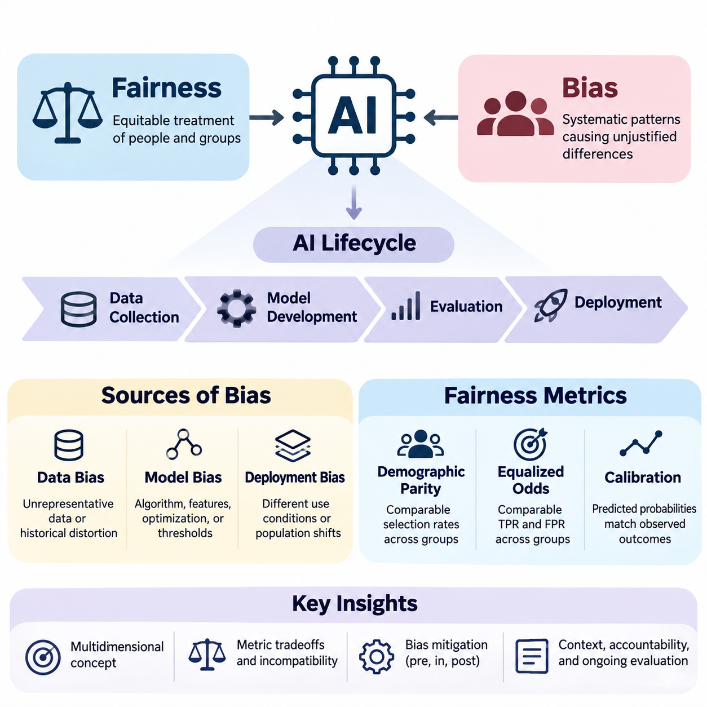
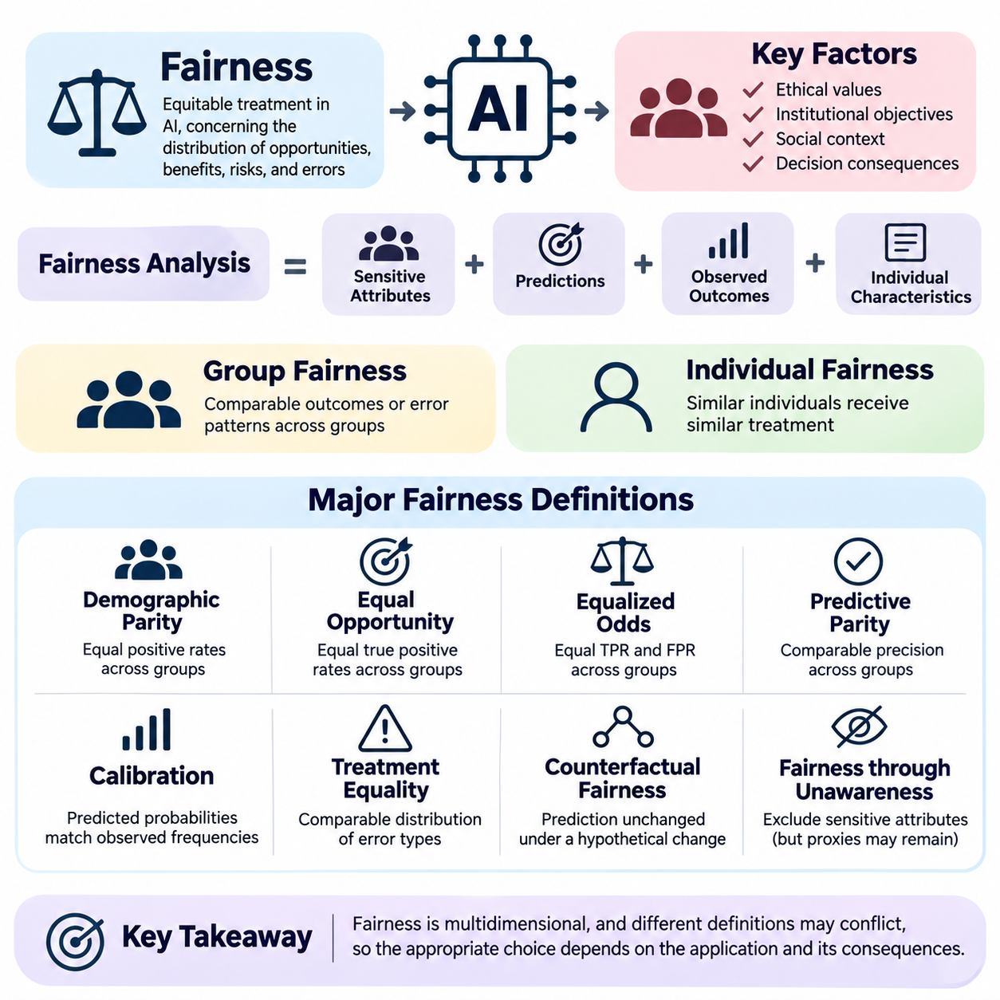
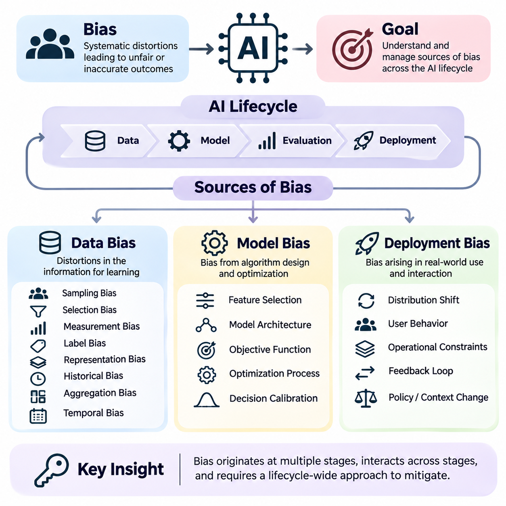
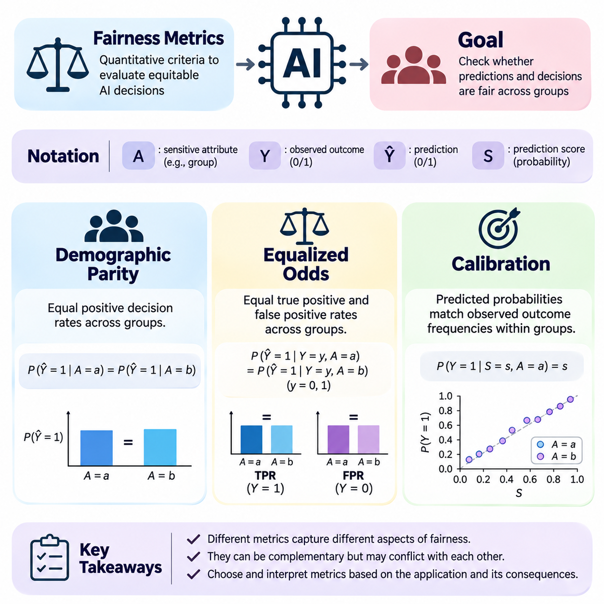
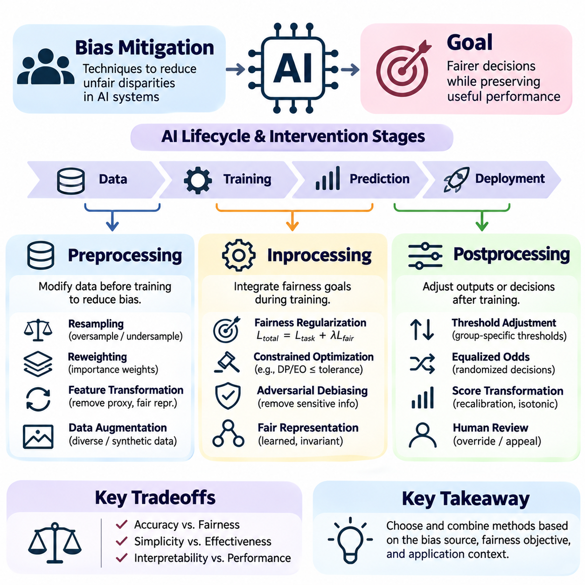
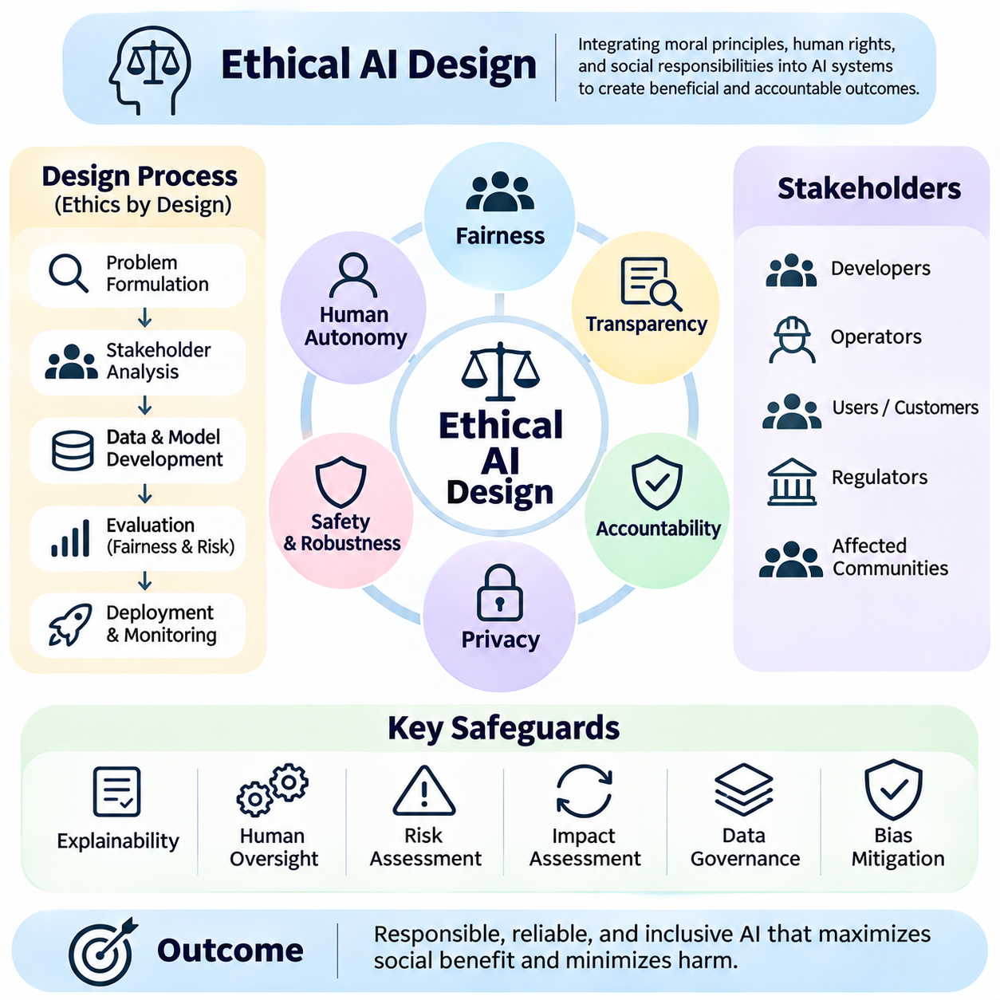
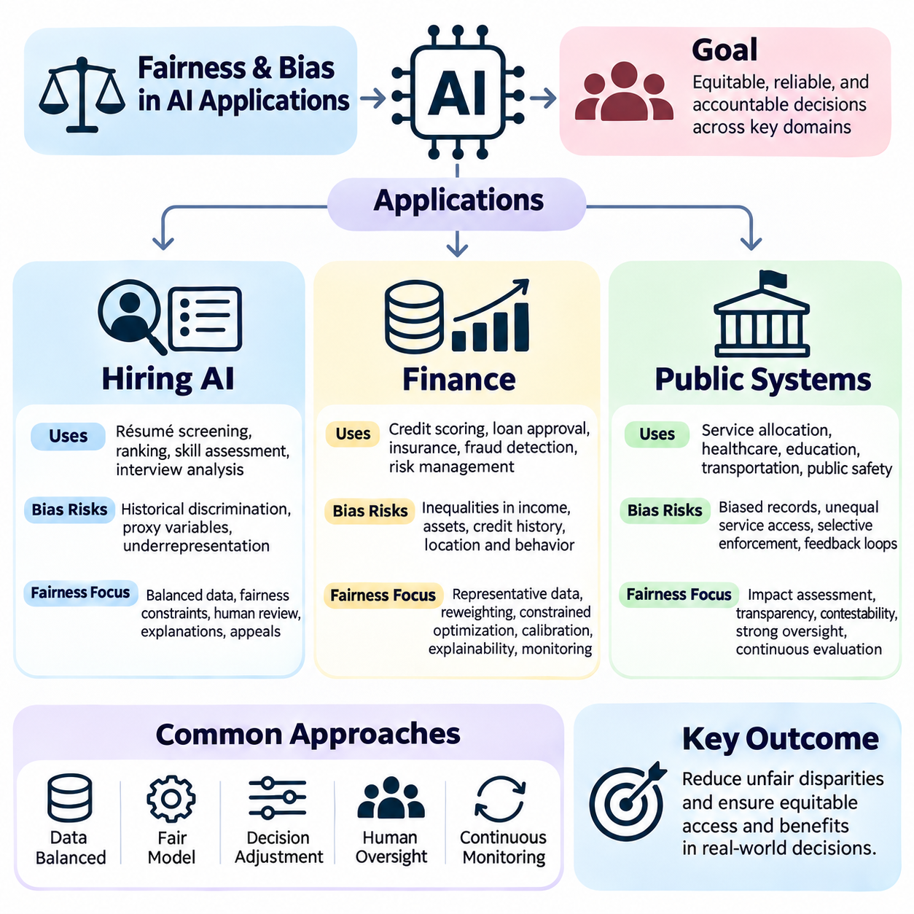

**Volume 42. AI Safety Alignment and Interpretability**

# 04. Fairness and Bias

## 04.00 Overview

{width="7.268055555555556in" height="7.268055555555556in"}

Fairness and bias are fundamental concerns in artificial intelligence because automated systems increasingly influence decisions affecting individuals, organizations, and society. Fairness refers to the equitable treatment of people and groups, while bias describes systematic patterns that may produce unjustified differences in outcomes. Understanding these concepts is essential for developing AI systems that are reliable, accountable, and socially responsible.

Artificial intelligence systems learn patterns from data and translate those patterns into predictions, recommendations, or decisions. Although mathematical optimization can improve predictive accuracy, it does not automatically guarantee equitable outcomes. Models may reproduce historical inequalities, amplify existing disadvantages, or create new forms of discrimination when their training objectives and deployment conditions overlook social consequences.

Fairness is a multidimensional concept involving statistical properties, ethical principles, legal expectations, and contextual judgments. Different stakeholders may interpret fairness according to equal treatment, equal opportunity, proportional outcomes, or protection against discrimination. Consequently, designing fair AI requires explicit consideration of the decision context, affected populations, institutional responsibilities, and potential conflicts between competing fairness objectives.

Bias in AI systems can originate throughout the machine learning lifecycle, beginning with data collection and continuing through model development, evaluation, and deployment. These sources interact rather than operating independently. A dataset containing historical discrimination may influence learned representations, while inappropriate optimization objectives or deployment practices can further magnify unequal outcomes across demographic or socioeconomic groups.

Data bias emerges when training datasets inadequately represent relevant populations or encode systematic distortions in observed outcomes. Sampling procedures, measurement instruments, labeling practices, and historical records can all introduce disparities. For example, recruitment datasets reflecting past hiring preferences may cause automated screening systems to reproduce patterns that disadvantage qualified applicants from underrepresented groups.

Model bias occurs when algorithmic assumptions, feature representations, optimization procedures, or decision thresholds generate systematic performance differences. Even when sensitive attributes are excluded, correlated variables may function as proxies for protected characteristics. Complex models can also learn interactions that are difficult to identify through conventional accuracy measurements, making subgroup evaluation and interpretability important components of fairness assessment.

Deployment bias arises when an AI system is applied under conditions that differ from those anticipated during development. Changes in population characteristics, institutional practices, user behavior, or decision procedures may alter the distribution of benefits and harms. A model evaluated as fair in one environment may produce unequal outcomes elsewhere, demonstrating why fairness must be continuously assessed under realistic operating conditions.

Fairness metrics provide quantitative methods for examining disparities between groups and evaluating whether model behavior satisfies specified criteria. However, no single metric captures every ethical or operational dimension of fairness. Different measures emphasize different relationships among predictions, actual outcomes, and population characteristics. Their interpretation therefore depends on the application, underlying data distributions, and consequences of incorrect decisions.

Demographic parity evaluates whether favorable prediction rates are comparable across defined demographic groups. This criterion emphasizes the distribution of model decisions without necessarily accounting for differences in observed target outcomes. Although useful for identifying unequal selection rates, demographic parity does not independently establish whether decisions are justified, especially when observed labels reflect historical discrimination or measurement limitations.

Equalized odds examines whether true positive rates and false positive rates are comparable across groups. This approach emphasizes differences in error behavior conditional on observed outcomes and can be especially relevant when incorrect classifications impose unequal costs. Nevertheless, satisfying equalized odds may require tradeoffs with predictive accuracy, calibration, or other fairness criteria, particularly when outcome prevalence differs across populations.

Calibration evaluates whether predicted probabilities correspond to observed outcome frequencies within relevant groups. A calibrated model assigning a risk score of 0.7 should produce approximately 70 percent positive outcomes among individuals receiving that score, subject to sufficient observations. Calibration supports meaningful risk interpretation, but it cannot always be simultaneously satisfied with equalized odds when group outcome distributions differ.

Fairness criteria may be mathematically incompatible under certain conditions, creating unavoidable tensions between desirable statistical properties. This means fairness cannot be reduced to maximizing a universal numerical score. Developers must determine which constraints best reflect the application and its consequences, document the reasoning behind those choices, and evaluate whether the resulting tradeoffs are acceptable to affected stakeholders.

Bias mitigation encompasses technical interventions designed to reduce undesirable disparities before, during, or after model training. These approaches are commonly categorized as preprocessing, inprocessing, and postprocessing methods. Each category targets different mechanisms through which bias enters automated decisions, and each introduces practical considerations involving data integrity, predictive performance, computational requirements, and institutional accountability.

Preprocessing methods modify training data or its representation before learning begins. Techniques may include sample reweighting, targeted resampling, feature transformation, and carefully designed data augmentation. Their objective is to reduce the influence of problematic distributions or representations while preserving information necessary for accurate predictions. However, preprocessing alone cannot resolve every source of discrimination embedded in labels or deployment practices.

Inprocessing methods incorporate fairness considerations directly into model training. Fairness-aware regularization, constrained optimization, adversarial representation learning, and modified objective functions can discourage specified disparities while optimizing predictive performance. These methods provide opportunities to balance fairness and utility during learning, but their effectiveness depends on selecting appropriate constraints and validating behavior across relevant populations.

Postprocessing methods adjust model predictions or decision policies after training without necessarily modifying the underlying model. Examples include group-aware threshold selection, score adjustment, and randomized decision rules designed to satisfy specified fairness constraints. Such approaches can be useful when retraining is impractical, although they may introduce interpretability challenges and require careful legal and ethical examination.

Ethical AI design extends fairness beyond numerical optimization by considering human rights, transparency, accountability, participation, and institutional responsibility. A technically compliant model may still create unacceptable consequences when its intended purpose, decision authority, or operational environment is inappropriate. Responsible development therefore requires interdisciplinary collaboration among engineers, domain experts, legal specialists, policymakers, and representatives of affected communities.

Fairness evaluation should consider both group-level disparities and individual circumstances. Group fairness examines statistical relationships across populations, whereas individual fairness seeks consistent treatment of sufficiently similar individuals. These perspectives can expose different problems and may lead to different interventions. Their practical application requires defensible similarity criteria, appropriate comparison groups, and awareness of intersectional disadvantages.

Intersectional fairness addresses the possibility that individuals belonging to multiple demographic categories experience disparities not visible in broad group comparisons. Evaluating only one attribute at a time may conceal concentrated errors affecting smaller subpopulations. Effective analysis therefore examines meaningful combinations of characteristics while accounting for sample size limitations, statistical uncertainty, privacy risks, and the possibility of unstable subgroup estimates.

Fairness assessment must also distinguish observed statistical disparities from causal explanations. Differences in prediction rates do not automatically establish discrimination, while similar aggregate outcomes do not guarantee the absence of discriminatory mechanisms. Causal reasoning, counterfactual analysis, and careful examination of institutional processes can help identify how sensitive characteristics, historical conditions, and decision pathways influence model behavior.

Hiring AI illustrates the importance of fairness because automated screening and candidate ranking directly influence access to employment opportunities. Models trained on historical recruitment records may reproduce occupational stereotypes or institutional preferences. Fairness evaluation should examine selection rates, qualification-related performance, subgroup error patterns, and the role of human oversight throughout recruitment and employment decisions.

Financial AI systems apply predictive models to credit scoring, lending, insurance, and fraud detection. Unequal error rates or poorly justified risk assessments can restrict access to essential financial services. Fairness analysis must therefore consider the relationship between legitimate risk factors, potentially discriminatory proxies, historical financial exclusion, and regulatory requirements while preserving the reliability of financial decision-making.

Public systems increasingly use AI to support resource allocation, eligibility assessment, service prioritization, and administrative decisions. Errors or disparities in these applications can affect access to public benefits and essential services. Responsible deployment requires transparent decision procedures, appropriate human review, accessible appeal mechanisms, and continuous evaluation of whether automated recommendations produce equitable outcomes.

Fairness monitoring must continue after deployment because demographic composition, economic conditions, data quality, and institutional behavior evolve over time. Monitoring systems should track subgroup performance, decision distributions, calibration, and emerging disparities while protecting sensitive information. When significant problems are detected, organizations need documented procedures for investigation, corrective action, reassessment, and responsible model updates.

Ultimately, fairness and bias management are continuous responsibilities rather than isolated technical tasks. Effective AI governance combines explicit fairness objectives, representative data practices, rigorous evaluation, appropriate mitigation strategies, ethical design, and operational oversight. Integrating these elements throughout the system lifecycle helps organizations develop AI technologies that are not only accurate and efficient but also trustworthy, accountable, and equitable.

## 04.01 Definitions of Fairness

{width="7.268055555555556in" height="7.268055555555556in"}

Fairness in artificial intelligence refers to the principles and measurable conditions under which automated systems treat individuals and groups equitably. It concerns how opportunities, benefits, risks, and errors are distributed across populations. Unlike predictive accuracy, fairness cannot be defined solely through technical performance because its interpretation depends on ethical values, institutional objectives, social circumstances, and the consequences of decisions.

The concept of fairness originates from philosophical discussions of justice, equality, rights, and legitimate differences in treatment. In artificial intelligence, these ideas must be translated into operational criteria that can guide system design and evaluation. Such translation is challenging because mathematical definitions capture selected aspects of fairness rather than its complete ethical meaning, and different definitions may produce conflicting conclusions.

Formal fairness definitions generally examine relationships among sensitive attributes, model predictions, observed outcomes, and relevant individual characteristics. Sensitive attributes may include race, gender, age, disability, or other legally protected characteristics. Their relevance depends on the application and jurisdiction. Fairness analysis must also consider indirect discrimination caused by features that correlate with protected attributes.

Group fairness evaluates whether an automated system produces comparable outcomes or error patterns across demographic groups. It typically relies on statistical comparisons involving selection rates, prediction accuracy, or conditional error probabilities. Group fairness is particularly relevant when AI systems influence access to employment, credit, education, healthcare, or public services, where systematic disparities may create substantial social consequences.

Individual fairness follows the principle that similar individuals should receive similar treatment. This approach requires defining a meaningful similarity measure based on legitimate task-related characteristics. For example, applicants with comparable qualifications should receive comparable evaluations. However, constructing an appropriate similarity metric is difficult because judgments about relevant differences often involve ethical and institutional assumptions.

Demographic parity, also called statistical parity, requires positive decision rates to be equal across specified demographic groups. In a hiring system, this criterion compares the proportion of applicants selected from each group. It can reveal disparities in access to favorable decisions, but it does not directly account for differences in observed qualifications, outcome prevalence, or the reliability of historical labels.

Equal opportunity focuses on equality of true positive rates across groups. Under this definition, individuals who satisfy the observed positive outcome condition should have comparable probabilities of receiving favorable predictions. In employment screening, qualified applicants from different groups should have similar chances of selection. This criterion emphasizes avoiding unequal exclusion of individuals who meet the relevant qualification standard.

Equalized odds extends equal opportunity by requiring comparable true positive rates and false positive rates across demographic groups. It therefore examines whether a classifier distributes both successful detections and incorrect positive predictions equitably. This definition is useful when classification errors create significant consequences, although its implementation may involve tradeoffs with overall accuracy and other fairness requirements.

Predictive parity requires the positive predictive value to be comparable across groups. When an AI system produces a positive classification, the probability that the observed outcome is actually positive should be similar regardless of group membership. This criterion emphasizes the reliability of favorable or high-risk classifications, but it does not guarantee equal selection rates or equivalent error distributions.

Calibration requires predicted probabilities to correspond to observed outcome frequencies within relevant groups. For example, among individuals assigned a predicted probability of 0.8, approximately 80 percent should experience the predicted outcome. Groupwise calibration supports consistent interpretation of risk scores, yet it may conflict with equalized odds when outcome prevalence differs and predictions are imperfect.

Treatment equality examines the relative distribution of different error types across groups. Some formulations compare false positive and false negative counts or rates, depending on the evaluation framework. The underlying concern is whether the burdens of incorrect decisions are distributed acceptably. Because false positives and false negatives can produce different harms, their relative importance must be established through domain-specific analysis.

Counterfactual fairness introduces a causal perspective by asking whether a prediction would remain unchanged if an individual\'s sensitive attribute were different in a hypothetical causal scenario. This approach requires a structural causal model describing relationships among attributes, circumstances, and outcomes. Its validity depends on causal assumptions that may be difficult to establish or verify using observational data alone.

Fairness through unawareness proposes excluding sensitive attributes from model inputs. Although conceptually straightforward, this strategy does not guarantee nondiscrimination because other variables may encode similar information. Geographic location, educational history, purchasing behavior, or employment patterns can act as proxies for protected characteristics. Consequently, removing explicit demographic variables does not eliminate the need for fairness evaluation.

Procedural fairness concerns whether decisions are produced through consistent, transparent, and justifiable processes. It emphasizes appropriate decision rules, accountability, opportunities for review, and protection against arbitrary treatment. An AI system may satisfy statistical fairness criteria while remaining procedurally unfair if affected individuals cannot understand, contest, or obtain meaningful review of consequential decisions.

Distributive fairness addresses how benefits, opportunities, resources, and burdens are allocated among individuals and groups. Different distributive principles emphasize equality, need, merit, or the reduction of disadvantage. AI applications frequently require balancing these perspectives. For example, healthcare allocation may prioritize clinical need, while employment decisions may emphasize job-related qualifications and equal access to consideration.

Substantive fairness evaluates whether an AI system contributes to genuinely equitable conditions rather than merely satisfying formal rules. Equal treatment under existing procedures may perpetuate historical disadvantages when individuals begin from unequal circumstances. Substantive fairness therefore considers structural inequalities, barriers to participation, and the long-term consequences of automated decisions within their broader institutional environments.

Intersectional fairness examines disparities affecting people who belong to multiple demographic categories simultaneously. A model may appear fair when evaluated separately by gender and age while performing poorly for a particular combination of these attributes. Intersectional analysis helps reveal hidden disadvantages, although smaller subgroup sizes introduce statistical uncertainty and require careful handling of privacy and measurement limitations.

Fairness definitions are not universally compatible. When outcome prevalence differs across groups, calibration, predictive parity, and equalized odds generally cannot all be achieved simultaneously by an imperfect classifier under common nondegenerate conditions. These incompatibility results demonstrate that fairness involves normative choices rather than purely mathematical optimization. Selecting a criterion requires understanding which errors and disparities matter most.

The distinction between equality and equity is central to interpreting fairness. Equality emphasizes applying the same rules or distributing resources uniformly, whereas equity considers differences in circumstances and the support needed to achieve justifiable outcomes. Neither concept automatically determines the correct algorithmic intervention. Appropriate choices depend on legitimate objectives, legal constraints, empirical evidence, and stakeholder perspectives.

Fairness definitions must also account for the limitations of observed labels and ground truth. Historical decisions may reflect discrimination, incomplete information, or institutional practices rather than objective measures of merit or risk. A model can satisfy statistical criteria relative to biased labels while reproducing harmful outcomes. Therefore, evaluating fairness requires examining how target variables are constructed and whether they represent defensible objectives.

Practical fairness assessment begins by identifying affected populations, consequential decisions, relevant protected characteristics, and plausible sources of harm. Developers then select fairness criteria consistent with the application and evaluate performance across meaningful groups. Statistical uncertainty, sample size, distribution shifts, and the costs of different errors should be considered before interpreting observed disparities as evidence of acceptable or unacceptable behavior.

Fairness is also dynamic because the relationship between automated decisions and social outcomes changes over time. Decisions can influence future opportunities, institutional behavior, and the data collected for subsequent training. Feedback loops may reinforce existing inequalities even when initial evaluation results appear acceptable. Continuous monitoring and periodic reassessment are therefore necessary to maintain fairness under evolving conditions.

Ultimately, defining fairness in artificial intelligence requires integrating mathematical criteria with ethical reasoning, causal understanding, domain knowledge, and institutional accountability. No single definition is sufficient for every application, and satisfying a chosen metric does not establish complete fairness. Responsible AI development depends on transparent justification of fairness objectives, rigorous empirical evaluation, meaningful stakeholder participation, and continuous examination of real-world consequences.

## 04.02 Sources of Bias

{width="7.268055555555556in" height="7.268055555555556in"}

Bias in artificial intelligence refers to systematic distortions that influence how models learn, predict, and make decisions. These distortions can produce inaccurate, inconsistent, or unfair outcomes across individuals and populations. Understanding the sources of bias requires examining the complete AI lifecycle, including data acquisition, representation learning, optimization, evaluation, deployment, and interactions with real-world environments.

Bias is not necessarily introduced through deliberate discrimination or explicit programming decisions. It frequently emerges from historical patterns, incomplete observations, measurement limitations, statistical assumptions, and operational constraints. Even models designed with neutral objectives may reproduce existing inequalities when the information used for training reflects unequal opportunities or institutional practices.

The sources of AI bias can be organized into three interconnected categories: data bias, model bias, and deployment bias. Data bias concerns distortions in the information used for learning, model bias arises from algorithmic design and optimization, and deployment bias develops when systems interact with operational environments. These categories frequently reinforce one another, making isolated interventions insufficient.

Data bias begins when collected observations fail to represent the target population or the underlying phenomenon accurately. Training datasets are often assembled from available records rather than carefully controlled samples. Consequently, the resulting information may overrepresent certain demographic groups, geographic regions, socioeconomic conditions, or behavioral patterns while systematically excluding others.

Sampling bias occurs when the probability of inclusion in a dataset differs across relevant populations in ways that distort the intended analysis. For example, a healthcare prediction system trained primarily on patients from large urban hospitals may perform poorly in rural communities. The problem is not simply insufficient data volume but a mismatch between the sampled population and the population receiving predictions.

Selection bias arises when the mechanisms determining which observations enter a dataset depend on characteristics associated with outcomes. Historical hiring records, for example, may contain performance evaluations only for applicants who were previously selected. Training a model on these records can reproduce earlier selection preferences because the system lacks comparable observations for candidates who were excluded.

Measurement bias occurs when collected features or outcomes imperfectly represent the concepts they are intended to measure. Healthcare expenditure, for instance, may be used as a proxy for medical need even though spending also depends on access to services. Such substitutions can introduce systematic differences between groups, especially when institutional conditions influence the relationship between measurements and underlying needs.

Label bias emerges when target labels contain errors, subjective judgments, or historical discrimination. Human annotators may interpret ambiguous cases differently, while institutional records may encode previous decisions rather than objective outcomes. A model trained to reproduce these labels can achieve high predictive accuracy while perpetuating the assumptions and inequalities embedded in the labeling process.

Representation bias occurs when particular populations, conditions, or behavioral patterns are insufficiently represented in the training data. Facial analysis systems trained on narrow demographic distributions may exhibit unequal performance across groups. Similarly, language models trained predominantly on particular languages or cultural contexts may provide less reliable outputs for underrepresented communities.

Historical bias reflects inequalities already present in the world from which data is collected. Even accurately measured and statistically representative datasets may preserve discriminatory patterns when the underlying social processes are unequal. Historical bias demonstrates that correcting sampling procedures alone cannot guarantee fairness because the observed relationships themselves may reflect structural disadvantages.

Aggregation bias appears when a single model is trained across heterogeneous populations whose underlying relationships differ. Combining groups without accounting for meaningful variation can produce predictions that fit the average population while performing poorly for particular subgroups. This problem is especially important in medicine, education, and public services, where contextual differences may substantially affect outcomes.

Temporal bias develops when historical observations no longer reflect current conditions. Changes in economic activity, population characteristics, technology, or institutional policies can make previously collected data misleading. A credit assessment model trained before major economic changes may produce systematically distorted predictions when applied to populations experiencing different financial circumstances.

Model bias originates from choices made during feature engineering, architecture selection, objective formulation, optimization, and decision calibration. Machine learning algorithms do not independently determine which social outcomes should be considered fair. Instead, they optimize mathematical objectives established by developers, and these objectives may overlook disparities that are not explicitly represented in training criteria.

Feature selection can introduce bias when variables capture protected characteristics indirectly or exclude information necessary for equitable decisions. Postal codes, educational institutions, and employment histories may correlate with demographic attributes. Removing explicit sensitive variables does not necessarily eliminate their influence because complex models can reconstruct related information from combinations of apparently neutral features.

Optimization bias occurs when a learning objective prioritizes aggregate performance while neglecting subgroup outcomes. Minimizing average prediction error can favor majority populations when their observations dominate the training distribution. As a result, a model may achieve strong overall accuracy while exhibiting substantially higher false positive rates, false negative rates, or calibration errors for smaller groups.

Model architecture and regularization can also influence fairness by determining which patterns are learned and retained. Limited model capacity may fail to capture meaningful differences among populations, while excessive complexity may amplify spurious correlations. Regularization, representation learning, and parameter sharing can improve generalization but do not automatically ensure equitable performance across relevant subgroups.

Threshold bias arises when continuous prediction scores are converted into categorical decisions using thresholds that create unequal error distributions. A common threshold may produce different false positive or false negative rates across populations because score distributions and outcome prevalence differ. Adjusting thresholds can address selected fairness objectives, although such changes may introduce tradeoffs with other performance measures.

Evaluation bias occurs when benchmark datasets, validation procedures, or performance metrics fail to capture relevant disparities. Reporting only aggregate accuracy can conceal severe subgroup failures. Evaluation datasets that resemble training data too closely may also underestimate real-world problems. Fairness assessment therefore requires representative testing, disaggregated metrics, uncertainty analysis, and examination of consequential errors.

Deployment bias emerges when models operate in environments that differ from their intended design assumptions. Differences in population composition, institutional workflows, user behavior, sensor conditions, or available resources can alter model performance. A system that satisfies fairness requirements during laboratory evaluation may generate unequal outcomes when integrated into complex operational settings.

Distribution shift is a major source of deployment bias because the statistical relationships between inputs, labels, and populations can change after deployment. Covariate shift, label shift, and concept drift describe different forms of this instability. Their effects may be uneven across demographic groups, causing fairness degradation even when overall system performance appears relatively stable.

Automation bias develops when human operators place excessive confidence in algorithmic recommendations and fail to exercise appropriate independent judgment. Decision-makers may accept incorrect predictions because they assume automated outputs are objective. This behavior can amplify existing model disparities, particularly when affected individuals have limited opportunities to challenge decisions or obtain meaningful human review.

Feedback loops occur when model decisions influence the future data used for training or evaluation. Predictive policing systems, for example, may direct attention toward locations already receiving intensive monitoring, generating additional recorded incidents in those areas. Retraining on these observations can reinforce the original allocation pattern, making it difficult to distinguish actual changes in underlying conditions from observation effects.

Institutional deployment practices can introduce additional bias through inconsistent procedures, inadequate training, limited oversight, or inappropriate use of model outputs. Different organizations may interpret identical predictions differently, producing unequal consequences. Fairness therefore depends not only on model properties but also on the policies, incentives, responsibilities, and human decisions surrounding automated systems.

Bias mitigation requires interventions matched to the mechanisms responsible for observed disparities. Data-oriented methods address sampling, representation, measurement, and labeling problems. Model-oriented methods modify objectives, constraints, representations, or decision rules. Deployment-oriented methods emphasize monitoring, human oversight, operational safeguards, and corrective procedures when conditions change.

Effective bias management also requires causal investigation rather than relying exclusively on statistical correlations. Similar disparities can arise from different mechanisms, and identical interventions may produce different consequences across applications. Developers must examine how historical conditions, institutional decisions, model behavior, and feedback processes interact before selecting mitigation strategies.

Ultimately, data bias, model bias, and deployment bias form a connected system of risks throughout the AI lifecycle. Eliminating one source does not guarantee fairness when other mechanisms remain active. Responsible AI engineering therefore requires representative data, carefully designed learning objectives, rigorous subgroup evaluation, transparent deployment practices, and continuous monitoring to identify and reduce harmful disparities.

## 04.03 Fairness Metrics

{width="7.268055555555556in" height="7.268055555555556in"}

Fairness metrics provide quantitative methods for evaluating whether artificial intelligence systems produce equitable predictions and decisions across different populations. They translate selected ethical principles into measurable statistical conditions involving sensitive attributes, predicted outcomes, and observed labels. Although these metrics support systematic evaluation, they cannot independently determine whether an AI system is socially just or appropriate for a particular application.

Three widely studied fairness criteria are demographic parity, equalized odds, and calibration. Each examines a different relationship between group membership, predictions, and actual outcomes. Demographic parity emphasizes the distribution of favorable decisions, equalized odds examines conditional classification errors, and calibration evaluates whether predicted probabilities correspond to observed outcome frequencies within relevant groups.

Fairness evaluation typically represents a sensitive group attribute as A, an observed binary outcome as Y, and a binary prediction as Ŷ. A probabilistic prediction score may be represented as S. These variables allow fairness conditions to be expressed mathematically and estimated from evaluation datasets. However, their interpretation depends on how groups are defined, whether outcome labels are reliable, and which decisions produce meaningful benefits or harms.

Demographic parity requires the probability of receiving a favorable prediction to be equal across specified demographic groups. Formally, this condition can be written as P(Ŷ = 1 \| A = a) = P(Ŷ = 1 \| A = b). The definition does not condition on observed outcomes or individual qualifications. It instead examines whether the overall allocation of positive decisions differs according to group membership.

In employment screening, demographic parity compares the proportion of candidates selected from different demographic groups. If one group has a selection rate of 60 percent and another has 40 percent, the demographic parity difference is 20 percentage points. Such a disparity warrants investigation, but the metric alone cannot establish whether the difference results from discrimination, legitimate qualifications, measurement problems, or historical inequalities.

Demographic parity can be summarized using the demographic parity difference, defined as the difference between group selection rates, or a selection-rate ratio. A difference near zero indicates similar positive prediction rates, while a ratio near one indicates approximate proportional equality. These measures should be interpreted with confidence intervals and sample sizes because small populations may produce unstable estimates.

A major limitation of demographic parity is that equal selection rates do not necessarily imply equal treatment of similarly qualified individuals. When observed outcome prevalence differs across groups, enforcing identical positive prediction rates can alter error distributions. Conversely, differences in observed qualifications may themselves reflect unequal opportunities. Consequently, demographic parity requires contextual interpretation rather than automatic acceptance or rejection.

Equalized odds evaluates fairness by conditioning predictions on the observed outcome. It requires both true positive rates and false positive rates to be equal across demographic groups. In mathematical terms, P(Ŷ = 1 \| Y = y, A = a) = P(Ŷ = 1 \| Y = y, A = b) for both y = 0 and y = 1. This criterion focuses on whether classification behavior differs among individuals sharing the same observed outcome.

The true positive rate measures the proportion of actual positive cases correctly identified by a classifier. The false positive rate measures the proportion of actual negative cases incorrectly classified as positive. Equalized odds requires comparable values for both quantities across groups. It therefore evaluates whether the benefits of correct positive decisions and the burdens of incorrect positive decisions are distributed consistently.

In a medical screening application, equalized odds can examine whether patients with a condition are detected at similar rates across demographic groups and whether patients without the condition experience similar false alarm rates. Unequal sensitivity may delay treatment for certain populations, while unequal false positive rates may create unnecessary examinations or anxiety. The relative importance of these errors depends on clinical consequences.

Equalized odds is commonly evaluated through differences in true positive rates and false positive rates between groups. An aggregate equalized odds gap may summarize the maximum absolute difference across these quantities. Reporting the separate components remains important because identical aggregate values can conceal different error patterns. Statistical uncertainty should also be considered, particularly when positive or negative cases are uncommon.

Equal opportunity is a related but less restrictive fairness criterion that requires equality of true positive rates without imposing equality of false positive rates. It emphasizes comparable access to favorable predictions among individuals with observed positive outcomes. Equalized odds extends this requirement to both outcome classes, making it more demanding but potentially more relevant when both false positives and false negatives carry substantial consequences.

Calibration concerns the relationship between probabilistic predictions and observed outcomes. A model is calibrated within a group when individuals receiving the same predicted probability experience the corresponding outcome at approximately that frequency. Formally, P(Y = 1 \| S = s, A = a) = s for relevant scores and groups. Calibration therefore addresses the interpretation and reliability of risk estimates rather than directly enforcing equal decision rates.

For example, if a credit model assigns a default probability of 0.20 to many applicants, approximately 20 percent of those applicants should default over the specified evaluation period. Groupwise calibration requires this interpretation to hold within each evaluated group. A score of 0.20 should therefore represent approximately the same observed default frequency across groups, subject to adequate data and estimation uncertainty.

Calibration can be assessed using reliability diagrams, calibration curves, expected calibration error, and proper scoring rules such as the Brier score. Reliability diagrams compare average predicted probabilities with observed event frequencies across score intervals. Expected calibration error summarizes discrepancies across intervals, although its value depends on binning choices. Proper scoring rules additionally assess probabilistic prediction quality beyond calibration alone.

A model may be well calibrated while producing unequal false positive rates or selection rates across groups. Calibration constrains the meaning of predicted probabilities but does not specify how thresholds should convert those probabilities into decisions. Conversely, adjusting decisions to satisfy demographic parity or equalized odds may change the relationship between scores, decisions, and observed outcomes without necessarily improving underlying probability estimates.

Fairness criteria can be mathematically incompatible under common conditions. When outcome prevalence differs between groups and predictions are imperfect, calibration and equalized odds generally cannot both hold exactly for an informative risk score. Demographic parity may also conflict with error-rate parity depending on group distributions and decision thresholds. These limitations demonstrate why fairness optimization requires explicit priorities and justified tradeoffs.

Threshold selection strongly influences fairness measurements for binary decisions. Different thresholds alter positive prediction rates, true positive rates, and false positive rates. A common threshold can produce unequal classification errors when score distributions differ, while group-specific thresholds may improve selected metrics but raise additional legal, ethical, and operational questions. Threshold policies should therefore be evaluated alongside the intended decision context.

Fairness metrics also depend on the validity of observed labels. If historical hiring decisions are treated as ground truth for applicant suitability, measured fairness may reflect previous institutional preferences rather than actual competence. Similarly, recorded healthcare outcomes can be influenced by unequal access to treatment. Statistical parity relative to biased observations cannot independently establish substantive fairness.

Intersectional evaluation examines fairness across combinations of sensitive attributes rather than considering each characteristic separately. A system may satisfy demographic parity by gender and equalized odds by age while performing poorly for a specific age-gender subgroup. Such analysis reveals disparities hidden by aggregated statistics, but reliable estimates require sufficient observations and careful consideration of uncertainty and privacy.

Fairness evaluation should account for statistical significance, confidence intervals, subgroup sample sizes, and multiple comparisons. Small observed differences may result from sampling variation, while apparently modest disparities may be consequential when systems operate at large scale. Practical significance depends on the number of affected individuals, severity of errors, decision reversibility, and the institutional context in which predictions are used.

Comparing fairness metrics requires distinguishing statistical definitions from normative objectives. Demographic parity addresses allocation patterns, equalized odds addresses conditional classification behavior, and calibration addresses probability reliability. None captures procedural fairness, individual rights, or historical disadvantage completely. Selecting an appropriate metric therefore requires understanding the application, affected populations, and legitimate reasons for differential treatment.

In operational systems, fairness metrics should be monitored after deployment because population composition, outcome prevalence, and model performance may change. Monitoring can identify emerging disparities, calibration drift, and subgroup-specific degradation. Effective governance combines metric tracking with documented thresholds for investigation, human review, corrective actions, and periodic reassessment of whether the selected criteria remain appropriate.

Ultimately, demographic parity, equalized odds, and calibration provide complementary but incomplete perspectives on algorithmic fairness. Their value lies in making selected disparities measurable, enabling transparent comparisons, and supporting evidence-based interventions. Responsible evaluation requires interpreting these measurements alongside causal mechanisms, domain-specific harms, legal obligations, and ethical objectives rather than treating any single metric as definitive proof of fairness.

## 04.04 Bias Mitigation [w/Code]

{width="7.268055555555556in" height="7.268055555555556in"}

Bias mitigation refers to systematic techniques for reducing unfair disparities in artificial intelligence systems while preserving useful predictive performance. These techniques address distortions introduced through data collection, model optimization, and decision-making procedures. Effective mitigation begins by identifying the source of bias, selecting appropriate fairness objectives, and evaluating whether corrective interventions improve outcomes across affected populations.

Bias mitigation methods are commonly classified into preprocessing, inprocessing, and postprocessing approaches. Preprocessing modifies data before model training, inprocessing incorporates fairness requirements into the learning algorithm, and postprocessing adjusts predictions or decisions after training. Each approach operates at a different stage of the machine learning lifecycle and introduces distinct tradeoffs involving accuracy, fairness, complexity, and interpretability.

Preprocessing methods attempt to reduce unfair patterns within training datasets before they influence model parameters. These methods can modify sampling distributions, observation weights, feature representations, or target labels. Their main advantage is compatibility with many existing learning algorithms because fairness interventions occur outside the model architecture. However, preprocessing cannot independently resolve all biases introduced during optimization or deployment.

Resampling adjusts the representation of demographic groups or outcome categories within a training dataset. Oversampling increases the contribution of underrepresented observations, while undersampling reduces the dominance of overrepresented cases. Stratified sampling can preserve selected group-outcome combinations. These procedures require careful validation because artificial changes to training distributions may affect probability calibration and generalization.

Reweighting assigns different importance weights to training observations according to group membership and outcome characteristics. Underrepresented combinations may receive larger weights, while dominant combinations receive smaller weights. A weighted learning objective can be expressed as the sum of individual losses multiplied by their assigned weights. This strategy modifies optimization influence without necessarily duplicating or deleting observations.

A simple Python implementation can calculate sample weights from observed group and outcome frequencies using pandas or NumPy. For each training observation, a weight may be derived from the product of marginal group and outcome probabilities divided by the corresponding joint probability. The resulting weights can be supplied to compatible estimators through a sample_weight argument, provided that zero-frequency combinations and numerical stability are handled appropriately.

Feature transformation methods seek representations that preserve task-relevant information while reducing dependence on sensitive attributes. Techniques include normalization within justified contexts, removal of problematic proxy variables, and learned fair representations. Simply deleting protected attributes is insufficient when correlated features reconstruct demographic information. Transformation quality must therefore be assessed using both predictive utility and subgroup fairness metrics.

Data augmentation can improve representation by generating additional observations for underrepresented populations or conditions. In image classification, augmentation may introduce variations in illumination, viewpoint, or environmental context. In language processing, carefully validated examples can broaden linguistic coverage. Synthetic data must be checked for realism and unintended stereotypes because poorly generated samples may reinforce rather than reduce bias.

Inprocessing methods integrate fairness objectives directly into model training. Instead of treating fairness as a separate data preparation problem, they modify the learning process to account for selected disparities. Common strategies include constrained optimization, fairness regularization, adversarial debiasing, and specialized representation learning. These methods provide direct control over training objectives but often require access to model internals.

Fairness regularization adds a penalty term to the conventional predictive loss. The combined objective can be written as L_total = L_task + λL_fair, where L_task measures prediction error, L_fair measures a selected disparity, and λ controls the relative emphasis on fairness. Increasing λ may reduce the targeted disparity but can also change overall accuracy, subgroup performance, and calibration.

For demographic parity, a differentiable fairness penalty may compare average predicted positive probabilities across demographic groups. For equal opportunity, the penalty may compare predictions among observations with positive labels. Such surrogate objectives approximate selected fairness criteria during gradient-based optimization. Their effectiveness depends on sufficient subgroup observations, stable estimation, and agreement between training penalties and evaluation metrics.

Constrained optimization treats fairness as an explicit requirement rather than only a weighted preference. A model may minimize predictive loss subject to a demographic parity difference or equalized odds gap remaining below a specified tolerance. Optimization algorithms can use Lagrangian methods to balance predictive performance and constraint violations. The chosen tolerance should reflect application risks and statistical uncertainty rather than arbitrary numerical convenience.

Adversarial debiasing trains a predictor alongside an adversary that attempts to infer sensitive attributes from learned representations or predictions. The predictor seeks useful task performance while reducing information available to the adversary. Gradient reversal or alternating optimization can implement this competition. However, unsuccessful adversarial prediction does not establish complete fairness, especially when untested proxies or causal pathways remain.

In PyTorch, an inprocessing implementation can compute the task loss using binary cross-entropy and add a fairness penalty calculated from subgroup predictions. The optimizer then updates model parameters using the combined loss. Developers should protect against empty subgroup batches, unstable gradients, and misleading mini-batch estimates. Validation must report both the targeted fairness criterion and other relevant performance measures.

Postprocessing methods modify model outputs or decision policies after training without necessarily changing the original model parameters. They are useful when retraining is expensive, restricted, or impossible. Typical approaches include threshold adjustment, score transformation, and randomized decision rules. Postprocessing can improve selected fairness metrics, but it cannot automatically correct biased representations or unreliable outcome labels.

Threshold adjustment converts continuous risk scores into binary decisions using selected decision boundaries. A common threshold may create unequal error rates when group score distributions differ. Group-specific thresholds can be optimized to reduce disparities in true positive rates, false positive rates, or selection rates. Their use requires careful consideration of legal requirements, operational transparency, and whether sensitive attributes are available at inference time.

Equalized odds postprocessing seeks decision rules that approximately equalize true positive and false positive rates across groups. Depending on the score distributions, randomized decisions may be necessary to reach selected operating points. Such procedures should be evaluated on held-out data rather than optimized and assessed on the same observations. Randomization can also introduce practical concerns regarding consistency, explanation, and stakeholder acceptance.

Calibration-oriented postprocessing modifies predicted probabilities to better match observed outcome frequencies. Methods such as Platt scaling and isotonic regression can improve probability reliability when applied with suitable validation data. Groupwise calibration may be examined when sufficient observations are available. However, improving calibration does not guarantee demographic parity or equalized odds, and aggressive adjustment may reduce discrimination performance.

Postprocessing implementations in Python can evaluate candidate thresholds over validation predictions and calculate subgroup confusion matrices. A search procedure may select thresholds satisfying a fairness tolerance while maximizing a specified utility measure. The selected policy should then be tested on an independent dataset. Threshold selection must avoid data leakage and account for uncertainty, particularly when subgroup sample sizes are limited.

Comparing mitigation approaches requires consistent evaluation protocols. Preprocessing changes the learning distribution, inprocessing changes the optimization problem, and postprocessing changes the final decision policy. Each can improve a targeted metric while worsening another. Therefore, experiments should report predictive accuracy, calibration, subgroup error rates, fairness gaps, and uncertainty before and after intervention.

Mitigation effectiveness also depends on whether the observed disparity reflects sampling problems, historical discrimination, measurement error, or legitimate differences relevant to the application. A technique that improves demographic parity may not address unfair false negative rates. Similarly, enforcing equalized odds against unreliable labels may preserve historical distortions. Causal analysis and domain expertise are essential for selecting appropriate interventions.

Fairness interventions should be tested across intersectional groups and operational conditions. Improvements measured for broad demographic categories may conceal deterioration among smaller populations. Distribution shifts can also weaken mitigation after deployment. Continuous monitoring should track subgroup performance, changes in data composition, threshold stability, and emerging disparities while respecting privacy and applicable governance requirements.

Responsible bias mitigation requires documented objectives, reproducible experiments, independent evaluation, and meaningful human oversight. Developers should record the selected fairness definition, intervention mechanism, parameter settings, observed tradeoffs, and limitations. Ultimately, preprocessing, inprocessing, and postprocessing are complementary engineering tools whose effectiveness depends on careful integration with ethical reasoning, institutional accountability, and ongoing evaluation.

## 04.05 Ethical AI Design

{width="7.268055555555556in" height="7.268055555555556in"}

Ethical AI design is the systematic integration of moral principles, human rights, and social responsibilities into the development and operation of artificial intelligence systems. It extends beyond predictive accuracy and computational efficiency to consider how automated decisions affect individuals, communities, and institutions. Ethical design requires developers to anticipate potential harms, justify system objectives, and establish mechanisms for responsible decision-making.

The foundations of ethical AI design include fairness, transparency, accountability, privacy, safety, and respect for human autonomy. These principles provide complementary perspectives on responsible system behavior. Fairness concerns equitable treatment, transparency supports understanding, accountability establishes responsibility, and autonomy preserves meaningful human control. Ethical design must balance these objectives when they create competing requirements.

Ethical considerations should begin during problem formulation rather than after model training. Developers must examine whether automation is appropriate, what decisions the system will influence, and which populations may experience benefits or harms. A technically successful model can remain ethically problematic when its underlying objective is unjustified. Defining legitimate purposes and acceptable boundaries is therefore a fundamental design responsibility.

Stakeholder analysis identifies individuals and organizations affected by an AI system, including those who may not directly interact with it. Developers, operators, customers, regulators, and affected communities can hold different expectations regarding fairness and acceptable risk. Meaningful participation helps reveal overlooked harms and conflicting priorities. Ethical engagement requires accessible communication and mechanisms for incorporating feedback into design decisions.

Fairness by design integrates equity considerations throughout data preparation, model development, evaluation, and deployment. This approach examines whether datasets represent relevant populations, whether learning objectives introduce disparities, and whether decision policies distribute errors acceptably. Fairness cannot be established through a single metric because different statistical definitions capture different ethical concerns and may conflict under realistic conditions.

Privacy by design limits unnecessary collection, processing, retention, and disclosure of personal information. Data minimization, access controls, encryption, and appropriate anonymization techniques reduce exposure to privacy risks. Differential privacy and federated learning may provide additional protections in suitable applications. However, privacy mechanisms can affect data utility and subgroup evaluation, requiring careful assessment of their fairness implications.

Transparency enables stakeholders to understand an AI system\'s intended purpose, capabilities, limitations, and decision processes. Documentation should describe training data characteristics, model assumptions, evaluation procedures, and known failure modes. Transparency does not require unrestricted disclosure of proprietary information or sensitive data. Instead, it requires providing appropriate explanations and evidence to those responsible for oversight or affected by consequential decisions.

Explainability supports meaningful interpretation of automated predictions and recommendations. Feature attribution, counterfactual explanations, and interpretable models can help reveal factors influencing decisions. However, explanations may be approximate, incomplete, or misleading when presented without limitations. Ethical design distinguishes explanations that describe model behavior from causal claims about the real world and avoids presenting interpretability tools as definitive evidence.

Accountability establishes responsibility for the consequences of AI development and deployment. Organizations should define decision authority, approval procedures, escalation paths, and responsibilities for monitoring and corrective action. Audit trails and documented design choices support investigations when failures occur. Accountability cannot be delegated entirely to algorithms because human institutions determine objectives, deployment conditions, and responses to identified harms.

Human oversight ensures that automated systems remain subject to appropriate supervision and intervention. Human-in-the-loop approaches require review of selected decisions, while human-on-the-loop arrangements emphasize operational monitoring. The appropriate level of oversight depends on risk, decision reversibility, and the consequences of error. Effective supervision requires trained operators, sufficient information, and genuine authority to challenge or override system outputs.

Safety and robustness are essential ethical requirements when AI systems influence physical environments or consequential decisions. Developers should evaluate foreseeable misuse, unexpected inputs, distribution shifts, and system failures. Risk assessments, stress testing, fallback mechanisms, and controlled deployment procedures reduce potential harm. Safety engineering must consider interactions among models, software, hardware, human operators, and operational environments.

Nonmaleficence emphasizes avoiding preventable harm, while beneficence emphasizes generating meaningful benefits for individuals and society. These principles require evaluating both intended functionality and unintended consequences. An AI system may improve average efficiency while disproportionately harming vulnerable populations. Ethical assessment therefore considers the severity, likelihood, distribution, and reversibility of potential harms rather than relying solely on aggregate performance.

Ethical AI design also requires attention to inclusion and accessibility. Systems should accommodate relevant differences in language, disability, digital literacy, cultural context, and available resources. Interfaces and decision procedures that work effectively for typical users may exclude individuals with different needs. Inclusive design combines representative testing, accessibility requirements, and direct engagement with affected populations.

Data governance establishes policies for collecting, labeling, storing, sharing, and retiring information used by AI systems. Responsible governance requires attention to data provenance, consent or other lawful processing grounds, quality assurance, and retention limits. Historical datasets may contain discriminatory patterns or unreliable labels. Ethical review must therefore examine whether data sources are appropriate for the intended application and whether their limitations are documented.

Ethical model development requires explicit consideration of competing objectives. Improving accuracy may increase subgroup disparities, while stronger privacy protections may reduce information available for fairness evaluation. Developers should document these tradeoffs and explain why particular constraints were selected. Multiobjective optimization can support technical analysis, but mathematical solutions cannot independently determine which social values deserve priority.

Impact assessments provide structured methods for identifying potential ethical, legal, and operational risks before deployment. They examine system purpose, affected stakeholders, data practices, foreseeable harms, mitigation measures, and accountability arrangements. Assessments should be proportional to the consequences of system failure. High-impact applications require stronger evidence, independent review, and clearly defined conditions for suspension or withdrawal.

Ethical evaluation must extend beyond laboratory benchmarks to realistic operational scenarios. Testing should examine subgroup performance, unusual conditions, human interaction, and the consequences of incorrect decisions. Aggregate metrics may conceal failures affecting smaller populations. Independent validation and red-team exercises can identify weaknesses that ordinary development testing overlooks, although their effectiveness depends on scenario coverage and evaluation quality.

Responsible deployment requires clear operating boundaries and procedures for responding to uncertainty. Systems should communicate limitations, avoid unsupported confidence, and provide escalation mechanisms when predictions are unreliable. Monitoring should detect performance degradation, emerging disparities, and changes in population characteristics. When risks exceed acceptable limits, organizations must be prepared to modify, restrict, or suspend automated functionality.

Ethical AI governance depends on organizational structures that connect technical development with policy, legal compliance, and operational responsibility. Review committees, documented standards, audit procedures, and incident reporting can support consistent decisions. Governance mechanisms should establish who approves deployment, who evaluates evidence, and who authorizes corrective action. Their effectiveness depends on practical enforcement rather than documentation alone.

Regulatory and professional standards can provide useful guidance for ethical AI development, but compliance does not automatically establish ethical adequacy. Legal requirements vary across jurisdictions and application domains. Organizations should distinguish mandatory obligations from voluntary principles and internal commitments. Ethical responsibility may require additional safeguards when foreseeable harms remain possible despite formal compliance.

Continuous ethical evaluation is necessary because AI systems operate within changing technical and social environments. Population characteristics, institutional practices, user behavior, and public expectations can evolve after deployment. Periodic reassessment should examine whether original objectives remain legitimate and whether mitigation measures continue to work. Feedback from affected individuals provides important evidence that technical monitoring alone may not capture.

Ethical AI design ultimately requires integrating human values into engineering decisions throughout the system lifecycle. Fairness, privacy, transparency, accountability, safety, and human autonomy must be translated into verifiable requirements and operational practices. No individual metric or technical intervention can guarantee ethical outcomes. Responsible AI emerges from continuous evaluation, meaningful oversight, documented justification, and willingness to correct harmful consequences.

## 04.06 Applications

{width="7.268055555555556in" height="7.268055555555556in"}

Fairness and bias management become particularly important when artificial intelligence systems influence access to employment, financial resources, and public services. These applications affect economic opportunities, individual rights, and social participation. Although their operational objectives differ, all require careful examination of training data, predictive models, decision policies, and institutional accountability to prevent automated decisions from reinforcing existing inequalities.

Hiring AI systems support recruitment through résumé screening, candidate ranking, skill assessment, interview analysis, and workforce planning. Machine learning models can process large applicant populations and identify patterns associated with job requirements. However, historical hiring records may reflect discriminatory practices, unequal educational opportunities, or subjective evaluations. Training models on such records can reproduce past preferences rather than measure genuine occupational competence.

Bias in hiring AI may originate from demographic imbalance, incomplete applicant histories, or features correlated with protected characteristics. Educational institutions, employment gaps, residential locations, and linguistic patterns can function as proxy variables. Even when gender, ethnicity, or age are excluded, models may reconstruct sensitive information through correlated attributes. Fairness assessment must therefore examine both explicit features and indirect pathways influencing recommendations.

Preprocessing techniques can improve hiring fairness by balancing training populations, correcting unreliable labels, and reducing the influence of problematic proxies. Reweighting may compensate for underrepresented applicant groups, while representative sampling can improve coverage of diverse career trajectories. These interventions require validation against job-relevant criteria because artificial balancing alone does not establish that candidate qualifications are evaluated fairly.

Inprocessing methods introduce fairness constraints during hiring model optimization. A recruitment classifier may minimize prediction error while restricting differences in selection rates or true positive rates across protected groups. Adversarial representation learning can also reduce demographic information encoded in candidate embeddings. Nevertheless, fairness constraints must be selected carefully because historical hiring outcomes may not provide reliable ground truth for applicant suitability.

Postprocessing adjusts hiring recommendations after model training through threshold modification, ranking adjustments, or structured human review. Organizations may evaluate demographic parity, equal opportunity, and subgroup error rates before finalizing candidate shortlists. Human oversight should examine qualifications rather than automatically accept model rankings. Transparent explanations, accessible appeals, and documented hiring criteria help preserve procedural fairness.

Finance represents another consequential application domain where AI supports credit scoring, loan approval, insurance assessment, fraud detection, and financial risk management. These systems evaluate complex behavioral and economic information to estimate probabilities of repayment or suspicious activity. Their decisions can influence access to housing, education, entrepreneurship, and essential financial services, making fairness evaluation an important component of responsible deployment.

Financial datasets often contain historical inequalities arising from differences in income, asset ownership, banking access, and credit history. Geographic location, employment patterns, transaction behavior, and account longevity may correlate with protected characteristics. A model trained to reproduce previous lending decisions can inherit institutional bias. Even statistically predictive variables require examination when their use produces unjustified exclusion or disproportionate harm.

Fairness evaluation in credit decisions may compare approval rates, false rejection rates, calibration, and error distributions across demographic groups. Demographic parity examines differences in favorable outcomes, while equalized odds considers prediction errors conditional on observed repayment outcomes. Calibration evaluates whether estimated default probabilities correspond to actual frequencies. These criteria may conflict when underlying outcome distributions differ, requiring explicit policy choices.

Bias mitigation in financial AI can combine representative data collection, reweighting, constrained optimization, and carefully validated decision thresholds. Credit models should distinguish predictive evidence from historical exclusion and assess whether alternative variables reduce unnecessary disparities. Mitigation procedures must preserve risk assessment quality while respecting applicable legal requirements. Independent testing is necessary to identify unintended consequences of fairness adjustments.

Explainability is especially important when automated financial decisions are difficult for applicants to understand or challenge. Institutions should provide meaningful reasons for adverse decisions where required and maintain records supporting model validation. Counterfactual explanations can illustrate which actionable factors might change an outcome, but they must avoid suggesting unrealistic or prohibited changes. Human review and correction procedures help address inaccurate data and disputed assessments.

Financial AI also requires continuous monitoring because economic conditions, borrower populations, and transaction patterns change over time. Distribution shifts may alter default rates, model calibration, and subgroup error patterns. Fraud detection systems can impose disproportionate burdens when legitimate transactions are repeatedly flagged for certain populations. Monitoring should therefore evaluate both predictive reliability and the operational consequences of false alarms, delays, and rejected services.

Public systems use AI to support administrative decisions, resource allocation, healthcare access, education services, transportation planning, and public safety operations. These applications often affect populations with limited ability to avoid automated decisions. Government institutions therefore face heightened responsibilities involving legality, transparency, equal treatment, and public accountability. Technical efficiency alone cannot justify systems that undermine fundamental rights or equitable access.

Bias in public-sector AI may arise from incomplete administrative records, unequal service availability, selective enforcement, and historical institutional practices. Recorded outcomes frequently reflect earlier human decisions rather than objective social conditions. For example, differences in inspection frequency can influence observed violation rates. Models trained on such data may direct additional scrutiny toward previously monitored communities, creating feedback loops that reinforce unequal treatment.

Public resource allocation systems may prioritize applicants for housing assistance, educational support, or social services. Fairness evaluation must consider whether eligibility rules, prediction targets, and prioritization procedures disadvantage particular populations. Equal selection rates may not always reflect equal need, while purely predictive allocation can neglect social vulnerability. Ethical design requires explicit policy objectives and assessment of distributive consequences rather than exclusive reliance on statistical accuracy.

In public safety applications, AI may support incident detection, emergency response, infrastructure monitoring, and operational planning. Systems should be evaluated for false alarms, missed events, geographic disparities, and consequences of incorrect intervention. Predictive policing and surveillance applications require particularly careful scrutiny because historical enforcement data can encode discriminatory patterns. Strong oversight, proportionality, and rights protections are essential where automated recommendations influence coercive state actions.

Transparency and contestability are central requirements for public AI systems. Individuals should have appropriate opportunities to understand consequential automated decisions, correct inaccurate information, and seek review. Public agencies should document system purposes, data sources, evaluation results, and accountability arrangements. Independent audits and impact assessments can identify weaknesses before deployment, while accessible complaint procedures provide evidence of harms that technical benchmarks may overlook.

Across hiring, finance, and public systems, fairness metrics must be interpreted within their institutional contexts. Selection-rate parity may be relevant to recruitment, calibrated risk estimates may be important in lending, and equitable access may dominate public-service allocation. No universal metric captures every dimension of justice. Evaluation should combine statistical evidence with domain expertise, legal analysis, stakeholder participation, and examination of historical inequalities.

Operational bias mitigation requires coordinated governance across the complete AI lifecycle. Data collection policies, model objectives, threshold selection, human oversight, and incident response should follow documented fairness requirements. Monitoring must examine intersectional subgroups and emerging distribution shifts. Organizations should establish measurable intervention criteria and procedures for retraining, restricting, or withdrawing systems when unacceptable disparities or harms are detected.

The practical goal of fairness-aware AI is not merely to equalize numerical indicators but to support justified, reliable, and accountable decisions. Hiring systems should evaluate relevant qualifications, financial systems should assess risk without unjustified exclusion, and public systems should distribute services consistently with legitimate social objectives. Responsible implementation combines technical mitigation, meaningful explanations, institutional safeguards, and continuous evaluation of real-world consequences.
