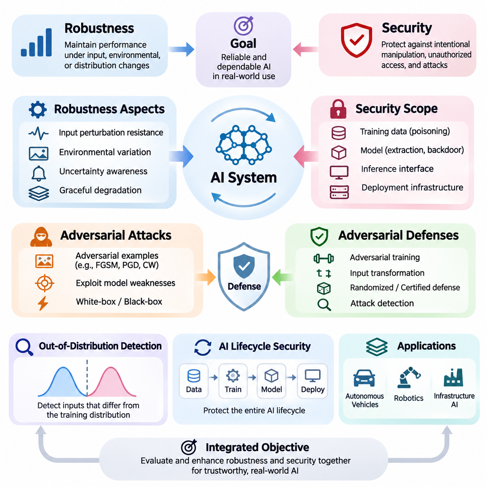
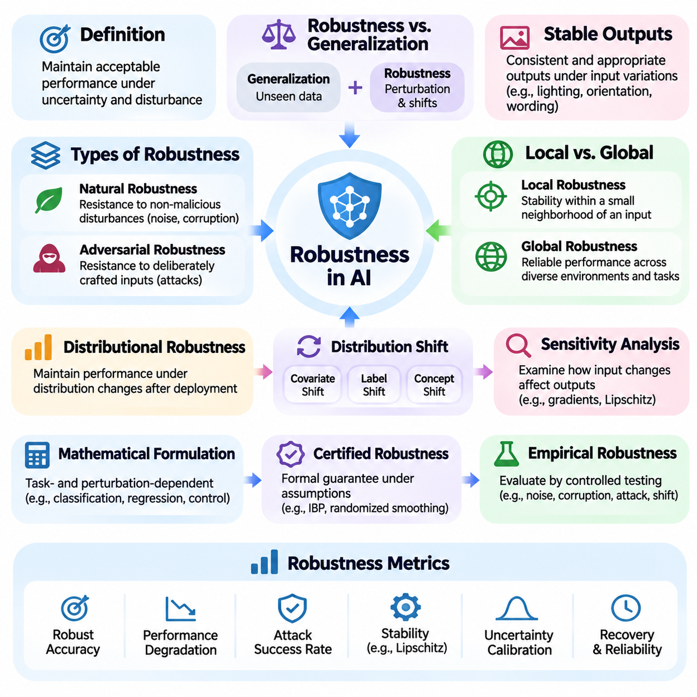
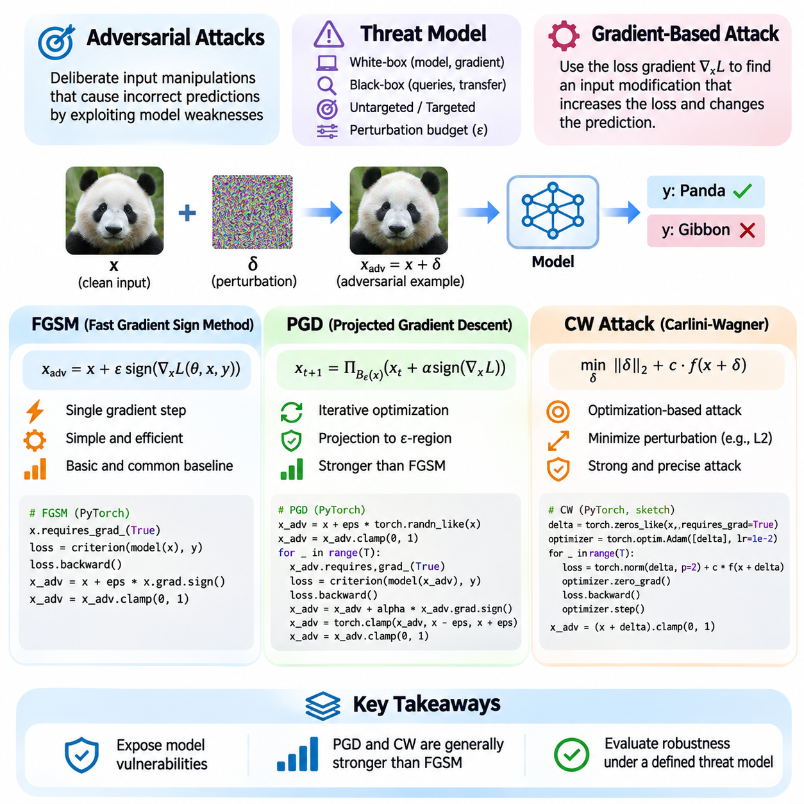
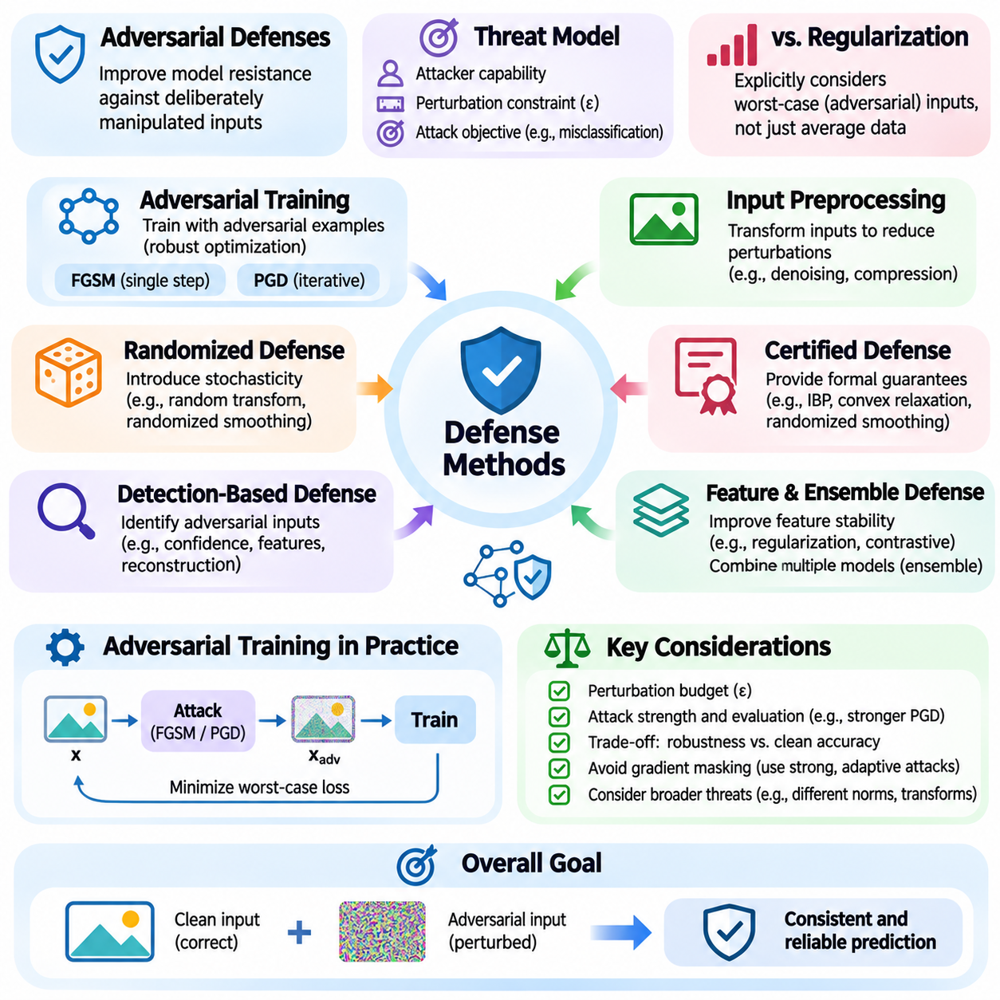
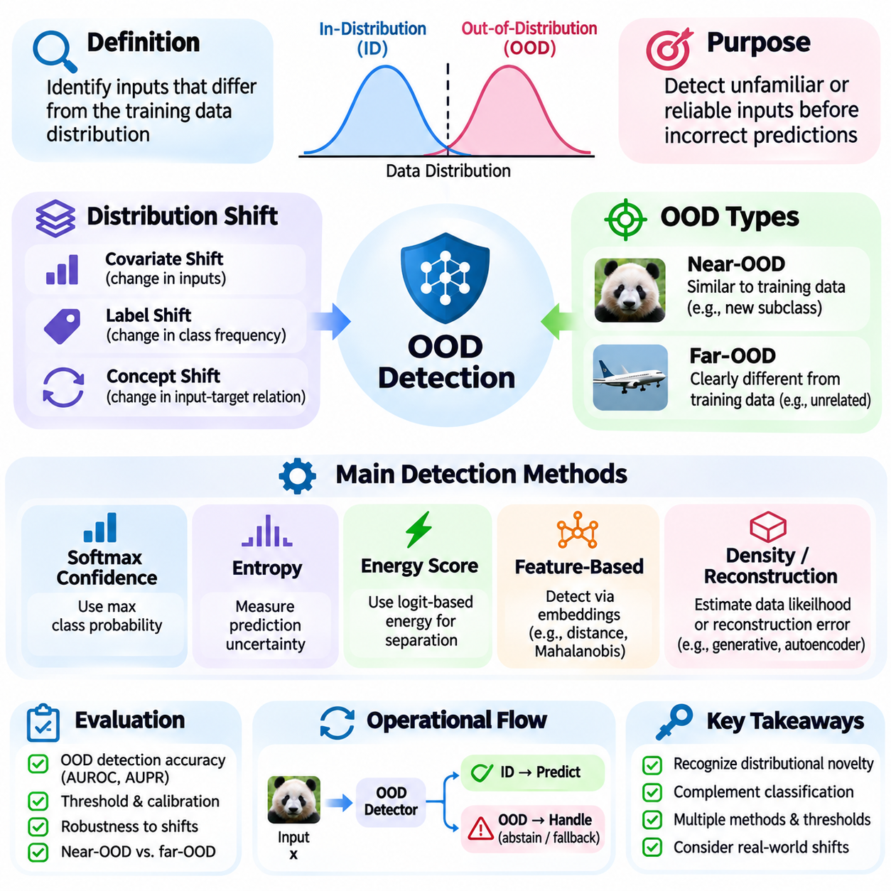
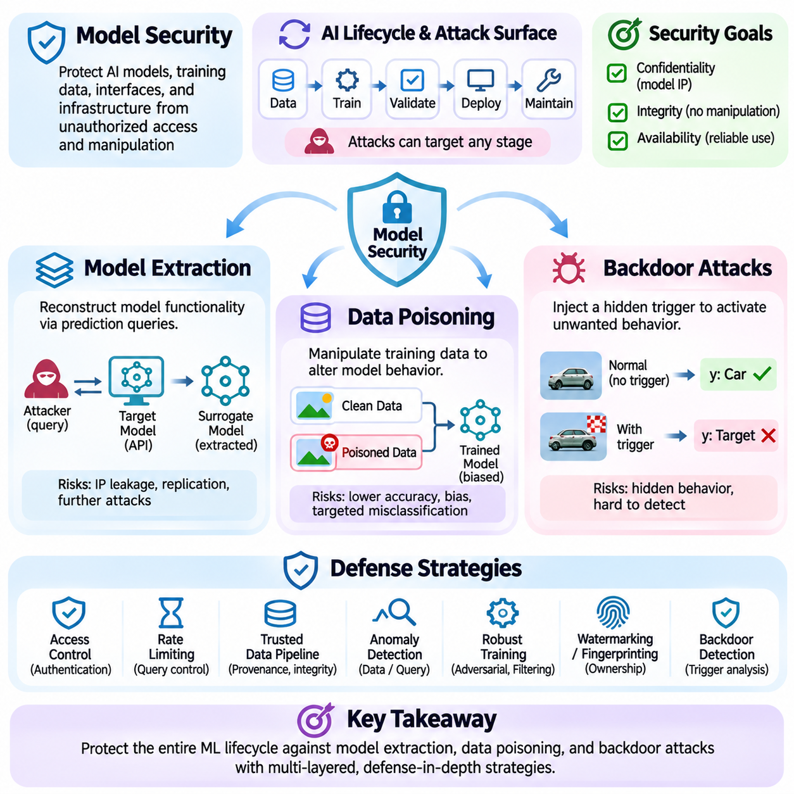
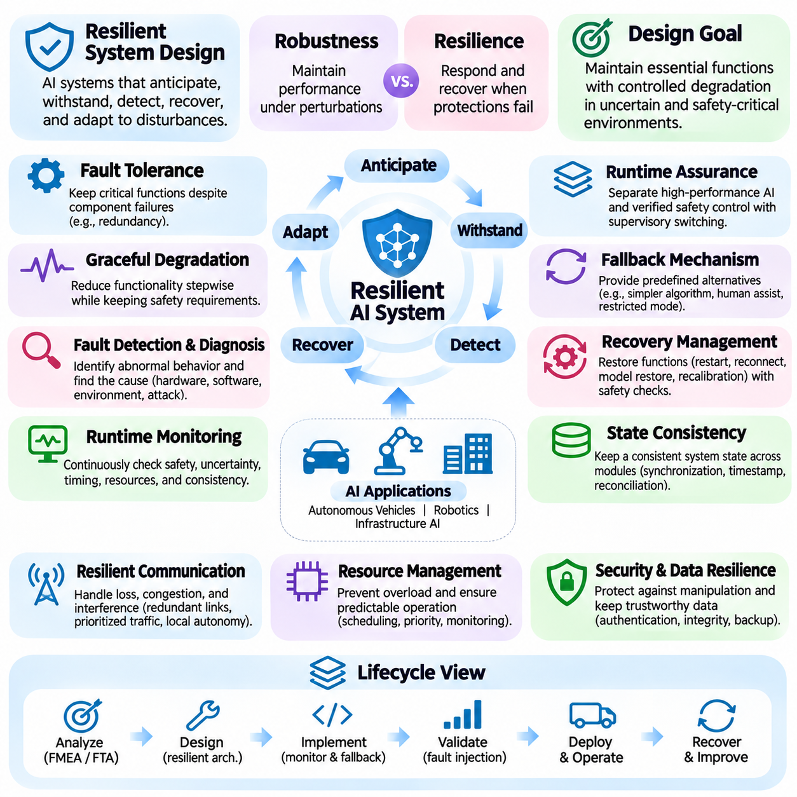

**Volume 42. AI Safety Alignment and Interpretability**


# 05. Robustness and Security

## 05.00 Overview

{width="7.268055555555556in" height="7.268055555555556in"}

Robustness and security are fundamental requirements for artificial intelligence systems operating in uncertain, dynamic, and potentially adversarial environments. Robustness describes the ability of a model to maintain acceptable performance when inputs, operating conditions, or environmental assumptions change. Security focuses on protecting AI systems against intentional manipulation, unauthorized access, and attacks that compromise their integrity, confidentiality, or availability.

Modern AI systems frequently achieve impressive accuracy under controlled evaluation conditions but exhibit unexpected failures when exposed to unfamiliar inputs or deliberate interference. Small changes in sensor measurements, image characteristics, language expressions, or data distributions can produce disproportionately large changes in predictions. Understanding these vulnerabilities requires examining both the statistical limitations of machine learning and the security properties of deployed computational systems.

Robustness and security address related but distinct challenges. A robust model should tolerate ordinary noise, measurement uncertainty, environmental variation, and reasonable distribution shifts without experiencing unacceptable degradation. A secure model must additionally resist adversaries who deliberately exploit weaknesses in its architecture, training process, interfaces, or deployment infrastructure. Reliable AI engineering requires these properties to be evaluated together rather than independently.

The concept of robustness extends beyond classification accuracy or prediction stability. It includes resistance to input perturbations, reliable behavior under changing environmental conditions, uncertainty awareness, and graceful degradation when assumptions are violated. A robust system should recognize situations in which its predictions become unreliable and support appropriate responses, including abstention, human intervention, or transition to a predefined safe operating mode.

Adversarial machine learning investigates how attackers manipulate AI behavior by exploiting weaknesses in learned decision boundaries and computational workflows. Adversarial examples are inputs intentionally modified to induce incorrect predictions or undesirable actions. Such modifications may be visually subtle, mathematically constrained, or physically implemented. Their effectiveness demonstrates that conventional predictive accuracy does not necessarily imply resistance to malicious interference.

Several established adversarial attack methods illustrate different approaches to exploiting model vulnerabilities. The Fast Gradient Sign Method uses gradient information to construct perturbations efficiently, while Projected Gradient Descent applies repeated constrained updates to search for stronger adversarial examples. The Carlini-Wagner attack formulates adversarial manipulation as an optimization problem, often seeking small perturbations that satisfy a specified attack objective.

These attack methods provide controlled mechanisms for investigating model weaknesses under defined assumptions. Their effectiveness depends on factors such as attacker knowledge, perturbation constraints, available computational resources, and access to model outputs or gradients. White-box attacks assume substantial knowledge of the target model, whereas black-box attacks operate with limited internal information. Both perspectives are important when constructing realistic security evaluations.

Adversarial defenses attempt to reduce vulnerability through improvements in training, model architecture, preprocessing, and inference procedures. Adversarial training exposes models to deliberately perturbed examples during optimization, encouraging more stable predictions within a specified threat model. Other approaches include input transformations, randomized mechanisms, certified defenses, and detection systems designed to identify suspicious inputs before they influence critical decisions.

No single adversarial defense provides universal protection against every attack. Defensive effectiveness must be measured against adaptive adversaries who understand the protection mechanisms and attempt to circumvent them. Evaluations should distinguish genuine improvements in robustness from misleading effects such as gradient masking or insufficient attack optimization. Strong security claims require clearly defined threat models, reproducible experiments, and transparent reporting of limitations.

Out-of-distribution detection addresses situations in which operational inputs differ substantially from the data used during model development. These differences may result from environmental changes, unfamiliar objects, sensor degradation, emerging behaviors, or previously unseen operating conditions. Because machine learning models can produce confident predictions for unfamiliar inputs, identifying distributional novelty is essential for dependable decision-making.

Out-of-distribution detection methods estimate whether an observation belongs to the expected operating distribution or exhibits characteristics associated with unfamiliar conditions. Common approaches examine predictive confidence, feature representations, energy scores, or statistical distances. However, detecting unfamiliar inputs does not automatically establish whether a prediction is incorrect. Detection performance must therefore be evaluated alongside calibration, task accuracy, and operational risk.

Model security encompasses threats affecting the entire AI lifecycle, including training data, model parameters, inference interfaces, and supporting infrastructure. Model extraction attacks attempt to reconstruct or approximate proprietary model behavior through available interactions. Such attacks may threaten intellectual property and expose information about decision boundaries. Effective protection requires appropriate access controls, query monitoring, interface restrictions, and security-aware deployment practices.

Data poisoning attacks compromise learning by introducing malicious or misleading information into training datasets. Attackers may seek to reduce overall model accuracy, manipulate specific predictions, or influence downstream behavior after deployment. The severity of poisoning depends on attacker control over the data pipeline, the learning algorithm, and the validation process. Data provenance, integrity verification, and controlled dataset management are important defensive considerations.

Backdoor attacks introduce hidden behavioral triggers that cause a model to deviate from its intended operation under particular conditions. A compromised model may perform normally on ordinary inputs while producing attacker-selected outputs when a trigger appears. Backdoors can originate from poisoned datasets, compromised pretrained models, or unauthorized parameter modifications. Their conditional behavior makes detection challenging and motivates systematic testing of model provenance and activation patterns.

Resilient system design extends robustness and security beyond individual models to the complete operational architecture. Even a carefully trained model can fail when sensors malfunction, communication channels become unavailable, or supporting software is compromised. Resilient AI systems therefore incorporate redundancy, monitoring, fault isolation, secure communication, recovery procedures, and mechanisms for maintaining essential functions during partial failures.

A resilient architecture should distinguish between preventing failures and limiting their consequences. Preventive controls reduce the probability of undesirable events, while detection and containment mechanisms restrict their propagation. Recovery procedures restore acceptable operation after disturbances. This layered approach recognizes that perfect model reliability is generally unattainable and that system-level safeguards remain necessary even when individual components demonstrate strong robustness.

Robustness evaluation requires systematic experimentation across normal, degraded, unfamiliar, and adversarial conditions. Useful measurements include clean accuracy, adversarial accuracy, attack success rate, detection performance, calibration error, recovery time, and service availability. These metrics describe different aspects of system behavior and should not be combined into a single score without considering application requirements, operational constraints, and the consequences of failure.

In autonomous vehicles, robustness and security directly influence perception, localization, planning, and control. Changes in illumination, weather, road markings, and sensor quality can reduce perception reliability, while malicious interference may compromise navigation or decision-making. Robust vehicle architectures combine diverse sensing capabilities, uncertainty estimation, operational monitoring, and fallback strategies to reduce the likelihood that individual errors develop into hazardous behavior.

Robotic systems face additional challenges because their predictions directly influence physical interactions. Sensor disturbances, unexpected contact forces, unfamiliar objects, and adversarial environmental modifications can affect manipulation and navigation. Robust robotic intelligence must integrate perception reliability with control stability, collision avoidance, and safe recovery. Security protections are equally important because compromised commands or observations can produce physical consequences.

Infrastructure AI supports applications such as power management, transportation coordination, industrial monitoring, and automated facility operation. These environments demand dependable behavior under equipment failures, changing demand, communication disruptions, and cybersecurity threats. Robustness and security must be integrated with operational continuity requirements, established engineering safeguards, and human supervisory mechanisms to protect critical services.

The relationship between robustness, security, safety, and alignment is particularly important in advanced AI systems. Robustness helps preserve intended behavior under changing conditions, while security protects against deliberate interference. Safety concerns the prevention of unacceptable harm, and alignment concerns consistency with intended objectives and human preferences. These properties reinforce one another, but success in one dimension does not automatically guarantee success in the others.

Building trustworthy AI ultimately requires continuous attention to robustness and security throughout design, development, evaluation, deployment, and maintenance. Threat models and operating assumptions must evolve as systems encounter new environments and adversarial techniques. By combining rigorous testing, secure engineering, uncertainty-aware decision-making, and resilient architectures, developers can create AI systems that remain more dependable when confronted with uncertainty, disturbance, and malicious activity.

견고성(Robustness)과 보안성(Security)은 불확실하고 동적이며 잠재적으로 적대적인 환경(Adversarial Environment)에서 작동하는 인공지능(Artificial Intelligence, AI) 시스템의 핵심 요구사항이다. 견고성은 입력, 운영 조건 또는 환경적 가정이 변화하더라도 모델이 허용 가능한 성능을 유지하는 능력을 의미한다. 보안성은 시스템의 무결성(Integrity), 기밀성(Confidentiality), 가용성(Availability)을 침해하는 의도적인 조작, 무단 접근 및 공격으로부터 AI 시스템을 보호하는 데 중점을 둔다.

현대 AI 시스템은 통제된 평가 환경에서 높은 정확도를 달성하지만, 익숙하지 않은 입력이나 의도적인 간섭에 노출되면 예상하지 못한 실패를 보이기도 한다. 센서 측정값, 이미지 특성, 언어 표현 또는 데이터 분포(Data Distribution)의 작은 변화가 예측 결과에 불균형적으로 큰 영향을 미칠 수 있다. 이러한 취약성을 이해하려면 기계학습(Machine Learning)의 통계적 한계와 실제 배포된 컴퓨팅 시스템의 보안 특성을 함께 분석해야 한다.

견고성과 보안성은 서로 연관되어 있지만 구별되는 문제를 다룬다. 견고한 모델은 일반적인 잡음(Noise), 측정 불확실성(Measurement Uncertainty), 환경 변화 및 합리적인 분포 이동(Distribution Shift)을 심각한 성능 저하 없이 견뎌야 한다. 보안성이 높은 모델은 구조, 학습 과정, 인터페이스 또는 배포 인프라의 약점을 의도적으로 악용하는 공격자에도 대응해야 한다. 신뢰할 수 있는 AI 엔지니어링(AI Engineering)을 위해서는 두 특성을 독립적으로 평가하기보다 통합적으로 검증해야 한다.

견고성의 개념은 분류 정확도(Classification Accuracy)나 예측 안정성(Prediction Stability)을 넘어선다. 여기에는 입력 교란(Input Perturbation)에 대한 저항성, 변화하는 환경에서의 안정적인 동작, 불확실성 인식(Uncertainty Awareness), 가정이 위반되었을 때의 점진적 성능 저하(Graceful Degradation)가 포함된다. 견고한 시스템은 예측의 신뢰성이 낮아지는 상황을 인식하고 판단 보류(Abstention), 인간 개입(Human Intervention), 사전에 정의된 안전 운영 모드(Safe Operating Mode)로의 전환을 지원해야 한다.

적대적 기계학습(Adversarial Machine Learning)은 공격자가 학습된 결정 경계(Decision Boundary)와 계산 과정의 취약성을 악용하여 AI 동작을 조작하는 방법을 연구한다. 적대적 예제(Adversarial Example)는 잘못된 예측이나 바람직하지 않은 행동을 유도하도록 의도적으로 수정된 입력이다. 이러한 수정은 시각적으로 미세하거나 수학적 제약을 따르거나 물리적 환경에서 구현될 수 있다. 이는 일반적인 예측 정확도가 악의적인 간섭에 대한 저항성을 반드시 보장하지는 않음을 보여준다.

대표적인 적대적 공격(Adversarial Attack) 기법은 모델 취약성을 악용하는 다양한 접근 방식을 보여준다. 빠른 기울기 부호 방법(Fast Gradient Sign Method, FGSM)은 기울기 정보를 이용하여 교란을 효율적으로 생성하며, 투영 기울기 하강법(Projected Gradient Descent, PGD)은 제약된 반복 갱신을 통해 더 강력한 적대적 예제를 탐색한다. 칼리니-와그너 공격(Carlini-Wagner Attack, CW Attack)은 적대적 조작을 최적화 문제(Optimization Problem)로 정식화하여 특정 공격 목표를 충족하는 작은 교란을 찾는다.

이러한 공격 기법은 명확하게 정의된 가정 아래에서 모델의 약점을 조사하는 통제된 수단을 제공한다. 공격 효과는 공격자의 지식, 교란 제약(Perturbation Constraint), 사용 가능한 계산 자원, 모델 출력이나 기울기에 대한 접근 권한 등에 따라 달라진다. 화이트박스 공격(White-Box Attack)은 대상 모델에 대한 상당한 내부 지식을 가정하지만, 블랙박스 공격(Black-Box Attack)은 제한된 내부 정보만으로 수행된다. 두 관점 모두 현실적인 보안 평가를 설계하는 데 중요하다.

적대적 방어(Adversarial Defense)는 학습 방법, 모델 구조, 전처리(Preprocessing), 추론 절차(Inference Procedure)를 개선하여 취약성을 줄이려는 접근 방식이다. 적대적 학습(Adversarial Training)은 최적화 과정에서 의도적으로 교란된 예제를 모델에 노출하여 특정 위협 모델(Threat Model) 내에서 더 안정적인 예측을 유도한다. 다른 방법으로는 입력 변환(Input Transformation), 무작위화 기법(Randomized Mechanism), 인증된 방어(Certified Defense), 의심스러운 입력을 탐지하는 시스템 등이 있다.

어떤 단일 적대적 방어 기법도 모든 공격에 대한 보편적인 보호를 제공하지는 못한다. 방어 효과는 보호 메커니즘을 이해하고 이를 우회하려는 적응형 공격자(Adaptive Adversary)를 대상으로 평가해야 한다. 평가 과정에서는 실제 견고성 향상과 기울기 마스킹(Gradient Masking) 또는 불충분한 공격 최적화로 발생하는 잘못된 효과를 구별해야 한다. 신뢰할 수 있는 보안성 주장을 위해서는 명확한 위협 모델, 재현 가능한 실험(Reproducible Experiment), 한계에 대한 투명한 보고가 필요하다.

분포 외 탐지(Out-of-Distribution Detection, OOD Detection)는 운영 중 입력이 모델 개발에 사용된 데이터와 상당히 달라지는 상황을 다룬다. 이러한 차이는 환경 변화, 익숙하지 않은 객체, 센서 성능 저하, 새롭게 등장한 행동 또는 이전에 관찰되지 않은 운영 조건에서 발생할 수 있다. 기계학습 모델은 익숙하지 않은 입력에도 높은 확신도의 예측을 생성할 수 있으므로, 분포적 신규성(Distributional Novelty)을 식별하는 능력은 신뢰할 수 있는 의사결정에 필수적이다.

분포 외 탐지 방법은 관측값이 예상된 운영 분포에 속하는지 또는 익숙하지 않은 조건과 관련된 특성을 보이는지 추정한다. 대표적인 접근 방식은 예측 신뢰도(Predictive Confidence), 특징 표현(Feature Representation), 에너지 점수(Energy Score), 통계적 거리(Statistical Distance)를 분석한다. 그러나 익숙하지 않은 입력을 탐지했다고 해서 예측이 반드시 잘못되었다는 의미는 아니다. 따라서 탐지 성능은 보정(Calibration), 작업 정확도(Task Accuracy), 운영 위험(Operational Risk)과 함께 평가해야 한다.

모델 보안(Model Security)은 학습 데이터, 모델 매개변수(Model Parameter), 추론 인터페이스 및 지원 인프라를 포함한 전체 AI 생명주기(AI Lifecycle)의 위협을 다룬다. 모델 추출 공격(Model Extraction Attack)은 이용 가능한 상호작용을 통해 독점 모델의 동작을 재구성하거나 근사하려는 시도이다. 이러한 공격은 지식재산권(Intellectual Property)을 위협하고 결정 경계에 관한 정보를 노출할 수 있다. 효과적인 보호를 위해서는 접근 제어(Access Control), 질의 모니터링(Query Monitoring), 인터페이스 제한 및 보안을 고려한 배포가 필요하다.

데이터 오염 공격(Data Poisoning Attack)은 학습 데이터셋(Training Dataset)에 악의적이거나 오해를 유발하는 정보를 주입하여 학습 과정을 손상시킨다. 공격자는 전체 모델 정확도를 낮추거나 특정 예측을 조작하거나 배포 이후의 동작에 영향을 미치려 할 수 있다. 오염 공격의 심각성은 공격자가 데이터 파이프라인(Data Pipeline), 학습 알고리즘(Learning Algorithm), 검증 과정(Validation Process)에 대해 갖는 통제 수준에 따라 달라진다. 데이터 출처 추적(Data Provenance), 무결성 검증(Integrity Verification), 통제된 데이터셋 관리가 중요한 방어 요소이다.

백도어 공격(Backdoor Attack)은 특정 조건에서 모델이 의도된 동작을 벗어나도록 숨겨진 행동 유발 조건인 트리거(Trigger)를 삽입한다. 손상된 모델은 일반적인 입력에서는 정상적으로 작동하지만, 트리거가 나타나면 공격자가 선택한 출력을 생성할 수 있다. 백도어는 오염된 데이터셋, 손상된 사전학습 모델(Pretrained Model), 무단 매개변수 수정에서 발생할 수 있다. 이러한 조건부 동작은 탐지를 어렵게 하므로 모델 출처와 활성화 패턴(Activation Pattern)에 대한 체계적인 검사가 필요하다.

복원력 있는 시스템 설계(Resilient System Design)는 개별 모델을 넘어 전체 운영 구조로 견고성과 보안성을 확장한다. 신중하게 학습된 모델이라도 센서가 오작동하거나 통신 채널을 사용할 수 없거나 지원 소프트웨어가 손상되면 실패할 수 있다. 따라서 복원력 있는 AI 시스템은 중복성(Redundancy), 모니터링(Monitoring), 결함 격리(Fault Isolation), 보안 통신(Secure Communication), 복구 절차(Recovery Procedure), 부분적인 장애 중에도 필수 기능을 유지하는 메커니즘을 포함해야 한다.

복원력 있는 아키텍처(Resilient Architecture)는 장애를 예방하는 것과 장애의 영향을 제한하는 것을 구분해야 한다. 예방적 통제(Preventive Control)는 바람직하지 않은 사건의 발생 확률을 줄이며, 탐지 및 봉쇄 메커니즘(Detection and Containment Mechanism)은 장애의 확산을 제한한다. 복구 절차는 교란 이후 허용 가능한 운영 상태를 회복한다. 이러한 계층적 접근(Layered Approach)은 완벽한 모델 신뢰성이 일반적으로 달성하기 어렵고, 개별 구성요소가 높은 견고성을 보여도 시스템 수준의 안전장치가 필요하다는 사실을 반영한다.

견고성 평가(Robustness Evaluation)는 정상, 성능 저하, 미지의 환경 및 적대적 조건에 대한 체계적인 실험을 요구한다. 주요 측정 지표에는 정상 입력 정확도(Clean Accuracy), 적대적 정확도(Adversarial Accuracy), 공격 성공률(Attack Success Rate), 탐지 성능(Detection Performance), 보정 오차(Calibration Error), 복구 시간(Recovery Time), 서비스 가용성(Service Availability)이 포함된다. 이러한 지표는 서로 다른 시스템 특성을 나타내므로 응용 요구사항과 운영 제약, 실패의 결과를 고려하지 않고 단일 점수로 결합해서는 안 된다.

자율주행차(Autonomous Vehicle)에서 견고성과 보안성은 인식(Perception), 위치 추정(Localization), 경로 계획(Planning), 제어(Control)에 직접적인 영향을 미친다. 조명, 날씨, 도로 표시, 센서 품질의 변화는 인식 신뢰성을 떨어뜨릴 수 있으며, 악의적인 간섭은 주행 판단이나 의사결정을 손상시킬 수 있다. 견고한 차량 아키텍처는 다양한 센싱 능력, 불확실성 추정(Uncertainty Estimation), 운영 모니터링, 대체 운영 전략(Fallback Strategy)을 결합하여 개별 오류가 위험한 상황으로 발전할 가능성을 줄인다.

로봇 시스템(Robotic System)은 예측 결과가 물리적 상호작용(Physical Interaction)에 직접 영향을 미치기 때문에 추가적인 문제에 직면한다. 센서 교란, 예상하지 못한 접촉력(Contact Force), 익숙하지 않은 객체, 적대적인 환경 변경은 조작(Manipulation)과 이동(Navigation)에 영향을 줄 수 있다. 견고한 로봇 지능(Robotic Intelligence)은 인식 신뢰성과 제어 안정성(Control Stability), 충돌 회피(Collision Avoidance), 안전한 복구(Safe Recovery)를 통합해야 한다. 손상된 명령이나 관측값이 물리적 결과를 초래할 수 있으므로 보안 보호 역시 중요하다.

인프라 AI(Infrastructure AI)는 전력 관리(Power Management), 교통 조정(Transportation Coordination), 산업 모니터링(Industrial Monitoring), 자동화 시설 운영(Automated Facility Operation)과 같은 응용 분야를 지원한다. 이러한 환경은 장비 고장, 수요 변화, 통신 장애, 사이버보안 위협(Cybersecurity Threat) 속에서도 신뢰할 수 있는 동작을 요구한다. 핵심 서비스를 보호하려면 견고성과 보안성을 운영 연속성(Operational Continuity), 기존 엔지니어링 안전장치, 인간 감독 메커니즘(Human Supervisory Mechanism)과 통합해야 한다.

견고성, 보안성, 안전성(Safety), 정렬(Alignment)의 관계는 고급 AI 시스템(Advanced AI System)에서 특히 중요하다. 견고성은 변화하는 조건에서도 의도된 동작을 유지하도록 지원하며, 보안성은 의도적인 간섭으로부터 시스템을 보호한다. 안전성은 허용할 수 없는 피해를 예방하는 데 초점을 맞추고, 정렬은 의도된 목표와 인간의 선호(Human Preference)에 대한 일관성을 다룬다. 이러한 특성은 서로를 강화하지만, 한 영역의 성공이 다른 영역의 성공을 자동으로 보장하지는 않는다.

신뢰할 수 있는 인공지능(Trustworthy AI)을 구축하려면 설계, 개발, 평가, 배포 및 유지보수 전반에서 견고성과 보안성을 지속적으로 고려해야 한다. 시스템이 새로운 환경과 적대적 기법을 접함에 따라 위협 모델과 운영 가정도 발전해야 한다. 엄격한 시험(Rigorous Testing), 보안 엔지니어링(Secure Engineering), 불확실성 인식 기반 의사결정(Uncertainty-Aware Decision-Making), 복원력 있는 아키텍처를 결합함으로써 개발자는 불확실성, 교란 및 악의적 활동에 직면하더라도 더욱 신뢰할 수 있는 AI 시스템을 구축할 수 있다.

## 05.01 Robustness Definitions

{width="7.268055555555556in" height="7.268055555555556in"}

Robustness in artificial intelligence refers to the ability of a model or system to maintain acceptable performance when operating conditions differ from those encountered during training or evaluation. These differences may include input noise, environmental changes, distribution shifts, or intentional perturbations. Robustness is therefore not simply a measure of accuracy but a property describing how reliably an AI system behaves under uncertainty and disturbance.

A robust AI model should produce stable and appropriate outputs when exposed to variations that do not fundamentally change the meaning of its inputs. For example, an image classifier should recognize an object despite moderate changes in lighting, orientation, or background. Similarly, a language model should preserve its intended interpretation when equivalent instructions are expressed differently. Such stability is essential for reliable deployment.

Robustness differs from generalization, although the two concepts are closely related. Generalization describes how well a model performs on previously unseen examples drawn from an assumed data distribution. Robustness additionally examines performance under perturbations, distribution changes, and challenging operating conditions. A model may generalize effectively on conventional test data while remaining highly vulnerable to small but carefully selected input modifications.

One important distinction separates natural robustness from adversarial robustness. Natural robustness concerns resistance to disturbances that arise without malicious intent, including sensor noise, image corruption, missing information, and environmental variability. Adversarial robustness concerns resistance to deliberately constructed inputs designed to cause incorrect predictions or unsafe behavior. Both forms are necessary for dependable AI systems operating in realistic environments.

Local robustness describes the stability of model predictions within a defined neighborhood surrounding a particular input. If small perturbations remain within an allowed distance, the model should preserve the desired prediction or satisfy a specified behavioral constraint. This concept is frequently studied using mathematical norms that quantify perturbation magnitude. However, mathematical proximity does not always correspond directly to perceptual or semantic similarity.

Global robustness concerns reliable behavior across a broader operational domain rather than within the neighborhood of an individual input. It examines whether a model maintains acceptable performance over diverse environments, populations, tasks, and input conditions. Global robustness is more difficult to establish because the operational domain may contain numerous combinations of disturbances, rare events, and unfamiliar situations that cannot be exhaustively tested.

Distributional robustness addresses changes in the statistical characteristics of data encountered after deployment. Training and operational distributions may differ because of changing environments, equipment configurations, user behavior, or data collection procedures. A distributionally robust model aims to maintain satisfactory performance across a defined family of plausible distributions rather than optimizing exclusively for a single observed training distribution.

Distribution shift can take several forms, including covariate shift, label shift, and concept shift. Covariate shift changes the distribution of input features while preserving the conditional relationship between inputs and targets. Label shift changes class frequencies while preserving class-conditional feature distributions. Concept shift changes the relationship between inputs and targets, potentially requiring substantial model adaptation rather than simple statistical correction.

Robustness can also be understood through sensitivity analysis, which examines how changes in inputs influence model outputs. A highly sensitive model may amplify small disturbances into large prediction differences, while a less sensitive model may exhibit greater stability. Sensitivity can be investigated using gradients, Lipschitz bounds, perturbation experiments, and empirical response measurements. Low sensitivity alone, however, does not guarantee correct predictions.

The mathematical formulation of robustness depends on the task, perturbation model, and acceptable behavior. For classification, robustness may require predictions to remain unchanged within a specified perturbation set. For regression, it may require output deviations to remain below a defined threshold. For control systems, robustness may involve maintaining stability, satisfying safety constraints, and achieving acceptable performance despite disturbances and modeling errors.

Certified robustness provides formal guarantees about model behavior under explicitly defined assumptions. Certification methods may use interval bound propagation, randomized smoothing, convex relaxation, or formal verification techniques. These approaches establish that certain classes of perturbations cannot change specified outcomes within certified regions. However, certificates are limited by their mathematical assumptions, perturbation models, and computational feasibility.

Empirical robustness evaluates model behavior through controlled testing rather than formal guarantees. Researchers introduce noise, corruptions, transformations, adversarial perturbations, and distribution changes to measure performance degradation. Such evaluations provide practical evidence about system reliability but cannot establish universal protection. Their validity depends on representative test conditions, appropriate attack strength, and transparent experimental procedures.

Robustness metrics quantify different aspects of performance under disturbance. Common measures include robust accuracy, worst-case loss, prediction consistency, corruption error, and performance degradation relative to clean conditions. For operational systems, additional measures may include recovery time, failure frequency, constraint violations, and service continuity. Metric selection should reflect the consequences of errors within the intended application.

Robustness must be distinguished from uncertainty estimation and calibration. Uncertainty estimation characterizes how uncertain a model is about its predictions, while calibration examines whether reported confidence corresponds to observed correctness. A model may be robust to certain perturbations yet remain overconfident when encountering unfamiliar inputs. Conversely, a well-calibrated model may still be vulnerable to adversarial manipulation or severe distribution shifts.

Robustness also differs from resilience, although the concepts are complementary. Robustness emphasizes maintaining acceptable behavior while disturbances occur, whereas resilience includes detecting failures, limiting their consequences, recovering functionality, and adapting after disruptions. A system may experience temporary performance degradation yet remain resilient if it transitions safely to alternative operating modes and restores normal functionality within acceptable limits.

In autonomous vehicles, robustness requires reliable perception and decision-making despite changing weather, illumination, road conditions, and sensor disturbances. In robotics, it involves maintaining stable manipulation and navigation under uncertain dynamics and environmental interactions. Infrastructure AI requires dependable operation despite equipment faults, communication delays, and fluctuating demand. Each application therefore requires domain-specific robustness definitions.

Robustness requirements should be established before model development and linked to operational risk. Engineers must identify relevant disturbances, acceptable performance limits, expected operating environments, and failure consequences. These requirements guide data collection, training strategies, architecture selection, and evaluation protocols. Without clearly specified robustness objectives, improvements observed during testing may not translate into meaningful operational reliability.

A comprehensive robustness assessment should combine ordinary test performance, stress testing, adversarial evaluation, distribution shift analysis, and system-level validation. Results should be reported with explicit perturbation constraints, operating assumptions, and uncertainty estimates. This approach prevents robustness from being reduced to a single benchmark score and supports meaningful comparisons between models designed for different operational conditions.

Robustness is ultimately a multidimensional property rather than an absolute guarantee of correct behavior. Its meaning depends on what disturbances are considered, which outputs must remain stable, and what level of degradation is acceptable. By defining robustness precisely and evaluating it systematically, AI developers can establish realistic reliability requirements and build systems that perform more consistently under uncertain and challenging conditions.

인공지능(Artificial Intelligence, AI)에서 견고성(Robustness)은 학습(Training)이나 평가(Evaluation) 과정에서 경험한 조건과 다른 운영 환경에서도 모델 또는 시스템이 허용 가능한 성능을 유지하는 능력을 의미한다. 이러한 차이에는 입력 잡음(Input Noise), 환경 변화(Environmental Change), 분포 이동(Distribution Shift), 의도적인 교란(Intentional Perturbation)이 포함될 수 있다. 따라서 견고성은 단순한 정확도(Accuracy) 측정이 아니라 불확실성과 교란 상황에서 AI 시스템이 얼마나 신뢰성 있게 동작하는지를 나타내는 특성이다.

견고한 AI 모델은 입력의 본질적인 의미를 변경하지 않는 다양한 변화에 노출되더라도 안정적이고 적절한 출력을 생성해야 한다. 예를 들어 이미지 분류기(Image Classifier)는 조명, 방향 또는 배경이 적당히 변화하더라도 객체를 인식해야 한다. 마찬가지로 언어 모델(Language Model)은 동일한 의미의 지시가 서로 다른 방식으로 표현되더라도 의도된 해석을 유지해야 한다. 이러한 안정성(Stability)은 신뢰할 수 있는 실제 배포(Deployment)를 위해 필수적이다.

견고성은 일반화(Generalization)와 밀접하게 관련되어 있지만 서로 다른 개념이다. 일반화는 가정된 데이터 분포(Data Distribution)에서 추출된 이전에 관찰하지 못한 예제에 대해 모델이 얼마나 잘 작동하는지를 설명한다. 반면 견고성은 교란, 분포 변화 및 까다로운 운영 조건에서의 성능까지 추가로 검토한다. 모델이 일반적인 테스트 데이터(Test Data)에서는 효과적으로 일반화하더라도 작지만 정교하게 선택된 입력 변경에는 매우 취약할 수 있다.

중요한 구분 중 하나는 자연적 견고성(Natural Robustness)과 적대적 견고성(Adversarial Robustness)의 차이이다. 자연적 견고성은 센서 잡음(Sensor Noise), 이미지 손상(Image Corruption), 정보 누락(Missing Information), 환경 변동성(Environmental Variability)처럼 악의적인 의도 없이 발생하는 교란에 대한 저항성을 의미한다. 적대적 견고성은 잘못된 예측이나 안전하지 않은 행동을 유도하도록 의도적으로 구성된 입력에 대한 저항성을 의미한다. 두 형태 모두 실제 환경에서 작동하는 신뢰성 높은 AI 시스템에 필요하다.

국소 견고성(Local Robustness)은 특정 입력 주변에 정의된 영역(Neighborhood) 내에서 모델 예측이 얼마나 안정적인지를 설명한다. 작은 교란이 허용된 거리 범위 내에 있다면 모델은 원하는 예측을 유지하거나 지정된 행동 제약(Behavioral Constraint)을 만족해야 한다. 이 개념은 교란의 크기를 정량화하는 수학적 노름(Mathematical Norm)을 이용하여 자주 연구된다. 그러나 수학적 근접성(Mathematical Proximity)이 항상 지각적 유사성(Perceptual Similarity)이나 의미적 유사성(Semantic Similarity)에 직접 대응하는 것은 아니다.

전역 견고성(Global Robustness)은 개별 입력 주변의 제한된 영역이 아니라 더 넓은 운영 영역(Operational Domain) 전반에서 신뢰할 수 있는 동작을 유지하는 능력을 의미한다. 이는 다양한 환경, 집단, 작업 및 입력 조건에서 모델이 허용 가능한 성능을 유지하는지를 검토한다. 전역 견고성은 운영 영역에 수많은 교란 조합, 희귀 사건(Rare Event), 익숙하지 않은 상황이 포함될 수 있고 이를 모두 시험하기 어렵기 때문에 확립하기가 더욱 어렵다.

분포적 견고성(Distributional Robustness)은 배포 이후 관찰되는 데이터의 통계적 특성이 변화하는 상황을 다룬다. 학습 분포(Training Distribution)와 운영 분포(Operational Distribution)는 환경 변화, 장비 구성, 사용자 행동 또는 데이터 수집 절차의 차이로 인해 달라질 수 있다. 분포적으로 견고한 모델은 단일 관측 학습 분포에 대해서만 최적화하기보다 합리적으로 예상할 수 있는 분포들의 집합 전반에서 만족스러운 성능을 유지하는 것을 목표로 한다.

분포 이동(Distribution Shift)은 공변량 이동(Covariate Shift), 레이블 이동(Label Shift), 개념 이동(Concept Shift) 등 여러 형태로 나타날 수 있다. 공변량 이동은 입력과 목표값 사이의 조건부 관계를 유지하면서 입력 특징의 분포가 변화하는 현상이다. 레이블 이동은 클래스별 조건부 특징 분포를 유지하면서 클래스 빈도가 변화하는 현상이다. 개념 이동은 입력과 목표값 사이의 관계 자체가 변화하는 것으로, 단순한 통계적 보정보다 상당한 수준의 모델 적응(Model Adaptation)이 필요할 수 있다.

견고성은 입력 변화가 모델 출력에 미치는 영향을 조사하는 민감도 분석(Sensitivity Analysis)을 통해서도 이해할 수 있다. 민감도가 높은 모델은 작은 교란을 큰 예측 차이로 증폭할 수 있지만, 민감도가 낮은 모델은 더 높은 안정성을 보일 수 있다. 민감도는 기울기(Gradient), 립시츠 경계(Lipschitz Bound), 교란 실험(Perturbation Experiment), 경험적 반응 측정(Empirical Response Measurement)을 통해 조사할 수 있다. 그러나 낮은 민감도만으로 올바른 예측이 보장되는 것은 아니다.

견고성의 수학적 정식화(Mathematical Formulation)는 작업, 교란 모델(Perturbation Model), 허용 가능한 동작에 따라 달라진다. 분류(Classification)에서는 지정된 교란 집합(Perturbation Set) 내에서 예측이 변하지 않아야 할 수 있다. 회귀(Regression)에서는 출력 편차(Output Deviation)가 정의된 임계값(Threshold) 이하로 유지되어야 할 수 있다. 제어 시스템(Control System)에서는 교란과 모델링 오차(Modeling Error)가 존재하더라도 안정성을 유지하고 안전 제약(Safety Constraint)을 만족하며 허용 가능한 성능을 달성하는 것이 견고성에 포함될 수 있다.

인증된 견고성(Certified Robustness)은 명시적으로 정의된 가정 아래에서 모델 동작에 대한 형식적 보장(Formal Guarantee)을 제공한다. 인증 방법(Certification Method)에는 구간 경계 전파(Interval Bound Propagation), 무작위 평활화(Randomized Smoothing), 볼록 완화(Convex Relaxation), 형식 검증(Formal Verification) 기법 등이 사용될 수 있다. 이러한 접근 방식은 인증된 영역(Certified Region) 내에서 특정 교란 유형이 지정된 결과를 변경할 수 없음을 입증한다. 그러나 인증은 수학적 가정, 교란 모델 및 계산 가능성(Computational Feasibility)에 의해 제한된다.

경험적 견고성(Empirical Robustness)은 형식적 보장 대신 통제된 시험을 통해 모델 동작을 평가한다. 연구자는 잡음, 데이터 손상(Corruption), 변환(Transformation), 적대적 교란(Adversarial Perturbation), 분포 변화를 도입하여 성능 저하를 측정한다. 이러한 평가는 시스템 신뢰성에 관한 실용적인 증거를 제공하지만 보편적인 보호를 입증하지는 못한다. 평가의 타당성(Validity)은 대표성 있는 시험 조건, 적절한 공격 강도(Attack Strength), 투명한 실험 절차에 따라 달라진다.

견고성 지표(Robustness Metric)는 교란 상황에서 나타나는 다양한 성능 특성을 정량화한다. 대표적인 지표에는 견고 정확도(Robust Accuracy), 최악 사례 손실(Worst-Case Loss), 예측 일관성(Prediction Consistency), 손상 오류(Corruption Error), 정상 조건 대비 성능 저하(Performance Degradation)가 포함된다. 운영 시스템에서는 복구 시간(Recovery Time), 장애 빈도(Failure Frequency), 제약 위반(Constraint Violation), 서비스 연속성(Service Continuity)도 측정할 수 있다. 지표는 실제 응용 분야에서 오류가 초래하는 결과를 반영하여 선택해야 한다.

견고성은 불확실성 추정(Uncertainty Estimation) 및 보정(Calibration)과 구별해야 한다. 불확실성 추정은 모델이 자신의 예측에 대해 얼마나 불확실한지를 나타내며, 보정은 보고된 신뢰도(Confidence)가 실제 관측된 정확성과 얼마나 일치하는지를 평가한다. 모델이 특정 교란에는 견고하더라도 익숙하지 않은 입력에 대해서는 지나치게 높은 확신을 보일 수 있다. 반대로 보정이 잘된 모델이라도 적대적 조작이나 심각한 분포 이동에는 취약할 수 있다.

견고성은 복원력(Resilience)과도 구별되지만 두 개념은 상호 보완적이다. 견고성은 교란이 발생하는 동안 허용 가능한 동작을 유지하는 데 중점을 두지만, 복원력은 장애 탐지(Failure Detection), 영향 제한, 기능 복구(Function Recovery), 중단 이후 적응(Adaptation)까지 포함한다. 시스템이 일시적인 성능 저하를 경험하더라도 대체 운영 모드(Alternative Operating Mode)로 안전하게 전환하고 허용 가능한 범위 내에서 정상 기능을 복원할 수 있다면 복원력이 있다고 평가할 수 있다.

자율주행차(Autonomous Vehicle)에서 견고성은 변화하는 날씨, 조명, 도로 상태 및 센서 교란에도 신뢰할 수 있는 인식(Perception)과 의사결정(Decision-Making)을 수행하는 능력을 요구한다. 로봇공학(Robotics)에서는 불확실한 동역학(Dynamics)과 환경적 상호작용 속에서도 안정적인 조작(Manipulation)과 이동(Navigation)을 유지하는 것이 중요하다. 인프라 AI(Infrastructure AI)는 장비 결함, 통신 지연 및 변동하는 수요에도 안정적으로 작동해야 한다. 따라서 각 응용 분야에는 영역별 견고성 정의(Domain-Specific Robustness Definition)가 필요하다.

견고성 요구사항(Robustness Requirement)은 모델 개발 이전에 수립하고 운영 위험(Operational Risk)과 연결해야 한다. 엔지니어는 관련 교란, 허용 가능한 성능 한계(Performance Limit), 예상 운영 환경 및 장애의 결과를 식별해야 한다. 이러한 요구사항은 데이터 수집(Data Collection), 학습 전략(Training Strategy), 아키텍처 선택(Architecture Selection), 평가 프로토콜(Evaluation Protocol)을 안내한다. 견고성 목표가 명확하게 정의되지 않으면 시험에서 관찰된 개선이 실제 운영 신뢰성 향상으로 이어지지 않을 수 있다.

포괄적인 견고성 평가(Comprehensive Robustness Assessment)는 일반적인 테스트 성능, 스트레스 테스트(Stress Testing), 적대적 평가(Adversarial Evaluation), 분포 이동 분석(Distribution Shift Analysis), 시스템 수준 검증(System-Level Validation)을 결합해야 한다. 결과는 명시적인 교란 제약, 운영 가정 및 불확실성 추정값과 함께 보고해야 한다. 이러한 접근 방식은 견고성을 단일 벤치마크 점수(Benchmark Score)로 축소하는 것을 방지하고 서로 다른 운영 조건을 위해 설계된 모델 사이의 의미 있는 비교를 지원한다.

견고성은 궁극적으로 올바른 동작에 대한 절대적인 보장이 아니라 다차원적 특성(Multidimensional Property)이다. 그 의미는 어떤 교란을 고려하는지, 어떤 출력이 안정적으로 유지되어야 하는지, 어느 수준의 성능 저하가 허용되는지에 따라 달라진다. 견고성을 정확하게 정의하고 체계적으로 평가함으로써 AI 개발자는 현실적인 신뢰성 요구사항(Reliability Requirement)을 수립하고 불확실하고 까다로운 조건에서도 더욱 일관되게 작동하는 시스템을 구축할 수 있다.

## 05.02 Adversarial Attacks [w/Code]

{width="7.268055555555556in" height="7.268055555555556in"}

Adversarial attacks are deliberate manipulations of input data designed to cause machine learning models to produce incorrect predictions or unintended behavior. These attacks exploit weaknesses in learned decision boundaries, often through small perturbations that preserve the apparent meaning of the original input. Their existence demonstrates that high accuracy on conventional test datasets does not necessarily guarantee reliable performance under hostile conditions.

Adversarial examples are typically constructed by modifying a legitimate input while satisfying predefined constraints on perturbation magnitude. In image classification, these modifications may be nearly imperceptible to human observers yet significantly alter model predictions. The attacker seeks to maximize prediction error, induce a particular target classification, or violate an operational requirement while keeping the modified input within an allowed perturbation region.

The adversarial threat model defines the attacker\'s objectives, capabilities, and constraints. White-box attacks assume access to model architecture, parameters, and gradients, whereas black-box attacks rely on model queries or transferability between models. Untargeted attacks seek any incorrect prediction, while targeted attacks attempt to produce a specific output. Perturbation budgets determine how extensively an attacker may modify the original input.

Gradient-based attacks exploit the differentiability of neural networks to identify input directions that increase a selected loss function. By computing the gradient of the loss with respect to the input, an attacker can estimate which modifications are most likely to influence model predictions. This approach transforms adversarial example generation into a constrained optimization problem involving prediction objectives and allowable perturbations.

The Fast Gradient Sign Method, commonly abbreviated FGSM, is one of the simplest gradient-based adversarial attacks. It generates an adversarial example using a single gradient computation and a perturbation scaled by a parameter called epsilon. For an untargeted attack, the perturbation follows the sign of the input gradient of the loss, increasing classification error while respecting an L-infinity perturbation constraint.

FGSM can be expressed mathematically as x_adv = x + ε sign(∇x L(θ, x, y)), where x represents the original input, ε controls perturbation magnitude, θ denotes model parameters, and L is the loss function. The gradient identifies the direction of increasing loss, while the sign operation produces a bounded modification for each input component. The resulting input is normally clipped to the valid data range.

A practical FGSM implementation in PyTorch begins by enabling gradient tracking for the input tensor. The model performs a forward pass, computes the classification loss, and propagates gradients backward to the input. The adversarial input is then constructed by adding epsilon times the gradient sign and applying clipping. Evaluation compares predictions on clean and perturbed inputs to quantify the attack\'s effectiveness.

FGSM is computationally efficient because it requires only one gradient evaluation per adversarial example. However, its single-step approximation may fail to identify stronger adversarial perturbations when the loss landscape is highly nonlinear. Attack effectiveness also depends on epsilon, model architecture, input normalization, and the chosen loss function. Consequently, FGSM is useful as an initial diagnostic rather than a comprehensive robustness evaluation.

Projected Gradient Descent, abbreviated PGD, extends FGSM through iterative optimization. Instead of applying a single perturbation, PGD repeatedly updates the adversarial input in a direction that increases the attack objective. After each update, the candidate is projected back into the permitted perturbation region. This procedure enables the attack to explore more effective adversarial modifications while maintaining predefined constraints.

For an untargeted L-infinity attack, PGD updates the input using x_next = Π(x_current + α sign(∇x L)), where α represents the step size and Π denotes projection onto the allowed region around the original input. The process repeats for a specified number of iterations. Random initialization within the perturbation budget can improve exploration and reduce dependence on a single starting point.

A PyTorch implementation of PGD maintains an adversarial tensor that is updated through repeated forward and backward passes. Each iteration computes the current loss gradient, applies a bounded gradient step, projects the result into the epsilon neighborhood, and clips values to the valid input domain. Multiple random restarts may be used to discover stronger adversarial examples and improve the reliability of empirical robustness estimates.

PGD is widely used as a reference attack for adversarial robustness evaluation and adversarial training. Its iterative nature generally makes it stronger than basic FGSM under comparable perturbation constraints, although performance depends on optimization settings. Increasing iterations, adjusting step sizes, and using multiple restarts can improve attack effectiveness, but also increase computational cost and do not guarantee global optimality.

The Carlini-Wagner attack, commonly called the CW attack, approaches adversarial example generation through explicit optimization of perturbation size and attack success. Rather than relying primarily on sign-gradient updates, it searches for a modified input that satisfies a misclassification objective while minimizing a chosen distance measure. The method is especially associated with carefully optimized adversarial examples under L2 distance constraints.

A common CW formulation minimizes \|\|δ\|\|² + c f(x + δ), where δ is the perturbation, c balances distortion against attack success, and f represents an attack-specific objective based on model outputs. The optimization may use logits rather than classification probabilities to obtain useful gradients. A confidence parameter can control the desired separation between the target outcome and competing classes.

CW implementations frequently use a variable transformation to keep adversarial inputs within valid numerical bounds during optimization. The transformed variable is optimized using gradient-based methods such as Adam, while a binary search over the tradeoff coefficient may identify smaller successful perturbations. These procedures are more computationally demanding than FGSM and often PGD, but can produce highly optimized adversarial examples.

FGSM, PGD, and CW illustrate distinct tradeoffs between computational efficiency, optimization strength, and perturbation control. FGSM provides a fast single-step baseline, PGD performs iterative constrained optimization, and CW explicitly balances perturbation magnitude against attack success. Their results are not directly comparable unless threat models, perturbation norms, attack objectives, and computational budgets are consistently defined.

Evaluating adversarial attacks requires measuring more than the number of incorrect predictions. Robust accuracy, attack success rate, perturbation magnitude, computational cost, and success across different model architectures provide complementary information. Targeted and untargeted results should be reported separately. Evaluation should also consider clean-input correctness, since an already incorrect prediction does not demonstrate a successful adversarial modification.

Adversarial attacks may transfer between models because different neural networks can learn related decision boundaries or vulnerable features. Transferability enables black-box attacks in which adversarial examples are generated using a surrogate model and evaluated against another system. However, transfer success varies with architecture, training data, preprocessing, and defensive mechanisms, making empirical verification essential.

Adversarial training uses generated attack examples to improve model resistance within a defined threat model. FGSM-based training offers computational efficiency, while PGD-based training can provide stronger optimization of adversarial examples during learning. Nevertheless, robustness improvements may involve tradeoffs in clean accuracy, training cost, and generalization to unseen attacks. Defenses must therefore be tested against sufficiently strong adaptive evaluations.

In autonomous vehicles, robotics, and infrastructure AI, adversarial perturbations can affect perception and downstream decisions. Physical attacks introduce additional constraints involving viewing angle, illumination, sensor characteristics, and environmental dynamics. Digital attack success does not automatically imply real-world effectiveness. Reliable assessment requires evaluating the complete perception and control pipeline under realistic operating conditions.

Adversarial attack research ultimately provides a systematic framework for identifying vulnerabilities before they cause operational failures. FGSM establishes a computationally inexpensive baseline, PGD supports stronger iterative evaluation, and CW demonstrates optimization-based perturbation minimization. Together, these methods help researchers characterize model weaknesses, validate defensive strategies, and establish more rigorous expectations for secure and robust AI deployment.

적대적 공격(Adversarial Attack)은 기계학습(Machine Learning) 모델이 잘못된 예측이나 의도하지 않은 동작을 수행하도록 입력 데이터를 의도적으로 조작하는 행위이다. 이러한 공격은 학습된 결정 경계(Decision Boundary)의 취약성을 악용하며, 원본 입력의 겉보기 의미를 유지하는 작은 교란(Perturbation)을 통해 수행되는 경우가 많다. 적대적 공격의 존재는 일반적인 테스트 데이터셋(Test Dataset)에서 높은 정확도를 달성하더라도 적대적인 조건에서 신뢰할 수 있는 성능이 반드시 보장되는 것은 아님을 보여준다.

적대적 예제(Adversarial Example)는 일반적으로 교란 크기(Perturbation Magnitude)에 대한 사전 정의된 제약을 만족하면서 정상적인 입력을 수정하여 생성된다. 이미지 분류(Image Classification)에서는 이러한 수정이 인간 관찰자에게 거의 인식되지 않으면서도 모델의 예측을 크게 변화시킬 수 있다. 공격자는 수정된 입력을 허용된 교란 영역(Perturbation Region) 내에 유지하면서 예측 오류를 최대화하거나 특정 목표 분류(Target Classification)를 유도하거나 운영 요구사항(Operational Requirement)을 위반하도록 만드는 것을 목표로 한다.

적대적 위협 모델(Adversarial Threat Model)은 공격자의 목표, 능력 및 제약 조건을 정의한다. 화이트박스 공격(White-Box Attack)은 모델 구조(Model Architecture), 매개변수(Parameter), 기울기(Gradient)에 접근할 수 있다고 가정하는 반면, 블랙박스 공격(Black-Box Attack)은 모델 질의(Model Query) 또는 모델 간 전이성(Transferability)에 의존한다. 비표적 공격(Untargeted Attack)은 임의의 잘못된 예측을 유도하며, 표적 공격(Targeted Attack)은 특정 출력을 생성하도록 시도한다. 교란 예산(Perturbation Budget)은 공격자가 원본 입력을 수정할 수 있는 범위를 결정한다.

기울기 기반 공격(Gradient-Based Attack)은 신경망(Neural Network)의 미분 가능성(Differentiability)을 활용하여 선택된 손실 함수(Loss Function)를 증가시키는 입력 방향을 식별한다. 입력에 대한 손실 함수의 기울기를 계산함으로써 공격자는 어떤 수정이 모델 예측에 가장 큰 영향을 미칠 가능성이 있는지 추정할 수 있다. 이러한 접근 방식은 적대적 예제 생성을 예측 목표(Prediction Objective)와 허용 가능한 교란을 포함하는 제약 최적화 문제(Constrained Optimization Problem)로 변환한다.

빠른 기울기 부호 방법(Fast Gradient Sign Method, FGSM)은 가장 단순한 기울기 기반 적대적 공격 중 하나이다. 이 방법은 단일 기울기 계산(Single Gradient Computation)을 사용하고 엡실론(Epsilon)이라는 매개변수로 조절되는 교란을 적용하여 적대적 예제를 생성한다. 비표적 공격에서는 손실 함수의 입력 기울기 부호를 따라 교란을 적용하여 L-무한대 노름(L-Infinity Norm) 제약을 만족하면서 분류 오류를 증가시킨다.

FGSM은 수학적으로 x_adv = x + ε sign(∇x L(θ, x, y))로 표현할 수 있다. 여기서 x는 원본 입력(Original Input), ε는 교란 크기, θ는 모델 매개변수(Model Parameter), L은 손실 함수(Loss Function)를 의미한다. 기울기는 손실이 증가하는 방향을 식별하며, 부호 연산(Sign Operation)은 각 입력 요소에 대해 제한된 크기의 수정을 생성한다. 생성된 적대적 입력은 일반적으로 유효한 데이터 범위(Valid Data Range)를 유지하도록 클리핑(Clipping)된다.

파이토치(PyTorch)를 이용한 실제 FGSM 구현은 입력 텐서(Input Tensor)에 대한 기울기 추적(Gradient Tracking)을 활성화하는 것으로 시작한다. 모델은 순전파(Forward Pass)를 수행하고 분류 손실(Classification Loss)을 계산한 다음 역전파(Backpropagation)를 통해 입력에 대한 기울기를 구한다. 이후 기울기 부호에 엡실론을 곱한 값을 입력에 더하고 클리핑을 적용하여 적대적 입력을 생성한다. 평가는 정상 입력(Clean Input)과 교란된 입력(Perturbed Input)에 대한 예측을 비교하여 공격 효과를 정량화한다.

FGSM은 적대적 예제마다 단 한 번의 기울기 평가(Gradient Evaluation)만 필요하므로 계산 효율성(Computational Efficiency)이 높다. 그러나 손실 지형(Loss Landscape)이 매우 비선형적(Nonlinear)인 경우 단일 단계 근사(Single-Step Approximation)만으로는 더 강력한 적대적 교란을 찾지 못할 수 있다. 공격 효과는 엡실론, 모델 구조, 입력 정규화(Input Normalization), 선택된 손실 함수에도 영향을 받는다. 따라서 FGSM은 포괄적인 견고성 평가(Robustness Evaluation)보다는 초기 진단 도구(Initial Diagnostic Tool)로 유용하다.

투영 기울기 하강법(Projected Gradient Descent, PGD)은 반복 최적화(Iterative Optimization)를 통해 FGSM을 확장한다. PGD는 단일 교란을 적용하는 대신 공격 목표(Attack Objective)를 증가시키는 방향으로 적대적 입력을 반복적으로 갱신한다. 각 갱신 이후 후보 입력(Candidate Input)은 허용된 교란 영역으로 다시 투영(Projection)된다. 이러한 절차를 통해 사전에 정의된 제약을 유지하면서 더욱 효과적인 적대적 수정(Adversarial Modification)을 탐색할 수 있다.

비표적 L-무한대 공격(Untargeted L-Infinity Attack)에서 PGD는 x_next = Π(x_current + α sign(∇x L))를 사용하여 입력을 갱신한다. 여기서 α는 단계 크기(Step Size)를 나타내며, Π는 원본 입력 주변의 허용 영역으로 투영하는 연산을 의미한다. 이 과정은 지정된 반복 횟수(Number of Iterations)만큼 수행된다. 교란 예산 내에서 무작위 초기화(Random Initialization)를 적용하면 탐색 능력을 향상시키고 단일 시작점에 대한 의존성을 줄일 수 있다.

PGD의 파이토치(PyTorch) 구현에서는 반복적인 순전파와 역전파를 통해 갱신되는 적대적 텐서(Adversarial Tensor)를 유지한다. 각 반복에서는 현재 손실 기울기를 계산하고 제한된 기울기 단계(Bounded Gradient Step)를 적용한 다음, 결과를 엡실론 주변 영역(Epsilon Neighborhood)으로 투영하고 유효한 입력 범위로 클리핑한다. 여러 번의 무작위 재시작(Random Restart)을 사용하면 더 강력한 적대적 예제를 발견하고 경험적 견고성 추정(Empirical Robustness Estimation)의 신뢰성을 높일 수 있다.

PGD는 적대적 견고성 평가(Adversarial Robustness Evaluation)와 적대적 학습(Adversarial Training)을 위한 기준 공격(Reference Attack)으로 널리 사용된다. 반복적인 특성으로 인해 일반적으로 동일한 교란 제약 아래에서 기본 FGSM보다 강력하지만, 실제 성능은 최적화 설정(Optimization Setting)에 따라 달라진다. 반복 횟수를 늘리고 단계 크기를 조정하며 여러 번 재시작하면 공격 효과를 높일 수 있지만 계산 비용(Computational Cost)도 증가하며 전역 최적해(Global Optimum)를 보장하지는 않는다.

칼리니-와그너 공격(Carlini-Wagner Attack, CW Attack)은 교란 크기와 공격 성공 여부를 명시적으로 최적화하여 적대적 예제를 생성한다. 이 방법은 주로 기울기 부호 갱신(Gradient Sign Update)에 의존하기보다 오분류 목표(Misclassification Objective)를 만족하면서 선택된 거리 척도(Distance Measure)를 최소화하는 수정 입력을 탐색한다. 특히 L2 거리 제약(L2 Distance Constraint) 아래에서 정교하게 최적화된 적대적 예제를 생성하는 방법으로 알려져 있다.

일반적인 CW 정식화(Formulation)는 \|\|δ\|\|² + c f(x + δ)를 최소화한다. 여기서 δ는 교란, c는 왜곡(Distortion)과 공격 성공 사이의 균형을 조절하는 계수이며, f는 모델 출력에 기반한 공격별 목적 함수(Attack-Specific Objective)를 나타낸다. 최적화 과정에서는 유용한 기울기를 얻기 위해 분류 확률(Classification Probability) 대신 로짓(Logit)을 사용할 수 있다. 신뢰도 매개변수(Confidence Parameter)는 목표 결과와 경쟁 클래스(Competing Class) 사이에 요구되는 분리 정도를 조절할 수 있다.

CW 구현에서는 최적화 과정에서 적대적 입력이 유효한 수치 범위(Numerical Bound)를 유지하도록 변수 변환(Variable Transformation)을 사용하는 경우가 많다. 변환된 변수는 아담(Adam)과 같은 기울기 기반 최적화 방법(Gradient-Based Optimization Method)을 사용하여 최적화하며, 절충 계수(Tradeoff Coefficient)에 대한 이진 탐색(Binary Search)을 통해 더 작은 성공적 교란을 찾을 수 있다. 이러한 절차는 FGSM 및 많은 PGD 설정에 비해 계산량이 많지만 고도로 최적화된 적대적 예제를 생성할 수 있다.

FGSM, PGD, CW는 계산 효율성, 최적화 강도(Optimization Strength), 교란 제어(Perturbation Control) 사이의 서로 다른 절충 관계(Tradeoff)를 보여준다. FGSM은 빠른 단일 단계 기준선(Single-Step Baseline)을 제공하고, PGD는 반복적인 제약 최적화(Constrained Optimization)를 수행하며, CW는 교란 크기와 공격 성공 사이의 균형을 명시적으로 최적화한다. 위협 모델, 교란 노름(Perturbation Norm), 공격 목표 및 계산 예산(Computational Budget)이 일관되게 정의되지 않으면 이들의 결과를 직접 비교하기 어렵다.

적대적 공격을 평가할 때는 잘못된 예측의 개수만 측정해서는 안 된다. 견고 정확도(Robust Accuracy), 공격 성공률(Attack Success Rate), 교란 크기(Perturbation Magnitude), 계산 비용(Computational Cost), 서로 다른 모델 구조에서의 공격 성공 여부는 상호 보완적인 정보를 제공한다. 표적 공격과 비표적 공격의 결과는 별도로 보고해야 한다. 이미 잘못 분류된 입력은 성공적인 적대적 수정의 증거가 아니므로 정상 입력의 예측 정확성도 함께 고려해야 한다.

적대적 공격은 서로 다른 신경망이 유사한 결정 경계나 취약한 특징(Vulnerable Feature)을 학습할 수 있기 때문에 모델 간 전이(Transfer)가 가능하다. 전이성(Transferability)은 대리 모델(Surrogate Model)을 이용하여 적대적 예제를 생성하고 이를 다른 시스템에 적용하는 블랙박스 공격을 가능하게 한다. 그러나 전이 성공률(Transfer Success Rate)은 모델 구조, 학습 데이터, 전처리 및 방어 메커니즘(Defensive Mechanism)에 따라 달라지므로 경험적 검증(Empirical Verification)이 필수적이다.

적대적 학습(Adversarial Training)은 생성된 공격 예제를 활용하여 정의된 위협 모델 내에서 모델의 저항성을 향상시킨다. FGSM 기반 학습(FGSM-Based Training)은 계산 효율성을 제공하며, PGD 기반 학습(PGD-Based Training)은 학습 중 적대적 예제에 대한 더 강력한 최적화를 수행할 수 있다. 그러나 견고성 향상은 정상 입력 정확도(Clean Accuracy), 학습 비용(Training Cost), 관찰하지 못한 공격에 대한 일반화(Generalization) 사이의 절충을 수반할 수 있다. 따라서 방어 기법은 충분히 강력한 적응형 평가(Adaptive Evaluation)를 통해 검증해야 한다.

자율주행차(Autonomous Vehicle), 로봇공학(Robotics), 인프라 AI(Infrastructure AI)에서 적대적 교란은 인식(Perception)과 후속 의사결정(Downstream Decision-Making)에 영향을 미칠 수 있다. 물리적 공격(Physical Attack)은 관측 각도(Viewing Angle), 조명(Illumination), 센서 특성(Sensor Characteristics), 환경 동역학(Environmental Dynamics)과 관련된 추가적인 제약을 가진다. 디지털 공격(Digital Attack)의 성공이 실제 환경에서의 효과를 자동으로 의미하지는 않는다. 신뢰할 수 있는 평가를 위해서는 현실적인 운영 조건에서 전체 인식 및 제어 파이프라인(Perception and Control Pipeline)을 검증해야 한다.

적대적 공격 연구(Adversarial Attack Research)는 궁극적으로 취약성이 운영 장애(Operational Failure)를 초래하기 전에 이를 체계적으로 식별하기 위한 프레임워크(Framework)를 제공한다. FGSM은 계산 비용이 낮은 기준선(Baseline)을 제공하고, PGD는 더욱 강력한 반복 평가(Iterative Evaluation)를 지원하며, CW는 최적화 기반 교란 최소화(Optimization-Based Perturbation Minimization)를 보여준다. 이러한 방법들은 연구자가 모델의 취약성을 분석하고 방어 전략(Defensive Strategy)을 검증하며 안전하고 견고한 AI 배포(Secure and Robust AI Deployment)를 위한 더욱 엄격한 기준을 수립하도록 지원한다.

## 05.03 Adversarial Defenses [w/Code]

{width="7.268055555555556in" height="7.268055555555556in"}

Adversarial defenses are techniques designed to improve the resistance of machine learning models against deliberately manipulated inputs. Their primary objective is to preserve reliable predictions and acceptable system behavior when attackers introduce perturbations intended to exploit model vulnerabilities. Effective defense requires understanding the adversarial threat model, including attacker capabilities, perturbation constraints, and the consequences of incorrect decisions.

Adversarial defense differs from conventional regularization because it explicitly considers inputs constructed to maximize model errors. Traditional training minimizes expected loss over a sampled data distribution, whereas robust training incorporates potentially harmful variations around observed examples. This distinction is important because models with excellent clean accuracy may remain vulnerable to adversarial examples that exploit unstable decision boundaries.

Adversarial training is among the most extensively studied defensive approaches. It introduces adversarially perturbed examples during model optimization, encouraging the network to learn decision boundaries that are less sensitive to allowed perturbations. The training objective typically minimizes the expected worst-case loss within a specified perturbation region. This formulation creates a connection between adversarial defense and robust optimization.

Fast Gradient Sign Method training generates adversarial examples using a single gradient-based perturbation step. These examples are incorporated into training batches so the model learns to classify both clean and modified inputs. The approach is computationally efficient compared with stronger iterative methods, but it can suffer from catastrophic overfitting, where apparent robustness against the training attack fails to generalize to stronger evaluations.

Projected Gradient Descent adversarial training uses iterative attacks to approximate the worst-case perturbations within a constrained region. During each training iteration, PGD generates challenging examples by repeatedly updating inputs and projecting them into the permitted perturbation set. Model parameters are then optimized against these examples. This approach often provides stronger empirical robustness than basic single-step training but requires substantially more computation.

The effectiveness of adversarial training depends on perturbation budgets, optimization settings, attack strength, and training data quality. A model trained against L-infinity perturbations may not automatically resist L2 attacks, geometric transformations, or physical manipulations. Increasing the perturbation budget can improve resistance within the specified threat model while reducing clean accuracy. Defense design therefore requires balancing robustness, predictive performance, and computational efficiency.

Input preprocessing provides another category of adversarial defense. Techniques such as image compression, smoothing, denoising, quantization, and feature reconstruction attempt to remove or reduce harmful perturbations before inference. These transformations can suppress certain forms of noise, but they may also discard useful information. Furthermore, attackers aware of preprocessing operations can optimize perturbations that survive the transformation pipeline.

Randomized defenses introduce controlled stochastic behavior into model inference or input processing. Random resizing, stochastic transformations, noise injection, and randomized smoothing can reduce the predictability of model responses. Randomized smoothing can also provide certified robustness guarantees under specific mathematical assumptions. However, randomness alone does not establish security, particularly when attackers can estimate expected gradients through repeated evaluations.

Certified adversarial defenses aim to establish mathematically justified guarantees rather than relying exclusively on empirical testing. Techniques include interval bound propagation, convex relaxation, randomized smoothing, and formal verification. These methods determine whether model predictions remain unchanged for all perturbations within a specified region. Their guarantees are valuable but remain limited to the assumptions, perturbation sets, and model properties covered by the certification procedure.

Detection-based defenses attempt to identify adversarial inputs before they influence downstream decisions. Detectors may analyze prediction confidence, feature distributions, reconstruction errors, or inconsistencies between multiple models. Suspicious inputs can trigger rejection, additional verification, or fallback behavior. Nevertheless, adversarial detection is itself vulnerable to adaptive attacks, and detection accuracy must be evaluated under realistic operating conditions.

Feature-level defenses seek to improve the stability of internal representations rather than modifying inputs alone. Representation regularization, contrastive learning, feature denoising, and consistency objectives can encourage models to preserve meaningful features under perturbation. These approaches may improve robustness when combined with adversarial training. However, stable feature representations do not automatically guarantee resistance against every attack strategy.

Ensemble defenses combine predictions from multiple models to reduce dependence on individual decision boundaries. Diversity in architectures, training procedures, or input representations may improve resistance to certain attacks. However, attackers can optimize against the complete ensemble or exploit shared vulnerabilities. Ensemble effectiveness therefore depends on genuine diversity and rigorous evaluation rather than the number of models alone.

Gradient masking is a major challenge in adversarial defense evaluation. Some defensive mechanisms make gradients unreliable or difficult to compute without meaningfully improving model robustness. Such systems may appear resistant to basic gradient attacks while remaining vulnerable to stronger optimization, transfer attacks, or gradient approximation methods. Robustness claims must distinguish genuine defensive improvements from artifacts caused by ineffective attack procedures.

Adaptive adversarial evaluation assumes that attackers understand the defense mechanism and modify their strategies accordingly. For differentiable defenses, attacks should optimize through the complete processing pipeline whenever possible. For nondifferentiable or randomized components, suitable approximations or expectation-based methods may be necessary. Evaluating only attacks designed for undefended models can substantially overestimate defensive effectiveness.

Defense evaluation should report clean accuracy, robust accuracy, attack success rate, perturbation constraints, and computational overhead. Comparisons must use consistent datasets, threat models, attack budgets, and evaluation procedures. Multiple attacks and optimization settings help reveal weaknesses that a single benchmark may overlook. Independent testing is particularly important when evaluating defenses intended for safety-critical applications.

Robustness improvements often introduce tradeoffs involving accuracy, latency, energy consumption, and training complexity. Iterative adversarial training can substantially increase computational requirements, while detection and preprocessing may add inference delays. In real-time systems, defensive mechanisms must operate within strict timing constraints. A defense that improves classification robustness but violates operational deadlines may reduce overall system dependability.

System-level defenses extend beyond neural network optimization to include monitoring, redundancy, access control, and safe fallback mechanisms. An AI system should recognize uncertain or suspicious conditions and prevent unreliable predictions from directly causing harmful actions. Combining robust perception with independent safety checks and operational constraints can reduce the consequences of successful adversarial manipulation.

Autonomous vehicles and robotic systems require defenses that account for physical environments and sensor interactions. Adversarial modifications may be affected by lighting, viewing angle, distance, motion, and sensor characteristics. Defensive strategies should therefore be evaluated using realistic environmental variation and complete perception-control pipelines. Digital robustness alone cannot establish dependable physical-world performance.

Infrastructure AI introduces additional requirements because compromised predictions can influence critical services and industrial processes. Defense mechanisms may include anomaly monitoring, sensor redundancy, authenticated data channels, and independent operational safeguards. These protections should complement model-level robustness rather than replace it. Security engineering must also consider data integrity, system availability, and recovery after disturbances.

Adversarial defense is best understood as a continuous engineering process rather than a permanent solution. Attack methods evolve, operational environments change, and newly discovered vulnerabilities can invalidate earlier assumptions. Effective defense programs combine threat modeling, robust training, adaptive testing, deployment monitoring, and periodic reassessment. This lifecycle approach supports sustained improvements in AI security and operational reliability.

Ultimately, no single adversarial defense guarantees protection against all possible attacks. Adversarial training, preprocessing, randomized methods, certified robustness, detection, and system-level safeguards address different vulnerabilities and operate under different assumptions. A trustworthy AI architecture combines complementary defenses, evaluates their limitations transparently, and maintains acceptable behavior even when individual protective mechanisms fail.

적대적 방어(Adversarial Defense)는 의도적으로 조작된 입력에 대한 기계학습(Machine Learning) 모델의 저항성을 향상시키기 위해 설계된 기술이다. 주요 목표는 공격자가 모델의 취약성(Model Vulnerability)을 악용하기 위한 교란(Perturbation)을 도입하더라도 신뢰할 수 있는 예측과 허용 가능한 시스템 동작을 유지하는 것이다. 효과적인 방어를 위해서는 공격자의 능력, 교란 제약(Perturbation Constraint), 잘못된 의사결정의 결과를 포함하는 적대적 위협 모델(Adversarial Threat Model)을 이해해야 한다.

적대적 방어는 모델 오류를 최대화하도록 구성된 입력을 명시적으로 고려한다는 점에서 기존 정규화(Regularization)와 다르다. 전통적인 학습(Traditional Training)은 표본으로 추출된 데이터 분포(Data Distribution)에 대한 기대 손실(Expected Loss)을 최소화하지만, 견고한 학습(Robust Training)은 관측된 예제 주변의 잠재적으로 유해한 변형을 포함한다. 이러한 차이는 정상 입력 정확도(Clean Accuracy)가 매우 높은 모델이라도 불안정한 결정 경계(Decision Boundary)를 악용하는 적대적 예제(Adversarial Example)에 취약할 수 있기 때문에 중요하다.

적대적 학습(Adversarial Training)은 가장 광범위하게 연구된 방어 접근 방식 중 하나이다. 이 방법은 모델 최적화(Model Optimization) 과정에 적대적으로 교란된 예제를 도입하여 신경망(Neural Network)이 허용된 교란에 덜 민감한 결정 경계를 학습하도록 유도한다. 학습 목적(Training Objective)은 일반적으로 지정된 교란 영역(Perturbation Region) 내에서 기대 최악 사례 손실(Expected Worst-Case Loss)을 최소화하는 것이다. 이러한 정식화(Formulation)는 적대적 방어와 견고 최적화(Robust Optimization) 사이의 연관성을 형성한다.

빠른 기울기 부호 방법(Fast Gradient Sign Method, FGSM)을 이용한 학습은 단일 기울기 기반 교란 단계(Single Gradient-Based Perturbation Step)를 사용하여 적대적 예제를 생성한다. 이러한 예제는 학습 배치(Training Batch)에 포함되어 모델이 정상 입력과 수정된 입력을 모두 올바르게 분류하도록 학습한다. 이 접근 방식은 강력한 반복 방법(Iterative Method)에 비해 계산 효율성이 높지만, 학습에 사용된 공격에 대한 겉보기 견고성이 더 강력한 평가로 일반화되지 않는 급격한 과적합(Catastrophic Overfitting)이 발생할 수 있다.

투영 기울기 하강법(Projected Gradient Descent, PGD)을 이용한 적대적 학습은 반복 공격(Iterative Attack)을 사용하여 제약된 영역 내에서 최악 사례 교란(Worst-Case Perturbation)을 근사한다. 각 학습 반복에서 PGD는 입력을 반복적으로 갱신하고 허용된 교란 집합(Perturbation Set)으로 투영하여 까다로운 예제를 생성한다. 이후 모델 매개변수(Model Parameter)는 이러한 예제에 대해 최적화된다. 이 방법은 기본적인 단일 단계 학습(Single-Step Training)보다 강력한 경험적 견고성(Empirical Robustness)을 제공하는 경우가 많지만 훨씬 많은 계산이 필요하다.

적대적 학습의 효과는 교란 예산(Perturbation Budget), 최적화 설정(Optimization Setting), 공격 강도(Attack Strength), 학습 데이터 품질(Training Data Quality)에 따라 달라진다. L-무한대 교란(L-Infinity Perturbation)에 대해 학습된 모델이 L2 공격(L2 Attack), 기하학적 변환(Geometric Transformation), 물리적 조작(Physical Manipulation)에 자동으로 저항하는 것은 아니다. 교란 예산을 증가시키면 지정된 위협 모델 내에서 저항성이 향상될 수 있지만 정상 입력 정확도는 감소할 수 있다. 따라서 방어 설계에서는 견고성, 예측 성능(Predictive Performance), 계산 효율성(Computational Efficiency) 사이의 균형이 필요하다.

입력 전처리(Input Preprocessing)는 적대적 방어의 또 다른 범주이다. 이미지 압축(Image Compression), 평활화(Smoothing), 잡음 제거(Denoising), 양자화(Quantization), 특징 재구성(Feature Reconstruction) 등의 기술은 추론(Inference) 이전에 유해한 교란을 제거하거나 감소시키는 것을 목표로 한다. 이러한 변환은 특정 형태의 잡음을 억제할 수 있지만 유용한 정보도 제거할 수 있다. 또한 전처리 연산을 알고 있는 공격자는 변환 파이프라인(Transformation Pipeline)을 통과해도 유지되는 교란을 최적화할 수 있다.

무작위화 방어(Randomized Defense)는 모델 추론이나 입력 처리 과정에 제어된 확률적 동작(Stochastic Behavior)을 도입한다. 무작위 크기 조정(Random Resizing), 확률적 변환(Stochastic Transformation), 잡음 주입(Noise Injection), 무작위 평활화(Randomized Smoothing)는 모델 반응의 예측 가능성을 감소시킬 수 있다. 무작위 평활화는 특정 수학적 가정 아래에서 인증된 견고성 보장(Certified Robustness Guarantee)을 제공할 수도 있다. 그러나 공격자가 반복적인 평가를 통해 기대 기울기(Expected Gradient)를 추정할 수 있다면 무작위성만으로 보안이 확립되지는 않는다.

인증된 적대적 방어(Certified Adversarial Defense)는 경험적 시험에만 의존하지 않고 수학적으로 정당화된 보장(Mathematically Justified Guarantee)을 확립하는 것을 목표로 한다. 대표적인 기술에는 구간 경계 전파(Interval Bound Propagation), 볼록 완화(Convex Relaxation), 무작위 평활화(Randomized Smoothing), 형식 검증(Formal Verification)이 포함된다. 이러한 방법은 지정된 영역 내의 모든 교란에 대해 모델 예측이 변하지 않는지를 판단한다. 인증 보장은 가치가 있지만 인증 절차에서 다루는 가정, 교란 집합 및 모델 특성으로 제한된다.

탐지 기반 방어(Detection-Based Defense)는 적대적 입력이 후속 의사결정(Downstream Decision-Making)에 영향을 미치기 전에 이를 식별하려고 시도한다. 탐지기(Detector)는 예측 신뢰도(Prediction Confidence), 특징 분포(Feature Distribution), 재구성 오류(Reconstruction Error), 여러 모델 사이의 불일치(Inconsistency)를 분석할 수 있다. 의심스러운 입력은 거부(Rejection), 추가 검증(Additional Verification), 대체 동작(Fallback Behavior)을 유발할 수 있다. 그러나 적대적 탐지 자체도 적응형 공격(Adaptive Attack)에 취약하며, 탐지 정확도(Detection Accuracy)는 현실적인 운영 조건에서 평가해야 한다.

특징 수준 방어(Feature-Level Defense)는 입력만 수정하는 대신 내부 표현(Internal Representation)의 안정성을 향상시키는 것을 목표로 한다. 표현 정규화(Representation Regularization), 대조 학습(Contrastive Learning), 특징 잡음 제거(Feature Denoising), 일관성 목적 함수(Consistency Objective)는 모델이 교란 상황에서도 의미 있는 특징을 유지하도록 유도할 수 있다. 이러한 접근 방식은 적대적 학습과 결합될 때 견고성을 향상시킬 수 있다. 그러나 안정적인 특징 표현이 모든 공격 전략에 대한 저항성을 자동으로 보장하는 것은 아니다.

앙상블 방어(Ensemble Defense)는 여러 모델의 예측을 결합하여 개별 결정 경계에 대한 의존성을 감소시킨다. 모델 구조(Model Architecture), 학습 절차(Training Procedure), 입력 표현(Input Representation)의 다양성은 특정 공격에 대한 저항성을 향상시킬 수 있다. 그러나 공격자는 전체 앙상블(Ensemble)을 대상으로 최적화하거나 공유된 취약성(Shared Vulnerability)을 악용할 수 있다. 따라서 앙상블의 효과는 단순한 모델 수가 아니라 실질적인 다양성과 엄격한 평가에 따라 결정된다.

기울기 마스킹(Gradient Masking)은 적대적 방어 평가에서 중요한 문제이다. 일부 방어 메커니즘(Defensive Mechanism)은 모델 견고성을 실질적으로 향상시키지 않으면서 기울기를 신뢰할 수 없게 만들거나 계산하기 어렵게 만든다. 이러한 시스템은 기본적인 기울기 공격(Gradient Attack)에 저항하는 것처럼 보이지만 더 강력한 최적화, 전이 공격(Transfer Attack), 기울기 근사 방법(Gradient Approximation Method)에는 여전히 취약할 수 있다. 견고성 주장은 실제 방어 개선과 비효과적인 공격 절차에서 발생한 인위적인 결과를 구분해야 한다.

적응형 적대적 평가(Adaptive Adversarial Evaluation)는 공격자가 방어 메커니즘을 이해하고 이에 따라 공격 전략을 수정한다고 가정한다. 미분 가능한 방어(Differentiable Defense)의 경우 가능한 한 전체 처리 파이프라인(Processing Pipeline)을 통해 공격을 최적화해야 한다. 미분 불가능한 구성요소(Nondifferentiable Component)나 무작위화된 구성요소(Randomized Component)에 대해서는 적절한 근사 방법(Approximation Method)이나 기댓값 기반 방법(Expectation-Based Method)이 필요할 수 있다. 방어되지 않은 모델을 대상으로 설계된 공격만 평가하면 방어 효과를 상당히 과대평가할 수 있다.

방어 평가(Defense Evaluation)에서는 정상 입력 정확도(Clean Accuracy), 견고 정확도(Robust Accuracy), 공격 성공률(Attack Success Rate), 교란 제약(Perturbation Constraint), 계산 오버헤드(Computational Overhead)를 보고해야 한다. 비교에는 일관된 데이터셋(Dataset), 위협 모델(Threat Model), 공격 예산(Attack Budget), 평가 절차(Evaluation Procedure)를 사용해야 한다. 여러 공격과 최적화 설정을 적용하면 단일 벤치마크(Benchmark)에서 놓칠 수 있는 취약성을 발견하는 데 도움이 된다. 독립적인 시험(Independent Testing)은 특히 안전 필수 응용 분야(Safety-Critical Application)를 위한 방어를 평가할 때 중요하다.

견고성 향상은 정확도(Accuracy), 지연 시간(Latency), 에너지 소비(Energy Consumption), 학습 복잡도(Training Complexity) 사이의 절충 관계를 수반하는 경우가 많다. 반복적 적대적 학습(Iterative Adversarial Training)은 계산 요구량을 크게 증가시킬 수 있으며, 탐지 및 전처리는 추론 지연(Inference Delay)을 추가할 수 있다. 실시간 시스템(Real-Time System)에서 방어 메커니즘은 엄격한 시간 제약(Timing Constraint) 내에서 작동해야 한다. 분류 견고성을 향상시키더라도 운영 마감시간(Operational Deadline)을 위반하는 방어는 전체 시스템 신뢰성(System Dependability)을 감소시킬 수 있다.

시스템 수준 방어(System-Level Defense)는 신경망 최적화를 넘어 모니터링(Monitoring), 중복성(Redundancy), 접근 제어(Access Control), 안전 대체 메커니즘(Safe Fallback Mechanism)까지 확장된다. AI 시스템은 불확실하거나 의심스러운 조건을 인식하고 신뢰할 수 없는 예측이 직접적으로 유해한 행동을 유발하지 않도록 해야 한다. 견고한 인식(Robust Perception)을 독립적인 안전 점검(Independent Safety Check) 및 운영 제약(Operational Constraint)과 결합하면 성공적인 적대적 조작의 결과를 줄일 수 있다.

자율주행차(Autonomous Vehicle)와 로봇 시스템(Robotic System)은 물리적 환경(Physical Environment)과 센서 상호작용(Sensor Interaction)을 고려한 방어가 필요하다. 적대적 수정(Adversarial Modification)은 조명(Illumination), 관측 각도(Viewing Angle), 거리(Distance), 움직임(Motion), 센서 특성(Sensor Characteristics)의 영향을 받을 수 있다. 따라서 방어 전략(Defensive Strategy)은 현실적인 환경 변화(Environmental Variation)와 완전한 인식·제어 파이프라인(Perception-Control Pipeline)을 사용하여 평가해야 한다. 디지털 견고성(Digital Robustness)만으로는 실제 물리 환경에서의 신뢰할 수 있는 성능을 입증할 수 없다.

인프라 AI(Infrastructure AI)는 손상된 예측(Compromised Prediction)이 핵심 서비스(Critical Service)와 산업 공정(Industrial Process)에 영향을 미칠 수 있으므로 추가적인 요구사항을 가진다. 방어 메커니즘에는 이상 모니터링(Anomaly Monitoring), 센서 중복성(Sensor Redundancy), 인증된 데이터 채널(Authenticated Data Channel), 독립적인 운영 안전장치(Independent Operational Safeguard)가 포함될 수 있다. 이러한 보호 수단은 모델 수준 견고성(Model-Level Robustness)을 대체하는 것이 아니라 보완해야 한다. 보안 공학(Security Engineering)은 데이터 무결성(Data Integrity), 시스템 가용성(System Availability), 교란 이후 복구(Recovery After Disturbance)도 고려해야 한다.

적대적 방어는 영구적인 해결책이 아니라 지속적인 공학적 과정(Continuous Engineering Process)으로 이해하는 것이 적절하다. 공격 방법은 진화하고 운영 환경은 변화하며 새롭게 발견된 취약성은 이전의 가정을 무효화할 수 있다. 효과적인 방어 프로그램(Defense Program)은 위협 모델링(Threat Modeling), 견고한 학습(Robust Training), 적응형 시험(Adaptive Testing), 배포 모니터링(Deployment Monitoring), 주기적 재평가(Periodic Reassessment)를 결합한다. 이러한 수명주기 접근 방식(Lifecycle Approach)은 AI 보안과 운영 신뢰성(Operational Reliability)의 지속적인 개선을 지원한다.

궁극적으로 단일 적대적 방어 기술만으로 모든 가능한 공격에 대한 보호를 보장할 수는 없다. 적대적 학습(Adversarial Training), 전처리(Preprocessing), 무작위화 방법(Randomized Method), 인증된 견고성(Certified Robustness), 탐지(Detection), 시스템 수준 안전장치(System-Level Safeguard)는 서로 다른 취약성을 다루며 각기 다른 가정 아래에서 작동한다. 신뢰할 수 있는 AI 아키텍처(Trustworthy AI Architecture)는 상호 보완적인 방어를 결합하고 그 한계를 투명하게 평가하며 개별 보호 메커니즘이 실패하더라도 허용 가능한 동작을 유지해야 한다.

## 05.04 Out of Distribution Detection

{width="7.268055555555556in" height="7.268055555555556in"}

Out-of-distribution detection, commonly abbreviated OOD detection, is the process of identifying inputs that differ meaningfully from the data distribution used to train an artificial intelligence model. Conventional machine learning assumes that training and deployment data follow sufficiently similar statistical patterns. When this assumption fails, predictions may become unreliable even if the model produces high confidence scores. OOD detection helps recognize such situations before errors propagate.

In-distribution data refers to samples consistent with the statistical characteristics and task definitions represented during model development. Out-of-distribution data may contain unfamiliar objects, unexpected environments, novel operating conditions, or combinations of features rarely observed during training. The distinction is not always absolute because real-world distributions overlap and evolve. Consequently, OOD detection requires a carefully defined reference distribution and operational context.

OOD detection differs from ordinary classification because its objective is not necessarily to assign an input to a known category. Instead, it estimates whether the input is sufficiently compatible with the model\'s learned representation of expected data. A classification model may confidently assign an unfamiliar object to an existing class because its output space contains only known labels. An OOD detector attempts to identify when such predictions should be treated cautiously.

Distribution shifts can arise from changes in sensors, environments, user populations, acquisition procedures, or underlying relationships between variables. Covariate shift modifies input characteristics, while label shift changes class frequencies. Concept shift alters the relationship between inputs and targets. OOD detection focuses on identifying unfamiliar observations, but not every distribution shift produces individually detectable anomalies, and some shifts require monitoring aggregated data over time.

A fundamental distinction separates near-OOD and far-OOD samples. Near-OOD inputs resemble the training distribution but contain meaningful differences, such as unfamiliar subclasses or subtle environmental changes. Far-OOD inputs are substantially different from expected data, such as unrelated images presented to a specialized classifier. Near-OOD detection is often more challenging because unfamiliar examples may occupy regions close to known classes in learned feature space.

Softmax confidence provides a simple baseline for OOD detection. A classifier produces probabilities over known classes, and the maximum predicted probability can serve as an indicator of familiarity. However, neural networks frequently assign high confidence to unfamiliar or meaningless inputs. Softmax scores therefore measure relative preference among available classes rather than reliably estimating whether an input belongs to the training distribution.

Entropy-based detection examines the uncertainty of the predicted class distribution. High predictive entropy indicates that probability mass is distributed across several classes, suggesting uncertainty about the classification decision. Low entropy indicates concentrated predictions but does not necessarily establish input familiarity. Consequently, entropy can help identify ambiguous examples while failing to detect unfamiliar inputs that produce confidently incorrect predictions.

Energy-based OOD detection derives a scalar score from model logits rather than relying exclusively on normalized classification probabilities. Energy scores summarize aspects of the model\'s output landscape and can provide useful separation between familiar and unfamiliar inputs. A threshold is applied to distinguish likely in-distribution observations from suspected OOD samples. Performance depends on model training, score calibration, and the characteristics of evaluation datasets.

Feature-based detection evaluates internal neural network representations instead of using only final prediction scores. Intermediate embeddings may reveal whether an input resembles known training examples in learned feature space. Distance-based approaches compare embeddings with reference samples or class prototypes. These methods can detect unfamiliar patterns that remain hidden in output probabilities, although their effectiveness depends on representation quality and feature geometry.

Mahalanobis distance is a representative feature-based OOD detection method. It measures how far an embedding lies from an estimated class distribution while accounting for covariance among feature dimensions. Samples with large distances from known class centers may be treated as unfamiliar. The method relies on estimated feature statistics and can become unreliable when class distributions are poorly approximated or operating conditions change substantially.

Density-based approaches attempt to estimate the probability distribution of training data and identify samples with low estimated likelihood. Generative models, normalizing flows, and probabilistic representations can support this strategy. However, high likelihood does not always imply semantic familiarity, particularly in high-dimensional data. A generative model may assign unexpectedly high likelihood to samples from a different dataset, limiting naive density-based detection.

Reconstruction-based methods use autoencoders or related models to reconstruct inputs from learned representations. The underlying assumption is that familiar inputs can be reconstructed more accurately than unfamiliar examples. Large reconstruction errors may therefore indicate distributional novelty. Nevertheless, expressive reconstruction models can sometimes reproduce OOD inputs effectively, while difficult but valid in-distribution samples may produce substantial errors.

Uncertainty-aware methods use ensembles, Bayesian approximations, or stochastic inference to estimate predictive uncertainty. Disagreement among independently trained models may indicate unfamiliar inputs or insufficient training coverage. Monte Carlo dropout provides another approximate approach by examining variation across stochastic forward passes. These methods can improve uncertainty characterization but require additional computation and do not guarantee reliable OOD separation.

OOD detection performance depends strongly on threshold selection. A detector typically converts a continuous novelty score into an acceptance or rejection decision using a predefined threshold. Lower thresholds may increase sensitivity to unfamiliar inputs while also rejecting legitimate observations. Higher thresholds may preserve operational availability but allow more OOD samples to pass. Thresholds should therefore reflect the consequences of false alarms and missed detections.

Evaluation commonly uses the area under the receiver operating characteristic curve, known as AUROC, to measure discrimination between in-distribution and OOD samples across thresholds. Additional metrics include the area under the precision-recall curve, false positive rate at a specified true positive rate, and detection error. Metrics should be interpreted alongside dataset composition, class imbalance, and the precise definition of positive detection events.

Reliable OOD evaluation requires multiple test datasets representing different forms of unfamiliarity. Near-OOD, far-OOD, corrupted inputs, and realistic deployment shifts should be examined separately because they expose different weaknesses. Training, validation, and test data must remain appropriately separated to avoid information leakage. Evaluations should also report detection latency, computational overhead, and sensitivity to threshold selection.

OOD detection is closely related to open-set recognition and novelty detection, but their objectives are not identical. Open-set recognition attempts to classify known categories while rejecting examples belonging to unknown categories. Novelty detection identifies observations that differ from an established reference distribution. OOD detection broadly addresses whether incoming data are compatible with the distributional assumptions under which a model is expected to operate reliably.

In autonomous vehicles and robotics, OOD inputs may arise from unfamiliar obstacles, severe weather, unusual road configurations, or sensor degradation. A detection signal can trigger reduced speed, additional sensing, human intervention, or a minimum-risk operating mode. However, detection alone cannot ensure safety. The system must connect novelty estimates to verified decision policies, operational constraints, and dependable fallback mechanisms.

Infrastructure and industrial AI systems encounter OOD conditions through equipment aging, unexpected faults, process changes, and altered operating environments. Continuous monitoring can identify emerging distributional changes before they cause widespread prediction failures. Temporal aggregation, sensor consistency checks, and domain-specific thresholds can complement individual-sample detection. Operational responses must distinguish genuine anomalies from harmless variations to avoid unnecessary disruptions.

OOD detection should be integrated into a broader reliability framework that includes uncertainty estimation, calibration, robustness testing, monitoring, and controlled model updates. No single detector can identify every unfamiliar or hazardous situation, and distributional familiarity does not guarantee correctness. By combining carefully validated detection methods with safe operational responses, AI systems can better recognize the boundaries of their competence and maintain dependable behavior under changing conditions.

분포 외 탐지(Out-of-Distribution Detection, OOD Detection)는 인공지능(Artificial Intelligence, AI) 모델을 학습시키는 데 사용된 데이터 분포(Data Distribution)와 의미 있게 다른 입력을 식별하는 과정이다. 기존 기계학습(Machine Learning)은 학습 데이터(Training Data)와 배포 데이터(Deployment Data)가 충분히 유사한 통계적 패턴(Statistical Pattern)을 따른다고 가정한다. 이러한 가정이 성립하지 않으면 모델이 높은 신뢰도 점수(Confidence Score)를 출력하더라도 예측의 신뢰성이 저하될 수 있다. OOD 탐지는 이러한 상황을 오류가 확산되기 전에 인식하도록 지원한다.

분포 내 데이터(In-Distribution Data)는 모델 개발 과정에서 표현된 통계적 특성(Statistical Characteristic)과 작업 정의(Task Definition)에 부합하는 표본을 의미한다. 분포 외 데이터(Out-of-Distribution Data)에는 익숙하지 않은 객체, 예상하지 못한 환경, 새로운 운영 조건 또는 학습 중 거의 관찰되지 않은 특징 조합(Feature Combination)이 포함될 수 있다. 실제 데이터 분포는 서로 겹치고 시간에 따라 변화하므로 이러한 구분이 항상 절대적인 것은 아니다. 따라서 OOD 탐지에는 신중하게 정의된 기준 분포(Reference Distribution)와 운영 맥락(Operational Context)이 필요하다.

OOD 탐지는 입력을 반드시 알려진 범주(Known Category)에 할당하는 것이 목적은 아니라는 점에서 일반적인 분류(Classification)와 다르다. 대신 입력이 모델이 학습한 예상 데이터의 표현(Learned Representation)과 충분히 일치하는지를 추정한다. 분류 모델(Classification Model)은 출력 공간(Output Space)에 알려진 레이블(Known Label)만 존재하기 때문에 익숙하지 않은 객체를 기존 클래스에 높은 신뢰도로 할당할 수 있다. OOD 탐지기(OOD Detector)는 이러한 예측을 신중하게 처리해야 하는 상황을 식별하려고 한다.

분포 이동(Distribution Shift)은 센서, 환경, 사용자 집단(User Population), 데이터 획득 절차(Data Acquisition Procedure), 변수 간 기본 관계의 변화로 발생할 수 있다. 공변량 이동(Covariate Shift)은 입력 특성을 변화시키고, 레이블 이동(Label Shift)은 클래스 빈도(Class Frequency)를 변화시킨다. 개념 이동(Concept Shift)은 입력과 목표값(Target) 사이의 관계를 변화시킨다. OOD 탐지는 익숙하지 않은 관측값을 식별하는 데 중점을 두지만 모든 분포 이동이 개별적으로 탐지 가능한 이상(Anomaly)을 발생시키는 것은 아니며, 일부 이동은 시간에 따른 집계 데이터(Aggregated Data)의 모니터링이 필요하다.

기본적인 구분 중 하나는 근거리 분포 외 표본(Near-OOD Sample)과 원거리 분포 외 표본(Far-OOD Sample)의 차이이다. 근거리 OOD 입력은 학습 분포와 유사하지만 익숙하지 않은 하위 클래스(Unfamiliar Subclass)나 미묘한 환경 변화처럼 의미 있는 차이를 포함한다. 원거리 OOD 입력은 특정 목적의 분류기에 관련 없는 이미지를 제공하는 경우처럼 예상 데이터와 상당히 다르다. 근거리 OOD 탐지는 익숙하지 않은 예제가 학습된 특징 공간(Learned Feature Space)에서 알려진 클래스와 가까운 영역에 위치할 수 있으므로 더 어려운 경우가 많다.

소프트맥스 신뢰도(Softmax Confidence)는 OOD 탐지를 위한 간단한 기준선(Baseline)을 제공한다. 분류기는 알려진 클래스에 대한 확률을 생성하며, 최대 예측 확률(Maximum Predicted Probability)은 입력의 친숙도를 나타내는 지표로 사용할 수 있다. 그러나 신경망(Neural Network)은 익숙하지 않거나 의미 없는 입력에도 높은 신뢰도를 부여하는 경우가 많다. 따라서 소프트맥스 점수(Softmax Score)는 입력이 학습 분포에 속하는지를 신뢰성 있게 추정하기보다 사용 가능한 클래스 사이의 상대적 선호도를 측정한다.

엔트로피 기반 탐지(Entropy-Based Detection)는 예측된 클래스 분포(Class Distribution)의 불확실성(Uncertainty)을 조사한다. 높은 예측 엔트로피(Predictive Entropy)는 확률 질량(Probability Mass)이 여러 클래스에 분산되어 있음을 나타내며, 분류 결정(Classification Decision)에 대한 불확실성을 시사한다. 낮은 엔트로피는 예측이 특정 클래스에 집중되어 있음을 의미하지만 입력의 친숙도를 반드시 보장하지는 않는다. 따라서 엔트로피는 모호한 예제(Ambiguous Example)를 식별하는 데 도움이 되지만 확신에 찬 잘못된 예측을 생성하는 익숙하지 않은 입력은 탐지하지 못할 수 있다.

에너지 기반 OOD 탐지(Energy-Based OOD Detection)는 정규화된 분류 확률(Normalized Classification Probability)에만 의존하지 않고 모델 로짓(Model Logit)으로부터 스칼라 점수(Scalar Score)를 도출한다. 에너지 점수(Energy Score)는 모델 출력 지형(Output Landscape)의 특정 특성을 요약하며, 익숙한 입력과 익숙하지 않은 입력을 구분하는 데 유용할 수 있다. 임계값(Threshold)을 적용하여 분포 내 관측값으로 추정되는 입력과 의심스러운 OOD 표본을 구별한다. 성능은 모델 학습, 점수 보정(Score Calibration), 평가 데이터셋(Evaluation Dataset)의 특성에 따라 달라진다.

특징 기반 탐지(Feature-Based Detection)는 최종 예측 점수만 사용하는 대신 신경망의 내부 표현(Internal Representation)을 평가한다. 중간 임베딩(Intermediate Embedding)은 입력이 학습된 특징 공간에서 알려진 학습 예제와 얼마나 유사한지를 보여줄 수 있다. 거리 기반 접근 방식(Distance-Based Approach)은 임베딩을 기준 표본(Reference Sample)이나 클래스 원형(Class Prototype)과 비교한다. 이러한 방법은 출력 확률(Output Probability)에 드러나지 않는 익숙하지 않은 패턴을 탐지할 수 있지만 효과는 표현 품질(Representation Quality)과 특징 공간의 기하학적 구조(Feature Geometry)에 따라 달라진다.

마할라노비스 거리(Mahalanobis Distance)는 대표적인 특징 기반 OOD 탐지 방법이다. 이 방법은 특징 차원(Feature Dimension) 사이의 공분산(Covariance)을 고려하면서 임베딩이 추정된 클래스 분포로부터 얼마나 떨어져 있는지를 측정한다. 알려진 클래스 중심(Class Center)에서 멀리 떨어진 표본은 익숙하지 않은 입력으로 처리할 수 있다. 이 방법은 추정된 특징 통계(Feature Statistics)에 의존하며, 클래스 분포가 부정확하게 근사되거나 운영 조건이 크게 변화하면 신뢰성이 떨어질 수 있다.

밀도 기반 접근 방식(Density-Based Approach)은 학습 데이터의 확률 분포(Probability Distribution)를 추정하고 추정 우도(Estimated Likelihood)가 낮은 표본을 식별하려고 한다. 생성 모델(Generative Model), 정규화 흐름(Normalizing Flow), 확률적 표현(Probabilistic Representation)은 이러한 전략을 지원할 수 있다. 그러나 특히 고차원 데이터(High-Dimensional Data)에서는 높은 우도(High Likelihood)가 항상 의미적 친숙도(Semantic Familiarity)를 의미하지 않는다. 생성 모델이 다른 데이터셋의 표본에 예상보다 높은 우도를 부여할 수 있으므로 단순한 밀도 기반 탐지에는 한계가 있다.

재구성 기반 방법(Reconstruction-Based Method)은 오토인코더(Autoencoder) 또는 관련 모델을 사용하여 학습된 표현으로부터 입력을 재구성한다. 기본 가정은 익숙한 입력이 익숙하지 않은 예제보다 더 정확하게 재구성될 수 있다는 것이다. 따라서 큰 재구성 오류(Reconstruction Error)는 분포적 신규성(Distributional Novelty)을 나타낼 수 있다. 그러나 표현력이 높은 재구성 모델(Expressive Reconstruction Model)은 OOD 입력도 효과적으로 재현할 수 있으며, 어렵지만 유효한 분포 내 표본에서도 상당한 오류가 발생할 수 있다.

불확실성 인식 방법(Uncertainty-Aware Method)은 앙상블(Ensemble), 베이지안 근사(Bayesian Approximation), 확률적 추론(Stochastic Inference)을 사용하여 예측 불확실성(Predictive Uncertainty)을 추정한다. 독립적으로 학습된 모델 사이의 불일치(Disagreement)는 익숙하지 않은 입력이나 불충분한 학습 범위(Training Coverage)를 나타낼 수 있다. 몬테카를로 드롭아웃(Monte Carlo Dropout)은 확률적 순전파(Stochastic Forward Pass) 사이의 변동을 조사하는 또 다른 근사 방법이다. 이러한 방법은 불확실성 특성화(Uncertainty Characterization)를 개선할 수 있지만 추가 계산이 필요하며 신뢰할 수 있는 OOD 분리를 보장하지는 않는다.

OOD 탐지 성능은 임계값 선택(Threshold Selection)에 크게 좌우된다. 탐지기는 일반적으로 사전에 정의된 임계값을 사용하여 연속적인 신규성 점수(Novelty Score)를 수용 또는 거부 결정(Acceptance or Rejection Decision)으로 변환한다. 낮은 임계값은 익숙하지 않은 입력에 대한 민감도(Sensitivity)를 높이는 동시에 정상적인 관측값도 거부할 수 있다. 높은 임계값은 운영 가용성(Operational Availability)을 유지하는 데 유리할 수 있지만 더 많은 OOD 표본을 통과시킬 수 있다. 따라서 임계값은 오경보(False Alarm)와 탐지 누락(Missed Detection)의 결과를 반영해야 한다.

평가에서는 일반적으로 수신자 조작 특성 곡선 아래 면적(Area Under the Receiver Operating Characteristic Curve, AUROC)을 사용하여 여러 임계값에서 분포 내 표본과 OOD 표본 사이의 구별 능력(Discrimination)을 측정한다. 추가 지표에는 정밀도-재현율 곡선 아래 면적(Area Under the Precision-Recall Curve), 지정된 참양성률(True Positive Rate)에서의 거짓양성률(False Positive Rate), 탐지 오류(Detection Error)가 포함된다. 이러한 지표는 데이터셋 구성(Dataset Composition), 클래스 불균형(Class Imbalance), 양성 탐지 사건(Positive Detection Event)의 정확한 정의와 함께 해석해야 한다.

신뢰할 수 있는 OOD 평가(Reliable OOD Evaluation)에는 서로 다른 형태의 비친숙성(Unfamiliarity)을 나타내는 여러 테스트 데이터셋이 필요하다. 근거리 OOD, 원거리 OOD, 손상된 입력(Corrupted Input), 현실적인 배포 환경의 분포 이동(Deployment Shift)은 서로 다른 취약성을 드러내므로 별도로 조사해야 한다. 정보 누출(Information Leakage)을 방지하기 위해 학습, 검증(Validation), 테스트 데이터는 적절하게 분리되어야 한다. 평가에서는 탐지 지연 시간(Detection Latency), 계산 오버헤드(Computational Overhead), 임계값 선택에 대한 민감도도 보고해야 한다.

OOD 탐지는 개방 집합 인식(Open-Set Recognition) 및 신규성 탐지(Novelty Detection)와 밀접하게 관련되어 있지만 목적이 완전히 동일하지는 않다. 개방 집합 인식은 알려진 범주를 분류하면서 알려지지 않은 범주(Unknown Category)에 속하는 예제를 거부하려고 한다. 신규성 탐지는 확립된 기준 분포(Reference Distribution)와 다른 관측값을 식별한다. OOD 탐지는 모델이 신뢰성 있게 작동할 것으로 예상되는 분포적 가정(Distributional Assumption)에 입력 데이터가 부합하는지를 보다 폭넓게 다룬다.

자율주행차(Autonomous Vehicle)와 로봇공학(Robotics)에서 OOD 입력은 익숙하지 않은 장애물(Unfamiliar Obstacle), 악천후(Severe Weather), 비정상적인 도로 구성(Unusual Road Configuration), 센서 성능 저하(Sensor Degradation)로 인해 발생할 수 있다. 탐지 신호(Detection Signal)는 속도 감소, 추가 감지(Additional Sensing), 인간 개입(Human Intervention), 최소 위험 운영 모드(Minimum-Risk Operating Mode)를 유발할 수 있다. 그러나 탐지만으로 안전을 보장할 수는 없다. 시스템은 신규성 추정(Novelty Estimate)을 검증된 의사결정 정책(Verified Decision Policy), 운영 제약(Operational Constraint), 신뢰할 수 있는 대체 메커니즘(Fallback Mechanism)과 연결해야 한다.

인프라 및 산업 AI 시스템(Infrastructure and Industrial AI System)은 장비 노후화(Equipment Aging), 예상하지 못한 결함(Unexpected Fault), 공정 변화(Process Change), 변경된 운영 환경(Operating Environment)으로 인해 OOD 조건에 직면한다. 지속적인 모니터링(Continuous Monitoring)은 광범위한 예측 실패(Prediction Failure)가 발생하기 전에 새로운 분포 변화를 식별할 수 있다. 시간적 집계(Temporal Aggregation), 센서 일관성 검사(Sensor Consistency Check), 영역별 임계값(Domain-Specific Threshold)은 개별 표본 탐지를 보완할 수 있다. 운영 대응(Operational Response)은 불필요한 중단을 방지하기 위해 실제 이상과 무해한 변동(Harmless Variation)을 구별해야 한다.

OOD 탐지는 불확실성 추정(Uncertainty Estimation), 보정(Calibration), 견고성 시험(Robustness Testing), 모니터링(Monitoring), 통제된 모델 갱신(Controlled Model Update)을 포함하는 보다 광범위한 신뢰성 프레임워크(Reliability Framework)에 통합되어야 한다. 단일 탐지기로 모든 익숙하지 않거나 위험한 상황을 식별할 수는 없으며, 분포적 친숙도(Distributional Familiarity)가 예측의 정확성을 보장하지도 않는다. 신중하게 검증된 탐지 방법을 안전한 운영 대응(Safe Operational Response)과 결합함으로써 AI 시스템은 자신의 역량 경계(Competence Boundary)를 더 잘 인식하고 변화하는 조건에서도 신뢰할 수 있는 동작을 유지할 수 있다.

## 05.05 Model Security

{width="7.268055555555556in" height="7.268055555555556in"}

Model security refers to the protection of artificial intelligence models, training data, inference interfaces, and associated infrastructure against unauthorized access and malicious manipulation. Unlike conventional software security, model security must consider vulnerabilities arising from learned statistical behavior and data dependencies. Model extraction, data poisoning, and backdoor attacks represent three major threats affecting confidentiality, integrity, and operational reliability.

A comprehensive model security framework considers the entire machine learning lifecycle, including data acquisition, preprocessing, training, validation, deployment, and maintenance. Attackers may target different stages depending on their access privileges and objectives. Some attacks attempt to reproduce proprietary model functionality, while others manipulate training information or introduce hidden behaviors. Effective protection requires identifying trust boundaries and securing interactions between system components.

Model extraction attacks attempt to reconstruct the functionality or characteristics of a protected machine learning model without authorization. An attacker may interact with a publicly accessible prediction interface and use observed responses to train a substitute model. The extracted model may approximate decision boundaries, reproduce predictions, or reveal commercially valuable behavior. Such attacks threaten intellectual property and may facilitate additional adversarial analysis.

Prediction application programming interfaces expose different levels of information depending on their configuration. Interfaces returning complete probability distributions provide richer behavioral information than those returning only class labels. Attackers may exploit repeated queries to collect input-output pairs and approximate the protected model. The effectiveness of extraction depends on query access, response detail, model complexity, and the similarity between attacker-generated inputs and operational data.

Model extraction can be understood as a form of knowledge transfer through observable behavior. The attacker constructs a surrogate model using responses obtained from the target system rather than accessing its original parameters directly. This process resembles knowledge distillation, although the authorization and security implications differ. Successful extraction does not necessarily reproduce the original architecture or weights, but it may recover enough functionality to undermine confidentiality.

Defenses against model extraction include authentication, access control, query monitoring, rate limiting, and restrictions on exposed prediction information. Statistical monitoring can identify unusual query patterns, although legitimate applications may also generate large query volumes. Watermarking and behavioral fingerprinting may support ownership verification when appropriately designed. Protection must balance confidentiality with the usability and accuracy requirements of legitimate clients.

Data poisoning attacks compromise model behavior by manipulating information used during training or model updates. Unlike inference-time adversarial attacks, poisoning modifies the learning process itself. Attackers may introduce malicious samples, alter labels, or influence data collection pipelines to change the resulting model. The consequences can include reduced accuracy, biased predictions, targeted misclassification, or degraded performance under specific operational conditions.

Poisoning threats are particularly relevant when training pipelines incorporate externally supplied datasets, user feedback, automated annotations, or continuously collected operational data. These sources may contain inaccurate or intentionally manipulated information. Even a relatively small quantity of malicious data can influence learning under favorable conditions, although effectiveness depends on the training procedure, dataset composition, and attacker control. Data provenance is therefore a central security requirement.

Availability poisoning and targeted poisoning represent different attacker objectives. Availability poisoning seeks to degrade overall model performance or disrupt useful learning. Targeted poisoning attempts to influence predictions for particular inputs, classes, or operating conditions while preserving acceptable performance elsewhere. Clean-label poisoning can be especially difficult to identify because malicious examples may retain apparently correct labels despite being constructed to influence the learned decision boundary.

Data poisoning defenses begin with trusted data acquisition and verifiable dataset management. Provenance tracking, cryptographic integrity checks, controlled labeling procedures, and restricted update permissions reduce opportunities for unauthorized modification. Statistical anomaly detection and duplicate analysis can identify suspicious samples, while robust training procedures may reduce sensitivity to contaminated observations. However, no individual filtering method reliably detects every poisoning strategy.

Robust statistics and influence analysis provide additional tools for examining suspicious training data. Influence estimation attempts to identify samples that disproportionately affect model parameters or predictions. Gradient-based diagnostics and representation analysis may reveal unusual training patterns. These techniques require careful interpretation because legitimate rare examples can also exert substantial influence. Removing unusual observations indiscriminately may reduce coverage of important operating conditions.

Backdoor attacks introduce hidden behaviors that activate when a particular trigger appears in the model input or operating context. A compromised model may behave normally on ordinary evaluation data while producing attacker-desired outputs when the trigger is present. This conditional behavior distinguishes backdoors from general accuracy degradation. Backdoors can be introduced through poisoned training samples, compromised pretrained models, or unauthorized modifications to the training pipeline.

A backdoor trigger may involve a visual pattern, a textual sequence, an acoustic signature, or another recognizable input characteristic. The trigger\'s effectiveness depends on whether the model learns an association between that characteristic and the attacker-desired behavior. Some triggers are conspicuous, while others are designed to blend into ordinary inputs. Trigger design and environmental variability influence whether a backdoor remains effective outside controlled evaluation conditions.

Backdoor attacks can be targeted or broader in scope. A targeted backdoor may cause selected triggered inputs to receive a particular classification, while other attacks may redirect model behavior under specified conditions. The compromised model can retain high clean accuracy, making conventional validation insufficient. Security evaluation must therefore examine conditional behavior, suspicious feature associations, and the integrity of model development artifacts.

Backdoor detection techniques include activation analysis, representation clustering, trigger-oriented testing, and inspection of training data or model behavior. Some approaches search for unusually strong associations between specific input features and output classes. Others compare internal responses across clean and suspicious examples. Detection remains challenging because legitimate task features may resemble triggers, and adaptive attackers can modify backdoor behavior to evade simple tests.

Backdoor mitigation may involve removing suspicious training samples, retraining affected components, pruning selected neurons, or applying carefully validated model repair procedures. Fine-tuning on trusted data can sometimes weaken unwanted associations, but it does not guarantee complete removal. Model replacement may be necessary when integrity cannot be established. Any mitigation should be evaluated against both normal performance and representative trigger conditions.

Model extraction, data poisoning, and backdoor attacks affect different security properties but can interact within a broader threat scenario. Extraction primarily threatens confidentiality, poisoning compromises training integrity, and backdoors introduce hidden conditional failures. A stolen surrogate may also assist vulnerability analysis, while poisoned datasets may become a delivery mechanism for backdoors. Security assessments should therefore examine combined threats rather than treating each attack independently.

Supply chain security is essential because AI systems frequently depend on external datasets, pretrained weights, libraries, and model repositories. Compromised dependencies can introduce vulnerabilities before deployment begins. Artifact signing, dependency verification, access auditing, and reproducible build procedures strengthen confidence in development inputs. Versioned datasets and model registries also support investigation and recovery when suspicious behavior is discovered.

Operational monitoring extends model security beyond initial deployment. Prediction patterns, model updates, access logs, and data ingestion pipelines should be monitored for unexpected changes. Incident response procedures should support isolation, rollback, forensic investigation, and restoration from trusted artifacts. Monitoring must respect privacy and operational constraints while providing sufficient evidence to distinguish attacks from ordinary distribution shifts or system faults.

Model security ultimately requires coordinated protection of data, algorithms, interfaces, infrastructure, and governance processes. Preventive controls reduce opportunities for compromise, detection mechanisms identify suspicious activity, and recovery procedures limit operational consequences. Because attacks evolve alongside AI capabilities, security assurance must be continuously reassessed through controlled testing, documented threat models, and systematic lifecycle management.

모델 보안(Model Security)은 인공지능(Artificial Intelligence, AI) 모델, 학습 데이터(Training Data), 추론 인터페이스(Inference Interface), 관련 인프라(Infrastructure)를 무단 접근(Unauthorized Access)과 악의적인 조작(Malicious Manipulation)으로부터 보호하는 것을 의미한다. 기존 소프트웨어 보안(Software Security)과 달리 모델 보안은 학습된 통계적 동작(Learned Statistical Behavior)과 데이터 의존성(Data Dependency)에서 발생하는 취약성을 고려해야 한다. 모델 추출(Model Extraction), 데이터 중독(Data Poisoning), 백도어 공격(Backdoor Attack)은 기밀성(Confidentiality), 무결성(Integrity), 운영 신뢰성(Operational Reliability)에 영향을 미치는 세 가지 주요 위협이다.

포괄적인 모델 보안 프레임워크(Model Security Framework)는 데이터 획득(Data Acquisition), 전처리(Preprocessing), 학습(Training), 검증(Validation), 배포(Deployment), 유지보수(Maintenance)를 포함하는 전체 기계학습 수명주기(Machine Learning Lifecycle)를 고려한다. 공격자는 접근 권한(Access Privilege)과 목표에 따라 서로 다른 단계를 공격할 수 있다. 일부 공격은 독점적인 모델 기능(Proprietary Model Functionality)을 복제하려고 시도하며, 다른 공격은 학습 정보를 조작하거나 숨겨진 동작(Hidden Behavior)을 도입한다. 효과적인 보호를 위해서는 신뢰 경계(Trust Boundary)를 식별하고 시스템 구성요소 사이의 상호작용을 보호해야 한다.

모델 추출 공격(Model Extraction Attack)은 승인 없이 보호된 기계학습 모델의 기능이나 특성을 재구성하려는 공격이다. 공격자는 공개적으로 접근할 수 있는 예측 인터페이스(Prediction Interface)와 상호작용하고 관찰된 응답을 이용하여 대체 모델(Substitute Model)을 학습시킬 수 있다. 추출된 모델은 결정 경계(Decision Boundary)를 근사하거나 예측을 재현하거나 상업적으로 가치 있는 동작을 드러낼 수 있다. 이러한 공격은 지식재산권(Intellectual Property)을 위협하며 추가적인 적대적 분석(Adversarial Analysis)을 가능하게 할 수 있다.

예측 응용 프로그래밍 인터페이스(Prediction Application Programming Interface, Prediction API)는 구성 방식에 따라 서로 다른 수준의 정보를 노출한다. 전체 확률 분포(Probability Distribution)를 반환하는 인터페이스는 클래스 레이블(Class Label)만 반환하는 인터페이스보다 풍부한 동작 정보를 제공한다. 공격자는 반복적인 질의(Repeated Query)를 이용하여 입력-출력 쌍(Input-Output Pair)을 수집하고 보호된 모델을 근사할 수 있다. 추출의 효과는 질의 접근 권한(Query Access), 응답의 상세 수준(Response Detail), 모델 복잡도(Model Complexity), 공격자가 생성한 입력과 운영 데이터 사이의 유사성에 따라 달라진다.

모델 추출은 관찰 가능한 동작(Observable Behavior)을 통한 지식 전달(Knowledge Transfer)의 한 형태로 이해할 수 있다. 공격자는 원본 모델의 매개변수(Parameter)에 직접 접근하는 대신 대상 시스템(Target System)에서 얻은 응답을 사용하여 대리 모델(Surrogate Model)을 구축한다. 이 과정은 지식 증류(Knowledge Distillation)와 유사하지만 승인 여부와 보안상 의미는 다르다. 성공적인 추출이 반드시 원본 아키텍처(Architecture)나 가중치(Weight)를 복제하는 것은 아니지만 기밀성을 훼손할 만큼 충분한 기능을 복원할 수 있다.

모델 추출에 대한 방어에는 인증(Authentication), 접근 제어(Access Control), 질의 모니터링(Query Monitoring), 요청 속도 제한(Rate Limiting), 노출되는 예측 정보의 제한이 포함된다. 통계적 모니터링(Statistical Monitoring)은 비정상적인 질의 패턴(Query Pattern)을 식별할 수 있지만 정상적인 응용 프로그램도 많은 질의를 생성할 수 있다. 워터마킹(Watermarking)과 동작 지문 분석(Behavioral Fingerprinting)은 적절하게 설계된 경우 소유권 검증(Ownership Verification)을 지원할 수 있다. 보호 조치는 기밀성과 정상적인 고객의 사용성(Usability) 및 정확도 요구사항 사이의 균형을 유지해야 한다.

데이터 중독 공격(Data Poisoning Attack)은 학습이나 모델 갱신(Model Update)에 사용되는 정보를 조작하여 모델 동작을 손상시킨다. 추론 시점 적대적 공격(Inference-Time Adversarial Attack)과 달리 데이터 중독은 학습 과정(Learning Process) 자체를 변경한다. 공격자는 악의적인 표본(Malicious Sample)을 삽입하거나 레이블(Label)을 변경하거나 데이터 수집 파이프라인(Data Collection Pipeline)에 영향을 주어 결과 모델을 변화시킬 수 있다. 그 결과 정확도 감소, 편향된 예측(Biased Prediction), 표적 오분류(Targeted Misclassification), 특정 운영 조건에서의 성능 저하가 발생할 수 있다.

데이터 중독 위협은 학습 파이프라인(Training Pipeline)이 외부에서 제공된 데이터셋(Dataset), 사용자 피드백(User Feedback), 자동 주석(Automated Annotation), 지속적으로 수집되는 운영 데이터(Operational Data)를 포함하는 경우 특히 중요하다. 이러한 데이터 소스(Data Source)에는 부정확하거나 의도적으로 조작된 정보가 포함될 수 있다. 공격자에게 유리한 조건에서는 비교적 적은 양의 악성 데이터도 학습에 영향을 미칠 수 있지만 효과는 학습 절차, 데이터셋 구성(Dataset Composition), 공격자의 제어 범위에 따라 달라진다. 따라서 데이터 출처 추적(Data Provenance)은 핵심적인 보안 요구사항이다.

가용성 중독(Availability Poisoning)과 표적 중독(Targeted Poisoning)은 서로 다른 공격 목표를 나타낸다. 가용성 중독은 전체 모델 성능을 저하시키거나 유용한 학습을 방해하는 것을 목표로 한다. 표적 중독은 다른 영역에서는 허용 가능한 성능을 유지하면서 특정 입력, 클래스 또는 운영 조건에 대한 예측에 영향을 주려고 한다. 정상 레이블 중독(Clean-Label Poisoning)은 악성 예제가 겉보기에는 올바른 레이블을 유지하면서 학습된 결정 경계에 영향을 주도록 구성될 수 있기 때문에 탐지하기가 특히 어렵다.

데이터 중독 방어(Data Poisoning Defense)는 신뢰할 수 있는 데이터 획득(Trusted Data Acquisition)과 검증 가능한 데이터셋 관리(Verifiable Dataset Management)에서 시작된다. 출처 추적(Provenance Tracking), 암호학적 무결성 검사(Cryptographic Integrity Check), 통제된 레이블링 절차(Controlled Labeling Procedure), 제한된 갱신 권한(Restricted Update Permission)은 무단 수정의 기회를 줄인다. 통계적 이상 탐지(Statistical Anomaly Detection)와 중복 분석(Duplicate Analysis)은 의심스러운 표본을 식별할 수 있으며, 견고한 학습 절차(Robust Training Procedure)는 오염된 관측값(Contaminated Observation)에 대한 민감도를 줄일 수 있다. 그러나 단일 필터링 방법으로 모든 중독 전략을 신뢰성 있게 탐지할 수는 없다.

견고 통계(Robust Statistics)와 영향 분석(Influence Analysis)은 의심스러운 학습 데이터를 조사하기 위한 추가적인 도구를 제공한다. 영향 추정(Influence Estimation)은 모델 매개변수나 예측에 불균형적으로 큰 영향을 미치는 표본을 식별하려고 한다. 기울기 기반 진단(Gradient-Based Diagnostics)과 표현 분석(Representation Analysis)은 비정상적인 학습 패턴(Training Pattern)을 드러낼 수 있다. 이러한 기술은 정상적인 희귀 예제(Rare Example)도 상당한 영향을 미칠 수 있으므로 신중하게 해석해야 한다. 특이한 관측값을 무분별하게 제거하면 중요한 운영 조건에 대한 데이터 포괄성(Data Coverage)이 감소할 수 있다.

백도어 공격(Backdoor Attack)은 모델 입력이나 운영 맥락(Operating Context)에 특정 트리거(Trigger)가 나타날 때 활성화되는 숨겨진 동작을 도입한다. 손상된 모델(Compromised Model)은 일반적인 평가 데이터에서는 정상적으로 작동하면서 트리거가 존재하면 공격자가 원하는 출력(Attacker-Desired Output)을 생성할 수 있다. 이러한 조건부 동작(Conditional Behavior)은 백도어를 일반적인 정확도 저하와 구별한다. 백도어는 중독된 학습 표본(Poisoned Training Sample), 손상된 사전학습 모델(Compromised Pretrained Model), 학습 파이프라인에 대한 무단 수정을 통해 도입될 수 있다.

백도어 트리거(Backdoor Trigger)는 시각적 패턴(Visual Pattern), 텍스트 시퀀스(Textual Sequence), 음향 특징(Acoustic Signature) 또는 인식 가능한 다른 입력 특성을 포함할 수 있다. 트리거의 효과는 모델이 해당 특성과 공격자가 원하는 동작 사이의 연관성(Association)을 학습하는지에 따라 달라진다. 일부 트리거는 눈에 잘 띄지만 다른 트리거는 일반적인 입력에 자연스럽게 섞이도록 설계된다. 트리거 설계(Trigger Design)와 환경 변동성(Environmental Variability)은 통제된 평가 조건을 벗어난 상황에서도 백도어가 효과를 유지할 수 있는지에 영향을 미친다.

백도어 공격은 표적형(Targeted) 또는 더 광범위한 형태로 수행될 수 있다. 표적 백도어(Targeted Backdoor)는 트리거가 포함된 특정 입력이 특정 분류 결과를 받도록 만들 수 있으며, 다른 공격은 지정된 조건에서 모델 동작을 변경할 수 있다. 손상된 모델은 높은 정상 입력 정확도(Clean Accuracy)를 유지할 수 있으므로 기존 검증(Conventional Validation)만으로는 충분하지 않다. 따라서 보안 평가(Security Evaluation)는 조건부 동작, 의심스러운 특징 연관성(Feature Association), 모델 개발 산출물(Model Development Artifact)의 무결성을 조사해야 한다.

백도어 탐지(Backdoor Detection) 기술에는 활성화 분석(Activation Analysis), 표현 군집화(Representation Clustering), 트리거 중심 시험(Trigger-Oriented Testing), 학습 데이터 또는 모델 동작 검사가 포함된다. 일부 접근 방식은 특정 입력 특징과 출력 클래스 사이의 비정상적으로 강한 연관성을 탐색한다. 다른 방법은 정상 예제(Clean Example)와 의심스러운 예제 사이의 내부 반응(Internal Response)을 비교한다. 정상적인 작업 특징(Task Feature)이 트리거와 유사할 수 있고 적응형 공격자(Adaptive Attacker)가 단순한 탐지를 회피하도록 백도어 동작을 수정할 수 있기 때문에 탐지는 여전히 어렵다.

백도어 완화(Backdoor Mitigation)에는 의심스러운 학습 표본 제거, 영향을 받은 구성요소의 재학습(Retraining), 선택된 뉴런(Neuron)의 가지치기(Pruning), 신중하게 검증된 모델 복구(Model Repair) 절차 적용이 포함될 수 있다. 신뢰할 수 있는 데이터로 미세조정(Fine-Tuning)을 수행하면 원하지 않는 연관성을 약화시킬 수 있지만 완전한 제거를 보장하지는 않는다. 무결성을 확립할 수 없는 경우에는 모델 교체(Model Replacement)가 필요할 수 있다. 모든 완화 조치는 정상 성능과 대표적인 트리거 조건(Trigger Condition)을 모두 기준으로 평가해야 한다.

모델 추출, 데이터 중독, 백도어 공격은 서로 다른 보안 속성(Security Property)에 영향을 미치지만 더 광범위한 위협 시나리오(Threat Scenario)에서는 상호작용할 수 있다. 모델 추출은 주로 기밀성을 위협하고, 데이터 중독은 학습 무결성(Training Integrity)을 손상시키며, 백도어는 숨겨진 조건부 장애(Conditional Failure)를 도입한다. 탈취된 대리 모델은 취약성 분석(Vulnerability Analysis)을 지원할 수 있으며, 중독된 데이터셋은 백도어의 전달 수단(Delivery Mechanism)이 될 수 있다. 따라서 보안 평가는 각 공격을 독립적으로 취급하기보다 결합된 위협(Combined Threat)을 조사해야 한다.

공급망 보안(Supply Chain Security)은 AI 시스템이 외부 데이터셋, 사전학습 가중치(Pretrained Weight), 라이브러리(Library), 모델 저장소(Model Repository)에 자주 의존하기 때문에 필수적이다. 손상된 의존성(Compromised Dependency)은 배포가 시작되기 전부터 취약성을 도입할 수 있다. 산출물 서명(Artifact Signing), 의존성 검증(Dependency Verification), 접근 감사(Access Auditing), 재현 가능한 빌드 절차(Reproducible Build Procedure)는 개발 입력에 대한 신뢰를 강화한다. 버전 관리된 데이터셋(Versioned Dataset)과 모델 레지스트리(Model Registry)는 의심스러운 동작이 발견되었을 때 조사와 복구도 지원한다.

운영 모니터링(Operational Monitoring)은 모델 보안을 초기 배포 이후까지 확장한다. 예측 패턴(Prediction Pattern), 모델 갱신(Model Update), 접근 로그(Access Log), 데이터 수집 파이프라인(Data Ingestion Pipeline)을 모니터링하여 예상하지 못한 변화를 식별해야 한다. 사고 대응 절차(Incident Response Procedure)는 격리(Isolation), 롤백(Rollback), 포렌식 조사(Forensic Investigation), 신뢰할 수 있는 산출물로부터의 복원(Restoration)을 지원해야 한다. 모니터링은 개인정보 보호(Privacy)와 운영 제약(Operational Constraint)을 준수하면서 공격을 일반적인 분포 이동(Distribution Shift)이나 시스템 결함(System Fault)과 구별할 수 있는 충분한 증거를 제공해야 한다.

모델 보안은 궁극적으로 데이터, 알고리즘(Algorithm), 인터페이스, 인프라, 거버넌스 프로세스(Governance Process)에 대한 조정된 보호를 요구한다. 예방적 통제(Preventive Control)는 침해 가능성을 줄이고, 탐지 메커니즘(Detection Mechanism)은 의심스러운 활동을 식별하며, 복구 절차(Recovery Procedure)는 운영상 결과를 제한한다. 공격은 AI 역량(AI Capability)의 발전과 함께 진화하므로 보안 보증(Security Assurance)은 통제된 시험(Controlled Testing), 문서화된 위협 모델(Documented Threat Model), 체계적인 수명주기 관리(Systematic Lifecycle Management)를 통해 지속적으로 재평가되어야 한다.

## 05.06 Resilient System Design

{width="7.268055555555556in" height="7.268055555555556in"}

Resilient system design refers to the engineering of artificial intelligence systems that can anticipate, withstand, detect, recover from, and adapt to disturbances without causing unacceptable operational consequences. Unlike robustness, which emphasizes maintaining performance under specified perturbations, resilience includes the ability to respond when protective mechanisms fail. This broader perspective is essential for AI systems operating in uncertain, dynamic, and safety-critical environments.

A resilient AI architecture assumes that failures cannot be completely eliminated through model accuracy or defensive training alone. Sensors may malfunction, communication channels may become unavailable, computational resources may degrade, and machine learning models may encounter unfamiliar conditions. Resilient design therefore focuses on maintaining essential functions despite partial system failures. The objective is controlled degradation rather than unrestricted continuation of unsafe operation.

Fault tolerance is a fundamental component of resilient system design. It enables a system to continue performing critical functions when individual components fail or produce unreliable outputs. Fault-tolerant architectures may incorporate redundant sensors, independent processing units, replicated communication paths, and alternative control mechanisms. However, redundancy must address common-cause failures because multiple identical components can fail simultaneously under shared disturbances.

Graceful degradation describes the ability of a system to reduce functionality progressively while preserving essential safety and operational requirements. An autonomous robot experiencing partial sensor failure may reduce speed, restrict navigation to verified areas, or disable nonessential capabilities. Rather than treating every abnormal condition as a complete system failure, graceful degradation provides intermediate operating states. These states must be explicitly defined and validated.

Fault detection and diagnosis provide the information required for effective recovery. Monitoring mechanisms analyze sensor consistency, computational health, communication status, model confidence, and operational constraints to identify abnormal behavior. Diagnostic procedures attempt to determine whether a disturbance originates from hardware, software, environmental conditions, or malicious interference. Accurate diagnosis supports appropriate recovery actions and reduces unnecessary shutdowns.

Runtime monitoring continuously evaluates whether an AI system remains within its intended operational boundaries. Monitors can examine safety constraints, prediction uncertainty, timing deadlines, resource utilization, and consistency between expected and observed behavior. When predefined conditions are violated, the monitoring layer can trigger alerts or protective actions. Runtime monitoring is particularly important because offline testing cannot anticipate every deployment scenario.

Runtime assurance architectures separate high-performance AI components from independently verified safety mechanisms. An advanced learning-based controller may handle complex tasks under normal conditions, while a simpler safety controller maintains essential constraints. A supervisory mechanism determines when control should transfer between these components. Such architectures help prevent uncertain or compromised AI predictions from directly producing hazardous actions.

Fallback mechanisms provide predefined alternatives when primary functions become unavailable or unreliable. A fallback may involve switching to a simpler algorithm, using redundant sensors, requesting human assistance, or entering a restricted operating mode. In safety-critical systems, a minimum-risk condition may require controlled stopping or another context-dependent safe response. Fallback strategies must consider whether the transition itself introduces additional hazards.

Recovery management coordinates the restoration of system functionality after a disturbance. Recovery procedures may restart failed services, reconnect communication channels, restore trusted model versions, or recalibrate affected sensors. The recovery process should verify that operating conditions are acceptable before normal functionality resumes. Premature restoration can reproduce the original failure or create new inconsistencies between system components.

State consistency is especially important in distributed and autonomous AI systems. Perception modules, planners, controllers, and monitoring services may maintain different representations of the environment or operational status. Communication delays and partial failures can cause these representations to diverge. Resilient architectures require synchronization, timestamp validation, state reconciliation, and mechanisms for rejecting stale or contradictory information.

Resilient communication design addresses packet loss, network congestion, intermittent connectivity, and malicious interference. Systems may employ redundant communication channels, bounded message queues, prioritized traffic, and local autonomy during network outages. Critical control functions should not depend unnecessarily on continuous cloud connectivity. Communication recovery must also prevent outdated commands from being executed after connections are restored.

Resource management contributes to resilience by preventing computational overload from cascading into operational failures. AI workloads may experience variable inference latency, memory pressure, thermal limitations, and unexpected processing demands. Resource-aware scheduling prioritizes essential functions and limits noncritical workloads when capacity becomes constrained. Monitoring deadlines and execution times helps maintain predictable behavior under degraded computational conditions.

Cybersecurity resilience combines preventive protection with detection, containment, and recovery capabilities. Authentication, encryption, access control, and software integrity verification reduce exposure to unauthorized manipulation. Network segmentation and privilege separation limit the spread of compromise between components. When an intrusion is suspected, the system should isolate affected functions and preserve essential safety capabilities while supporting investigation and restoration.

Data resilience ensures that information required for AI operation remains available, consistent, and trustworthy. Sensor data, maps, configuration files, model weights, and operational logs may be corrupted, delayed, or lost. Version control, integrity checks, redundant storage, and controlled update procedures support reliable data management. Recovery mechanisms should distinguish valid historical information from stale or compromised data before restoring operational state.

Uncertainty-aware decision-making strengthens resilience by allowing systems to recognize limitations in their predictions. Model confidence, uncertainty estimates, and out-of-distribution detection can provide signals that normal operating assumptions may no longer hold. These signals should influence planning, control, and escalation policies rather than remaining isolated diagnostic outputs. However, uncertainty estimates must themselves be calibrated and validated under realistic disturbances.

Human oversight remains important when automated recovery cannot resolve ambiguous or high-risk situations. Operators may need access to system health information, diagnostic explanations, and clearly defined intervention mechanisms. Human-machine interfaces should communicate uncertainty and operational limitations without overwhelming users with unnecessary alerts. Authority transfer between autonomous and human control must account for response time, situational awareness, and communication reliability.

Resilience engineering requires systematic analysis of failure modes and their consequences. Failure Mode and Effects Analysis, fault tree analysis, hazard analysis, and security threat modeling can identify critical dependencies and possible cascading failures. These methods support the definition of safety requirements, recovery priorities, and architectural safeguards. Their effectiveness depends on periodically updating assumptions as system capabilities and operating environments evolve.

Resilience validation extends beyond ordinary accuracy benchmarks and isolated component tests. Fault injection, communication interruption, sensor degradation, adversarial testing, and recovery exercises reveal how the complete system behaves under stress. Evaluation should measure failure detection time, recovery time, service availability, constraint violations, and mission continuity. Testing must also examine combinations of failures because interacting disturbances may produce unexpected behavior.

Digital twins and simulation environments can support resilience testing by reproducing difficult or hazardous operating conditions without exposing physical systems to unnecessary risk. Simulations may introduce component failures, environmental disturbances, and communication degradation across many scenarios. However, simulated results must be validated against real-world observations because modeling assumptions can overlook important physical interactions and operational constraints.

Resilient system design is ultimately a lifecycle discipline that integrates robust models, fault-tolerant architecture, runtime assurance, cybersecurity, recovery management, and operational governance. No individual mechanism can eliminate every failure or guarantee uninterrupted operation. By defining acceptable degraded states, verifying recovery procedures, and continuously reassessing system risks, AI engineers can develop systems that remain dependable even when unexpected disturbances occur.

복원력 있는 시스템 설계(Resilient System Design)는 허용할 수 없는 운영상의 결과를 초래하지 않으면서 교란(Disturbance)을 예측하고, 견디고, 탐지하고, 복구하며, 적응할 수 있는 인공지능(Artificial Intelligence, AI) 시스템을 구축하는 공학적 접근 방식이다. 지정된 교란 상황에서 성능을 유지하는 데 중점을 두는 견고성(Robustness)과 달리 복원력(Resilience)은 보호 메커니즘(Protective Mechanism)이 실패했을 때 대응하는 능력까지 포함한다. 이러한 폭넓은 관점은 불확실하고 동적이며 안전 필수적인 환경(Safety-Critical Environment)에서 작동하는 AI 시스템에 필수적이다.

복원력 있는 AI 아키텍처(Resilient AI Architecture)는 모델 정확도(Model Accuracy)나 방어 학습(Defensive Training)만으로 모든 장애를 완전히 제거할 수 없다고 가정한다. 센서(Sensor)가 오작동하거나 통신 채널(Communication Channel)을 사용할 수 없게 되거나 계산 자원(Computational Resource)의 성능이 저하되거나 기계학습(Machine Learning) 모델이 익숙하지 않은 조건에 직면할 수 있다. 따라서 복원력 있는 설계는 시스템 일부에 장애가 발생하더라도 필수 기능(Essential Function)을 유지하는 데 중점을 둔다. 목표는 안전하지 않은 동작을 무제한으로 지속하는 것이 아니라 통제된 성능 저하(Controlled Degradation)를 구현하는 것이다.

결함 허용(Fault Tolerance)은 복원력 있는 시스템 설계의 기본 구성요소이다. 이는 개별 구성요소(Component)가 고장 나거나 신뢰할 수 없는 출력을 생성하더라도 시스템이 핵심 기능(Critical Function)을 계속 수행할 수 있도록 한다. 결함 허용 아키텍처(Fault-Tolerant Architecture)에는 중복 센서(Redundant Sensor), 독립적인 처리 장치(Independent Processing Unit), 복제된 통신 경로(Replicated Communication Path), 대체 제어 메커니즘(Alternative Control Mechanism)이 포함될 수 있다. 그러나 동일한 교란으로 여러 구성요소가 동시에 고장 날 수 있으므로 중복성(Redundancy)은 공통 원인 장애(Common-Cause Failure)까지 고려해야 한다.

점진적 성능 저하(Graceful Degradation)는 필수적인 안전 및 운영 요구사항을 유지하면서 시스템 기능을 단계적으로 축소하는 능력을 의미한다. 부분적인 센서 장애(Partial Sensor Failure)를 경험한 자율 로봇(Autonomous Robot)은 속도를 줄이거나 검증된 영역으로 이동 범위를 제한하거나 비필수 기능(Nonessential Capability)을 비활성화할 수 있다. 모든 비정상 조건을 완전한 시스템 장애(System Failure)로 처리하는 대신 점진적 성능 저하는 중간 운영 상태(Intermediate Operating State)를 제공한다. 이러한 상태는 명시적으로 정의하고 검증해야 한다.

결함 탐지 및 진단(Fault Detection and Diagnosis)은 효과적인 복구(Recovery)에 필요한 정보를 제공한다. 모니터링 메커니즘(Monitoring Mechanism)은 센서 일관성(Sensor Consistency), 계산 장치 상태(Computational Health), 통신 상태(Communication Status), 모델 신뢰도(Model Confidence), 운영 제약(Operational Constraint)을 분석하여 비정상적인 동작을 식별한다. 진단 절차(Diagnostic Procedure)는 교란의 원인이 하드웨어(Hardware), 소프트웨어(Software), 환경 조건(Environmental Condition), 악의적인 간섭(Malicious Interference) 중 어디에 있는지 판단하려고 한다. 정확한 진단은 적절한 복구 조치를 지원하고 불필요한 시스템 종료를 줄인다.

실행 시간 모니터링(Runtime Monitoring)은 AI 시스템이 의도된 운영 경계(Operational Boundary) 내에 있는지를 지속적으로 평가한다. 모니터(Monitor)는 안전 제약(Safety Constraint), 예측 불확실성(Prediction Uncertainty), 시간 마감 조건(Timing Deadline), 자원 사용률(Resource Utilization), 예상 동작과 관측 동작 사이의 일관성을 검사할 수 있다. 사전에 정의된 조건이 위반되면 모니터링 계층(Monitoring Layer)은 경고(Alert) 또는 보호 조치(Protective Action)를 실행할 수 있다. 오프라인 시험(Offline Testing)으로 모든 배포 상황을 예측할 수 없기 때문에 실행 시간 모니터링은 특히 중요하다.

실행 시간 보증 아키텍처(Runtime Assurance Architecture)는 고성능 AI 구성요소(High-Performance AI Component)와 독립적으로 검증된 안전 메커니즘(Independently Verified Safety Mechanism)을 분리한다. 고급 학습 기반 제어기(Learning-Based Controller)는 정상 조건에서 복잡한 작업을 처리하고, 더 단순한 안전 제어기(Safety Controller)는 필수 제약을 유지할 수 있다. 감독 메커니즘(Supervisory Mechanism)은 이러한 구성요소 사이에서 제어권(Control Authority)을 언제 전환할지 결정한다. 이러한 아키텍처는 불확실하거나 손상된 AI 예측이 직접적으로 위험한 행동을 유발하지 않도록 지원한다.

대체 메커니즘(Fallback Mechanism)은 주요 기능을 사용할 수 없거나 신뢰할 수 없을 때 사전에 정의된 대안을 제공한다. 대체 동작(Fallback Behavior)에는 더 단순한 알고리즘(Algorithm)으로 전환하거나 중복 센서를 사용하거나 인간의 지원(Human Assistance)을 요청하거나 제한된 운영 모드(Restricted Operating Mode)로 진입하는 방법이 포함될 수 있다. 안전 필수 시스템에서는 최소 위험 상태(Minimum-Risk Condition)를 달성하기 위해 통제된 정지(Controlled Stopping) 또는 상황에 적합한 다른 안전 대응이 필요할 수 있다. 대체 전략(Fallback Strategy)은 전환 과정 자체가 추가적인 위험을 발생시키는지도 고려해야 한다.

복구 관리(Recovery Management)는 교란 이후 시스템 기능을 복원하는 과정을 조정한다. 복구 절차(Recovery Procedure)에는 실패한 서비스(Service)의 재시작, 통신 채널의 재연결, 신뢰할 수 있는 모델 버전(Trusted Model Version)의 복원, 영향을 받은 센서의 재보정(Recalibration)이 포함될 수 있다. 복구 과정은 정상 기능을 재개하기 전에 운영 조건이 허용 가능한 상태인지 검증해야 한다. 성급한 복원(Premature Restoration)은 기존 장애를 재발시키거나 시스템 구성요소 사이에 새로운 불일치(Inconsistency)를 발생시킬 수 있다.

상태 일관성(State Consistency)은 분산형 및 자율형 AI 시스템(Distributed and Autonomous AI System)에서 특히 중요하다. 인식 모듈(Perception Module), 계획기(Planner), 제어기(Controller), 모니터링 서비스(Monitoring Service)는 환경이나 운영 상태에 대해 서로 다른 표현(Representation)을 유지할 수 있다. 통신 지연(Communication Delay)과 부분 장애(Partial Failure)는 이러한 표현 사이의 불일치를 유발할 수 있다. 복원력 있는 아키텍처에는 동기화(Synchronization), 타임스탬프 검증(Timestamp Validation), 상태 조정(State Reconciliation), 오래되거나 모순된 정보(Stale or Contradictory Information)를 거부하는 메커니즘이 필요하다.

복원력 있는 통신 설계(Resilient Communication Design)는 패킷 손실(Packet Loss), 네트워크 혼잡(Network Congestion), 간헐적 연결(Intermittent Connectivity), 악의적인 간섭(Malicious Interference)을 다룬다. 시스템은 중복 통신 채널(Redundant Communication Channel), 크기가 제한된 메시지 대기열(Bounded Message Queue), 우선순위 기반 트래픽(Prioritized Traffic), 네트워크 중단 시의 로컬 자율성(Local Autonomy)을 활용할 수 있다. 핵심 제어 기능은 지속적인 클라우드 연결(Cloud Connectivity)에 불필요하게 의존해서는 안 된다. 또한 통신 복구 과정에서는 연결이 복원된 후 오래된 명령(Stale Command)이 실행되지 않도록 해야 한다.

자원 관리(Resource Management)는 계산 과부하(Computational Overload)가 연쇄적인 운영 장애(Cascading Operational Failure)로 확산되는 것을 방지하여 복원력에 기여한다. AI 작업 부하(AI Workload)는 가변적인 추론 지연 시간(Inference Latency), 메모리 압박(Memory Pressure), 열적 제약(Thermal Limitation), 예상하지 못한 처리 요구량(Processing Demand)에 직면할 수 있다. 자원 인식 스케줄링(Resource-Aware Scheduling)은 필수 기능에 우선순위를 부여하고 처리 용량이 제한될 때 비핵심 작업을 제한한다. 마감시간과 실행 시간(Execution Time)을 모니터링하면 계산 성능이 저하된 조건에서도 예측 가능한 동작을 유지하는 데 도움이 된다.

사이버보안 복원력(Cybersecurity Resilience)은 예방적 보호(Preventive Protection)와 탐지(Detection), 격리(Containment), 복구(Recovery) 능력을 결합한다. 인증(Authentication), 암호화(Encryption), 접근 제어(Access Control), 소프트웨어 무결성 검증(Software Integrity Verification)은 무단 조작에 대한 노출을 줄인다. 네트워크 분할(Network Segmentation)과 권한 분리(Privilege Separation)는 구성요소 사이에서 침해가 확산되는 것을 제한한다. 침입(Intrusion)이 의심되면 시스템은 영향을 받은 기능을 격리하고 필수 안전 기능을 유지하면서 조사와 복원을 지원해야 한다.

데이터 복원력(Data Resilience)은 AI 운영에 필요한 정보가 사용 가능하고 일관되며 신뢰할 수 있는 상태를 유지하도록 보장한다. 센서 데이터(Sensor Data), 지도(Map), 구성 파일(Configuration File), 모델 가중치(Model Weight), 운영 로그(Operational Log)는 손상되거나 지연되거나 손실될 수 있다. 버전 관리(Version Control), 무결성 검사(Integrity Check), 중복 저장소(Redundant Storage), 통제된 갱신 절차(Controlled Update Procedure)는 신뢰할 수 있는 데이터 관리를 지원한다. 복구 메커니즘은 운영 상태를 복원하기 전에 유효한 과거 정보(Valid Historical Information)와 오래되거나 손상된 데이터를 구별해야 한다.

불확실성 인식 의사결정(Uncertainty-Aware Decision-Making)은 시스템이 자신의 예측 한계를 인식하도록 하여 복원력을 강화한다. 모델 신뢰도(Model Confidence), 불확실성 추정(Uncertainty Estimation), 분포 외 탐지(Out-of-Distribution Detection)는 정상적인 운영 가정(Operating Assumption)이 더 이상 성립하지 않을 수 있음을 나타내는 신호를 제공한다. 이러한 신호는 독립적인 진단 출력(Diagnostic Output)으로만 남아서는 안 되며 계획(Planning), 제어(Control), 대응 단계 상향 정책(Escalation Policy)에 영향을 주어야 한다. 다만 불확실성 추정 자체도 현실적인 교란 조건에서 보정(Calibration)되고 검증(Validation)되어야 한다.

자동화된 복구(Automated Recovery)로 모호하거나 위험도가 높은 상황을 해결할 수 없는 경우에는 인간 감독(Human Oversight)이 중요하다. 운영자(Operator)는 시스템 상태 정보(System Health Information), 진단 설명(Diagnostic Explanation), 명확하게 정의된 개입 메커니즘(Intervention Mechanism)에 접근할 수 있어야 한다. 인간-기계 인터페이스(Human-Machine Interface)는 불필요한 경고로 사용자를 압도하지 않으면서 불확실성과 운영상의 한계를 전달해야 한다. 자율 제어(Autonomous Control)와 인간 제어(Human Control) 사이의 권한 전환(Authority Transfer)은 대응 시간(Response Time), 상황 인식(Situational Awareness), 통신 신뢰성(Communication Reliability)을 고려해야 한다.

복원력 공학(Resilience Engineering)은 장애 형태(Failure Mode)와 그 결과에 대한 체계적인 분석을 요구한다. 고장 형태 및 영향 분석(Failure Mode and Effects Analysis, FMEA), 결함 트리 분석(Fault Tree Analysis, FTA), 위험 분석(Hazard Analysis), 보안 위협 모델링(Security Threat Modeling)은 핵심 의존성(Critical Dependency)과 가능한 연쇄 장애(Cascading Failure)를 식별할 수 있다. 이러한 방법은 안전 요구사항(Safety Requirement), 복구 우선순위(Recovery Priority), 아키텍처 안전장치(Architectural Safeguard)의 정의를 지원한다. 효과를 유지하려면 시스템 역량과 운영 환경이 변화함에 따라 관련 가정을 주기적으로 갱신해야 한다.

복원력 검증(Resilience Validation)은 일반적인 정확도 벤치마크(Accuracy Benchmark)와 개별 구성요소 시험(Component Test)을 넘어선다. 결함 주입(Fault Injection), 통신 중단(Communication Interruption), 센서 성능 저하(Sensor Degradation), 적대적 시험(Adversarial Testing), 복구 훈련(Recovery Exercise)은 스트레스 상황에서 전체 시스템이 어떻게 동작하는지를 보여준다. 평가에서는 장애 탐지 시간(Failure Detection Time), 복구 시간(Recovery Time), 서비스 가용성(Service Availability), 제약 위반(Constraint Violation), 임무 연속성(Mission Continuity)을 측정해야 한다. 상호작용하는 교란이 예상하지 못한 동작을 유발할 수 있으므로 복합 장애(Combined Failure)도 시험해야 한다.

디지털 트윈(Digital Twin)과 시뮬레이션 환경(Simulation Environment)은 물리 시스템(Physical System)을 불필요한 위험에 노출시키지 않으면서 어렵거나 위험한 운영 조건을 재현하여 복원력 시험(Resilience Testing)을 지원할 수 있다. 시뮬레이션(Simulation)은 다양한 시나리오(Scenario)에 구성요소 장애(Component Failure), 환경 교란(Environmental Disturbance), 통신 성능 저하(Communication Degradation)를 도입할 수 있다. 그러나 모델링 가정(Modeling Assumption)이 중요한 물리적 상호작용(Physical Interaction)과 운영 제약을 누락할 수 있으므로 시뮬레이션 결과는 실제 환경 관측(Real-World Observation)을 통해 검증해야 한다.

복원력 있는 시스템 설계는 궁극적으로 견고한 모델(Robust Model), 결함 허용 아키텍처(Fault-Tolerant Architecture), 실행 시간 보증(Runtime Assurance), 사이버보안(Cybersecurity), 복구 관리(Recovery Management), 운영 거버넌스(Operational Governance)를 통합하는 수명주기 중심의 공학 분야(Lifecycle Discipline)이다. 어떤 단일 메커니즘도 모든 장애를 제거하거나 중단 없는 운영을 보장할 수는 없다. 허용 가능한 성능 저하 상태(Acceptable Degraded State)를 정의하고 복구 절차를 검증하며 시스템 위험(System Risk)을 지속적으로 재평가함으로써 AI 엔지니어는 예상하지 못한 교란이 발생하더라도 신뢰할 수 있는 시스템을 개발할 수 있다.

## 05.07 Applications

{width="7.268055555555556in" height="7.268055555555556in"}

Robustness and security are essential requirements for artificial intelligence systems operating in physical environments and critical infrastructure. Autonomous vehicles, robotic platforms, and infrastructure AI encounter unpredictable conditions that differ substantially from controlled training environments. Their reliability depends not only on accurate predictions but also on resistance to disturbances, malicious manipulation, component failures, and unexpected operational changes.

The application of robust AI requires translating general security principles into domain-specific engineering requirements. Each operational environment presents different sensors, control mechanisms, communication dependencies, and failure consequences. Autonomous vehicles prioritize safe mobility, robots require reliable physical interaction, and infrastructure AI must preserve essential services. Effective protection therefore combines model-level defenses with system-level safety mechanisms.

Autonomous vehicles depend on perception systems that interpret camera images, LiDAR measurements, radar observations, and positioning information. These sensors support object detection, localization, trajectory prediction, and motion planning. Environmental disturbances such as rain, fog, glare, snow, and sensor contamination can reduce perception reliability. Robust perception architectures must recognize degraded sensing conditions and prevent uncertain observations from producing unsafe driving decisions.

Adversarial attacks against autonomous vehicles may target visual recognition, traffic sign interpretation, lane detection, or sensor fusion. Carefully manipulated visual patterns can influence neural network predictions under certain conditions. However, physical attack effectiveness depends on viewing distance, illumination, perspective, and sensor characteristics. Security evaluation must therefore distinguish digital adversarial success from reproducible physical-world vulnerabilities.

Sensor fusion improves vehicle robustness by combining complementary information from cameras, radar, LiDAR, inertial sensors, and satellite navigation. When one sensing modality becomes unreliable, other modalities may preserve partial situational awareness. Nevertheless, redundant sensing does not automatically guarantee safety because correlated failures and inconsistent measurements can compromise multiple components. Fusion systems must evaluate sensor health, temporal alignment, and measurement credibility.

Out-of-distribution detection is particularly important for autonomous driving because vehicles encounter unfamiliar road layouts, unexpected obstacles, and rare traffic situations. Detection mechanisms can identify observations that differ from expected operating conditions and trigger conservative planning strategies. These responses may include reduced speed, increased following distance, or controlled stopping. Reliable operation requires connecting uncertainty estimates to verified safety policies.

Autonomous driving systems also require resilient control architectures that maintain essential safety functions when advanced AI components fail. Runtime assurance can supervise learning-based planning and transfer authority to a verified safety controller when constraints are violated. Minimum-risk maneuvers should account for road geometry, surrounding traffic, and vehicle dynamics. The objective is not uninterrupted autonomous operation but controlled behavior under degraded conditions.

Robotics introduces additional robustness challenges because intelligent systems interact directly with dynamic physical environments. Mobile robots, manipulators, humanoids, and collaborative robots must respond to uncertain object properties, changing terrain, human activity, and actuator limitations. Small perception errors can propagate into planning and physical execution. Robust robotic intelligence therefore requires coordinated protection across sensing, decision-making, and control.

Autonomous mobile robots rely on localization, mapping, obstacle detection, and path planning to navigate safely. Wheel slip, uneven surfaces, moving obstacles, and degraded positioning signals can introduce significant uncertainty. Robust navigation systems combine sensor consistency checks, localization confidence estimation, and adaptive motion planning. When environmental conditions exceed validated capabilities, robots should reduce operational speed or transition to restricted navigation modes.

Robotic manipulation requires resilience against variations in object geometry, friction, weight, and contact dynamics. Vision-based grasping systems may encounter unfamiliar objects or partially occluded targets, while force-control systems must manage uncertain physical interactions. Robust manipulation combines visual perception with tactile or force feedback and continuous state estimation. Recovery behaviors should detect unsuccessful grasps, unexpected collisions, and deviations from intended motion.

Collaborative robots operate near human workers and therefore require particularly careful management of uncertain behavior. Human motion is difficult to predict, and perception failures can create hazardous interactions. Safety mechanisms may include protective separation monitoring, speed limitation, force constraints, and independent emergency stopping functions. Learning-based policies should operate within validated safety boundaries rather than replacing essential protective controls.

Robotic fleet operations introduce distributed-system security and resilience requirements. Multiple robots may exchange maps, tasks, telemetry, and operational commands through wireless networks and centralized management platforms. Communication failures, inconsistent shared states, or compromised commands can disrupt coordinated behavior. Resilient fleet architectures require authenticated communication, local fallback capabilities, task reassignment, and consistent recovery procedures.

Infrastructure AI supports essential services such as electric power distribution, transportation networks, water management, industrial facilities, and communication systems. These environments often contain interconnected physical processes whose failures can affect large populations or critical operations. AI models may support anomaly detection, predictive maintenance, demand forecasting, and automated control. Robustness requirements must reflect the operational consequences of incorrect predictions.

Power infrastructure uses AI to estimate demand, identify equipment anomalies, optimize energy distribution, and support maintenance planning. Distribution shifts may result from unusual weather, changing consumption patterns, or equipment degradation. Incorrect forecasts or manipulated measurements can influence operational decisions. Resilient power systems combine validated predictions with physical constraints, independent protection mechanisms, and conservative control strategies.

Transportation infrastructure applies AI to traffic management, railway monitoring, intelligent signaling, and infrastructure inspection. These systems process information from cameras, environmental sensors, communication networks, and operational databases. Sensor faults or adversarially manipulated observations may produce misleading assessments of congestion, equipment condition, or safety risks. Robust designs require cross-validation between information sources and clearly defined responses to uncertain measurements.

Water treatment and industrial process control present additional challenges because AI decisions may influence chemical dosing, pressure regulation, equipment scheduling, and fault response. Operational disturbances can propagate through interconnected processes and create delayed consequences. AI-assisted control must respect process safety constraints and maintain separation between predictive recommendations and independently enforced protection functions. Recovery procedures should prioritize physical system stability.

Infrastructure AI is also vulnerable to data poisoning, model extraction, and backdoor attacks through external datasets, maintenance interfaces, and software supply chains. Compromised models may generate misleading predictions while appearing normal during routine validation. Protective measures include trusted data pipelines, model integrity verification, authenticated updates, and continuous monitoring. Security assessments should examine interactions between cyber threats and physical process behavior.

Evaluation frameworks must reflect the operational characteristics of each application domain. Autonomous vehicles require scenario-based driving tests, robotics requires physical interaction and recovery assessments, and infrastructure AI requires process-level reliability analysis. Common metrics include robust accuracy, fault detection latency, recovery time, service availability, and safety constraint violations. Testing should combine simulation, controlled fault injection, and representative real-world validation.

Across autonomous vehicles, robotics, and infrastructure AI, dependable deployment requires defense in depth rather than reliance on a single robust model. Adversarial defenses, uncertainty estimation, fault tolerance, cybersecurity controls, and runtime assurance address complementary sources of failure. Their integration should be guided by explicit threat models, operational design boundaries, and measurable safety requirements. Continuous monitoring and reassessment are necessary as environments, systems, and attack methods evolve.

견고성(Robustness)과 보안(Security)은 물리적 환경(Physical Environment)과 핵심 인프라(Critical Infrastructure)에서 운영되는 인공지능(Artificial Intelligence, AI) 시스템의 필수 요구사항이다. 자율주행차(Autonomous Vehicle), 로봇 플랫폼(Robotic Platform), 인프라 인공지능(Infrastructure AI)은 통제된 학습 환경(Training Environment)과 상당히 다른 예측 불가능한 조건에 직면한다. 이러한 시스템의 신뢰성(Reliability)은 정확한 예측뿐만 아니라 교란(Disturbance), 악의적인 조작(Malicious Manipulation), 구성요소 장애(Component Failure), 예상하지 못한 운영 변화(Operational Change)에 대한 대응 능력에도 달려 있다.

견고한 인공지능(Robust AI)의 적용을 위해서는 일반적인 보안 원칙(Security Principle)을 분야별 공학 요구사항(Domain-Specific Engineering Requirement)으로 전환해야 한다. 각 운영 환경(Operational Environment)은 서로 다른 센서(Sensor), 제어 메커니즘(Control Mechanism), 통신 의존성(Communication Dependency), 장애 결과(Failure Consequence)를 가진다. 자율주행차는 안전한 이동(Safe Mobility)을 우선시하고, 로봇은 신뢰할 수 있는 물리적 상호작용(Physical Interaction)을 요구하며, 인프라 인공지능은 필수 서비스(Essential Service)를 유지해야 한다. 따라서 효과적인 보호는 모델 수준 방어(Model-Level Defense)와 시스템 수준 안전 메커니즘(System-Level Safety Mechanism)을 결합한다.

자율주행차는 카메라 영상(Camera Image), 라이다(LiDAR) 측정값, 레이더(Radar) 관측값, 위치 정보(Positioning Information)를 해석하는 인식 시스템(Perception System)에 의존한다. 이러한 센서는 객체 탐지(Object Detection), 위치 추정(Localization), 궤적 예측(Trajectory Prediction), 운동 계획(Motion Planning)을 지원한다. 비, 안개, 눈부심, 눈, 센서 오염(Sensor Contamination)과 같은 환경 교란(Environmental Disturbance)은 인식 신뢰성(Perception Reliability)을 저하시킬 수 있다. 견고한 인식 아키텍처(Robust Perception Architecture)는 센싱 성능이 저하된 조건을 인식하고 불확실한 관측값이 안전하지 않은 주행 판단(Driving Decision)으로 이어지지 않도록 해야 한다.

자율주행차에 대한 적대적 공격(Adversarial Attack)은 시각 인식(Visual Recognition), 교통표지판 해석(Traffic Sign Interpretation), 차선 탐지(Lane Detection), 센서 융합(Sensor Fusion)을 대상으로 할 수 있다. 정교하게 조작된 시각적 패턴(Visual Pattern)은 특정 조건에서 신경망(Neural Network)의 예측에 영향을 줄 수 있다. 그러나 물리적 공격(Physical Attack)의 효과는 관측 거리(Viewing Distance), 조명(Illumination), 시점(Perspective), 센서 특성(Sensor Characteristic)에 따라 달라진다. 따라서 보안 평가(Security Evaluation)는 디지털 환경에서의 적대적 공격 성공(Digital Adversarial Success)과 실제 물리 환경에서 재현 가능한 취약성(Physical-World Vulnerability)을 구분해야 한다.

센서 융합(Sensor Fusion)은 카메라, 레이더, 라이다, 관성 센서(Inertial Sensor), 위성 항법(Satellite Navigation)에서 얻은 상호 보완적인 정보를 결합하여 차량의 견고성을 향상시킨다. 하나의 센싱 방식(Sensing Modality)이 신뢰할 수 없게 되더라도 다른 센싱 방식이 부분적인 상황 인식(Situational Awareness)을 유지할 수 있다. 그러나 상관된 장애(Correlated Failure)와 일관되지 않은 측정값(Inconsistent Measurement)이 여러 구성요소를 손상시킬 수 있으므로 중복 센싱(Redundant Sensing)이 자동으로 안전을 보장하지는 않는다. 융합 시스템(Fusion System)은 센서 상태(Sensor Health), 시간 정렬(Temporal Alignment), 측정 신뢰성(Measurement Credibility)을 평가해야 한다.

분포 외 탐지(Out-of-Distribution Detection, OOD Detection)는 자율주행차가 익숙하지 않은 도로 구조(Road Layout), 예상하지 못한 장애물(Unexpected Obstacle), 드문 교통 상황(Rare Traffic Situation)에 직면하기 때문에 특히 중요하다. 탐지 메커니즘(Detection Mechanism)은 예상된 운영 조건과 다른 관측값을 식별하고 보수적인 계획 전략(Conservative Planning Strategy)을 실행할 수 있다. 이러한 대응에는 속도 감소(Speed Reduction), 차간 거리 증가(Increased Following Distance), 통제된 정지(Controlled Stopping)가 포함될 수 있다. 신뢰할 수 있는 운영을 위해서는 불확실성 추정(Uncertainty Estimation)을 검증된 안전 정책(Verified Safety Policy)과 연결해야 한다.

자율주행 시스템(Autonomous Driving System)은 고급 AI 구성요소(Advanced AI Component)에 장애가 발생했을 때 필수 안전 기능(Essential Safety Function)을 유지하는 복원력 있는 제어 아키텍처(Resilient Control Architecture)도 필요하다. 실행 시간 보증(Runtime Assurance)은 학습 기반 계획(Learning-Based Planning)을 감독하고 제약 조건이 위반되면 검증된 안전 제어기(Verified Safety Controller)로 제어 권한을 이전할 수 있다. 최소 위험 기동(Minimum-Risk Maneuver)은 도로 형상(Road Geometry), 주변 교통(Surrounding Traffic), 차량 동역학(Vehicle Dynamics)을 고려해야 한다. 목표는 중단 없는 자율주행이 아니라 성능이 저하된 조건에서 통제된 동작(Controlled Behavior)을 유지하는 것이다.

로보틱스(Robotics)는 지능형 시스템(Intelligent System)이 동적인 물리 환경(Dynamic Physical Environment)과 직접 상호작용하기 때문에 추가적인 견고성 문제를 제기한다. 이동 로봇(Mobile Robot), 매니퓰레이터(Manipulator), 휴머노이드(Humanoid), 협동 로봇(Collaborative Robot)은 불확실한 물체 특성(Object Property), 변화하는 지형(Terrain), 인간 활동(Human Activity), 액추에이터 한계(Actuator Limitation)에 대응해야 한다. 작은 인식 오류(Perception Error)도 계획과 물리적 실행(Physical Execution)으로 전파될 수 있다. 따라서 견고한 로봇 지능(Robust Robotic Intelligence)은 센싱(Sensing), 의사결정(Decision-Making), 제어(Control) 전반에 걸친 통합적인 보호가 필요하다.

자율이동로봇(Autonomous Mobile Robot, AMR)은 안전한 주행을 위해 위치 추정(Localization), 지도 작성(Mapping), 장애물 탐지(Obstacle Detection), 경로 계획(Path Planning)에 의존한다. 바퀴 미끄러짐(Wheel Slip), 고르지 않은 지면(Uneven Surface), 이동 장애물(Moving Obstacle), 위치 신호 저하(Degraded Positioning Signal)는 상당한 불확실성을 발생시킬 수 있다. 견고한 내비게이션 시스템(Robust Navigation System)은 센서 일관성 검사(Sensor Consistency Check), 위치 추정 신뢰도 평가(Localization Confidence Estimation), 적응형 운동 계획(Adaptive Motion Planning)을 결합한다. 환경 조건이 검증된 능력(Validated Capability)을 초과하면 로봇은 운행 속도를 줄이거나 제한된 주행 모드(Restricted Navigation Mode)로 전환해야 한다.

로봇 조작(Robotic Manipulation)은 물체 형상(Object Geometry), 마찰(Friction), 무게(Weight), 접촉 동역학(Contact Dynamics)의 변화에 대한 복원력을 요구한다. 비전 기반 파지 시스템(Vision-Based Grasping System)은 익숙하지 않은 물체나 부분적으로 가려진 대상(Partially Occluded Target)에 직면할 수 있으며, 힘 제어 시스템(Force-Control System)은 불확실한 물리적 상호작용을 관리해야 한다. 견고한 조작(Robust Manipulation)은 시각 인식(Visual Perception), 촉각 또는 힘 피드백(Tactile or Force Feedback), 지속적인 상태 추정(Continuous State Estimation)을 결합한다. 복구 동작(Recovery Behavior)은 파지 실패(Unsuccessful Grasp), 예상하지 못한 충돌(Unexpected Collision), 의도된 움직임에서의 편차(Motion Deviation)를 탐지해야 한다.

협동 로봇(Collaborative Robot)은 인간 작업자(Human Worker) 가까이에서 작동하므로 불확실한 동작(Uncertain Behavior)을 특히 신중하게 관리해야 한다. 인간의 움직임(Human Motion)은 예측하기 어렵고 인식 장애(Perception Failure)는 위험한 상호작용(Hazardous Interaction)을 발생시킬 수 있다. 안전 메커니즘(Safety Mechanism)에는 보호 거리 감시(Protective Separation Monitoring), 속도 제한(Speed Limitation), 힘 제약(Force Constraint), 독립적인 비상 정지 기능(Independent Emergency Stopping Function)이 포함될 수 있다. 학습 기반 정책(Learning-Based Policy)은 필수 보호 제어(Essential Protective Control)를 대체하는 것이 아니라 검증된 안전 경계(Validated Safety Boundary) 내에서 작동해야 한다.

로봇 군집 운영(Robotic Fleet Operation)은 분산 시스템 보안(Distributed-System Security)과 복원력 요구사항(Resilience Requirement)을 추가한다. 여러 로봇은 무선 네트워크(Wireless Network)와 중앙 관리 플랫폼(Centralized Management Platform)을 통해 지도, 작업(Task), 원격 측정 데이터(Telemetry), 운영 명령(Operational Command)을 교환할 수 있다. 통신 장애(Communication Failure), 공유 상태 불일치(Inconsistent Shared State), 손상된 명령(Compromised Command)은 협력 동작(Coordinated Behavior)을 방해할 수 있다. 복원력 있는 군집 아키텍처(Resilient Fleet Architecture)에는 인증된 통신(Authenticated Communication), 로컬 대체 기능(Local Fallback Capability), 작업 재할당(Task Reassignment), 일관된 복구 절차(Consistent Recovery Procedure)가 필요하다.

인프라 인공지능(Infrastructure AI)은 전력 배전(Electric Power Distribution), 교통망(Transportation Network), 수자원 관리(Water Management), 산업 시설(Industrial Facility), 통신 시스템(Communication System)과 같은 필수 서비스를 지원한다. 이러한 환경에는 장애가 대규모 인구나 핵심 운영(Critical Operation)에 영향을 미칠 수 있는 상호 연결된 물리적 공정(Interconnected Physical Process)이 포함되는 경우가 많다. AI 모델은 이상 탐지(Anomaly Detection), 예지보전(Predictive Maintenance), 수요 예측(Demand Forecasting), 자동 제어(Automated Control)를 지원할 수 있다. 견고성 요구사항(Robustness Requirement)은 잘못된 예측(Incorrect Prediction)이 초래하는 운영상의 결과를 반영해야 한다.

전력 인프라(Power Infrastructure)는 수요 추정(Demand Estimation), 설비 이상 식별(Equipment Anomaly Identification), 에너지 분배 최적화(Energy Distribution Optimization), 유지보수 계획(Maintenance Planning)에 AI를 활용한다. 분포 이동(Distribution Shift)은 비정상적인 기상 조건(Unusual Weather), 변화하는 소비 패턴(Consumption Pattern), 설비 성능 저하(Equipment Degradation)로 인해 발생할 수 있다. 잘못된 예측이나 조작된 측정값(Manipulated Measurement)은 운영 의사결정(Operational Decision)에 영향을 줄 수 있다. 복원력 있는 전력 시스템(Resilient Power System)은 검증된 예측(Validated Prediction), 물리적 제약(Physical Constraint), 독립적인 보호 메커니즘(Independent Protection Mechanism), 보수적인 제어 전략(Conservative Control Strategy)을 결합한다.

교통 인프라(Transportation Infrastructure)는 교통 관리(Traffic Management), 철도 모니터링(Railway Monitoring), 지능형 신호 제어(Intelligent Signaling), 인프라 점검(Infrastructure Inspection)에 AI를 적용한다. 이러한 시스템은 카메라, 환경 센서(Environmental Sensor), 통신 네트워크(Communication Network), 운영 데이터베이스(Operational Database)의 정보를 처리한다. 센서 결함(Sensor Fault)이나 적대적으로 조작된 관측값(Adversarially Manipulated Observation)은 혼잡(Congestion), 설비 상태(Equipment Condition), 안전 위험(Safety Risk)에 대한 잘못된 평가를 유발할 수 있다. 견고한 설계(Robust Design)는 정보원 사이의 교차 검증(Cross-Validation)과 불확실한 측정값에 대한 명확하게 정의된 대응을 요구한다.

수처리(Water Treatment)와 산업 공정 제어(Industrial Process Control)는 AI 의사결정이 약품 주입량(Chemical Dosing), 압력 조절(Pressure Regulation), 설비 일정 관리(Equipment Scheduling), 결함 대응(Fault Response)에 영향을 미칠 수 있으므로 추가적인 문제를 제기한다. 운영 교란(Operational Disturbance)은 상호 연결된 공정을 통해 전파되어 지연된 결과(Delayed Consequence)를 발생시킬 수 있다. AI 지원 제어(AI-Assisted Control)는 공정 안전 제약(Process Safety Constraint)을 준수하고 예측 기반 권고(Predictive Recommendation)와 독립적으로 시행되는 보호 기능(Independently Enforced Protection Function)을 분리해야 한다. 복구 절차(Recovery Procedure)는 물리 시스템 안정성(Physical System Stability)을 우선시해야 한다.

인프라 인공지능은 외부 데이터셋(External Dataset), 유지보수 인터페이스(Maintenance Interface), 소프트웨어 공급망(Software Supply Chain)을 통해 데이터 중독(Data Poisoning), 모델 추출(Model Extraction), 백도어 공격(Backdoor Attack)에도 노출될 수 있다. 손상된 모델(Compromised Model)은 일상적인 검증(Routine Validation)에서는 정상적으로 보이면서 잘못된 예측을 생성할 수 있다. 보호 조치(Protective Measure)에는 신뢰할 수 있는 데이터 파이프라인(Trusted Data Pipeline), 모델 무결성 검증(Model Integrity Verification), 인증된 갱신(Authenticated Update), 지속적인 모니터링(Continuous Monitoring)이 포함된다. 보안 평가는 사이버 위협(Cyber Threat)과 물리적 공정 동작(Physical Process Behavior) 사이의 상호작용을 조사해야 한다.

평가 프레임워크(Evaluation Framework)는 각 응용 분야(Application Domain)의 운영 특성(Operational Characteristic)을 반영해야 한다. 자율주행차에는 시나리오 기반 주행 시험(Scenario-Based Driving Test)이 필요하고, 로보틱스에는 물리적 상호작용 및 복구 평가(Physical Interaction and Recovery Assessment)가 필요하며, 인프라 인공지능에는 공정 수준 신뢰성 분석(Process-Level Reliability Analysis)이 필요하다. 공통 평가 지표(Evaluation Metric)에는 견고 정확도(Robust Accuracy), 결함 탐지 지연 시간(Fault Detection Latency), 복구 시간(Recovery Time), 서비스 가용성(Service Availability), 안전 제약 위반(Safety Constraint Violation)이 포함된다. 시험은 시뮬레이션(Simulation), 통제된 결함 주입(Controlled Fault Injection), 대표적인 실제 환경 검증(Representative Real-World Validation)을 결합해야 한다.

자율주행차, 로보틱스, 인프라 인공지능 전반에서 신뢰할 수 있는 배포(Dependable Deployment)를 위해서는 단일 견고 모델(Robust Model)에 의존하기보다 심층 방어(Defense in Depth)가 필요하다. 적대적 방어(Adversarial Defense), 불확실성 추정(Uncertainty Estimation), 결함 허용(Fault Tolerance), 사이버보안 통제(Cybersecurity Control), 실행 시간 보증(Runtime Assurance)은 상호 보완적인 장애 원인(Failure Source)에 대응한다. 이러한 기술의 통합은 명시적인 위협 모델(Threat Model), 운영 설계 경계(Operational Design Boundary), 측정 가능한 안전 요구사항(Measurable Safety Requirement)을 기반으로 이루어져야 한다. 환경, 시스템, 공격 방법(Attack Method)이 변화함에 따라 지속적인 모니터링과 재평가(Continuous Monitoring and Reassessment)가 필요하다.
