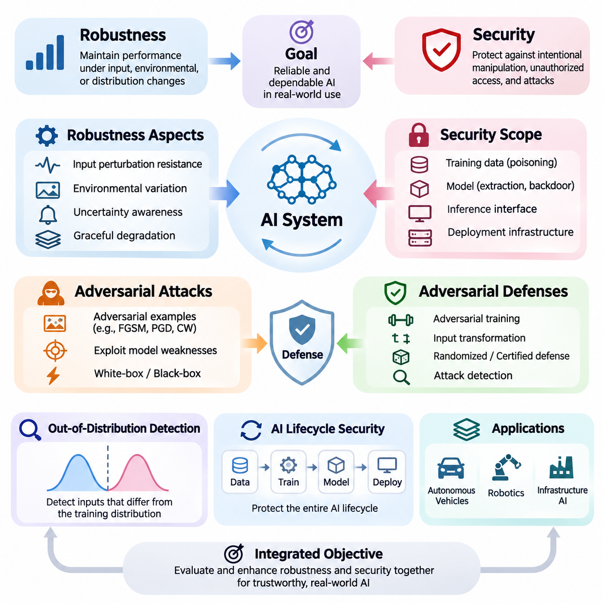
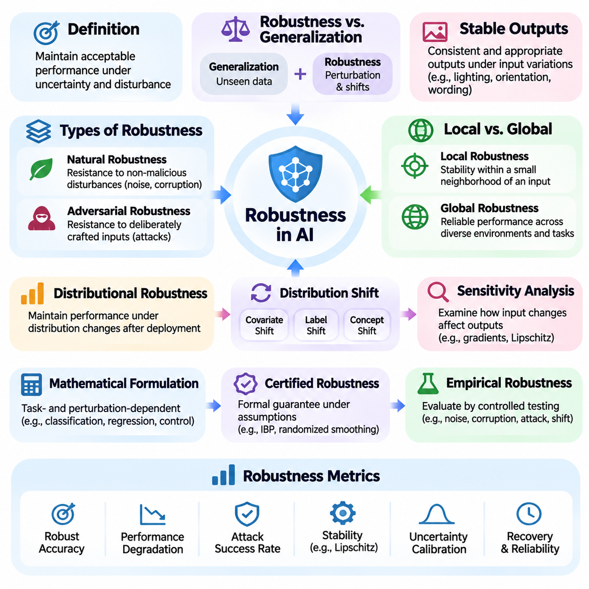
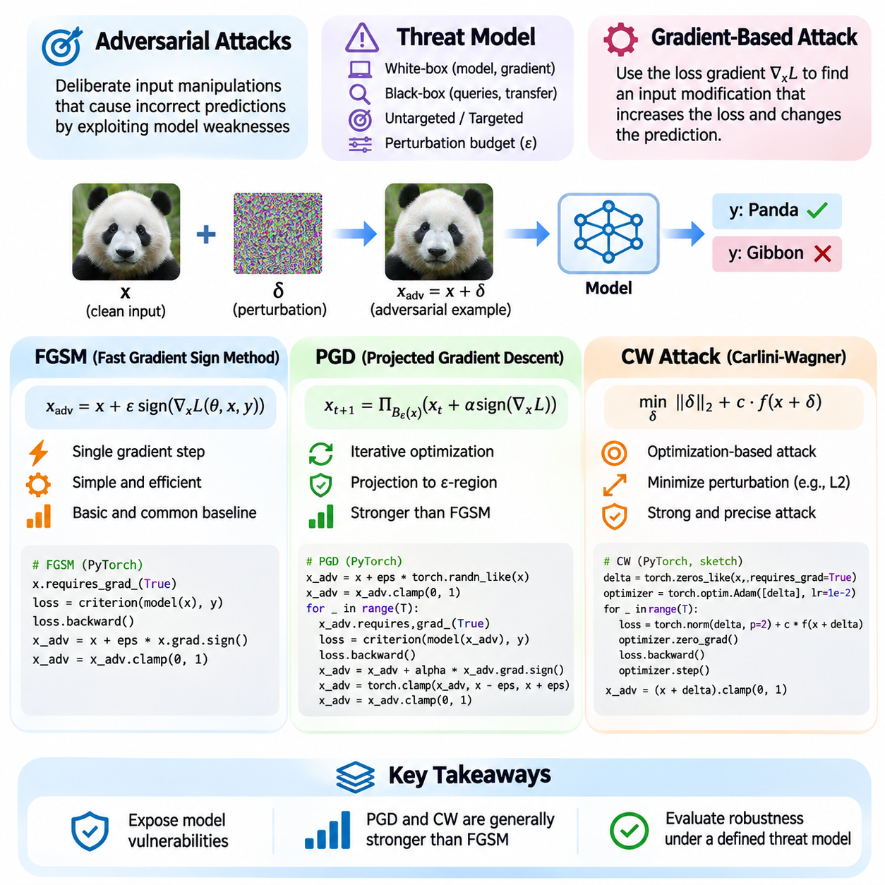
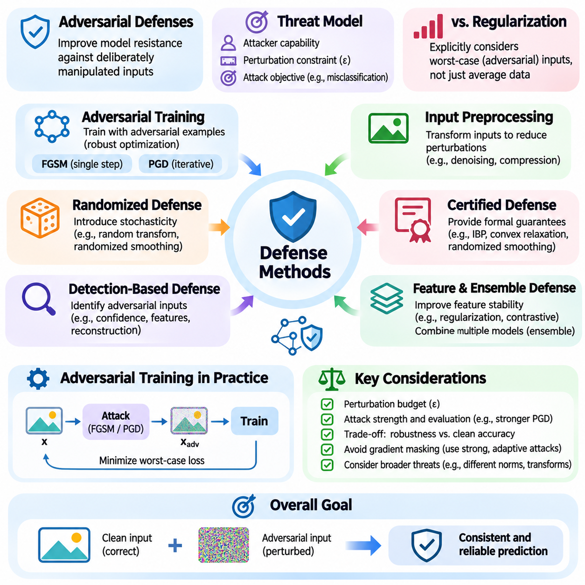
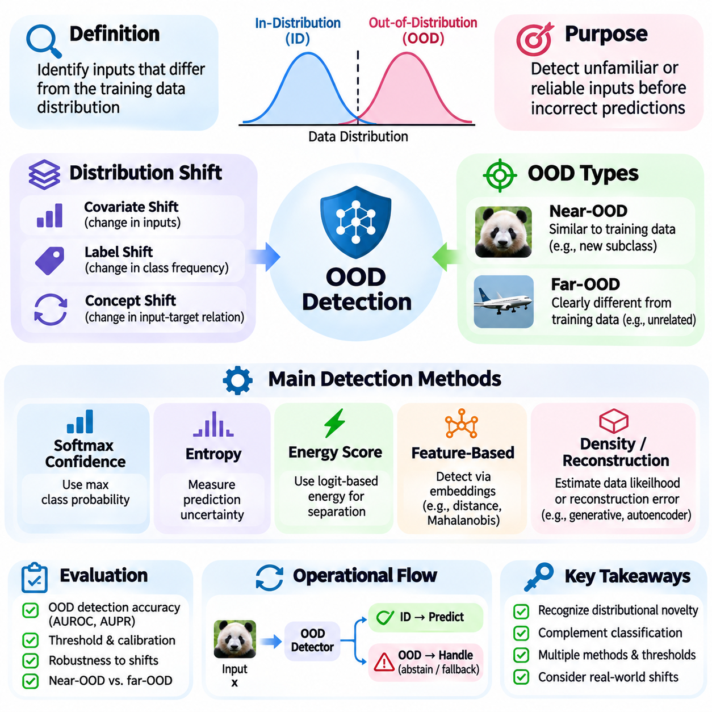
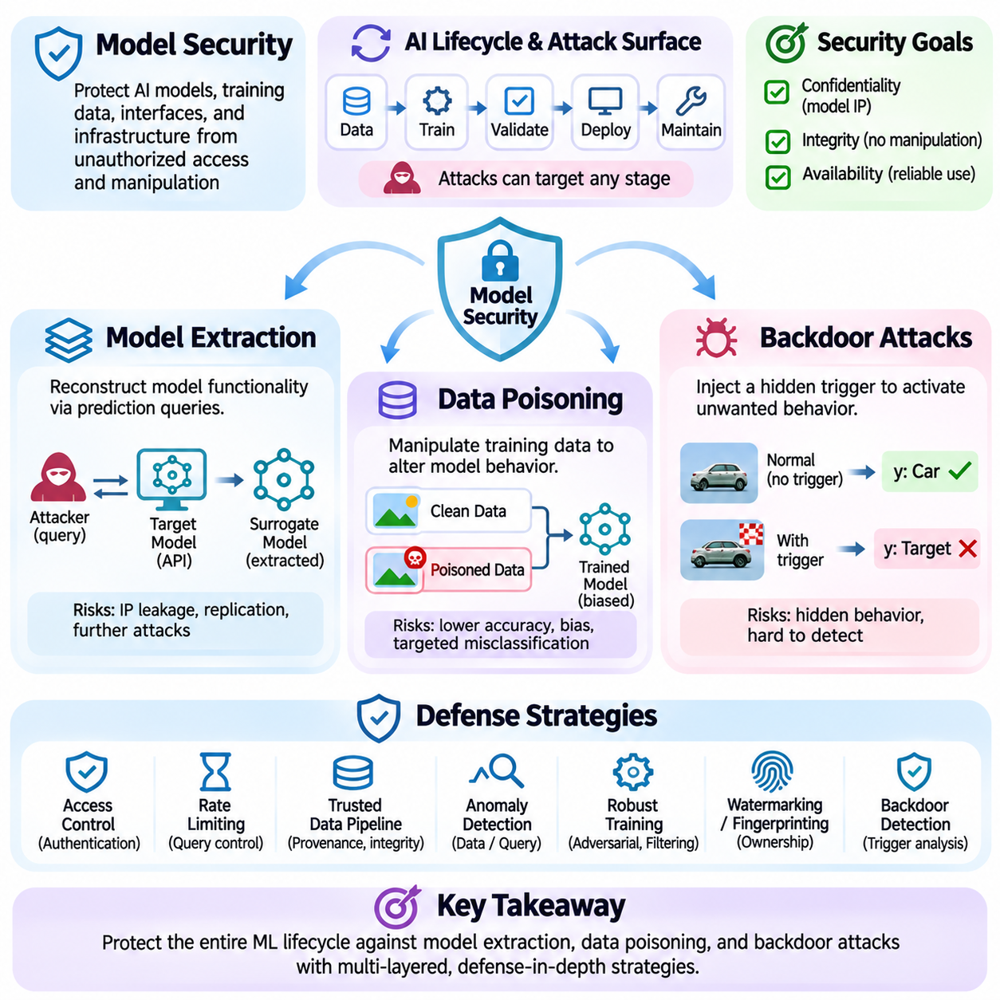
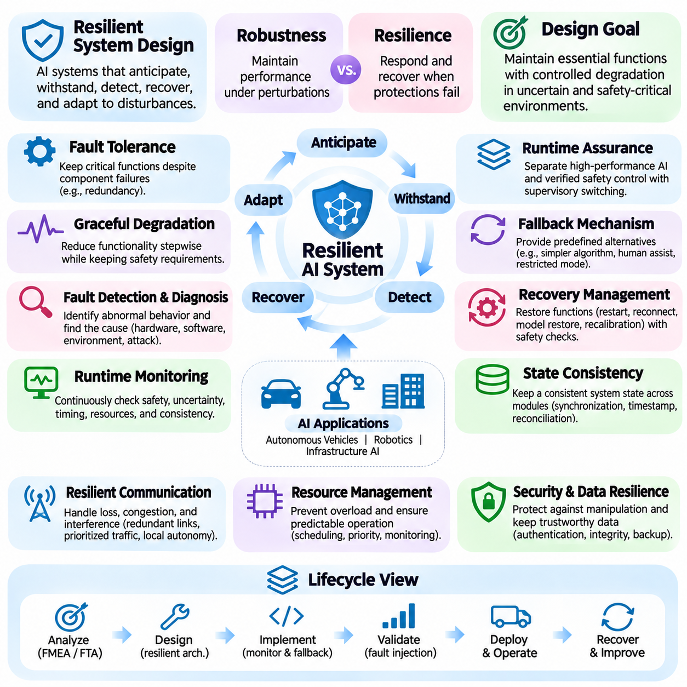

**Volume 42. AI Safety Alignment and Interpretability**

# 05. Robustness and Security

## 05.00 Overview

{width="7.268055555555556in" height="7.268055555555556in"}

Robustness and security are fundamental requirements for artificial intelligence systems operating in uncertain, dynamic, and potentially adversarial environments. Robustness describes the ability of a model to maintain acceptable performance when inputs, operating conditions, or environmental assumptions change. Security focuses on protecting AI systems against intentional manipulation, unauthorized access, and attacks that compromise their integrity, confidentiality, or availability.

Modern AI systems frequently achieve impressive accuracy under controlled evaluation conditions but exhibit unexpected failures when exposed to unfamiliar inputs or deliberate interference. Small changes in sensor measurements, image characteristics, language expressions, or data distributions can produce disproportionately large changes in predictions. Understanding these vulnerabilities requires examining both the statistical limitations of machine learning and the security properties of deployed computational systems.

Robustness and security address related but distinct challenges. A robust model should tolerate ordinary noise, measurement uncertainty, environmental variation, and reasonable distribution shifts without experiencing unacceptable degradation. A secure model must additionally resist adversaries who deliberately exploit weaknesses in its architecture, training process, interfaces, or deployment infrastructure. Reliable AI engineering requires these properties to be evaluated together rather than independently.

The concept of robustness extends beyond classification accuracy or prediction stability. It includes resistance to input perturbations, reliable behavior under changing environmental conditions, uncertainty awareness, and graceful degradation when assumptions are violated. A robust system should recognize situations in which its predictions become unreliable and support appropriate responses, including abstention, human intervention, or transition to a predefined safe operating mode.

Adversarial machine learning investigates how attackers manipulate AI behavior by exploiting weaknesses in learned decision boundaries and computational workflows. Adversarial examples are inputs intentionally modified to induce incorrect predictions or undesirable actions. Such modifications may be visually subtle, mathematically constrained, or physically implemented. Their effectiveness demonstrates that conventional predictive accuracy does not necessarily imply resistance to malicious interference.

Several established adversarial attack methods illustrate different approaches to exploiting model vulnerabilities. The Fast Gradient Sign Method uses gradient information to construct perturbations efficiently, while Projected Gradient Descent applies repeated constrained updates to search for stronger adversarial examples. The Carlini-Wagner attack formulates adversarial manipulation as an optimization problem, often seeking small perturbations that satisfy a specified attack objective.

These attack methods provide controlled mechanisms for investigating model weaknesses under defined assumptions. Their effectiveness depends on factors such as attacker knowledge, perturbation constraints, available computational resources, and access to model outputs or gradients. White-box attacks assume substantial knowledge of the target model, whereas black-box attacks operate with limited internal information. Both perspectives are important when constructing realistic security evaluations.

Adversarial defenses attempt to reduce vulnerability through improvements in training, model architecture, preprocessing, and inference procedures. Adversarial training exposes models to deliberately perturbed examples during optimization, encouraging more stable predictions within a specified threat model. Other approaches include input transformations, randomized mechanisms, certified defenses, and detection systems designed to identify suspicious inputs before they influence critical decisions.

No single adversarial defense provides universal protection against every attack. Defensive effectiveness must be measured against adaptive adversaries who understand the protection mechanisms and attempt to circumvent them. Evaluations should distinguish genuine improvements in robustness from misleading effects such as gradient masking or insufficient attack optimization. Strong security claims require clearly defined threat models, reproducible experiments, and transparent reporting of limitations.

Out-of-distribution detection addresses situations in which operational inputs differ substantially from the data used during model development. These differences may result from environmental changes, unfamiliar objects, sensor degradation, emerging behaviors, or previously unseen operating conditions. Because machine learning models can produce confident predictions for unfamiliar inputs, identifying distributional novelty is essential for dependable decision-making.

Out-of-distribution detection methods estimate whether an observation belongs to the expected operating distribution or exhibits characteristics associated with unfamiliar conditions. Common approaches examine predictive confidence, feature representations, energy scores, or statistical distances. However, detecting unfamiliar inputs does not automatically establish whether a prediction is incorrect. Detection performance must therefore be evaluated alongside calibration, task accuracy, and operational risk.

Model security encompasses threats affecting the entire AI lifecycle, including training data, model parameters, inference interfaces, and supporting infrastructure. Model extraction attacks attempt to reconstruct or approximate proprietary model behavior through available interactions. Such attacks may threaten intellectual property and expose information about decision boundaries. Effective protection requires appropriate access controls, query monitoring, interface restrictions, and security-aware deployment practices.

Data poisoning attacks compromise learning by introducing malicious or misleading information into training datasets. Attackers may seek to reduce overall model accuracy, manipulate specific predictions, or influence downstream behavior after deployment. The severity of poisoning depends on attacker control over the data pipeline, the learning algorithm, and the validation process. Data provenance, integrity verification, and controlled dataset management are important defensive considerations.

Backdoor attacks introduce hidden behavioral triggers that cause a model to deviate from its intended operation under particular conditions. A compromised model may perform normally on ordinary inputs while producing attacker-selected outputs when a trigger appears. Backdoors can originate from poisoned datasets, compromised pretrained models, or unauthorized parameter modifications. Their conditional behavior makes detection challenging and motivates systematic testing of model provenance and activation patterns.

Resilient system design extends robustness and security beyond individual models to the complete operational architecture. Even a carefully trained model can fail when sensors malfunction, communication channels become unavailable, or supporting software is compromised. Resilient AI systems therefore incorporate redundancy, monitoring, fault isolation, secure communication, recovery procedures, and mechanisms for maintaining essential functions during partial failures.

A resilient architecture should distinguish between preventing failures and limiting their consequences. Preventive controls reduce the probability of undesirable events, while detection and containment mechanisms restrict their propagation. Recovery procedures restore acceptable operation after disturbances. This layered approach recognizes that perfect model reliability is generally unattainable and that system-level safeguards remain necessary even when individual components demonstrate strong robustness.

Robustness evaluation requires systematic experimentation across normal, degraded, unfamiliar, and adversarial conditions. Useful measurements include clean accuracy, adversarial accuracy, attack success rate, detection performance, calibration error, recovery time, and service availability. These metrics describe different aspects of system behavior and should not be combined into a single score without considering application requirements, operational constraints, and the consequences of failure.

In autonomous vehicles, robustness and security directly influence perception, localization, planning, and control. Changes in illumination, weather, road markings, and sensor quality can reduce perception reliability, while malicious interference may compromise navigation or decision-making. Robust vehicle architectures combine diverse sensing capabilities, uncertainty estimation, operational monitoring, and fallback strategies to reduce the likelihood that individual errors develop into hazardous behavior.

Robotic systems face additional challenges because their predictions directly influence physical interactions. Sensor disturbances, unexpected contact forces, unfamiliar objects, and adversarial environmental modifications can affect manipulation and navigation. Robust robotic intelligence must integrate perception reliability with control stability, collision avoidance, and safe recovery. Security protections are equally important because compromised commands or observations can produce physical consequences.

Infrastructure AI supports applications such as power management, transportation coordination, industrial monitoring, and automated facility operation. These environments demand dependable behavior under equipment failures, changing demand, communication disruptions, and cybersecurity threats. Robustness and security must be integrated with operational continuity requirements, established engineering safeguards, and human supervisory mechanisms to protect critical services.

The relationship between robustness, security, safety, and alignment is particularly important in advanced AI systems. Robustness helps preserve intended behavior under changing conditions, while security protects against deliberate interference. Safety concerns the prevention of unacceptable harm, and alignment concerns consistency with intended objectives and human preferences. These properties reinforce one another, but success in one dimension does not automatically guarantee success in the others.

Building trustworthy AI ultimately requires continuous attention to robustness and security throughout design, development, evaluation, deployment, and maintenance. Threat models and operating assumptions must evolve as systems encounter new environments and adversarial techniques. By combining rigorous testing, secure engineering, uncertainty-aware decision-making, and resilient architectures, developers can create AI systems that remain more dependable when confronted with uncertainty, disturbance, and malicious activity.

## 05.01 Robustness Definitions

{width="7.268055555555556in" height="7.268055555555556in"}

Robustness in artificial intelligence refers to the ability of a model or system to maintain acceptable performance when operating conditions differ from those encountered during training or evaluation. These differences may include input noise, environmental changes, distribution shifts, or intentional perturbations. Robustness is therefore not simply a measure of accuracy but a property describing how reliably an AI system behaves under uncertainty and disturbance.

A robust AI model should produce stable and appropriate outputs when exposed to variations that do not fundamentally change the meaning of its inputs. For example, an image classifier should recognize an object despite moderate changes in lighting, orientation, or background. Similarly, a language model should preserve its intended interpretation when equivalent instructions are expressed differently. Such stability is essential for reliable deployment.

Robustness differs from generalization, although the two concepts are closely related. Generalization describes how well a model performs on previously unseen examples drawn from an assumed data distribution. Robustness additionally examines performance under perturbations, distribution changes, and challenging operating conditions. A model may generalize effectively on conventional test data while remaining highly vulnerable to small but carefully selected input modifications.

One important distinction separates natural robustness from adversarial robustness. Natural robustness concerns resistance to disturbances that arise without malicious intent, including sensor noise, image corruption, missing information, and environmental variability. Adversarial robustness concerns resistance to deliberately constructed inputs designed to cause incorrect predictions or unsafe behavior. Both forms are necessary for dependable AI systems operating in realistic environments.

Local robustness describes the stability of model predictions within a defined neighborhood surrounding a particular input. If small perturbations remain within an allowed distance, the model should preserve the desired prediction or satisfy a specified behavioral constraint. This concept is frequently studied using mathematical norms that quantify perturbation magnitude. However, mathematical proximity does not always correspond directly to perceptual or semantic similarity.

Global robustness concerns reliable behavior across a broader operational domain rather than within the neighborhood of an individual input. It examines whether a model maintains acceptable performance over diverse environments, populations, tasks, and input conditions. Global robustness is more difficult to establish because the operational domain may contain numerous combinations of disturbances, rare events, and unfamiliar situations that cannot be exhaustively tested.

Distributional robustness addresses changes in the statistical characteristics of data encountered after deployment. Training and operational distributions may differ because of changing environments, equipment configurations, user behavior, or data collection procedures. A distributionally robust model aims to maintain satisfactory performance across a defined family of plausible distributions rather than optimizing exclusively for a single observed training distribution.

Distribution shift can take several forms, including covariate shift, label shift, and concept shift. Covariate shift changes the distribution of input features while preserving the conditional relationship between inputs and targets. Label shift changes class frequencies while preserving class-conditional feature distributions. Concept shift changes the relationship between inputs and targets, potentially requiring substantial model adaptation rather than simple statistical correction.

Robustness can also be understood through sensitivity analysis, which examines how changes in inputs influence model outputs. A highly sensitive model may amplify small disturbances into large prediction differences, while a less sensitive model may exhibit greater stability. Sensitivity can be investigated using gradients, Lipschitz bounds, perturbation experiments, and empirical response measurements. Low sensitivity alone, however, does not guarantee correct predictions.

The mathematical formulation of robustness depends on the task, perturbation model, and acceptable behavior. For classification, robustness may require predictions to remain unchanged within a specified perturbation set. For regression, it may require output deviations to remain below a defined threshold. For control systems, robustness may involve maintaining stability, satisfying safety constraints, and achieving acceptable performance despite disturbances and modeling errors.

Certified robustness provides formal guarantees about model behavior under explicitly defined assumptions. Certification methods may use interval bound propagation, randomized smoothing, convex relaxation, or formal verification techniques. These approaches establish that certain classes of perturbations cannot change specified outcomes within certified regions. However, certificates are limited by their mathematical assumptions, perturbation models, and computational feasibility.

Empirical robustness evaluates model behavior through controlled testing rather than formal guarantees. Researchers introduce noise, corruptions, transformations, adversarial perturbations, and distribution changes to measure performance degradation. Such evaluations provide practical evidence about system reliability but cannot establish universal protection. Their validity depends on representative test conditions, appropriate attack strength, and transparent experimental procedures.

Robustness metrics quantify different aspects of performance under disturbance. Common measures include robust accuracy, worst-case loss, prediction consistency, corruption error, and performance degradation relative to clean conditions. For operational systems, additional measures may include recovery time, failure frequency, constraint violations, and service continuity. Metric selection should reflect the consequences of errors within the intended application.

Robustness must be distinguished from uncertainty estimation and calibration. Uncertainty estimation characterizes how uncertain a model is about its predictions, while calibration examines whether reported confidence corresponds to observed correctness. A model may be robust to certain perturbations yet remain overconfident when encountering unfamiliar inputs. Conversely, a well-calibrated model may still be vulnerable to adversarial manipulation or severe distribution shifts.

Robustness also differs from resilience, although the concepts are complementary. Robustness emphasizes maintaining acceptable behavior while disturbances occur, whereas resilience includes detecting failures, limiting their consequences, recovering functionality, and adapting after disruptions. A system may experience temporary performance degradation yet remain resilient if it transitions safely to alternative operating modes and restores normal functionality within acceptable limits.

In autonomous vehicles, robustness requires reliable perception and decision-making despite changing weather, illumination, road conditions, and sensor disturbances. In robotics, it involves maintaining stable manipulation and navigation under uncertain dynamics and environmental interactions. Infrastructure AI requires dependable operation despite equipment faults, communication delays, and fluctuating demand. Each application therefore requires domain-specific robustness definitions.

Robustness requirements should be established before model development and linked to operational risk. Engineers must identify relevant disturbances, acceptable performance limits, expected operating environments, and failure consequences. These requirements guide data collection, training strategies, architecture selection, and evaluation protocols. Without clearly specified robustness objectives, improvements observed during testing may not translate into meaningful operational reliability.

A comprehensive robustness assessment should combine ordinary test performance, stress testing, adversarial evaluation, distribution shift analysis, and system-level validation. Results should be reported with explicit perturbation constraints, operating assumptions, and uncertainty estimates. This approach prevents robustness from being reduced to a single benchmark score and supports meaningful comparisons between models designed for different operational conditions.

Robustness is ultimately a multidimensional property rather than an absolute guarantee of correct behavior. Its meaning depends on what disturbances are considered, which outputs must remain stable, and what level of degradation is acceptable. By defining robustness precisely and evaluating it systematically, AI developers can establish realistic reliability requirements and build systems that perform more consistently under uncertain and challenging conditions.

## 05.02 Adversarial Attacks [w/Code]

{width="7.268055555555556in" height="7.268055555555556in"}

Adversarial attacks are deliberate manipulations of input data designed to cause machine learning models to produce incorrect predictions or unintended behavior. These attacks exploit weaknesses in learned decision boundaries, often through small perturbations that preserve the apparent meaning of the original input. Their existence demonstrates that high accuracy on conventional test datasets does not necessarily guarantee reliable performance under hostile conditions.

Adversarial examples are typically constructed by modifying a legitimate input while satisfying predefined constraints on perturbation magnitude. In image classification, these modifications may be nearly imperceptible to human observers yet significantly alter model predictions. The attacker seeks to maximize prediction error, induce a particular target classification, or violate an operational requirement while keeping the modified input within an allowed perturbation region.

The adversarial threat model defines the attacker\'s objectives, capabilities, and constraints. White-box attacks assume access to model architecture, parameters, and gradients, whereas black-box attacks rely on model queries or transferability between models. Untargeted attacks seek any incorrect prediction, while targeted attacks attempt to produce a specific output. Perturbation budgets determine how extensively an attacker may modify the original input.

Gradient-based attacks exploit the differentiability of neural networks to identify input directions that increase a selected loss function. By computing the gradient of the loss with respect to the input, an attacker can estimate which modifications are most likely to influence model predictions. This approach transforms adversarial example generation into a constrained optimization problem involving prediction objectives and allowable perturbations.

The Fast Gradient Sign Method, commonly abbreviated FGSM, is one of the simplest gradient-based adversarial attacks. It generates an adversarial example using a single gradient computation and a perturbation scaled by a parameter called epsilon. For an untargeted attack, the perturbation follows the sign of the input gradient of the loss, increasing classification error while respecting an L-infinity perturbation constraint.

FGSM can be expressed mathematically as x_adv = x + ε sign(∇x L(θ, x, y)), where x represents the original input, ε controls perturbation magnitude, θ denotes model parameters, and L is the loss function. The gradient identifies the direction of increasing loss, while the sign operation produces a bounded modification for each input component. The resulting input is normally clipped to the valid data range.

A practical FGSM implementation in PyTorch begins by enabling gradient tracking for the input tensor. The model performs a forward pass, computes the classification loss, and propagates gradients backward to the input. The adversarial input is then constructed by adding epsilon times the gradient sign and applying clipping. Evaluation compares predictions on clean and perturbed inputs to quantify the attack\'s effectiveness.

FGSM is computationally efficient because it requires only one gradient evaluation per adversarial example. However, its single-step approximation may fail to identify stronger adversarial perturbations when the loss landscape is highly nonlinear. Attack effectiveness also depends on epsilon, model architecture, input normalization, and the chosen loss function. Consequently, FGSM is useful as an initial diagnostic rather than a comprehensive robustness evaluation.

Projected Gradient Descent, abbreviated PGD, extends FGSM through iterative optimization. Instead of applying a single perturbation, PGD repeatedly updates the adversarial input in a direction that increases the attack objective. After each update, the candidate is projected back into the permitted perturbation region. This procedure enables the attack to explore more effective adversarial modifications while maintaining predefined constraints.

For an untargeted L-infinity attack, PGD updates the input using x_next = Π(x_current + α sign(∇x L)), where α represents the step size and Π denotes projection onto the allowed region around the original input. The process repeats for a specified number of iterations. Random initialization within the perturbation budget can improve exploration and reduce dependence on a single starting point.

A PyTorch implementation of PGD maintains an adversarial tensor that is updated through repeated forward and backward passes. Each iteration computes the current loss gradient, applies a bounded gradient step, projects the result into the epsilon neighborhood, and clips values to the valid input domain. Multiple random restarts may be used to discover stronger adversarial examples and improve the reliability of empirical robustness estimates.

PGD is widely used as a reference attack for adversarial robustness evaluation and adversarial training. Its iterative nature generally makes it stronger than basic FGSM under comparable perturbation constraints, although performance depends on optimization settings. Increasing iterations, adjusting step sizes, and using multiple restarts can improve attack effectiveness, but also increase computational cost and do not guarantee global optimality.

The Carlini-Wagner attack, commonly called the CW attack, approaches adversarial example generation through explicit optimization of perturbation size and attack success. Rather than relying primarily on sign-gradient updates, it searches for a modified input that satisfies a misclassification objective while minimizing a chosen distance measure. The method is especially associated with carefully optimized adversarial examples under L2 distance constraints.

A common CW formulation minimizes \|\|δ\|\|² + c f(x + δ), where δ is the perturbation, c balances distortion against attack success, and f represents an attack-specific objective based on model outputs. The optimization may use logits rather than classification probabilities to obtain useful gradients. A confidence parameter can control the desired separation between the target outcome and competing classes.

CW implementations frequently use a variable transformation to keep adversarial inputs within valid numerical bounds during optimization. The transformed variable is optimized using gradient-based methods such as Adam, while a binary search over the tradeoff coefficient may identify smaller successful perturbations. These procedures are more computationally demanding than FGSM and often PGD, but can produce highly optimized adversarial examples.

FGSM, PGD, and CW illustrate distinct tradeoffs between computational efficiency, optimization strength, and perturbation control. FGSM provides a fast single-step baseline, PGD performs iterative constrained optimization, and CW explicitly balances perturbation magnitude against attack success. Their results are not directly comparable unless threat models, perturbation norms, attack objectives, and computational budgets are consistently defined.

Evaluating adversarial attacks requires measuring more than the number of incorrect predictions. Robust accuracy, attack success rate, perturbation magnitude, computational cost, and success across different model architectures provide complementary information. Targeted and untargeted results should be reported separately. Evaluation should also consider clean-input correctness, since an already incorrect prediction does not demonstrate a successful adversarial modification.

Adversarial attacks may transfer between models because different neural networks can learn related decision boundaries or vulnerable features. Transferability enables black-box attacks in which adversarial examples are generated using a surrogate model and evaluated against another system. However, transfer success varies with architecture, training data, preprocessing, and defensive mechanisms, making empirical verification essential.

Adversarial training uses generated attack examples to improve model resistance within a defined threat model. FGSM-based training offers computational efficiency, while PGD-based training can provide stronger optimization of adversarial examples during learning. Nevertheless, robustness improvements may involve tradeoffs in clean accuracy, training cost, and generalization to unseen attacks. Defenses must therefore be tested against sufficiently strong adaptive evaluations.

In autonomous vehicles, robotics, and infrastructure AI, adversarial perturbations can affect perception and downstream decisions. Physical attacks introduce additional constraints involving viewing angle, illumination, sensor characteristics, and environmental dynamics. Digital attack success does not automatically imply real-world effectiveness. Reliable assessment requires evaluating the complete perception and control pipeline under realistic operating conditions.

Adversarial attack research ultimately provides a systematic framework for identifying vulnerabilities before they cause operational failures. FGSM establishes a computationally inexpensive baseline, PGD supports stronger iterative evaluation, and CW demonstrates optimization-based perturbation minimization. Together, these methods help researchers characterize model weaknesses, validate defensive strategies, and establish more rigorous expectations for secure and robust AI deployment.

## 05.03 Adversarial Defenses [w/Code]

{width="7.268055555555556in" height="7.268055555555556in"}

Adversarial defenses are techniques designed to improve the resistance of machine learning models against deliberately manipulated inputs. Their primary objective is to preserve reliable predictions and acceptable system behavior when attackers introduce perturbations intended to exploit model vulnerabilities. Effective defense requires understanding the adversarial threat model, including attacker capabilities, perturbation constraints, and the consequences of incorrect decisions.

Adversarial defense differs from conventional regularization because it explicitly considers inputs constructed to maximize model errors. Traditional training minimizes expected loss over a sampled data distribution, whereas robust training incorporates potentially harmful variations around observed examples. This distinction is important because models with excellent clean accuracy may remain vulnerable to adversarial examples that exploit unstable decision boundaries.

Adversarial training is among the most extensively studied defensive approaches. It introduces adversarially perturbed examples during model optimization, encouraging the network to learn decision boundaries that are less sensitive to allowed perturbations. The training objective typically minimizes the expected worst-case loss within a specified perturbation region. This formulation creates a connection between adversarial defense and robust optimization.

Fast Gradient Sign Method training generates adversarial examples using a single gradient-based perturbation step. These examples are incorporated into training batches so the model learns to classify both clean and modified inputs. The approach is computationally efficient compared with stronger iterative methods, but it can suffer from catastrophic overfitting, where apparent robustness against the training attack fails to generalize to stronger evaluations.

Projected Gradient Descent adversarial training uses iterative attacks to approximate the worst-case perturbations within a constrained region. During each training iteration, PGD generates challenging examples by repeatedly updating inputs and projecting them into the permitted perturbation set. Model parameters are then optimized against these examples. This approach often provides stronger empirical robustness than basic single-step training but requires substantially more computation.

The effectiveness of adversarial training depends on perturbation budgets, optimization settings, attack strength, and training data quality. A model trained against L-infinity perturbations may not automatically resist L2 attacks, geometric transformations, or physical manipulations. Increasing the perturbation budget can improve resistance within the specified threat model while reducing clean accuracy. Defense design therefore requires balancing robustness, predictive performance, and computational efficiency.

Input preprocessing provides another category of adversarial defense. Techniques such as image compression, smoothing, denoising, quantization, and feature reconstruction attempt to remove or reduce harmful perturbations before inference. These transformations can suppress certain forms of noise, but they may also discard useful information. Furthermore, attackers aware of preprocessing operations can optimize perturbations that survive the transformation pipeline.

Randomized defenses introduce controlled stochastic behavior into model inference or input processing. Random resizing, stochastic transformations, noise injection, and randomized smoothing can reduce the predictability of model responses. Randomized smoothing can also provide certified robustness guarantees under specific mathematical assumptions. However, randomness alone does not establish security, particularly when attackers can estimate expected gradients through repeated evaluations.

Certified adversarial defenses aim to establish mathematically justified guarantees rather than relying exclusively on empirical testing. Techniques include interval bound propagation, convex relaxation, randomized smoothing, and formal verification. These methods determine whether model predictions remain unchanged for all perturbations within a specified region. Their guarantees are valuable but remain limited to the assumptions, perturbation sets, and model properties covered by the certification procedure.

Detection-based defenses attempt to identify adversarial inputs before they influence downstream decisions. Detectors may analyze prediction confidence, feature distributions, reconstruction errors, or inconsistencies between multiple models. Suspicious inputs can trigger rejection, additional verification, or fallback behavior. Nevertheless, adversarial detection is itself vulnerable to adaptive attacks, and detection accuracy must be evaluated under realistic operating conditions.

Feature-level defenses seek to improve the stability of internal representations rather than modifying inputs alone. Representation regularization, contrastive learning, feature denoising, and consistency objectives can encourage models to preserve meaningful features under perturbation. These approaches may improve robustness when combined with adversarial training. However, stable feature representations do not automatically guarantee resistance against every attack strategy.

Ensemble defenses combine predictions from multiple models to reduce dependence on individual decision boundaries. Diversity in architectures, training procedures, or input representations may improve resistance to certain attacks. However, attackers can optimize against the complete ensemble or exploit shared vulnerabilities. Ensemble effectiveness therefore depends on genuine diversity and rigorous evaluation rather than the number of models alone.

Gradient masking is a major challenge in adversarial defense evaluation. Some defensive mechanisms make gradients unreliable or difficult to compute without meaningfully improving model robustness. Such systems may appear resistant to basic gradient attacks while remaining vulnerable to stronger optimization, transfer attacks, or gradient approximation methods. Robustness claims must distinguish genuine defensive improvements from artifacts caused by ineffective attack procedures.

Adaptive adversarial evaluation assumes that attackers understand the defense mechanism and modify their strategies accordingly. For differentiable defenses, attacks should optimize through the complete processing pipeline whenever possible. For nondifferentiable or randomized components, suitable approximations or expectation-based methods may be necessary. Evaluating only attacks designed for undefended models can substantially overestimate defensive effectiveness.

Defense evaluation should report clean accuracy, robust accuracy, attack success rate, perturbation constraints, and computational overhead. Comparisons must use consistent datasets, threat models, attack budgets, and evaluation procedures. Multiple attacks and optimization settings help reveal weaknesses that a single benchmark may overlook. Independent testing is particularly important when evaluating defenses intended for safety-critical applications.

Robustness improvements often introduce tradeoffs involving accuracy, latency, energy consumption, and training complexity. Iterative adversarial training can substantially increase computational requirements, while detection and preprocessing may add inference delays. In real-time systems, defensive mechanisms must operate within strict timing constraints. A defense that improves classification robustness but violates operational deadlines may reduce overall system dependability.

System-level defenses extend beyond neural network optimization to include monitoring, redundancy, access control, and safe fallback mechanisms. An AI system should recognize uncertain or suspicious conditions and prevent unreliable predictions from directly causing harmful actions. Combining robust perception with independent safety checks and operational constraints can reduce the consequences of successful adversarial manipulation.

Autonomous vehicles and robotic systems require defenses that account for physical environments and sensor interactions. Adversarial modifications may be affected by lighting, viewing angle, distance, motion, and sensor characteristics. Defensive strategies should therefore be evaluated using realistic environmental variation and complete perception-control pipelines. Digital robustness alone cannot establish dependable physical-world performance.

Infrastructure AI introduces additional requirements because compromised predictions can influence critical services and industrial processes. Defense mechanisms may include anomaly monitoring, sensor redundancy, authenticated data channels, and independent operational safeguards. These protections should complement model-level robustness rather than replace it. Security engineering must also consider data integrity, system availability, and recovery after disturbances.

Adversarial defense is best understood as a continuous engineering process rather than a permanent solution. Attack methods evolve, operational environments change, and newly discovered vulnerabilities can invalidate earlier assumptions. Effective defense programs combine threat modeling, robust training, adaptive testing, deployment monitoring, and periodic reassessment. This lifecycle approach supports sustained improvements in AI security and operational reliability.

Ultimately, no single adversarial defense guarantees protection against all possible attacks. Adversarial training, preprocessing, randomized methods, certified robustness, detection, and system-level safeguards address different vulnerabilities and operate under different assumptions. A trustworthy AI architecture combines complementary defenses, evaluates their limitations transparently, and maintains acceptable behavior even when individual protective mechanisms fail.

## 05.04 Out of Distribution Detection

{width="7.268055555555556in" height="7.268055555555556in"}

Out-of-distribution detection, commonly abbreviated OOD detection, is the process of identifying inputs that differ meaningfully from the data distribution used to train an artificial intelligence model. Conventional machine learning assumes that training and deployment data follow sufficiently similar statistical patterns. When this assumption fails, predictions may become unreliable even if the model produces high confidence scores. OOD detection helps recognize such situations before errors propagate.

In-distribution data refers to samples consistent with the statistical characteristics and task definitions represented during model development. Out-of-distribution data may contain unfamiliar objects, unexpected environments, novel operating conditions, or combinations of features rarely observed during training. The distinction is not always absolute because real-world distributions overlap and evolve. Consequently, OOD detection requires a carefully defined reference distribution and operational context.

OOD detection differs from ordinary classification because its objective is not necessarily to assign an input to a known category. Instead, it estimates whether the input is sufficiently compatible with the model\'s learned representation of expected data. A classification model may confidently assign an unfamiliar object to an existing class because its output space contains only known labels. An OOD detector attempts to identify when such predictions should be treated cautiously.

Distribution shifts can arise from changes in sensors, environments, user populations, acquisition procedures, or underlying relationships between variables. Covariate shift modifies input characteristics, while label shift changes class frequencies. Concept shift alters the relationship between inputs and targets. OOD detection focuses on identifying unfamiliar observations, but not every distribution shift produces individually detectable anomalies, and some shifts require monitoring aggregated data over time.

A fundamental distinction separates near-OOD and far-OOD samples. Near-OOD inputs resemble the training distribution but contain meaningful differences, such as unfamiliar subclasses or subtle environmental changes. Far-OOD inputs are substantially different from expected data, such as unrelated images presented to a specialized classifier. Near-OOD detection is often more challenging because unfamiliar examples may occupy regions close to known classes in learned feature space.

Softmax confidence provides a simple baseline for OOD detection. A classifier produces probabilities over known classes, and the maximum predicted probability can serve as an indicator of familiarity. However, neural networks frequently assign high confidence to unfamiliar or meaningless inputs. Softmax scores therefore measure relative preference among available classes rather than reliably estimating whether an input belongs to the training distribution.

Entropy-based detection examines the uncertainty of the predicted class distribution. High predictive entropy indicates that probability mass is distributed across several classes, suggesting uncertainty about the classification decision. Low entropy indicates concentrated predictions but does not necessarily establish input familiarity. Consequently, entropy can help identify ambiguous examples while failing to detect unfamiliar inputs that produce confidently incorrect predictions.

Energy-based OOD detection derives a scalar score from model logits rather than relying exclusively on normalized classification probabilities. Energy scores summarize aspects of the model\'s output landscape and can provide useful separation between familiar and unfamiliar inputs. A threshold is applied to distinguish likely in-distribution observations from suspected OOD samples. Performance depends on model training, score calibration, and the characteristics of evaluation datasets.

Feature-based detection evaluates internal neural network representations instead of using only final prediction scores. Intermediate embeddings may reveal whether an input resembles known training examples in learned feature space. Distance-based approaches compare embeddings with reference samples or class prototypes. These methods can detect unfamiliar patterns that remain hidden in output probabilities, although their effectiveness depends on representation quality and feature geometry.

Mahalanobis distance is a representative feature-based OOD detection method. It measures how far an embedding lies from an estimated class distribution while accounting for covariance among feature dimensions. Samples with large distances from known class centers may be treated as unfamiliar. The method relies on estimated feature statistics and can become unreliable when class distributions are poorly approximated or operating conditions change substantially.

Density-based approaches attempt to estimate the probability distribution of training data and identify samples with low estimated likelihood. Generative models, normalizing flows, and probabilistic representations can support this strategy. However, high likelihood does not always imply semantic familiarity, particularly in high-dimensional data. A generative model may assign unexpectedly high likelihood to samples from a different dataset, limiting naive density-based detection.

Reconstruction-based methods use autoencoders or related models to reconstruct inputs from learned representations. The underlying assumption is that familiar inputs can be reconstructed more accurately than unfamiliar examples. Large reconstruction errors may therefore indicate distributional novelty. Nevertheless, expressive reconstruction models can sometimes reproduce OOD inputs effectively, while difficult but valid in-distribution samples may produce substantial errors.

Uncertainty-aware methods use ensembles, Bayesian approximations, or stochastic inference to estimate predictive uncertainty. Disagreement among independently trained models may indicate unfamiliar inputs or insufficient training coverage. Monte Carlo dropout provides another approximate approach by examining variation across stochastic forward passes. These methods can improve uncertainty characterization but require additional computation and do not guarantee reliable OOD separation.

OOD detection performance depends strongly on threshold selection. A detector typically converts a continuous novelty score into an acceptance or rejection decision using a predefined threshold. Lower thresholds may increase sensitivity to unfamiliar inputs while also rejecting legitimate observations. Higher thresholds may preserve operational availability but allow more OOD samples to pass. Thresholds should therefore reflect the consequences of false alarms and missed detections.

Evaluation commonly uses the area under the receiver operating characteristic curve, known as AUROC, to measure discrimination between in-distribution and OOD samples across thresholds. Additional metrics include the area under the precision-recall curve, false positive rate at a specified true positive rate, and detection error. Metrics should be interpreted alongside dataset composition, class imbalance, and the precise definition of positive detection events.

Reliable OOD evaluation requires multiple test datasets representing different forms of unfamiliarity. Near-OOD, far-OOD, corrupted inputs, and realistic deployment shifts should be examined separately because they expose different weaknesses. Training, validation, and test data must remain appropriately separated to avoid information leakage. Evaluations should also report detection latency, computational overhead, and sensitivity to threshold selection.

OOD detection is closely related to open-set recognition and novelty detection, but their objectives are not identical. Open-set recognition attempts to classify known categories while rejecting examples belonging to unknown categories. Novelty detection identifies observations that differ from an established reference distribution. OOD detection broadly addresses whether incoming data are compatible with the distributional assumptions under which a model is expected to operate reliably.

In autonomous vehicles and robotics, OOD inputs may arise from unfamiliar obstacles, severe weather, unusual road configurations, or sensor degradation. A detection signal can trigger reduced speed, additional sensing, human intervention, or a minimum-risk operating mode. However, detection alone cannot ensure safety. The system must connect novelty estimates to verified decision policies, operational constraints, and dependable fallback mechanisms.

Infrastructure and industrial AI systems encounter OOD conditions through equipment aging, unexpected faults, process changes, and altered operating environments. Continuous monitoring can identify emerging distributional changes before they cause widespread prediction failures. Temporal aggregation, sensor consistency checks, and domain-specific thresholds can complement individual-sample detection. Operational responses must distinguish genuine anomalies from harmless variations to avoid unnecessary disruptions.

OOD detection should be integrated into a broader reliability framework that includes uncertainty estimation, calibration, robustness testing, monitoring, and controlled model updates. No single detector can identify every unfamiliar or hazardous situation, and distributional familiarity does not guarantee correctness. By combining carefully validated detection methods with safe operational responses, AI systems can better recognize the boundaries of their competence and maintain dependable behavior under changing conditions.

## 05.05 Model Security

{width="7.268055555555556in" height="7.268055555555556in"}

Model security refers to the protection of artificial intelligence models, training data, inference interfaces, and associated infrastructure against unauthorized access and malicious manipulation. Unlike conventional software security, model security must consider vulnerabilities arising from learned statistical behavior and data dependencies. Model extraction, data poisoning, and backdoor attacks represent three major threats affecting confidentiality, integrity, and operational reliability.

A comprehensive model security framework considers the entire machine learning lifecycle, including data acquisition, preprocessing, training, validation, deployment, and maintenance. Attackers may target different stages depending on their access privileges and objectives. Some attacks attempt to reproduce proprietary model functionality, while others manipulate training information or introduce hidden behaviors. Effective protection requires identifying trust boundaries and securing interactions between system components.

Model extraction attacks attempt to reconstruct the functionality or characteristics of a protected machine learning model without authorization. An attacker may interact with a publicly accessible prediction interface and use observed responses to train a substitute model. The extracted model may approximate decision boundaries, reproduce predictions, or reveal commercially valuable behavior. Such attacks threaten intellectual property and may facilitate additional adversarial analysis.

Prediction application programming interfaces expose different levels of information depending on their configuration. Interfaces returning complete probability distributions provide richer behavioral information than those returning only class labels. Attackers may exploit repeated queries to collect input-output pairs and approximate the protected model. The effectiveness of extraction depends on query access, response detail, model complexity, and the similarity between attacker-generated inputs and operational data.

Model extraction can be understood as a form of knowledge transfer through observable behavior. The attacker constructs a surrogate model using responses obtained from the target system rather than accessing its original parameters directly. This process resembles knowledge distillation, although the authorization and security implications differ. Successful extraction does not necessarily reproduce the original architecture or weights, but it may recover enough functionality to undermine confidentiality.

Defenses against model extraction include authentication, access control, query monitoring, rate limiting, and restrictions on exposed prediction information. Statistical monitoring can identify unusual query patterns, although legitimate applications may also generate large query volumes. Watermarking and behavioral fingerprinting may support ownership verification when appropriately designed. Protection must balance confidentiality with the usability and accuracy requirements of legitimate clients.

Data poisoning attacks compromise model behavior by manipulating information used during training or model updates. Unlike inference-time adversarial attacks, poisoning modifies the learning process itself. Attackers may introduce malicious samples, alter labels, or influence data collection pipelines to change the resulting model. The consequences can include reduced accuracy, biased predictions, targeted misclassification, or degraded performance under specific operational conditions.

Poisoning threats are particularly relevant when training pipelines incorporate externally supplied datasets, user feedback, automated annotations, or continuously collected operational data. These sources may contain inaccurate or intentionally manipulated information. Even a relatively small quantity of malicious data can influence learning under favorable conditions, although effectiveness depends on the training procedure, dataset composition, and attacker control. Data provenance is therefore a central security requirement.

Availability poisoning and targeted poisoning represent different attacker objectives. Availability poisoning seeks to degrade overall model performance or disrupt useful learning. Targeted poisoning attempts to influence predictions for particular inputs, classes, or operating conditions while preserving acceptable performance elsewhere. Clean-label poisoning can be especially difficult to identify because malicious examples may retain apparently correct labels despite being constructed to influence the learned decision boundary.

Data poisoning defenses begin with trusted data acquisition and verifiable dataset management. Provenance tracking, cryptographic integrity checks, controlled labeling procedures, and restricted update permissions reduce opportunities for unauthorized modification. Statistical anomaly detection and duplicate analysis can identify suspicious samples, while robust training procedures may reduce sensitivity to contaminated observations. However, no individual filtering method reliably detects every poisoning strategy.

Robust statistics and influence analysis provide additional tools for examining suspicious training data. Influence estimation attempts to identify samples that disproportionately affect model parameters or predictions. Gradient-based diagnostics and representation analysis may reveal unusual training patterns. These techniques require careful interpretation because legitimate rare examples can also exert substantial influence. Removing unusual observations indiscriminately may reduce coverage of important operating conditions.

Backdoor attacks introduce hidden behaviors that activate when a particular trigger appears in the model input or operating context. A compromised model may behave normally on ordinary evaluation data while producing attacker-desired outputs when the trigger is present. This conditional behavior distinguishes backdoors from general accuracy degradation. Backdoors can be introduced through poisoned training samples, compromised pretrained models, or unauthorized modifications to the training pipeline.

A backdoor trigger may involve a visual pattern, a textual sequence, an acoustic signature, or another recognizable input characteristic. The trigger\'s effectiveness depends on whether the model learns an association between that characteristic and the attacker-desired behavior. Some triggers are conspicuous, while others are designed to blend into ordinary inputs. Trigger design and environmental variability influence whether a backdoor remains effective outside controlled evaluation conditions.

Backdoor attacks can be targeted or broader in scope. A targeted backdoor may cause selected triggered inputs to receive a particular classification, while other attacks may redirect model behavior under specified conditions. The compromised model can retain high clean accuracy, making conventional validation insufficient. Security evaluation must therefore examine conditional behavior, suspicious feature associations, and the integrity of model development artifacts.

Backdoor detection techniques include activation analysis, representation clustering, trigger-oriented testing, and inspection of training data or model behavior. Some approaches search for unusually strong associations between specific input features and output classes. Others compare internal responses across clean and suspicious examples. Detection remains challenging because legitimate task features may resemble triggers, and adaptive attackers can modify backdoor behavior to evade simple tests.

Backdoor mitigation may involve removing suspicious training samples, retraining affected components, pruning selected neurons, or applying carefully validated model repair procedures. Fine-tuning on trusted data can sometimes weaken unwanted associations, but it does not guarantee complete removal. Model replacement may be necessary when integrity cannot be established. Any mitigation should be evaluated against both normal performance and representative trigger conditions.

Model extraction, data poisoning, and backdoor attacks affect different security properties but can interact within a broader threat scenario. Extraction primarily threatens confidentiality, poisoning compromises training integrity, and backdoors introduce hidden conditional failures. A stolen surrogate may also assist vulnerability analysis, while poisoned datasets may become a delivery mechanism for backdoors. Security assessments should therefore examine combined threats rather than treating each attack independently.

Supply chain security is essential because AI systems frequently depend on external datasets, pretrained weights, libraries, and model repositories. Compromised dependencies can introduce vulnerabilities before deployment begins. Artifact signing, dependency verification, access auditing, and reproducible build procedures strengthen confidence in development inputs. Versioned datasets and model registries also support investigation and recovery when suspicious behavior is discovered.

Operational monitoring extends model security beyond initial deployment. Prediction patterns, model updates, access logs, and data ingestion pipelines should be monitored for unexpected changes. Incident response procedures should support isolation, rollback, forensic investigation, and restoration from trusted artifacts. Monitoring must respect privacy and operational constraints while providing sufficient evidence to distinguish attacks from ordinary distribution shifts or system faults.

Model security ultimately requires coordinated protection of data, algorithms, interfaces, infrastructure, and governance processes. Preventive controls reduce opportunities for compromise, detection mechanisms identify suspicious activity, and recovery procedures limit operational consequences. Because attacks evolve alongside AI capabilities, security assurance must be continuously reassessed through controlled testing, documented threat models, and systematic lifecycle management.

## 05.06 Resilient System Design

{width="7.268055555555556in" height="7.268055555555556in"}

Resilient system design refers to the engineering of artificial intelligence systems that can anticipate, withstand, detect, recover from, and adapt to disturbances without causing unacceptable operational consequences. Unlike robustness, which emphasizes maintaining performance under specified perturbations, resilience includes the ability to respond when protective mechanisms fail. This broader perspective is essential for AI systems operating in uncertain, dynamic, and safety-critical environments.

A resilient AI architecture assumes that failures cannot be completely eliminated through model accuracy or defensive training alone. Sensors may malfunction, communication channels may become unavailable, computational resources may degrade, and machine learning models may encounter unfamiliar conditions. Resilient design therefore focuses on maintaining essential functions despite partial system failures. The objective is controlled degradation rather than unrestricted continuation of unsafe operation.

Fault tolerance is a fundamental component of resilient system design. It enables a system to continue performing critical functions when individual components fail or produce unreliable outputs. Fault-tolerant architectures may incorporate redundant sensors, independent processing units, replicated communication paths, and alternative control mechanisms. However, redundancy must address common-cause failures because multiple identical components can fail simultaneously under shared disturbances.

Graceful degradation describes the ability of a system to reduce functionality progressively while preserving essential safety and operational requirements. An autonomous robot experiencing partial sensor failure may reduce speed, restrict navigation to verified areas, or disable nonessential capabilities. Rather than treating every abnormal condition as a complete system failure, graceful degradation provides intermediate operating states. These states must be explicitly defined and validated.

Fault detection and diagnosis provide the information required for effective recovery. Monitoring mechanisms analyze sensor consistency, computational health, communication status, model confidence, and operational constraints to identify abnormal behavior. Diagnostic procedures attempt to determine whether a disturbance originates from hardware, software, environmental conditions, or malicious interference. Accurate diagnosis supports appropriate recovery actions and reduces unnecessary shutdowns.

Runtime monitoring continuously evaluates whether an AI system remains within its intended operational boundaries. Monitors can examine safety constraints, prediction uncertainty, timing deadlines, resource utilization, and consistency between expected and observed behavior. When predefined conditions are violated, the monitoring layer can trigger alerts or protective actions. Runtime monitoring is particularly important because offline testing cannot anticipate every deployment scenario.

Runtime assurance architectures separate high-performance AI components from independently verified safety mechanisms. An advanced learning-based controller may handle complex tasks under normal conditions, while a simpler safety controller maintains essential constraints. A supervisory mechanism determines when control should transfer between these components. Such architectures help prevent uncertain or compromised AI predictions from directly producing hazardous actions.

Fallback mechanisms provide predefined alternatives when primary functions become unavailable or unreliable. A fallback may involve switching to a simpler algorithm, using redundant sensors, requesting human assistance, or entering a restricted operating mode. In safety-critical systems, a minimum-risk condition may require controlled stopping or another context-dependent safe response. Fallback strategies must consider whether the transition itself introduces additional hazards.

Recovery management coordinates the restoration of system functionality after a disturbance. Recovery procedures may restart failed services, reconnect communication channels, restore trusted model versions, or recalibrate affected sensors. The recovery process should verify that operating conditions are acceptable before normal functionality resumes. Premature restoration can reproduce the original failure or create new inconsistencies between system components.

State consistency is especially important in distributed and autonomous AI systems. Perception modules, planners, controllers, and monitoring services may maintain different representations of the environment or operational status. Communication delays and partial failures can cause these representations to diverge. Resilient architectures require synchronization, timestamp validation, state reconciliation, and mechanisms for rejecting stale or contradictory information.

Resilient communication design addresses packet loss, network congestion, intermittent connectivity, and malicious interference. Systems may employ redundant communication channels, bounded message queues, prioritized traffic, and local autonomy during network outages. Critical control functions should not depend unnecessarily on continuous cloud connectivity. Communication recovery must also prevent outdated commands from being executed after connections are restored.

Resource management contributes to resilience by preventing computational overload from cascading into operational failures. AI workloads may experience variable inference latency, memory pressure, thermal limitations, and unexpected processing demands. Resource-aware scheduling prioritizes essential functions and limits noncritical workloads when capacity becomes constrained. Monitoring deadlines and execution times helps maintain predictable behavior under degraded computational conditions.

Cybersecurity resilience combines preventive protection with detection, containment, and recovery capabilities. Authentication, encryption, access control, and software integrity verification reduce exposure to unauthorized manipulation. Network segmentation and privilege separation limit the spread of compromise between components. When an intrusion is suspected, the system should isolate affected functions and preserve essential safety capabilities while supporting investigation and restoration.

Data resilience ensures that information required for AI operation remains available, consistent, and trustworthy. Sensor data, maps, configuration files, model weights, and operational logs may be corrupted, delayed, or lost. Version control, integrity checks, redundant storage, and controlled update procedures support reliable data management. Recovery mechanisms should distinguish valid historical information from stale or compromised data before restoring operational state.

Uncertainty-aware decision-making strengthens resilience by allowing systems to recognize limitations in their predictions. Model confidence, uncertainty estimates, and out-of-distribution detection can provide signals that normal operating assumptions may no longer hold. These signals should influence planning, control, and escalation policies rather than remaining isolated diagnostic outputs. However, uncertainty estimates must themselves be calibrated and validated under realistic disturbances.

Human oversight remains important when automated recovery cannot resolve ambiguous or high-risk situations. Operators may need access to system health information, diagnostic explanations, and clearly defined intervention mechanisms. Human-machine interfaces should communicate uncertainty and operational limitations without overwhelming users with unnecessary alerts. Authority transfer between autonomous and human control must account for response time, situational awareness, and communication reliability.

Resilience engineering requires systematic analysis of failure modes and their consequences. Failure Mode and Effects Analysis, fault tree analysis, hazard analysis, and security threat modeling can identify critical dependencies and possible cascading failures. These methods support the definition of safety requirements, recovery priorities, and architectural safeguards. Their effectiveness depends on periodically updating assumptions as system capabilities and operating environments evolve.

Resilience validation extends beyond ordinary accuracy benchmarks and isolated component tests. Fault injection, communication interruption, sensor degradation, adversarial testing, and recovery exercises reveal how the complete system behaves under stress. Evaluation should measure failure detection time, recovery time, service availability, constraint violations, and mission continuity. Testing must also examine combinations of failures because interacting disturbances may produce unexpected behavior.

Digital twins and simulation environments can support resilience testing by reproducing difficult or hazardous operating conditions without exposing physical systems to unnecessary risk. Simulations may introduce component failures, environmental disturbances, and communication degradation across many scenarios. However, simulated results must be validated against real-world observations because modeling assumptions can overlook important physical interactions and operational constraints.

Resilient system design is ultimately a lifecycle discipline that integrates robust models, fault-tolerant architecture, runtime assurance, cybersecurity, recovery management, and operational governance. No individual mechanism can eliminate every failure or guarantee uninterrupted operation. By defining acceptable degraded states, verifying recovery procedures, and continuously reassessing system risks, AI engineers can develop systems that remain dependable even when unexpected disturbances occur.

## 05.07 Applications

{width="7.268055555555556in" height="7.268055555555556in"}

Robustness and security are essential requirements for artificial intelligence systems operating in physical environments and critical infrastructure. Autonomous vehicles, robotic platforms, and infrastructure AI encounter unpredictable conditions that differ substantially from controlled training environments. Their reliability depends not only on accurate predictions but also on resistance to disturbances, malicious manipulation, component failures, and unexpected operational changes.

The application of robust AI requires translating general security principles into domain-specific engineering requirements. Each operational environment presents different sensors, control mechanisms, communication dependencies, and failure consequences. Autonomous vehicles prioritize safe mobility, robots require reliable physical interaction, and infrastructure AI must preserve essential services. Effective protection therefore combines model-level defenses with system-level safety mechanisms.

Autonomous vehicles depend on perception systems that interpret camera images, LiDAR measurements, radar observations, and positioning information. These sensors support object detection, localization, trajectory prediction, and motion planning. Environmental disturbances such as rain, fog, glare, snow, and sensor contamination can reduce perception reliability. Robust perception architectures must recognize degraded sensing conditions and prevent uncertain observations from producing unsafe driving decisions.

Adversarial attacks against autonomous vehicles may target visual recognition, traffic sign interpretation, lane detection, or sensor fusion. Carefully manipulated visual patterns can influence neural network predictions under certain conditions. However, physical attack effectiveness depends on viewing distance, illumination, perspective, and sensor characteristics. Security evaluation must therefore distinguish digital adversarial success from reproducible physical-world vulnerabilities.

Sensor fusion improves vehicle robustness by combining complementary information from cameras, radar, LiDAR, inertial sensors, and satellite navigation. When one sensing modality becomes unreliable, other modalities may preserve partial situational awareness. Nevertheless, redundant sensing does not automatically guarantee safety because correlated failures and inconsistent measurements can compromise multiple components. Fusion systems must evaluate sensor health, temporal alignment, and measurement credibility.

Out-of-distribution detection is particularly important for autonomous driving because vehicles encounter unfamiliar road layouts, unexpected obstacles, and rare traffic situations. Detection mechanisms can identify observations that differ from expected operating conditions and trigger conservative planning strategies. These responses may include reduced speed, increased following distance, or controlled stopping. Reliable operation requires connecting uncertainty estimates to verified safety policies.

Autonomous driving systems also require resilient control architectures that maintain essential safety functions when advanced AI components fail. Runtime assurance can supervise learning-based planning and transfer authority to a verified safety controller when constraints are violated. Minimum-risk maneuvers should account for road geometry, surrounding traffic, and vehicle dynamics. The objective is not uninterrupted autonomous operation but controlled behavior under degraded conditions.

Robotics introduces additional robustness challenges because intelligent systems interact directly with dynamic physical environments. Mobile robots, manipulators, humanoids, and collaborative robots must respond to uncertain object properties, changing terrain, human activity, and actuator limitations. Small perception errors can propagate into planning and physical execution. Robust robotic intelligence therefore requires coordinated protection across sensing, decision-making, and control.

Autonomous mobile robots rely on localization, mapping, obstacle detection, and path planning to navigate safely. Wheel slip, uneven surfaces, moving obstacles, and degraded positioning signals can introduce significant uncertainty. Robust navigation systems combine sensor consistency checks, localization confidence estimation, and adaptive motion planning. When environmental conditions exceed validated capabilities, robots should reduce operational speed or transition to restricted navigation modes.

Robotic manipulation requires resilience against variations in object geometry, friction, weight, and contact dynamics. Vision-based grasping systems may encounter unfamiliar objects or partially occluded targets, while force-control systems must manage uncertain physical interactions. Robust manipulation combines visual perception with tactile or force feedback and continuous state estimation. Recovery behaviors should detect unsuccessful grasps, unexpected collisions, and deviations from intended motion.

Collaborative robots operate near human workers and therefore require particularly careful management of uncertain behavior. Human motion is difficult to predict, and perception failures can create hazardous interactions. Safety mechanisms may include protective separation monitoring, speed limitation, force constraints, and independent emergency stopping functions. Learning-based policies should operate within validated safety boundaries rather than replacing essential protective controls.

Robotic fleet operations introduce distributed-system security and resilience requirements. Multiple robots may exchange maps, tasks, telemetry, and operational commands through wireless networks and centralized management platforms. Communication failures, inconsistent shared states, or compromised commands can disrupt coordinated behavior. Resilient fleet architectures require authenticated communication, local fallback capabilities, task reassignment, and consistent recovery procedures.

Infrastructure AI supports essential services such as electric power distribution, transportation networks, water management, industrial facilities, and communication systems. These environments often contain interconnected physical processes whose failures can affect large populations or critical operations. AI models may support anomaly detection, predictive maintenance, demand forecasting, and automated control. Robustness requirements must reflect the operational consequences of incorrect predictions.

Power infrastructure uses AI to estimate demand, identify equipment anomalies, optimize energy distribution, and support maintenance planning. Distribution shifts may result from unusual weather, changing consumption patterns, or equipment degradation. Incorrect forecasts or manipulated measurements can influence operational decisions. Resilient power systems combine validated predictions with physical constraints, independent protection mechanisms, and conservative control strategies.

Transportation infrastructure applies AI to traffic management, railway monitoring, intelligent signaling, and infrastructure inspection. These systems process information from cameras, environmental sensors, communication networks, and operational databases. Sensor faults or adversarially manipulated observations may produce misleading assessments of congestion, equipment condition, or safety risks. Robust designs require cross-validation between information sources and clearly defined responses to uncertain measurements.

Water treatment and industrial process control present additional challenges because AI decisions may influence chemical dosing, pressure regulation, equipment scheduling, and fault response. Operational disturbances can propagate through interconnected processes and create delayed consequences. AI-assisted control must respect process safety constraints and maintain separation between predictive recommendations and independently enforced protection functions. Recovery procedures should prioritize physical system stability.

Infrastructure AI is also vulnerable to data poisoning, model extraction, and backdoor attacks through external datasets, maintenance interfaces, and software supply chains. Compromised models may generate misleading predictions while appearing normal during routine validation. Protective measures include trusted data pipelines, model integrity verification, authenticated updates, and continuous monitoring. Security assessments should examine interactions between cyber threats and physical process behavior.

Evaluation frameworks must reflect the operational characteristics of each application domain. Autonomous vehicles require scenario-based driving tests, robotics requires physical interaction and recovery assessments, and infrastructure AI requires process-level reliability analysis. Common metrics include robust accuracy, fault detection latency, recovery time, service availability, and safety constraint violations. Testing should combine simulation, controlled fault injection, and representative real-world validation.

Across autonomous vehicles, robotics, and infrastructure AI, dependable deployment requires defense in depth rather than reliance on a single robust model. Adversarial defenses, uncertainty estimation, fault tolerance, cybersecurity controls, and runtime assurance address complementary sources of failure. Their integration should be guided by explicit threat models, operational design boundaries, and measurable safety requirements. Continuous monitoring and reassessment are necessary as environments, systems, and attack methods evolve.
