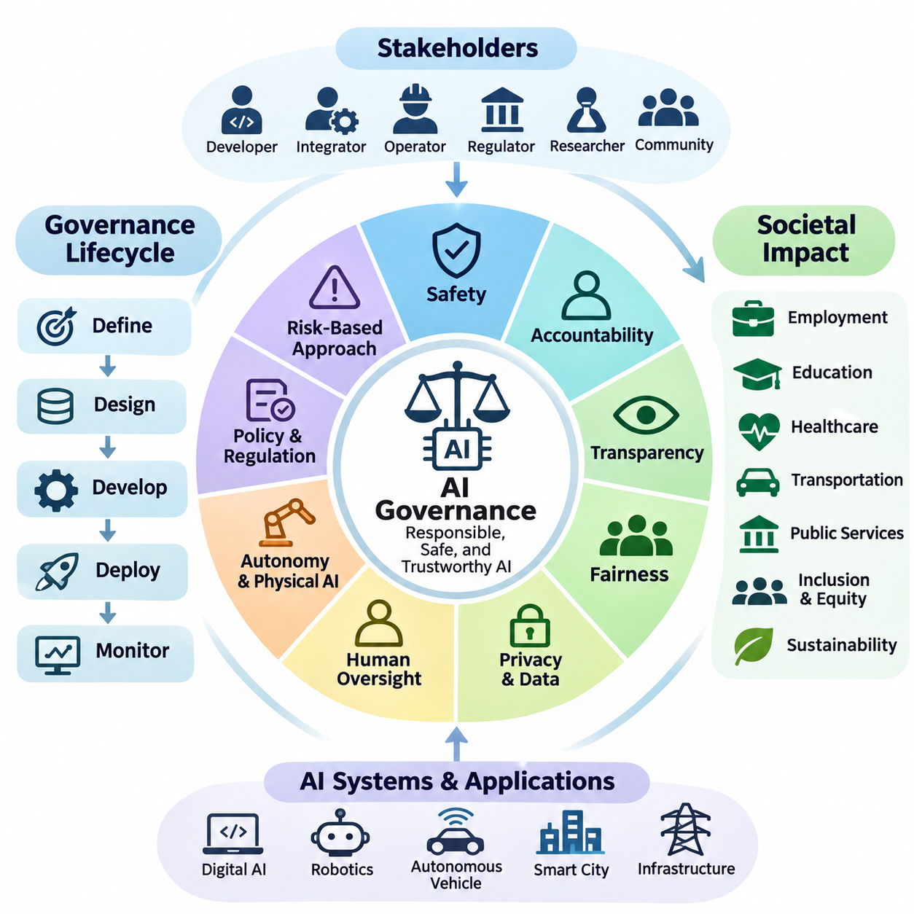
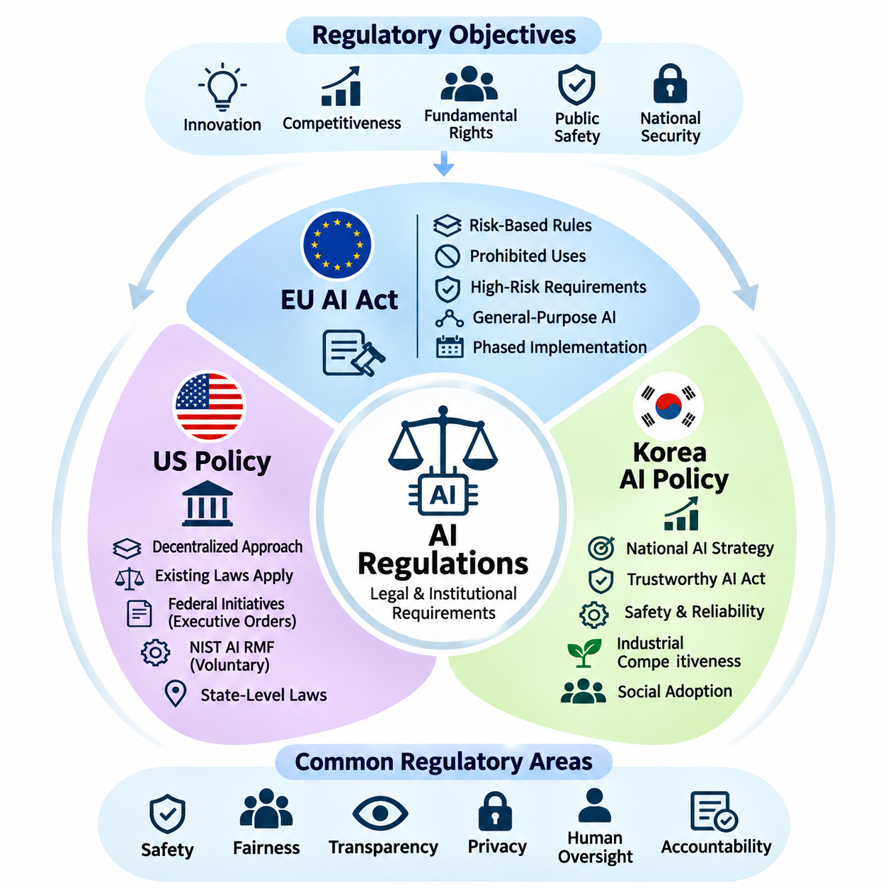
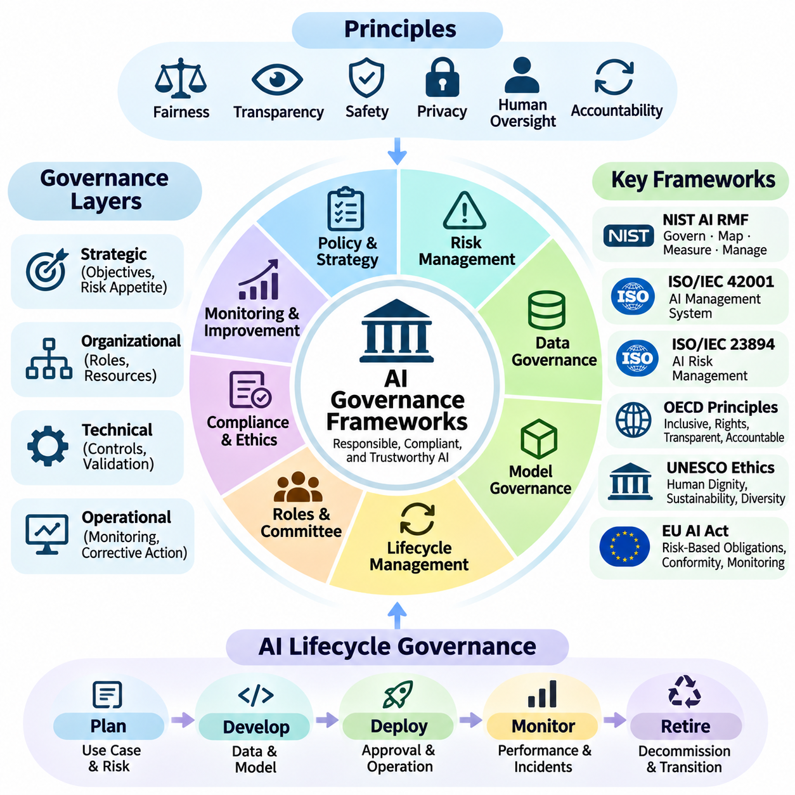
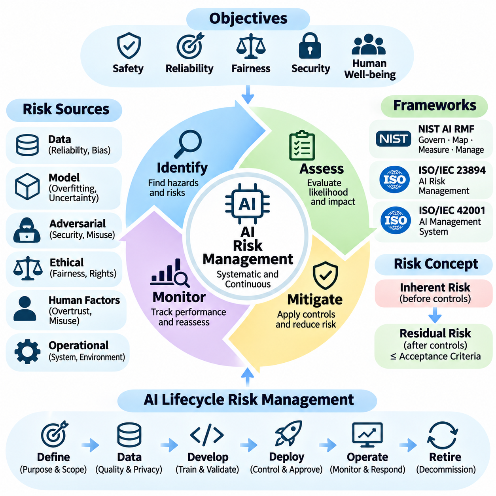
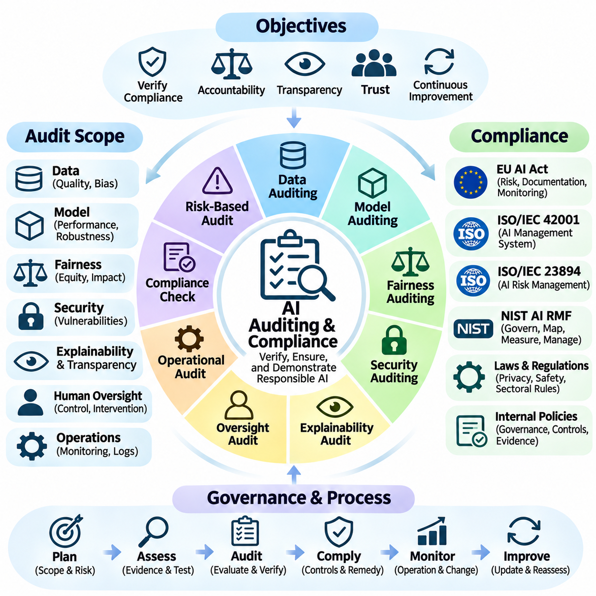
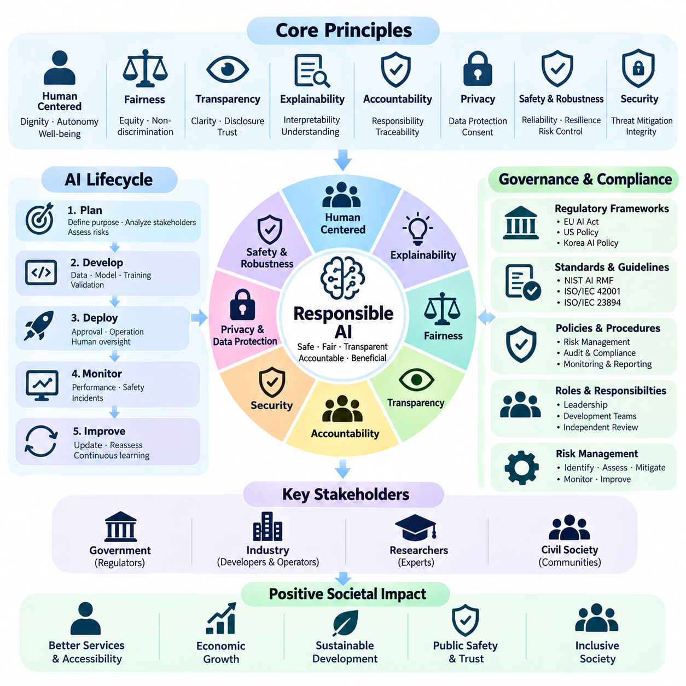
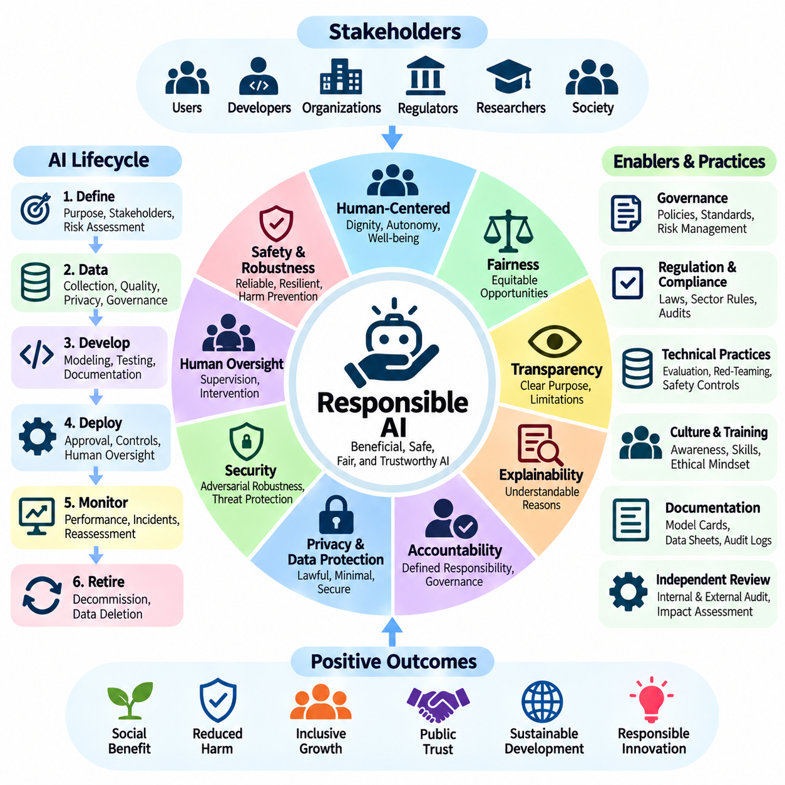
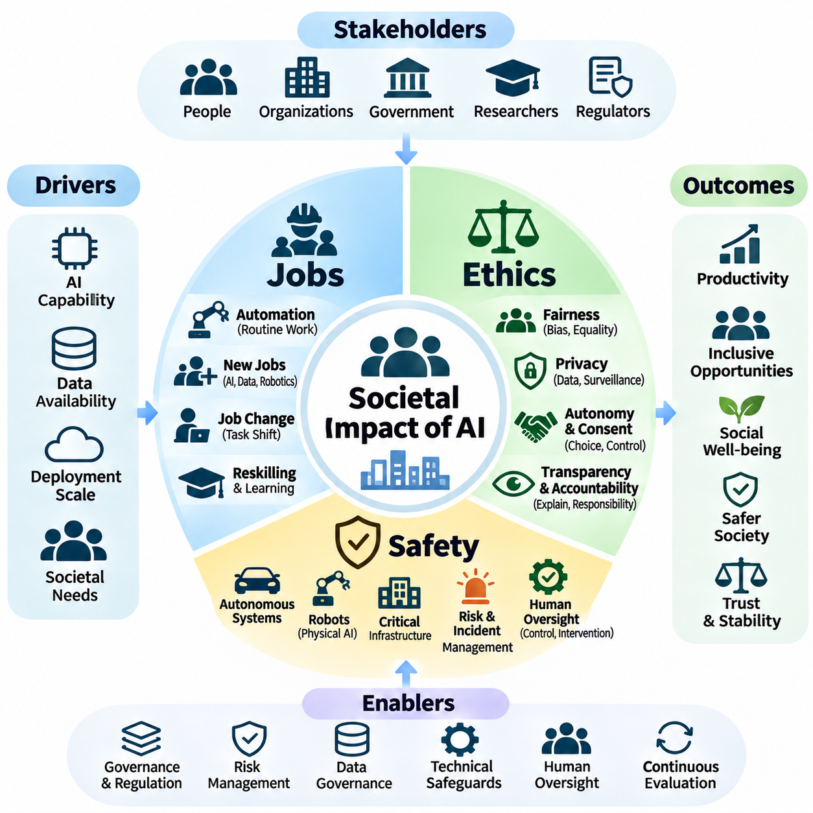
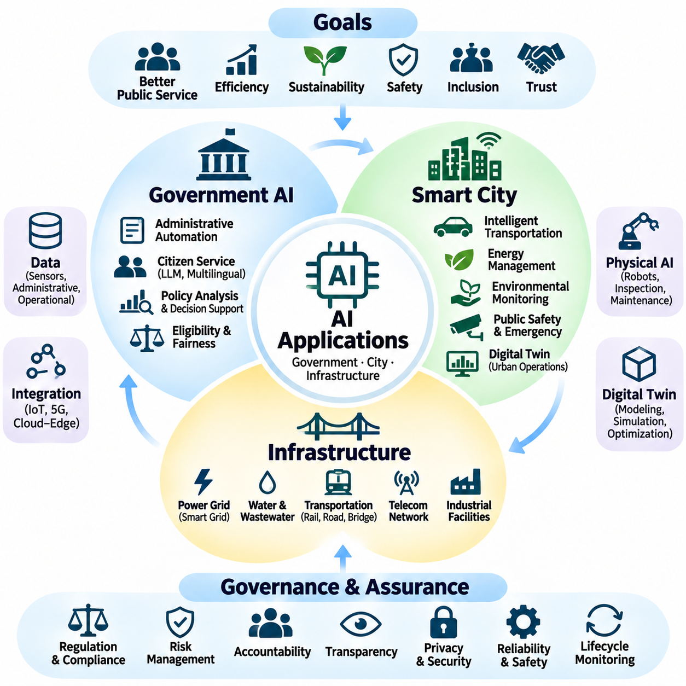

**Volume 42. AI Safety Alignment and Interpretability**


# 06. Governance and Societal Impact

## 06.00 Overview

{width="7.268055555555556in" height="7.268055555555556in"}

Artificial intelligence governance establishes the institutional, technical, and organizational mechanisms required to develop and deploy AI systems responsibly. As intelligent technologies increasingly influence economic activities, public services, and physical environments, governance must address safety, accountability, transparency, fairness, and human oversight throughout the entire AI lifecycle.

The societal impact of artificial intelligence extends beyond algorithmic performance and computational efficiency. AI systems influence employment, education, healthcare, transportation, public administration, and access to essential services. Their deployment can improve productivity and accessibility while introducing risks associated with discrimination, surveillance, economic inequality, institutional dependence, and unintended consequences.

Effective AI governance requires coordination among developers, system integrators, operators, regulators, researchers, and affected communities. Each stakeholder contributes different responsibilities, including technical validation, regulatory compliance, operational monitoring, and public accountability. Governance structures must clarify decision authority and establish mechanisms for resolving conflicts between competing objectives.

Governance frameworks should distinguish organizational policies from technical safeguards and legally enforceable requirements. Organizational policies define acceptable practices, technical safeguards constrain system behavior, and regulatory requirements establish mandatory obligations. These layers should reinforce one another while remaining adaptable to technological progress and changing societal expectations.

The governance lifecycle begins with defining intended purposes, operational boundaries, affected populations, and acceptable risk levels. These considerations influence dataset selection, model architecture, evaluation procedures, deployment conditions, and monitoring requirements. Early governance integration reduces the likelihood that ethical or legal concerns will emerge only after systems enter production.

Risk-based governance recognizes that AI applications differ substantially in their potential consequences. A recommendation engine, clinical decision-support system, autonomous vehicle, and industrial robot operate under different risk conditions. Governance requirements should therefore reflect the severity, likelihood, reversibility, and distribution of potential harms rather than applying identical controls universally.

Safety governance focuses on preventing unacceptable harm arising from incorrect predictions, unexpected interactions, system failures, or unsafe autonomous actions. This requires systematic hazard identification, risk assessment, verification, validation, and operational monitoring. Safety responsibilities must remain explicit even when intelligent components adapt to changing environments or operate with limited human supervision.

Accountability establishes how responsibility is assigned when AI systems influence decisions or produce harmful outcomes. Clear accountability requires documented roles, traceable development decisions, auditable operational records, and defined escalation procedures. Organizations must avoid situations in which responsibility becomes ambiguous because decisions emerge from complex interactions among models, infrastructure, and human operators.

Transparency supports informed understanding of how AI systems are developed, evaluated, and used. It includes communicating system capabilities, intended purposes, known limitations, uncertainty, and relevant operational constraints. Transparency does not necessarily require unrestricted disclosure of proprietary models, but it should provide sufficient information for appropriate oversight, contestability, and independent assessment.

Fairness governance examines whether AI systems distribute benefits, errors, and risks equitably across individuals and communities. Bias can emerge from historical datasets, measurement practices, model objectives, deployment contexts, and feedback mechanisms. Fairness assessments should consider both statistical performance differences and the broader social conditions under which automated decisions affect opportunities and outcomes.

Privacy and data governance are essential because modern AI systems frequently depend on extensive collections of personal, behavioral, environmental, and operational information. Responsible data practices include lawful collection, purpose limitation, minimization, access control, retention management, and secure processing. Governance must also address risks created by data inference, reidentification, and secondary uses.

Human oversight remains a fundamental governance principle, particularly when AI systems influence safety-critical operations or consequential decisions. Oversight mechanisms may include human approval, supervisory control, intervention authority, and emergency shutdown capabilities. Their effectiveness depends on whether operators possess sufficient information, training, response time, and practical authority to intervene meaningfully.

Autonomous and Physical AI systems introduce governance challenges that differ from those associated with purely digital applications. Robots, autonomous vehicles, and intelligent infrastructure interact directly with physical environments, equipment, and people. Their governance must integrate software assurance, mechanical safety, cybersecurity, environmental perception, operational constraints, and responsibility for real-world actions.

The increasing autonomy of intelligent agents complicates conventional assumptions about supervision and control. Agentic systems may plan tasks, invoke external tools, coordinate with other agents, and execute actions over extended periods. Governance mechanisms must establish permission boundaries, action authorization, resource limitations, behavioral monitoring, and recovery procedures when autonomous execution diverges from intended objectives.

AI governance must also consider cybersecurity and adversarial manipulation. Malicious inputs, compromised datasets, model extraction, prompt injection, and unauthorized control interfaces can undermine otherwise reliable systems. Security governance requires continuous threat assessment, defense-in-depth architectures, incident response capabilities, and coordinated vulnerability management across the AI supply chain.

Regulatory governance translates public policy objectives into enforceable obligations, assessment procedures, and institutional responsibilities. International standards and regulatory frameworks increasingly emphasize risk management, documentation, transparency, and oversight. Organizations operating across jurisdictions must reconcile differing legal requirements while maintaining consistent internal principles for responsible development and deployment.

Standards provide common terminology, evaluation methods, and management practices that support interoperability and accountability. Frameworks such as the NIST AI Risk Management Framework and ISO/IEC 42001 offer structured approaches to identifying, managing, and reviewing AI-related risks. Their practical effectiveness depends on implementation quality, organizational commitment, and evidence of operational compliance.

Societal governance must address the economic transformation associated with AI adoption. Automation can increase productivity, improve service availability, and create new technical occupations, but it may also displace existing tasks and redistribute economic opportunities. Responsible transition strategies require workforce development, accessible education, institutional adaptation, and consideration of communities exposed to disproportionate disruption.

Public trust depends not only on technical reliability but also on procedural legitimacy and meaningful participation. Individuals affected by AI-supported decisions should have appropriate opportunities to understand relevant processes, raise concerns, and seek review or remedies. Participatory governance can help identify contextual risks that conventional engineering evaluations may overlook.

Environmental sustainability represents another important dimension of AI governance. Training large models, operating inference infrastructure, manufacturing specialized hardware, and deploying autonomous machines consume energy and physical resources. Responsible governance should evaluate lifecycle impacts, computational efficiency, hardware utilization, maintenance requirements, and the environmental consequences of system-wide adoption.

Continuous governance is necessary because AI risks evolve after deployment. Changes in operating environments, user behavior, model distributions, software dependencies, and institutional expectations can invalidate earlier assumptions. Monitoring, periodic reassessment, incident analysis, and controlled updates allow organizations to detect emerging problems and maintain alignment between deployed behavior and governance objectives.

A mature governance framework connects strategic objectives with measurable operational evidence. Risk registers, evaluation reports, model documentation, audit trails, incident records, and performance indicators provide information for management review. Governance effectiveness should be assessed through demonstrated risk reduction, timely corrective action, accountability, and sustained operational reliability rather than documentation alone.

The long-term objective of AI governance is to ensure that increasingly capable intelligent systems remain beneficial, controllable, and socially legitimate. Achieving this objective requires integrating engineering discipline, institutional accountability, regulatory coordination, and public participation. Governance and societal impact must therefore be treated as foundational dimensions of AI system design rather than secondary considerations.

인공지능 거버넌스(AI Governance)는 인공지능 시스템(AI Systems)을 책임 있게 개발하고 배포하기 위해 필요한 제도적(Institutional), 기술적(Technical), 조직적(Organizational) 메커니즘을 확립한다. 지능형 기술(Intelligent Technologies)이 경제 활동, 공공 서비스(Public Services), 물리적 환경(Physical Environments)에 점점 더 큰 영향을 미치면서, 거버넌스는 인공지능 전체 생명주기(AI Lifecycle)에 걸쳐 안전성(Safety), 책임성(Accountability), 투명성(Transparency), 공정성(Fairness), 인간 감독(Human Oversight)을 다루어야 한다.

인공지능의 사회적 영향(Societal Impact)은 알고리즘 성능(Algorithmic Performance)과 계산 효율성(Computational Efficiency)을 넘어선다. 인공지능 시스템은 고용, 교육, 의료, 교통, 공공 행정, 필수 서비스 접근성에 영향을 미친다. 이러한 시스템의 도입은 생산성과 접근성을 향상시킬 수 있지만, 차별(Discrimination), 감시(Surveillance), 경제적 불평등(Economic Inequality), 제도적 의존성(Institutional Dependence), 의도하지 않은 결과(Unintended Consequences)와 관련된 위험도 발생시킬 수 있다.

효과적인 인공지능 거버넌스(Effective AI Governance)를 위해서는 개발자(Developers), 시스템 통합자(System Integrators), 운영자(Operators), 규제기관(Regulators), 연구자(Researchers), 영향을 받는 공동체(Affected Communities) 간의 협력이 필요하다. 각 이해관계자(Stakeholder)는 기술적 검증(Technical Validation), 규제 준수(Regulatory Compliance), 운영 모니터링(Operational Monitoring), 공적 책임성(Public Accountability) 등 서로 다른 책임을 수행한다. 거버넌스 구조(Governance Structure)는 의사결정 권한(Decision Authority)을 명확히 하고 상충하는 목표 사이의 갈등을 해결할 수 있는 메커니즘을 확립해야 한다.

거버넌스 프레임워크(Governance Framework)는 조직 정책(Organizational Policies), 기술적 안전장치(Technical Safeguards), 법적 구속력이 있는 요구사항(Legally Enforceable Requirements)을 구분해야 한다. 조직 정책은 허용 가능한 업무 관행을 정의하고, 기술적 안전장치는 시스템 동작을 제한하며, 규제 요구사항은 의무적으로 준수해야 하는 사항을 확립한다. 이러한 계층은 기술 발전과 변화하는 사회적 기대에 적응하면서 상호 보완적으로 작동해야 한다.

거버넌스 생명주기(Governance Lifecycle)는 의도된 목적(Intended Purposes), 운영 경계(Operational Boundaries), 영향을 받는 집단(Affected Populations), 허용 가능한 위험 수준(Acceptable Risk Levels)을 정의하는 것에서 시작된다. 이러한 고려사항은 데이터셋 선택(Dataset Selection), 모델 아키텍처(Model Architecture), 평가 절차(Evaluation Procedures), 배포 조건(Deployment Conditions), 모니터링 요구사항(Monitoring Requirements)에 영향을 미친다. 초기 단계부터 거버넌스를 통합하면 시스템이 실제 운영 환경에 투입된 이후 윤리적 또는 법적 문제가 발견될 가능성을 줄일 수 있다.

위험 기반 거버넌스(Risk-Based Governance)는 인공지능 응용 분야마다 잠재적 결과가 크게 다르다는 점을 인식한다. 추천 엔진(Recommendation Engine), 임상 의사결정 지원 시스템(Clinical Decision-Support System), 자율주행 차량(Autonomous Vehicle), 산업용 로봇(Industrial Robot)은 서로 다른 위험 조건에서 작동한다. 따라서 거버넌스 요구사항은 모든 시스템에 동일한 통제를 적용하기보다 잠재적 피해의 심각도(Severity), 발생 가능성(Likelihood), 회복 가능성(Reversibility), 피해 분포(Distribution of Harms)를 반영해야 한다.

안전 거버넌스(Safety Governance)는 잘못된 예측(Incorrect Predictions), 예상하지 못한 상호작용(Unexpected Interactions), 시스템 장애(System Failures), 안전하지 않은 자율 행동(Unsafe Autonomous Actions)으로 인해 발생할 수 있는 허용 불가능한 피해를 방지하는 데 중점을 둔다. 이를 위해 체계적인 위험요소 식별(Hazard Identification), 위험 평가(Risk Assessment), 검증(Verification), 타당성 확인(Validation), 운영 모니터링(Operational Monitoring)이 필요하다. 지능형 구성요소가 변화하는 환경에 적응하거나 제한된 인간 감독하에 작동하더라도 안전에 대한 책임은 명확하게 유지되어야 한다.

책임성(Accountability)은 인공지능 시스템이 의사결정에 영향을 미치거나 유해한 결과를 발생시켰을 때 책임을 어떻게 배분할 것인지를 규정한다. 명확한 책임성을 확보하려면 문서화된 역할(Documented Roles), 추적 가능한 개발 의사결정(Traceable Development Decisions), 감사 가능한 운영 기록(Auditable Operational Records), 정의된 보고 및 대응 절차(Escalation Procedures)가 필요하다. 조직은 모델, 인프라, 인간 운영자 사이의 복잡한 상호작용으로 인해 책임 소재가 불명확해지는 상황을 방지해야 한다.

투명성(Transparency)은 인공지능 시스템이 어떻게 개발되고 평가되며 사용되는지에 대한 충분한 이해를 지원한다. 여기에는 시스템 역량(System Capabilities), 의도된 목적(Intended Purposes), 알려진 한계(Known Limitations), 불확실성(Uncertainty), 관련 운영 제약(Operational Constraints)을 전달하는 과정이 포함된다. 투명성이 반드시 독점 모델(Proprietary Models)의 무제한 공개를 의미하는 것은 아니지만, 적절한 감독(Oversight), 이의 제기 가능성(Contestability), 독립적 평가(Independent Assessment)를 수행할 수 있을 만큼 충분한 정보를 제공해야 한다.

공정성 거버넌스(Fairness Governance)는 인공지능 시스템이 개인과 공동체 사이에서 혜택(Benefits), 오류(Errors), 위험(Risks)을 공평하게 분배하는지를 검토한다. 편향(Bias)은 과거 데이터셋(Historical Datasets), 측정 관행(Measurement Practices), 모델 목표(Model Objectives), 배포 환경(Deployment Contexts), 피드백 메커니즘(Feedback Mechanisms)에서 발생할 수 있다. 공정성 평가(Fairness Assessment)는 통계적 성능 차이뿐 아니라 자동화된 의사결정이 기회와 결과에 영향을 미치는 광범위한 사회적 조건도 고려해야 한다.

개인정보 보호 및 데이터 거버넌스(Privacy and Data Governance)는 현대 인공지능 시스템이 개인 정보(Personal Information), 행동 정보(Behavioral Information), 환경 정보(Environmental Information), 운영 정보(Operational Information)의 대규모 수집에 의존하는 경우가 많기 때문에 필수적이다. 책임 있는 데이터 관리(Responsible Data Practices)에는 적법한 수집(Lawful Collection), 목적 제한(Purpose Limitation), 데이터 최소화(Data Minimization), 접근 제어(Access Control), 보존 관리(Retention Management), 안전한 처리(Secure Processing)가 포함된다. 또한 데이터 추론(Data Inference), 재식별(Reidentification), 2차 활용(Secondary Uses)으로 발생하는 위험도 다루어야 한다.

인간 감독(Human Oversight)은 특히 인공지능 시스템이 안전 필수 운영(Safety-Critical Operations)이나 중대한 의사결정(Consequential Decisions)에 영향을 미치는 경우 핵심적인 거버넌스 원칙이다. 감독 메커니즘(Oversight Mechanisms)에는 인간 승인(Human Approval), 감독 제어(Supervisory Control), 개입 권한(Intervention Authority), 비상 정지 기능(Emergency Shutdown Capabilities)이 포함될 수 있다. 이러한 메커니즘의 효과는 운영자가 의미 있는 개입을 수행할 수 있도록 충분한 정보, 교육, 대응 시간, 실질적인 권한을 보유하고 있는지에 달려 있다.

자율 시스템 및 피지컬 인공지능(Autonomous and Physical AI Systems)은 순수 디지털 응용 시스템(Purely Digital Applications)과 다른 거버넌스 과제를 발생시킨다. 로봇(Robots), 자율주행 차량(Autonomous Vehicles), 지능형 인프라(Intelligent Infrastructure)는 물리적 환경, 장비, 사람과 직접 상호작용한다. 따라서 이들 시스템의 거버넌스는 소프트웨어 보증(Software Assurance), 기계적 안전(Mechanical Safety), 사이버보안(Cybersecurity), 환경 인식(Environmental Perception), 운영 제약(Operational Constraints), 실제 행동에 대한 책임(Responsibility for Real-World Actions)을 통합해야 한다.

지능형 에이전트(Intelligent Agents)의 자율성이 증가하면서 감독과 제어에 대한 기존 가정이 더욱 복잡해지고 있다. 에이전트형 시스템(Agentic Systems)은 작업을 계획하고 외부 도구(External Tools)를 호출하며 다른 에이전트와 협력하고 장시간에 걸쳐 행동을 실행할 수 있다. 거버넌스 메커니즘은 권한 경계(Permission Boundaries), 행동 승인(Action Authorization), 자원 제한(Resource Limitations), 행동 모니터링(Behavioral Monitoring), 자율 실행이 의도된 목표에서 벗어났을 때의 복구 절차(Recovery Procedures)를 확립해야 한다.

인공지능 거버넌스는 사이버보안(Cybersecurity)과 적대적 조작(Adversarial Manipulation)도 고려해야 한다. 악의적인 입력(Malicious Inputs), 손상된 데이터셋(Compromised Datasets), 모델 추출(Model Extraction), 프롬프트 인젝션(Prompt Injection), 승인되지 않은 제어 인터페이스(Unauthorized Control Interfaces)는 정상적으로 작동하던 시스템의 신뢰성을 훼손할 수 있다. 보안 거버넌스(Security Governance)는 지속적인 위협 평가(Threat Assessment), 심층 방어 아키텍처(Defense-in-Depth Architectures), 사고 대응 역량(Incident Response Capabilities), 인공지능 공급망(AI Supply Chain) 전반의 통합 취약점 관리(Vulnerability Management)를 요구한다.

규제 거버넌스(Regulatory Governance)는 공공 정책 목표(Public Policy Objectives)를 법적으로 집행 가능한 의무(Enforceable Obligations), 평가 절차(Assessment Procedures), 제도적 책임(Institutional Responsibilities)으로 전환한다. 국제 표준(International Standards)과 규제 프레임워크(Regulatory Frameworks)는 위험 관리(Risk Management), 문서화(Documentation), 투명성(Transparency), 감독(Oversight)을 점점 더 강조하고 있다. 여러 관할권(Jurisdictions)에서 운영하는 조직은 책임 있는 개발과 배포를 위한 일관된 내부 원칙을 유지하면서 서로 다른 법적 요구사항을 조정해야 한다.

표준(Standards)은 상호운용성(Interoperability)과 책임성(Accountability)을 지원하는 공통 용어(Common Terminology), 평가 방법(Evaluation Methods), 관리 관행(Management Practices)을 제공한다. 미국 국립표준기술연구소 인공지능 위험관리 프레임워크(NIST AI Risk Management Framework)와 국제표준화기구 및 국제전기기술위원회의 ISO/IEC 42001은 인공지능 관련 위험을 식별하고 관리하며 검토하기 위한 체계적인 접근법을 제공한다. 이러한 표준의 실질적인 효과는 구현 품질(Implementation Quality), 조직의 실행 의지(Organizational Commitment), 운영 준수에 대한 증거(Evidence of Operational Compliance)에 달려 있다.

사회적 거버넌스(Societal Governance)는 인공지능 도입과 관련된 경제적 전환(Economic Transformation)을 다루어야 한다. 자동화(Automation)는 생산성을 높이고 서비스 가용성을 개선하며 새로운 기술 직종(Technical Occupations)을 창출할 수 있지만, 기존 업무를 대체하고 경제적 기회를 재분배할 수도 있다. 책임 있는 전환 전략(Responsible Transition Strategies)에는 인력 역량 개발(Workforce Development), 접근 가능한 교육(Accessible Education), 제도적 적응(Institutional Adaptation), 불균형한 변화에 노출된 공동체에 대한 고려가 필요하다.

공공 신뢰(Public Trust)는 기술적 신뢰성(Technical Reliability)뿐 아니라 절차적 정당성(Procedural Legitimacy)과 실질적인 참여(Meaningful Participation)에 의해서도 형성된다. 인공지능 기반 의사결정(AI-Supported Decisions)의 영향을 받는 개인은 관련 절차를 이해하고 우려를 제기하며 검토 또는 구제 조치(Remedy)를 요청할 수 있는 적절한 기회를 가져야 한다. 참여형 거버넌스(Participatory Governance)는 기존 공학적 평가(Engineering Evaluations)에서 간과할 수 있는 상황별 위험(Contextual Risks)을 식별하는 데 도움을 줄 수 있다.

환경적 지속가능성(Environmental Sustainability)은 인공지능 거버넌스의 또 다른 중요한 차원이다. 대규모 모델 학습(Large-Scale Model Training), 추론 인프라(Inference Infrastructure) 운영, 특수 하드웨어(Specialized Hardware) 제조, 자율 기계(Autonomous Machines) 배포에는 에너지와 물리적 자원이 소비된다. 책임 있는 거버넌스는 생명주기 영향(Lifecycle Impacts), 계산 효율성(Computational Efficiency), 하드웨어 활용률(Hardware Utilization), 유지보수 요구사항(Maintenance Requirements), 시스템 전반의 도입에 따른 환경적 결과(Environmental Consequences)를 평가해야 한다.

인공지능 위험은 배포 이후에도 변화하기 때문에 지속적 거버넌스(Continuous Governance)가 필요하다. 운영 환경(Operating Environments), 사용자 행동(User Behavior), 모델 데이터 분포(Model Distributions), 소프트웨어 의존성(Software Dependencies), 제도적 기대(Institutional Expectations)의 변화는 기존 가정을 무효화할 수 있다. 모니터링(Monitoring), 주기적 재평가(Periodic Reassessment), 사고 분석(Incident Analysis), 통제된 업데이트(Controlled Updates)를 통해 조직은 새롭게 발생하는 문제를 감지하고 배포된 시스템의 행동과 거버넌스 목표 사이의 정합성을 유지할 수 있다.

성숙한 거버넌스 프레임워크(Mature Governance Framework)는 전략적 목표(Strategic Objectives)를 측정 가능한 운영 증거(Measurable Operational Evidence)와 연결한다. 위험 등록부(Risk Registers), 평가 보고서(Evaluation Reports), 모델 문서(Model Documentation), 감사 추적 기록(Audit Trails), 사고 기록(Incident Records), 성과 지표(Performance Indicators)는 경영 검토(Management Review)에 필요한 정보를 제공한다. 거버넌스의 효과는 문서화 자체가 아니라 입증된 위험 감소(Demonstrated Risk Reduction), 적시 시정 조치(Timely Corrective Action), 책임성(Accountability), 지속적인 운영 신뢰성(Sustained Operational Reliability)을 통해 평가되어야 한다.

인공지능 거버넌스의 장기적 목표(Long-Term Objective)는 점점 더 높은 역량을 갖추는 지능형 시스템(Intelligent Systems)이 인간과 사회에 유익하고(Beneficial), 통제 가능하며(Controllable), 사회적 정당성(Social Legitimacy)을 유지하도록 보장하는 것이다. 이를 달성하려면 공학적 규율(Engineering Discipline), 제도적 책임성(Institutional Accountability), 규제 조정(Regulatory Coordination), 공공 참여(Public Participation)를 통합해야 한다. 따라서 거버넌스와 사회적 영향(Governance and Societal Impact)은 부차적인 고려사항이 아니라 인공지능 시스템 설계(AI System Design)의 근본적인 차원으로 다루어져야 한다.

## 06.01 AI Regulations

{width="7.268055555555556in" height="7.268055555555556in"}

Artificial intelligence regulation establishes legal and institutional requirements for developing, deploying, and operating intelligent systems. Regulatory approaches differ across jurisdictions because governments balance innovation, economic competitiveness, fundamental rights, public safety, and national security differently. Understanding these differences is essential for organizations developing AI technologies for international markets.

The European Union, United States, and South Korea represent three important approaches to AI governance. The European Union emphasizes harmonized legislation and risk-based obligations, while the United States combines federal initiatives, sector-specific laws, and state-level regulation. South Korea integrates national AI development strategies with legislation intended to promote trustworthy AI and industrial competitiveness.

The European Union Artificial Intelligence Act establishes a comprehensive regulatory framework for AI systems placed on the European market or used within its jurisdiction. Its risk-based structure differentiates applications according to their potential consequences for safety and fundamental rights. The regulation also addresses general-purpose AI models, transparency obligations, regulatory supervision, and enforcement mechanisms.

The EU AI Act identifies prohibited AI practices that present unacceptable risks to individuals or society. These include certain forms of manipulative AI, social scoring, and specified biometric applications, subject to detailed legal definitions and exceptions. The prohibition framework reflects the principle that some AI uses should not be permitted merely because technical safeguards or organizational controls are available.

High-risk AI systems under the EU AI Act are subject to additional requirements concerning risk management, data governance, technical documentation, recordkeeping, transparency, human oversight, accuracy, robustness, and cybersecurity. Depending on the application, conformity assessment procedures and registration obligations may also apply. These requirements connect engineering practices with regulatory accountability.

The classification of high-risk AI depends on its intended purpose and applicable legal provisions rather than computational complexity alone. Relevant domains include certain medical devices, machinery, critical infrastructure, employment systems, education, and public services. Organizations must evaluate whether their applications fall within regulated categories and whether exemptions or sector-specific provisions apply.

The EU AI Act also establishes obligations for providers of general-purpose AI models, including documentation and information-sharing requirements. Models presenting systemic risks face additional evaluation, risk mitigation, incident reporting, and cybersecurity obligations. These provisions recognize that broadly reusable foundation models can influence numerous downstream applications beyond their original development context.

Implementation of the EU AI Act follows a phased timetable rather than a single universal compliance date. Different provisions apply at different stages, and legislative amendments or transitional arrangements may affect specific obligations. Organizations should therefore maintain regulatory monitoring processes that distinguish provisions already applicable from requirements scheduled for future implementation.

For international AI developers, the EU framework has implications beyond European headquarters or infrastructure. Its territorial scope can cover certain providers and deployers outside the European Union when relevant market or output-use conditions are satisfied. Compliance planning consequently requires attention to product distribution, deployment location, contractual responsibilities, and the intended use of AI-generated outputs.

In the United States, AI governance follows a more decentralized regulatory structure. Federal agencies, state legislatures, courts, and sector-specific authorities contribute different requirements and guidance. Existing laws governing consumer protection, employment discrimination, privacy, financial services, healthcare, and product safety may apply to AI systems even when they were not originally written specifically for artificial intelligence.

Federal AI policy has emphasized innovation, national competitiveness, security, government adoption, and the management of technological risks, although priorities vary between administrations. Executive orders and agency guidance can influence federal operations and policy direction without necessarily establishing comprehensive obligations for private companies. Their legal scope and continuing applicability require separate examination.

The NIST AI Risk Management Framework provides a voluntary structure for identifying, measuring, managing, and governing AI risks. Its functions support organizational accountability, documentation, evaluation, and continuous improvement. Although the framework is not itself a federal law, it can inform procurement practices, internal assurance programs, and sector-specific compliance activities.

State-level AI legislation adds another dimension to the American regulatory landscape. Different states have introduced requirements concerning automated decision-making, consumer protection, employment, privacy, and algorithmic discrimination. Consequently, organizations deploying AI across multiple states may face overlapping obligations, varying implementation schedules, and different enforcement mechanisms.

American regulatory practice frequently relies on existing institutional authorities rather than a single comprehensive AI statute. Agencies may evaluate deceptive AI claims, discriminatory automated decisions, unsafe products, or improper data practices under established legal frameworks. Developers must therefore examine both AI-specific measures and the broader laws governing their products and industries.

South Korea has established a national AI regulatory foundation through the Framework Act on the Development of Artificial Intelligence and the Creation of a Foundation for Trust, commonly known as the AI Basic Act. Effective January 22, 2026, the legislation combines measures supporting AI research and industrial development with obligations concerning transparency, safety, and trustworthy deployment.\&#x20;

[image](https://www.google.com/s2/favicons?domain=https://www.law.go.kr\\&sz=32)

국가법령정보센터+1

Korean AI policy emphasizes technological competitiveness, research infrastructure, industrial adoption, and coordinated national governance. Government initiatives support AI development, training data, testing facilities, international cooperation, and commercialization. These policies reflect an effort to strengthen domestic AI capabilities while establishing institutional mechanisms for managing emerging technological risks.

The Korean AI Basic Act introduces provisions concerning high-impact AI and transparency for specified AI products and services. Relevant responsibilities may involve notifying users about AI interactions, addressing synthetic content, and implementing appropriate safety or reliability measures. The precise obligations depend on statutory definitions, implementing rules, and the characteristics of the deployed system.

For high-impact AI applications, Korean governance emphasizes assessment of potential consequences for human life, physical safety, and fundamental rights. Organizations should examine the intended application, degree of autonomy, affected populations, and available human oversight. This approach is particularly relevant to AI systems operating in healthcare, transportation, energy, and other consequential environments.

Korea\'s regulatory environment also interacts with existing privacy, cybersecurity, product safety, and sector-specific legislation. Compliance with the AI Basic Act does not automatically satisfy obligations arising from personal information protection or industrial safety requirements. Developers must evaluate the combined legal framework applicable to their datasets, products, operating environments, and commercial relationships.

Comparing the three jurisdictions reveals differences in regulatory structure but also substantial convergence in underlying objectives. The European Union emphasizes harmonized risk-based legislation, the United States relies on distributed legal and institutional mechanisms, and South Korea combines national AI promotion with statutory trust requirements. All three approaches recognize the importance of safety, accountability, transparency, and responsible innovation.

Organizations operating internationally should develop compliance architectures capable of accommodating jurisdiction-specific requirements without fragmenting their engineering processes. Shared foundations may include documented risk assessments, model evaluation, incident management, human oversight, cybersecurity controls, and traceable development records. Regulatory mapping can then connect these common controls to the obligations applicable in each market.

For autonomous vehicles, robotics, and Physical AI, regulatory compliance requires particular attention to the relationship between intelligent software and physical safety. AI-specific legislation may operate alongside machinery regulations, transportation rules, functional safety standards, and product liability frameworks. Effective governance therefore integrates algorithmic assurance with system-level engineering, operational validation, and continuous regulatory review.

AI regulation will continue evolving as foundation models, autonomous agents, and embodied intelligence create new technical capabilities and societal risks. Organizations should treat regulatory readiness as a continuous engineering and governance responsibility rather than a one-time certification exercise. Sustainable compliance depends on adapting technical safeguards, institutional processes, and accountability mechanisms as legal requirements and deployment conditions change.

인공지능 규제(AI Regulation)는 지능형 시스템(Intelligent Systems)의 개발, 배포 및 운영에 필요한 법적·제도적 요구사항(Legal and Institutional Requirements)을 확립한다. 각국 정부는 혁신(Innovation), 경제적 경쟁력(Economic Competitiveness), 기본권(Fundamental Rights), 공공 안전(Public Safety), 국가 안보(National Security) 사이의 균형을 서로 다르게 설정하기 때문에 규제 접근법도 국가와 관할권에 따라 차이가 있다. 이러한 차이를 이해하는 것은 국제 시장을 대상으로 인공지능 기술을 개발하는 조직에 필수적이다.

유럽연합(European Union), 미국(United States), 대한민국(South Korea)은 인공지능 거버넌스(AI Governance)에 대한 세 가지 중요한 접근법을 대표한다. 유럽연합은 통일된 법률 체계(Harmonized Legislation)와 위험 기반 의무(Risk-Based Obligations)를 강조하는 반면, 미국은 연방정부 정책(Federal Initiatives), 산업별 법률(Sector-Specific Laws), 주정부 규제(State-Level Regulation)를 결합한다. 대한민국은 신뢰할 수 있는 인공지능(Trustworthy AI)과 산업 경쟁력(Industrial Competitiveness)을 촉진하기 위한 법률을 국가 인공지능 발전 전략(National AI Development Strategies)과 통합한다.

유럽연합 인공지능법(EU Artificial Intelligence Act)은 유럽 시장에 출시되거나 해당 관할권 내에서 사용되는 인공지능 시스템을 위한 포괄적인 규제 프레임워크(Comprehensive Regulatory Framework)를 확립한다. 위험 기반 구조(Risk-Based Structure)는 안전성과 기본권에 미치는 잠재적 결과에 따라 응용 분야를 구분한다. 또한 범용 인공지능 모델(General-Purpose AI Models), 투명성 의무(Transparency Obligations), 규제 감독(Regulatory Supervision), 법 집행 메커니즘(Enforcement Mechanisms)을 다룬다.

유럽연합 인공지능법(EU AI Act)은 개인이나 사회에 허용할 수 없는 위험(Unacceptable Risks)을 초래하는 금지된 인공지능 관행(Prohibited AI Practices)을 규정한다. 여기에는 특정한 형태의 조작적 인공지능(Manipulative AI), 사회적 점수화(Social Scoring), 생체인식 응용(Biometric Applications)이 포함되며, 구체적인 법적 정의와 예외 조항이 적용된다. 이러한 금지 체계(Prohibition Framework)는 기술적 안전장치(Technical Safeguards)나 조직적 통제(Organizational Controls)가 존재한다는 이유만으로 모든 인공지능 활용이 허용되어서는 안 된다는 원칙을 반영한다.

유럽연합 인공지능법에 따른 고위험 인공지능 시스템(High-Risk AI Systems)에는 위험 관리(Risk Management), 데이터 거버넌스(Data Governance), 기술 문서(Technical Documentation), 기록 유지(Recordkeeping), 투명성(Transparency), 인간 감독(Human Oversight), 정확성(Accuracy), 강건성(Robustness), 사이버보안(Cybersecurity)에 관한 추가 요구사항이 적용된다. 응용 분야에 따라 적합성 평가 절차(Conformity Assessment Procedures)와 등록 의무(Registration Obligations)도 적용될 수 있다. 이러한 요구사항은 공학적 실무(Engineering Practices)를 규제 책임성(Regulatory Accountability)과 연결한다.

고위험 인공지능(High-Risk AI)의 분류는 계산 복잡도(Computational Complexity)만으로 결정되지 않으며, 의도된 목적(Intended Purpose)과 적용 가능한 법률 조항(Applicable Legal Provisions)에 따라 결정된다. 관련 분야에는 특정 의료기기(Medical Devices), 기계류(Machinery), 핵심 인프라(Critical Infrastructure), 고용 시스템(Employment Systems), 교육(Education), 공공 서비스(Public Services)가 포함된다. 조직은 자사의 응용 시스템이 규제 대상 범주에 해당하는지, 예외 조항(Exemptions)이나 산업별 규정(Sector-Specific Provisions)이 적용되는지 평가해야 한다.

유럽연합 인공지능법은 범용 인공지능 모델(General-Purpose AI Models)의 제공자(Providers)에 대해서도 문서화(Documentation)와 정보 공유(Information Sharing) 요구사항을 포함한 의무를 규정한다. 시스템적 위험(Systemic Risks)을 초래하는 모델에는 추가적인 평가(Evaluation), 위험 완화(Risk Mitigation), 사고 보고(Incident Reporting), 사이버보안 의무(Cybersecurity Obligations)가 적용된다. 이러한 조항은 광범위하게 재사용 가능한 파운데이션 모델(Foundation Models)이 최초 개발 목적을 넘어 다양한 후속 응용 분야(Downstream Applications)에 영향을 미칠 수 있다는 점을 반영한다.

유럽연합 인공지능법의 시행(Implementation)은 단일한 규제 준수 날짜(Compliance Date)가 아니라 단계적 일정(Phased Timetable)에 따라 진행된다. 서로 다른 조항이 각기 다른 시점에 적용되며, 법률 개정(Legislative Amendments)이나 경과 조치(Transitional Arrangements)에 따라 특정 의무가 변경될 수 있다. 따라서 조직은 이미 적용되는 조항과 향후 시행 예정인 요구사항을 구분할 수 있는 규제 모니터링 프로세스(Regulatory Monitoring Processes)를 유지해야 한다.

국제적인 인공지능 개발자(International AI Developers)에게 유럽연합의 규제 프레임워크는 유럽 외 지역에 위치한 본사나 인프라에도 영향을 미칠 수 있다. 관련 시장 진입 조건(Market Conditions)이나 출력물 사용 조건(Output-Use Conditions)이 충족되면 유럽연합 외부의 제공자(Providers)와 배포자(Deployers)도 규제 대상이 될 수 있다. 따라서 규제 준수 계획(Compliance Planning)은 제품 유통(Product Distribution), 배포 위치(Deployment Location), 계약상 책임(Contractual Responsibilities), 인공지능 생성 결과물의 의도된 사용(Intended Use of AI-Generated Outputs)을 고려해야 한다.

미국의 인공지능 거버넌스(AI Governance)는 상대적으로 분산된 규제 구조(Decentralized Regulatory Structure)를 따른다. 연방기관(Federal Agencies), 주의회(State Legislatures), 법원(Courts), 산업별 감독기관(Sector-Specific Authorities)이 서로 다른 요구사항과 지침을 마련한다. 소비자 보호(Consumer Protection), 고용 차별(Employment Discrimination), 개인정보 보호(Privacy), 금융 서비스(Financial Services), 의료(Healthcare), 제품 안전(Product Safety)에 관한 기존 법률은 원래 인공지능을 대상으로 제정되지 않았더라도 인공지능 시스템에 적용될 수 있다.

미국의 연방 인공지능 정책(Federal AI Policy)은 혁신(Innovation), 국가 경쟁력(National Competitiveness), 안보(Security), 정부의 인공지능 도입(Government Adoption), 기술적 위험 관리(Technological Risk Management)를 강조해 왔지만, 정책 우선순위는 행정부에 따라 달라진다. 행정명령(Executive Orders)과 기관 지침(Agency Guidance)은 민간기업에 포괄적인 의무를 반드시 부과하지 않더라도 연방정부 운영과 정책 방향에 영향을 미칠 수 있다. 이러한 조치의 법적 적용 범위(Legal Scope)와 지속적인 효력(Continuing Applicability)은 별도로 검토해야 한다.

미국 국립표준기술연구소의 인공지능 위험관리 프레임워크(NIST AI Risk Management Framework)는 인공지능 위험을 식별(Identify), 측정(Measure), 관리(Manage), 거버넌스 체계로 통제(Govern)하기 위한 자발적 구조(Voluntary Structure)를 제공한다. 이 프레임워크는 조직적 책임성(Organizational Accountability), 문서화(Documentation), 평가(Evaluation), 지속적 개선(Continuous Improvement)을 지원한다. 프레임워크 자체가 연방법(Federal Law)은 아니지만, 조달 관행(Procurement Practices), 내부 보증 프로그램(Internal Assurance Programs), 산업별 규제 준수 활동(Sector-Specific Compliance Activities)에 활용될 수 있다.

주정부 차원의 인공지능 입법(State-Level AI Legislation)은 미국의 규제 환경(Regulatory Landscape)에 또 다른 차원을 추가한다. 각 주는 자동화된 의사결정(Automated Decision-Making), 소비자 보호(Consumer Protection), 고용(Employment), 개인정보 보호(Privacy), 알고리즘 차별(Algorithmic Discrimination)에 관한 서로 다른 요구사항을 도입해 왔다. 따라서 여러 주에서 인공지능을 배포하는 조직은 중복되는 의무(Overlapping Obligations), 상이한 시행 일정(Implementation Schedules), 서로 다른 집행 메커니즘(Enforcement Mechanisms)에 직면할 수 있다.

미국의 규제 관행(Regulatory Practice)은 단일한 포괄적 인공지능 법률(Comprehensive AI Statute)보다는 기존 제도적 권한(Institutional Authorities)에 의존하는 경우가 많다. 감독기관은 기만적인 인공지능 관련 주장(Deceptive AI Claims), 차별적인 자동화 의사결정(Discriminatory Automated Decisions), 안전하지 않은 제품(Unsafe Products), 부적절한 데이터 처리(Improper Data Practices)를 기존 법적 프레임워크(Established Legal Frameworks)에 따라 평가할 수 있다. 따라서 개발자는 인공지능 전용 규제뿐 아니라 제품과 산업을 규율하는 광범위한 법률도 검토해야 한다.

대한민국은 일반적으로 인공지능 기본법(AI Basic Act)으로 알려진 인공지능 발전과 신뢰 기반 조성 등에 관한 기본법(Framework Act on the Development of Artificial Intelligence and the Creation of a Foundation for Trust)을 통해 국가 인공지능 규제 기반(National AI Regulatory Foundation)을 확립하였다. 2026년 1월 22일 시행된 이 법률은 인공지능 연구와 산업 발전을 지원하는 조치와 투명성(Transparency), 안전성(Safety), 신뢰할 수 있는 배포(Trustworthy Deployment)에 관한 의무를 결합한다.

대한민국의 인공지능 정책(Korean AI Policy)은 기술 경쟁력(Technological Competitiveness), 연구 인프라(Research Infrastructure), 산업적 도입(Industrial Adoption), 국가 차원의 통합 거버넌스(Coordinated National Governance)를 강조한다. 정부 정책은 인공지능 개발(AI Development), 학습 데이터(Training Data), 시험 시설(Testing Facilities), 국제 협력(International Cooperation), 사업화(Commercialization)를 지원한다. 이러한 정책은 새로운 기술적 위험을 관리하기 위한 제도적 메커니즘(Institutional Mechanisms)을 확립하면서 국내 인공지능 역량(Domestic AI Capabilities)을 강화하려는 노력을 반영한다.

대한민국 인공지능 기본법(Korean AI Basic Act)은 고영향 인공지능(High-Impact AI)과 특정 인공지능 제품 및 서비스의 투명성(Transparency)에 관한 조항을 도입한다. 관련 책임에는 인공지능과의 상호작용(AI Interactions)을 사용자에게 고지하고, 합성 콘텐츠(Synthetic Content)를 적절하게 표시하거나 관리하며, 필요한 안전성 및 신뢰성 조치(Safety and Reliability Measures)를 구현하는 것이 포함될 수 있다. 구체적인 의무는 법률상 정의(Statutory Definitions), 시행 규정(Implementing Rules), 배포된 시스템의 특성(Characteristics of the Deployed System)에 따라 달라진다.

고영향 인공지능 응용(High-Impact AI Applications)에 대해 대한민국의 거버넌스는 인간의 생명(Human Life), 신체적 안전(Physical Safety), 기본권(Fundamental Rights)에 미치는 잠재적 결과의 평가를 강조한다. 조직은 의도된 응용 분야(Intended Application), 자율성 수준(Degree of Autonomy), 영향을 받는 집단(Affected Populations), 활용 가능한 인간 감독(Human Oversight)을 검토해야 한다. 이러한 접근법은 의료(Healthcare), 교통(Transportation), 에너지(Energy) 및 기타 중대한 영향을 미치는 환경(Consequential Environments)에서 작동하는 인공지능 시스템에 특히 중요하다.

대한민국의 규제 환경(Regulatory Environment)은 기존 개인정보 보호(Privacy), 사이버보안(Cybersecurity), 제품 안전(Product Safety), 산업별 법률(Sector-Specific Legislation)과도 상호작용한다. 인공지능 기본법(AI Basic Act)을 준수한다고 해서 개인정보 보호나 산업 안전 요구사항(Industrial Safety Requirements)에 따른 의무가 자동으로 충족되는 것은 아니다. 개발자는 데이터셋(Datasets), 제품(Products), 운영 환경(Operating Environments), 상업적 관계(Commercial Relationships)에 적용되는 통합적인 법적 프레임워크(Combined Legal Framework)를 평가해야 한다.

세 관할권(Jurisdictions)을 비교하면 규제 구조(Regulatory Structure)에는 차이가 있지만, 근본적인 목표(Underlying Objectives)에서는 상당한 공통점이 나타난다. 유럽연합은 통일된 위험 기반 법률(Harmonized Risk-Based Legislation)을 강조하고, 미국은 분산된 법적·제도적 메커니즘(Distributed Legal and Institutional Mechanisms)에 의존하며, 대한민국은 국가 차원의 인공지능 진흥(National AI Promotion)과 법률에 따른 신뢰성 요구사항(Statutory Trust Requirements)을 결합한다. 세 접근법 모두 안전성(Safety), 책임성(Accountability), 투명성(Transparency), 책임 있는 혁신(Responsible Innovation)의 중요성을 인정한다.

국제적으로 운영하는 조직은 공학적 프로세스(Engineering Processes)를 분절시키지 않으면서 관할권별 요구사항(Jurisdiction-Specific Requirements)을 수용할 수 있는 규제 준수 아키텍처(Compliance Architectures)를 개발해야 한다. 공통 기반에는 문서화된 위험 평가(Documented Risk Assessments), 모델 평가(Model Evaluation), 사고 관리(Incident Management), 인간 감독(Human Oversight), 사이버보안 통제(Cybersecurity Controls), 추적 가능한 개발 기록(Traceable Development Records)이 포함될 수 있다. 이후 규제 매핑(Regulatory Mapping)을 통해 이러한 공통 통제를 각 시장에 적용되는 의무와 연결할 수 있다.

자율주행 차량(Autonomous Vehicles), 로봇공학(Robotics), 피지컬 인공지능(Physical AI)의 경우 규제 준수(Regulatory Compliance)는 지능형 소프트웨어(Intelligent Software)와 물리적 안전(Physical Safety)의 관계에 특별한 주의를 요구한다. 인공지능 전용 법률(AI-Specific Legislation)은 기계류 규정(Machinery Regulations), 교통 규칙(Transportation Rules), 기능 안전 표준(Functional Safety Standards), 제조물 책임 프레임워크(Product Liability Frameworks)와 함께 적용될 수 있다. 따라서 효과적인 거버넌스는 알고리즘 보증(Algorithmic Assurance)을 시스템 수준의 공학(System-Level Engineering), 운영 검증(Operational Validation), 지속적인 규제 검토(Continuous Regulatory Review)와 통합한다.

파운데이션 모델(Foundation Models), 자율 에이전트(Autonomous Agents), 체화 지능(Embodied Intelligence)이 새로운 기술적 역량(Technical Capabilities)과 사회적 위험(Societal Risks)을 창출함에 따라 인공지능 규제(AI Regulation)는 계속 발전할 것이다. 조직은 규제 대응 준비(Regulatory Readiness)를 일회성 인증 절차(One-Time Certification Exercise)가 아니라 지속적인 공학 및 거버넌스 책임(Continuous Engineering and Governance Responsibility)으로 다루어야 한다. 지속 가능한 규제 준수(Sustainable Compliance)는 법적 요구사항(Legal Requirements)과 배포 조건(Deployment Conditions)이 변화함에 따라 기술적 안전장치(Technical Safeguards), 제도적 프로세스(Institutional Processes), 책임성 메커니즘(Accountability Mechanisms)을 적응시키는 능력에 달려 있다.

## 06.02 AI Governance Frameworks

{width="7.268055555555556in" height="7.268055555555556in"}

AI governance frameworks provide structured mechanisms for ensuring that artificial intelligence systems are developed, deployed, and operated responsibly. They translate ethical principles, regulatory obligations, and organizational objectives into practical policies and operational controls. Effective frameworks establish accountability, risk management, transparency, human oversight, and continuous evaluation throughout the AI lifecycle.

The primary purpose of an AI governance framework is to connect strategic responsibility with technical implementation. Governance cannot depend exclusively on ethical declarations or voluntary commitments. Organizations require defined decision-making authorities, measurable objectives, documented procedures, and verification mechanisms that demonstrate whether AI systems satisfy established safety, reliability, fairness, and compliance requirements.

Governance frameworks typically operate across strategic, organizational, technical, and operational layers. Strategic governance establishes institutional objectives and acceptable risk boundaries, while organizational governance assigns responsibilities and resources. Technical governance defines engineering controls, and operational governance ensures that deployed systems remain within approved conditions through monitoring and corrective action.

The NIST AI Risk Management Framework provides a widely recognized approach to managing risks associated with artificial intelligence. Its four interconnected functions, Govern, Map, Measure, and Manage, support the systematic identification and treatment of AI risks. The framework emphasizes organizational context, trustworthy AI characteristics, stakeholder engagement, and continuous improvement across development and deployment activities.

Within the NIST framework, the Govern function establishes policies, responsibilities, organizational culture, and oversight mechanisms. Map identifies the intended context, stakeholders, potential impacts, and operational boundaries of AI systems. Measure evaluates risks and system characteristics, while Manage prioritizes responses, implements controls, and monitors whether mitigation measures remain effective.

ISO/IEC 42001 establishes requirements for an Artificial Intelligence Management System that organizations can integrate into existing management structures. It addresses governance responsibilities, organizational context, planning, operational controls, performance evaluation, and continual improvement. Its management-system approach helps organizations institutionalize responsible AI practices rather than relying on isolated technical assessments.

ISO/IEC 23894 complements management-system governance by providing guidance on AI-specific risk management. It supports the identification, analysis, evaluation, and treatment of risks arising from AI systems and their operational environments. Organizations can use this guidance alongside broader enterprise risk management processes to address uncertainty, unintended consequences, and changing system behavior.

International governance principles also influence organizational AI frameworks. The OECD AI Principles emphasize inclusive growth, human rights, transparency, robustness, security, and accountability. UNESCO\'s Recommendation on the Ethics of Artificial Intelligence expands the discussion to human dignity, environmental sustainability, cultural diversity, and societal well-being, encouraging governance beyond purely technical performance measures.

The European Union\'s regulatory approach introduces legally enforceable obligations that can be incorporated into organizational governance systems. Risk classification, conformity assessment, technical documentation, human oversight, and post-market monitoring become governance responsibilities when applicable. Organizations must distinguish mandatory regulatory requirements from voluntary standards and ethical recommendations to establish defensible compliance strategies.

Effective governance requires a clearly defined allocation of responsibilities among executive leadership, AI development teams, risk managers, compliance specialists, and operational personnel. Executive leadership establishes risk appetite and organizational priorities, while engineering teams implement technical safeguards. Independent review functions evaluate whether development decisions and deployment practices satisfy approved governance policies.

An AI governance committee can coordinate decisions involving high-risk applications, sensitive datasets, model deployment, and significant system modifications. Such committees should include expertise in engineering, cybersecurity, privacy, legal compliance, safety, and relevant application domains. Their effectiveness depends on explicit decision authority, documented review criteria, escalation procedures, and access to reliable technical evidence.

Lifecycle governance begins before model development and continues through retirement or replacement. During planning, organizations define intended uses, prohibited applications, stakeholder impacts, and acceptable risks. Development introduces data quality controls, model validation, and documentation, while deployment requires operational approval, performance monitoring, incident response, and periodic reassessment.

Data governance forms a foundational component of AI governance because training and operational datasets strongly influence model behavior. Governance policies should address data provenance, collection legitimacy, representativeness, annotation quality, access permissions, retention, and privacy protection. Dataset documentation and version control support traceability when models are retrained, evaluated, or transferred between operational environments.

Model governance establishes controls over model selection, training, evaluation, release, modification, and retirement. Model registries, version histories, evaluation reports, and approval records provide evidence of engineering decisions. Governance processes should also identify limitations, uncertainty, distribution shifts, and dependencies on external foundation models or third-party services that may affect operational reliability.

Risk management within governance frameworks must account for technical failures and broader societal consequences. Relevant risks include unsafe behavior, discriminatory outcomes, privacy violations, security vulnerabilities, misinformation, and excessive automation dependence. Assessment methods should consider likelihood, severity, affected populations, uncertainty, and the effectiveness of existing controls before authorizing deployment.

Human oversight mechanisms establish how people supervise, intervene in, or override AI-supported decisions. Governance frameworks should specify when human approval is required, what information operators receive, and how intervention authority is exercised. Oversight must be designed around realistic operational conditions because nominal human involvement does not guarantee meaningful control over complex or rapidly acting systems.

Transparency and explainability support governance by making system capabilities, limitations, and decision processes accessible to relevant stakeholders. Internal transparency enables engineers and auditors to investigate behavior, while external transparency helps users understand AI involvement and potential consequences. Documentation should communicate uncertainty and known limitations without implying that every complex model decision can be completely explained.

Auditing and assurance provide evidence that governance requirements are implemented effectively. Internal audits examine policies, technical controls, development records, and operational practices, while independent assessments may provide additional scrutiny. Audit findings should lead to corrective actions, assigned responsibilities, verification of remediation, and management review rather than remaining isolated compliance reports.

Continuous monitoring is essential because AI systems can experience performance degradation, changing data distributions, emerging vulnerabilities, and unexpected user interactions. Governance frameworks should define measurable indicators, alert thresholds, incident classification, and escalation procedures. Monitoring results must feed back into model maintenance, risk reassessment, operational restrictions, and deployment decisions.

For autonomous systems and Physical AI, governance must extend beyond software models to integrated hardware, sensors, actuators, communication networks, and operating environments. Safety responsibilities involve system-level hazard analysis, operational design domains, fail-safe mechanisms, and human intervention capabilities. Governance must ensure that autonomous behavior remains compatible with physical safety constraints and applicable engineering standards.

Third-party and supply-chain governance becomes increasingly important as organizations integrate pretrained models, cloud platforms, external datasets, and commercial AI services. Dependencies can introduce licensing restrictions, security vulnerabilities, uncertain data provenance, and limited visibility into model development. Governance policies should establish supplier assessment, contractual responsibilities, update management, and contingency procedures for critical dependencies.

Governance maturity develops through repeated evaluation and organizational learning. Initial frameworks may emphasize policy creation and basic documentation, while more advanced implementations integrate automated controls, continuous assurance, quantitative risk indicators, and independent oversight. Maturity should be assessed through demonstrated effectiveness, timely incident resolution, and sustained accountability rather than the number of policies produced.

A comprehensive AI governance framework ultimately connects ethical objectives, regulatory requirements, engineering practices, and organizational accountability into a coherent operating system. Its success depends on leadership commitment, technical evidence, stakeholder participation, and continuous adaptation. As AI systems become increasingly autonomous and influential, governance must evolve into an integral component of trustworthy system architecture and responsible technological deployment.

인공지능 거버넌스 프레임워크(AI Governance Frameworks)는 인공지능 시스템(AI Systems)이 책임 있게 개발, 배포 및 운영되도록 보장하기 위한 체계적인 메커니즘을 제공한다. 이러한 프레임워크는 윤리적 원칙(Ethical Principles), 규제 의무(Regulatory Obligations), 조직적 목표(Organizational Objectives)를 실질적인 정책(Policies)과 운영 통제(Operational Controls)로 전환한다. 효과적인 프레임워크는 인공지능 생명주기(AI Lifecycle) 전반에 걸쳐 책임성(Accountability), 위험 관리(Risk Management), 투명성(Transparency), 인간 감독(Human Oversight), 지속적인 평가(Continuous Evaluation)를 확립한다.

인공지능 거버넌스 프레임워크의 주요 목적은 전략적 책임(Strategic Responsibility)을 기술적 구현(Technical Implementation)과 연결하는 것이다. 거버넌스는 윤리적 선언(Ethical Declarations)이나 자발적 약속(Voluntary Commitments)에만 의존할 수 없다. 조직은 인공지능 시스템이 확립된 안전성(Safety), 신뢰성(Reliability), 공정성(Fairness), 규제 준수(Compliance) 요구사항을 충족하는지 입증할 수 있도록 명확한 의사결정 권한(Decision-Making Authorities), 측정 가능한 목표(Measurable Objectives), 문서화된 절차(Documented Procedures), 검증 메커니즘(Verification Mechanisms)을 갖추어야 한다.

거버넌스 프레임워크(Governance Frameworks)는 일반적으로 전략적 계층(Strategic Layer), 조직적 계층(Organizational Layer), 기술적 계층(Technical Layer), 운영적 계층(Operational Layer)에 걸쳐 작동한다. 전략적 거버넌스(Strategic Governance)는 제도적 목표(Institutional Objectives)와 허용 가능한 위험 경계(Acceptable Risk Boundaries)를 설정하며, 조직적 거버넌스(Organizational Governance)는 책임과 자원을 배분한다. 기술적 거버넌스(Technical Governance)는 공학적 통제(Engineering Controls)를 정의하고, 운영적 거버넌스(Operational Governance)는 모니터링과 시정 조치(Corrective Action)를 통해 배포된 시스템이 승인된 조건 내에서 작동하도록 보장한다.

미국 국립표준기술연구소의 인공지능 위험관리 프레임워크(NIST AI Risk Management Framework)는 인공지능과 관련된 위험을 관리하기 위한 널리 인정받는 접근법을 제공한다. 거버넌스(Govern), 맥락 파악(Map), 측정(Measure), 관리(Manage)라는 네 가지 상호 연결된 기능은 인공지능 위험을 체계적으로 식별하고 대응하도록 지원한다. 이 프레임워크는 개발 및 배포 활동 전반에서 조직적 맥락(Organizational Context), 신뢰할 수 있는 인공지능의 특성(Trustworthy AI Characteristics), 이해관계자 참여(Stakeholder Engagement), 지속적인 개선(Continuous Improvement)을 강조한다.

NIST 프레임워크에서 거버넌스 기능(Govern Function)은 정책(Policies), 책임(Responsibilities), 조직 문화(Organizational Culture), 감독 메커니즘(Oversight Mechanisms)을 확립한다. 맥락 파악 기능(Map Function)은 인공지능 시스템의 의도된 사용 환경(Intended Context), 이해관계자(Stakeholders), 잠재적 영향(Potential Impacts), 운영 경계(Operational Boundaries)를 식별한다. 측정 기능(Measure Function)은 위험과 시스템 특성을 평가하며, 관리 기능(Manage Function)은 대응 우선순위를 설정하고 통제를 구현하며 위험 완화 조치(Risk Mitigation Measures)의 효과가 유지되는지 모니터링한다.

ISO/IEC 42001은 조직이 기존 관리 구조(Management Structures)에 통합할 수 있는 인공지능 경영시스템(Artificial Intelligence Management System)의 요구사항을 규정한다. 이 표준은 거버넌스 책임(Governance Responsibilities), 조직의 상황(Organizational Context), 계획(Planning), 운영 통제(Operational Controls), 성과 평가(Performance Evaluation), 지속적 개선(Continual Improvement)을 다룬다. 이러한 경영시스템 접근법(Management-System Approach)은 조직이 개별적인 기술 평가에 의존하지 않고 책임 있는 인공지능 실무(Responsible AI Practices)를 제도화하도록 지원한다.

ISO/IEC 23894는 인공지능에 특화된 위험 관리(AI-Specific Risk Management)에 관한 지침을 제공함으로써 경영시스템 거버넌스(Management-System Governance)를 보완한다. 이 표준은 인공지능 시스템과 운영 환경에서 발생하는 위험의 식별(Identification), 분석(Analysis), 평가(Evaluation), 처리(Treatment)를 지원한다. 조직은 이러한 지침을 전사적 위험 관리(Enterprise Risk Management) 프로세스와 함께 활용하여 불확실성(Uncertainty), 의도하지 않은 결과(Unintended Consequences), 변화하는 시스템 행동(Changing System Behavior)에 대응할 수 있다.

국제적인 거버넌스 원칙(International Governance Principles)도 조직의 인공지능 프레임워크에 영향을 미친다. 경제협력개발기구 인공지능 원칙(OECD AI Principles)은 포용적 성장(Inclusive Growth), 인권(Human Rights), 투명성(Transparency), 강건성(Robustness), 보안(Security), 책임성(Accountability)을 강조한다. 유네스코 인공지능 윤리 권고(UNESCO Recommendation on the Ethics of Artificial Intelligence)는 인간 존엄성(Human Dignity), 환경적 지속가능성(Environmental Sustainability), 문화적 다양성(Cultural Diversity), 사회적 복지(Societal Well-Being)까지 논의를 확장하여 순수한 기술적 성능을 넘어서는 거버넌스를 장려한다.

유럽연합의 규제 접근법(European Union Regulatory Approach)은 조직의 거버넌스 시스템에 통합할 수 있는 법적으로 집행 가능한 의무(Legally Enforceable Obligations)를 도입한다. 적용 대상에 해당하는 경우 위험 분류(Risk Classification), 적합성 평가(Conformity Assessment), 기술 문서(Technical Documentation), 인간 감독(Human Oversight), 시판 후 모니터링(Post-Market Monitoring)이 거버넌스 책임으로 전환된다. 조직은 방어 가능한 규제 준수 전략(Defensible Compliance Strategies)을 수립하기 위해 의무적인 규제 요구사항(Mandatory Regulatory Requirements)을 자발적 표준(Voluntary Standards) 및 윤리적 권고(Ethical Recommendations)와 구분해야 한다.

효과적인 거버넌스를 위해서는 최고경영진(Executive Leadership), 인공지능 개발팀(AI Development Teams), 위험 관리자(Risk Managers), 규제 준수 전문가(Compliance Specialists), 운영 담당자(Operational Personnel) 사이의 책임 배분(Allocation of Responsibilities)이 명확하게 정의되어야 한다. 최고경영진은 위험 수용 성향(Risk Appetite)과 조직의 우선순위(Organizational Priorities)를 설정하고, 공학팀(Engineering Teams)은 기술적 안전장치(Technical Safeguards)를 구현한다. 독립적인 검토 조직(Independent Review Functions)은 개발 의사결정과 배포 관행이 승인된 거버넌스 정책을 충족하는지 평가한다.

인공지능 거버넌스 위원회(AI Governance Committee)는 고위험 응용(High-Risk Applications), 민감한 데이터셋(Sensitive Datasets), 모델 배포(Model Deployment), 중요한 시스템 변경(Significant System Modifications)에 관한 의사결정을 조정할 수 있다. 이러한 위원회에는 공학(Engineering), 사이버보안(Cybersecurity), 개인정보 보호(Privacy), 법적 규제 준수(Legal Compliance), 안전성(Safety), 관련 응용 분야(Application Domains)의 전문성이 포함되어야 한다. 위원회의 효과는 명확한 의사결정 권한(Decision Authority), 문서화된 검토 기준(Documented Review Criteria), 상위 보고 절차(Escalation Procedures), 신뢰할 수 있는 기술적 증거(Technical Evidence)에 대한 접근성에 달려 있다.

생명주기 거버넌스(Lifecycle Governance)는 모델 개발 이전에 시작되어 시스템 폐기(Retirement) 또는 교체(Replacement)까지 지속된다. 계획 단계(Planning Stage)에서 조직은 의도된 사용(Intended Uses), 금지된 응용(Prohibited Applications), 이해관계자 영향(Stakeholder Impacts), 허용 가능한 위험(Acceptable Risks)을 정의한다. 개발 단계(Development Stage)에서는 데이터 품질 관리(Data Quality Controls), 모델 검증(Model Validation), 문서화(Documentation)를 도입하며, 배포 단계(Deployment Stage)에서는 운영 승인(Operational Approval), 성능 모니터링(Performance Monitoring), 사고 대응(Incident Response), 주기적 재평가(Periodic Reassessment)가 요구된다.

데이터 거버넌스(Data Governance)는 학습 및 운영 데이터셋(Training and Operational Datasets)이 모델 행동(Model Behavior)에 큰 영향을 미치기 때문에 인공지능 거버넌스의 핵심 구성요소이다. 거버넌스 정책은 데이터 출처(Data Provenance), 수집의 적법성(Collection Legitimacy), 대표성(Representativeness), 주석 품질(Annotation Quality), 접근 권한(Access Permissions), 보존(Retention), 개인정보 보호(Privacy Protection)를 다루어야 한다. 데이터셋 문서화(Dataset Documentation)와 버전 관리(Version Control)는 모델이 재학습(Retraining), 평가(Evaluation), 운영 환경 간 이전(Transfer)될 때 추적성(Traceability)을 지원한다.

모델 거버넌스(Model Governance)는 모델 선택(Model Selection), 학습(Training), 평가(Evaluation), 출시(Release), 수정(Modification), 폐기(Retirement)에 대한 통제를 확립한다. 모델 레지스트리(Model Registries), 버전 이력(Version Histories), 평가 보고서(Evaluation Reports), 승인 기록(Approval Records)은 공학적 의사결정의 증거를 제공한다. 또한 거버넌스 프로세스는 운영 신뢰성(Operational Reliability)에 영향을 미칠 수 있는 모델의 한계(Limitations), 불확실성(Uncertainty), 분포 변화(Distribution Shifts), 외부 파운데이션 모델(External Foundation Models) 또는 제3자 서비스(Third-Party Services)에 대한 의존성을 식별해야 한다.

거버넌스 프레임워크 내 위험 관리(Risk Management)는 기술적 장애(Technical Failures)와 광범위한 사회적 결과(Broader Societal Consequences)를 함께 고려해야 한다. 관련 위험에는 안전하지 않은 행동(Unsafe Behavior), 차별적 결과(Discriminatory Outcomes), 개인정보 침해(Privacy Violations), 보안 취약점(Security Vulnerabilities), 허위정보(Misinformation), 자동화에 대한 과도한 의존(Excessive Automation Dependence)이 포함된다. 평가 방법은 배포 승인 이전에 발생 가능성(Likelihood), 심각도(Severity), 영향을 받는 집단(Affected Populations), 불확실성(Uncertainty), 기존 통제의 효과(Effectiveness of Existing Controls)를 고려해야 한다.

인간 감독 메커니즘(Human Oversight Mechanisms)은 사람이 인공지능 기반 의사결정(AI-Supported Decisions)을 감독하고 개입하거나 무효화하는 방법을 확립한다. 거버넌스 프레임워크는 인간 승인(Human Approval)이 필요한 시점, 운영자에게 제공되는 정보(Operator Information), 개입 권한(Intervention Authority)의 행사 방법을 명시해야 한다. 형식적인 인간 참여(Nominal Human Involvement)가 복잡하거나 빠르게 작동하는 시스템에 대한 실질적인 통제(Meaningful Control)를 보장하지는 않으므로, 감독 체계는 현실적인 운영 조건(Realistic Operational Conditions)을 기반으로 설계되어야 한다.

투명성(Transparency)과 설명가능성(Explainability)은 시스템 역량(System Capabilities), 한계(Limitations), 의사결정 과정(Decision Processes)을 관련 이해관계자가 이해할 수 있도록 함으로써 거버넌스를 지원한다. 내부 투명성(Internal Transparency)은 엔지니어와 감사자가 시스템 행동을 조사할 수 있도록 하며, 외부 투명성(External Transparency)은 사용자가 인공지능의 관여 여부와 잠재적 결과를 이해하도록 돕는다. 문서화(Documentation)는 복잡한 모델의 모든 의사결정을 완전히 설명할 수 있다는 인상을 주지 않으면서 불확실성(Uncertainty)과 알려진 한계(Known Limitations)를 전달해야 한다.

감사 및 보증(Auditing and Assurance)은 거버넌스 요구사항이 효과적으로 구현되었음을 입증하는 증거를 제공한다. 내부 감사(Internal Audits)는 정책(Policies), 기술적 통제(Technical Controls), 개발 기록(Development Records), 운영 관행(Operational Practices)을 검토하며, 독립적 평가(Independent Assessments)는 추가적인 검증을 제공할 수 있다. 감사 결과(Audit Findings)는 단순한 규제 준수 보고서(Compliance Reports)로 남아서는 안 되며, 시정 조치(Corrective Actions), 책임자 지정(Assigned Responsibilities), 개선 조치 검증(Verification of Remediation), 경영진 검토(Management Review)로 이어져야 한다.

지속적인 모니터링(Continuous Monitoring)은 인공지능 시스템에서 성능 저하(Performance Degradation), 데이터 분포 변화(Changing Data Distributions), 새로운 취약점(Emerging Vulnerabilities), 예상하지 못한 사용자 상호작용(Unexpected User Interactions)이 발생할 수 있기 때문에 필수적이다. 거버넌스 프레임워크는 측정 가능한 지표(Measurable Indicators), 경고 임계값(Alert Thresholds), 사고 분류(Incident Classification), 상위 보고 절차(Escalation Procedures)를 정의해야 한다. 모니터링 결과는 모델 유지보수(Model Maintenance), 위험 재평가(Risk Reassessment), 운영 제한(Operational Restrictions), 배포 의사결정(Deployment Decisions)에 다시 반영되어야 한다.

자율 시스템(Autonomous Systems)과 피지컬 인공지능(Physical AI)의 경우 거버넌스는 소프트웨어 모델을 넘어 통합된 하드웨어(Hardware), 센서(Sensors), 액추에이터(Actuators), 통신 네트워크(Communication Networks), 운영 환경(Operating Environments)까지 확장되어야 한다. 안전 책임(Safety Responsibilities)에는 시스템 수준의 위험요소 분석(System-Level Hazard Analysis), 운행 설계 영역(Operational Design Domains), 고장 안전 메커니즘(Fail-Safe Mechanisms), 인간 개입 기능(Human Intervention Capabilities)이 포함된다. 거버넌스는 자율 행동(Autonomous Behavior)이 물리적 안전 제약(Physical Safety Constraints) 및 적용 가능한 공학 표준(Engineering Standards)과 양립하도록 보장해야 한다.

제3자 및 공급망 거버넌스(Third-Party and Supply-Chain Governance)는 조직이 사전학습 모델(Pretrained Models), 클라우드 플랫폼(Cloud Platforms), 외부 데이터셋(External Datasets), 상용 인공지능 서비스(Commercial AI Services)를 통합함에 따라 더욱 중요해진다. 이러한 의존성(Dependencies)은 라이선스 제한(Licensing Restrictions), 보안 취약점(Security Vulnerabilities), 불확실한 데이터 출처(Uncertain Data Provenance), 모델 개발 과정에 대한 제한된 가시성(Limited Visibility)을 초래할 수 있다. 거버넌스 정책은 공급업체 평가(Supplier Assessment), 계약상 책임(Contractual Responsibilities), 업데이트 관리(Update Management), 핵심 의존성에 대한 비상 대응 절차(Contingency Procedures)를 확립해야 한다.

거버넌스 성숙도(Governance Maturity)는 반복적인 평가(Repeated Evaluation)와 조직적 학습(Organizational Learning)을 통해 발전한다. 초기 프레임워크는 정책 수립(Policy Creation)과 기본 문서화(Basic Documentation)에 중점을 둘 수 있지만, 고도화된 구현은 자동화된 통제(Automated Controls), 지속적 보증(Continuous Assurance), 정량적 위험 지표(Quantitative Risk Indicators), 독립적 감독(Independent Oversight)을 통합한다. 성숙도는 작성된 정책의 수가 아니라 입증된 효과(Demonstrated Effectiveness), 신속한 사고 해결(Timely Incident Resolution), 지속적인 책임성(Sustained Accountability)을 통해 평가되어야 한다.

포괄적인 인공지능 거버넌스 프레임워크(Comprehensive AI Governance Framework)는 궁극적으로 윤리적 목표(Ethical Objectives), 규제 요구사항(Regulatory Requirements), 공학적 실무(Engineering Practices), 조직적 책임성(Organizational Accountability)을 일관된 운영 체계(Coherent Operating System)로 연결한다. 그 성공은 경영진의 실행 의지(Leadership Commitment), 기술적 증거(Technical Evidence), 이해관계자 참여(Stakeholder Participation), 지속적인 적응(Continuous Adaptation)에 달려 있다. 인공지능 시스템의 자율성과 영향력이 증가함에 따라 거버넌스는 신뢰할 수 있는 시스템 아키텍처(Trustworthy System Architecture)와 책임 있는 기술 배포(Responsible Technological Deployment)의 필수 구성요소로 발전해야 한다.

## 06.03 Risk Management

{width="7.268055555555556in" height="7.268055555555556in"}

Risk management in artificial intelligence establishes systematic processes for identifying, assessing, mitigating, and monitoring uncertainties that may affect system safety, reliability, fairness, security, and societal well-being. Unlike conventional software, AI systems can exhibit probabilistic behavior, data-dependent failures, and unexpected interactions. Effective risk management must therefore address both technical vulnerabilities and broader organizational consequences.

AI risk management begins by defining the intended purpose, operating environment, stakeholders, and acceptable risk boundaries of a system. These factors determine which hazards require attention and how potential consequences should be evaluated. Organizations must consider normal operation, foreseeable misuse, abnormal conditions, and interactions with external systems when establishing the scope of risk assessments.

Risk identification examines potential sources of harm throughout the AI lifecycle, including data collection, model training, validation, deployment, maintenance, and retirement. Relevant risks include biased datasets, inaccurate predictions, adversarial attacks, privacy violations, automation failures, and unintended autonomous behavior. Identifying risks early allows organizations to implement preventive controls before failures become operational incidents.

Risk assessment evaluates the likelihood and severity of identified hazards while considering uncertainty, exposure, and the effectiveness of existing safeguards. Traditional risk matrices provide qualitative classifications, while quantitative methods estimate probabilities, expected losses, and operational consequences. For complex AI systems, these approaches should be supplemented by scenario analysis and evidence-based testing.

The distinction between inherent risk and residual risk is fundamental to AI governance. Inherent risk represents potential exposure before protective controls are applied, whereas residual risk remains after mitigation measures have been implemented. Organizations must determine whether residual risks fall within approved acceptance criteria and whether additional controls or deployment restrictions are necessary.

The NIST AI Risk Management Framework provides a structured approach through its Govern, Map, Measure, and Manage functions. These functions connect organizational accountability with contextual risk identification, technical measurement, and operational mitigation. Their iterative application supports continuous reassessment as AI capabilities, deployment conditions, and stakeholder expectations evolve.

ISO/IEC 23894 provides guidance for integrating AI-specific risk management into organizational processes. It emphasizes contextual understanding, risk identification, analysis, evaluation, treatment, communication, and monitoring. When combined with ISO/IEC 42001, these practices support a management system that connects strategic governance responsibilities with practical risk controls and documented evidence.

Data-related risks frequently originate from incomplete coverage, inaccurate labels, sampling bias, outdated information, or inappropriate data collection practices. Such weaknesses can propagate through model training and produce unreliable or discriminatory outcomes. Risk mitigation requires data provenance tracking, quality assessment, representative sampling, privacy protection, and systematic evaluation of dataset limitations.

Model-related risks arise from overfitting, poor calibration, distribution shift, uncertainty, and inadequate generalization. A model that performs well on benchmark datasets may behave unpredictably under unfamiliar operational conditions. Risk management should therefore include out-of-distribution testing, uncertainty estimation, stress testing, and explicit characterization of performance boundaries before deployment.

Adversarial and cybersecurity risks require particular attention because intelligent systems may be manipulated through malicious inputs, compromised training data, or unauthorized access. Threat modeling should consider adversarial examples, data poisoning, model extraction, prompt injection, and supply-chain vulnerabilities. Defensive strategies combine secure development practices, access controls, monitoring, and incident response capabilities.

Fairness and ethical risks emerge when AI systems produce unequal outcomes, reinforce historical discrimination, or influence individuals without adequate transparency. These risks cannot always be evaluated through predictive accuracy alone. Organizations should examine demographic performance differences, affected populations, decision consequences, and opportunities for human review or contestation.

Human factors introduce additional risks when operators misunderstand model capabilities, overtrust automated recommendations, or cannot intervene effectively. Automation bias and poorly designed interfaces can amplify technical errors into organizational failures. Risk management must therefore evaluate human-machine interaction, operator training, workload, intervention authority, and the practical effectiveness of oversight mechanisms.

Risk mitigation strategies can reduce the probability of failure, limit the severity of consequences, or prevent exposure to unacceptable conditions. Technical controls include redundancy, input validation, confidence thresholds, fallback mechanisms, and runtime monitoring. Organizational controls include approval procedures, independent reviews, operational restrictions, and clearly assigned responsibilities for corrective action.

Safety-critical AI applications require hazard analysis methods that account for interactions among software, hardware, humans, and environmental conditions. Techniques such as Failure Mode and Effects Analysis, Fault Tree Analysis, and Systems-Theoretic Process Analysis can support systematic examination of failure pathways. These methods should be adapted to AI-specific uncertainty and integrated with conventional safety engineering practices.

Autonomous vehicles and Physical AI systems introduce direct physical consequences when perception, planning, or control functions fail. Risks may arise from sensor degradation, localization errors, unexpected obstacles, communication failures, or unsafe actuator commands. Effective management requires operational design domains, safety constraints, emergency intervention capabilities, and validated minimum-risk behavior.

Risk evaluation should distinguish isolated component performance from integrated system behavior. Individually reliable models may interact in ways that create unexpected hazards when connected through perception, planning, decision-making, and control pipelines. System-level testing must therefore examine interface assumptions, timing dependencies, cascading failures, and recovery behavior under realistic operating conditions.

Scenario-based risk analysis explores how AI systems respond to rare events, unusual combinations of conditions, and foreseeable operational disturbances. Simulation, fault injection, adversarial testing, and controlled field experiments can reveal weaknesses not captured by standard benchmarks. Scenario coverage should reflect operational hazards and known limitations rather than relying exclusively on randomly generated tests.

Risk registers provide structured records of identified hazards, affected assets, likelihood estimates, severity assessments, mitigation measures, responsible owners, and residual risk decisions. Maintaining these records improves traceability and accountability across development teams. Risk registers should remain active operational documents that evolve with new evidence, incidents, and system modifications.

Risk acceptance requires explicit organizational authority and evidence that remaining exposure is consistent with legal obligations and established safety objectives. Not every risk can be eliminated, but unacceptable hazards should not be justified solely by economic benefits or performance improvements. Approval processes should document assumptions, limitations, compensating controls, and conditions that trigger reassessment.

Continuous monitoring detects emerging risks after deployment, including model drift, degraded accuracy, abnormal behavior, cybersecurity incidents, and unexpected environmental interactions. Monitoring systems should establish measurable indicators, alert thresholds, escalation procedures, and response responsibilities. Operational evidence must inform decisions about retraining, rollback, temporary restrictions, or system shutdown.

Incident management transforms operational failures and near misses into opportunities for systematic improvement. Effective processes include event detection, severity classification, evidence preservation, root-cause analysis, corrective action, and verification of remediation. Lessons learned should update risk assessments, testing procedures, operational policies, and engineering requirements to prevent repeated failures.

Third-party dependencies introduce risks involving external models, cloud services, datasets, hardware suppliers, and software libraries. Organizations may have limited visibility into these components or their development processes. Supplier assessment, contractual obligations, vulnerability monitoring, version control, and contingency planning help reduce exposure to failures outside direct organizational control.

A mature AI risk management program integrates governance, technical assurance, operational monitoring, and continuous organizational learning. Its effectiveness depends on measurable evidence, clear accountability, realistic testing, and timely corrective action. As AI systems become increasingly autonomous and interconnected, risk management must evolve from periodic compliance assessment into a continuous capability embedded throughout system engineering and deployment.

인공지능 위험 관리(AI Risk Management)는 시스템의 안전성(Safety), 신뢰성(Reliability), 공정성(Fairness), 보안(Security), 사회적 복지(Societal Well-Being)에 영향을 미칠 수 있는 불확실성을 식별(Identification), 평가(Assessment), 완화(Mitigation), 모니터링(Monitoring)하기 위한 체계적인 프로세스를 확립한다. 기존 소프트웨어(Conventional Software)와 달리 인공지능 시스템(AI Systems)은 확률적 행동(Probabilistic Behavior), 데이터 의존적 장애(Data-Dependent Failures), 예상하지 못한 상호작용(Unexpected Interactions)을 나타낼 수 있다. 따라서 효과적인 위험 관리는 기술적 취약점(Technical Vulnerabilities)과 광범위한 조직적 결과(Organizational Consequences)를 모두 다루어야 한다.

인공지능 위험 관리는 시스템의 의도된 목적(Intended Purpose), 운영 환경(Operating Environment), 이해관계자(Stakeholders), 허용 가능한 위험 경계(Acceptable Risk Boundaries)를 정의하는 것에서 시작된다. 이러한 요소는 어떤 위험요소(Hazards)에 주의를 기울여야 하는지, 잠재적 결과(Potential Consequences)를 어떻게 평가해야 하는지를 결정한다. 조직은 위험 평가(Risk Assessment)의 범위를 설정할 때 정상 작동(Normal Operation), 예측 가능한 오용(Foreseeable Misuse), 비정상 조건(Abnormal Conditions), 외부 시스템과의 상호작용(Interactions with External Systems)을 고려해야 한다.

위험 식별(Risk Identification)은 데이터 수집(Data Collection), 모델 학습(Model Training), 검증(Validation), 배포(Deployment), 유지보수(Maintenance), 폐기(Retirement)를 포함한 인공지능 생명주기(AI Lifecycle) 전반에서 발생할 수 있는 잠재적 피해 원인(Potential Sources of Harm)을 조사한다. 관련 위험에는 편향된 데이터셋(Biased Datasets), 부정확한 예측(Inaccurate Predictions), 적대적 공격(Adversarial Attacks), 개인정보 침해(Privacy Violations), 자동화 장애(Automation Failures), 의도하지 않은 자율 행동(Unintended Autonomous Behavior)이 포함된다. 위험을 조기에 식별하면 조직은 장애가 운영 사고(Operational Incidents)로 발전하기 전에 예방적 통제(Preventive Controls)를 구현할 수 있다.

위험 평가(Risk Assessment)는 불확실성(Uncertainty), 노출도(Exposure), 기존 안전장치의 효과(Effectiveness of Existing Safeguards)를 고려하면서 식별된 위험요소의 발생 가능성(Likelihood)과 심각도(Severity)를 평가한다. 전통적인 위험 매트릭스(Risk Matrices)는 정성적 분류(Qualitative Classifications)를 제공하며, 정량적 방법(Quantitative Methods)은 발생 확률(Probabilities), 기대 손실(Expected Losses), 운영상 결과(Operational Consequences)를 추정한다. 복잡한 인공지능 시스템에서는 이러한 접근법을 시나리오 분석(Scenario Analysis)과 증거 기반 시험(Evidence-Based Testing)으로 보완해야 한다.

내재 위험(Inherent Risk)과 잔여 위험(Residual Risk)의 구분은 인공지능 거버넌스(AI Governance)의 기본 요소이다. 내재 위험은 보호 통제(Protective Controls)가 적용되기 전의 잠재적 위험 노출(Potential Exposure)을 의미하며, 잔여 위험은 위험 완화 조치(Mitigation Measures)가 구현된 이후에도 남아 있는 위험을 의미한다. 조직은 잔여 위험이 승인된 수용 기준(Acceptance Criteria) 내에 있는지, 추가적인 통제(Additional Controls)나 배포 제한(Deployment Restrictions)이 필요한지를 판단해야 한다.

미국 국립표준기술연구소의 인공지능 위험관리 프레임워크(NIST AI Risk Management Framework)는 거버넌스(Govern), 맥락 파악(Map), 측정(Measure), 관리(Manage) 기능을 통해 체계적인 접근법을 제공한다. 이러한 기능은 조직적 책임성(Organizational Accountability)을 상황별 위험 식별(Contextual Risk Identification), 기술적 측정(Technical Measurement), 운영적 위험 완화(Operational Mitigation)와 연결한다. 반복적인 적용(Iterative Application)은 인공지능 역량(AI Capabilities), 배포 조건(Deployment Conditions), 이해관계자의 기대(Stakeholder Expectations)가 변화함에 따라 지속적인 재평가(Continuous Reassessment)를 지원한다.

ISO/IEC 23894는 인공지능에 특화된 위험 관리(AI-Specific Risk Management)를 조직의 프로세스(Organizational Processes)에 통합하기 위한 지침을 제공한다. 이 표준은 맥락 이해(Contextual Understanding), 위험 식별(Risk Identification), 분석(Analysis), 평가(Evaluation), 처리(Treatment), 의사소통(Communication), 모니터링(Monitoring)을 강조한다. ISO/IEC 42001과 결합하면 이러한 실무는 전략적 거버넌스 책임(Strategic Governance Responsibilities)을 실질적인 위험 통제(Practical Risk Controls) 및 문서화된 증거(Documented Evidence)와 연결하는 경영시스템(Management System)을 지원한다.

데이터 관련 위험(Data-Related Risks)은 불완전한 데이터 범위(Incomplete Coverage), 부정확한 레이블(Inaccurate Labels), 표본 편향(Sampling Bias), 오래된 정보(Outdated Information), 부적절한 데이터 수집 관행(Inappropriate Data Collection Practices)에서 자주 발생한다. 이러한 약점은 모델 학습(Model Training) 과정으로 전파되어 신뢰할 수 없거나 차별적인 결과(Unreliable or Discriminatory Outcomes)를 생성할 수 있다. 위험 완화(Risk Mitigation)를 위해서는 데이터 출처 추적(Data Provenance Tracking), 품질 평가(Quality Assessment), 대표성 있는 표본 추출(Representative Sampling), 개인정보 보호(Privacy Protection), 데이터셋 한계에 대한 체계적인 평가(Systematic Evaluation of Dataset Limitations)가 필요하다.

모델 관련 위험(Model-Related Risks)은 과적합(Overfitting), 부정확한 확률 보정(Poor Calibration), 분포 변화(Distribution Shift), 불확실성(Uncertainty), 불충분한 일반화(Inadequate Generalization)에서 발생한다. 벤치마크 데이터셋(Benchmark Datasets)에서 우수한 성능을 보이는 모델도 익숙하지 않은 운영 조건(Unfamiliar Operational Conditions)에서는 예측하기 어려운 행동을 나타낼 수 있다. 따라서 위험 관리에는 배포 이전에 분포 외 데이터 시험(Out-of-Distribution Testing), 불확실성 추정(Uncertainty Estimation), 스트레스 시험(Stress Testing), 성능 경계의 명시적 특성화(Explicit Characterization of Performance Boundaries)가 포함되어야 한다.

적대적 위험(Adversarial Risks)과 사이버보안 위험(Cybersecurity Risks)은 악의적인 입력(Malicious Inputs), 손상된 학습 데이터(Compromised Training Data), 무단 접근(Unauthorized Access)을 통해 지능형 시스템이 조작될 수 있으므로 특별한 주의가 필요하다. 위협 모델링(Threat Modeling)은 적대적 예제(Adversarial Examples), 데이터 오염(Data Poisoning), 모델 추출(Model Extraction), 프롬프트 인젝션(Prompt Injection), 공급망 취약점(Supply-Chain Vulnerabilities)을 고려해야 한다. 방어 전략(Defensive Strategies)은 안전한 개발 관행(Secure Development Practices), 접근 통제(Access Controls), 모니터링(Monitoring), 사고 대응 역량(Incident Response Capabilities)을 결합한다.

공정성 위험(Fairness Risks)과 윤리적 위험(Ethical Risks)은 인공지능 시스템이 불평등한 결과(Unequal Outcomes)를 생성하거나, 역사적 차별(Historical Discrimination)을 강화하거나, 충분한 투명성(Transparency) 없이 개인에게 영향을 미칠 때 발생한다. 이러한 위험은 예측 정확도(Predictive Accuracy)만으로 항상 평가할 수 있는 것은 아니다. 조직은 인구집단별 성능 차이(Demographic Performance Differences), 영향을 받는 집단(Affected Populations), 의사결정의 결과(Decision Consequences), 인간 검토(Human Review) 또는 이의제기(Contestation)의 기회를 검토해야 한다.

인적 요인(Human Factors)은 운영자가 모델 역량(Model Capabilities)을 잘못 이해하거나, 자동화된 권고(Automated Recommendations)를 과도하게 신뢰하거나, 효과적으로 개입할 수 없을 때 추가적인 위험을 초래한다. 자동화 편향(Automation Bias)과 부적절하게 설계된 인터페이스(Poorly Designed Interfaces)는 기술적 오류(Technical Errors)를 조직적 장애(Organizational Failures)로 확대할 수 있다. 따라서 위험 관리는 인간-기계 상호작용(Human-Machine Interaction), 운영자 교육(Operator Training), 업무 부하(Workload), 개입 권한(Intervention Authority), 감독 메커니즘의 실질적인 효과(Practical Effectiveness of Oversight Mechanisms)를 평가해야 한다.

위험 완화 전략(Risk Mitigation Strategies)은 장애 발생 확률(Probability of Failure)을 낮추거나, 결과의 심각도(Severity of Consequences)를 제한하거나, 허용할 수 없는 조건(Unacceptable Conditions)에 대한 노출을 방지할 수 있다. 기술적 통제(Technical Controls)에는 이중화(Redundancy), 입력 검증(Input Validation), 신뢰도 임계값(Confidence Thresholds), 대체 작동 메커니즘(Fallback Mechanisms), 런타임 모니터링(Runtime Monitoring)이 포함된다. 조직적 통제(Organizational Controls)에는 승인 절차(Approval Procedures), 독립적 검토(Independent Reviews), 운영 제한(Operational Restrictions), 시정 조치(Corrective Action)에 대한 명확한 책임 배분이 포함된다.

안전 필수 인공지능 응용(Safety-Critical AI Applications)에는 소프트웨어(Software), 하드웨어(Hardware), 인간(Humans), 환경 조건(Environmental Conditions) 사이의 상호작용을 고려하는 위험요소 분석 방법(Hazard Analysis Methods)이 필요하다. 고장 형태 및 영향 분석(Failure Mode and Effects Analysis), 결함수 분석(Fault Tree Analysis), 시스템 이론 기반 프로세스 분석(Systems-Theoretic Process Analysis)과 같은 기법은 장애 발생 경로(Failure Pathways)를 체계적으로 조사하는 데 활용될 수 있다. 이러한 방법은 인공지능 특유의 불확실성(AI-Specific Uncertainty)에 맞게 조정하고 기존 안전 공학 실무(Conventional Safety Engineering Practices)와 통합해야 한다.

자율주행 차량(Autonomous Vehicles)과 피지컬 인공지능 시스템(Physical AI Systems)은 인지(Perception), 계획(Planning), 제어(Control) 기능이 실패할 경우 직접적인 물리적 결과(Physical Consequences)를 초래한다. 위험은 센서 성능 저하(Sensor Degradation), 위치 추정 오류(Localization Errors), 예상하지 못한 장애물(Unexpected Obstacles), 통신 장애(Communication Failures), 안전하지 않은 액추에이터 명령(Unsafe Actuator Commands)에서 발생할 수 있다. 효과적인 관리를 위해서는 운행 설계 영역(Operational Design Domains), 안전 제약(Safety Constraints), 비상 개입 기능(Emergency Intervention Capabilities), 검증된 최소 위험 행동(Validated Minimum-Risk Behavior)이 필요하다.

위험 평가(Risk Evaluation)는 개별 구성요소의 성능(Isolated Component Performance)과 통합 시스템의 행동(Integrated System Behavior)을 구분해야 한다. 개별적으로 신뢰성이 높은 모델도 인지(Perception), 계획(Planning), 의사결정(Decision-Making), 제어(Control) 파이프라인으로 연결되면 예상하지 못한 위험을 생성하는 방식으로 상호작용할 수 있다. 따라서 시스템 수준 시험(System-Level Testing)은 현실적인 운영 조건(Realistic Operating Conditions)에서 인터페이스 가정(Interface Assumptions), 시간적 의존성(Timing Dependencies), 연쇄 장애(Cascading Failures), 복구 행동(Recovery Behavior)을 검토해야 한다.

시나리오 기반 위험 분석(Scenario-Based Risk Analysis)은 드문 사건(Rare Events), 비정상적인 조건 조합(Unusual Combinations of Conditions), 예측 가능한 운영 교란(Foreseeable Operational Disturbances)에 인공지능 시스템이 어떻게 대응하는지 탐색한다. 시뮬레이션(Simulation), 결함 주입(Fault Injection), 적대적 시험(Adversarial Testing), 통제된 현장 실험(Controlled Field Experiments)은 표준 벤치마크(Standard Benchmarks)에서 포착되지 않는 약점을 드러낼 수 있다. 시나리오 범위(Scenario Coverage)는 무작위로 생성된 시험(Randomly Generated Tests)에만 의존하지 않고 운영상 위험요소(Operational Hazards)와 알려진 한계(Known Limitations)를 반영해야 한다.

위험 등록부(Risk Registers)는 식별된 위험요소(Identified Hazards), 영향을 받는 자산(Affected Assets), 발생 가능성 추정치(Likelihood Estimates), 심각도 평가(Severity Assessments), 위험 완화 조치(Mitigation Measures), 책임자(Responsible Owners), 잔여 위험 결정(Residual Risk Decisions)을 구조화하여 기록한다. 이러한 기록을 유지하면 개발팀 전반의 추적성(Traceability)과 책임성(Accountability)이 향상된다. 위험 등록부는 새로운 증거(New Evidence), 사고(Incidents), 시스템 변경(System Modifications)에 따라 지속적으로 갱신되는 실제 운영 문서(Active Operational Documents)로 유지되어야 한다.

위험 수용(Risk Acceptance)에는 명시적인 조직적 권한(Organizational Authority)과 남아 있는 위험 노출(Remaining Exposure)이 법적 의무(Legal Obligations) 및 확립된 안전 목표(Established Safety Objectives)에 부합한다는 증거가 필요하다. 모든 위험을 제거할 수는 없지만, 허용할 수 없는 위험요소(Unacceptable Hazards)를 경제적 이익(Economic Benefits)이나 성능 개선(Performance Improvements)만으로 정당화해서는 안 된다. 승인 프로세스(Approval Processes)는 가정(Assumptions), 한계(Limitations), 보완적 통제(Compensating Controls), 재평가를 유발하는 조건(Conditions Triggering Reassessment)을 문서화해야 한다.

지속적인 모니터링(Continuous Monitoring)은 배포 이후 발생하는 모델 드리프트(Model Drift), 정확도 저하(Degraded Accuracy), 비정상 행동(Abnormal Behavior), 사이버보안 사고(Cybersecurity Incidents), 예상하지 못한 환경 상호작용(Unexpected Environmental Interactions)을 포함한 새로운 위험을 탐지한다. 모니터링 시스템(Monitoring Systems)은 측정 가능한 지표(Measurable Indicators), 경고 임계값(Alert Thresholds), 상위 보고 절차(Escalation Procedures), 대응 책임(Response Responsibilities)을 확립해야 한다. 운영 증거(Operational Evidence)는 재학습(Retraining), 이전 버전 복원(Rollback), 일시적 제한(Temporary Restrictions), 시스템 종료(System Shutdown)에 관한 의사결정에 반영되어야 한다.

사고 관리(Incident Management)는 운영 장애(Operational Failures)와 아차사고(Near Misses)를 체계적인 개선(Systematic Improvement)의 기회로 전환한다. 효과적인 프로세스에는 사건 탐지(Event Detection), 심각도 분류(Severity Classification), 증거 보존(Evidence Preservation), 근본 원인 분석(Root-Cause Analysis), 시정 조치(Corrective Action), 개선 조치 검증(Verification of Remediation)이 포함된다. 도출된 교훈(Lessons Learned)은 반복적인 장애를 방지하기 위해 위험 평가(Risk Assessments), 시험 절차(Testing Procedures), 운영 정책(Operational Policies), 공학적 요구사항(Engineering Requirements)에 반영되어야 한다.

제3자 의존성(Third-Party Dependencies)은 외부 모델(External Models), 클라우드 서비스(Cloud Services), 데이터셋(Datasets), 하드웨어 공급업체(Hardware Suppliers), 소프트웨어 라이브러리(Software Libraries)와 관련된 위험을 초래한다. 조직은 이러한 구성요소나 개발 프로세스(Development Processes)에 대한 가시성(Visibility)이 제한될 수 있다. 공급업체 평가(Supplier Assessment), 계약상 의무(Contractual Obligations), 취약점 모니터링(Vulnerability Monitoring), 버전 관리(Version Control), 비상 대응 계획(Contingency Planning)은 조직의 직접적인 통제 범위 밖에서 발생하는 장애에 대한 노출을 줄이는 데 도움이 된다.

성숙한 인공지능 위험 관리 프로그램(Mature AI Risk Management Program)은 거버넌스(Governance), 기술적 보증(Technical Assurance), 운영 모니터링(Operational Monitoring), 지속적인 조직적 학습(Continuous Organizational Learning)을 통합한다. 그 효과는 측정 가능한 증거(Measurable Evidence), 명확한 책임성(Clear Accountability), 현실적인 시험(Realistic Testing), 적시의 시정 조치(Timely Corrective Action)에 달려 있다. 인공지능 시스템의 자율성(Autonomy)과 상호연결성(Interconnectedness)이 증가함에 따라 위험 관리는 주기적인 규제 준수 평가(Periodic Compliance Assessment)에서 벗어나 시스템 공학(System Engineering)과 배포(Deployment) 전반에 내재된 지속적인 역량(Continuous Capability)으로 발전해야 한다.

## 06.04 Auditing and Compliance

{width="7.268055555555556in" height="7.268055555555556in"}

AI auditing and compliance establish systematic processes for verifying whether artificial intelligence systems satisfy regulatory obligations, organizational policies, technical standards, and ethical commitments. Auditing examines evidence of system behavior and governance effectiveness, while compliance ensures that applicable requirements are consistently fulfilled. Together, these functions strengthen accountability, transparency, and trust throughout the AI lifecycle.

AI auditing differs from conventional software auditing because intelligent systems often exhibit probabilistic behavior, data-dependent outcomes, and changing performance under unfamiliar conditions. Auditors must examine not only software architecture and security controls but also training data, model evaluation, decision patterns, uncertainty, and operational impacts. This broader scope requires interdisciplinary expertise and evidence-based assessment methods.

Compliance management begins by identifying applicable laws, regulations, standards, contractual obligations, and internal governance requirements. Organizations operating internationally must consider jurisdiction-specific rules, sectoral regulations, privacy legislation, and product safety requirements. A regulatory applicability assessment establishes which obligations govern each AI application and how compliance responsibilities should be allocated.

An effective AI compliance program translates external obligations into measurable internal controls. Regulatory requirements should be mapped to development procedures, documentation practices, testing protocols, approval workflows, and operational safeguards. This mapping creates traceability between legal expectations and engineering evidence, enabling organizations to demonstrate how specific requirements are satisfied.

The EU AI Act illustrates how regulatory compliance can require documented risk management, data governance, technical documentation, human oversight, and post-market monitoring for applicable high-risk systems. Depending on the system and relevant provisions, conformity assessment and registration may also be required. Organizations must distinguish applicable legal duties from voluntary guidance and monitor phased implementation schedules.

ISO/IEC 42001 provides requirements for establishing, implementing, maintaining, and continually improving an Artificial Intelligence Management System. Its management-system structure supports internal audits, leadership review, documented responsibilities, and corrective action. Certification against the standard may provide independent assurance of management-system conformity, but it does not automatically establish compliance with every applicable AI law.

The NIST AI Risk Management Framework supports auditing through its Govern, Map, Measure, and Manage functions. These functions encourage organizations to document risk ownership, system context, evaluation methods, and mitigation decisions. Although the framework is voluntary, its structured approach can support audit preparation, control assessment, and continuous assurance across diverse AI applications.

Audit scope should be defined according to system criticality, regulatory classification, operational exposure, and potential consequences. A low-risk recommendation engine may require different evidence from an autonomous vehicle or medical decision-support system. Risk-based audit planning directs resources toward systems where failures could produce significant safety, legal, financial, or societal impacts.

Data auditing evaluates the quality, legitimacy, representativeness, and governance of datasets used throughout the AI lifecycle. Auditors examine data provenance, collection permissions, labeling accuracy, missing values, sampling bias, privacy safeguards, and retention practices. Dataset versioning and documented transformations help establish whether training and evaluation results can be reproduced and independently verified.

Model auditing examines development procedures, training configurations, evaluation datasets, performance metrics, and known limitations. Auditors assess whether models meet documented acceptance criteria and whether testing reflects realistic deployment conditions. Robustness, calibration, generalization, fairness, and security evaluations provide evidence that reported performance extends beyond selected benchmark results.

Fairness auditing investigates whether AI systems produce unjustified performance differences or discriminatory outcomes across relevant populations. Appropriate methods depend on the application, available data, legal context, and competing fairness objectives. Auditors should evaluate subgroup performance, decision thresholds, potential sources of bias, and the practical consequences of model outputs rather than relying on a single fairness metric.

Security auditing addresses vulnerabilities affecting AI models, data pipelines, infrastructure, and connected services. Relevant assessments include access control reviews, adversarial testing, data poisoning analysis, prompt injection resistance, model extraction risks, and software supply-chain security. Findings should be evaluated according to exploitability, potential impact, and the effectiveness of existing defensive controls.

Explainability and transparency audits determine whether relevant stakeholders receive appropriate information about AI capabilities, limitations, and decision processes. Internal documentation should enable technical investigation, while user-facing disclosures should accurately communicate AI involvement and material risks. Auditors must distinguish meaningful explanations from superficial descriptions that do not support understanding or accountability.

Human oversight auditing evaluates whether designated personnel can supervise, challenge, interrupt, or override AI-supported decisions when necessary. Evidence may include interface evaluations, operator training records, intervention logs, and emergency procedures. Effective oversight requires sufficient information, realistic response times, clearly assigned authority, and demonstrated intervention capability under operational conditions.

Technical documentation is essential because audit conclusions must be supported by verifiable evidence. Relevant records include system specifications, model cards, dataset descriptions, risk assessments, validation reports, change histories, incident logs, and approval decisions. Documentation should remain consistent with deployed configurations and provide traceability from requirements through implementation, testing, and operational monitoring.

Audit trails record significant events and decisions throughout system operation. These records may capture model versions, input characteristics, output decisions, human interventions, configuration changes, and security events, subject to privacy and security constraints. Reliable timestamps, access controls, integrity protection, and retention policies help preserve evidence for investigations and regulatory reviews.

Internal audits provide recurring assessments of organizational controls and engineering practices, while independent external audits may offer additional scrutiny. Audit independence, professional competence, access to evidence, and clearly defined assessment criteria influence the credibility of findings. Organizations should recognize that independent assessment does not eliminate management responsibility for system safety and compliance.

Conformity assessment determines whether a system satisfies specified regulatory or technical requirements before or during market deployment. Depending on the applicable legal framework, assessment may involve internal control procedures or authorized third-party bodies. Conformity assessment should not be confused with comprehensive proof of safety, because system performance can change after initial evaluation.

Continuous compliance monitoring addresses the possibility that models, datasets, infrastructure, regulations, and operating conditions evolve after deployment. Organizations should establish compliance indicators, review intervals, automated evidence collection, and escalation procedures. Significant model updates or changes in intended use may require renewed assessments, additional testing, or revised documentation.

Nonconformities identified during audits require structured corrective and preventive action. Organizations should document the finding, determine its underlying cause, assign responsible personnel, implement remediation, and verify effectiveness. Repeated deficiencies may indicate weaknesses in governance, engineering processes, or organizational culture that require broader management intervention.

For autonomous systems and Physical AI, auditing must include interactions among perception models, planning algorithms, control software, sensors, actuators, and physical environments. Evidence should cover operational design domains, hazard analyses, emergency responses, fail-safe behavior, and system-level validation. Compliance may involve AI-specific requirements alongside machinery, transportation, cybersecurity, and functional safety obligations.

Third-party AI components create additional audit challenges because organizations may lack direct access to proprietary models, training datasets, or supplier development records. Supplier assessments, contractual audit rights, security attestations, model documentation, and dependency tracking can reduce these visibility gaps. Responsibility for integrating external components safely remains a central governance consideration.

A mature AI auditing and compliance program integrates regulatory mapping, technical verification, independent assessment, operational evidence, and continuous improvement. Its purpose extends beyond passing inspections or obtaining certifications. Effective auditing establishes justified confidence that AI systems remain accountable, reliable, and appropriately controlled as technologies, deployment conditions, and regulatory expectations evolve.

인공지능 감사 및 규제 준수(AI Auditing and Compliance)는 인공지능 시스템(Artificial Intelligence Systems)이 규제 의무(Regulatory Obligations), 조직 정책(Organizational Policies), 기술 표준(Technical Standards), 윤리적 약속(Ethical Commitments)을 충족하는지 검증하기 위한 체계적인 프로세스를 확립한다. 감사(Auditing)는 시스템 행동(System Behavior)과 거버넌스 효과성(Governance Effectiveness)에 관한 증거를 검토하며, 규제 준수(Compliance)는 적용 가능한 요구사항이 일관되게 충족되도록 보장한다. 이 두 기능은 인공지능 생명주기(AI Lifecycle) 전반에 걸쳐 책임성(Accountability), 투명성(Transparency), 신뢰(Trust)를 강화한다.

인공지능 감사(AI Auditing)는 지능형 시스템(Intelligent Systems)이 확률적 행동(Probabilistic Behavior), 데이터 의존적 결과(Data-Dependent Outcomes), 익숙하지 않은 조건에서 변화하는 성능(Changing Performance)을 나타내는 경우가 많기 때문에 기존 소프트웨어 감사(Conventional Software Auditing)와 차이가 있다. 감사자는 소프트웨어 아키텍처(Software Architecture)와 보안 통제(Security Controls)뿐만 아니라 학습 데이터(Training Data), 모델 평가(Model Evaluation), 의사결정 패턴(Decision Patterns), 불확실성(Uncertainty), 운영상 영향(Operational Impacts)도 검토해야 한다. 이러한 확장된 범위에는 학제 간 전문성(Interdisciplinary Expertise)과 증거 기반 평가 방법(Evidence-Based Assessment Methods)이 필요하다.

규제 준수 관리(Compliance Management)는 적용 가능한 법률(Laws), 규정(Regulations), 표준(Standards), 계약상 의무(Contractual Obligations), 내부 거버넌스 요구사항(Internal Governance Requirements)을 식별하는 것에서 시작된다. 국제적으로 운영되는 조직은 관할권별 규칙(Jurisdiction-Specific Rules), 산업별 규제(Sectoral Regulations), 개인정보 보호 법률(Privacy Legislation), 제품 안전 요구사항(Product Safety Requirements)을 고려해야 한다. 규제 적용성 평가(Regulatory Applicability Assessment)는 각 인공지능 응용(AI Application)에 어떤 의무가 적용되는지, 규제 준수 책임(Compliance Responsibilities)을 어떻게 배분해야 하는지 확립한다.

효과적인 인공지능 규제 준수 프로그램(AI Compliance Program)은 외부 의무(External Obligations)를 측정 가능한 내부 통제(Measurable Internal Controls)로 전환한다. 규제 요구사항(Regulatory Requirements)은 개발 절차(Development Procedures), 문서화 관행(Documentation Practices), 시험 프로토콜(Testing Protocols), 승인 워크플로(Approval Workflows), 운영 안전장치(Operational Safeguards)와 연결되어야 한다. 이러한 대응 관계(Mapping)는 법적 요구사항(Legal Expectations)과 공학적 증거(Engineering Evidence) 사이의 추적성(Traceability)을 형성하여 조직이 특정 요구사항의 충족 방법을 입증할 수 있도록 한다.

유럽연합 인공지능법(EU AI Act)은 적용 대상인 고위험 시스템(High-Risk Systems)에 대해 문서화된 위험 관리(Documented Risk Management), 데이터 거버넌스(Data Governance), 기술 문서(Technical Documentation), 인간 감독(Human Oversight), 시판 후 모니터링(Post-Market Monitoring)을 요구할 수 있다는 점을 보여준다. 시스템과 관련 조항에 따라 적합성 평가(Conformity Assessment)와 등록(Registration)도 요구될 수 있다. 조직은 적용 가능한 법적 의무(Applicable Legal Duties)를 자발적 지침(Voluntary Guidance)과 구분하고 단계적 시행 일정(Phased Implementation Schedules)을 모니터링해야 한다.

ISO/IEC 42001은 인공지능 경영시스템(Artificial Intelligence Management System)의 수립(Establishment), 구현(Implementation), 유지(Maintenance), 지속적 개선(Continual Improvement)에 관한 요구사항을 제공한다. 이 표준의 경영시스템 구조(Management-System Structure)는 내부 감사(Internal Audits), 경영진 검토(Leadership Review), 문서화된 책임(Documented Responsibilities), 시정 조치(Corrective Action)를 지원한다. 이 표준에 따른 인증(Certification)은 경영시스템 적합성(Management-System Conformity)에 대한 독립적 보증(Independent Assurance)을 제공할 수 있지만, 적용 가능한 모든 인공지능 법률의 준수를 자동으로 입증하지는 않는다.

미국 국립표준기술연구소의 인공지능 위험관리 프레임워크(NIST AI Risk Management Framework)는 거버넌스(Govern), 맥락 파악(Map), 측정(Measure), 관리(Manage) 기능을 통해 감사를 지원한다. 이러한 기능은 조직이 위험 책임(Risk Ownership), 시스템 맥락(System Context), 평가 방법(Evaluation Methods), 위험 완화 결정(Mitigation Decisions)을 문서화하도록 장려한다. 이 프레임워크는 자발적으로 적용되는 체계이지만, 구조화된 접근법(Structured Approach)을 통해 다양한 인공지능 응용 분야에서 감사 준비(Audit Preparation), 통제 평가(Control Assessment), 지속적 보증(Continuous Assurance)을 지원할 수 있다.

감사 범위(Audit Scope)는 시스템 중요도(System Criticality), 규제 분류(Regulatory Classification), 운영상 노출(Operational Exposure), 잠재적 결과(Potential Consequences)에 따라 정의되어야 한다. 저위험 추천 엔진(Low-Risk Recommendation Engine)은 자율주행 차량(Autonomous Vehicle)이나 의료 의사결정 지원 시스템(Medical Decision-Support System)과 서로 다른 수준의 증거를 요구할 수 있다. 위험 기반 감사 계획(Risk-Based Audit Planning)은 장애가 중대한 안전상, 법적, 재무적, 사회적 영향(Safety, Legal, Financial, or Societal Impacts)을 초래할 수 있는 시스템에 자원을 집중하도록 한다.

데이터 감사(Data Auditing)는 인공지능 생명주기 전반에서 사용되는 데이터셋(Datasets)의 품질(Quality), 적법성(Legitimacy), 대표성(Representativeness), 거버넌스(Governance)를 평가한다. 감사자는 데이터 출처(Data Provenance), 수집 권한(Collection Permissions), 레이블 정확도(Labeling Accuracy), 결측값(Missing Values), 표본 편향(Sampling Bias), 개인정보 보호 장치(Privacy Safeguards), 보존 관행(Retention Practices)을 검토한다. 데이터셋 버전 관리(Dataset Versioning)와 문서화된 변환 과정(Documented Transformations)은 학습 및 평가 결과의 재현 가능성(Reproducibility)과 독립적 검증(Independent Verification)을 확인하는 데 도움이 된다.

모델 감사(Model Auditing)는 개발 절차(Development Procedures), 학습 구성(Training Configurations), 평가 데이터셋(Evaluation Datasets), 성능 지표(Performance Metrics), 알려진 한계(Known Limitations)를 검토한다. 감사자는 모델이 문서화된 수용 기준(Documented Acceptance Criteria)을 충족하는지, 시험이 현실적인 배포 조건(Realistic Deployment Conditions)을 반영하는지 평가한다. 강건성(Robustness), 확률 보정(Calibration), 일반화(Generalization), 공정성(Fairness), 보안(Security)에 대한 평가는 보고된 성능이 선택된 벤치마크 결과(Selected Benchmark Results)를 넘어 유지되는지 판단할 수 있는 증거를 제공한다.

공정성 감사(Fairness Auditing)는 인공지능 시스템이 관련 집단(Relevant Populations) 사이에서 정당화되지 않는 성능 차이(Unjustified Performance Differences)나 차별적 결과(Discriminatory Outcomes)를 생성하는지 조사한다. 적절한 평가 방법은 응용 분야(Application), 이용 가능한 데이터(Available Data), 법적 맥락(Legal Context), 상충하는 공정성 목표(Competing Fairness Objectives)에 따라 달라진다. 감사자는 단일 공정성 지표(Single Fairness Metric)에 의존하기보다 하위집단별 성능(Subgroup Performance), 의사결정 임계값(Decision Thresholds), 잠재적 편향 원인(Potential Sources of Bias), 모델 출력의 실질적인 결과(Practical Consequences)를 평가해야 한다.

보안 감사(Security Auditing)는 인공지능 모델(AI Models), 데이터 파이프라인(Data Pipelines), 인프라(Infrastructure), 연결된 서비스(Connected Services)에 영향을 미치는 취약점(Vulnerabilities)을 다룬다. 관련 평가에는 접근 통제 검토(Access Control Reviews), 적대적 시험(Adversarial Testing), 데이터 오염 분석(Data Poisoning Analysis), 프롬프트 인젝션 저항성(Prompt Injection Resistance), 모델 추출 위험(Model Extraction Risks), 소프트웨어 공급망 보안(Software Supply-Chain Security)이 포함된다. 감사 결과는 악용 가능성(Exploitability), 잠재적 영향(Potential Impact), 기존 방어 통제의 효과(Effectiveness of Existing Defensive Controls)에 따라 평가되어야 한다.

설명가능성 및 투명성 감사(Explainability and Transparency Audits)는 관련 이해관계자(Stakeholders)가 인공지능 역량(AI Capabilities), 한계(Limitations), 의사결정 과정(Decision Processes)에 관한 적절한 정보를 제공받는지 판단한다. 내부 문서(Internal Documentation)는 기술적 조사(Technical Investigation)를 가능하게 해야 하며, 사용자 대상 고지(User-Facing Disclosures)는 인공지능의 관여 여부(AI Involvement)와 중대한 위험(Material Risks)을 정확하게 전달해야 한다. 감사자는 실질적인 설명(Meaningful Explanations)과 이해 또는 책임성에 도움이 되지 않는 피상적인 설명(Superficial Descriptions)을 구분해야 한다.

인간 감독 감사(Human Oversight Auditing)는 지정된 담당자(Designated Personnel)가 필요할 때 인공지능 기반 의사결정(AI-Supported Decisions)을 감독(Supervise), 이의제기(Challenge), 중단(Interrupt), 무효화(Override)할 수 있는지 평가한다. 관련 증거에는 인터페이스 평가(Interface Evaluations), 운영자 교육 기록(Operator Training Records), 개입 로그(Intervention Logs), 비상 절차(Emergency Procedures)가 포함될 수 있다. 효과적인 감독(Effective Oversight)을 위해서는 충분한 정보(Sufficient Information), 현실적인 대응 시간(Realistic Response Times), 명확하게 배정된 권한(Clearly Assigned Authority), 운영 조건에서 입증된 개입 능력(Demonstrated Intervention Capability)이 필요하다.

기술 문서(Technical Documentation)는 감사 결론(Audit Conclusions)이 검증 가능한 증거(Verifiable Evidence)에 의해 뒷받침되어야 하므로 필수적이다. 관련 기록에는 시스템 사양(System Specifications), 모델 카드(Model Cards), 데이터셋 설명(Dataset Descriptions), 위험 평가(Risk Assessments), 검증 보고서(Validation Reports), 변경 이력(Change Histories), 사고 로그(Incident Logs), 승인 결정(Approval Decisions)이 포함된다. 문서는 실제 배포 구성(Deployed Configurations)과 일치해야 하며, 요구사항(Requirements)에서 구현(Implementation), 시험(Testing), 운영 모니터링(Operational Monitoring)에 이르는 추적성(Traceability)을 제공해야 한다.

감사 추적 기록(Audit Trails)은 시스템 운영 전반에서 발생하는 중요한 사건(Significant Events)과 의사결정(Decisions)을 기록한다. 이러한 기록은 개인정보 보호 및 보안 제약(Privacy and Security Constraints)을 준수하는 범위에서 모델 버전(Model Versions), 입력 특성(Input Characteristics), 출력 결정(Output Decisions), 인간 개입(Human Interventions), 구성 변경(Configuration Changes), 보안 이벤트(Security Events)를 포함할 수 있다. 신뢰할 수 있는 타임스탬프(Reliable Timestamps), 접근 통제(Access Controls), 무결성 보호(Integrity Protection), 보존 정책(Retention Policies)은 조사(Investigations)와 규제 검토(Regulatory Reviews)를 위한 증거 보존(Evidence Preservation)에 도움이 된다.

내부 감사(Internal Audits)는 조직적 통제(Organizational Controls)와 공학적 실무(Engineering Practices)에 대한 반복적인 평가를 제공하며, 독립적인 외부 감사(Independent External Audits)는 추가적인 검증을 제공할 수 있다. 감사 독립성(Audit Independence), 전문적 역량(Professional Competence), 증거 접근성(Access to Evidence), 명확하게 정의된 평가 기준(Assessment Criteria)은 감사 결과의 신뢰성(Credibility)에 영향을 미친다. 조직은 독립적 평가(Independent Assessment)가 시스템 안전성(System Safety)과 규제 준수(Compliance)에 대한 경영진의 책임(Management Responsibility)을 제거하지 않는다는 점을 인식해야 한다.

적합성 평가(Conformity Assessment)는 시장 배포(Market Deployment) 이전 또는 배포 과정에서 시스템이 특정 규제 요구사항(Regulatory Requirements)이나 기술적 요구사항(Technical Requirements)을 충족하는지 판단한다. 적용되는 법적 프레임워크(Legal Framework)에 따라 평가에는 내부 통제 절차(Internal Control Procedures) 또는 승인된 제3자 기관(Authorized Third-Party Bodies)이 관여할 수 있다. 적합성 평가를 안전성에 대한 포괄적인 증명(Comprehensive Proof of Safety)과 혼동해서는 안 되며, 이는 최초 평가 이후에도 시스템 성능(System Performance)이 변화할 수 있기 때문이다.

지속적인 규제 준수 모니터링(Continuous Compliance Monitoring)은 배포 이후 모델(Models), 데이터셋(Datasets), 인프라(Infrastructure), 규정(Regulations), 운영 조건(Operating Conditions)이 변화할 가능성에 대응한다. 조직은 규제 준수 지표(Compliance Indicators), 검토 주기(Review Intervals), 자동화된 증거 수집(Automated Evidence Collection), 상위 보고 절차(Escalation Procedures)를 확립해야 한다. 중요한 모델 업데이트(Significant Model Updates)나 의도된 사용 목적의 변경(Changes in Intended Use)은 재평가(Renewed Assessments), 추가 시험(Additional Testing), 문서 개정(Revised Documentation)을 요구할 수 있다.

감사 과정에서 식별된 부적합 사항(Nonconformities)은 체계적인 시정 및 예방 조치(Corrective and Preventive Action)를 필요로 한다. 조직은 발견 사항(Finding)을 문서화하고, 근본 원인(Underlying Cause)을 파악하며, 책임자(Responsible Personnel)를 지정하고, 개선 조치(Remediation)를 구현한 후 그 효과(Effectiveness)를 검증해야 한다. 반복적으로 발생하는 결함(Repeated Deficiencies)은 거버넌스(Governance), 공학 프로세스(Engineering Processes), 조직 문화(Organizational Culture)의 약점을 나타낼 수 있으며, 보다 광범위한 경영진의 개입(Management Intervention)이 필요할 수 있다.

자율 시스템(Autonomous Systems)과 피지컬 인공지능(Physical AI)의 경우 감사는 인지 모델(Perception Models), 계획 알고리즘(Planning Algorithms), 제어 소프트웨어(Control Software), 센서(Sensors), 액추에이터(Actuators), 물리적 환경(Physical Environments) 사이의 상호작용을 포함해야 한다. 관련 증거는 운행 설계 영역(Operational Design Domains), 위험요소 분석(Hazard Analyses), 비상 대응(Emergency Responses), 고장 안전 행동(Fail-Safe Behavior), 시스템 수준 검증(System-Level Validation)을 다루어야 한다. 규제 준수에는 인공지능 특화 요구사항(AI-Specific Requirements)과 함께 기계류(Machinery), 운송(Transportation), 사이버보안(Cybersecurity), 기능 안전(Functional Safety)에 관한 의무가 포함될 수 있다.

제3자 인공지능 구성요소(Third-Party AI Components)는 조직이 독점 모델(Proprietary Models), 학습 데이터셋(Training Datasets), 공급업체 개발 기록(Supplier Development Records)에 직접 접근하지 못할 수 있기 때문에 추가적인 감사 과제(Audit Challenges)를 발생시킨다. 공급업체 평가(Supplier Assessments), 계약상 감사 권한(Contractual Audit Rights), 보안 증명(Security Attestations), 모델 문서(Model Documentation), 의존성 추적(Dependency Tracking)은 이러한 가시성 격차(Visibility Gaps)를 줄일 수 있다. 외부 구성요소를 안전하게 통합(Safe Integration)할 책임은 여전히 거버넌스의 핵심 고려사항(Central Governance Consideration)이다.

성숙한 인공지능 감사 및 규제 준수 프로그램(Mature AI Auditing and Compliance Program)은 규제 요구사항 대응 관계 설정(Regulatory Mapping), 기술적 검증(Technical Verification), 독립적 평가(Independent Assessment), 운영 증거(Operational Evidence), 지속적인 개선(Continuous Improvement)을 통합한다. 그 목적은 검사(Inspections)를 통과하거나 인증(Certifications)을 획득하는 것에 그치지 않는다. 효과적인 감사(Effective Auditing)는 기술(Technologies), 배포 조건(Deployment Conditions), 규제 기대사항(Regulatory Expectations)이 변화하더라도 인공지능 시스템이 책임성(Accountability), 신뢰성(Reliability), 적절한 통제(Appropriate Control)를 유지한다는 정당한 확신(Justified Confidence)을 확립한다.

## 06.05 Responsible AI

{width="7.268055555555556in" height="7.268055555555556in"}

{width="7.268055555555556in" height="7.268055555555556in"}

Responsible AI establishes the principles, practices, and institutional responsibilities required to develop artificial intelligence systems that benefit individuals and society while minimizing foreseeable harm. It integrates ethical reasoning, technical reliability, legal compliance, and human-centered design throughout the AI lifecycle. Its objective is not merely to create capable systems but to ensure that their capabilities are exercised appropriately.

Responsible AI extends beyond conventional performance optimization because high accuracy does not necessarily imply safety, fairness, transparency, or social acceptability. A model may achieve excellent benchmark results while producing discriminatory decisions or unsafe behavior in unfamiliar environments. Responsible development therefore requires multidimensional evaluation that considers technical performance alongside human rights and societal consequences.

Human-centered AI places human dignity, autonomy, and well-being at the center of system design. AI applications should support meaningful human choices rather than manipulate behavior or unnecessarily replace human judgment. This principle requires attention to user needs, accessibility, informed participation, and the distribution of benefits and risks among individuals and communities affected by automated decisions.

Fairness is a foundational element of Responsible AI because training data and algorithmic decisions can reproduce historical inequalities. Fairness assessment examines whether systems produce unjustified differences in treatment, opportunity, or outcomes across relevant populations. Appropriate evaluation requires contextual understanding, representative datasets, subgroup analysis, and recognition that different fairness metrics may conflict.

Transparency enables stakeholders to understand when AI is involved, what purposes it serves, and which limitations affect its outputs. Responsible systems should communicate their intended uses, operational boundaries, and significant uncertainties without creating misleading impressions of certainty. Transparency also supports independent scrutiny, informed consent where applicable, and meaningful accountability for consequential decisions.

Explainability complements transparency by providing interpretable information about how AI systems generate predictions, recommendations, or actions. Different stakeholders require different explanation levels, ranging from technical diagnostics for engineers to understandable reasons for affected individuals. Explanations should be evaluated for fidelity, usefulness, and consistency rather than treated as universally complete descriptions of complex models.

Accountability ensures that identifiable individuals and organizations remain responsible for AI-related decisions and consequences. Governance structures should assign ownership for development, deployment approval, monitoring, incident response, and corrective action. Accountability cannot be transferred entirely to automated systems, external model providers, or abstract algorithmic processes when human institutions retain operational authority.

Privacy and data protection are essential because AI development often depends on extensive collections of personal, behavioral, or sensitive information. Responsible practices include lawful data collection, purpose limitation, data minimization, access control, retention management, and appropriate privacy-enhancing techniques. Organizations must also evaluate memorization, unintended disclosure, and information inference risks.

Safety and robustness require AI systems to operate reliably under expected conditions and respond appropriately when those conditions change. Responsible engineering incorporates uncertainty estimation, stress testing, adversarial evaluation, failure detection, and fallback mechanisms. Safety objectives should be established before deployment and validated against realistic scenarios, including foreseeable misuse and environmental disturbances.

Security is closely connected to responsibility because compromised AI systems can expose confidential information, manipulate decisions, or create physical hazards. Threat modeling should consider data poisoning, adversarial inputs, prompt injection, model extraction, and compromised dependencies. Secure development practices, vulnerability management, access restrictions, and continuous monitoring help preserve system integrity.

Human oversight provides mechanisms for supervising automated decisions, correcting errors, and intervening when unacceptable behavior occurs. The appropriate level of oversight depends on system autonomy, decision consequences, and operational response time. Meaningful oversight requires trained personnel, understandable system information, clearly defined authority, and intervention capabilities that function under realistic conditions.

Responsible AI development begins with explicit problem formulation and stakeholder analysis. Organizations should determine whether AI is appropriate for the intended task and whether less intrusive alternatives could achieve comparable benefits. Early design reviews should identify affected populations, foreseeable harms, operational constraints, and ethical tradeoffs before substantial technical commitments are made.

Responsible data practices extend across collection, annotation, preprocessing, training, evaluation, and deletion. Dataset documentation should identify provenance, intended uses, known limitations, and potential representation gaps. Quality assurance and version control improve reproducibility, while periodic reassessment helps determine whether previously acceptable datasets remain appropriate as applications and populations change.

Model development should incorporate documented objectives, reproducible experiments, representative evaluation, and explicit acceptance criteria. Responsible evaluation examines not only average accuracy but also subgroup performance, uncertainty, robustness, failure severity, and behavior under distribution shift. Independent review and controlled release procedures provide additional assurance before models influence consequential decisions.

Generative AI introduces responsibilities associated with fabricated information, harmful outputs, copyright concerns, privacy leakage, and misleading representations of machine-generated content. Responsible deployment may require content safeguards, provenance mechanisms, user disclosures, and human verification for consequential applications. Evaluation should examine both direct model behavior and downstream misuse enabled by generated outputs.

Agentic AI creates additional challenges because systems may plan, use tools, access external resources, and execute actions with limited supervision. Responsible agent design requires permission boundaries, action validation, constrained tool access, audit trails, and mechanisms for interruption or rollback. The degree of autonomy granted should remain proportional to demonstrated reliability and the consequences of potential failures.

Physical AI and autonomous robotics extend responsible design into environments where algorithmic decisions can produce immediate physical consequences. Perception errors, unsafe trajectories, actuator failures, and unexpected human interactions may create serious hazards. Responsible deployment requires system-level safety engineering, operational design domains, emergency stopping capabilities, and validated minimum-risk behavior.

Responsible AI also considers the environmental and economic consequences of computational infrastructure. Large-scale training and inference consume electricity, computing resources, and hardware materials, while deployment can affect labor markets and organizational practices. Sustainability assessments should consider energy efficiency, hardware utilization, lifecycle impacts, and whether anticipated societal benefits justify resource consumption.

Inclusive participation strengthens Responsible AI by incorporating perspectives from people who develop, operate, regulate, and experience AI systems. Stakeholder engagement can reveal accessibility barriers, cultural assumptions, overlooked harms, and practical limitations absent from technical benchmarks. Participation should influence design decisions and remediation priorities rather than serve only as symbolic consultation.

Responsible deployment requires clear communication about system capabilities, limitations, appropriate uses, and available remedies. Users should understand when automated decisions materially affect them and how concerns can be raised. Complaint handling, appeal mechanisms, incident reporting, and accessible support channels help convert ethical commitments into practical protections for affected individuals.

Continuous evaluation is necessary because responsible behavior cannot be guaranteed by a single predeployment assessment. Changes in data distributions, user behavior, regulatory expectations, and system integrations may introduce new risks. Organizations should monitor real-world outcomes, investigate incidents, update safeguards, and suspend or restrict systems when evidence indicates unacceptable harm.

Responsible AI governance integrates ethical principles with measurable engineering requirements and organizational accountability. Frameworks such as the NIST AI Risk Management Framework and ISO/IEC 42001 can support systematic implementation, documentation, and improvement. However, adopting a framework does not by itself demonstrate responsible outcomes; effectiveness must be established through evidence and operational practice.

The long-term objective of Responsible AI is to align technological progress with human welfare, institutional accountability, and sustainable societal development. As AI systems become more capable, autonomous, and deeply integrated into critical infrastructure, responsibility must remain a continuous engineering and governance obligation. Trustworthy AI emerges when ethical commitments are translated into verifiable safeguards and consistently maintained throughout real-world operation.

책임 있는 인공지능(Responsible AI)은 개인과 사회에 이익을 제공하면서 예측 가능한 피해(Foreseeable Harm)를 최소화하는 인공지능 시스템(Artificial Intelligence Systems)을 개발하기 위해 필요한 원칙(Principles), 실무 관행(Practices), 제도적 책임(Institutional Responsibilities)을 확립한다. 이는 인공지능 생명주기(AI Lifecycle) 전반에 걸쳐 윤리적 추론(Ethical Reasoning), 기술적 신뢰성(Technical Reliability), 법적 규제 준수(Legal Compliance), 인간 중심 설계(Human-Centered Design)를 통합한다. 그 목적은 단순히 높은 역량을 가진 시스템을 만드는 것이 아니라, 해당 역량이 적절하게 발휘되도록 보장하는 것이다.

책임 있는 인공지능(Responsible AI)은 높은 정확도(High Accuracy)가 반드시 안전성(Safety), 공정성(Fairness), 투명성(Transparency), 사회적 수용성(Social Acceptability)을 의미하지 않기 때문에 기존의 성능 최적화(Conventional Performance Optimization)를 넘어선다. 모델은 벤치마크(Benchmarks)에서 우수한 결과를 달성하면서도 익숙하지 않은 환경(Unfamiliar Environments)에서 차별적 의사결정(Discriminatory Decisions)이나 안전하지 않은 행동(Unsafe Behavior)을 생성할 수 있다. 따라서 책임 있는 개발(Responsible Development)에는 기술적 성능(Technical Performance)과 인권(Human Rights), 사회적 결과(Societal Consequences)를 함께 고려하는 다차원 평가(Multidimensional Evaluation)가 필요하다.

인간 중심 인공지능(Human-Centered AI)은 인간 존엄성(Human Dignity), 자율성(Autonomy), 복지(Well-Being)를 시스템 설계(System Design)의 중심에 둔다. 인공지능 응용(AI Applications)은 인간의 행동을 조작하거나 인간의 판단(Human Judgment)을 불필요하게 대체하기보다 의미 있는 인간의 선택(Meaningful Human Choices)을 지원해야 한다. 이러한 원칙은 사용자 요구(User Needs), 접근성(Accessibility), 충분한 정보를 바탕으로 한 참여(Informed Participation), 자동화된 의사결정(Automated Decisions)의 영향을 받는 개인과 공동체 사이의 이익 및 위험 분배(Distribution of Benefits and Risks)에 대한 고려를 요구한다.

공정성(Fairness)은 학습 데이터(Training Data)와 알고리즘 의사결정(Algorithmic Decisions)이 역사적 불평등(Historical Inequalities)을 재생산할 수 있기 때문에 책임 있는 인공지능(Responsible AI)의 핵심 요소이다. 공정성 평가(Fairness Assessment)는 시스템이 관련 집단(Relevant Populations) 사이에서 대우(Treatment), 기회(Opportunity), 결과(Outcomes)에 정당화되지 않는 차이를 생성하는지 검토한다. 적절한 평가에는 맥락적 이해(Contextual Understanding), 대표성 있는 데이터셋(Representative Datasets), 하위집단 분석(Subgroup Analysis), 서로 다른 공정성 지표(Fairness Metrics)가 충돌할 수 있다는 사실에 대한 인식이 필요하다.

투명성(Transparency)은 이해관계자(Stakeholders)가 인공지능이 언제 관여하는지, 어떤 목적을 수행하는지, 어떤 한계가 출력 결과에 영향을 미치는지 이해하도록 한다. 책임 있는 시스템(Responsible Systems)은 의도된 사용 목적(Intended Uses), 운영 경계(Operational Boundaries), 중요한 불확실성(Significant Uncertainties)을 전달하면서 확실성에 대한 오해(Misleading Impressions of Certainty)를 유발하지 않아야 한다. 투명성은 독립적 검토(Independent Scrutiny), 적용 가능한 경우 충분한 정보에 기반한 동의(Informed Consent), 중대한 의사결정(Consequential Decisions)에 대한 실질적인 책임성(Meaningful Accountability)도 지원한다.

설명가능성(Explainability)은 인공지능 시스템이 예측(Predictions), 권고(Recommendations), 행동(Actions)을 생성하는 방식에 관한 해석 가능한 정보(Interpretable Information)를 제공함으로써 투명성(Transparency)을 보완한다. 이해관계자마다 서로 다른 수준의 설명(Explanation Levels)이 필요하며, 엔지니어를 위한 기술적 진단(Technical Diagnostics)부터 영향을 받는 개인을 위한 이해 가능한 이유(Understandable Reasons)까지 다양하다. 설명은 복잡한 모델(Complex Models)에 대한 보편적으로 완전한 설명으로 간주하기보다 충실도(Fidelity), 유용성(Usefulness), 일관성(Consistency)을 기준으로 평가해야 한다.

책임성(Accountability)은 식별 가능한 개인(Identifiable Individuals)과 조직(Organizations)이 인공지능 관련 의사결정(AI-Related Decisions) 및 결과(Consequences)에 대한 책임을 유지하도록 보장한다. 거버넌스 구조(Governance Structures)는 개발(Development), 배포 승인(Deployment Approval), 모니터링(Monitoring), 사고 대응(Incident Response), 시정 조치(Corrective Action)에 대한 책임 주체를 지정해야 한다. 인간 조직(Human Institutions)이 운영 권한(Operational Authority)을 유지하는 상황에서 책임을 자동화 시스템(Automated Systems), 외부 모델 제공업체(External Model Providers), 추상적인 알고리즘 프로세스(Abstract Algorithmic Processes)에 완전히 이전할 수는 없다.

개인정보 보호(Privacy)와 데이터 보호(Data Protection)는 인공지능 개발(AI Development)이 광범위한 개인 정보(Personal Information), 행동 정보(Behavioral Information), 민감 정보(Sensitive Information)의 수집에 의존하는 경우가 많기 때문에 필수적이다. 책임 있는 실무(Responsible Practices)에는 적법한 데이터 수집(Lawful Data Collection), 목적 제한(Purpose Limitation), 데이터 최소화(Data Minimization), 접근 통제(Access Control), 보존 관리(Retention Management), 적절한 개인정보 보호 강화 기술(Privacy-Enhancing Techniques)이 포함된다. 조직은 암기(Memorization), 의도하지 않은 정보 공개(Unintended Disclosure), 정보 추론 위험(Information Inference Risks)도 평가해야 한다.

안전성(Safety)과 강건성(Robustness)은 인공지능 시스템이 예상되는 조건(Expected Conditions)에서 신뢰성 있게 작동하고, 해당 조건이 변화할 때 적절하게 대응하도록 요구한다. 책임 있는 공학(Responsible Engineering)은 불확실성 추정(Uncertainty Estimation), 스트레스 시험(Stress Testing), 적대적 평가(Adversarial Evaluation), 장애 탐지(Failure Detection), 대체 작동 메커니즘(Fallback Mechanisms)을 포함한다. 안전 목표(Safety Objectives)는 배포 이전에 확립되어야 하며, 예측 가능한 오용(Foreseeable Misuse)과 환경적 교란(Environmental Disturbances)을 포함한 현실적인 시나리오(Realistic Scenarios)를 통해 검증되어야 한다.

보안(Security)은 침해된 인공지능 시스템(Compromised AI Systems)이 기밀 정보(Confidential Information)를 노출하거나 의사결정(Decisions)을 조작하거나 물리적 위험(Physical Hazards)을 발생시킬 수 있기 때문에 책임성과 밀접하게 연결된다. 위협 모델링(Threat Modeling)은 데이터 오염(Data Poisoning), 적대적 입력(Adversarial Inputs), 프롬프트 인젝션(Prompt Injection), 모델 추출(Model Extraction), 손상된 의존 구성요소(Compromised Dependencies)를 고려해야 한다. 안전한 개발 관행(Secure Development Practices), 취약점 관리(Vulnerability Management), 접근 제한(Access Restrictions), 지속적인 모니터링(Continuous Monitoring)은 시스템 무결성(System Integrity)을 유지하는 데 도움이 된다.

인간 감독(Human Oversight)은 자동화된 의사결정(Automated Decisions)을 감독하고, 오류(Errors)를 수정하며, 허용할 수 없는 행동(Unacceptable Behavior)이 발생할 때 개입하기 위한 메커니즘을 제공한다. 적절한 감독 수준(Level of Oversight)은 시스템 자율성(System Autonomy), 의사결정의 결과(Decision Consequences), 운영 대응 시간(Operational Response Time)에 따라 달라진다. 실질적인 감독(Meaningful Oversight)을 위해서는 교육받은 담당자(Trained Personnel), 이해 가능한 시스템 정보(Understandable System Information), 명확하게 정의된 권한(Clearly Defined Authority), 현실적인 조건에서 작동하는 개입 기능(Intervention Capabilities)이 필요하다.

책임 있는 인공지능 개발(Responsible AI Development)은 명시적인 문제 정의(Explicit Problem Formulation)와 이해관계자 분석(Stakeholder Analysis)에서 시작된다. 조직은 의도된 작업(Intended Task)에 인공지능이 적절한지, 침해성이 낮은 대안(Less Intrusive Alternatives)이 유사한 이익(Comparable Benefits)을 제공할 수 있는지 판단해야 한다. 초기 설계 검토(Early Design Reviews)는 상당한 기술적 투입(Substantial Technical Commitments)이 이루어지기 전에 영향을 받는 집단(Affected Populations), 예측 가능한 피해(Foreseeable Harms), 운영 제약(Operational Constraints), 윤리적 상충관계(Ethical Tradeoffs)를 식별해야 한다.

책임 있는 데이터 관리 관행(Responsible Data Practices)은 수집(Collection), 주석 작업(Annotation), 전처리(Preprocessing), 학습(Training), 평가(Evaluation), 삭제(Deletion) 전반에 걸쳐 적용된다. 데이터셋 문서(Dataset Documentation)는 데이터 출처(Provenance), 의도된 사용 목적(Intended Uses), 알려진 한계(Known Limitations), 잠재적인 대표성 격차(Potential Representation Gaps)를 식별해야 한다. 품질 보증(Quality Assurance)과 버전 관리(Version Control)는 재현 가능성(Reproducibility)을 향상시키며, 주기적 재평가(Periodic Reassessment)는 응용 분야와 대상 집단이 변화함에 따라 이전에 적합했던 데이터셋이 여전히 적절한지 판단하는 데 도움이 된다.

모델 개발(Model Development)은 문서화된 목표(Documented Objectives), 재현 가능한 실험(Reproducible Experiments), 대표성 있는 평가(Representative Evaluation), 명시적인 수용 기준(Explicit Acceptance Criteria)을 포함해야 한다. 책임 있는 평가(Responsible Evaluation)는 평균 정확도(Average Accuracy)뿐만 아니라 하위집단별 성능(Subgroup Performance), 불확실성(Uncertainty), 강건성(Robustness), 장애 심각도(Failure Severity), 분포 변화 상황에서의 행동(Behavior under Distribution Shift)을 검토한다. 독립적 검토(Independent Review)와 통제된 출시 절차(Controlled Release Procedures)는 모델이 중대한 의사결정에 영향을 미치기 전에 추가적인 보증(Additional Assurance)을 제공한다.

생성형 인공지능(Generative AI)은 허위 정보 생성(Fabricated Information), 유해한 출력(Harmful Outputs), 저작권 문제(Copyright Concerns), 개인정보 유출(Privacy Leakage), 기계 생성 콘텐츠에 대한 오해를 유발하는 표현(Misleading Representations of Machine-Generated Content)과 관련된 책임을 추가로 발생시킨다. 책임 있는 배포(Responsible Deployment)에는 콘텐츠 안전장치(Content Safeguards), 출처 확인 메커니즘(Provenance Mechanisms), 사용자 고지(User Disclosures), 중대한 응용 분야에서의 인간 검증(Human Verification)이 필요할 수 있다. 평가는 직접적인 모델 행동(Direct Model Behavior)과 생성된 출력이 가능하게 하는 후속 오용(Downstream Misuse)을 모두 검토해야 한다.

에이전트형 인공지능(Agentic AI)은 시스템이 제한된 감독(Limited Supervision) 아래에서 계획(Planning)을 수립하고, 도구(Tools)를 사용하며, 외부 자원(External Resources)에 접근하고, 행동(Actions)을 실행할 수 있기 때문에 추가적인 과제를 발생시킨다. 책임 있는 에이전트 설계(Responsible Agent Design)에는 권한 경계(Permission Boundaries), 행동 검증(Action Validation), 제한된 도구 접근(Constrained Tool Access), 감사 추적 기록(Audit Trails), 중단 또는 이전 상태 복원 메커니즘(Interruption or Rollback Mechanisms)이 필요하다. 부여되는 자율성 수준(Degree of Autonomy)은 입증된 신뢰성(Demonstrated Reliability)과 잠재적 장애의 결과(Consequences of Potential Failures)에 비례해야 한다.

피지컬 인공지능(Physical AI)과 자율 로봇공학(Autonomous Robotics)은 알고리즘 의사결정(Algorithmic Decisions)이 즉각적인 물리적 결과(Immediate Physical Consequences)를 초래할 수 있는 환경으로 책임 있는 설계(Responsible Design)를 확장한다. 인지 오류(Perception Errors), 안전하지 않은 이동 경로(Unsafe Trajectories), 액추에이터 장애(Actuator Failures), 예상하지 못한 인간과의 상호작용(Unexpected Human Interactions)은 심각한 위험을 발생시킬 수 있다. 책임 있는 배포에는 시스템 수준 안전 공학(System-Level Safety Engineering), 운행 설계 영역(Operational Design Domains), 비상 정지 기능(Emergency Stopping Capabilities), 검증된 최소 위험 행동(Validated Minimum-Risk Behavior)이 필요하다.

책임 있는 인공지능(Responsible AI)은 컴퓨팅 인프라(Computational Infrastructure)의 환경적 및 경제적 결과(Environmental and Economic Consequences)도 고려한다. 대규모 학습(Large-Scale Training)과 추론(Inference)은 전력(Electricity), 컴퓨팅 자원(Computing Resources), 하드웨어 자재(Hardware Materials)를 소비하며, 배포는 노동시장(Labor Markets)과 조직 운영 관행(Organizational Practices)에 영향을 미칠 수 있다. 지속가능성 평가(Sustainability Assessments)는 에너지 효율성(Energy Efficiency), 하드웨어 활용률(Hardware Utilization), 생명주기 영향(Lifecycle Impacts), 예상되는 사회적 이익(Anticipated Societal Benefits)이 자원 소비(Resource Consumption)를 정당화하는지 고려해야 한다.

포용적 참여(Inclusive Participation)는 인공지능 시스템을 개발(Develop), 운영(Operate), 규제(Regulate), 경험(Experience)하는 사람들의 관점을 반영함으로써 책임 있는 인공지능을 강화한다. 이해관계자 참여(Stakeholder Engagement)는 기술적 벤치마크(Technical Benchmarks)에서 드러나지 않는 접근성 장벽(Accessibility Barriers), 문화적 가정(Cultural Assumptions), 간과된 피해(Overlooked Harms), 실질적인 한계(Practical Limitations)를 발견할 수 있다. 참여는 상징적인 협의(Symbolic Consultation)에 그치지 않고 설계 의사결정(Design Decisions)과 개선 우선순위(Remediation Priorities)에 영향을 미쳐야 한다.

책임 있는 배포(Responsible Deployment)를 위해서는 시스템 역량(System Capabilities), 한계(Limitations), 적절한 사용 방법(Appropriate Uses), 이용 가능한 구제 수단(Available Remedies)에 관한 명확한 의사소통(Clear Communication)이 필요하다. 사용자는 자동화된 의사결정(Automated Decisions)이 자신에게 중대한 영향을 미치는 시점과 우려 사항(Concerns)을 제기하는 방법을 이해해야 한다. 불만 처리(Complaint Handling), 이의신청 메커니즘(Appeal Mechanisms), 사고 보고(Incident Reporting), 접근 가능한 지원 채널(Accessible Support Channels)은 윤리적 약속(Ethical Commitments)을 영향을 받는 개인을 위한 실질적인 보호(Practical Protections)로 전환하는 데 도움이 된다.

지속적인 평가(Continuous Evaluation)는 배포 이전의 단일 평가(Single Predeployment Assessment)만으로 책임 있는 행동(Responsible Behavior)을 보장할 수 없기 때문에 필요하다. 데이터 분포(Data Distributions), 사용자 행동(User Behavior), 규제 기대사항(Regulatory Expectations), 시스템 통합(System Integrations)의 변화는 새로운 위험을 발생시킬 수 있다. 조직은 실제 환경에서의 결과(Real-World Outcomes)를 모니터링하고, 사고(Incidents)를 조사하며, 안전장치(Safeguards)를 갱신하고, 허용할 수 없는 피해(Unacceptable Harm)를 나타내는 증거가 확인되면 시스템을 중단하거나 제한해야 한다.

책임 있는 인공지능 거버넌스(Responsible AI Governance)는 윤리적 원칙(Ethical Principles)을 측정 가능한 공학적 요구사항(Measurable Engineering Requirements) 및 조직적 책임성(Organizational Accountability)과 통합한다. 미국 국립표준기술연구소 인공지능 위험관리 프레임워크(NIST AI Risk Management Framework)와 ISO/IEC 42001 같은 프레임워크는 체계적인 구현(Systematic Implementation), 문서화(Documentation), 개선(Improvement)을 지원할 수 있다. 그러나 프레임워크를 도입하는 것만으로 책임 있는 결과(Responsible Outcomes)가 입증되는 것은 아니며, 그 효과는 증거(Evidence)와 운영 실무(Operational Practice)를 통해 확인되어야 한다.

책임 있는 인공지능(Responsible AI)의 장기적인 목표(Long-Term Objective)는 기술 발전(Technological Progress)을 인간 복지(Human Welfare), 제도적 책임성(Institutional Accountability), 지속 가능한 사회 발전(Sustainable Societal Development)과 조화시키는 것이다. 인공지능 시스템의 역량(Capabilities)과 자율성(Autonomy)이 증가하고 핵심 인프라(Critical Infrastructure)에 더욱 깊이 통합됨에 따라 책임은 지속적인 공학 및 거버넌스 의무(Continuous Engineering and Governance Obligation)로 유지되어야 한다. 신뢰할 수 있는 인공지능(Trustworthy AI)은 윤리적 약속(Ethical Commitments)이 검증 가능한 안전장치(Verifiable Safeguards)로 전환되고 실제 운영(Real-World Operation) 전반에서 일관되게 유지될 때 실현된다.

## 06.06 Societal Impact

{width="7.268055555555556in" height="7.268055555555556in"}

The societal impact of artificial intelligence extends beyond technological performance to employment, economic opportunity, ethical responsibility, public safety, and institutional stability. As AI systems become integrated into workplaces, public services, and physical infrastructure, their consequences affect individuals and communities differently. Understanding these effects requires examining how technological capabilities interact with social structures and human needs.

AI-driven transformation influences society through productivity improvements, automation, decision support, and the creation of new services. These benefits may increase economic efficiency and expand access to information, healthcare, and transportation. However, the distribution of benefits depends on institutional arrangements, workforce readiness, infrastructure availability, and policies that address emerging inequalities.

Employment represents one of the most visible dimensions of AI\'s societal impact. Machine learning, generative AI, and autonomous systems can automate routine cognitive tasks, repetitive physical operations, and selected analytical activities. Rather than eliminating entire occupations uniformly, AI often changes the composition of tasks within jobs, creating different opportunities and risks across industries.

Workforce displacement occurs when automated systems reduce demand for particular tasks or occupational roles. Administrative processing, basic content production, standardized customer support, and repetitive manufacturing activities may experience substantial restructuring. The pace and consequences of displacement depend on technology adoption, labor regulations, business incentives, and the availability of alternative employment.

AI can also generate new occupations involving model development, data engineering, safety evaluation, cybersecurity, robotics integration, and human-AI coordination. Existing professions may evolve as workers increasingly supervise automated processes and interpret machine-generated recommendations. These changes create demand for interdisciplinary skills combining technical literacy, domain expertise, and critical judgment.

Workforce adaptation requires education, reskilling, and lifelong learning programs aligned with changing technological requirements. Effective initiatives should provide accessible training, practical experience, and pathways into emerging occupations. Governments, educational institutions, employers, and workers share responsibility for ensuring that technological transitions do not disproportionately disadvantage vulnerable populations.

The economic effects of AI depend on how productivity gains are distributed among employees, organizations, consumers, and technology providers. Automation may increase output while concentrating profits and decision-making power within a limited number of firms. Public policy and organizational governance can influence whether productivity improvements support broader prosperity or intensify existing economic inequalities.

Human-AI collaboration offers an alternative to viewing automation solely as labor replacement. AI systems can support professionals by processing information, identifying patterns, and handling repetitive activities while humans retain contextual judgment and accountability. Effective collaboration requires appropriate task allocation, understandable interfaces, reliable outputs, and mechanisms for correcting automated errors.

Physical AI and robotics introduce additional employment changes in manufacturing, logistics, agriculture, transportation, and public infrastructure maintenance. Autonomous machines may reduce exposure to hazardous environments and physically demanding tasks. However, deployment can also restructure operational roles, introduce new maintenance requirements, and create workforce concerns about surveillance, safety, and job security.

Ethical considerations become essential when AI systems influence opportunities, rights, resources, and human relationships. Responsible deployment requires evaluating not only whether a system performs its intended function but also whether its use respects human dignity, autonomy, fairness, and social expectations. Ethical analysis must consider affected stakeholders and the consequences of decisions across different communities.

Algorithmic bias can arise when historical inequalities, incomplete datasets, or inappropriate modeling assumptions influence automated decisions. In employment, finance, healthcare, and public services, biased outputs may reinforce disadvantages affecting particular populations. Ethical governance requires representative evaluation, contextual fairness assessment, transparent decision criteria, and accessible mechanisms for challenging harmful outcomes.

Privacy and surveillance represent significant ethical challenges because AI enables large-scale analysis of personal behavior, communications, images, and location information. Such capabilities may improve service delivery and security while also enabling intrusive monitoring or misuse of sensitive data. Appropriate safeguards include lawful collection, purpose limitation, data minimization, access restrictions, and independent oversight.

Autonomy and informed consent are central to ethical AI because automated systems can influence decisions without users fully understanding their operation. Recommendation engines, conversational agents, and predictive systems may shape preferences or behavior through personalized outputs. Ethical design should preserve meaningful choice, communicate relevant limitations, and avoid deceptive or manipulative interaction patterns.

Transparency and accountability help establish legitimate relationships between AI developers, deploying organizations, and affected individuals. People should understand when automated decisions materially influence their lives and which institutions are responsible for those decisions. Explainability, documentation, appeal procedures, and independent review provide practical mechanisms for addressing errors and contested outcomes.

The concentration of AI capabilities within large organizations raises questions about market competition, democratic accountability, and access to essential technologies. Control over computational resources, training datasets, and foundation models may influence economic participation and information ecosystems. Societal governance should examine how technological power is distributed and whether institutions can exercise effective oversight.

Public safety becomes increasingly important as AI systems interact with transportation networks, healthcare facilities, industrial equipment, and critical infrastructure. Failures in perception, prediction, planning, or automated control can create consequences extending beyond individual users. Safety assessment must therefore consider system reliability, environmental conditions, human interaction, and the potential for cascading failures.

Safety-critical applications require rigorous engineering practices that integrate hazard identification, risk assessment, validation, and operational monitoring. Autonomous vehicles, medical AI, and industrial robots must demonstrate acceptable behavior under foreseeable operating conditions. Safety mechanisms should include uncertainty handling, fault detection, fallback strategies, emergency intervention, and clearly defined operational boundaries.

AI-enabled infrastructure introduces systemic risks because interconnected systems may share software dependencies, communication networks, data sources, or automated decision mechanisms. A failure in one component can propagate across transportation, energy, telecommunications, or public services. Resilience requires redundancy, isolation mechanisms, cybersecurity protection, contingency planning, and coordinated incident response.

Human factors influence societal safety when operators overtrust automated recommendations or misunderstand system limitations. Automation bias, inadequate training, unclear interfaces, and excessive workload can amplify technical failures. Effective safety governance should evaluate human-machine interaction, intervention authority, response times, and the practical ability of personnel to regain control during abnormal situations.

The misuse of AI creates additional public safety concerns involving misinformation, fraud, cyberattacks, discriminatory surveillance, and manipulation of information environments. Generative models and autonomous agents can increase the scale and speed of harmful activities. Risk reduction requires technical safeguards, security controls, public awareness, institutional coordination, and proportionate enforcement mechanisms.

Environmental sustainability is another dimension of societal impact because AI development and deployment require energy, computing infrastructure, water, and hardware resources. Although intelligent optimization may improve resource efficiency, large-scale computation can increase environmental burdens. Responsible evaluation should consider lifecycle impacts, energy consumption, hardware replacement, and measurable environmental benefits.

Societal impact assessment should combine quantitative indicators with qualitative evidence from affected communities. Employment changes, accessibility, fairness, safety incidents, environmental costs, and public trust cannot be adequately represented by a single performance metric. Participatory evaluation and longitudinal monitoring help identify consequences that may emerge only after widespread adoption.

The long-term societal value of AI depends on aligning innovation with inclusive economic development, ethical safeguards, and reliable public safety mechanisms. Governments, industry, researchers, and civil society must cooperate to establish adaptable governance arrangements. As AI becomes increasingly autonomous and embedded in everyday life, responsible progress requires continuous evaluation of who benefits, who bears risks, and how institutions protect human welfare.

인공지능의 사회적 영향(Societal Impact of Artificial Intelligence)은 기술적 성능(Technological Performance)을 넘어 고용(Employment), 경제적 기회(Economic Opportunity), 윤리적 책임(Ethical Responsibility), 공공 안전(Public Safety), 제도적 안정성(Institutional Stability)까지 확장된다. 인공지능 시스템(AI Systems)이 작업장(Workplaces), 공공 서비스(Public Services), 물리적 인프라(Physical Infrastructure)에 통합됨에 따라 그 결과는 개인과 공동체에 서로 다른 영향을 미친다. 이러한 영향을 이해하려면 기술적 역량(Technological Capabilities)이 사회 구조(Social Structures) 및 인간의 요구(Human Needs)와 어떻게 상호작용하는지 검토해야 한다.

인공지능 주도 전환(AI-Driven Transformation)은 생산성 향상(Productivity Improvements), 자동화(Automation), 의사결정 지원(Decision Support), 새로운 서비스 창출(Creation of New Services)을 통해 사회에 영향을 미친다. 이러한 이점은 경제적 효율성(Economic Efficiency)을 높이고 정보(Information), 의료(Healthcare), 교통(Transportation)에 대한 접근성을 확대할 수 있다. 그러나 혜택의 분배(Distribution of Benefits)는 제도적 체계(Institutional Arrangements), 노동력 준비도(Workforce Readiness), 인프라 가용성(Infrastructure Availability), 새롭게 발생하는 불평등(Emerging Inequalities)에 대응하는 정책에 따라 달라진다.

고용(Employment)은 인공지능의 사회적 영향에서 가장 가시적인 영역 중 하나이다. 기계학습(Machine Learning), 생성형 인공지능(Generative AI), 자율 시스템(Autonomous Systems)은 반복적인 인지 작업(Routine Cognitive Tasks), 반복적인 물리적 작업(Repetitive Physical Operations), 일부 분석 활동(Analytical Activities)을 자동화할 수 있다. 인공지능은 모든 직업(Occupations)을 일률적으로 제거하기보다는 직무 내부의 작업 구성(Task Composition)을 변화시키는 경우가 많으며, 산업별로 서로 다른 기회와 위험을 발생시킨다.

노동력 대체(Workforce Displacement)는 자동화 시스템(Automated Systems)이 특정 작업(Tasks)이나 직무 역할(Occupational Roles)에 대한 수요를 감소시킬 때 발생한다. 행정 처리(Administrative Processing), 기초 콘텐츠 제작(Basic Content Production), 표준화된 고객 지원(Standardized Customer Support), 반복적인 제조 활동(Repetitive Manufacturing Activities)은 상당한 구조조정(Restructuring)을 경험할 수 있다. 대체의 속도와 결과는 기술 도입(Technology Adoption), 노동 규제(Labor Regulations), 기업의 경제적 유인(Business Incentives), 대체 고용(Alternative Employment)의 가용성에 따라 달라진다.

인공지능은 모델 개발(Model Development), 데이터 공학(Data Engineering), 안전성 평가(Safety Evaluation), 사이버보안(Cybersecurity), 로봇 통합(Robotics Integration), 인간-인공지능 협업(Human-AI Coordination)과 관련된 새로운 직업(New Occupations)을 창출할 수도 있다. 근로자가 자동화된 프로세스(Automated Processes)를 감독하고 기계가 생성한 권고(Machine-Generated Recommendations)를 해석하는 역할을 확대함에 따라 기존 전문직(Existing Professions)도 변화할 수 있다. 이러한 변화는 기술적 이해력(Technical Literacy), 도메인 전문성(Domain Expertise), 비판적 판단(Critical Judgment)을 결합한 학제 간 역량(Interdisciplinary Skills)에 대한 수요를 창출한다.

노동력 적응(Workforce Adaptation)을 위해서는 변화하는 기술적 요구사항(Technological Requirements)에 부합하는 교육(Education), 재교육(Reskilling), 평생학습(Lifelong Learning) 프로그램이 필요하다. 효과적인 프로그램은 접근 가능한 교육(Accessible Training), 실무 경험(Practical Experience), 새로운 직업으로 진입할 수 있는 경로(Pathways into Emerging Occupations)를 제공해야 한다. 정부(Governments), 교육기관(Educational Institutions), 고용주(Employers), 근로자(Workers)는 기술적 전환(Technological Transitions)이 취약계층(Vulnerable Populations)에 불균형한 불이익을 주지 않도록 공동의 책임을 가진다.

인공지능의 경제적 효과(Economic Effects of AI)는 생산성 향상으로 발생한 이익(Productivity Gains)이 근로자(Employees), 조직(Organizations), 소비자(Consumers), 기술 제공업체(Technology Providers) 사이에서 어떻게 분배되는지에 따라 달라진다. 자동화는 생산량(Output)을 증가시키는 동시에 이익(Profits)과 의사결정 권한(Decision-Making Power)을 소수 기업에 집중시킬 수 있다. 공공 정책(Public Policy)과 조직 거버넌스(Organizational Governance)는 생산성 향상이 광범위한 번영(Broader Prosperity)을 지원할지, 기존의 경제적 불평등(Economic Inequalities)을 심화시킬지에 영향을 미칠 수 있다.

인간-인공지능 협업(Human-AI Collaboration)은 자동화를 단순한 노동 대체(Labor Replacement)로 바라보는 관점에 대한 대안을 제공한다. 인공지능 시스템은 정보 처리(Information Processing), 패턴 식별(Pattern Identification), 반복 작업 처리(Handling Repetitive Activities)를 통해 전문가(Professionals)를 지원하며, 인간은 맥락적 판단(Contextual Judgment)과 책임성(Accountability)을 유지할 수 있다. 효과적인 협업에는 적절한 작업 배분(Task Allocation), 이해하기 쉬운 인터페이스(Understandable Interfaces), 신뢰할 수 있는 출력(Reliable Outputs), 자동화 오류를 수정하기 위한 메커니즘(Mechanisms for Correcting Automated Errors)이 필요하다.

피지컬 인공지능(Physical AI)과 로봇공학(Robotics)은 제조업(Manufacturing), 물류(Logistics), 농업(Agriculture), 운송(Transportation), 공공 인프라 유지보수(Public Infrastructure Maintenance)에서 추가적인 고용 변화를 가져온다. 자율 기계(Autonomous Machines)는 위험한 환경(Hazardous Environments)과 육체적으로 부담이 큰 작업(Physically Demanding Tasks)에 대한 근로자의 노출을 줄일 수 있다. 그러나 배포(Deployment)는 운영 역할(Operational Roles)을 재구성하고, 새로운 유지보수 요구사항(Maintenance Requirements)을 도입하며, 감시(Surveillance), 안전(Safety), 고용 안정성(Job Security)에 대한 노동자의 우려를 발생시킬 수도 있다.

윤리적 고려사항(Ethical Considerations)은 인공지능 시스템이 기회(Opportunities), 권리(Rights), 자원(Resources), 인간관계(Human Relationships)에 영향을 미칠 때 필수적이다. 책임 있는 배포(Responsible Deployment)를 위해서는 시스템이 의도된 기능(Intended Function)을 수행하는지뿐만 아니라 인간 존엄성(Human Dignity), 자율성(Autonomy), 공정성(Fairness), 사회적 기대(Social Expectations)를 존중하는지도 평가해야 한다. 윤리적 분석(Ethical Analysis)은 영향을 받는 이해관계자(Affected Stakeholders)와 서로 다른 공동체에서 발생하는 의사결정의 결과(Consequences of Decisions)를 고려해야 한다.

알고리즘 편향(Algorithmic Bias)은 역사적 불평등(Historical Inequalities), 불완전한 데이터셋(Incomplete Datasets), 부적절한 모델링 가정(Inappropriate Modeling Assumptions)이 자동화된 의사결정(Automated Decisions)에 영향을 미칠 때 발생할 수 있다. 고용(Employment), 금융(Finance), 의료(Healthcare), 공공 서비스(Public Services)에서 편향된 출력(Biased Outputs)은 특정 집단이 경험하는 불이익(Disadvantages)을 강화할 수 있다. 윤리적 거버넌스(Ethical Governance)에는 대표성 있는 평가(Representative Evaluation), 맥락 기반 공정성 평가(Contextual Fairness Assessment), 투명한 의사결정 기준(Transparent Decision Criteria), 유해한 결과에 이의를 제기할 수 있는 접근 가능한 메커니즘(Accessible Mechanisms)이 필요하다.

개인정보 보호(Privacy)와 감시(Surveillance)는 인공지능이 개인의 행동(Personal Behavior), 통신(Communications), 이미지(Images), 위치 정보(Location Information)를 대규모로 분석할 수 있도록 하기 때문에 중요한 윤리적 과제(Ethical Challenges)가 된다. 이러한 역량은 서비스 제공(Service Delivery)과 보안(Security)을 개선할 수 있지만, 침해적인 모니터링(Intrusive Monitoring)이나 민감 정보(Sensitive Data)의 오용(Misuse)을 가능하게 할 수도 있다. 적절한 안전장치(Safeguards)에는 적법한 수집(Lawful Collection), 목적 제한(Purpose Limitation), 데이터 최소화(Data Minimization), 접근 제한(Access Restrictions), 독립적 감독(Independent Oversight)이 포함된다.

자율성(Autonomy)과 충분한 정보에 기반한 동의(Informed Consent)는 자동화 시스템(Automated Systems)이 사용자가 작동 방식을 완전히 이해하지 못하는 상태에서도 의사결정에 영향을 미칠 수 있기 때문에 윤리적 인공지능(Ethical AI)의 핵심 요소이다. 추천 엔진(Recommendation Engines), 대화형 에이전트(Conversational Agents), 예측 시스템(Predictive Systems)은 개인화된 출력(Personalized Outputs)을 통해 선호도(Preferences)나 행동(Behavior)을 형성할 수 있다. 윤리적 설계(Ethical Design)는 의미 있는 선택(Meaningful Choice)을 보존하고, 관련 한계(Relevant Limitations)를 전달하며, 기만적이거나 조작적인 상호작용 패턴(Deceptive or Manipulative Interaction Patterns)을 방지해야 한다.

투명성(Transparency)과 책임성(Accountability)은 인공지능 개발자(AI Developers), 배포 조직(Deploying Organizations), 영향을 받는 개인(Affected Individuals) 사이에 정당한 관계(Legitimate Relationships)를 확립하는 데 도움이 된다. 사람들은 자동화된 의사결정(Automated Decisions)이 자신의 삶에 중대한 영향을 미치는 시점과 그 결정에 책임을 지는 기관(Responsible Institutions)을 이해할 수 있어야 한다. 설명가능성(Explainability), 문서화(Documentation), 이의신청 절차(Appeal Procedures), 독립적 검토(Independent Review)는 오류(Errors)와 논쟁의 대상이 되는 결과(Contested Outcomes)에 대응하기 위한 실질적인 메커니즘을 제공한다.

대규모 조직(Large Organizations)에 인공지능 역량(AI Capabilities)이 집중되는 현상은 시장 경쟁(Market Competition), 민주적 책임성(Democratic Accountability), 핵심 기술에 대한 접근성(Access to Essential Technologies)에 관한 문제를 제기한다. 컴퓨팅 자원(Computational Resources), 학습 데이터셋(Training Datasets), 파운데이션 모델(Foundation Models)에 대한 통제는 경제적 참여(Economic Participation)와 정보 생태계(Information Ecosystems)에 영향을 미칠 수 있다. 사회적 거버넌스(Societal Governance)는 기술적 권력(Technological Power)이 어떻게 분배되는지, 제도적 기관(Institutional Bodies)이 효과적인 감독(Effective Oversight)을 수행할 수 있는지 검토해야 한다.

공공 안전(Public Safety)은 인공지능 시스템이 교통망(Transportation Networks), 의료시설(Healthcare Facilities), 산업 장비(Industrial Equipment), 핵심 인프라(Critical Infrastructure)와 상호작용함에 따라 더욱 중요해진다. 인지(Perception), 예측(Prediction), 계획(Planning), 자동화 제어(Automated Control)의 장애는 개별 사용자를 넘어서는 결과를 초래할 수 있다. 따라서 안전성 평가(Safety Assessment)는 시스템 신뢰성(System Reliability), 환경 조건(Environmental Conditions), 인간과의 상호작용(Human Interaction), 연쇄 장애의 가능성(Potential for Cascading Failures)을 고려해야 한다.

안전 필수 응용(Safety-Critical Applications)에는 위험요소 식별(Hazard Identification), 위험 평가(Risk Assessment), 검증(Validation), 운영 모니터링(Operational Monitoring)을 통합하는 엄격한 공학적 실무(Rigorous Engineering Practices)가 필요하다. 자율주행 차량(Autonomous Vehicles), 의료 인공지능(Medical AI), 산업용 로봇(Industrial Robots)은 예측 가능한 운영 조건(Foreseeable Operating Conditions)에서 허용 가능한 행동(Acceptable Behavior)을 입증해야 한다. 안전 메커니즘(Safety Mechanisms)에는 불확실성 처리(Uncertainty Handling), 결함 탐지(Fault Detection), 대체 작동 전략(Fallback Strategies), 비상 개입(Emergency Intervention), 명확하게 정의된 운영 경계(Operational Boundaries)가 포함되어야 한다.

인공지능 기반 인프라(AI-Enabled Infrastructure)는 상호 연결된 시스템(Interconnected Systems)이 소프트웨어 의존성(Software Dependencies), 통신 네트워크(Communication Networks), 데이터 소스(Data Sources), 자동화된 의사결정 메커니즘(Automated Decision Mechanisms)을 공유할 수 있기 때문에 시스템적 위험(Systemic Risks)을 발생시킨다. 한 구성요소(Component)의 장애가 교통(Transportation), 에너지(Energy), 통신(Telecommunications), 공공 서비스(Public Services) 전반으로 전파될 수 있다. 복원력(Resilience)을 확보하려면 이중화(Redundancy), 격리 메커니즘(Isolation Mechanisms), 사이버보안 보호(Cybersecurity Protection), 비상 대응 계획(Contingency Planning), 조정된 사고 대응(Coordinated Incident Response)이 필요하다.

인적 요인(Human Factors)은 운영자가 자동화된 권고(Automated Recommendations)를 과도하게 신뢰하거나 시스템의 한계(System Limitations)를 잘못 이해할 때 사회적 안전(Societal Safety)에 영향을 미친다. 자동화 편향(Automation Bias), 불충분한 교육(Inadequate Training), 불명확한 인터페이스(Unclear Interfaces), 과도한 업무 부하(Excessive Workload)는 기술적 장애(Technical Failures)를 증폭시킬 수 있다. 효과적인 안전 거버넌스(Safety Governance)는 인간-기계 상호작용(Human-Machine Interaction), 개입 권한(Intervention Authority), 대응 시간(Response Times), 비정상 상황(Abnormal Situations)에서 담당자가 통제권을 회복할 수 있는 실질적인 능력(Practical Ability to Regain Control)을 평가해야 한다.

인공지능의 오용(Misuse of AI)은 허위정보(Misinformation), 사기(Fraud), 사이버공격(Cyberattacks), 차별적 감시(Discriminatory Surveillance), 정보 환경의 조작(Manipulation of Information Environments)과 관련된 추가적인 공공 안전 문제(Public Safety Concerns)를 발생시킨다. 생성형 모델(Generative Models)과 자율 에이전트(Autonomous Agents)는 유해한 활동(Harmful Activities)의 규모와 속도를 증가시킬 수 있다. 위험 감소(Risk Reduction)를 위해서는 기술적 안전장치(Technical Safeguards), 보안 통제(Security Controls), 대중의 인식(Public Awareness), 제도적 협력(Institutional Coordination), 비례적인 집행 메커니즘(Proportionate Enforcement Mechanisms)이 필요하다.

환경적 지속가능성(Environmental Sustainability)은 인공지능 개발과 배포(AI Development and Deployment)에 에너지(Energy), 컴퓨팅 인프라(Computing Infrastructure), 물(Water), 하드웨어 자원(Hardware Resources)이 필요하기 때문에 사회적 영향의 또 다른 차원이다. 지능형 최적화(Intelligent Optimization)는 자원 효율성(Resource Efficiency)을 향상시킬 수 있지만, 대규모 컴퓨팅(Large-Scale Computation)은 환경적 부담(Environmental Burdens)을 증가시킬 수 있다. 책임 있는 평가(Responsible Evaluation)는 생명주기 영향(Lifecycle Impacts), 에너지 소비(Energy Consumption), 하드웨어 교체(Hardware Replacement), 측정 가능한 환경적 이익(Measurable Environmental Benefits)을 고려해야 한다.

사회적 영향 평가(Societal Impact Assessment)는 정량적 지표(Quantitative Indicators)와 영향을 받는 공동체(Affected Communities)에서 수집한 정성적 증거(Qualitative Evidence)를 결합해야 한다. 고용 변화(Employment Changes), 접근성(Accessibility), 공정성(Fairness), 안전사고(Safety Incidents), 환경 비용(Environmental Costs), 대중의 신뢰(Public Trust)는 단일 성능 지표(Single Performance Metric)만으로 충분히 표현할 수 없다. 참여형 평가(Participatory Evaluation)와 장기적 모니터링(Longitudinal Monitoring)은 광범위한 도입(Widespread Adoption) 이후에야 나타날 수 있는 결과를 식별하는 데 도움이 된다.

인공지능의 장기적인 사회적 가치(Long-Term Societal Value of AI)는 혁신(Innovation)을 포용적 경제 발전(Inclusive Economic Development), 윤리적 안전장치(Ethical Safeguards), 신뢰할 수 있는 공공 안전 메커니즘(Reliable Public Safety Mechanisms)과 조화시키는 데 달려 있다. 정부(Governments), 산업계(Industry), 연구자(Researchers), 시민사회(Civil Society)는 적응 가능한 거버넌스 체계(Adaptable Governance Arrangements)를 확립하기 위해 협력해야 한다. 인공지능이 점점 더 자율적(Autonomous)이 되고 일상생활(Everyday Life)에 깊이 통합됨에 따라 책임 있는 발전(Responsible Progress)을 위해서는 누가 혜택을 받는지, 누가 위험을 부담하는지, 제도적 기관이 인간 복지(Human Welfare)를 어떻게 보호하는지 지속적으로 평가해야 한다.

## 06.07 Applications

{width="7.268055555555556in" height="7.268055555555556in"}

Artificial intelligence applications in government, smart cities, and critical infrastructure demonstrate how intelligent systems can improve public services while introducing complex governance responsibilities. These environments require more than technical accuracy because automated decisions may affect citizens, essential resources, and public safety. Responsible deployment must integrate transparency, accountability, legal compliance, and operational reliability.

Government AI supports administrative efficiency, public policy analysis, citizen services, and institutional decision-making. Machine learning systems can process documents, identify service demands, detect anomalies, and assist public officials with complex information. However, governmental applications require stronger accountability mechanisms because their decisions may influence legal rights, public benefits, and access to essential services.

AI-assisted public administration can automate document classification, application processing, information retrieval, and routine citizen inquiries. Natural language processing and generative AI can improve accessibility by supporting multilingual communication and personalized guidance. Nevertheless, automated recommendations must remain verifiable, and citizens should have clear opportunities to obtain human assistance when decisions are consequential.

Public-sector decision support systems may assist with resource allocation, infrastructure planning, emergency preparedness, and policy evaluation. Predictive models can reveal patterns that conventional analysis might overlook, but their outputs depend on data quality and modeling assumptions. Government agencies must distinguish statistical predictions from legitimate policy judgments and retain human responsibility for public decisions.

Algorithmic fairness is particularly important when government AI influences eligibility assessments, employment services, public housing, or social assistance. Historical administrative data may reflect existing inequalities, causing automated systems to reproduce discriminatory outcomes. Fairness evaluation should examine affected populations, subgroup performance, decision thresholds, and mechanisms for correcting inappropriate decisions.

Government AI governance requires documented legal authority, transparent procurement, data protection, independent auditing, and accessible appeal procedures. Public institutions should establish clear accountability for system selection, development, deployment, and monitoring. Citizens must be able to understand when AI materially influences administrative decisions and how those decisions can be reviewed or challenged.

Smart cities integrate artificial intelligence with connected sensors, communication networks, geographic information systems, and urban infrastructure. Their objective is to improve transportation, energy management, environmental monitoring, public safety, and municipal operations. Effective smart-city systems transform distributed data into coordinated decisions while respecting privacy, cybersecurity requirements, and public accountability.

Intelligent transportation systems use AI to analyze traffic conditions, predict congestion, optimize signal timing, and support incident detection. Integration with connected vehicles and roadside infrastructure can improve situational awareness and traffic coordination. Safety-critical applications require validated control policies, reliable communications, operational constraints, and fallback strategies when sensors or networks fail.

Smart-city energy management applies predictive analytics and optimization to electricity demand, renewable generation, storage systems, and building operations. AI can support load forecasting, demand response, and fault detection across distributed energy resources. Governance must address data integrity, cybersecurity, system interoperability, and the possibility that automated decisions could destabilize interconnected energy networks.

Environmental intelligence uses sensor networks and AI models to monitor air quality, water conditions, noise, urban heat, and environmental hazards. Predictive systems can identify emerging problems and support targeted interventions. Reliable operation requires calibrated sensors, representative spatial coverage, uncertainty estimation, and transparent communication of environmental measurements and forecasts.

Urban public safety applications include intelligent surveillance, emergency detection, disaster response, and autonomous inspection. Computer vision and multimodal sensor fusion can identify hazardous conditions and support faster operational responses. However, deployment must carefully balance safety benefits against privacy intrusion, surveillance expansion, false alarms, and potential discriminatory impacts.

Autonomous mobile robots and Physical AI platforms can support smart-city inspection, logistics, maintenance, and emergency operations. These systems combine perception, localization, planning, and control to navigate complex environments shared with pedestrians and vehicles. Their deployment requires operational design domains, obstacle avoidance, emergency stopping, remote supervision, and validated recovery behavior.

Smart-city digital twins provide virtual representations of urban assets, infrastructure networks, and operational processes. By integrating sensor measurements, geographic data, simulation, and predictive models, digital twins can support planning and maintenance decisions. Their reliability depends on model fidelity, data synchronization, uncertainty management, and continuous validation against real-world conditions.

Critical infrastructure AI extends intelligent automation into electricity grids, water distribution, transportation networks, telecommunications, and industrial facilities. These systems often operate continuously and support essential societal functions. Consequently, AI failures may create cascading disruptions, making resilience, cybersecurity, redundancy, and human intervention fundamental engineering requirements.

Predictive maintenance is a major infrastructure application in which AI analyzes vibration, temperature, acoustic signals, electrical measurements, and operational histories. Models estimate equipment degradation and identify emerging anomalies before catastrophic failure. Effective deployment requires trustworthy sensor data, validated diagnostic models, maintenance integration, and careful management of false alarms and missed detections.

Infrastructure inspection increasingly combines autonomous robots, drones, computer vision, LiDAR, thermal imaging, and specialized sensing technologies. These systems can detect structural deterioration, surface defects, abnormal temperatures, and potential underground hazards. Reliable inspection requires sensor calibration, spatial localization, evidence traceability, and expert verification before high-consequence maintenance decisions.

Water and wastewater infrastructure can benefit from AI-based leakage detection, demand forecasting, quality monitoring, and pump optimization. Intelligent systems may combine hydraulic models with pressure sensors, flow measurements, and environmental data. Because inaccurate predictions can affect service continuity and public health, deployment requires validated models, operational safeguards, and clearly defined escalation procedures.

Transportation infrastructure AI supports railway monitoring, bridge inspection, roadway maintenance, and network-level traffic management. Multimodal sensing and predictive analytics can identify deterioration, abnormal operating conditions, and emerging safety risks. Governance should require traceable inspection evidence, maintenance decision accountability, and verification of model performance across changing environmental conditions.

Infrastructure cybersecurity becomes increasingly important when AI systems interact with industrial control systems, operational technology, and remote monitoring networks. Compromised models or communication channels may influence physical operations and essential services. Security architectures should incorporate network segmentation, authenticated commands, anomaly detection, controlled updates, and tested incident recovery procedures.

Interoperability is essential because government platforms, smart-city systems, and infrastructure networks frequently involve equipment and software from multiple suppliers. Common data models, standardized interfaces, time synchronization, and secure communication protocols enable coordinated operation. Governance must also define responsibility for integration failures, incompatible updates, and dependencies on external technology providers.

Public procurement and lifecycle governance determine whether AI applications remain maintainable, auditable, and economically sustainable. Procurement requirements should address system performance, data ownership, cybersecurity, documentation, interoperability, and supplier obligations. Lifecycle planning must consider model updates, hardware replacement, operational training, incident response, and eventual system retirement.

Continuous assurance connects technical monitoring with institutional accountability after deployment. Government and infrastructure operators should track performance degradation, operational incidents, fairness concerns, security events, and changing regulatory obligations. Independent review, corrective action, and transparent reporting help ensure that systems remain appropriate as environments, populations, and technologies evolve.

The successful application of AI in government, smart cities, and infrastructure depends on integrating technological innovation with democratic accountability, safety engineering, and public trust. Intelligent systems should strengthen human decision-making rather than obscure responsibility. Long-term value emerges when measurable service improvements are accompanied by transparent governance, resilient operations, and sustained protection of public welfare.

정부(Government), 스마트시티(Smart City), 핵심 인프라(Critical Infrastructure)에서의 인공지능 응용(AI Applications)은 지능형 시스템(Intelligent Systems)이 공공 서비스(Public Services)를 개선하는 동시에 복잡한 거버넌스 책임(Governance Responsibilities)을 발생시킬 수 있음을 보여준다. 이러한 환경에서는 자동화된 의사결정(Automated Decisions)이 시민(Citizens), 필수 자원(Essential Resources), 공공 안전(Public Safety)에 영향을 미칠 수 있으므로 기술적 정확성(Technical Accuracy) 이상의 요구사항이 필요하다. 책임 있는 배포(Responsible Deployment)는 투명성(Transparency), 책임성(Accountability), 법적 규제 준수(Legal Compliance), 운영 신뢰성(Operational Reliability)을 통합해야 한다.

정부 인공지능(Government AI)은 행정 효율성(Administrative Efficiency), 공공 정책 분석(Public Policy Analysis), 시민 서비스(Citizen Services), 제도적 의사결정(Institutional Decision-Making)을 지원한다. 기계학습 시스템(Machine Learning Systems)은 문서를 처리하고, 서비스 수요(Service Demands)를 식별하며, 이상 현상(Anomalies)을 탐지하고, 공무원(Public Officials)이 복잡한 정보를 다루도록 지원할 수 있다. 그러나 정부 응용(Governmental Applications)은 의사결정이 법적 권리(Legal Rights), 공공 혜택(Public Benefits), 필수 서비스 접근성(Access to Essential Services)에 영향을 미칠 수 있으므로 더욱 강력한 책임성 메커니즘(Accountability Mechanisms)이 필요하다.

인공지능 지원 공공 행정(AI-Assisted Public Administration)은 문서 분류(Document Classification), 신청서 처리(Application Processing), 정보 검색(Information Retrieval), 일상적인 시민 문의(Routine Citizen Inquiries)를 자동화할 수 있다. 자연어 처리(Natural Language Processing)와 생성형 인공지능(Generative AI)은 다국어 의사소통(Multilingual Communication)과 개인화된 안내(Personalized Guidance)를 지원하여 접근성(Accessibility)을 개선할 수 있다. 그러나 자동화된 권고(Automated Recommendations)는 검증 가능해야 하며, 중대한 의사결정(Consequential Decisions)이 이루어지는 경우 시민이 인간의 지원(Human Assistance)을 받을 수 있는 명확한 기회가 제공되어야 한다.

공공 부문 의사결정 지원 시스템(Public-Sector Decision Support Systems)은 자원 배분(Resource Allocation), 인프라 계획(Infrastructure Planning), 비상 대비(Emergency Preparedness), 정책 평가(Policy Evaluation)를 지원할 수 있다. 예측 모델(Predictive Models)은 기존 분석(Conventional Analysis)에서 간과할 수 있는 패턴(Patterns)을 발견할 수 있지만, 그 출력은 데이터 품질(Data Quality)과 모델링 가정(Modeling Assumptions)에 의존한다. 정부 기관(Government Agencies)은 통계적 예측(Statistical Predictions)과 정당한 정책적 판단(Legitimate Policy Judgments)을 구분하고, 공공 의사결정(Public Decisions)에 대한 인간의 책임(Human Responsibility)을 유지해야 한다.

알고리즘 공정성(Algorithmic Fairness)은 정부 인공지능(Government AI)이 자격 심사(Eligibility Assessments), 고용 서비스(Employment Services), 공공 주택(Public Housing), 사회적 지원(Social Assistance)에 영향을 미칠 때 특히 중요하다. 과거 행정 데이터(Historical Administrative Data)는 기존의 불평등(Existing Inequalities)을 반영할 수 있으며, 이로 인해 자동화 시스템(Automated Systems)이 차별적 결과(Discriminatory Outcomes)를 재생산할 수 있다. 공정성 평가(Fairness Evaluation)는 영향을 받는 집단(Affected Populations), 하위집단별 성능(Subgroup Performance), 의사결정 임계값(Decision Thresholds), 부적절한 결정을 수정하기 위한 메커니즘(Mechanisms for Correcting Inappropriate Decisions)을 검토해야 한다.

정부 인공지능 거버넌스(Government AI Governance)에는 문서화된 법적 권한(Documented Legal Authority), 투명한 조달(Transparent Procurement), 데이터 보호(Data Protection), 독립적 감사(Independent Auditing), 접근 가능한 이의신청 절차(Accessible Appeal Procedures)가 필요하다. 공공기관(Public Institutions)은 시스템 선정(System Selection), 개발(Development), 배포(Deployment), 모니터링(Monitoring)에 대한 명확한 책임성(Accountability)을 확립해야 한다. 시민은 인공지능이 행정적 의사결정(Administrative Decisions)에 실질적인 영향을 미치는 시점과 해당 결정을 검토하거나 이의를 제기할 수 있는 방법을 이해할 수 있어야 한다.

스마트시티(Smart Cities)는 인공지능(Artificial Intelligence)을 연결된 센서(Connected Sensors), 통신 네트워크(Communication Networks), 지리정보시스템(Geographic Information Systems), 도시 인프라(Urban Infrastructure)와 통합한다. 그 목적은 교통(Transportation), 에너지 관리(Energy Management), 환경 모니터링(Environmental Monitoring), 공공 안전(Public Safety), 도시 운영(Municipal Operations)을 개선하는 것이다. 효과적인 스마트시티 시스템(Smart-City Systems)은 개인정보 보호(Privacy), 사이버보안 요구사항(Cybersecurity Requirements), 공공 책임성(Public Accountability)을 존중하면서 분산된 데이터(Distributed Data)를 조정된 의사결정(Coordinated Decisions)으로 전환한다.

지능형 교통 시스템(Intelligent Transportation Systems)은 인공지능을 활용하여 교통 상황(Traffic Conditions)을 분석하고, 혼잡(Congestion)을 예측하며, 신호 제어 시점(Signal Timing)을 최적화하고, 사고 탐지(Incident Detection)를 지원한다. 커넥티드 차량(Connected Vehicles) 및 도로변 인프라(Roadside Infrastructure)와의 통합은 상황 인식(Situational Awareness)과 교통 조정(Traffic Coordination)을 개선할 수 있다. 안전 필수 응용(Safety-Critical Applications)에는 검증된 제어 정책(Validated Control Policies), 신뢰할 수 있는 통신(Reliable Communications), 운영 제약(Operational Constraints), 센서나 네트워크 장애 발생 시의 대체 작동 전략(Fallback Strategies)이 필요하다.

스마트시티 에너지 관리(Smart-City Energy Management)는 전력 수요(Electricity Demand), 재생에너지 발전(Renewable Generation), 에너지 저장 시스템(Storage Systems), 건물 운영(Building Operations)에 예측 분석(Predictive Analytics)과 최적화(Optimization)를 적용한다. 인공지능은 분산 에너지 자원(Distributed Energy Resources) 전반에서 부하 예측(Load Forecasting), 수요 반응(Demand Response), 결함 탐지(Fault Detection)를 지원할 수 있다. 거버넌스(Governance)는 데이터 무결성(Data Integrity), 사이버보안(Cybersecurity), 시스템 상호운용성(System Interoperability), 자동화된 의사결정이 상호 연결된 에너지 네트워크(Interconnected Energy Networks)를 불안정하게 만들 가능성을 다루어야 한다.

환경 지능(Environmental Intelligence)은 센서 네트워크(Sensor Networks)와 인공지능 모델(AI Models)을 활용하여 대기질(Air Quality), 수질(Water Conditions), 소음(Noise), 도시 열환경(Urban Heat), 환경적 위험요소(Environmental Hazards)를 모니터링한다. 예측 시스템(Predictive Systems)은 새롭게 발생하는 문제(Emerging Problems)를 식별하고 목표 지향적 개입(Targeted Interventions)을 지원할 수 있다. 신뢰할 수 있는 운영(Reliable Operation)을 위해서는 보정된 센서(Calibrated Sensors), 대표성 있는 공간적 범위(Representative Spatial Coverage), 불확실성 추정(Uncertainty Estimation), 환경 측정값(Environmental Measurements)과 예측 결과(Forecasts)에 대한 투명한 의사소통(Transparent Communication)이 필요하다.

도시 공공 안전 응용(Urban Public Safety Applications)에는 지능형 감시(Intelligent Surveillance), 비상 상황 탐지(Emergency Detection), 재난 대응(Disaster Response), 자율 점검(Autonomous Inspection)이 포함된다. 컴퓨터 비전(Computer Vision)과 다중모달 센서 융합(Multimodal Sensor Fusion)은 위험한 상황(Hazardous Conditions)을 식별하고 더욱 신속한 운영 대응(Operational Responses)을 지원할 수 있다. 그러나 배포(Deployment) 과정에서는 안전상의 이익(Safety Benefits)과 개인정보 침해(Privacy Intrusion), 감시 확대(Surveillance Expansion), 오경보(False Alarms), 잠재적인 차별적 영향(Discriminatory Impacts) 사이의 균형을 신중하게 고려해야 한다.

자율 이동 로봇(Autonomous Mobile Robots)과 피지컬 인공지능 플랫폼(Physical AI Platforms)은 스마트시티의 점검(Inspection), 물류(Logistics), 유지보수(Maintenance), 비상 운영(Emergency Operations)을 지원할 수 있다. 이러한 시스템은 인지(Perception), 위치 추정(Localization), 경로 계획(Planning), 제어(Control)를 결합하여 보행자(Pedestrians)와 차량(Vehicles)이 함께 이용하는 복잡한 환경(Complex Environments)을 주행한다. 배포를 위해서는 운행 설계 영역(Operational Design Domains), 장애물 회피(Obstacle Avoidance), 비상 정지(Emergency Stopping), 원격 감독(Remote Supervision), 검증된 복구 행동(Validated Recovery Behavior)이 필요하다.

스마트시티 디지털 트윈(Smart-City Digital Twins)은 도시 자산(Urban Assets), 인프라 네트워크(Infrastructure Networks), 운영 프로세스(Operational Processes)의 가상 표현(Virtual Representations)을 제공한다. 센서 측정값(Sensor Measurements), 지리정보(Geographic Data), 시뮬레이션(Simulation), 예측 모델(Predictive Models)을 통합함으로써 디지털 트윈(Digital Twins)은 계획 및 유지보수 의사결정(Planning and Maintenance Decisions)을 지원할 수 있다. 그 신뢰성(Reliability)은 모델 충실도(Model Fidelity), 데이터 동기화(Data Synchronization), 불확실성 관리(Uncertainty Management), 실제 환경 조건에 대한 지속적인 검증(Continuous Validation)에 달려 있다.

핵심 인프라 인공지능(Critical Infrastructure AI)은 지능형 자동화(Intelligent Automation)를 전력망(Electricity Grids), 상수도 배급망(Water Distribution), 교통망(Transportation Networks), 통신(Telecommunications), 산업시설(Industrial Facilities)로 확장한다. 이러한 시스템은 지속적으로 운영되며 필수적인 사회적 기능(Essential Societal Functions)을 지원하는 경우가 많다. 따라서 인공지능 장애(AI Failures)는 연쇄적인 서비스 중단(Cascading Disruptions)을 초래할 수 있으며, 복원력(Resilience), 사이버보안(Cybersecurity), 이중화(Redundancy), 인간 개입(Human Intervention)이 핵심적인 공학적 요구사항(Fundamental Engineering Requirements)이 된다.

예지보전(Predictive Maintenance)은 인공지능이 진동(Vibration), 온도(Temperature), 음향 신호(Acoustic Signals), 전기적 측정값(Electrical Measurements), 운영 이력(Operational Histories)을 분석하는 대표적인 인프라 응용(Infrastructure Application)이다. 모델은 장비 열화(Equipment Degradation)를 추정하고 치명적인 장애(Catastrophic Failure)가 발생하기 전에 초기 이상 현상(Emerging Anomalies)을 식별한다. 효과적인 배포를 위해서는 신뢰할 수 있는 센서 데이터(Trustworthy Sensor Data), 검증된 진단 모델(Validated Diagnostic Models), 유지보수 시스템 통합(Maintenance Integration), 오경보(False Alarms)와 미탐지(Missed Detections)에 대한 신중한 관리가 필요하다.

인프라 점검(Infrastructure Inspection)은 자율 로봇(Autonomous Robots), 드론(Drones), 컴퓨터 비전(Computer Vision), 라이다(LiDAR), 열화상 영상(Thermal Imaging), 특수 센싱 기술(Specialized Sensing Technologies)을 점점 더 많이 결합하고 있다. 이러한 시스템은 구조적 열화(Structural Deterioration), 표면 결함(Surface Defects), 비정상 온도(Abnormal Temperatures), 잠재적인 지하 위험요소(Potential Underground Hazards)를 탐지할 수 있다. 신뢰할 수 있는 점검(Reliable Inspection)을 위해서는 센서 보정(Sensor Calibration), 공간적 위치 추정(Spatial Localization), 증거 추적성(Evidence Traceability), 중대한 유지보수 의사결정 이전의 전문가 검증(Expert Verification)이 필요하다.

상수도 및 하수도 인프라(Water and Wastewater Infrastructure)는 인공지능 기반 누수 탐지(AI-Based Leakage Detection), 수요 예측(Demand Forecasting), 수질 모니터링(Quality Monitoring), 펌프 최적화(Pump Optimization)의 혜택을 받을 수 있다. 지능형 시스템(Intelligent Systems)은 수리학 모델(Hydraulic Models)을 압력 센서(Pressure Sensors), 유량 측정값(Flow Measurements), 환경 데이터(Environmental Data)와 결합할 수 있다. 부정확한 예측(Inaccurate Predictions)은 서비스 연속성(Service Continuity)과 공중보건(Public Health)에 영향을 미칠 수 있으므로, 배포에는 검증된 모델(Validated Models), 운영 안전장치(Operational Safeguards), 명확하게 정의된 상위 보고 절차(Escalation Procedures)가 필요하다.

교통 인프라 인공지능(Transportation Infrastructure AI)은 철도 모니터링(Railway Monitoring), 교량 점검(Bridge Inspection), 도로 유지보수(Roadway Maintenance), 네트워크 수준 교통 관리(Network-Level Traffic Management)를 지원한다. 다중모달 센싱(Multimodal Sensing)과 예측 분석(Predictive Analytics)은 열화(Deterioration), 비정상 운영 조건(Abnormal Operating Conditions), 새롭게 발생하는 안전 위험(Emerging Safety Risks)을 식별할 수 있다. 거버넌스(Governance)는 추적 가능한 점검 증거(Traceable Inspection Evidence), 유지보수 의사결정 책임성(Maintenance Decision Accountability), 변화하는 환경 조건에서의 모델 성능 검증(Verification of Model Performance)을 요구해야 한다.

인프라 사이버보안(Infrastructure Cybersecurity)은 인공지능 시스템이 산업 제어 시스템(Industrial Control Systems), 운영 기술(Operational Technology), 원격 모니터링 네트워크(Remote Monitoring Networks)와 상호작용함에 따라 더욱 중요해진다. 침해된 모델(Compromised Models)이나 통신 채널(Communication Channels)은 물리적 운영(Physical Operations)과 필수 서비스(Essential Services)에 영향을 미칠 수 있다. 보안 아키텍처(Security Architectures)는 네트워크 분할(Network Segmentation), 인증된 명령(Authenticated Commands), 이상 탐지(Anomaly Detection), 통제된 업데이트(Controlled Updates), 검증된 사고 복구 절차(Tested Incident Recovery Procedures)를 포함해야 한다.

상호운용성(Interoperability)은 정부 플랫폼(Government Platforms), 스마트시티 시스템(Smart-City Systems), 인프라 네트워크(Infrastructure Networks)가 여러 공급업체(Multiple Suppliers)의 장비와 소프트웨어를 사용하는 경우가 많기 때문에 필수적이다. 공통 데이터 모델(Common Data Models), 표준화된 인터페이스(Standardized Interfaces), 시간 동기화(Time Synchronization), 보안 통신 프로토콜(Secure Communication Protocols)은 조정된 운영(Coordinated Operation)을 가능하게 한다. 거버넌스는 통합 장애(Integration Failures), 호환되지 않는 업데이트(Incompatible Updates), 외부 기술 제공업체에 대한 의존성(Dependencies on External Technology Providers)에 관한 책임도 정의해야 한다.

공공 조달(Public Procurement)과 생명주기 거버넌스(Lifecycle Governance)는 인공지능 응용(AI Applications)이 유지보수 가능성(Maintainability), 감사 가능성(Auditability), 경제적 지속가능성(Economic Sustainability)을 유지할 수 있는지 결정한다. 조달 요구사항(Procurement Requirements)은 시스템 성능(System Performance), 데이터 소유권(Data Ownership), 사이버보안(Cybersecurity), 문서화(Documentation), 상호운용성(Interoperability), 공급업체 의무(Supplier Obligations)를 다루어야 한다. 생명주기 계획(Lifecycle Planning)은 모델 업데이트(Model Updates), 하드웨어 교체(Hardware Replacement), 운영 교육(Operational Training), 사고 대응(Incident Response), 최종적인 시스템 폐기(System Retirement)를 고려해야 한다.

지속적 보증(Continuous Assurance)은 배포 이후 기술적 모니터링(Technical Monitoring)을 제도적 책임성(Institutional Accountability)과 연결한다. 정부 및 인프라 운영기관(Government and Infrastructure Operators)은 성능 저하(Performance Degradation), 운영 사고(Operational Incidents), 공정성 문제(Fairness Concerns), 보안 이벤트(Security Events), 변화하는 규제 의무(Changing Regulatory Obligations)를 추적해야 한다. 독립적 검토(Independent Review), 시정 조치(Corrective Action), 투명한 보고(Transparent Reporting)는 환경(Environments), 대상 집단(Populations), 기술(Technologies)이 변화함에 따라 시스템의 적절성(Appropriateness)을 유지하도록 지원한다.

정부(Government), 스마트시티(Smart Cities), 인프라(Infrastructure)에서 인공지능을 성공적으로 적용하려면 기술 혁신(Technological Innovation)을 민주적 책임성(Democratic Accountability), 안전 공학(Safety Engineering), 공공의 신뢰(Public Trust)와 통합해야 한다. 지능형 시스템(Intelligent Systems)은 책임을 불명확하게 만드는 것이 아니라 인간의 의사결정(Human Decision-Making)을 강화해야 한다. 장기적 가치(Long-Term Value)는 측정 가능한 서비스 개선(Measurable Service Improvements)이 투명한 거버넌스(Transparent Governance), 복원력 있는 운영(Resilient Operations), 공공 복지에 대한 지속적인 보호(Sustained Protection of Public Welfare)와 함께 실현될 때 창출된다.
