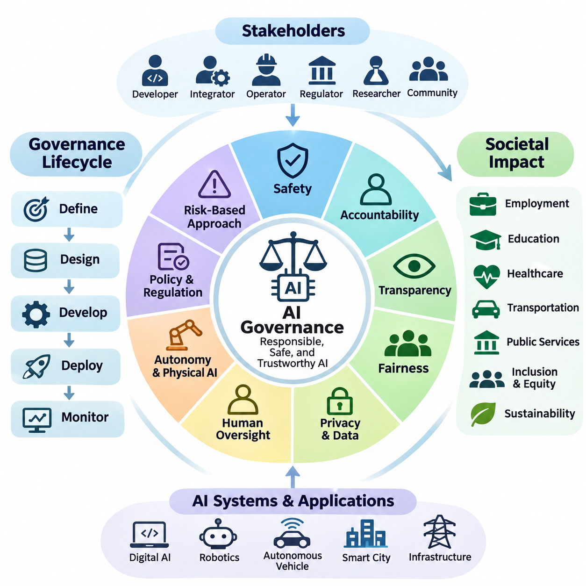
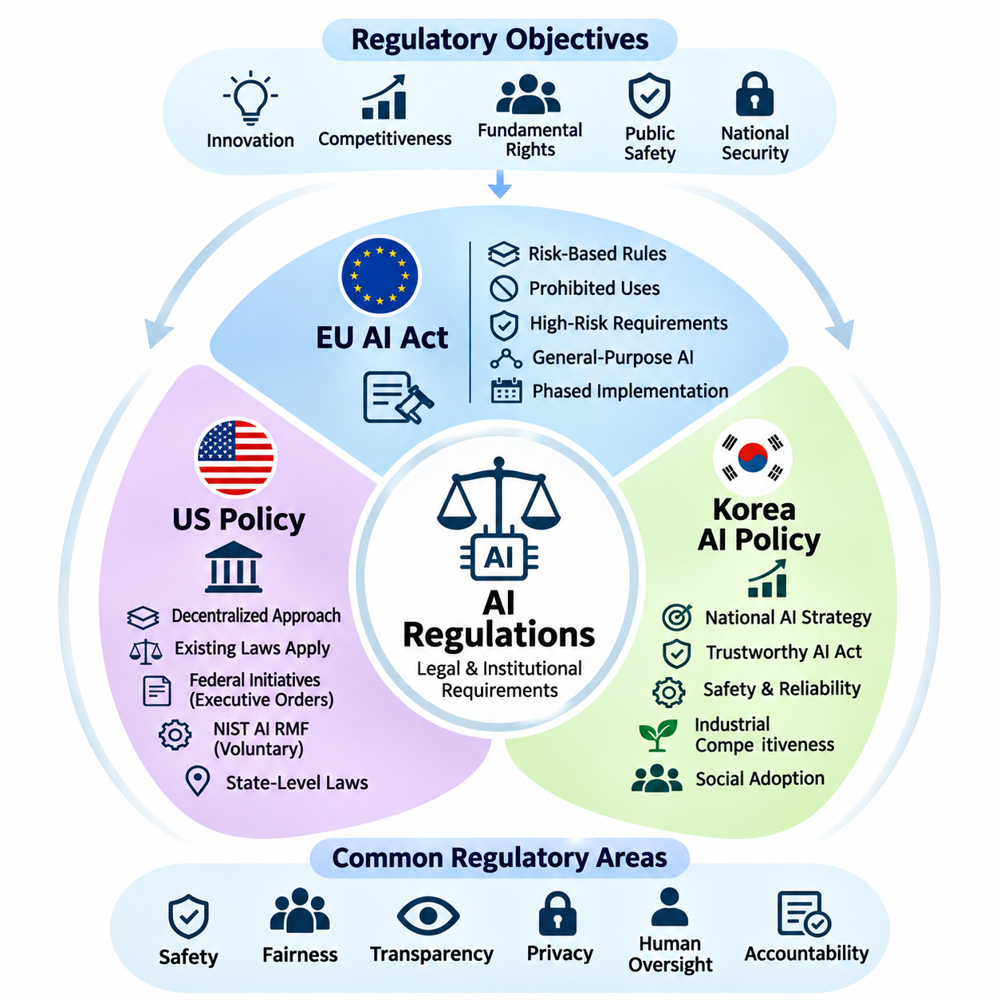
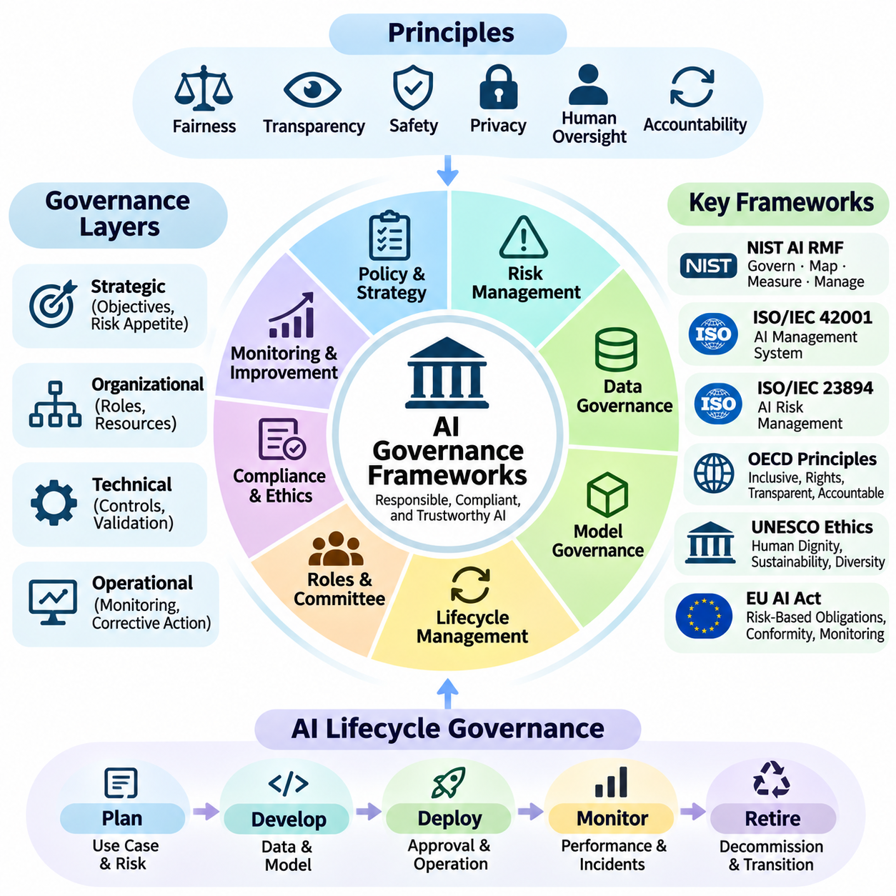
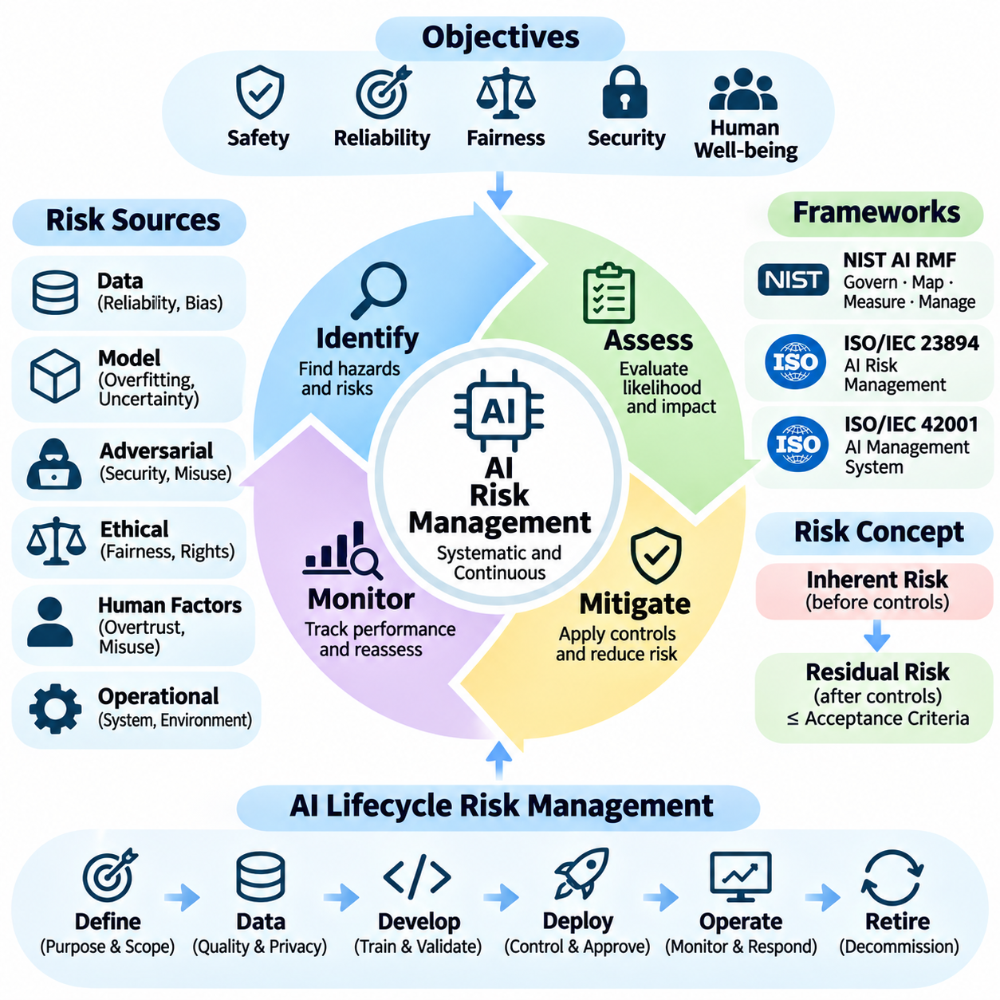
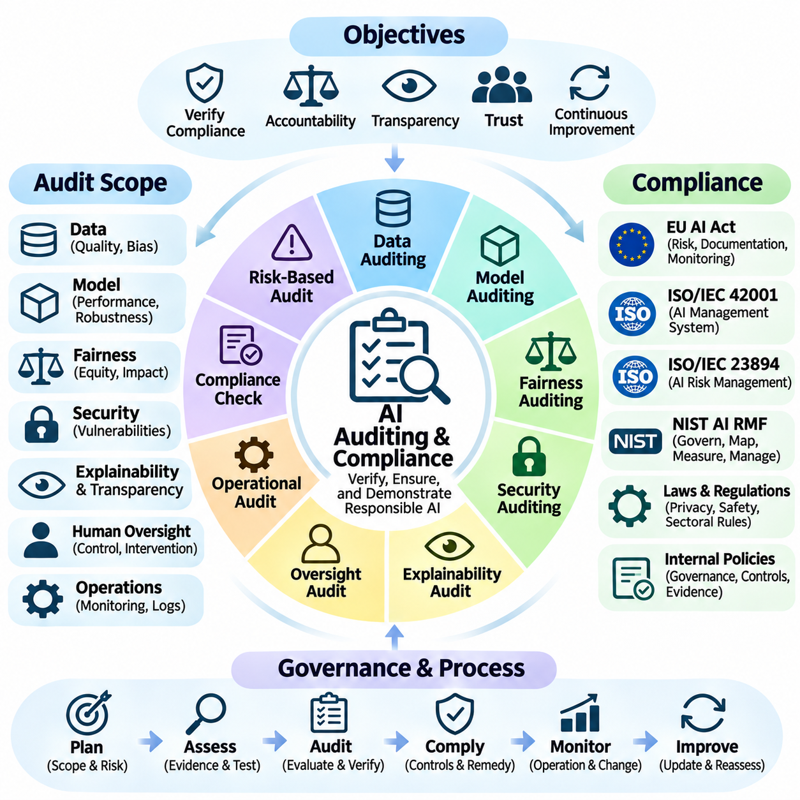
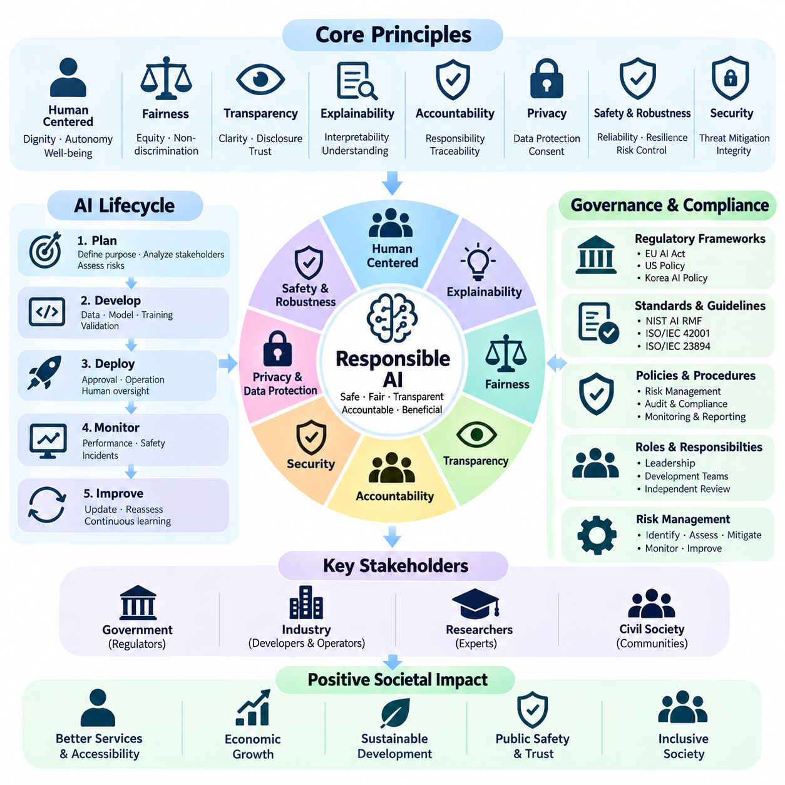
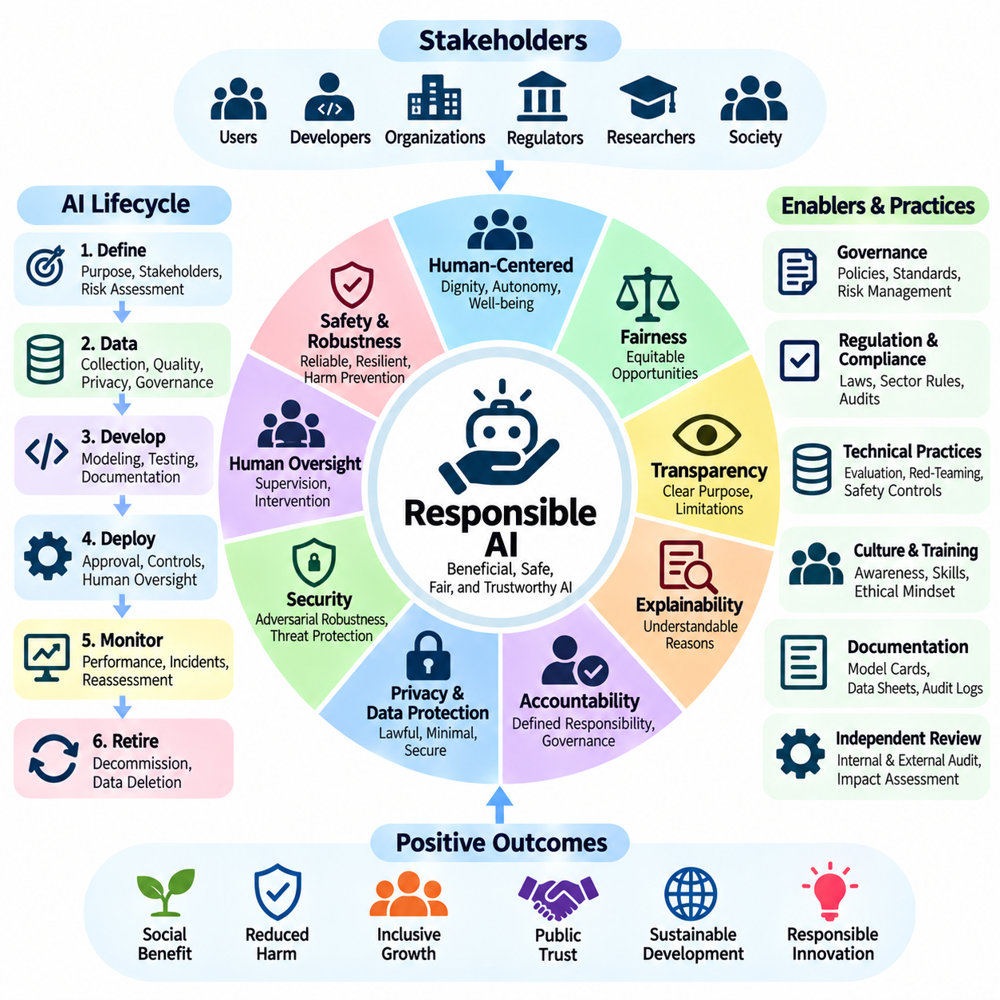
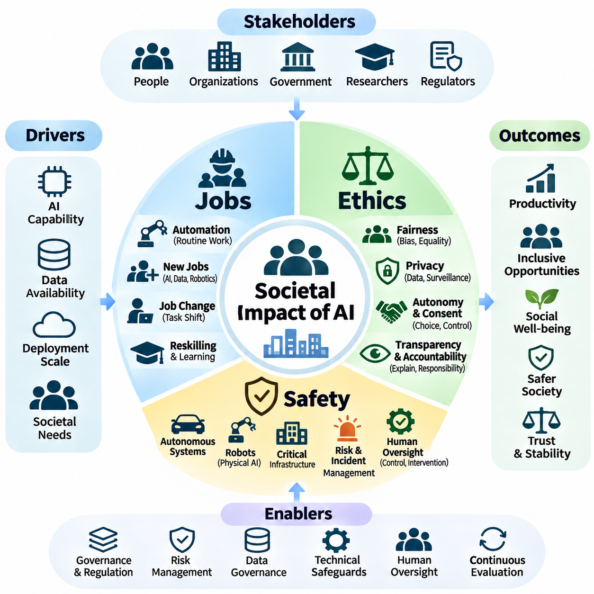
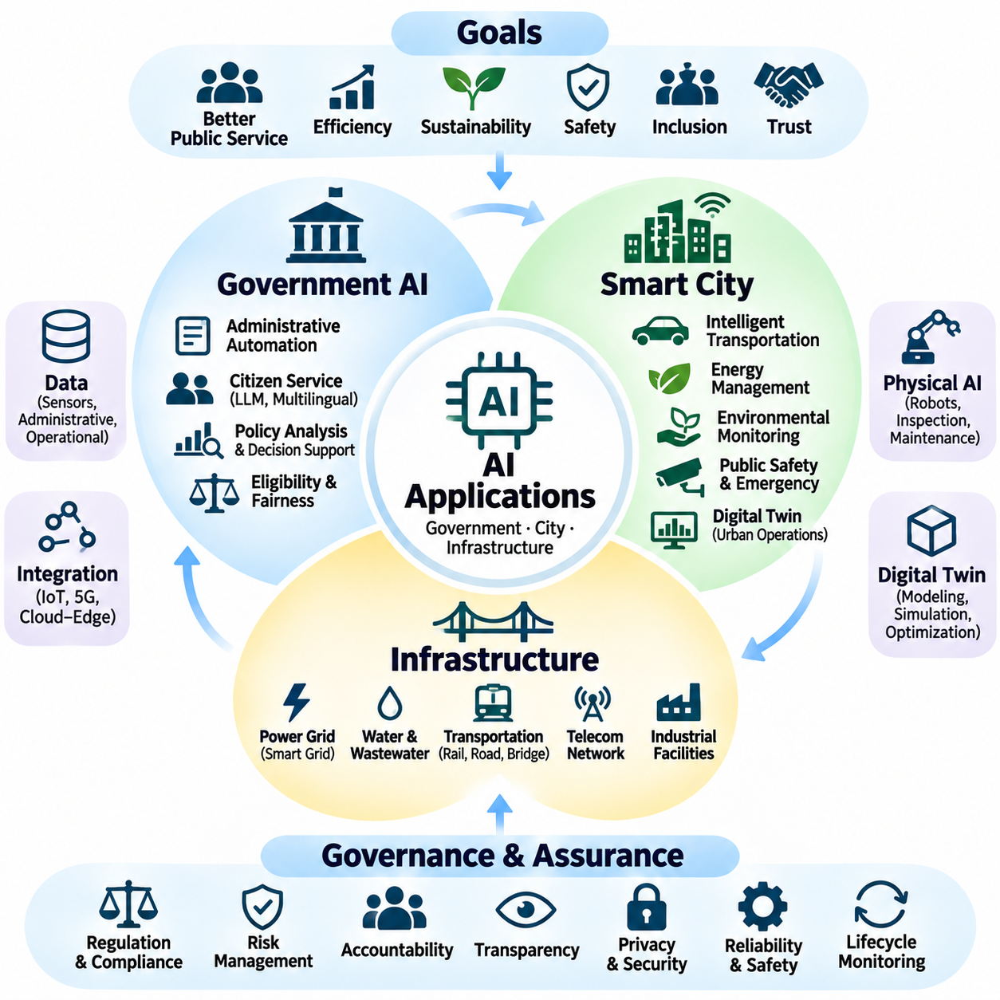

**Volume 42. AI Safety Alignment and Interpretability**

# 06. Governance and Societal Impact

## 06.00 Overview

{width="7.268055555555556in" height="7.268055555555556in"}

Artificial intelligence governance establishes the institutional, technical, and organizational mechanisms required to develop and deploy AI systems responsibly. As intelligent technologies increasingly influence economic activities, public services, and physical environments, governance must address safety, accountability, transparency, fairness, and human oversight throughout the entire AI lifecycle.

The societal impact of artificial intelligence extends beyond algorithmic performance and computational efficiency. AI systems influence employment, education, healthcare, transportation, public administration, and access to essential services. Their deployment can improve productivity and accessibility while introducing risks associated with discrimination, surveillance, economic inequality, institutional dependence, and unintended consequences.

Effective AI governance requires coordination among developers, system integrators, operators, regulators, researchers, and affected communities. Each stakeholder contributes different responsibilities, including technical validation, regulatory compliance, operational monitoring, and public accountability. Governance structures must clarify decision authority and establish mechanisms for resolving conflicts between competing objectives.

Governance frameworks should distinguish organizational policies from technical safeguards and legally enforceable requirements. Organizational policies define acceptable practices, technical safeguards constrain system behavior, and regulatory requirements establish mandatory obligations. These layers should reinforce one another while remaining adaptable to technological progress and changing societal expectations.

The governance lifecycle begins with defining intended purposes, operational boundaries, affected populations, and acceptable risk levels. These considerations influence dataset selection, model architecture, evaluation procedures, deployment conditions, and monitoring requirements. Early governance integration reduces the likelihood that ethical or legal concerns will emerge only after systems enter production.

Risk-based governance recognizes that AI applications differ substantially in their potential consequences. A recommendation engine, clinical decision-support system, autonomous vehicle, and industrial robot operate under different risk conditions. Governance requirements should therefore reflect the severity, likelihood, reversibility, and distribution of potential harms rather than applying identical controls universally.

Safety governance focuses on preventing unacceptable harm arising from incorrect predictions, unexpected interactions, system failures, or unsafe autonomous actions. This requires systematic hazard identification, risk assessment, verification, validation, and operational monitoring. Safety responsibilities must remain explicit even when intelligent components adapt to changing environments or operate with limited human supervision.

Accountability establishes how responsibility is assigned when AI systems influence decisions or produce harmful outcomes. Clear accountability requires documented roles, traceable development decisions, auditable operational records, and defined escalation procedures. Organizations must avoid situations in which responsibility becomes ambiguous because decisions emerge from complex interactions among models, infrastructure, and human operators.

Transparency supports informed understanding of how AI systems are developed, evaluated, and used. It includes communicating system capabilities, intended purposes, known limitations, uncertainty, and relevant operational constraints. Transparency does not necessarily require unrestricted disclosure of proprietary models, but it should provide sufficient information for appropriate oversight, contestability, and independent assessment.

Fairness governance examines whether AI systems distribute benefits, errors, and risks equitably across individuals and communities. Bias can emerge from historical datasets, measurement practices, model objectives, deployment contexts, and feedback mechanisms. Fairness assessments should consider both statistical performance differences and the broader social conditions under which automated decisions affect opportunities and outcomes.

Privacy and data governance are essential because modern AI systems frequently depend on extensive collections of personal, behavioral, environmental, and operational information. Responsible data practices include lawful collection, purpose limitation, minimization, access control, retention management, and secure processing. Governance must also address risks created by data inference, reidentification, and secondary uses.

Human oversight remains a fundamental governance principle, particularly when AI systems influence safety-critical operations or consequential decisions. Oversight mechanisms may include human approval, supervisory control, intervention authority, and emergency shutdown capabilities. Their effectiveness depends on whether operators possess sufficient information, training, response time, and practical authority to intervene meaningfully.

Autonomous and Physical AI systems introduce governance challenges that differ from those associated with purely digital applications. Robots, autonomous vehicles, and intelligent infrastructure interact directly with physical environments, equipment, and people. Their governance must integrate software assurance, mechanical safety, cybersecurity, environmental perception, operational constraints, and responsibility for real-world actions.

The increasing autonomy of intelligent agents complicates conventional assumptions about supervision and control. Agentic systems may plan tasks, invoke external tools, coordinate with other agents, and execute actions over extended periods. Governance mechanisms must establish permission boundaries, action authorization, resource limitations, behavioral monitoring, and recovery procedures when autonomous execution diverges from intended objectives.

AI governance must also consider cybersecurity and adversarial manipulation. Malicious inputs, compromised datasets, model extraction, prompt injection, and unauthorized control interfaces can undermine otherwise reliable systems. Security governance requires continuous threat assessment, defense-in-depth architectures, incident response capabilities, and coordinated vulnerability management across the AI supply chain.

Regulatory governance translates public policy objectives into enforceable obligations, assessment procedures, and institutional responsibilities. International standards and regulatory frameworks increasingly emphasize risk management, documentation, transparency, and oversight. Organizations operating across jurisdictions must reconcile differing legal requirements while maintaining consistent internal principles for responsible development and deployment.

Standards provide common terminology, evaluation methods, and management practices that support interoperability and accountability. Frameworks such as the NIST AI Risk Management Framework and ISO/IEC 42001 offer structured approaches to identifying, managing, and reviewing AI-related risks. Their practical effectiveness depends on implementation quality, organizational commitment, and evidence of operational compliance.

Societal governance must address the economic transformation associated with AI adoption. Automation can increase productivity, improve service availability, and create new technical occupations, but it may also displace existing tasks and redistribute economic opportunities. Responsible transition strategies require workforce development, accessible education, institutional adaptation, and consideration of communities exposed to disproportionate disruption.

Public trust depends not only on technical reliability but also on procedural legitimacy and meaningful participation. Individuals affected by AI-supported decisions should have appropriate opportunities to understand relevant processes, raise concerns, and seek review or remedies. Participatory governance can help identify contextual risks that conventional engineering evaluations may overlook.

Environmental sustainability represents another important dimension of AI governance. Training large models, operating inference infrastructure, manufacturing specialized hardware, and deploying autonomous machines consume energy and physical resources. Responsible governance should evaluate lifecycle impacts, computational efficiency, hardware utilization, maintenance requirements, and the environmental consequences of system-wide adoption.

Continuous governance is necessary because AI risks evolve after deployment. Changes in operating environments, user behavior, model distributions, software dependencies, and institutional expectations can invalidate earlier assumptions. Monitoring, periodic reassessment, incident analysis, and controlled updates allow organizations to detect emerging problems and maintain alignment between deployed behavior and governance objectives.

A mature governance framework connects strategic objectives with measurable operational evidence. Risk registers, evaluation reports, model documentation, audit trails, incident records, and performance indicators provide information for management review. Governance effectiveness should be assessed through demonstrated risk reduction, timely corrective action, accountability, and sustained operational reliability rather than documentation alone.

The long-term objective of AI governance is to ensure that increasingly capable intelligent systems remain beneficial, controllable, and socially legitimate. Achieving this objective requires integrating engineering discipline, institutional accountability, regulatory coordination, and public participation. Governance and societal impact must therefore be treated as foundational dimensions of AI system design rather than secondary considerations.

## 06.01 AI Regulations

{width="7.268055555555556in" height="7.268055555555556in"}

Artificial intelligence regulation establishes legal and institutional requirements for developing, deploying, and operating intelligent systems. Regulatory approaches differ across jurisdictions because governments balance innovation, economic competitiveness, fundamental rights, public safety, and national security differently. Understanding these differences is essential for organizations developing AI technologies for international markets.

The European Union, United States, and South Korea represent three important approaches to AI governance. The European Union emphasizes harmonized legislation and risk-based obligations, while the United States combines federal initiatives, sector-specific laws, and state-level regulation. South Korea integrates national AI development strategies with legislation intended to promote trustworthy AI and industrial competitiveness.

The European Union Artificial Intelligence Act establishes a comprehensive regulatory framework for AI systems placed on the European market or used within its jurisdiction. Its risk-based structure differentiates applications according to their potential consequences for safety and fundamental rights. The regulation also addresses general-purpose AI models, transparency obligations, regulatory supervision, and enforcement mechanisms.

The EU AI Act identifies prohibited AI practices that present unacceptable risks to individuals or society. These include certain forms of manipulative AI, social scoring, and specified biometric applications, subject to detailed legal definitions and exceptions. The prohibition framework reflects the principle that some AI uses should not be permitted merely because technical safeguards or organizational controls are available.

High-risk AI systems under the EU AI Act are subject to additional requirements concerning risk management, data governance, technical documentation, recordkeeping, transparency, human oversight, accuracy, robustness, and cybersecurity. Depending on the application, conformity assessment procedures and registration obligations may also apply. These requirements connect engineering practices with regulatory accountability.

The classification of high-risk AI depends on its intended purpose and applicable legal provisions rather than computational complexity alone. Relevant domains include certain medical devices, machinery, critical infrastructure, employment systems, education, and public services. Organizations must evaluate whether their applications fall within regulated categories and whether exemptions or sector-specific provisions apply.

The EU AI Act also establishes obligations for providers of general-purpose AI models, including documentation and information-sharing requirements. Models presenting systemic risks face additional evaluation, risk mitigation, incident reporting, and cybersecurity obligations. These provisions recognize that broadly reusable foundation models can influence numerous downstream applications beyond their original development context.

Implementation of the EU AI Act follows a phased timetable rather than a single universal compliance date. Different provisions apply at different stages, and legislative amendments or transitional arrangements may affect specific obligations. Organizations should therefore maintain regulatory monitoring processes that distinguish provisions already applicable from requirements scheduled for future implementation.

For international AI developers, the EU framework has implications beyond European headquarters or infrastructure. Its territorial scope can cover certain providers and deployers outside the European Union when relevant market or output-use conditions are satisfied. Compliance planning consequently requires attention to product distribution, deployment location, contractual responsibilities, and the intended use of AI-generated outputs.

In the United States, AI governance follows a more decentralized regulatory structure. Federal agencies, state legislatures, courts, and sector-specific authorities contribute different requirements and guidance. Existing laws governing consumer protection, employment discrimination, privacy, financial services, healthcare, and product safety may apply to AI systems even when they were not originally written specifically for artificial intelligence.

Federal AI policy has emphasized innovation, national competitiveness, security, government adoption, and the management of technological risks, although priorities vary between administrations. Executive orders and agency guidance can influence federal operations and policy direction without necessarily establishing comprehensive obligations for private companies. Their legal scope and continuing applicability require separate examination.

The NIST AI Risk Management Framework provides a voluntary structure for identifying, measuring, managing, and governing AI risks. Its functions support organizational accountability, documentation, evaluation, and continuous improvement. Although the framework is not itself a federal law, it can inform procurement practices, internal assurance programs, and sector-specific compliance activities.

State-level AI legislation adds another dimension to the American regulatory landscape. Different states have introduced requirements concerning automated decision-making, consumer protection, employment, privacy, and algorithmic discrimination. Consequently, organizations deploying AI across multiple states may face overlapping obligations, varying implementation schedules, and different enforcement mechanisms.

American regulatory practice frequently relies on existing institutional authorities rather than a single comprehensive AI statute. Agencies may evaluate deceptive AI claims, discriminatory automated decisions, unsafe products, or improper data practices under established legal frameworks. Developers must therefore examine both AI-specific measures and the broader laws governing their products and industries.

South Korea has established a national AI regulatory foundation through the Framework Act on the Development of Artificial Intelligence and the Creation of a Foundation for Trust, commonly known as the AI Basic Act. Effective January 22, 2026, the legislation combines measures supporting AI research and industrial development with obligations concerning transparency, safety, and trustworthy deployment.\&#x20;

[image](https://www.google.com/s2/favicons?domain=https://www.law.go.kr\\&sz=32)

Korean AI policy emphasizes technological competitiveness, research infrastructure, industrial adoption, and coordinated national governance. Government initiatives support AI development, training data, testing facilities, international cooperation, and commercialization. These policies reflect an effort to strengthen domestic AI capabilities while establishing institutional mechanisms for managing emerging technological risks.

The Korean AI Basic Act introduces provisions concerning high-impact AI and transparency for specified AI products and services. Relevant responsibilities may involve notifying users about AI interactions, addressing synthetic content, and implementing appropriate safety or reliability measures. The precise obligations depend on statutory definitions, implementing rules, and the characteristics of the deployed system.

For high-impact AI applications, Korean governance emphasizes assessment of potential consequences for human life, physical safety, and fundamental rights. Organizations should examine the intended application, degree of autonomy, affected populations, and available human oversight. This approach is particularly relevant to AI systems operating in healthcare, transportation, energy, and other consequential environments.

Korea\'s regulatory environment also interacts with existing privacy, cybersecurity, product safety, and sector-specific legislation. Compliance with the AI Basic Act does not automatically satisfy obligations arising from personal information protection or industrial safety requirements. Developers must evaluate the combined legal framework applicable to their datasets, products, operating environments, and commercial relationships.

Comparing the three jurisdictions reveals differences in regulatory structure but also substantial convergence in underlying objectives. The European Union emphasizes harmonized risk-based legislation, the United States relies on distributed legal and institutional mechanisms, and South Korea combines national AI promotion with statutory trust requirements. All three approaches recognize the importance of safety, accountability, transparency, and responsible innovation.

Organizations operating internationally should develop compliance architectures capable of accommodating jurisdiction-specific requirements without fragmenting their engineering processes. Shared foundations may include documented risk assessments, model evaluation, incident management, human oversight, cybersecurity controls, and traceable development records. Regulatory mapping can then connect these common controls to the obligations applicable in each market.

For autonomous vehicles, robotics, and Physical AI, regulatory compliance requires particular attention to the relationship between intelligent software and physical safety. AI-specific legislation may operate alongside machinery regulations, transportation rules, functional safety standards, and product liability frameworks. Effective governance therefore integrates algorithmic assurance with system-level engineering, operational validation, and continuous regulatory review.

AI regulation will continue evolving as foundation models, autonomous agents, and embodied intelligence create new technical capabilities and societal risks. Organizations should treat regulatory readiness as a continuous engineering and governance responsibility rather than a one-time certification exercise. Sustainable compliance depends on adapting technical safeguards, institutional processes, and accountability mechanisms as legal requirements and deployment conditions change.

## 06.02 AI Governance Frameworks

{width="7.268055555555556in" height="7.268055555555556in"}

AI governance frameworks provide structured mechanisms for ensuring that artificial intelligence systems are developed, deployed, and operated responsibly. They translate ethical principles, regulatory obligations, and organizational objectives into practical policies and operational controls. Effective frameworks establish accountability, risk management, transparency, human oversight, and continuous evaluation throughout the AI lifecycle.

The primary purpose of an AI governance framework is to connect strategic responsibility with technical implementation. Governance cannot depend exclusively on ethical declarations or voluntary commitments. Organizations require defined decision-making authorities, measurable objectives, documented procedures, and verification mechanisms that demonstrate whether AI systems satisfy established safety, reliability, fairness, and compliance requirements.

Governance frameworks typically operate across strategic, organizational, technical, and operational layers. Strategic governance establishes institutional objectives and acceptable risk boundaries, while organizational governance assigns responsibilities and resources. Technical governance defines engineering controls, and operational governance ensures that deployed systems remain within approved conditions through monitoring and corrective action.

The NIST AI Risk Management Framework provides a widely recognized approach to managing risks associated with artificial intelligence. Its four interconnected functions, Govern, Map, Measure, and Manage, support the systematic identification and treatment of AI risks. The framework emphasizes organizational context, trustworthy AI characteristics, stakeholder engagement, and continuous improvement across development and deployment activities.

Within the NIST framework, the Govern function establishes policies, responsibilities, organizational culture, and oversight mechanisms. Map identifies the intended context, stakeholders, potential impacts, and operational boundaries of AI systems. Measure evaluates risks and system characteristics, while Manage prioritizes responses, implements controls, and monitors whether mitigation measures remain effective.

ISO/IEC 42001 establishes requirements for an Artificial Intelligence Management System that organizations can integrate into existing management structures. It addresses governance responsibilities, organizational context, planning, operational controls, performance evaluation, and continual improvement. Its management-system approach helps organizations institutionalize responsible AI practices rather than relying on isolated technical assessments.

ISO/IEC 23894 complements management-system governance by providing guidance on AI-specific risk management. It supports the identification, analysis, evaluation, and treatment of risks arising from AI systems and their operational environments. Organizations can use this guidance alongside broader enterprise risk management processes to address uncertainty, unintended consequences, and changing system behavior.

International governance principles also influence organizational AI frameworks. The OECD AI Principles emphasize inclusive growth, human rights, transparency, robustness, security, and accountability. UNESCO\'s Recommendation on the Ethics of Artificial Intelligence expands the discussion to human dignity, environmental sustainability, cultural diversity, and societal well-being, encouraging governance beyond purely technical performance measures.

The European Union\'s regulatory approach introduces legally enforceable obligations that can be incorporated into organizational governance systems. Risk classification, conformity assessment, technical documentation, human oversight, and post-market monitoring become governance responsibilities when applicable. Organizations must distinguish mandatory regulatory requirements from voluntary standards and ethical recommendations to establish defensible compliance strategies.

Effective governance requires a clearly defined allocation of responsibilities among executive leadership, AI development teams, risk managers, compliance specialists, and operational personnel. Executive leadership establishes risk appetite and organizational priorities, while engineering teams implement technical safeguards. Independent review functions evaluate whether development decisions and deployment practices satisfy approved governance policies.

An AI governance committee can coordinate decisions involving high-risk applications, sensitive datasets, model deployment, and significant system modifications. Such committees should include expertise in engineering, cybersecurity, privacy, legal compliance, safety, and relevant application domains. Their effectiveness depends on explicit decision authority, documented review criteria, escalation procedures, and access to reliable technical evidence.

Lifecycle governance begins before model development and continues through retirement or replacement. During planning, organizations define intended uses, prohibited applications, stakeholder impacts, and acceptable risks. Development introduces data quality controls, model validation, and documentation, while deployment requires operational approval, performance monitoring, incident response, and periodic reassessment.

Data governance forms a foundational component of AI governance because training and operational datasets strongly influence model behavior. Governance policies should address data provenance, collection legitimacy, representativeness, annotation quality, access permissions, retention, and privacy protection. Dataset documentation and version control support traceability when models are retrained, evaluated, or transferred between operational environments.

Model governance establishes controls over model selection, training, evaluation, release, modification, and retirement. Model registries, version histories, evaluation reports, and approval records provide evidence of engineering decisions. Governance processes should also identify limitations, uncertainty, distribution shifts, and dependencies on external foundation models or third-party services that may affect operational reliability.

Risk management within governance frameworks must account for technical failures and broader societal consequences. Relevant risks include unsafe behavior, discriminatory outcomes, privacy violations, security vulnerabilities, misinformation, and excessive automation dependence. Assessment methods should consider likelihood, severity, affected populations, uncertainty, and the effectiveness of existing controls before authorizing deployment.

Human oversight mechanisms establish how people supervise, intervene in, or override AI-supported decisions. Governance frameworks should specify when human approval is required, what information operators receive, and how intervention authority is exercised. Oversight must be designed around realistic operational conditions because nominal human involvement does not guarantee meaningful control over complex or rapidly acting systems.

Transparency and explainability support governance by making system capabilities, limitations, and decision processes accessible to relevant stakeholders. Internal transparency enables engineers and auditors to investigate behavior, while external transparency helps users understand AI involvement and potential consequences. Documentation should communicate uncertainty and known limitations without implying that every complex model decision can be completely explained.

Auditing and assurance provide evidence that governance requirements are implemented effectively. Internal audits examine policies, technical controls, development records, and operational practices, while independent assessments may provide additional scrutiny. Audit findings should lead to corrective actions, assigned responsibilities, verification of remediation, and management review rather than remaining isolated compliance reports.

Continuous monitoring is essential because AI systems can experience performance degradation, changing data distributions, emerging vulnerabilities, and unexpected user interactions. Governance frameworks should define measurable indicators, alert thresholds, incident classification, and escalation procedures. Monitoring results must feed back into model maintenance, risk reassessment, operational restrictions, and deployment decisions.

For autonomous systems and Physical AI, governance must extend beyond software models to integrated hardware, sensors, actuators, communication networks, and operating environments. Safety responsibilities involve system-level hazard analysis, operational design domains, fail-safe mechanisms, and human intervention capabilities. Governance must ensure that autonomous behavior remains compatible with physical safety constraints and applicable engineering standards.

Third-party and supply-chain governance becomes increasingly important as organizations integrate pretrained models, cloud platforms, external datasets, and commercial AI services. Dependencies can introduce licensing restrictions, security vulnerabilities, uncertain data provenance, and limited visibility into model development. Governance policies should establish supplier assessment, contractual responsibilities, update management, and contingency procedures for critical dependencies.

Governance maturity develops through repeated evaluation and organizational learning. Initial frameworks may emphasize policy creation and basic documentation, while more advanced implementations integrate automated controls, continuous assurance, quantitative risk indicators, and independent oversight. Maturity should be assessed through demonstrated effectiveness, timely incident resolution, and sustained accountability rather than the number of policies produced.

A comprehensive AI governance framework ultimately connects ethical objectives, regulatory requirements, engineering practices, and organizational accountability into a coherent operating system. Its success depends on leadership commitment, technical evidence, stakeholder participation, and continuous adaptation. As AI systems become increasingly autonomous and influential, governance must evolve into an integral component of trustworthy system architecture and responsible technological deployment.

## 06.03 Risk Management

{width="7.268055555555556in" height="7.268055555555556in"}

Risk management in artificial intelligence establishes systematic processes for identifying, assessing, mitigating, and monitoring uncertainties that may affect system safety, reliability, fairness, security, and societal well-being. Unlike conventional software, AI systems can exhibit probabilistic behavior, data-dependent failures, and unexpected interactions. Effective risk management must therefore address both technical vulnerabilities and broader organizational consequences.

AI risk management begins by defining the intended purpose, operating environment, stakeholders, and acceptable risk boundaries of a system. These factors determine which hazards require attention and how potential consequences should be evaluated. Organizations must consider normal operation, foreseeable misuse, abnormal conditions, and interactions with external systems when establishing the scope of risk assessments.

Risk identification examines potential sources of harm throughout the AI lifecycle, including data collection, model training, validation, deployment, maintenance, and retirement. Relevant risks include biased datasets, inaccurate predictions, adversarial attacks, privacy violations, automation failures, and unintended autonomous behavior. Identifying risks early allows organizations to implement preventive controls before failures become operational incidents.

Risk assessment evaluates the likelihood and severity of identified hazards while considering uncertainty, exposure, and the effectiveness of existing safeguards. Traditional risk matrices provide qualitative classifications, while quantitative methods estimate probabilities, expected losses, and operational consequences. For complex AI systems, these approaches should be supplemented by scenario analysis and evidence-based testing.

The distinction between inherent risk and residual risk is fundamental to AI governance. Inherent risk represents potential exposure before protective controls are applied, whereas residual risk remains after mitigation measures have been implemented. Organizations must determine whether residual risks fall within approved acceptance criteria and whether additional controls or deployment restrictions are necessary.

The NIST AI Risk Management Framework provides a structured approach through its Govern, Map, Measure, and Manage functions. These functions connect organizational accountability with contextual risk identification, technical measurement, and operational mitigation. Their iterative application supports continuous reassessment as AI capabilities, deployment conditions, and stakeholder expectations evolve.

ISO/IEC 23894 provides guidance for integrating AI-specific risk management into organizational processes. It emphasizes contextual understanding, risk identification, analysis, evaluation, treatment, communication, and monitoring. When combined with ISO/IEC 42001, these practices support a management system that connects strategic governance responsibilities with practical risk controls and documented evidence.

Data-related risks frequently originate from incomplete coverage, inaccurate labels, sampling bias, outdated information, or inappropriate data collection practices. Such weaknesses can propagate through model training and produce unreliable or discriminatory outcomes. Risk mitigation requires data provenance tracking, quality assessment, representative sampling, privacy protection, and systematic evaluation of dataset limitations.

Model-related risks arise from overfitting, poor calibration, distribution shift, uncertainty, and inadequate generalization. A model that performs well on benchmark datasets may behave unpredictably under unfamiliar operational conditions. Risk management should therefore include out-of-distribution testing, uncertainty estimation, stress testing, and explicit characterization of performance boundaries before deployment.

Adversarial and cybersecurity risks require particular attention because intelligent systems may be manipulated through malicious inputs, compromised training data, or unauthorized access. Threat modeling should consider adversarial examples, data poisoning, model extraction, prompt injection, and supply-chain vulnerabilities. Defensive strategies combine secure development practices, access controls, monitoring, and incident response capabilities.

Fairness and ethical risks emerge when AI systems produce unequal outcomes, reinforce historical discrimination, or influence individuals without adequate transparency. These risks cannot always be evaluated through predictive accuracy alone. Organizations should examine demographic performance differences, affected populations, decision consequences, and opportunities for human review or contestation.

Human factors introduce additional risks when operators misunderstand model capabilities, overtrust automated recommendations, or cannot intervene effectively. Automation bias and poorly designed interfaces can amplify technical errors into organizational failures. Risk management must therefore evaluate human-machine interaction, operator training, workload, intervention authority, and the practical effectiveness of oversight mechanisms.

Risk mitigation strategies can reduce the probability of failure, limit the severity of consequences, or prevent exposure to unacceptable conditions. Technical controls include redundancy, input validation, confidence thresholds, fallback mechanisms, and runtime monitoring. Organizational controls include approval procedures, independent reviews, operational restrictions, and clearly assigned responsibilities for corrective action.

Safety-critical AI applications require hazard analysis methods that account for interactions among software, hardware, humans, and environmental conditions. Techniques such as Failure Mode and Effects Analysis, Fault Tree Analysis, and Systems-Theoretic Process Analysis can support systematic examination of failure pathways. These methods should be adapted to AI-specific uncertainty and integrated with conventional safety engineering practices.

Autonomous vehicles and Physical AI systems introduce direct physical consequences when perception, planning, or control functions fail. Risks may arise from sensor degradation, localization errors, unexpected obstacles, communication failures, or unsafe actuator commands. Effective management requires operational design domains, safety constraints, emergency intervention capabilities, and validated minimum-risk behavior.

Risk evaluation should distinguish isolated component performance from integrated system behavior. Individually reliable models may interact in ways that create unexpected hazards when connected through perception, planning, decision-making, and control pipelines. System-level testing must therefore examine interface assumptions, timing dependencies, cascading failures, and recovery behavior under realistic operating conditions.

Scenario-based risk analysis explores how AI systems respond to rare events, unusual combinations of conditions, and foreseeable operational disturbances. Simulation, fault injection, adversarial testing, and controlled field experiments can reveal weaknesses not captured by standard benchmarks. Scenario coverage should reflect operational hazards and known limitations rather than relying exclusively on randomly generated tests.

Risk registers provide structured records of identified hazards, affected assets, likelihood estimates, severity assessments, mitigation measures, responsible owners, and residual risk decisions. Maintaining these records improves traceability and accountability across development teams. Risk registers should remain active operational documents that evolve with new evidence, incidents, and system modifications.

Risk acceptance requires explicit organizational authority and evidence that remaining exposure is consistent with legal obligations and established safety objectives. Not every risk can be eliminated, but unacceptable hazards should not be justified solely by economic benefits or performance improvements. Approval processes should document assumptions, limitations, compensating controls, and conditions that trigger reassessment.

Continuous monitoring detects emerging risks after deployment, including model drift, degraded accuracy, abnormal behavior, cybersecurity incidents, and unexpected environmental interactions. Monitoring systems should establish measurable indicators, alert thresholds, escalation procedures, and response responsibilities. Operational evidence must inform decisions about retraining, rollback, temporary restrictions, or system shutdown.

Incident management transforms operational failures and near misses into opportunities for systematic improvement. Effective processes include event detection, severity classification, evidence preservation, root-cause analysis, corrective action, and verification of remediation. Lessons learned should update risk assessments, testing procedures, operational policies, and engineering requirements to prevent repeated failures.

Third-party dependencies introduce risks involving external models, cloud services, datasets, hardware suppliers, and software libraries. Organizations may have limited visibility into these components or their development processes. Supplier assessment, contractual obligations, vulnerability monitoring, version control, and contingency planning help reduce exposure to failures outside direct organizational control.

A mature AI risk management program integrates governance, technical assurance, operational monitoring, and continuous organizational learning. Its effectiveness depends on measurable evidence, clear accountability, realistic testing, and timely corrective action. As AI systems become increasingly autonomous and interconnected, risk management must evolve from periodic compliance assessment into a continuous capability embedded throughout system engineering and deployment.

## 06.04 Auditing and Compliance

{width="7.268055555555556in" height="7.268055555555556in"}

AI auditing and compliance establish systematic processes for verifying whether artificial intelligence systems satisfy regulatory obligations, organizational policies, technical standards, and ethical commitments. Auditing examines evidence of system behavior and governance effectiveness, while compliance ensures that applicable requirements are consistently fulfilled. Together, these functions strengthen accountability, transparency, and trust throughout the AI lifecycle.

AI auditing differs from conventional software auditing because intelligent systems often exhibit probabilistic behavior, data-dependent outcomes, and changing performance under unfamiliar conditions. Auditors must examine not only software architecture and security controls but also training data, model evaluation, decision patterns, uncertainty, and operational impacts. This broader scope requires interdisciplinary expertise and evidence-based assessment methods.

Compliance management begins by identifying applicable laws, regulations, standards, contractual obligations, and internal governance requirements. Organizations operating internationally must consider jurisdiction-specific rules, sectoral regulations, privacy legislation, and product safety requirements. A regulatory applicability assessment establishes which obligations govern each AI application and how compliance responsibilities should be allocated.

An effective AI compliance program translates external obligations into measurable internal controls. Regulatory requirements should be mapped to development procedures, documentation practices, testing protocols, approval workflows, and operational safeguards. This mapping creates traceability between legal expectations and engineering evidence, enabling organizations to demonstrate how specific requirements are satisfied.

The EU AI Act illustrates how regulatory compliance can require documented risk management, data governance, technical documentation, human oversight, and post-market monitoring for applicable high-risk systems. Depending on the system and relevant provisions, conformity assessment and registration may also be required. Organizations must distinguish applicable legal duties from voluntary guidance and monitor phased implementation schedules.

ISO/IEC 42001 provides requirements for establishing, implementing, maintaining, and continually improving an Artificial Intelligence Management System. Its management-system structure supports internal audits, leadership review, documented responsibilities, and corrective action. Certification against the standard may provide independent assurance of management-system conformity, but it does not automatically establish compliance with every applicable AI law.

The NIST AI Risk Management Framework supports auditing through its Govern, Map, Measure, and Manage functions. These functions encourage organizations to document risk ownership, system context, evaluation methods, and mitigation decisions. Although the framework is voluntary, its structured approach can support audit preparation, control assessment, and continuous assurance across diverse AI applications.

Audit scope should be defined according to system criticality, regulatory classification, operational exposure, and potential consequences. A low-risk recommendation engine may require different evidence from an autonomous vehicle or medical decision-support system. Risk-based audit planning directs resources toward systems where failures could produce significant safety, legal, financial, or societal impacts.

Data auditing evaluates the quality, legitimacy, representativeness, and governance of datasets used throughout the AI lifecycle. Auditors examine data provenance, collection permissions, labeling accuracy, missing values, sampling bias, privacy safeguards, and retention practices. Dataset versioning and documented transformations help establish whether training and evaluation results can be reproduced and independently verified.

Model auditing examines development procedures, training configurations, evaluation datasets, performance metrics, and known limitations. Auditors assess whether models meet documented acceptance criteria and whether testing reflects realistic deployment conditions. Robustness, calibration, generalization, fairness, and security evaluations provide evidence that reported performance extends beyond selected benchmark results.

Fairness auditing investigates whether AI systems produce unjustified performance differences or discriminatory outcomes across relevant populations. Appropriate methods depend on the application, available data, legal context, and competing fairness objectives. Auditors should evaluate subgroup performance, decision thresholds, potential sources of bias, and the practical consequences of model outputs rather than relying on a single fairness metric.

Security auditing addresses vulnerabilities affecting AI models, data pipelines, infrastructure, and connected services. Relevant assessments include access control reviews, adversarial testing, data poisoning analysis, prompt injection resistance, model extraction risks, and software supply-chain security. Findings should be evaluated according to exploitability, potential impact, and the effectiveness of existing defensive controls.

Explainability and transparency audits determine whether relevant stakeholders receive appropriate information about AI capabilities, limitations, and decision processes. Internal documentation should enable technical investigation, while user-facing disclosures should accurately communicate AI involvement and material risks. Auditors must distinguish meaningful explanations from superficial descriptions that do not support understanding or accountability.

Human oversight auditing evaluates whether designated personnel can supervise, challenge, interrupt, or override AI-supported decisions when necessary. Evidence may include interface evaluations, operator training records, intervention logs, and emergency procedures. Effective oversight requires sufficient information, realistic response times, clearly assigned authority, and demonstrated intervention capability under operational conditions.

Technical documentation is essential because audit conclusions must be supported by verifiable evidence. Relevant records include system specifications, model cards, dataset descriptions, risk assessments, validation reports, change histories, incident logs, and approval decisions. Documentation should remain consistent with deployed configurations and provide traceability from requirements through implementation, testing, and operational monitoring.

Audit trails record significant events and decisions throughout system operation. These records may capture model versions, input characteristics, output decisions, human interventions, configuration changes, and security events, subject to privacy and security constraints. Reliable timestamps, access controls, integrity protection, and retention policies help preserve evidence for investigations and regulatory reviews.

Internal audits provide recurring assessments of organizational controls and engineering practices, while independent external audits may offer additional scrutiny. Audit independence, professional competence, access to evidence, and clearly defined assessment criteria influence the credibility of findings. Organizations should recognize that independent assessment does not eliminate management responsibility for system safety and compliance.

Conformity assessment determines whether a system satisfies specified regulatory or technical requirements before or during market deployment. Depending on the applicable legal framework, assessment may involve internal control procedures or authorized third-party bodies. Conformity assessment should not be confused with comprehensive proof of safety, because system performance can change after initial evaluation.

Continuous compliance monitoring addresses the possibility that models, datasets, infrastructure, regulations, and operating conditions evolve after deployment. Organizations should establish compliance indicators, review intervals, automated evidence collection, and escalation procedures. Significant model updates or changes in intended use may require renewed assessments, additional testing, or revised documentation.

Nonconformities identified during audits require structured corrective and preventive action. Organizations should document the finding, determine its underlying cause, assign responsible personnel, implement remediation, and verify effectiveness. Repeated deficiencies may indicate weaknesses in governance, engineering processes, or organizational culture that require broader management intervention.

For autonomous systems and Physical AI, auditing must include interactions among perception models, planning algorithms, control software, sensors, actuators, and physical environments. Evidence should cover operational design domains, hazard analyses, emergency responses, fail-safe behavior, and system-level validation. Compliance may involve AI-specific requirements alongside machinery, transportation, cybersecurity, and functional safety obligations.

Third-party AI components create additional audit challenges because organizations may lack direct access to proprietary models, training datasets, or supplier development records. Supplier assessments, contractual audit rights, security attestations, model documentation, and dependency tracking can reduce these visibility gaps. Responsibility for integrating external components safely remains a central governance consideration.

A mature AI auditing and compliance program integrates regulatory mapping, technical verification, independent assessment, operational evidence, and continuous improvement. Its purpose extends beyond passing inspections or obtaining certifications. Effective auditing establishes justified confidence that AI systems remain accountable, reliable, and appropriately controlled as technologies, deployment conditions, and regulatory expectations evolve.

## 06.05 Responsible AI

{width="7.268055555555556in" height="7.268055555555556in"}

{width="7.268055555555556in" height="7.268055555555556in"}

Responsible AI establishes the principles, practices, and institutional responsibilities required to develop artificial intelligence systems that benefit individuals and society while minimizing foreseeable harm. It integrates ethical reasoning, technical reliability, legal compliance, and human-centered design throughout the AI lifecycle. Its objective is not merely to create capable systems but to ensure that their capabilities are exercised appropriately.

Responsible AI extends beyond conventional performance optimization because high accuracy does not necessarily imply safety, fairness, transparency, or social acceptability. A model may achieve excellent benchmark results while producing discriminatory decisions or unsafe behavior in unfamiliar environments. Responsible development therefore requires multidimensional evaluation that considers technical performance alongside human rights and societal consequences.

Human-centered AI places human dignity, autonomy, and well-being at the center of system design. AI applications should support meaningful human choices rather than manipulate behavior or unnecessarily replace human judgment. This principle requires attention to user needs, accessibility, informed participation, and the distribution of benefits and risks among individuals and communities affected by automated decisions.

Fairness is a foundational element of Responsible AI because training data and algorithmic decisions can reproduce historical inequalities. Fairness assessment examines whether systems produce unjustified differences in treatment, opportunity, or outcomes across relevant populations. Appropriate evaluation requires contextual understanding, representative datasets, subgroup analysis, and recognition that different fairness metrics may conflict.

Transparency enables stakeholders to understand when AI is involved, what purposes it serves, and which limitations affect its outputs. Responsible systems should communicate their intended uses, operational boundaries, and significant uncertainties without creating misleading impressions of certainty. Transparency also supports independent scrutiny, informed consent where applicable, and meaningful accountability for consequential decisions.

Explainability complements transparency by providing interpretable information about how AI systems generate predictions, recommendations, or actions. Different stakeholders require different explanation levels, ranging from technical diagnostics for engineers to understandable reasons for affected individuals. Explanations should be evaluated for fidelity, usefulness, and consistency rather than treated as universally complete descriptions of complex models.

Accountability ensures that identifiable individuals and organizations remain responsible for AI-related decisions and consequences. Governance structures should assign ownership for development, deployment approval, monitoring, incident response, and corrective action. Accountability cannot be transferred entirely to automated systems, external model providers, or abstract algorithmic processes when human institutions retain operational authority.

Privacy and data protection are essential because AI development often depends on extensive collections of personal, behavioral, or sensitive information. Responsible practices include lawful data collection, purpose limitation, data minimization, access control, retention management, and appropriate privacy-enhancing techniques. Organizations must also evaluate memorization, unintended disclosure, and information inference risks.

Safety and robustness require AI systems to operate reliably under expected conditions and respond appropriately when those conditions change. Responsible engineering incorporates uncertainty estimation, stress testing, adversarial evaluation, failure detection, and fallback mechanisms. Safety objectives should be established before deployment and validated against realistic scenarios, including foreseeable misuse and environmental disturbances.

Security is closely connected to responsibility because compromised AI systems can expose confidential information, manipulate decisions, or create physical hazards. Threat modeling should consider data poisoning, adversarial inputs, prompt injection, model extraction, and compromised dependencies. Secure development practices, vulnerability management, access restrictions, and continuous monitoring help preserve system integrity.

Human oversight provides mechanisms for supervising automated decisions, correcting errors, and intervening when unacceptable behavior occurs. The appropriate level of oversight depends on system autonomy, decision consequences, and operational response time. Meaningful oversight requires trained personnel, understandable system information, clearly defined authority, and intervention capabilities that function under realistic conditions.

Responsible AI development begins with explicit problem formulation and stakeholder analysis. Organizations should determine whether AI is appropriate for the intended task and whether less intrusive alternatives could achieve comparable benefits. Early design reviews should identify affected populations, foreseeable harms, operational constraints, and ethical tradeoffs before substantial technical commitments are made.

Responsible data practices extend across collection, annotation, preprocessing, training, evaluation, and deletion. Dataset documentation should identify provenance, intended uses, known limitations, and potential representation gaps. Quality assurance and version control improve reproducibility, while periodic reassessment helps determine whether previously acceptable datasets remain appropriate as applications and populations change.

Model development should incorporate documented objectives, reproducible experiments, representative evaluation, and explicit acceptance criteria. Responsible evaluation examines not only average accuracy but also subgroup performance, uncertainty, robustness, failure severity, and behavior under distribution shift. Independent review and controlled release procedures provide additional assurance before models influence consequential decisions.

Generative AI introduces responsibilities associated with fabricated information, harmful outputs, copyright concerns, privacy leakage, and misleading representations of machine-generated content. Responsible deployment may require content safeguards, provenance mechanisms, user disclosures, and human verification for consequential applications. Evaluation should examine both direct model behavior and downstream misuse enabled by generated outputs.

Agentic AI creates additional challenges because systems may plan, use tools, access external resources, and execute actions with limited supervision. Responsible agent design requires permission boundaries, action validation, constrained tool access, audit trails, and mechanisms for interruption or rollback. The degree of autonomy granted should remain proportional to demonstrated reliability and the consequences of potential failures.

Physical AI and autonomous robotics extend responsible design into environments where algorithmic decisions can produce immediate physical consequences. Perception errors, unsafe trajectories, actuator failures, and unexpected human interactions may create serious hazards. Responsible deployment requires system-level safety engineering, operational design domains, emergency stopping capabilities, and validated minimum-risk behavior.

Responsible AI also considers the environmental and economic consequences of computational infrastructure. Large-scale training and inference consume electricity, computing resources, and hardware materials, while deployment can affect labor markets and organizational practices. Sustainability assessments should consider energy efficiency, hardware utilization, lifecycle impacts, and whether anticipated societal benefits justify resource consumption.

Inclusive participation strengthens Responsible AI by incorporating perspectives from people who develop, operate, regulate, and experience AI systems. Stakeholder engagement can reveal accessibility barriers, cultural assumptions, overlooked harms, and practical limitations absent from technical benchmarks. Participation should influence design decisions and remediation priorities rather than serve only as symbolic consultation.

Responsible deployment requires clear communication about system capabilities, limitations, appropriate uses, and available remedies. Users should understand when automated decisions materially affect them and how concerns can be raised. Complaint handling, appeal mechanisms, incident reporting, and accessible support channels help convert ethical commitments into practical protections for affected individuals.

Continuous evaluation is necessary because responsible behavior cannot be guaranteed by a single predeployment assessment. Changes in data distributions, user behavior, regulatory expectations, and system integrations may introduce new risks. Organizations should monitor real-world outcomes, investigate incidents, update safeguards, and suspend or restrict systems when evidence indicates unacceptable harm.

Responsible AI governance integrates ethical principles with measurable engineering requirements and organizational accountability. Frameworks such as the NIST AI Risk Management Framework and ISO/IEC 42001 can support systematic implementation, documentation, and improvement. However, adopting a framework does not by itself demonstrate responsible outcomes; effectiveness must be established through evidence and operational practice.

The long-term objective of Responsible AI is to align technological progress with human welfare, institutional accountability, and sustainable societal development. As AI systems become more capable, autonomous, and deeply integrated into critical infrastructure, responsibility must remain a continuous engineering and governance obligation. Trustworthy AI emerges when ethical commitments are translated into verifiable safeguards and consistently maintained throughout real-world operation.

## 06.06 Societal Impact

{width="7.268055555555556in" height="7.268055555555556in"}

The societal impact of artificial intelligence extends beyond technological performance to employment, economic opportunity, ethical responsibility, public safety, and institutional stability. As AI systems become integrated into workplaces, public services, and physical infrastructure, their consequences affect individuals and communities differently. Understanding these effects requires examining how technological capabilities interact with social structures and human needs.

AI-driven transformation influences society through productivity improvements, automation, decision support, and the creation of new services. These benefits may increase economic efficiency and expand access to information, healthcare, and transportation. However, the distribution of benefits depends on institutional arrangements, workforce readiness, infrastructure availability, and policies that address emerging inequalities.

Employment represents one of the most visible dimensions of AI\'s societal impact. Machine learning, generative AI, and autonomous systems can automate routine cognitive tasks, repetitive physical operations, and selected analytical activities. Rather than eliminating entire occupations uniformly, AI often changes the composition of tasks within jobs, creating different opportunities and risks across industries.

Workforce displacement occurs when automated systems reduce demand for particular tasks or occupational roles. Administrative processing, basic content production, standardized customer support, and repetitive manufacturing activities may experience substantial restructuring. The pace and consequences of displacement depend on technology adoption, labor regulations, business incentives, and the availability of alternative employment.

AI can also generate new occupations involving model development, data engineering, safety evaluation, cybersecurity, robotics integration, and human-AI coordination. Existing professions may evolve as workers increasingly supervise automated processes and interpret machine-generated recommendations. These changes create demand for interdisciplinary skills combining technical literacy, domain expertise, and critical judgment.

Workforce adaptation requires education, reskilling, and lifelong learning programs aligned with changing technological requirements. Effective initiatives should provide accessible training, practical experience, and pathways into emerging occupations. Governments, educational institutions, employers, and workers share responsibility for ensuring that technological transitions do not disproportionately disadvantage vulnerable populations.

The economic effects of AI depend on how productivity gains are distributed among employees, organizations, consumers, and technology providers. Automation may increase output while concentrating profits and decision-making power within a limited number of firms. Public policy and organizational governance can influence whether productivity improvements support broader prosperity or intensify existing economic inequalities.

Human-AI collaboration offers an alternative to viewing automation solely as labor replacement. AI systems can support professionals by processing information, identifying patterns, and handling repetitive activities while humans retain contextual judgment and accountability. Effective collaboration requires appropriate task allocation, understandable interfaces, reliable outputs, and mechanisms for correcting automated errors.

Physical AI and robotics introduce additional employment changes in manufacturing, logistics, agriculture, transportation, and public infrastructure maintenance. Autonomous machines may reduce exposure to hazardous environments and physically demanding tasks. However, deployment can also restructure operational roles, introduce new maintenance requirements, and create workforce concerns about surveillance, safety, and job security.

Ethical considerations become essential when AI systems influence opportunities, rights, resources, and human relationships. Responsible deployment requires evaluating not only whether a system performs its intended function but also whether its use respects human dignity, autonomy, fairness, and social expectations. Ethical analysis must consider affected stakeholders and the consequences of decisions across different communities.

Algorithmic bias can arise when historical inequalities, incomplete datasets, or inappropriate modeling assumptions influence automated decisions. In employment, finance, healthcare, and public services, biased outputs may reinforce disadvantages affecting particular populations. Ethical governance requires representative evaluation, contextual fairness assessment, transparent decision criteria, and accessible mechanisms for challenging harmful outcomes.

Privacy and surveillance represent significant ethical challenges because AI enables large-scale analysis of personal behavior, communications, images, and location information. Such capabilities may improve service delivery and security while also enabling intrusive monitoring or misuse of sensitive data. Appropriate safeguards include lawful collection, purpose limitation, data minimization, access restrictions, and independent oversight.

Autonomy and informed consent are central to ethical AI because automated systems can influence decisions without users fully understanding their operation. Recommendation engines, conversational agents, and predictive systems may shape preferences or behavior through personalized outputs. Ethical design should preserve meaningful choice, communicate relevant limitations, and avoid deceptive or manipulative interaction patterns.

Transparency and accountability help establish legitimate relationships between AI developers, deploying organizations, and affected individuals. People should understand when automated decisions materially influence their lives and which institutions are responsible for those decisions. Explainability, documentation, appeal procedures, and independent review provide practical mechanisms for addressing errors and contested outcomes.

The concentration of AI capabilities within large organizations raises questions about market competition, democratic accountability, and access to essential technologies. Control over computational resources, training datasets, and foundation models may influence economic participation and information ecosystems. Societal governance should examine how technological power is distributed and whether institutions can exercise effective oversight.

Public safety becomes increasingly important as AI systems interact with transportation networks, healthcare facilities, industrial equipment, and critical infrastructure. Failures in perception, prediction, planning, or automated control can create consequences extending beyond individual users. Safety assessment must therefore consider system reliability, environmental conditions, human interaction, and the potential for cascading failures.

Safety-critical applications require rigorous engineering practices that integrate hazard identification, risk assessment, validation, and operational monitoring. Autonomous vehicles, medical AI, and industrial robots must demonstrate acceptable behavior under foreseeable operating conditions. Safety mechanisms should include uncertainty handling, fault detection, fallback strategies, emergency intervention, and clearly defined operational boundaries.

AI-enabled infrastructure introduces systemic risks because interconnected systems may share software dependencies, communication networks, data sources, or automated decision mechanisms. A failure in one component can propagate across transportation, energy, telecommunications, or public services. Resilience requires redundancy, isolation mechanisms, cybersecurity protection, contingency planning, and coordinated incident response.

Human factors influence societal safety when operators overtrust automated recommendations or misunderstand system limitations. Automation bias, inadequate training, unclear interfaces, and excessive workload can amplify technical failures. Effective safety governance should evaluate human-machine interaction, intervention authority, response times, and the practical ability of personnel to regain control during abnormal situations.

The misuse of AI creates additional public safety concerns involving misinformation, fraud, cyberattacks, discriminatory surveillance, and manipulation of information environments. Generative models and autonomous agents can increase the scale and speed of harmful activities. Risk reduction requires technical safeguards, security controls, public awareness, institutional coordination, and proportionate enforcement mechanisms.

Environmental sustainability is another dimension of societal impact because AI development and deployment require energy, computing infrastructure, water, and hardware resources. Although intelligent optimization may improve resource efficiency, large-scale computation can increase environmental burdens. Responsible evaluation should consider lifecycle impacts, energy consumption, hardware replacement, and measurable environmental benefits.

Societal impact assessment should combine quantitative indicators with qualitative evidence from affected communities. Employment changes, accessibility, fairness, safety incidents, environmental costs, and public trust cannot be adequately represented by a single performance metric. Participatory evaluation and longitudinal monitoring help identify consequences that may emerge only after widespread adoption.

The long-term societal value of AI depends on aligning innovation with inclusive economic development, ethical safeguards, and reliable public safety mechanisms. Governments, industry, researchers, and civil society must cooperate to establish adaptable governance arrangements. As AI becomes increasingly autonomous and embedded in everyday life, responsible progress requires continuous evaluation of who benefits, who bears risks, and how institutions protect human welfare.

## 06.07 Applications

{width="7.268055555555556in" height="7.268055555555556in"}

Artificial intelligence applications in government, smart cities, and critical infrastructure demonstrate how intelligent systems can improve public services while introducing complex governance responsibilities. These environments require more than technical accuracy because automated decisions may affect citizens, essential resources, and public safety. Responsible deployment must integrate transparency, accountability, legal compliance, and operational reliability.

Government AI supports administrative efficiency, public policy analysis, citizen services, and institutional decision-making. Machine learning systems can process documents, identify service demands, detect anomalies, and assist public officials with complex information. However, governmental applications require stronger accountability mechanisms because their decisions may influence legal rights, public benefits, and access to essential services.

AI-assisted public administration can automate document classification, application processing, information retrieval, and routine citizen inquiries. Natural language processing and generative AI can improve accessibility by supporting multilingual communication and personalized guidance. Nevertheless, automated recommendations must remain verifiable, and citizens should have clear opportunities to obtain human assistance when decisions are consequential.

Public-sector decision support systems may assist with resource allocation, infrastructure planning, emergency preparedness, and policy evaluation. Predictive models can reveal patterns that conventional analysis might overlook, but their outputs depend on data quality and modeling assumptions. Government agencies must distinguish statistical predictions from legitimate policy judgments and retain human responsibility for public decisions.

Algorithmic fairness is particularly important when government AI influences eligibility assessments, employment services, public housing, or social assistance. Historical administrative data may reflect existing inequalities, causing automated systems to reproduce discriminatory outcomes. Fairness evaluation should examine affected populations, subgroup performance, decision thresholds, and mechanisms for correcting inappropriate decisions.

Government AI governance requires documented legal authority, transparent procurement, data protection, independent auditing, and accessible appeal procedures. Public institutions should establish clear accountability for system selection, development, deployment, and monitoring. Citizens must be able to understand when AI materially influences administrative decisions and how those decisions can be reviewed or challenged.

Smart cities integrate artificial intelligence with connected sensors, communication networks, geographic information systems, and urban infrastructure. Their objective is to improve transportation, energy management, environmental monitoring, public safety, and municipal operations. Effective smart-city systems transform distributed data into coordinated decisions while respecting privacy, cybersecurity requirements, and public accountability.

Intelligent transportation systems use AI to analyze traffic conditions, predict congestion, optimize signal timing, and support incident detection. Integration with connected vehicles and roadside infrastructure can improve situational awareness and traffic coordination. Safety-critical applications require validated control policies, reliable communications, operational constraints, and fallback strategies when sensors or networks fail.

Smart-city energy management applies predictive analytics and optimization to electricity demand, renewable generation, storage systems, and building operations. AI can support load forecasting, demand response, and fault detection across distributed energy resources. Governance must address data integrity, cybersecurity, system interoperability, and the possibility that automated decisions could destabilize interconnected energy networks.

Environmental intelligence uses sensor networks and AI models to monitor air quality, water conditions, noise, urban heat, and environmental hazards. Predictive systems can identify emerging problems and support targeted interventions. Reliable operation requires calibrated sensors, representative spatial coverage, uncertainty estimation, and transparent communication of environmental measurements and forecasts.

Urban public safety applications include intelligent surveillance, emergency detection, disaster response, and autonomous inspection. Computer vision and multimodal sensor fusion can identify hazardous conditions and support faster operational responses. However, deployment must carefully balance safety benefits against privacy intrusion, surveillance expansion, false alarms, and potential discriminatory impacts.

Autonomous mobile robots and Physical AI platforms can support smart-city inspection, logistics, maintenance, and emergency operations. These systems combine perception, localization, planning, and control to navigate complex environments shared with pedestrians and vehicles. Their deployment requires operational design domains, obstacle avoidance, emergency stopping, remote supervision, and validated recovery behavior.

Smart-city digital twins provide virtual representations of urban assets, infrastructure networks, and operational processes. By integrating sensor measurements, geographic data, simulation, and predictive models, digital twins can support planning and maintenance decisions. Their reliability depends on model fidelity, data synchronization, uncertainty management, and continuous validation against real-world conditions.

Critical infrastructure AI extends intelligent automation into electricity grids, water distribution, transportation networks, telecommunications, and industrial facilities. These systems often operate continuously and support essential societal functions. Consequently, AI failures may create cascading disruptions, making resilience, cybersecurity, redundancy, and human intervention fundamental engineering requirements.

Predictive maintenance is a major infrastructure application in which AI analyzes vibration, temperature, acoustic signals, electrical measurements, and operational histories. Models estimate equipment degradation and identify emerging anomalies before catastrophic failure. Effective deployment requires trustworthy sensor data, validated diagnostic models, maintenance integration, and careful management of false alarms and missed detections.

Infrastructure inspection increasingly combines autonomous robots, drones, computer vision, LiDAR, thermal imaging, and specialized sensing technologies. These systems can detect structural deterioration, surface defects, abnormal temperatures, and potential underground hazards. Reliable inspection requires sensor calibration, spatial localization, evidence traceability, and expert verification before high-consequence maintenance decisions.

Water and wastewater infrastructure can benefit from AI-based leakage detection, demand forecasting, quality monitoring, and pump optimization. Intelligent systems may combine hydraulic models with pressure sensors, flow measurements, and environmental data. Because inaccurate predictions can affect service continuity and public health, deployment requires validated models, operational safeguards, and clearly defined escalation procedures.

Transportation infrastructure AI supports railway monitoring, bridge inspection, roadway maintenance, and network-level traffic management. Multimodal sensing and predictive analytics can identify deterioration, abnormal operating conditions, and emerging safety risks. Governance should require traceable inspection evidence, maintenance decision accountability, and verification of model performance across changing environmental conditions.

Infrastructure cybersecurity becomes increasingly important when AI systems interact with industrial control systems, operational technology, and remote monitoring networks. Compromised models or communication channels may influence physical operations and essential services. Security architectures should incorporate network segmentation, authenticated commands, anomaly detection, controlled updates, and tested incident recovery procedures.

Interoperability is essential because government platforms, smart-city systems, and infrastructure networks frequently involve equipment and software from multiple suppliers. Common data models, standardized interfaces, time synchronization, and secure communication protocols enable coordinated operation. Governance must also define responsibility for integration failures, incompatible updates, and dependencies on external technology providers.

Public procurement and lifecycle governance determine whether AI applications remain maintainable, auditable, and economically sustainable. Procurement requirements should address system performance, data ownership, cybersecurity, documentation, interoperability, and supplier obligations. Lifecycle planning must consider model updates, hardware replacement, operational training, incident response, and eventual system retirement.

Continuous assurance connects technical monitoring with institutional accountability after deployment. Government and infrastructure operators should track performance degradation, operational incidents, fairness concerns, security events, and changing regulatory obligations. Independent review, corrective action, and transparent reporting help ensure that systems remain appropriate as environments, populations, and technologies evolve.

The successful application of AI in government, smart cities, and infrastructure depends on integrating technological innovation with democratic accountability, safety engineering, and public trust. Intelligent systems should strengthen human decision-making rather than obscure responsibility. Long-term value emerges when measurable service improvements are accompanied by transparent governance, resilient operations, and sustained protection of public welfare.
