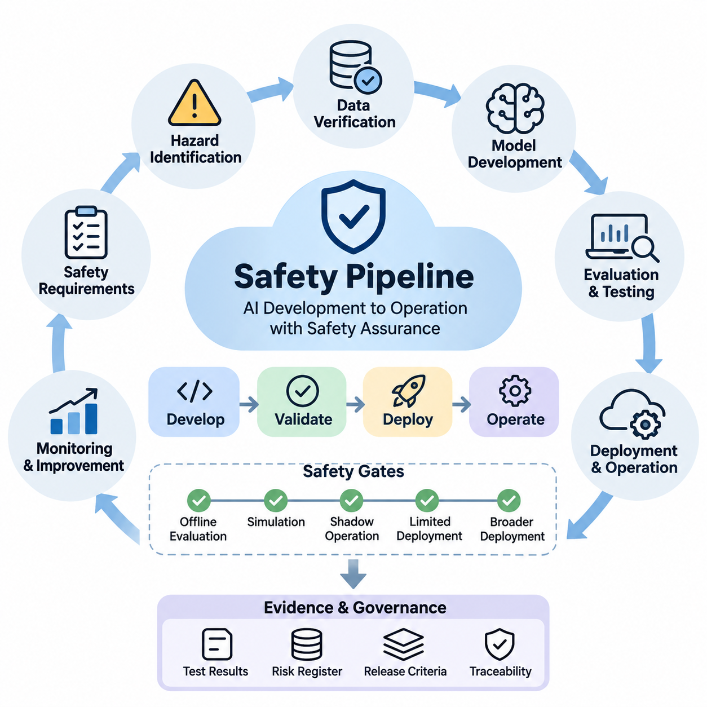
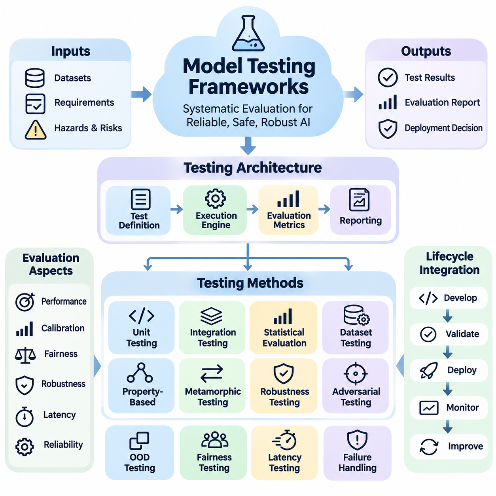
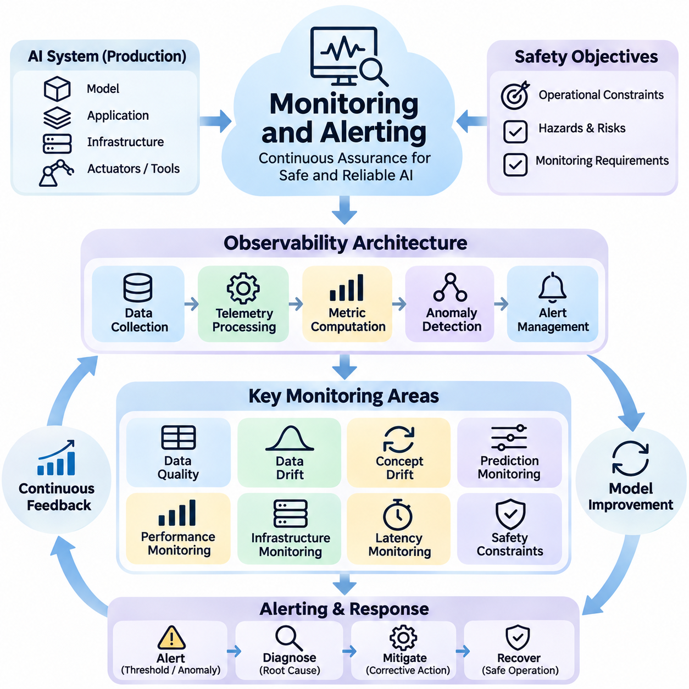
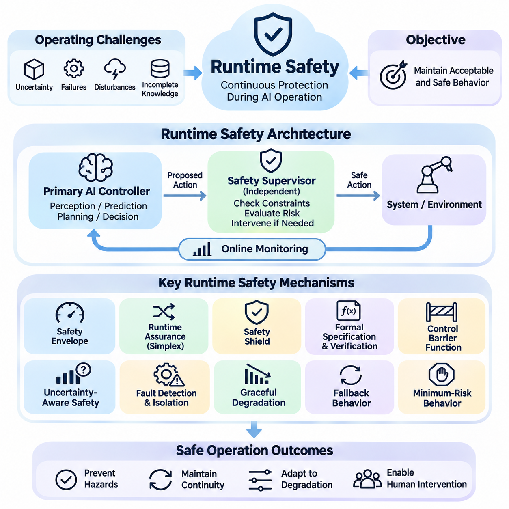
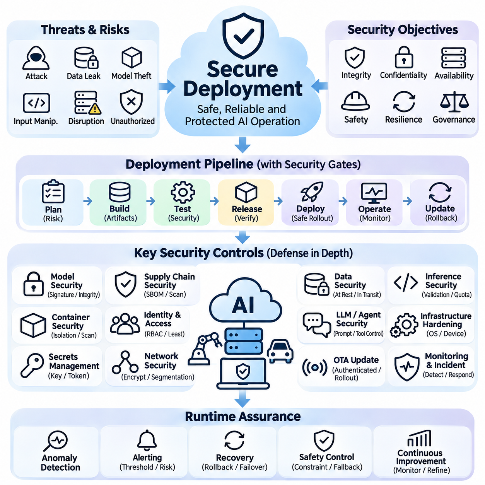
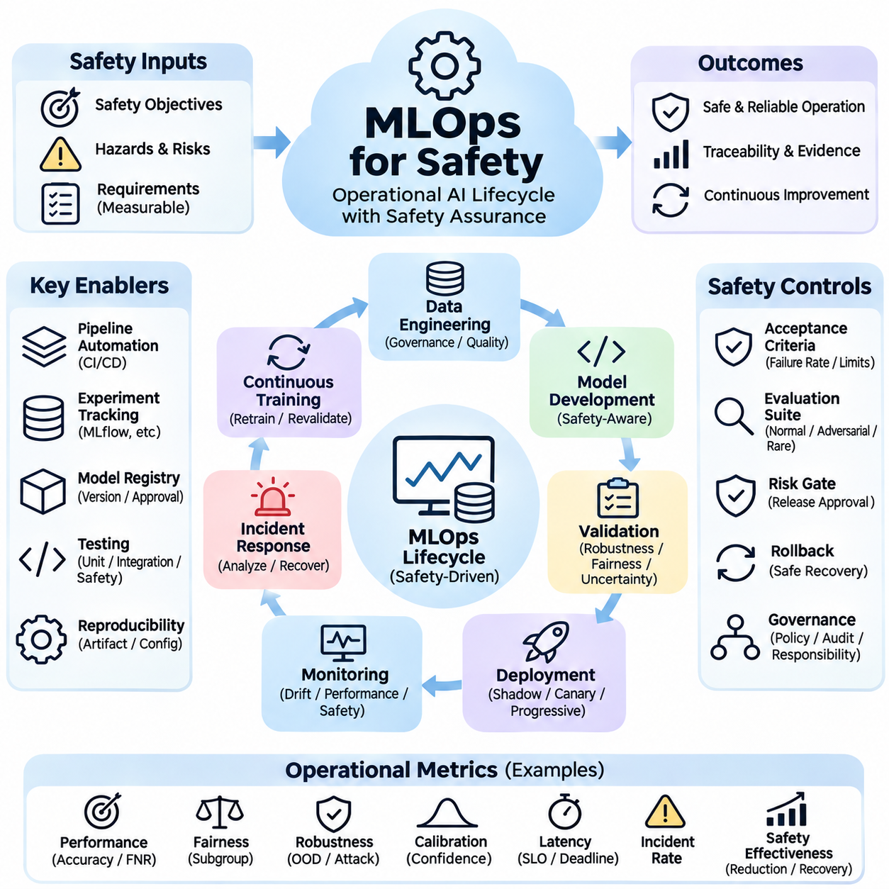

**Volume 42. AI Safety Alignment and Interpretability**

# 08. Engineering and Deployment

## 08.01 Safety Pipeline [w/Code]

{width="7.268055555555556in" height="7.268055555555556in"}

A safety pipeline provides a systematic engineering process for ensuring that artificial intelligence systems satisfy defined safety requirements throughout development, validation, deployment, and operation. Rather than treating safety as a final inspection, the pipeline integrates risk assessment, data verification, model evaluation, security testing, and operational controls into a continuous lifecycle. Each stage produces evidence supporting deployment decisions and future system improvements.

The engineering process begins by translating organizational safety objectives into measurable technical requirements. These requirements identify unacceptable outcomes, operational boundaries, environmental assumptions, and acceptable residual risks. Safety engineers collaborate with machine learning developers, domain specialists, and system operators to define evaluation criteria that reflect realistic operating conditions rather than relying exclusively on conventional predictive accuracy.

Hazard identification establishes the foundation of the pipeline by examining how model errors, unreliable inputs, software defects, and human interactions could produce harmful consequences. Techniques such as Failure Mode and Effects Analysis, fault tree analysis, and scenario-based hazard assessment help identify critical failure pathways. The resulting risk register connects individual hazards with mitigation measures, verification activities, responsible engineers, and documented acceptance decisions.

Data safety verification examines whether training, validation, and testing datasets adequately represent the intended operational environment. Automated checks detect missing values, corrupted samples, inconsistent labels, duplicate records, and unexpected distribution changes. Additional analysis evaluates representation across relevant populations, environmental conditions, and rare events. Dataset provenance and version tracking allow engineers to reproduce experiments and investigate safety failures.

Model development incorporates safety constraints directly into training and optimization workflows. Depending on the application, engineers may use constrained optimization, adversarial training, uncertainty estimation, calibrated confidence scores, or safety-aware loss functions. These mechanisms reduce exposure to known failure conditions but cannot independently guarantee safe behavior. Their effectiveness must be demonstrated through evaluation against explicitly defined hazards and operational requirements.

A practical implementation separates safety checks into reusable software components that operate within automated development workflows. Python-based validation modules can inspect dataset schemas, calculate evaluation metrics, and enforce release criteria. For example, a validation function may compare measured false-negative rates against application-specific thresholds and return a failure status when requirements are violated. Such thresholds must originate from risk analysis rather than arbitrary engineering preferences.

Continuous integration provides a mechanism for executing safety tests whenever source code, datasets, configuration files, or model artifacts change. Automated pipelines can perform unit testing, dependency scanning, data validation, regression evaluation, and adversarial testing before approving a candidate release. Tools such as pytest, GitHub Actions, and containerized test environments help standardize execution, while immutable artifacts preserve the relationship between tested models and deployed versions.

Safety evaluation must extend beyond aggregate performance metrics because average accuracy can conceal severe failures in critical operating scenarios. Engineers should examine false-negative rates, calibration error, subgroup performance, uncertainty behavior, and robustness under environmental disturbances. Scenario-based testing explores sensor degradation, ambiguous inputs, distribution shifts, and combinations of abnormal conditions. Results are compared against risk-specific acceptance criteria established before testing begins.

Adversarial and out-of-distribution testing investigate whether models remain dependable when inputs differ from normal training conditions. Test generators may introduce bounded perturbations, corrupted images, missing sensor measurements, unusual language instructions, or unexpected operating states. These experiments identify vulnerabilities and characterize performance degradation. Detection mechanisms can trigger conservative responses when input reliability becomes insufficient for safe autonomous decisions.

For autonomous robots and physical AI systems, the safety pipeline must account for interactions between perception, planning, control, and physical hardware. A perception error may influence trajectory generation, while delayed communication can prevent timely execution of corrective actions. Integrated testing therefore evaluates complete perception-action sequences, including obstacle detection, emergency stopping, localization uncertainty, actuator response, and recovery behavior under realistic timing constraints.

Simulation environments support systematic exploration of hazardous situations that would be expensive or unsafe to reproduce directly. Engineers can vary environmental conditions, introduce component failures, and execute large collections of randomized scenarios. Digital twins and hardware-in-the-loop platforms improve the realism of these experiments by incorporating physical dynamics and actual control components. Nevertheless, simulation evidence must be supplemented with controlled real-world validation.

Safety gates establish formal decision points between development stages. A candidate model may progress from offline evaluation to simulation, shadow operation, limited deployment, and broader production use only after satisfying the corresponding acceptance criteria. Each gate evaluates documented evidence, unresolved hazards, test coverage, and operational readiness. Failed gates require corrective action and renewed verification rather than informal exceptions or unsupported confidence in model behavior.

Deployment preparation introduces additional controls for software integrity, configuration management, and infrastructure security. Model artifacts should be versioned, authenticated, and associated with their training data, evaluation reports, and approved runtime configurations. Secure build processes, access restrictions, dependency verification, and rollback mechanisms reduce operational exposure. Deployment automation must prevent untested models or unauthorized configuration changes from bypassing established safety gates.

Runtime safety mechanisms provide protection against failures that emerge after deployment. Monitoring services can evaluate prediction confidence, input validity, response latency, resource consumption, and operational constraint violations. Independent supervisory components may reject unsafe commands, restrict system capabilities, or initiate predefined fallback behavior. In safety-critical physical systems, protective actions should not depend exclusively on the continued correctness of the AI model being supervised.

Monitoring and alerting transform operational observations into actionable safety information. Engineers establish thresholds for abnormal error rates, distribution shifts, repeated fallback activation, and unexpected system behavior. Telemetry records should include relevant timestamps, model versions, input characteristics, and decision outcomes while respecting privacy and security requirements. Alert prioritization helps distinguish routine anomalies from events requiring immediate intervention, investigation, or suspension of automated operation.

Incident management closes the gap between operational failures and engineering improvements. When a safety event occurs, the organization preserves relevant evidence, reconstructs the sequence of decisions, identifies contributing factors, and evaluates whether existing safeguards operated correctly. Root-cause analysis distinguishes data problems, model limitations, integration defects, and operational misuse. Corrective actions are incorporated into regression tests so previously observed failures remain visible during future development.

Traceability connects safety requirements to implementation components, test cases, evaluation results, and deployment approvals. A structured safety evidence repository enables reviewers to determine why a system was considered acceptable for a particular operating environment. Machine-readable metadata can associate each model release with its risk assessment, dataset version, software dependencies, and test outcomes. This supports reproducibility, auditing, and disciplined change management across the lifecycle.

Human oversight remains essential when safety decisions involve uncertain evidence, competing objectives, or potentially severe consequences. Automated checks can detect measurable violations, but they cannot fully determine whether residual risks are socially, legally, or operationally acceptable. Qualified reviewers must examine critical exceptions, approve significant changes, and retain authority to suspend deployment. Clear responsibility assignments prevent safety decisions from becoming fragmented across engineering and management teams.

The safety pipeline should evolve through continuous feedback from testing, monitoring, incidents, and changes in the operational environment. New failure patterns may require additional datasets, revised safety requirements, stronger runtime controls, or redesigned system architecture. Periodic reassessment ensures that earlier approvals remain relevant as models and dependencies change. Continuous improvement must preserve historical evidence while demonstrating that modifications do not introduce unacceptable new risks.

A mature safety pipeline integrates machine learning engineering, systems safety, cybersecurity, operational monitoring, and organizational governance into a unified assurance process. Its purpose is not to claim that complex AI systems are completely free from failure, but to establish defensible evidence that identified risks are controlled within defined operating boundaries. This engineering discipline enables reliable deployment while maintaining accountability, reproducibility, and the capacity to respond to emerging hazards.

## 08.02 Model Testing Frameworks [w/Code]

{width="7.268055555555556in" height="7.268055555555556in"}

Model testing frameworks provide a structured foundation for evaluating the reliability, safety, robustness, and operational readiness of artificial intelligence systems. Unlike conventional software testing, which often verifies deterministic outputs, AI testing must account for probabilistic predictions, uncertain inputs, and changing data distributions. A comprehensive framework combines functional validation, statistical evaluation, adversarial testing, and deployment-oriented verification.

The primary objective of a model testing framework is to determine whether an AI model satisfies predefined requirements under expected and unexpected operating conditions. These requirements include predictive performance, calibration, fairness, robustness, latency, and failure handling. Testing frameworks translate abstract safety objectives into measurable assertions, reproducible experiments, and automated acceptance criteria that support evidence-based deployment decisions.

A well-designed testing architecture separates test definitions, execution engines, evaluation metrics, and reporting components. Test definitions specify datasets, scenarios, perturbations, and expected behaviors. Execution engines run models under controlled configurations, while evaluation modules calculate performance indicators. Reporting components preserve experimental results, configuration metadata, failure examples, and comparisons against established acceptance thresholds.

Unit testing verifies individual components within a machine learning system, including preprocessing functions, feature transformations, model interfaces, and postprocessing logic. Frameworks such as pytest and unittest support automated assertions for input dimensions, numerical ranges, output structures, and exception handling. These tests detect implementation defects before broader model evaluation, reducing the risk that software errors will be mistaken for model limitations.

Integration testing examines interactions among data pipelines, inference engines, external services, and downstream decision modules. A model may perform correctly in isolation while producing unsafe results when connected to incompatible preprocessing logic or delayed sensor streams. Integration tests therefore validate interface contracts, data consistency, synchronization behavior, and error propagation across the complete inference workflow.

Statistical model evaluation measures predictive performance using metrics appropriate to the application domain. Classification systems may require precision, recall, F1 score, and confusion matrices, while regression models use absolute or squared error measurements. Safety-critical applications often emphasize false-negative rates, detection delay, and worst-case performance because a small number of severe failures can outweigh strong average accuracy.

Test dataset design strongly influences the credibility of evaluation results. Representative datasets should cover normal operating conditions, relevant population groups, environmental variations, and known failure scenarios. Separate development, validation, and final test partitions help prevent information leakage. Dataset versioning, provenance records, and controlled sampling procedures make comparisons reproducible and reduce the risk of misleading performance estimates.

Property-based testing evaluates general behavioral expectations rather than relying exclusively on predetermined input-output examples. Tools such as Hypothesis can generate diverse inputs to verify properties involving valid numerical ranges, consistent tensor dimensions, and stable interface behavior. For AI models, carefully defined invariants may also test whether irrelevant transformations preserve predictions within acceptable tolerances.

Metamorphic testing addresses situations where exact expected outputs are difficult to determine. Instead of requiring a complete reference answer, it examines relationships between predictions before and after controlled input transformations. For example, moderate illumination changes should not substantially alter object classification when illumination is irrelevant to the task. Such relationships must be justified by domain requirements because not every transformation preserves semantic meaning.

Robustness testing investigates how model behavior changes under noise, missing information, corrupted inputs, and distribution shifts. Libraries such as RobustBench and robustness evaluation toolkits support standardized comparisons for selected model families and threat assumptions. Engineers should measure degradation curves, uncertainty responses, and failure concentrations rather than reporting only performance under clean conditions. Results must identify the exact perturbation settings used.

Adversarial testing evaluates model susceptibility to intentionally constructed inputs designed to induce incorrect behavior. Frameworks such as Foolbox and Adversarial Robustness Toolbox provide implementations of attack and defense evaluation methods. Tests may examine bounded perturbations, adversarial examples, and model-specific vulnerabilities. Meaningful conclusions require explicit threat models, appropriate attack budgets, and careful avoidance of evaluation procedures that underestimate vulnerability.

Out-of-distribution testing evaluates whether models recognize inputs that differ substantially from their training distributions. Detection methods may use confidence scores, feature-space distances, energy-based scores, or specialized uncertainty estimators. Evaluation frameworks measure detection quality and examine whether unreliable predictions trigger appropriate handling. High confidence alone should never be interpreted as proof that an unfamiliar input is safe.

Fairness testing examines whether model performance differs across relevant groups or operating contexts. Frameworks such as Fairlearn and AI Fairness 360 support evaluation of selected group fairness metrics and mitigation techniques. Testing should consider demographic representation, intersectional subgroups, and application-specific harm. Fairness metrics may conflict, making contextual interpretation and documented tradeoffs essential rather than assuming that one numerical score establishes fairness.

Explainability testing evaluates whether interpretation methods produce useful and sufficiently stable evidence about model behavior. Tools such as SHAP, LIME, and Captum can support feature attribution and explanation analysis. Engineers may compare explanations across similar inputs, model versions, and controlled perturbations. However, plausible explanations do not establish causal correctness, and explanation quality must be assessed separately from predictive accuracy.

For large language models, testing frameworks must evaluate instruction following, factual reliability, harmful output risks, prompt injection resistance, and consistency across diverse contexts. Evaluation environments such as HELM support multidimensional assessment, while custom test suites examine application-specific safety policies. Automated graders can accelerate testing but require validation because their judgments may contain systematic errors or reproduce evaluator biases.

Agentic AI systems require additional testing of tool execution, planning behavior, permission boundaries, and long-horizon task completion. A model may generate individually acceptable actions while producing unsafe consequences through extended sequences of decisions. Testing frameworks should simulate tool failures, malicious instructions, incomplete observations, and unexpected state transitions. Evaluation must consider cumulative risk and recovery behavior across entire trajectories.

Physical AI testing extends model evaluation into perception, planning, control, and hardware interaction. Simulation platforms can generate obstacle encounters, sensor failures, localization errors, and communication delays. Hardware-in-the-loop testing examines behavior with actual control components, while controlled field testing validates performance under physical constraints. Critical measures include collision avoidance, emergency response latency, trajectory safety, and minimum-risk behavior.

Automated regression testing ensures that model updates do not reintroduce previously identified failures. A regression suite preserves representative failure cases, boundary conditions, and operational scenarios from earlier releases. Candidate models are compared against approved baselines using consistent datasets and evaluation configurations. Statistical uncertainty and practical significance should be considered before interpreting small performance differences as meaningful improvements.

Continuous integration and deployment workflows can execute model testing frameworks whenever code, model weights, datasets, or configurations change. Lightweight checks may run for every modification, while computationally expensive robustness and simulation evaluations execute at defined release gates. Automated pipelines collect results and prevent promotion when mandatory requirements fail. Critical exceptions should require documented review and explicit authorization.

Reproducibility depends on controlling random seeds, dataset versions, software dependencies, hardware configurations, and numerical execution settings. Experiment tracking systems such as MLflow can associate model artifacts with parameters, metrics, and evaluation reports. Containerized environments reduce configuration differences, although some hardware-dependent nondeterminism may remain. Repeated evaluations and confidence intervals improve the reliability of reported conclusions.

An effective model testing framework ultimately produces a traceable body of safety evidence rather than a single performance score. Its outputs connect requirements, test scenarios, observed failures, corrective actions, and release decisions. By combining automated software verification with statistical analysis, adversarial evaluation, and realistic system testing, organizations can establish stronger confidence in AI behavior while recognizing that testing reduces uncertainty without proving the absence of all possible failures.

## 08.03 Monitoring and Alerting

{width="7.268055555555556in" height="7.268055555555556in"}

Monitoring and alerting are essential components of AI safety engineering, providing continuous visibility into model behavior, system reliability, and emerging operational risks. While predeployment testing evaluates known conditions, production monitoring detects failures that arise from changing environments, unexpected inputs, and evolving user behavior. Effective monitoring transforms operational observations into actionable evidence for maintaining safe and dependable AI systems.

An AI monitoring architecture integrates data collection, telemetry processing, metric computation, anomaly detection, and alert management. These components operate across model inference services, application interfaces, infrastructure resources, and downstream decision systems. A centralized observability platform correlates information from multiple sources, allowing engineers to distinguish model-related failures from infrastructure defects, communication problems, and external environmental disturbances.

Monitoring requirements should originate from safety objectives, operational constraints, and previously identified hazards. Engineers define measurable indicators for prediction quality, response latency, uncertainty, data integrity, and safety constraint violations. Each indicator requires an expected operating range, an evaluation interval, and a documented response policy. This approach ensures that monitoring activities support explicit risk controls rather than collecting metrics without operational purpose.

Data quality monitoring examines whether incoming information remains consistent with the assumptions established during model development. Automated checks identify missing fields, invalid values, corrupted sensor measurements, unexpected categorical values, and abnormal sampling frequencies. Changes in input completeness or sensor reliability may indicate emerging operational hazards even before predictive performance visibly deteriorates.

Data drift monitoring detects changes in the statistical properties of incoming data relative to reference distributions. Techniques such as population stability indices, Kolmogorov--Smirnov tests, and distribution distance measurements can identify significant changes in selected features. However, statistical drift does not necessarily imply reduced model accuracy. Engineers must interpret drift signals alongside application context, uncertainty estimates, and observed outcomes.

Concept drift monitoring focuses on changes in the relationship between input features and target outcomes. Unlike data drift, concept drift may occur even when input distributions appear stable. Detection often requires delayed ground-truth labels, outcome tracking, or carefully designed proxy indicators. Monitoring systems should account for label availability and distinguish confirmed performance degradation from preliminary signals suggesting that learned relationships may no longer remain valid.

Prediction monitoring evaluates output distributions, confidence scores, uncertainty estimates, and decision patterns during operation. Sudden changes in class frequencies, unusually concentrated confidence values, or repeated low-confidence predictions may indicate model instability. Calibration monitoring compares predicted probabilities with observed outcomes when reliable labels become available. These measurements help identify overconfidence and support safer handling of uncertain predictions.

Performance monitoring measures the operational effectiveness of deployed models using task-specific metrics. Classification services may track precision, recall, and false-negative rates, while forecasting systems monitor prediction errors and residual distributions. Safety-critical applications should emphasize failure severity, rare-event detection, and performance under difficult operating conditions. Aggregate metrics must be supplemented with targeted analysis of high-risk scenarios.

Infrastructure monitoring examines CPU and GPU utilization, memory consumption, network throughput, storage availability, and service responsiveness. Resource exhaustion can increase inference latency, trigger request failures, or interrupt safety-critical decision processes. Monitoring systems should correlate infrastructure conditions with model performance to determine whether degraded behavior originates from computational limitations, software defects, or changes in incoming workloads.

Latency monitoring is particularly important for autonomous vehicles, robotics, and real-time industrial AI. End-to-end response time includes sensor acquisition, preprocessing, inference, communication, planning, and actuator execution. A model may achieve high predictive accuracy while becoming unsafe when decisions arrive too late. Engineers therefore monitor latency distributions, deadline violations, and worst-case execution behavior rather than relying exclusively on average response times.

Safety constraint monitoring verifies that system outputs and actions remain within predefined operational boundaries. Constraints may include prohibited actions, maximum actuator commands, minimum obstacle clearance, restricted operating regions, and authorized tool permissions. Independent runtime monitors can detect violations and request corrective responses. In physical systems, safety enforcement should use appropriately validated control mechanisms rather than relying solely on application-level warnings.

Anomaly detection identifies operational patterns that differ from established baselines. Statistical control methods, isolation forests, autoencoders, and temporal anomaly detectors may recognize unusual combinations of metrics. Detection models require careful calibration because normal operational changes can resemble failures. An effective monitoring system combines automated anomaly scores with domain knowledge, contextual information, and explicit safety thresholds.

Alerting converts monitoring results into notifications that require operational attention. Alert rules should specify triggering conditions, severity levels, responsible personnel, and expected response actions. Threshold-based alerts are useful for clearly defined constraints, while adaptive methods may detect deviations from changing baselines. Alert design must balance sensitivity and specificity because excessive false alarms can overwhelm operators and reduce responsiveness to genuine hazards.

Alert prioritization should reflect potential consequences rather than metric magnitude alone. A small deviation affecting emergency braking may be more important than a large change in a noncritical recommendation score. Severity classification considers hazard likelihood, possible harm, system exposure, and available recovery mechanisms. Critical alerts may require immediate protective actions, while lower-priority events can initiate investigation or scheduled maintenance.

Alert correlation reduces operational noise by grouping related symptoms into meaningful incidents. A single network failure may generate multiple warnings involving missing sensor data, delayed inference, and unavailable downstream services. Correlation mechanisms use timestamps, dependency relationships, and system topology to identify probable common causes. This approach improves incident interpretation and prevents operators from treating every secondary symptom as an independent failure.

Observability platforms such as Prometheus, Grafana, and OpenTelemetry support metric collection, visualization, tracing, and alert integration. Specialized model monitoring systems may additionally track feature distributions, prediction quality, and drift indicators. These tools provide engineering infrastructure rather than automatic safety guarantees. Their configurations, access permissions, data retention policies, and alert delivery paths must be validated against operational requirements.

Logging and traceability preserve the information required to reconstruct model decisions and investigate failures. Useful records include timestamps, model versions, input validation results, confidence estimates, safety monitor decisions, and relevant system states. Distributed tracing connects events across preprocessing, inference, and downstream services. Logging policies should minimize sensitive information, enforce access controls, and preserve sufficient evidence for authorized safety investigations.

Incident response procedures define how organizations react when monitoring identifies unacceptable conditions. Depending on severity, responses may include operator notification, workload isolation, reduced operating capability, model rollback, or transition to a predefined safe state. Response workflows should assign responsibilities and specify escalation paths. Automated interventions require testing to ensure that protective actions do not introduce additional hazards or unexpected system interactions.

For autonomous robots and physical AI, monitoring must integrate perception confidence, localization quality, sensor health, communication availability, battery status, and actuator diagnostics. Sensor disagreement, localization uncertainty, or missed control deadlines may require immediate operational restrictions. Fleet monitoring platforms can aggregate events across multiple robots, but local safety mechanisms must remain effective when cloud connectivity is interrupted.

Human oversight complements automated monitoring by interpreting ambiguous events and approving consequential interventions. Operators require dashboards that communicate system state, alert severity, uncertainty, and recommended responses without overwhelming them with unnecessary detail. Training and incident exercises improve readiness for rare failures. Monitoring effectiveness depends not only on detection algorithms but also on whether responsible personnel can recognize and respond to hazards promptly.

Continuous improvement connects monitoring outcomes with model testing, retraining, and deployment governance. Operational incidents and near misses should generate new regression tests, updated hazard assessments, and revised monitoring thresholds where justified. Periodic reviews evaluate missed detections, false alarms, response times, and unresolved risks. Through this feedback process, monitoring and alerting become integral mechanisms for sustaining AI safety throughout the operational lifecycle.

## 08.04 Runtime Safety

{width="7.268055555555556in" height="7.268055555555556in"}

Runtime safety refers to the mechanisms that continuously protect artificial intelligence systems while they operate in real-world environments. Unlike predeployment verification, which evaluates anticipated behavior before release, runtime safety addresses unexpected conditions that emerge during execution. It combines online monitoring, safety constraints, supervisory control, and recovery mechanisms to prevent model errors from escalating into harmful system actions.

The fundamental objective of runtime safety is to maintain acceptable system behavior despite uncertainty, component failures, environmental disturbances, and incomplete knowledge. AI models may encounter inputs that differ significantly from their training distributions or produce decisions that violate operational requirements. Runtime safety mechanisms therefore evaluate system states and proposed actions continuously, intervening whenever predefined safety boundaries are threatened.

A runtime safety architecture typically separates the primary AI controller from an independent safety supervisor. The primary controller performs perception, prediction, planning, or decision-making, while the supervisor evaluates whether proposed actions satisfy established safety constraints. This separation reduces dependence on the correctness of a single model and enables protective intervention when the primary controller becomes unreliable.

Safety envelopes define the operational boundaries within which an AI system may function. These boundaries can include maximum velocity, acceleration limits, minimum separation distances, authorized operating regions, and permissible actuator commands. Runtime monitors compare observed states and proposed actions against these constraints. When a violation is detected or predicted, the system may restrict actions, modify commands, or transition toward a safer operating condition.

Runtime assurance provides a structured approach for combining high-performance AI controllers with independently verified safety mechanisms. Architectures such as Simplex use an advanced controller during normal operation and transfer control to a trusted backup controller when necessary. A decision module evaluates whether continued operation remains within a recoverable safety region. Successful implementation requires reliable switching logic and a backup controller capable of maintaining safety.

Safety shields provide an additional protective layer between AI-generated decisions and the environment. A shield examines candidate actions and blocks or modifies those that violate predefined safety specifications. In reinforcement learning systems, shielding can constrain exploration and execution without requiring the learned policy itself to satisfy every safety property. However, shield effectiveness depends on the correctness of its specifications, system assumptions, and enforcement mechanisms.

Formal safety specifications express critical requirements using mathematical constraints or temporal logic. Examples include preventing collisions, maintaining actuator limits, and ensuring that emergency commands receive timely responses. Runtime verification evaluates execution traces against these properties as the system operates. Temporal logic monitors can detect violations involving event sequences, timing relationships, and persistent conditions that simple threshold checks cannot adequately represent.

Control barrier functions offer a mathematical approach to enforcing safety constraints in dynamical systems. A barrier function represents a safe region of the system state space and restricts control inputs to prevent trajectories from leaving that region. Quadratic programming can select commands that remain close to the AI controller\'s preferred action while satisfying safety conditions. Practical guarantees depend on model accuracy, feasibility, disturbances, and implementation assumptions.

Uncertainty-aware runtime safety considers whether the AI system has sufficient confidence to execute a proposed decision. Uncertainty may originate from noisy sensors, unfamiliar environments, ambiguous observations, or limitations in model knowledge. Monitoring components can evaluate predictive uncertainty, confidence calibration, and out-of-distribution indicators. When uncertainty exceeds application-specific limits, the system may reduce autonomy, request human assistance, or activate conservative behavior.

Fault detection and isolation identify failures in sensors, actuators, communication channels, and computational components. Diagnostic methods compare redundant measurements, evaluate signal plausibility, and monitor component health indicators. Once a fault is detected, isolation mechanisms determine which subsystem is affected and whether continued operation is permissible. This distinction prevents a localized component failure from unnecessarily disabling the entire system while preserving critical safety functions.

Graceful degradation allows an AI system to maintain limited functionality when full performance can no longer be guaranteed. An autonomous robot experiencing reduced localization accuracy may lower its speed or restrict movement to a verified region. A language-based agent may disable external tool execution when authorization checks become unreliable. Degradation policies should be predefined, tested, and linked to specific failure conditions rather than improvised during incidents.

Fallback behavior defines the actions taken when normal operation becomes unsafe or unavailable. Depending on the application, fallback strategies may include stopping motion, switching controllers, rejecting requests, isolating services, or transferring responsibility to a human operator. A fallback is not automatically safe merely because it is conservative. Its suitability must be evaluated against the current environment, system dynamics, and potential consequences of intervention.

Minimum-risk behavior is particularly important for autonomous vehicles, mobile robots, and industrial automation. A minimum-risk maneuver seeks to reduce exposure to harm when the intended mission can no longer continue safely. Depending on the situation, this may involve controlled deceleration, movement toward a designated safe location, or maintaining a stable protective state. The appropriate response depends on physical constraints, surrounding hazards, and available control authority.

Real-time execution requirements are fundamental to runtime safety because protective decisions must occur before hazardous conditions become unavoidable. Monitoring latency, communication delay, controller switching time, and actuator response collectively determine intervention effectiveness. Safety mechanisms therefore require bounded execution times and appropriate scheduling priorities. A logically correct safety decision may still fail if it arrives after the system has crossed a recoverability boundary.

For physical AI systems, runtime safety integrates perception monitoring, motion planning constraints, actuator supervision, and emergency control. Sensor fusion can identify inconsistent observations, while localization monitors detect excessive position uncertainty. Independent controllers can enforce speed limits, collision avoidance boundaries, and emergency stopping procedures. Safety-critical functions should remain available even when high-level AI inference or remote connectivity becomes unavailable.

Runtime safety for large language models focuses on controlling generated outputs, tool permissions, and interactions with external systems. Input validation, policy enforcement, authorization checks, and output filtering can reduce harmful or unauthorized behavior. Tool-using agents require additional safeguards that inspect proposed operations before execution. High-impact actions may require explicit human approval, restricted credentials, or execution within isolated environments.

Long-horizon autonomous agents introduce safety challenges because individually acceptable actions may produce harmful consequences when combined over time. Runtime supervisors must therefore monitor cumulative resource consumption, evolving permissions, task progress, and environmental state changes. Safety constraints may depend on historical actions rather than the current decision alone. Persistent state tracking and periodic authorization checks help prevent unsafe behavior from emerging through extended action sequences.

Human oversight provides an escalation mechanism when automated safety systems cannot resolve uncertainty or conflicting requirements. Operators should receive relevant information about detected hazards, system state, intervention history, and available recovery options. Human intervention procedures must account for response delays and workload limitations. Immediate protection should not depend on human action when hazardous conditions develop faster than operators can reasonably respond.

Runtime safety mechanisms themselves require rigorous verification and testing. Engineers should evaluate monitor correctness, controller switching behavior, fault detection coverage, intervention latency, and fallback effectiveness. Simulation, fault injection, hardware-in-the-loop testing, and controlled field experiments can expose weaknesses in protective logic. Safety assurance must also consider failures of the monitoring infrastructure and interactions between multiple protective mechanisms.

Operational telemetry supports continuous improvement by recording safety interventions, constraint violations, uncertainty events, and recovery outcomes. These records enable engineers to investigate near misses, identify recurring failure patterns, and update safety specifications. Runtime observations should feed into regression testing, hazard analysis, and model development. Monitoring results must be interpreted carefully because frequent interventions may indicate either effective protection or underlying system instability.

Effective runtime safety transforms AI deployment from unrestricted model execution into supervised operation within explicitly defined boundaries. It combines predictive intelligence with independent enforcement, fault tolerance, and controlled recovery to limit the consequences of model uncertainty and unexpected failures. Although no runtime mechanism can eliminate every hazard, a carefully engineered assurance architecture provides a stronger foundation for dependable autonomous systems operating in dynamic environments.

## 08.05 Secure Deployment

{width="7.268055555555556in" height="7.268055555555556in"}

Secure deployment is the process of introducing artificial intelligence systems into operational environments while protecting their integrity, confidentiality, availability, and safety. Unlike conventional software, AI deployments must secure model weights, training artifacts, inference interfaces, and data processing pipelines. A comprehensive deployment strategy combines cybersecurity controls, model verification, infrastructure protection, and continuous operational assurance.

The foundation of secure AI deployment begins with threat modeling and risk assessment. Engineers identify potential attackers, vulnerable components, attack surfaces, and consequences of compromise. Threat scenarios may include model theft, malicious input manipulation, unauthorized access, data leakage, and infrastructure disruption. Security requirements should reflect the operational environment, asset criticality, and potential safety consequences of successful attacks.

A secure deployment architecture applies defense-in-depth principles across applications, models, networks, containers, and physical infrastructure. Each layer introduces independent security controls that reduce reliance on any single protective mechanism. Network segmentation, identity verification, encrypted communication, and runtime isolation collectively limit attack propagation. Critical safety functions should remain protected even when less trusted components are compromised.

Model artifact security ensures that deployed models originate from authorized sources and have not been modified without approval. Cryptographic hashes, digital signatures, and artifact registries establish integrity and provenance. Deployment pipelines should verify model signatures before loading weights or configuration files. Version-controlled artifacts and immutable release records support forensic investigation, reproducibility, and controlled recovery following security incidents.

Software supply chain security addresses vulnerabilities introduced through external libraries, pretrained models, containers, and development tools. Dependencies should be inventoried, scanned for known vulnerabilities, and obtained from trusted repositories. Software bills of materials provide visibility into included components and their versions. Reproducible builds and signed release artifacts reduce opportunities for unauthorized modifications during development and distribution.

Container security provides isolation between AI workloads and their execution environments. Secure configurations minimize container privileges, restrict filesystem access, and avoid unnecessary system capabilities. Container images should use maintained base distributions and exclude development credentials or unused services. Image scanning and runtime security monitoring help identify vulnerabilities, suspicious processes, and unauthorized attempts to access host resources.

Identity and access management controls determine which users, services, and automated agents may access deployment resources. Role-based access control and attribute-based policies can restrict permissions according to operational responsibilities. Least-privilege principles limit access to model repositories, production datasets, deployment interfaces, and administrative functions. Privileged operations should require strong authentication, authorization checks, and auditable approval procedures.

Secrets management protects authentication tokens, API keys, encryption keys, and service credentials used by deployed AI systems. Sensitive credentials should not be embedded in source code, model files, container images, or configuration repositories. Dedicated secrets management services support controlled access, rotation, and revocation. Short-lived credentials and workload identities reduce exposure when individual services or deployment components are compromised.

Network security protects communication among inference servers, databases, monitoring platforms, and external applications. Transport encryption, mutual authentication, firewall policies, and network segmentation help prevent interception and unauthorized access. Public inference endpoints require appropriate request validation and abuse protection. Rate limiting, traffic inspection, and denial-of-service mitigation preserve service availability under malicious or excessive workloads.

Data security requires protecting information throughout collection, transmission, processing, storage, and deletion. Encryption at rest and in transit reduces exposure, while access restrictions and data minimization limit unnecessary disclosure. AI inference systems should avoid retaining sensitive inputs longer than operationally necessary. Logging and telemetry must be designed to support investigations without unintentionally exposing confidential information or personal data.

Inference interface security addresses malicious requests designed to exploit application logic or underlying infrastructure. Input validation should enforce expected data types, sizes, formats, and authorization requirements. Resource quotas and execution timeouts help prevent computational exhaustion. Model outputs should be treated as untrusted when passed into databases, interpreters, or external services. Defensive validation is necessary at every trust boundary rather than only at the initial request interface.

Large language model deployments introduce additional threats involving prompt injection, instruction hierarchy manipulation, and unauthorized tool execution. Untrusted documents, retrieved webpages, and external messages may contain instructions intended to redirect model behavior. Secure architectures separate trusted policies from untrusted content and enforce tool permissions outside the language model. Sensitive operations should require independent authorization rather than relying exclusively on generated responses.

Agentic AI deployment requires strict control over tools, external actions, and persistent execution contexts. Agents may interact with file systems, communication services, enterprise applications, or physical devices, creating opportunities for unintended consequences. Sandboxed execution, permission scoping, transaction limits, and approval checkpoints reduce exposure. Security policies should account for sequences of actions because individually permitted operations may collectively violate organizational constraints.

Model confidentiality is particularly important when deployed weights contain proprietary intellectual property or sensitive learned information. Access-controlled repositories, encrypted storage, and restricted model loading environments reduce unauthorized extraction risks. Model extraction attacks may also target public prediction interfaces through repeated queries. Query monitoring and abuse detection can raise the cost of extraction, although they cannot guarantee complete protection against determined adversaries.

Secure deployment pipelines integrate security testing into continuous integration and delivery processes. Automated checks may include dependency scanning, static analysis, configuration validation, artifact verification, and container vulnerability assessment. Release gates prevent promotion when mandatory controls fail. Deployment approvals should preserve evidence of security reviews, test results, authorized personnel, and the exact artifacts approved for production use.

Infrastructure hardening reduces vulnerabilities in operating systems, accelerators, edge devices, and orchestration platforms. Unnecessary services should be disabled, security updates applied according to risk, and administrative interfaces restricted. Secure boot and trusted execution mechanisms can strengthen platform integrity where supported. Hardware-specific security assumptions must be evaluated carefully, particularly when physical access or device replacement is possible.

For autonomous robots and physical AI systems, secure deployment extends to sensors, actuators, communication buses, and embedded controllers. Attackers may attempt sensor spoofing, command injection, firmware modification, or disruption of remote connectivity. Authentication, message integrity checks, secure firmware updates, and network separation reduce exposure. Independent safety controllers should prevent unauthorized software behavior from directly producing hazardous physical actions.

Over-the-air updates enable remote maintenance of distributed AI systems but introduce additional security requirements. Update packages should be authenticated, integrity-checked, and associated with approved device and software versions. Staged rollouts help identify unexpected failures before fleet-wide deployment. Rollback mechanisms must account for compatibility with stored data, firmware, and safety configurations. Interrupted updates should not leave devices in uncontrolled operating states.

Runtime security monitoring detects suspicious activities after deployment. Relevant indicators include unusual authentication attempts, unexpected network connections, unauthorized configuration changes, abnormal inference traffic, and integrity verification failures. Security telemetry should be correlated with model behavior and operational safety indicators. A cyberattack may first appear as degraded perception, delayed decisions, or unexplained actuator behavior rather than an explicit security alert.

Incident response and recovery procedures define how organizations contain security breaches while preserving essential services. Depending on the threat, responses may involve credential revocation, workload isolation, traffic restriction, model rollback, or activation of a safe operating mode. For physical systems, containment actions must consider the consequences of abruptly stopping control processes. Recovery requires verified artifacts, trusted configurations, and documented authorization before normal operation resumes.

Secure deployment ultimately requires continuous coordination among AI engineering, cybersecurity, infrastructure operations, and safety governance. Security controls must evolve as models, dependencies, threats, and deployment environments change. Regular assessments, penetration testing, configuration reviews, and incident exercises strengthen operational readiness. By combining preventive protection, continuous detection, controlled intervention, and verified recovery, organizations can deploy AI systems with greater resilience and accountability.

## 08.06 MLOps for Safety

{width="7.268055555555556in" height="7.268055555555556in"}

MLOps for safety integrates machine learning operations with systematic risk management throughout the AI lifecycle. Traditional MLOps emphasizes reproducibility, automation, scalability, and deployment efficiency, while safety-oriented MLOps introduces explicit controls for hazardous behavior and operational uncertainty. Its purpose is to ensure that every model change, data update, and deployment decision remains traceable, testable, and consistent with established safety requirements.

The foundation of safety-oriented MLOps is a lifecycle governance framework connecting data engineering, model development, validation, deployment, monitoring, and incident response. Safety requirements must be translated into measurable acceptance criteria before training begins. These criteria define acceptable failure rates, operational boundaries, uncertainty limits, and recovery expectations. Each development stage produces evidence demonstrating whether the system satisfies its assigned safety obligations.

Data governance plays a central role because unsafe model behavior often originates from incomplete, biased, corrupted, or unrepresentative training data. Data pipelines should validate schemas, detect anomalies, identify duplicates, and preserve dataset provenance. Safety-critical scenarios and rare events require explicit coverage analysis. Dataset versioning allows engineers to determine which data contributed to a particular model release and investigate failures discovered after deployment.

Feature engineering pipelines must preserve consistency between training and production inference. Differences in normalization, encoding, missing-value handling, or sensor preprocessing can create unexpected behavior despite successful offline evaluation. Automated pipeline tests verify transformations and detect training-serving skew. Feature stores and versioned preprocessing components help maintain consistency, although their correctness must still be established through independent validation.

Experiment tracking provides a reproducible record of model configurations, hyperparameters, datasets, software dependencies, and evaluation results. Platforms such as MLflow support the association of training runs with model artifacts and performance metrics. Safety-oriented tracking additionally records hazard scenarios, robustness results, constraint violations, and approval decisions. These records enable engineers to reconstruct the evidence supporting a model\'s operational acceptance.

Model validation extends beyond conventional predictive accuracy to include robustness, calibration, fairness, uncertainty, and safety constraint compliance. Evaluation suites should contain normal cases, boundary conditions, rare events, and adversarial scenarios. Statistical confidence intervals help distinguish meaningful improvements from measurement noise. A candidate model should not replace an approved baseline merely because its average benchmark score is higher.

Continuous integration pipelines automate the verification of source code, preprocessing logic, model interfaces, and configuration changes. Unit tests, integration tests, dependency scans, and regression evaluations detect defects before deployment. Safety-critical checks should be mandatory release conditions rather than optional quality indicators. Failed checks must generate actionable reports and prevent unauthorized promotion of unverified artifacts.

Continuous training introduces additional risks because newly collected data can change model behavior in unpredictable ways. Automated retraining pipelines should validate incoming datasets, detect distribution shifts, and compare candidate models against approved baselines. Retraining triggers must distinguish genuine performance degradation from temporary environmental variation. Updated models should undergo independent safety evaluation before receiving production authorization.

Model registries provide controlled management of model versions, metadata, validation results, and deployment status. Each registered artifact should have a unique identifier linked to its training data, configuration, software environment, and safety evidence. Promotion workflows can require documented approval from responsible engineering and safety personnel. Immutable records support auditing and prevent unverified model versions from silently entering production.

Deployment strategies should minimize operational exposure when introducing new models. Shadow deployments evaluate predictions without allowing the candidate model to control production decisions. Canary releases expose a limited portion of traffic or devices to the updated system. Progressive rollout expands deployment only after predefined acceptance conditions are satisfied. Safety-critical applications may require controlled physical trials before broader activation.

Rollback mechanisms provide a recovery path when a newly deployed model exhibits unacceptable behavior. Effective rollback requires more than restoring previous model weights because preprocessing components, interfaces, dependencies, and configuration files may also change. Compatible artifacts and verified recovery procedures should be maintained together. Rollback decisions must consider whether the previous version remains safe under current operating conditions.

Production monitoring continuously evaluates data quality, prediction distributions, model performance, latency, resource consumption, and safety-related events. Monitoring thresholds should reflect operational hazards rather than arbitrary statistical deviations. Drift detection can identify changing conditions, but drift alone does not prove that model performance has deteriorated. Reliable ground truth, contextual analysis, and targeted investigation remain necessary for interpreting monitoring results.

Safety incident management connects operational failures with corrective engineering actions. Incident records should preserve relevant model versions, input characteristics, system states, monitoring events, and intervention outcomes. Root cause analysis distinguishes data defects, model limitations, infrastructure failures, and integration problems. Confirmed failure scenarios should become regression tests so that subsequent releases can be evaluated against previously discovered hazards.

For autonomous robots and physical AI systems, MLOps must coordinate model updates with hardware configurations, sensor calibration, firmware versions, and control software. A perception model validated on one sensor arrangement may behave differently after hardware replacement. Deployment records should therefore capture platform-specific compatibility requirements. Safety verification must consider the complete physical system rather than treating the neural network as an isolated component.

Fleet-level MLOps introduces challenges involving heterogeneous devices, intermittent connectivity, and geographically distributed operating environments. Centralized management can coordinate approved model versions, monitor deployment status, and aggregate safety incidents. Edge devices must retain essential safety functions during network interruptions. Staged updates, device authentication, and local recovery procedures reduce the risk of widespread failures caused by centralized deployment mistakes.

Large language models and autonomous agents require additional operational controls for prompts, tools, policies, and external integrations. Changes to system instructions or tool permissions can alter behavior even when model weights remain unchanged. Safety-oriented MLOps should version prompts, evaluation datasets, authorization policies, and tool configurations alongside models. Agent evaluations must examine extended action sequences, unauthorized operations, and cumulative operational risks.

Security and safety governance intersect throughout the MLOps lifecycle. Signed artifacts, access controls, secrets management, dependency verification, and secure deployment pipelines protect against unauthorized modifications. Security incidents may directly affect model reliability or physical safety. Release processes should therefore integrate cybersecurity assessments with safety verification while maintaining clear responsibility for both disciplines.

Human oversight remains essential when automated pipelines encounter ambiguous evidence or conflicting performance objectives. Responsible reviewers should evaluate residual risks, approve consequential releases, and authorize exceptions to established procedures. Approval workflows must identify decision authority and preserve supporting documentation. Automation can accelerate routine verification, but accountability for safety-critical deployment decisions must remain explicit.

Safety metrics should measure the effectiveness of the entire operational process rather than model accuracy alone. Relevant indicators include regression escape rates, incident frequency, detection latency, recovery time, safety gate failures, and unresolved hazards. These metrics require interpretation because low incident counts may reflect limited exposure rather than strong protection. Periodic reviews should connect observed outcomes with operational context and risk severity.

Continuous improvement closes the loop between field observations, hazard analysis, data collection, model development, and deployment governance. Near misses and unexpected interventions provide valuable evidence for refining test suites and safety requirements. Changes should be evaluated for unintended consequences before release. By combining disciplined automation, traceable evidence, independent validation, and controlled recovery, safety-oriented MLOps supports dependable AI operation throughout evolving deployment conditions.
