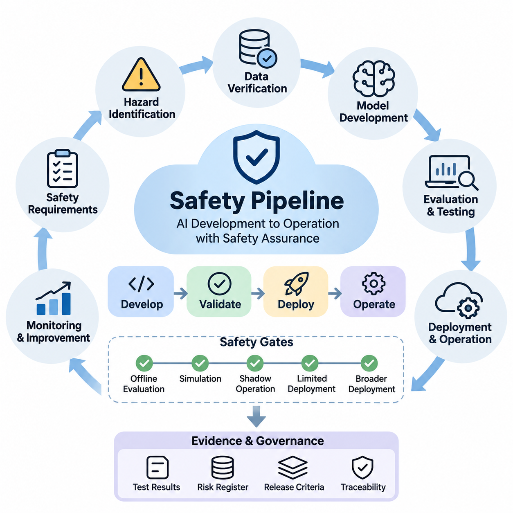
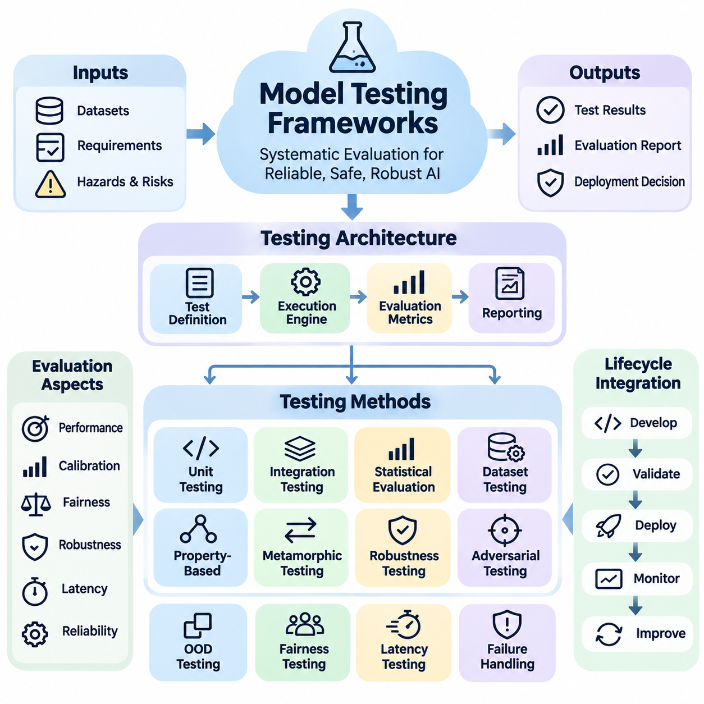
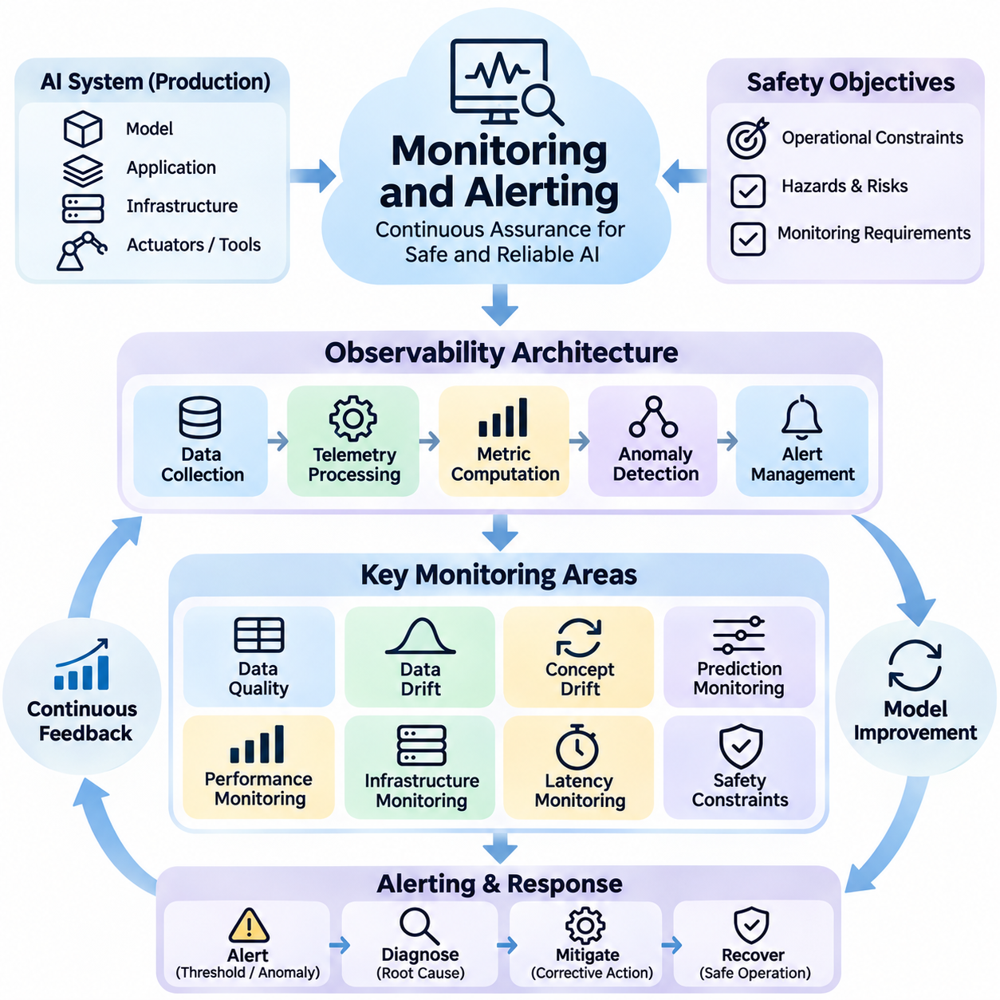
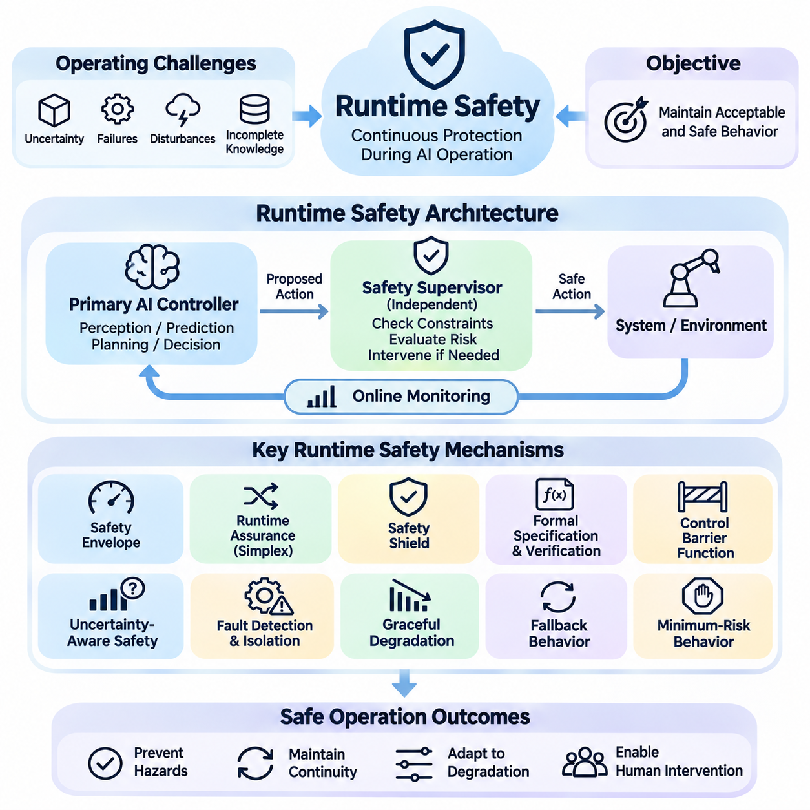
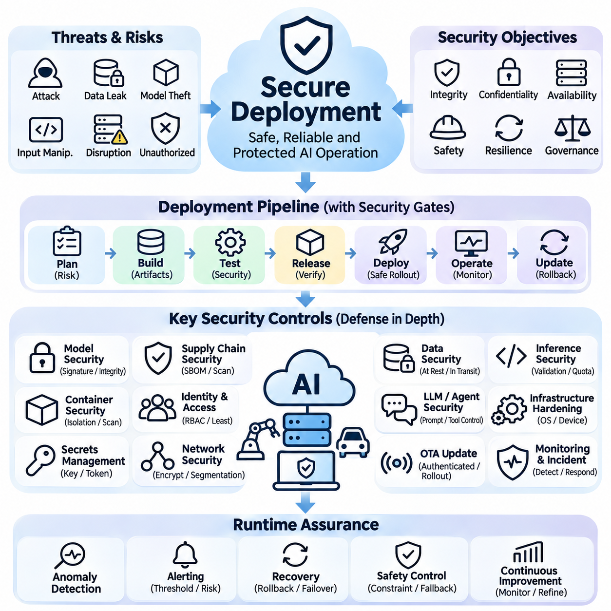
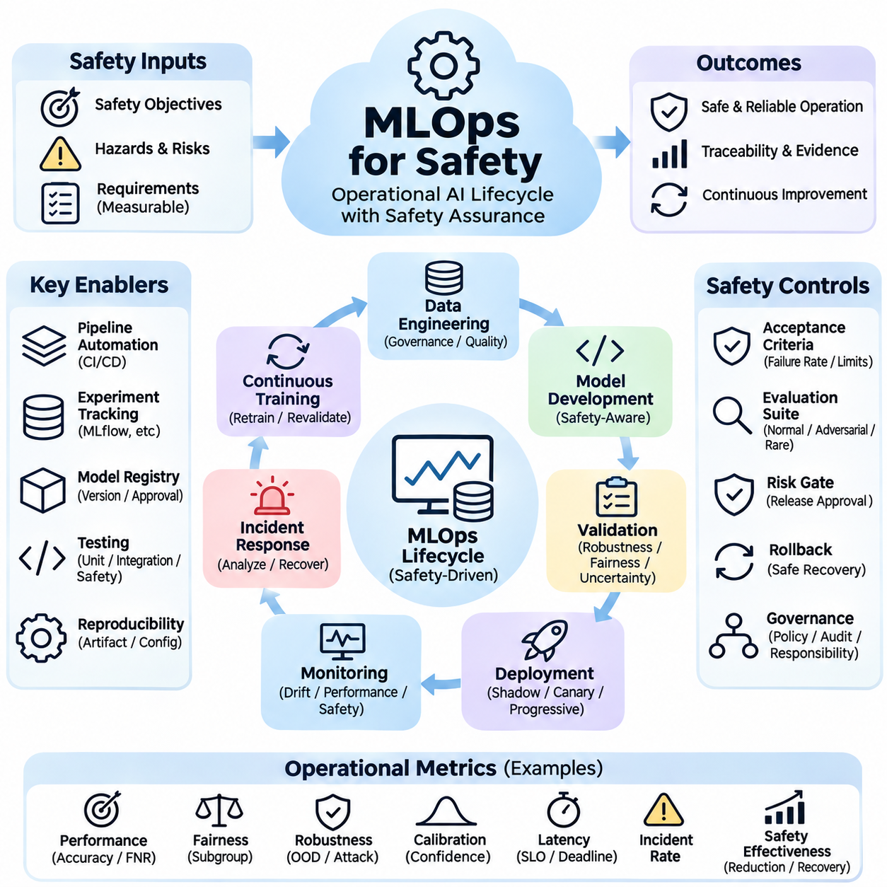

**Volume 42. AI Safety Alignment and Interpretability**

# 08. Engineering and Deployment

## 08.01 Safety Pipeline [w/Code]

{width="7.268055555555556in" height="7.268055555555556in"}

안전 파이프라인(Safety Pipeline)은 인공지능(Artificial Intelligence, AI) 시스템이 개발, 검증, 배포 및 운영의 전체 과정에서 정의된 안전 요구사항(Safety Requirements)을 충족하도록 보장하기 위한 체계적인 엔지니어링 절차(Engineering Process)를 제공한다. 안전을 최종 검사 단계로 취급하는 대신, 위험 평가(Risk Assessment), 데이터 검증(Data Verification), 모델 평가(Model Evaluation), 보안 테스트(Security Testing), 운영 통제(Operational Controls)를 지속적인 생명주기(Lifecycle)에 통합한다. 각 단계에서는 배포 결정과 향후 시스템 개선을 뒷받침하는 검증 근거(Evidence)를 생성한다.

엔지니어링 프로세스(Engineering Process)는 조직의 안전 목표(Safety Objectives)를 측정 가능한 기술 요구사항(Technical Requirements)으로 변환하는 것에서 시작된다. 이러한 요구사항은 허용할 수 없는 결과(Unacceptable Outcomes), 운영 경계(Operational Boundaries), 환경적 가정(Environmental Assumptions), 허용 가능한 잔여 위험(Acceptable Residual Risks)을 정의한다. 안전 엔지니어(Safety Engineers)는 머신러닝 개발자(Machine Learning Developers), 도메인 전문가(Domain Specialists), 시스템 운영자(System Operators)와 협력하여 기존 예측 정확도(Predictive Accuracy)에만 의존하지 않고 실제 운영 조건을 반영하는 평가 기준(Evaluation Criteria)을 수립한다.

위험요소 식별(Hazard Identification)은 모델 오류(Model Errors), 신뢰할 수 없는 입력(Unreliable Inputs), 소프트웨어 결함(Software Defects), 인간과 시스템의 상호작용(Human Interactions)이 어떻게 유해한 결과를 초래할 수 있는지 분석함으로써 파이프라인의 기반을 형성한다. 고장 형태 및 영향 분석(Failure Mode and Effects Analysis, FMEA), 결함 트리 분석(Fault Tree Analysis, FTA), 시나리오 기반 위험 평가(Scenario-Based Hazard Assessment) 등의 기법은 주요 고장 경로(Failure Pathways)를 식별하는 데 활용된다. 그 결과 생성되는 위험 등록부(Risk Register)는 개별 위험요소를 완화 조치(Mitigation Measures), 검증 활동(Verification Activities), 담당 엔지니어(Responsible Engineers), 문서화된 수용 결정(Acceptance Decisions)과 연결한다.

데이터 안전 검증(Data Safety Verification)은 학습 데이터셋(Training Dataset), 검증 데이터셋(Validation Dataset), 테스트 데이터셋(Test Dataset)이 의도된 운영 환경(Operational Environment)을 충분히 대표하는지 평가한다. 자동화된 검사(Automated Checks)는 결측값(Missing Values), 손상된 샘플(Corrupted Samples), 일관되지 않은 레이블(Inconsistent Labels), 중복 기록(Duplicate Records), 예상하지 못한 분포 변화(Distribution Changes)를 탐지한다. 추가 분석에서는 관련 인구 집단(Populations), 환경 조건(Environmental Conditions), 희귀 사건(Rare Events)에 대한 대표성을 평가한다. 데이터셋 출처 추적(Dataset Provenance)과 버전 관리(Version Tracking)는 실험 재현과 안전 실패 원인 조사를 가능하게 한다.

모델 개발(Model Development)은 안전 제약조건(Safety Constraints)을 학습 및 최적화 워크플로(Training and Optimization Workflows)에 직접 통합한다. 응용 분야에 따라 엔지니어는 제약 최적화(Constrained Optimization), 적대적 학습(Adversarial Training), 불확실성 추정(Uncertainty Estimation), 보정된 신뢰도 점수(Calibrated Confidence Scores), 안전 인식 손실 함수(Safety-Aware Loss Functions)를 활용할 수 있다. 이러한 메커니즘은 알려진 실패 조건(Known Failure Conditions)에 대한 노출을 줄이지만, 독립적으로 안전한 동작을 보장하지는 못한다. 효과성은 명시적으로 정의된 위험요소와 운영 요구사항에 대한 평가를 통해 입증되어야 한다.

실용적인 구현(Practical Implementation)에서는 안전 검사를 자동화된 개발 워크플로(Automated Development Workflows) 내부에서 실행되는 재사용 가능한 소프트웨어 구성요소(Reusable Software Components)로 분리한다. 파이썬(Python) 기반 검증 모듈(Validation Modules)은 데이터셋 스키마(Dataset Schemas)를 검사하고, 평가 지표(Evaluation Metrics)를 계산하며, 릴리스 기준(Release Criteria)을 적용할 수 있다. 예를 들어 검증 함수(Validation Function)는 측정된 거짓 음성률(False-Negative Rate)을 응용 분야별 임계값(Application-Specific Thresholds)과 비교하고, 요구사항을 위반하면 실패 상태(Failure Status)를 반환할 수 있다. 이러한 임계값은 임의적인 엔지니어링 선호가 아니라 위험 분석(Risk Analysis)에 근거해야 한다.

지속적 통합(Continuous Integration, CI)은 소스 코드(Source Code), 데이터셋(Datasets), 구성 파일(Configuration Files), 모델 산출물(Model Artifacts)이 변경될 때마다 안전 테스트(Safety Tests)를 실행하는 메커니즘을 제공한다. 자동화된 파이프라인(Automated Pipelines)은 후보 릴리스(Candidate Release)를 승인하기 전에 단위 테스트(Unit Testing), 의존성 검사(Dependency Scanning), 데이터 검증(Data Validation), 회귀 평가(Regression Evaluation), 적대적 테스트(Adversarial Testing)를 수행할 수 있다. pytest, GitHub Actions, 컨테이너 기반 테스트 환경(Containerized Test Environments) 등의 도구는 실행 과정을 표준화하며, 변경 불가능한 산출물(Immutable Artifacts)은 테스트된 모델과 배포된 버전 사이의 관계를 보존한다.

안전 평가(Safety Evaluation)는 전체 성능 지표(Aggregate Performance Metrics)를 넘어 수행되어야 한다. 평균 정확도(Average Accuracy)가 중요한 운영 시나리오(Critical Operating Scenarios)에서 발생하는 심각한 실패를 감출 수 있기 때문이다. 엔지니어는 거짓 음성률(False-Negative Rate), 보정 오차(Calibration Error), 하위 집단별 성능(Subgroup Performance), 불확실성 동작(Uncertainty Behavior), 환경 교란(Environmental Disturbances)에 대한 강건성(Robustness)을 분석해야 한다. 시나리오 기반 테스트(Scenario-Based Testing)는 센서 성능 저하(Sensor Degradation), 모호한 입력(Ambiguous Inputs), 분포 이동(Distribution Shift), 비정상 조건의 조합을 탐색한다. 결과는 테스트 전에 수립된 위험별 수용 기준(Risk-Specific Acceptance Criteria)과 비교된다.

적대적 테스트(Adversarial Testing)와 분포 외 탐지 테스트(Out-of-Distribution Testing)는 입력이 정상적인 학습 조건과 달라질 때 모델이 신뢰할 수 있는 동작을 유지하는지 조사한다. 테스트 생성기(Test Generators)는 제한된 범위의 교란(Bounded Perturbations), 손상된 이미지(Corrupted Images), 누락된 센서 측정값(Missing Sensor Measurements), 비정상적인 언어 명령(Unusual Language Instructions), 예상하지 못한 운영 상태(Unexpected Operating States)를 도입할 수 있다. 이러한 실험은 취약점(Vulnerabilities)을 식별하고 성능 저하(Performance Degradation)를 특성화한다. 입력 신뢰성(Input Reliability)이 안전한 자율 의사결정(Autonomous Decision-Making)에 충분하지 않으면 탐지 메커니즘(Detection Mechanisms)이 보수적인 대응(Conservative Responses)을 실행할 수 있다.

자율 로봇(Autonomous Robots)과 피지컬 AI(Physical AI) 시스템에서 안전 파이프라인(Safety Pipeline)은 인지(Perception), 계획(Planning), 제어(Control), 물리적 하드웨어(Physical Hardware) 사이의 상호작용을 고려해야 한다. 인지 오류(Perception Error)는 궤적 생성(Trajectory Generation)에 영향을 줄 수 있으며, 통신 지연(Communication Delay)은 시기적절한 수정 동작(Corrective Actions)의 실행을 방해할 수 있다. 따라서 통합 테스트(Integrated Testing)는 장애물 탐지(Obstacle Detection), 비상 정지(Emergency Stopping), 위치 추정 불확실성(Localization Uncertainty), 액추에이터 응답(Actuator Response), 현실적인 시간 제약(Timing Constraints)에서의 복구 동작(Recovery Behavior)을 포함하여 전체 인지-행동 시퀀스(Perception-Action Sequences)를 평가한다.

시뮬레이션 환경(Simulation Environments)은 실제 환경에서 재현하기에 비용이 많이 들거나 위험한 상황을 체계적으로 탐색할 수 있도록 지원한다. 엔지니어는 환경 조건(Environmental Conditions)을 변화시키고, 구성요소 고장(Component Failures)을 주입하며, 대규모 무작위 시나리오(Randomized Scenarios)를 실행할 수 있다. 디지털 트윈(Digital Twins)과 하드웨어 인 더 루프(Hardware-in-the-Loop, HIL) 플랫폼은 물리적 동역학(Physical Dynamics)과 실제 제어 구성요소(Actual Control Components)를 통합하여 실험의 현실성을 향상시킨다. 그러나 시뮬레이션 근거(Simulation Evidence)는 통제된 실제 환경 검증(Controlled Real-World Validation)으로 보완되어야 한다.

안전 게이트(Safety Gates)는 개발 단계 사이에 공식적인 의사결정 지점(Formal Decision Points)을 설정한다. 후보 모델(Candidate Model)은 해당 단계의 수용 기준(Acceptance Criteria)을 충족한 경우에만 오프라인 평가(Offline Evaluation), 시뮬레이션(Simulation), 섀도 운영(Shadow Operation), 제한적 배포(Limited Deployment), 광범위한 운영 환경 적용(Broader Production Use)으로 진행할 수 있다. 각 게이트는 문서화된 근거(Documented Evidence), 해결되지 않은 위험요소(Unresolved Hazards), 테스트 범위(Test Coverage), 운영 준비 상태(Operational Readiness)를 평가한다. 게이트 통과에 실패하면 비공식적인 예외나 근거 없는 신뢰에 의존하지 않고 시정 조치(Corrective Action)와 재검증(Reverification)을 수행해야 한다.

배포 준비(Deployment Preparation)에서는 소프트웨어 무결성(Software Integrity), 구성 관리(Configuration Management), 인프라 보안(Infrastructure Security)을 위한 추가 통제 기능을 도입한다. 모델 산출물(Model Artifacts)은 버전 관리(Versioning)와 인증(Authentication)을 적용하고, 학습 데이터(Training Data), 평가 보고서(Evaluation Reports), 승인된 런타임 구성(Approved Runtime Configurations)과 연결되어야 한다. 보안 빌드 프로세스(Secure Build Processes), 접근 제한(Access Restrictions), 의존성 검증(Dependency Verification), 롤백 메커니즘(Rollback Mechanisms)은 운영 위험 노출을 줄인다. 배포 자동화(Deployment Automation)는 테스트되지 않은 모델이나 승인되지 않은 구성 변경이 안전 게이트를 우회하지 못하도록 해야 한다.

런타임 안전 메커니즘(Runtime Safety Mechanisms)은 배포 이후 발생하는 실패에 대한 보호 기능을 제공한다. 모니터링 서비스(Monitoring Services)는 예측 신뢰도(Prediction Confidence), 입력 유효성(Input Validity), 응답 지연(Response Latency), 자원 사용량(Resource Consumption), 운영 제약조건 위반(Operational Constraint Violations)을 평가할 수 있다. 독립적인 감독 구성요소(Independent Supervisory Components)는 안전하지 않은 명령을 거부하거나 시스템 기능을 제한하거나 사전에 정의된 대체 동작(Fallback Behavior)을 실행할 수 있다. 안전 필수 물리 시스템(Safety-Critical Physical Systems)에서 보호 동작(Protective Actions)은 감독 대상 AI 모델의 지속적인 정확성에만 의존해서는 안 된다.

모니터링 및 경고(Monitoring and Alerting)는 운영 관측 결과(Operational Observations)를 실행 가능한 안전 정보(Actionable Safety Information)로 변환한다. 엔지니어는 비정상 오류율(Abnormal Error Rates), 분포 이동(Distribution Shifts), 반복적인 대체 동작 활성화(Repeated Fallback Activation), 예상하지 못한 시스템 동작(Unexpected System Behavior)에 대한 임계값을 설정한다. 원격 측정 기록(Telemetry Records)은 개인정보 보호(Privacy)와 보안 요구사항(Security Requirements)을 준수하면서 관련 타임스탬프(Timestamps), 모델 버전(Model Versions), 입력 특성(Input Characteristics), 의사결정 결과(Decision Outcomes)를 포함해야 한다. 경고 우선순위 지정(Alert Prioritization)은 일반적인 이상 현상과 즉각적인 개입, 조사 또는 자동화 운영 중단이 필요한 사건을 구분하는 데 도움이 된다.

사고 관리(Incident Management)는 운영 실패(Operational Failures)와 엔지니어링 개선(Engineering Improvements) 사이의 간극을 해소한다. 안전 사고(Safety Event)가 발생하면 조직은 관련 근거를 보존하고, 의사결정 순서(Decision Sequence)를 재구성하며, 기여 요인(Contributing Factors)을 식별하고, 기존 안전장치(Safeguards)가 올바르게 작동했는지 평가한다. 근본 원인 분석(Root-Cause Analysis)은 데이터 문제(Data Problems), 모델 한계(Model Limitations), 통합 결함(Integration Defects), 운영상 오용(Operational Misuse)을 구분한다. 시정 조치(Corrective Actions)는 회귀 테스트(Regression Tests)에 반영되어 이전에 관측된 실패가 향후 개발 과정에서도 지속적으로 확인될 수 있도록 한다.

추적성(Traceability)은 안전 요구사항(Safety Requirements)을 구현 구성요소(Implementation Components), 테스트 사례(Test Cases), 평가 결과(Evaluation Results), 배포 승인(Deployment Approvals)과 연결한다. 구조화된 안전 근거 저장소(Structured Safety Evidence Repository)를 통해 검토자는 특정 운영 환경에서 시스템이 수용 가능하다고 판단된 이유를 확인할 수 있다. 기계 판독 가능한 메타데이터(Machine-Readable Metadata)는 각 모델 릴리스를 위험 평가(Risk Assessment), 데이터셋 버전(Dataset Version), 소프트웨어 의존성(Software Dependencies), 테스트 결과(Test Outcomes)와 연결할 수 있다. 이는 전체 생명주기에서 재현성(Reproducibility), 감사(Auditing), 체계적인 변경 관리(Change Management)를 지원한다.

인간 감독(Human Oversight)은 안전 관련 의사결정이 불확실한 근거(Uncertain Evidence), 상충하는 목표(Competing Objectives), 잠재적으로 심각한 결과(Potentially Severe Consequences)를 포함할 때 필수적이다. 자동화된 검사는 측정 가능한 위반 사항(Measurable Violations)을 탐지할 수 있지만, 잔여 위험(Residual Risks)이 사회적, 법적 또는 운영상 수용 가능한지를 완전히 판단할 수는 없다. 자격을 갖춘 검토자(Qualified Reviewers)는 중요한 예외 사항(Critical Exceptions)을 검토하고, 중대한 변경(Significant Changes)을 승인하며, 배포를 중단할 권한(Authority to Suspend Deployment)을 유지해야 한다. 명확한 책임 할당(Responsibility Assignments)은 안전 의사결정이 엔지니어링 조직과 관리 조직 사이에서 분산되는 것을 방지한다.

안전 파이프라인(Safety Pipeline)은 테스트(Testing), 모니터링(Monitoring), 사고(Incidents), 운영 환경 변화(Operational Environment Changes)에서 발생하는 지속적인 피드백(Continuous Feedback)을 통해 발전해야 한다. 새로운 실패 패턴(Failure Patterns)은 추가 데이터셋(Additional Datasets), 수정된 안전 요구사항(Revised Safety Requirements), 강화된 런타임 통제(Stronger Runtime Controls), 재설계된 시스템 아키텍처(Redesigned System Architecture)를 요구할 수 있다. 정기적인 재평가(Periodic Reassessment)는 모델과 의존성이 변경되더라도 이전 승인이 여전히 유효한지 확인한다. 지속적 개선(Continuous Improvement)은 과거의 검증 근거(Historical Evidence)를 보존하면서 변경 사항이 허용할 수 없는 새로운 위험을 도입하지 않는다는 점을 입증해야 한다.

성숙한 안전 파이프라인(Mature Safety Pipeline)은 머신러닝 엔지니어링(Machine Learning Engineering), 시스템 안전(Systems Safety), 사이버보안(Cybersecurity), 운영 모니터링(Operational Monitoring), 조직 거버넌스(Organizational Governance)를 통합된 안전 보증 프로세스(Unified Assurance Process)로 결합한다. 그 목적은 복잡한 AI 시스템에 실패 가능성이 전혀 없다고 주장하는 것이 아니라, 식별된 위험이 정의된 운영 경계(Operating Boundaries) 내에서 통제되고 있다는 방어 가능한 근거(Defensible Evidence)를 확립하는 것이다. 이러한 엔지니어링 원칙(Engineering Discipline)은 책임성(Accountability), 재현성(Reproducibility), 새롭게 발생하는 위험요소(Emerging Hazards)에 대응할 수 있는 역량을 유지하면서 신뢰할 수 있는 배포(Reliable Deployment)를 가능하게 한다.

## 08.02 Model Testing Frameworks [w/Code]

{width="7.268055555555556in" height="7.268055555555556in"}

모델 테스트 프레임워크(Model Testing Frameworks)는 인공지능(Artificial Intelligence, AI) 시스템의 신뢰성(Reliability), 안전성(Safety), 강건성(Robustness), 운영 준비 상태(Operational Readiness)를 평가하기 위한 체계적인 기반을 제공한다. 결정론적 출력(Deterministic Outputs)을 검증하는 기존 소프트웨어 테스트(Software Testing)와 달리, AI 테스트는 확률적 예측(Probabilistic Predictions), 불확실한 입력(Uncertain Inputs), 변화하는 데이터 분포(Changing Data Distributions)를 고려해야 한다. 포괄적인 프레임워크는 기능 검증(Functional Validation), 통계적 평가(Statistical Evaluation), 적대적 테스트(Adversarial Testing), 배포 중심 검증(Deployment-Oriented Verification)을 결합한다.

모델 테스트 프레임워크(Model Testing Framework)의 주요 목적은 AI 모델이 예상된 운영 조건과 예상하지 못한 운영 조건에서 사전에 정의된 요구사항(Predefined Requirements)을 충족하는지 판단하는 것이다. 이러한 요구사항에는 예측 성능(Predictive Performance), 확률 보정(Calibration), 공정성(Fairness), 강건성(Robustness), 지연시간(Latency), 실패 처리(Failure Handling)가 포함된다. 테스트 프레임워크는 추상적인 안전 목표(Abstract Safety Objectives)를 측정 가능한 검증 조건(Measurable Assertions), 재현 가능한 실험(Reproducible Experiments), 자동화된 수용 기준(Automated Acceptance Criteria)으로 변환하여 근거 기반 배포 결정(Evidence-Based Deployment Decisions)을 지원한다.

잘 설계된 테스트 아키텍처(Testing Architecture)는 테스트 정의(Test Definitions), 실행 엔진(Execution Engines), 평가 지표(Evaluation Metrics), 보고 구성요소(Reporting Components)를 분리한다. 테스트 정의는 데이터셋(Datasets), 시나리오(Scenarios), 교란(Perturbations), 예상 동작(Expected Behaviors)을 명시한다. 실행 엔진은 통제된 구성(Controlled Configurations)에서 모델을 실행하고, 평가 모듈(Evaluation Modules)은 성능 지표(Performance Indicators)를 계산한다. 보고 구성요소는 실험 결과(Experimental Results), 구성 메타데이터(Configuration Metadata), 실패 사례(Failure Examples), 설정된 수용 임계값(Acceptance Thresholds)과의 비교 결과를 보존한다.

단위 테스트(Unit Testing)는 전처리 함수(Preprocessing Functions), 특징 변환(Feature Transformations), 모델 인터페이스(Model Interfaces), 후처리 로직(Postprocessing Logic)을 포함하여 머신러닝 시스템(Machine Learning System)의 개별 구성요소를 검증한다. pytest와 unittest 같은 프레임워크는 입력 차원(Input Dimensions), 수치 범위(Numerical Ranges), 출력 구조(Output Structures), 예외 처리(Exception Handling)에 대한 자동화된 검증(Automated Assertions)을 지원한다. 이러한 테스트는 광범위한 모델 평가 이전에 구현 결함(Implementation Defects)을 탐지하여 소프트웨어 오류(Software Errors)가 모델 자체의 한계(Model Limitations)로 잘못 해석될 위험을 줄인다.

통합 테스트(Integration Testing)는 데이터 파이프라인(Data Pipelines), 추론 엔진(Inference Engines), 외부 서비스(External Services), 후속 의사결정 모듈(Downstream Decision Modules) 사이의 상호작용을 검사한다. 모델이 독립적으로는 올바르게 작동하더라도 호환되지 않는 전처리 로직(Incompatible Preprocessing Logic)이나 지연된 센서 스트림(Delayed Sensor Streams)과 연결되면 안전하지 않은 결과를 생성할 수 있다. 따라서 통합 테스트는 전체 추론 워크플로(Inference Workflow)에 걸쳐 인터페이스 계약(Interface Contracts), 데이터 일관성(Data Consistency), 동기화 동작(Synchronization Behavior), 오류 전파(Error Propagation)를 검증한다.

통계적 모델 평가(Statistical Model Evaluation)는 응용 분야에 적합한 지표를 사용하여 예측 성능(Predictive Performance)을 측정한다. 분류 시스템(Classification Systems)은 정밀도(Precision), 재현율(Recall), F1 점수(F1 Score), 혼동 행렬(Confusion Matrix)을 필요로 할 수 있으며, 회귀 모델(Regression Models)은 절대 오차(Absolute Error) 또는 제곱 오차(Squared Error)를 사용한다. 안전 필수 응용 분야(Safety-Critical Applications)에서는 소수의 심각한 실패가 높은 평균 정확도(Average Accuracy)보다 더 중요한 영향을 미칠 수 있으므로 거짓 음성률(False-Negative Rate), 탐지 지연(Detection Delay), 최악 조건 성능(Worst-Case Performance)을 특히 강조한다.

테스트 데이터셋 설계(Test Dataset Design)는 평가 결과의 신뢰성(Credibility)에 큰 영향을 미친다. 대표성 있는 데이터셋(Representative Datasets)은 정상 운영 조건(Normal Operating Conditions), 관련 인구 집단(Relevant Population Groups), 환경적 변화(Environmental Variations), 알려진 실패 시나리오(Known Failure Scenarios)를 포함해야 한다. 개발 데이터(Development Data), 검증 데이터(Validation Data), 최종 테스트 데이터(Final Test Data)를 분리하면 정보 누출(Information Leakage)을 방지하는 데 도움이 된다. 데이터셋 버전 관리(Dataset Versioning), 출처 기록(Provenance Records), 통제된 샘플링 절차(Controlled Sampling Procedures)는 비교의 재현성을 확보하고 잘못된 성능 추정(Misleading Performance Estimates)의 위험을 줄인다.

속성 기반 테스트(Property-Based Testing)는 사전에 결정된 입력과 출력의 예시에만 의존하지 않고 일반적인 동작 기대사항(General Behavioral Expectations)을 평가한다. Hypothesis와 같은 도구는 다양한 입력을 생성하여 유효한 수치 범위(Valid Numerical Ranges), 일관된 텐서 차원(Consistent Tensor Dimensions), 안정적인 인터페이스 동작(Stable Interface Behavior)과 관련된 속성을 검증할 수 있다. AI 모델에서는 신중하게 정의된 불변 조건(Invariants)을 활용하여 관련 없는 입력 변환(Irrelevant Transformations)이 허용 가능한 오차 범위(Acceptable Tolerances) 내에서 예측을 유지하는지도 검사할 수 있다.

메타모픽 테스트(Metamorphic Testing)는 정확한 예상 출력(Expected Outputs)을 결정하기 어려운 상황을 다룬다. 완전한 정답(Reference Answer)을 요구하는 대신, 통제된 입력 변환(Controlled Input Transformations) 전후의 예측 관계(Prediction Relationships)를 검사한다. 예를 들어 조명 변화(Illumination Changes)가 작업과 무관한 경우 적당한 조명 변화는 객체 분류(Object Classification) 결과를 크게 변경하지 않아야 한다. 그러나 모든 변환이 의미적 정보(Semantic Meaning)를 보존하는 것은 아니므로 이러한 관계는 도메인 요구사항(Domain Requirements)에 근거하여 정당화되어야 한다.

강건성 테스트(Robustness Testing)는 잡음(Noise), 정보 누락(Missing Information), 손상된 입력(Corrupted Inputs), 분포 이동(Distribution Shifts) 상황에서 모델 동작이 어떻게 변화하는지 조사한다. RobustBench와 강건성 평가 도구 모음(Robustness Evaluation Toolkits)은 특정 모델 계열(Model Families)과 위협 가정(Threat Assumptions)에 대한 표준화된 비교를 지원한다. 엔지니어는 정상 입력(Clean Inputs)에 대한 성능만 보고하는 대신 성능 저하 곡선(Degradation Curves), 불확실성 응답(Uncertainty Responses), 실패 집중 현상(Failure Concentrations)을 측정해야 한다. 평가 결과에는 사용된 정확한 교란 설정(Perturbation Settings)을 명시해야 한다.

적대적 테스트(Adversarial Testing)는 의도적으로 잘못된 동작을 유발하도록 구성된 입력에 대한 모델의 취약성(Susceptibility)을 평가한다. Foolbox와 적대적 강건성 도구 모음(Adversarial Robustness Toolbox, ART) 같은 프레임워크는 공격 및 방어 평가 방법(Attack and Defense Evaluation Methods)의 구현을 제공한다. 테스트에서는 제한된 교란(Bounded Perturbations), 적대적 예제(Adversarial Examples), 모델별 취약점(Model-Specific Vulnerabilities)을 검사할 수 있다. 의미 있는 결론을 얻으려면 명시적인 위협 모델(Threat Models), 적절한 공격 예산(Attack Budgets), 취약성을 과소평가하지 않는 신중한 평가 절차(Evaluation Procedures)가 필요하다.

분포 외 테스트(Out-of-Distribution Testing)는 모델이 학습 데이터 분포(Training Distributions)와 크게 다른 입력을 인식할 수 있는지 평가한다. 탐지 방법(Detection Methods)은 신뢰도 점수(Confidence Scores), 특징 공간 거리(Feature-Space Distances), 에너지 기반 점수(Energy-Based Scores), 특수한 불확실성 추정기(Uncertainty Estimators)를 활용할 수 있다. 평가 프레임워크(Evaluation Frameworks)는 탐지 품질(Detection Quality)을 측정하고 신뢰할 수 없는 예측(Unreliable Predictions)이 적절한 처리 동작(Appropriate Handling)을 유발하는지 검사한다. 높은 신뢰도(High Confidence)만으로 익숙하지 않은 입력(Unfamiliar Input)이 안전하다고 판단해서는 안 된다.

공정성 테스트(Fairness Testing)는 관련 집단이나 운영 환경에 따라 모델 성능(Model Performance)이 달라지는지 검사한다. Fairlearn과 AI Fairness 360 같은 프레임워크는 선택된 집단 공정성 지표(Group Fairness Metrics)와 편향 완화 기법(Bias Mitigation Techniques)의 평가를 지원한다. 테스트에서는 인구통계학적 대표성(Demographic Representation), 교차적 하위 집단(Intersectional Subgroups), 응용 분야별 피해(Application-Specific Harm)를 고려해야 한다. 공정성 지표는 서로 충돌할 수 있으므로 하나의 수치 점수가 공정성을 확립한다고 가정하기보다 맥락에 따른 해석(Contextual Interpretation)과 문서화된 상충관계(Documented Tradeoffs)가 중요하다.

설명가능성 테스트(Explainability Testing)는 해석 방법(Interpretation Methods)이 모델 동작에 대해 유용하고 충분히 안정적인 근거를 제공하는지 평가한다. SHAP, LIME, Captum과 같은 도구는 특징 기여도 분석(Feature Attribution)과 설명 분석(Explanation Analysis)을 지원할 수 있다. 엔지니어는 유사한 입력(Similar Inputs), 모델 버전(Model Versions), 통제된 교란(Controlled Perturbations)에 걸쳐 설명 결과를 비교할 수 있다. 그러나 그럴듯한 설명(Plausible Explanations)이 인과적 정확성(Causal Correctness)을 입증하는 것은 아니며, 설명 품질(Explanation Quality)은 예측 정확도(Predictive Accuracy)와 별도로 평가해야 한다.

대규모 언어 모델(Large Language Models, LLMs)의 경우 테스트 프레임워크는 지시 이행(Instruction Following), 사실적 신뢰성(Factual Reliability), 유해 출력 위험(Harmful Output Risks), 프롬프트 인젝션 저항성(Prompt Injection Resistance), 다양한 맥락에서의 일관성(Consistency Across Diverse Contexts)을 평가해야 한다. HELM과 같은 평가 환경(Evaluation Environments)은 다차원 평가(Multidimensional Assessment)를 지원하며, 사용자 정의 테스트 모음(Custom Test Suites)은 응용 분야별 안전 정책(Application-Specific Safety Policies)을 검사한다. 자동화된 평가기(Automated Graders)는 테스트를 가속할 수 있지만, 판단에 체계적인 오류(Systematic Errors)가 포함되거나 평가자 편향(Evaluator Biases)이 재현될 수 있으므로 별도의 검증이 필요하다.

에이전트형 AI 시스템(Agentic AI Systems)은 도구 실행(Tool Execution), 계획 동작(Planning Behavior), 권한 경계(Permission Boundaries), 장기 작업 완료(Long-Horizon Task Completion)에 대한 추가 테스트가 필요하다. 모델이 개별적으로는 허용 가능한 행동을 생성하더라도 장기간의 의사결정 시퀀스(Decision Sequences)를 통해 안전하지 않은 결과를 초래할 수 있다. 테스트 프레임워크는 도구 실패(Tool Failures), 악의적인 지시(Malicious Instructions), 불완전한 관측(Incomplete Observations), 예상하지 못한 상태 전이(Unexpected State Transitions)를 시뮬레이션해야 한다. 평가는 전체 행동 궤적(Entire Trajectories)에 걸친 누적 위험(Cumulative Risk)과 복구 동작(Recovery Behavior)을 고려해야 한다.

피지컬 AI 테스트(Physical AI Testing)는 모델 평가를 인지(Perception), 계획(Planning), 제어(Control), 하드웨어 상호작용(Hardware Interaction)으로 확장한다. 시뮬레이션 플랫폼(Simulation Platforms)은 장애물 조우(Obstacle Encounters), 센서 고장(Sensor Failures), 위치 추정 오류(Localization Errors), 통신 지연(Communication Delays)을 생성할 수 있다. 하드웨어 인 더 루프 테스트(Hardware-in-the-Loop Testing)는 실제 제어 구성요소(Actual Control Components)를 사용하여 동작을 검사하고, 통제된 현장 테스트(Controlled Field Testing)는 물리적 제약조건(Physical Constraints)에서 성능을 검증한다. 주요 측정 지표에는 충돌 회피(Collision Avoidance), 비상 대응 지연시간(Emergency Response Latency), 궤적 안전성(Trajectory Safety), 최소 위험 동작(Minimum-Risk Behavior)이 포함된다.

자동화된 회귀 테스트(Automated Regression Testing)는 모델 업데이트(Model Updates)가 이전에 식별된 실패를 다시 발생시키지 않도록 보장하는 데 사용된다. 회귀 테스트 모음(Regression Suite)은 이전 릴리스(Earlier Releases)에서 수집한 대표적인 실패 사례(Representative Failure Cases), 경계 조건(Boundary Conditions), 운영 시나리오(Operational Scenarios)를 보존한다. 후보 모델(Candidate Models)은 일관된 데이터셋과 평가 구성(Evaluation Configurations)을 사용하여 승인된 기준 모델(Approved Baselines)과 비교된다. 작은 성능 차이를 의미 있는 개선으로 해석하기 전에 통계적 불확실성(Statistical Uncertainty)과 실질적 유의성(Practical Significance)을 고려해야 한다.

지속적 통합 및 배포 워크플로(Continuous Integration and Deployment Workflows)는 코드(Code), 모델 가중치(Model Weights), 데이터셋(Datasets), 구성(Configuration)이 변경될 때마다 모델 테스트 프레임워크를 실행할 수 있다. 경량 검사(Lightweight Checks)는 모든 변경에 대해 수행할 수 있으며, 계산 비용이 높은 강건성 평가(Robustness Evaluation)와 시뮬레이션 평가(Simulation Evaluation)는 정의된 릴리스 게이트(Release Gates)에서 실행할 수 있다. 자동화된 파이프라인(Automated Pipelines)은 결과를 수집하고 필수 요구사항(Mandatory Requirements)을 충족하지 못하면 다음 단계로의 승격(Promotion)을 차단한다. 중요한 예외 사항(Critical Exceptions)은 문서화된 검토(Documented Review)와 명시적인 승인(Explicit Authorization)을 요구해야 한다.

재현성(Reproducibility)은 난수 시드(Random Seeds), 데이터셋 버전(Dataset Versions), 소프트웨어 의존성(Software Dependencies), 하드웨어 구성(Hardware Configurations), 수치 연산 실행 설정(Numerical Execution Settings)을 통제하는 데 달려 있다. MLflow와 같은 실험 추적 시스템(Experiment Tracking Systems)은 모델 산출물(Model Artifacts)을 매개변수(Parameters), 평가 지표(Metrics), 평가 보고서(Evaluation Reports)와 연결할 수 있다. 컨테이너 기반 환경(Containerized Environments)은 구성 차이(Configuration Differences)를 줄이지만 일부 하드웨어 의존적 비결정성(Hardware-Dependent Nondeterminism)은 남아 있을 수 있다. 반복 평가(Repeated Evaluations)와 신뢰구간(Confidence Intervals)은 보고된 결론의 신뢰성을 향상시킨다.

효과적인 모델 테스트 프레임워크(Effective Model Testing Framework)는 궁극적으로 단일 성능 점수(Single Performance Score)가 아니라 추적 가능한 안전 근거(Traceable Safety Evidence)의 집합을 생성한다. 이러한 결과는 요구사항(Requirements), 테스트 시나리오(Test Scenarios), 관측된 실패(Observed Failures), 시정 조치(Corrective Actions), 릴리스 결정(Release Decisions)을 연결한다. 자동화된 소프트웨어 검증(Automated Software Verification)을 통계 분석(Statistical Analysis), 적대적 평가(Adversarial Evaluation), 현실적인 시스템 테스트(Realistic System Testing)와 결합함으로써 조직은 AI 동작에 대한 신뢰를 강화할 수 있다. 동시에 테스트는 불확실성(Uncertainty)을 줄이는 수단이지 모든 가능한 실패의 부재(Absence of All Possible Failures)를 증명하는 수단은 아니라는 점을 인식해야 한다.

## 08.03 Monitoring and Alerting

{width="7.268055555555556in" height="7.268055555555556in"}

모니터링 및 경고(Monitoring and Alerting)는 AI 안전 엔지니어링(AI Safety Engineering)의 핵심 구성요소로서 모델 동작(Model Behavior), 시스템 신뢰성(System Reliability), 새롭게 발생하는 운영 위험(Emerging Operational Risks)에 대한 지속적인 가시성(Continuous Visibility)을 제공한다. 배포 전 테스트(Predeployment Testing)가 알려진 조건을 평가하는 반면, 운영 환경 모니터링(Production Monitoring)은 변화하는 환경, 예상하지 못한 입력, 진화하는 사용자 행동으로 인해 발생하는 실패를 탐지한다. 효과적인 모니터링은 운영 관측 결과(Operational Observations)를 안전하고 신뢰할 수 있는 AI 시스템을 유지하기 위한 실행 가능한 근거(Actionable Evidence)로 변환한다.

AI 모니터링 아키텍처(AI Monitoring Architecture)는 데이터 수집(Data Collection), 원격 측정 처리(Telemetry Processing), 지표 계산(Metric Computation), 이상 탐지(Anomaly Detection), 경고 관리(Alert Management)를 통합한다. 이러한 구성요소는 모델 추론 서비스(Model Inference Services), 애플리케이션 인터페이스(Application Interfaces), 인프라 자원(Infrastructure Resources), 후속 의사결정 시스템(Downstream Decision Systems) 전반에서 작동한다. 중앙 집중식 관측 가능성 플랫폼(Centralized Observability Platform)은 여러 출처의 정보를 연관 분석하여 엔지니어가 모델 관련 실패(Model-Related Failures)를 인프라 결함(Infrastructure Defects), 통신 문제(Communication Problems), 외부 환경 교란(External Environmental Disturbances)과 구분할 수 있도록 한다.

모니터링 요구사항(Monitoring Requirements)은 안전 목표(Safety Objectives), 운영 제약조건(Operational Constraints), 이전에 식별된 위험요소(Previously Identified Hazards)에서 도출되어야 한다. 엔지니어는 예측 품질(Prediction Quality), 응답 지연시간(Response Latency), 불확실성(Uncertainty), 데이터 무결성(Data Integrity), 안전 제약조건 위반(Safety Constraint Violations)에 대한 측정 가능한 지표를 정의한다. 각 지표에는 예상 운영 범위(Expected Operating Range), 평가 주기(Evaluation Interval), 문서화된 대응 정책(Documented Response Policy)이 필요하다. 이러한 접근 방식은 운영 목적 없이 지표만 수집하는 대신 모니터링 활동이 명시적인 위험 통제(Explicit Risk Controls)를 지원하도록 보장한다.

데이터 품질 모니터링(Data Quality Monitoring)은 입력 정보가 모델 개발 과정에서 설정한 가정과 일관성을 유지하는지 검사한다. 자동화된 검사(Automated Checks)는 누락된 필드(Missing Fields), 유효하지 않은 값(Invalid Values), 손상된 센서 측정값(Corrupted Sensor Measurements), 예상하지 못한 범주형 값(Unexpected Categorical Values), 비정상적인 샘플링 주파수(Abnormal Sampling Frequencies)를 식별한다. 입력 완전성(Input Completeness)이나 센서 신뢰성(Sensor Reliability)의 변화는 예측 성능(Predictive Performance)이 눈에 띄게 저하되기 전에도 새로운 운영 위험(Operational Hazards)이 발생하고 있음을 나타낼 수 있다.

데이터 드리프트 모니터링(Data Drift Monitoring)은 기준 분포(Reference Distributions)와 비교하여 입력 데이터의 통계적 특성(Statistical Properties)이 변화하는 현상을 탐지한다. 모집단 안정성 지수(Population Stability Index, PSI), 콜모고로프--스미르노프 검정(Kolmogorov--Smirnov Test), 분포 거리 측정(Distribution Distance Measurements)과 같은 기법은 선택된 특징(Selected Features)의 유의미한 변화를 식별할 수 있다. 그러나 통계적 드리프트(Statistical Drift)가 반드시 모델 정확도(Model Accuracy)의 감소를 의미하지는 않는다. 엔지니어는 드리프트 신호(Drift Signals)를 응용 분야의 맥락(Application Context), 불확실성 추정값(Uncertainty Estimates), 관측된 결과(Observed Outcomes)와 함께 해석해야 한다.

개념 드리프트 모니터링(Concept Drift Monitoring)은 입력 특징(Input Features)과 목표 결과(Target Outcomes) 사이의 관계 변화를 중점적으로 분석한다. 데이터 드리프트(Data Drift)와 달리 개념 드리프트(Concept Drift)는 입력 분포(Input Distributions)가 안정적으로 보이는 상황에서도 발생할 수 있다. 탐지에는 지연되어 확보되는 정답 레이블(Delayed Ground-Truth Labels), 결과 추적(Outcome Tracking), 신중하게 설계된 대리 지표(Proxy Indicators)가 필요한 경우가 많다. 모니터링 시스템은 레이블 가용성(Label Availability)을 고려하고, 확인된 성능 저하(Confirmed Performance Degradation)와 학습된 관계가 더 이상 유효하지 않을 가능성을 나타내는 초기 신호(Preliminary Signals)를 구분해야 한다.

예측 모니터링(Prediction Monitoring)은 운영 중 출력 분포(Output Distributions), 신뢰도 점수(Confidence Scores), 불확실성 추정값(Uncertainty Estimates), 의사결정 패턴(Decision Patterns)을 평가한다. 클래스 빈도(Class Frequencies)의 급격한 변화, 비정상적으로 집중된 신뢰도 값(Unusually Concentrated Confidence Values), 반복적인 낮은 신뢰도 예측(Low-Confidence Predictions)은 모델 불안정성(Model Instability)을 나타낼 수 있다. 보정 모니터링(Calibration Monitoring)은 신뢰할 수 있는 레이블을 확보했을 때 예측 확률(Predicted Probabilities)과 관측된 결과(Observed Outcomes)를 비교한다. 이러한 측정은 과신(Overconfidence)을 식별하고 불확실한 예측에 대한 안전한 처리(Safer Handling)를 지원한다.

성능 모니터링(Performance Monitoring)은 작업별 지표(Task-Specific Metrics)를 사용하여 배포된 모델의 운영 효과성(Operational Effectiveness)을 측정한다. 분류 서비스(Classification Services)는 정밀도(Precision), 재현율(Recall), 거짓 음성률(False-Negative Rates)을 추적할 수 있으며, 예측 시스템(Forecasting Systems)은 예측 오차(Prediction Errors)와 잔차 분포(Residual Distributions)를 모니터링한다. 안전 필수 응용 분야(Safety-Critical Applications)는 실패 심각도(Failure Severity), 희귀 사건 탐지(Rare-Event Detection), 어려운 운영 조건에서의 성능을 강조해야 한다. 전체 성능 지표(Aggregate Metrics)는 고위험 시나리오(High-Risk Scenarios)에 대한 집중 분석으로 보완되어야 한다.

인프라 모니터링(Infrastructure Monitoring)은 CPU 및 GPU 사용률(Utilization), 메모리 사용량(Memory Consumption), 네트워크 처리량(Network Throughput), 저장 공간 가용성(Storage Availability), 서비스 응답성(Service Responsiveness)을 검사한다. 자원 고갈(Resource Exhaustion)은 추론 지연시간(Inference Latency)을 증가시키거나 요청 실패(Request Failures)를 유발하거나 안전 필수 의사결정 프로세스(Safety-Critical Decision Processes)를 중단시킬 수 있다. 모니터링 시스템은 인프라 상태(Infrastructure Conditions)와 모델 성능(Model Performance)을 연관 분석하여 성능 저하가 계산 자원의 한계(Computational Limitations), 소프트웨어 결함(Software Defects), 입력 작업 부하의 변화(Changes in Incoming Workloads) 중 어디에서 발생했는지 판단해야 한다.

지연시간 모니터링(Latency Monitoring)은 자율주행 차량(Autonomous Vehicles), 로보틱스(Robotics), 실시간 산업용 AI(Real-Time Industrial AI)에서 특히 중요하다. 종단 간 응답시간(End-to-End Response Time)은 센서 데이터 취득(Sensor Acquisition), 전처리(Preprocessing), 추론(Inference), 통신(Communication), 계획(Planning), 액추에이터 실행(Actuator Execution)을 포함한다. 모델이 높은 예측 정확도(Predictive Accuracy)를 달성하더라도 의사결정이 너무 늦게 도착하면 안전하지 않을 수 있다. 따라서 엔지니어는 평균 응답시간(Average Response Time)에만 의존하지 않고 지연시간 분포(Latency Distributions), 마감시간 위반(Deadline Violations), 최악 조건 실행 동작(Worst-Case Execution Behavior)을 모니터링한다.

안전 제약조건 모니터링(Safety Constraint Monitoring)은 시스템 출력과 행동이 사전에 정의된 운영 경계(Predefined Operational Boundaries) 내에 유지되는지 검증한다. 제약조건에는 금지된 행동(Prohibited Actions), 최대 액추에이터 명령(Maximum Actuator Commands), 최소 장애물 이격거리(Minimum Obstacle Clearance), 제한된 운영 구역(Restricted Operating Regions), 승인된 도구 권한(Authorized Tool Permissions)이 포함될 수 있다. 독립적인 런타임 모니터(Independent Runtime Monitors)는 위반 사항을 탐지하고 수정 대응(Corrective Responses)을 요청할 수 있다. 물리 시스템(Physical Systems)에서는 애플리케이션 수준의 경고(Application-Level Warnings)에만 의존하지 않고 적절하게 검증된 제어 메커니즘(Validated Control Mechanisms)을 통해 안전을 강제해야 한다.

이상 탐지(Anomaly Detection)는 설정된 기준선(Established Baselines)과 다른 운영 패턴(Operational Patterns)을 식별한다. 통계적 공정 관리 기법(Statistical Control Methods), 고립 포레스트(Isolation Forests), 오토인코더(Autoencoders), 시계열 이상 탐지기(Temporal Anomaly Detectors)는 비정상적인 지표 조합(Unusual Combinations of Metrics)을 인식할 수 있다. 정상적인 운영 변화(Normal Operational Changes)가 실패와 유사하게 나타날 수 있으므로 탐지 모델(Detection Models)은 신중한 보정(Calibration)이 필요하다. 효과적인 모니터링 시스템은 자동화된 이상 점수(Automated Anomaly Scores)를 도메인 지식(Domain Knowledge), 맥락 정보(Contextual Information), 명시적인 안전 임계값(Explicit Safety Thresholds)과 결합한다.

경고(Alerting)는 모니터링 결과를 운영상 주의가 필요한 알림(Notifications)으로 변환한다. 경고 규칙(Alert Rules)은 발생 조건(Triggering Conditions), 심각도 수준(Severity Levels), 담당 인력(Responsible Personnel), 예상 대응 조치(Expected Response Actions)를 명시해야 한다. 임계값 기반 경고(Threshold-Based Alerts)는 명확하게 정의된 제약조건에 유용하며, 적응형 방법(Adaptive Methods)은 변화하는 기준선(Changing Baselines)에서 벗어나는 현상을 탐지할 수 있다. 경고 설계(Alert Design)는 민감도(Sensitivity)와 특이도(Specificity)의 균형을 유지해야 한다. 과도한 오경보(False Alarms)는 운영자의 부담을 증가시키고 실제 위험에 대한 대응 능력을 저하시킬 수 있기 때문이다.

경고 우선순위 지정(Alert Prioritization)은 단순한 지표 변화의 크기보다 잠재적인 결과(Potential Consequences)를 반영해야 한다. 비상 제동(Emergency Braking)에 영향을 미치는 작은 편차(Small Deviation)는 중요하지 않은 추천 점수(Noncritical Recommendation Score)의 큰 변화보다 더 중요할 수 있다. 심각도 분류(Severity Classification)는 위험 발생 가능성(Hazard Likelihood), 잠재적 피해(Possible Harm), 시스템 노출도(System Exposure), 사용 가능한 복구 메커니즘(Available Recovery Mechanisms)을 고려한다. 치명적인 경고(Critical Alerts)는 즉각적인 보호 조치(Protective Actions)가 필요할 수 있으며, 낮은 우선순위의 사건(Lower-Priority Events)은 조사(Investigation)나 계획된 유지보수(Scheduled Maintenance)를 시작하는 계기가 될 수 있다.

경고 상관관계 분석(Alert Correlation)은 관련된 증상(Related Symptoms)을 의미 있는 사고(Meaningful Incidents)로 묶어 운영상의 잡음(Operational Noise)을 줄인다. 하나의 네트워크 장애(Network Failure)가 센서 데이터 누락(Missing Sensor Data), 추론 지연(Delayed Inference), 후속 서비스 사용 불가(Unavailable Downstream Services)와 관련된 여러 경고를 발생시킬 수 있다. 상관관계 분석 메커니즘(Correlation Mechanisms)은 타임스탬프(Timestamps), 의존성 관계(Dependency Relationships), 시스템 토폴로지(System Topology)를 사용하여 공통 원인(Common Causes)의 가능성을 식별한다. 이러한 접근 방식은 사고 해석(Incident Interpretation)을 개선하고 운영자가 모든 부차적 증상(Secondary Symptoms)을 독립적인 실패로 처리하는 것을 방지한다.

Prometheus, Grafana, OpenTelemetry와 같은 관측 가능성 플랫폼(Observability Platforms)은 지표 수집(Metric Collection), 시각화(Visualization), 추적(Tracing), 경고 통합(Alert Integration)을 지원한다. 특화된 모델 모니터링 시스템(Specialized Model Monitoring Systems)은 특징 분포(Feature Distributions), 예측 품질(Prediction Quality), 드리프트 지표(Drift Indicators)를 추가로 추적할 수 있다. 이러한 도구는 자동적인 안전 보장(Automatic Safety Guarantees)이 아니라 엔지니어링 인프라(Engineering Infrastructure)를 제공한다. 따라서 구성 설정(Configurations), 접근 권한(Access Permissions), 데이터 보존 정책(Data Retention Policies), 경고 전달 경로(Alert Delivery Paths)를 운영 요구사항(Operational Requirements)에 따라 검증해야 한다.

로깅 및 추적성(Logging and Traceability)은 모델 의사결정(Model Decisions)을 재구성하고 실패를 조사하는 데 필요한 정보를 보존한다. 유용한 기록에는 타임스탬프(Timestamps), 모델 버전(Model Versions), 입력 검증 결과(Input Validation Results), 신뢰도 추정값(Confidence Estimates), 안전 모니터의 결정(Safety Monitor Decisions), 관련 시스템 상태(Relevant System States)가 포함된다. 분산 추적(Distributed Tracing)은 전처리(Preprocessing), 추론(Inference), 후속 서비스(Downstream Services) 전반의 사건을 연결한다. 로깅 정책(Logging Policies)은 민감한 정보(Sensitive Information)를 최소화하고, 접근 통제(Access Controls)를 적용하며, 승인된 안전 조사(Authorized Safety Investigations)에 충분한 근거를 보존해야 한다.

사고 대응 절차(Incident Response Procedures)는 모니터링이 허용할 수 없는 조건(Unacceptable Conditions)을 식별했을 때 조직이 어떻게 대응할지를 정의한다. 심각도(Severity)에 따라 운영자 알림(Operator Notification), 작업 부하 격리(Workload Isolation), 운영 기능 축소(Reduced Operating Capability), 모델 롤백(Model Rollback), 사전에 정의된 안전 상태(Predefined Safe State)로의 전환이 필요할 수 있다. 대응 워크플로(Response Workflows)는 책임을 할당하고 단계별 보고 및 대응 경로(Escalation Paths)를 명시해야 한다. 자동화된 개입(Automated Interventions)은 보호 조치가 추가적인 위험이나 예상하지 못한 시스템 상호작용을 유발하지 않는지 확인하기 위한 테스트가 필요하다.

자율 로봇(Autonomous Robots)과 피지컬 AI(Physical AI)의 경우 모니터링은 인지 신뢰도(Perception Confidence), 위치 추정 품질(Localization Quality), 센서 상태(Sensor Health), 통신 가용성(Communication Availability), 배터리 상태(Battery Status), 액추에이터 진단(Actuator Diagnostics)을 통합해야 한다. 센서 간 불일치(Sensor Disagreement), 위치 추정 불확실성(Localization Uncertainty), 제어 마감시간 미준수(Missed Control Deadlines)는 즉각적인 운영 제한(Operational Restrictions)을 요구할 수 있다. 플릿 모니터링 플랫폼(Fleet Monitoring Platforms)은 여러 로봇의 사건을 통합할 수 있지만, 클라우드 연결(Cloud Connectivity)이 중단되더라도 로컬 안전 메커니즘(Local Safety Mechanisms)은 효과적으로 작동해야 한다.

인간 감독(Human Oversight)은 모호한 사건(Ambiguous Events)을 해석하고 중대한 개입(Consequential Interventions)을 승인함으로써 자동화된 모니터링(Automated Monitoring)을 보완한다. 운영자는 불필요한 세부 정보로 인한 과부하 없이 시스템 상태(System State), 경고 심각도(Alert Severity), 불확실성(Uncertainty), 권장 대응(Recommended Responses)을 전달하는 대시보드(Dashboards)가 필요하다. 교육(Training)과 사고 대응 훈련(Incident Exercises)은 드문 실패 상황(Rare Failures)에 대한 준비 상태(Readiness)를 향상시킨다. 모니터링 효과성(Monitoring Effectiveness)은 탐지 알고리즘(Detection Algorithms)뿐만 아니라 담당 인력이 위험요소를 신속하게 인식하고 대응할 수 있는지에도 달려 있다.

지속적 개선(Continuous Improvement)은 모니터링 결과(Monitoring Outcomes)를 모델 테스트(Model Testing), 재학습(Retraining), 배포 거버넌스(Deployment Governance)와 연결한다. 운영 사고(Operational Incidents)와 아차 사고(Near Misses)는 새로운 회귀 테스트(Regression Tests), 갱신된 위험 평가(Updated Hazard Assessments), 필요에 따라 수정된 모니터링 임계값(Revised Monitoring Thresholds)으로 이어져야 한다. 정기적인 검토(Periodic Reviews)는 탐지 누락(Missed Detections), 오경보(False Alarms), 대응시간(Response Times), 해결되지 않은 위험(Unresolved Risks)을 평가한다. 이러한 피드백 프로세스(Feedback Process)를 통해 모니터링 및 경고(Monitoring and Alerting)는 전체 운영 생명주기(Operational Lifecycle)에 걸쳐 AI 안전(AI Safety)을 지속적으로 유지하는 핵심 메커니즘으로 자리 잡는다.

## 08.04 Runtime Safety

{width="7.268055555555556in" height="7.268055555555556in"}

런타임 안전(Runtime Safety)은 인공지능(Artificial Intelligence, AI) 시스템이 실제 환경(Real-World Environments)에서 작동하는 동안 지속적으로 시스템을 보호하는 메커니즘(Mechanisms)을 의미한다. 배포 전 검증(Predeployment Verification)이 출시 이전에 예상되는 동작을 평가하는 것과 달리, 런타임 안전은 실행 중 발생하는 예상하지 못한 조건(Unexpected Conditions)을 다룬다. 온라인 모니터링(Online Monitoring), 안전 제약조건(Safety Constraints), 감독 제어(Supervisory Control), 복구 메커니즘(Recovery Mechanisms)을 결합하여 모델 오류(Model Errors)가 유해한 시스템 행동(Harmful System Actions)으로 확대되는 것을 방지한다.

런타임 안전(Runtime Safety)의 근본적인 목표는 불확실성(Uncertainty), 구성요소 고장(Component Failures), 환경 교란(Environmental Disturbances), 불완전한 지식(Incomplete Knowledge)이 존재하더라도 허용 가능한 시스템 동작(Acceptable System Behavior)을 유지하는 것이다. AI 모델은 학습 분포(Training Distributions)와 크게 다른 입력을 접하거나 운영 요구사항(Operational Requirements)을 위반하는 결정을 생성할 수 있다. 따라서 런타임 안전 메커니즘은 시스템 상태(System States)와 제안된 행동(Proposed Actions)을 지속적으로 평가하고, 사전에 정의된 안전 경계(Safety Boundaries)가 위협받을 때 개입한다.

런타임 안전 아키텍처(Runtime Safety Architecture)는 일반적으로 주 AI 제어기(Primary AI Controller)와 독립적인 안전 감독기(Independent Safety Supervisor)를 분리한다. 주 제어기는 인지(Perception), 예측(Prediction), 계획(Planning), 의사결정(Decision-Making)을 수행하며, 안전 감독기는 제안된 행동이 설정된 안전 제약조건(Established Safety Constraints)을 충족하는지 평가한다. 이러한 분리는 단일 모델의 정확성에 대한 의존도를 줄이고, 주 제어기의 신뢰성이 저하될 때 보호 개입(Protective Intervention)을 가능하게 한다.

안전 운용 범위(Safety Envelopes)는 AI 시스템이 작동할 수 있는 운영 경계(Operational Boundaries)를 정의한다. 이러한 경계에는 최대 속도(Maximum Velocity), 가속도 제한(Acceleration Limits), 최소 이격거리(Minimum Separation Distances), 허가된 운영 구역(Authorized Operating Regions), 허용 가능한 액추에이터 명령(Permissible Actuator Commands)이 포함될 수 있다. 런타임 모니터(Runtime Monitors)는 관측된 상태(Observed States)와 제안된 행동(Proposed Actions)을 이러한 제약조건과 비교한다. 위반이 탐지되거나 예측되면 시스템은 행동을 제한하거나 명령을 수정하거나 더 안전한 운영 상태(Safer Operating Condition)로 전환할 수 있다.

런타임 보증(Runtime Assurance)은 고성능 AI 제어기(High-Performance AI Controllers)와 독립적으로 검증된 안전 메커니즘(Independently Verified Safety Mechanisms)을 결합하는 체계적인 접근 방식을 제공한다. 심플렉스 아키텍처(Simplex Architecture)는 정상 작동 중 고급 제어기(Advanced Controller)를 사용하고, 필요한 경우 신뢰할 수 있는 백업 제어기(Trusted Backup Controller)로 제어권을 전환한다. 결정 모듈(Decision Module)은 지속적인 작동이 복구 가능한 안전 영역(Recoverable Safety Region) 내에 있는지 평가한다. 성공적인 구현을 위해서는 신뢰할 수 있는 전환 로직(Switching Logic)과 안전을 유지할 수 있는 백업 제어기가 필요하다.

안전 실드(Safety Shields)는 AI가 생성한 결정과 환경 사이에 추가적인 보호 계층(Protective Layer)을 제공한다. 실드는 후보 행동(Candidate Actions)을 검사하고 사전에 정의된 안전 명세(Safety Specifications)를 위반하는 행동을 차단하거나 수정한다. 강화학습 시스템(Reinforcement Learning Systems)에서 실딩(Shielding)은 학습된 정책(Learned Policy)이 모든 안전 속성(Safety Properties)을 직접 만족하도록 요구하지 않으면서 탐색(Exploration)과 실행(Execution)을 제한할 수 있다. 그러나 실드의 효과성(Shield Effectiveness)은 안전 명세의 정확성, 시스템 가정(System Assumptions), 강제 적용 메커니즘(Enforcement Mechanisms)의 적절성에 달려 있다.

형식적 안전 명세(Formal Safety Specifications)는 중요한 요구사항을 수학적 제약조건(Mathematical Constraints)이나 시간 논리(Temporal Logic)를 사용하여 표현한다. 대표적인 예로 충돌 방지(Collision Prevention), 액추에이터 제한 유지(Actuator Limit Enforcement), 비상 명령에 대한 적시 응답(Timely Emergency Response)이 있다. 런타임 검증(Runtime Verification)은 시스템이 작동하는 동안 실행 추적(Execution Traces)을 이러한 속성과 비교하여 평가한다. 시간 논리 모니터(Temporal Logic Monitors)는 단순한 임계값 검사(Threshold Checks)만으로 충분히 표현하기 어려운 사건 순서(Event Sequences), 시간적 관계(Timing Relationships), 지속 조건(Persistent Conditions)의 위반을 탐지할 수 있다.

제어 장벽 함수(Control Barrier Functions, CBF)는 동적 시스템(Dynamical Systems)의 안전 제약조건을 강제하기 위한 수학적 접근 방식이다. 장벽 함수(Barrier Function)는 시스템 상태 공간(System State Space)의 안전 영역(Safe Region)을 표현하고, 시스템 궤적(System Trajectories)이 해당 영역을 벗어나지 않도록 제어 입력(Control Inputs)을 제한한다. 이차 계획법(Quadratic Programming)은 안전 조건을 만족하면서 AI 제어기가 선호하는 행동(Preferred Action)에 최대한 가까운 명령을 선택할 수 있다. 실제 안전 보장(Practical Guarantees)은 모델 정확도(Model Accuracy), 해의 존재 가능성(Feasibility), 외란(Disturbances), 구현 가정(Implementation Assumptions)에 따라 달라진다.

불확실성 인식 런타임 안전(Uncertainty-Aware Runtime Safety)은 AI 시스템이 제안된 결정을 실행할 만큼 충분한 신뢰도를 확보했는지 고려한다. 불확실성은 잡음이 포함된 센서(Noisy Sensors), 익숙하지 않은 환경(Unfamiliar Environments), 모호한 관측(Ambiguous Observations), 모델 지식의 한계(Limitations in Model Knowledge)에서 발생할 수 있다. 모니터링 구성요소는 예측 불확실성(Predictive Uncertainty), 신뢰도 보정(Confidence Calibration), 분포 외 탐지 지표(Out-of-Distribution Indicators)를 평가할 수 있다. 불확실성이 응용 분야별 허용 한계(Application-Specific Limits)를 초과하면 시스템은 자율성 수준(Autonomy Level)을 낮추거나 인간의 지원(Human Assistance)을 요청하거나 보수적인 동작(Conservative Behavior)을 활성화할 수 있다.

고장 탐지 및 격리(Fault Detection and Isolation)는 센서(Sensors), 액추에이터(Actuators), 통신 채널(Communication Channels), 컴퓨팅 구성요소(Computational Components)의 고장을 식별한다. 진단 방법(Diagnostic Methods)은 중복 측정값(Redundant Measurements)을 비교하고, 신호 타당성(Signal Plausibility)을 평가하며, 구성요소 상태 지표(Component Health Indicators)를 모니터링한다. 고장이 탐지되면 격리 메커니즘(Isolation Mechanisms)은 영향을 받은 하위 시스템(Subsystem)을 확인하고 지속적인 작동이 허용되는지 판단한다. 이러한 구분은 중요한 안전 기능(Critical Safety Functions)을 유지하면서 국소적인 구성요소 고장(Localized Component Failure)으로 인해 전체 시스템이 불필요하게 중단되는 것을 방지한다.

점진적 성능 저하(Graceful Degradation)는 전체 성능을 더 이상 보장할 수 없는 상황에서도 AI 시스템이 제한된 기능(Limited Functionality)을 유지하도록 한다. 위치 추정 정확도(Localization Accuracy)가 저하된 자율 로봇(Autonomous Robot)은 속도를 낮추거나 검증된 구역(Verified Region)으로 이동을 제한할 수 있다. 언어 기반 에이전트(Language-Based Agent)는 권한 확인(Authorization Checks)의 신뢰성이 저하되면 외부 도구 실행(External Tool Execution)을 비활성화할 수 있다. 성능 저하 정책(Degradation Policies)은 사고 발생 중 즉흥적으로 결정하기보다 사전에 정의하고 테스트하며 특정 고장 조건(Specific Failure Conditions)과 연결해야 한다.

대체 동작(Fallback Behavior)은 정상 작동이 안전하지 않거나 불가능해졌을 때 수행할 행동을 정의한다. 응용 분야에 따라 대체 전략(Fallback Strategies)에는 이동 정지(Stopping Motion), 제어기 전환(Controller Switching), 요청 거부(Request Rejection), 서비스 격리(Service Isolation), 인간 운영자(Human Operator)에게 책임 이관(Transfer of Responsibility)이 포함될 수 있다. 대체 동작이 보수적이라는 이유만으로 자동적으로 안전한 것은 아니다. 그 적합성(Suitability)은 현재 환경(Current Environment), 시스템 동역학(System Dynamics), 개입으로 인해 발생할 수 있는 결과(Potential Consequences of Intervention)를 고려하여 평가해야 한다.

최소 위험 동작(Minimum-Risk Behavior)은 자율주행 차량(Autonomous Vehicles), 이동 로봇(Mobile Robots), 산업 자동화(Industrial Automation)에서 특히 중요하다. 최소 위험 기동(Minimum-Risk Maneuver)은 의도된 임무(Intended Mission)를 더 이상 안전하게 지속할 수 없을 때 위험 노출(Risk Exposure)을 줄이는 것을 목표로 한다. 상황에 따라 제어된 감속(Controlled Deceleration), 지정된 안전 위치(Designated Safe Location)로의 이동, 안정적인 보호 상태(Stable Protective State)의 유지가 포함될 수 있다. 적절한 대응은 물리적 제약조건(Physical Constraints), 주변 위험요소(Surrounding Hazards), 사용 가능한 제어 권한(Available Control Authority)에 따라 달라진다.

실시간 실행 요구사항(Real-Time Execution Requirements)은 위험 상황을 피할 수 없게 되기 전에 보호 결정을 수행해야 하므로 런타임 안전의 기본 요소이다. 모니터링 지연시간(Monitoring Latency), 통신 지연(Communication Delay), 제어기 전환 시간(Controller Switching Time), 액추에이터 응답(Actuator Response)은 개입 효과성(Intervention Effectiveness)을 함께 결정한다. 따라서 안전 메커니즘은 제한된 실행시간(Bounded Execution Times)과 적절한 스케줄링 우선순위(Scheduling Priorities)를 필요로 한다. 논리적으로 올바른 안전 결정(Logically Correct Safety Decision)이라도 시스템이 복구 가능 경계(Recoverability Boundary)를 넘어선 뒤 도착하면 실패할 수 있다.

피지컬 AI 시스템(Physical AI Systems)에서 런타임 안전은 인지 모니터링(Perception Monitoring), 동작 계획 제약조건(Motion Planning Constraints), 액추에이터 감독(Actuator Supervision), 비상 제어(Emergency Control)를 통합한다. 센서 융합(Sensor Fusion)은 일관되지 않은 관측(Inconsistent Observations)을 식별할 수 있으며, 위치 추정 모니터(Localization Monitors)는 과도한 위치 불확실성(Position Uncertainty)을 탐지한다. 독립적인 제어기(Independent Controllers)는 속도 제한(Speed Limits), 충돌 회피 경계(Collision Avoidance Boundaries), 비상 정지 절차(Emergency Stopping Procedures)를 강제할 수 있다. 상위 수준 AI 추론(High-Level AI Inference)이나 원격 연결(Remote Connectivity)이 불가능해져도 안전 필수 기능(Safety-Critical Functions)은 유지되어야 한다.

대규모 언어 모델(Large Language Models, LLMs)의 런타임 안전은 생성된 출력(Generated Outputs), 도구 권한(Tool Permissions), 외부 시스템과의 상호작용(Interactions with External Systems)을 통제하는 데 중점을 둔다. 입력 검증(Input Validation), 정책 집행(Policy Enforcement), 권한 확인(Authorization Checks), 출력 필터링(Output Filtering)은 유해하거나 승인되지 않은 행동을 줄일 수 있다. 도구 사용 에이전트(Tool-Using Agents)는 실행 전에 제안된 작업(Proposed Operations)을 검사하는 추가적인 보호 장치(Safeguards)가 필요하다. 영향력이 큰 행동(High-Impact Actions)은 명시적인 인간 승인(Explicit Human Approval), 제한된 자격증명(Restricted Credentials), 격리된 환경(Isolated Environments)에서의 실행을 요구할 수 있다.

장기 자율 에이전트(Long-Horizon Autonomous Agents)는 개별적으로 허용 가능한 행동이 시간에 따라 결합되면서 유해한 결과를 초래할 수 있기 때문에 새로운 안전 과제를 제기한다. 따라서 런타임 감독기(Runtime Supervisors)는 누적 자원 소비(Cumulative Resource Consumption), 변화하는 권한(Evolving Permissions), 작업 진행 상태(Task Progress), 환경 상태 변화(Environmental State Changes)를 모니터링해야 한다. 안전 제약조건(Safety Constraints)은 현재 결정뿐만 아니라 과거 행동(Historical Actions)에 의존할 수 있다. 지속적인 상태 추적(Persistent State Tracking)과 주기적인 권한 확인(Periodic Authorization Checks)은 장기간의 행동 시퀀스(Extended Action Sequences)에서 안전하지 않은 동작이 발생하는 것을 방지하는 데 도움이 된다.

인간 감독(Human Oversight)은 자동화된 안전 시스템(Automated Safety Systems)이 불확실성이나 상충하는 요구사항(Conflicting Requirements)을 해결할 수 없을 때 대응 수준을 높이는 메커니즘(Escalation Mechanism)을 제공한다. 운영자는 탐지된 위험요소(Detected Hazards), 시스템 상태(System State), 개입 이력(Intervention History), 사용 가능한 복구 선택지(Recovery Options)에 관한 정보를 제공받아야 한다. 인간 개입 절차(Human Intervention Procedures)는 응답 지연(Response Delays)과 작업 부하의 한계(Workload Limitations)를 고려해야 한다. 위험 상황이 운영자의 합리적인 대응 속도보다 빠르게 진행될 경우 즉각적인 보호(Immediate Protection)를 인간의 행동에 의존해서는 안 된다.

런타임 안전 메커니즘(Runtime Safety Mechanisms) 자체도 엄격한 검증 및 테스트(Rigorous Verification and Testing)가 필요하다. 엔지니어는 모니터 정확성(Monitor Correctness), 제어기 전환 동작(Controller Switching Behavior), 고장 탐지 범위(Fault Detection Coverage), 개입 지연시간(Intervention Latency), 대체 동작의 효과성(Fallback Effectiveness)을 평가해야 한다. 시뮬레이션(Simulation), 고장 주입(Fault Injection), 하드웨어 인 더 루프 테스트(Hardware-in-the-Loop Testing), 통제된 현장 실험(Controlled Field Experiments)은 보호 로직(Protective Logic)의 취약점을 드러낼 수 있다. 안전 보증(Safety Assurance)은 모니터링 인프라(Monitoring Infrastructure)의 고장과 여러 보호 메커니즘 사이의 상호작용도 고려해야 한다.

운영 원격 측정(Operational Telemetry)은 안전 개입(Safety Interventions), 제약조건 위반(Constraint Violations), 불확실성 사건(Uncertainty Events), 복구 결과(Recovery Outcomes)를 기록하여 지속적 개선(Continuous Improvement)을 지원한다. 이러한 기록을 통해 엔지니어는 아차 사고(Near Misses)를 조사하고 반복적인 실패 패턴(Recurring Failure Patterns)을 식별하며 안전 명세(Safety Specifications)를 갱신할 수 있다. 런타임 관측 결과(Runtime Observations)는 회귀 테스트(Regression Testing), 위험 분석(Hazard Analysis), 모델 개발(Model Development)에 반영되어야 한다. 빈번한 개입(Frequent Interventions)은 효과적인 보호를 의미할 수도 있고 근본적인 시스템 불안정성(Underlying System Instability)을 나타낼 수도 있으므로 모니터링 결과를 신중하게 해석해야 한다.

효과적인 런타임 안전(Effective Runtime Safety)은 AI 배포(AI Deployment)를 제한 없는 모델 실행(Unrestricted Model Execution)에서 명시적으로 정의된 경계(Explicitly Defined Boundaries) 내의 감독된 운영(Supervised Operation)으로 전환한다. 예측 지능(Predictive Intelligence)을 독립적인 안전 강제 적용(Independent Enforcement), 결함 허용성(Fault Tolerance), 통제된 복구(Controlled Recovery)와 결합하여 모델 불확실성(Model Uncertainty)과 예상하지 못한 실패(Unexpected Failures)의 영향을 제한한다. 어떠한 런타임 메커니즘도 모든 위험요소를 제거할 수는 없지만, 신중하게 설계된 보증 아키텍처(Assurance Architecture)는 동적인 환경(Dynamic Environments)에서 작동하는 신뢰할 수 있는 자율 시스템(Dependable Autonomous Systems)을 위한 더욱 견고한 기반을 제공한다.

## 08.05 Secure Deployment

{width="7.268055555555556in" height="7.268055555555556in"}

보안 배포(Secure Deployment)는 인공지능(Artificial Intelligence, AI) 시스템의 무결성(Integrity), 기밀성(Confidentiality), 가용성(Availability), 안전성(Safety)을 보호하면서 운영 환경(Operational Environments)에 도입하는 과정이다. 기존 소프트웨어와 달리 AI 배포에서는 모델 가중치(Model Weights), 학습 산출물(Training Artifacts), 추론 인터페이스(Inference Interfaces), 데이터 처리 파이프라인(Data Processing Pipelines)을 보호해야 한다. 포괄적인 배포 전략(Deployment Strategy)은 사이버보안 통제(Cybersecurity Controls), 모델 검증(Model Verification), 인프라 보호(Infrastructure Protection), 지속적인 운영 보증(Continuous Operational Assurance)을 결합한다.

안전한 AI 배포의 기반은 위협 모델링(Threat Modeling)과 위험 평가(Risk Assessment)에서 시작된다. 엔지니어는 잠재적인 공격자(Potential Attackers), 취약한 구성요소(Vulnerable Components), 공격 표면(Attack Surfaces), 침해 결과(Consequences of Compromise)를 식별한다. 위협 시나리오(Threat Scenarios)에는 모델 탈취(Model Theft), 악의적인 입력 조작(Malicious Input Manipulation), 무단 접근(Unauthorized Access), 데이터 유출(Data Leakage), 인프라 장애(Infrastructure Disruption)가 포함될 수 있다. 보안 요구사항(Security Requirements)은 운영 환경, 자산의 중요도(Asset Criticality), 공격 성공 시 발생할 수 있는 안전상의 결과(Potential Safety Consequences)를 반영해야 한다.

보안 배포 아키텍처(Secure Deployment Architecture)는 애플리케이션(Applications), 모델(Models), 네트워크(Networks), 컨테이너(Containers), 물리적 인프라(Physical Infrastructure) 전반에 심층 방어 원칙(Defense-in-Depth Principles)을 적용한다. 각 계층은 단일 보호 메커니즘(Protective Mechanism)에 대한 의존도를 줄이는 독립적인 보안 통제(Independent Security Controls)를 제공한다. 네트워크 분할(Network Segmentation), 신원 확인(Identity Verification), 암호화 통신(Encrypted Communication), 런타임 격리(Runtime Isolation)는 공격 확산(Attack Propagation)을 제한한다. 신뢰 수준이 낮은 구성요소가 침해되더라도 핵심 안전 기능(Critical Safety Functions)은 보호되어야 한다.

모델 산출물 보안(Model Artifact Security)은 배포된 모델이 승인된 출처(Authorized Sources)에서 생성되었으며 승인 없이 수정되지 않았음을 보장한다. 암호학적 해시(Cryptographic Hashes), 디지털 서명(Digital Signatures), 산출물 레지스트리(Artifact Registries)는 무결성(Integrity)과 출처 추적성(Provenance)을 확립한다. 배포 파이프라인(Deployment Pipelines)은 모델 가중치나 구성 파일(Configuration Files)을 로드하기 전에 모델 서명(Model Signatures)을 검증해야 한다. 버전 관리된 산출물(Version-Controlled Artifacts)과 변경 불가능한 릴리스 기록(Immutable Release Records)은 보안 사고 이후 포렌식 조사(Forensic Investigation), 재현성(Reproducibility), 통제된 복구(Controlled Recovery)를 지원한다.

소프트웨어 공급망 보안(Software Supply Chain Security)은 외부 라이브러리(External Libraries), 사전학습 모델(Pretrained Models), 컨테이너(Containers), 개발 도구(Development Tools)를 통해 유입되는 취약점을 다룬다. 의존성(Dependencies)은 목록화하고 알려진 취약점(Known Vulnerabilities)을 검사하며 신뢰할 수 있는 저장소(Trusted Repositories)에서 확보해야 한다. 소프트웨어 자재명세서(Software Bill of Materials, SBOM)는 포함된 구성요소와 버전에 대한 가시성을 제공한다. 재현 가능한 빌드(Reproducible Builds)와 서명된 릴리스 산출물(Signed Release Artifacts)은 개발 및 배포 과정에서 승인되지 않은 수정이 발생할 가능성을 줄인다.

컨테이너 보안(Container Security)은 AI 작업 부하(AI Workloads)와 실행 환경(Execution Environments) 사이의 격리(Isolation)를 제공한다. 안전한 구성(Secure Configurations)은 컨테이너 권한(Container Privileges)을 최소화하고 파일시스템 접근(Filesystem Access)을 제한하며 불필요한 시스템 기능(System Capabilities)을 제거한다. 컨테이너 이미지(Container Images)는 유지보수되는 기반 배포판(Maintained Base Distributions)을 사용하고 개발용 자격증명(Development Credentials)이나 사용하지 않는 서비스를 포함하지 않아야 한다. 이미지 검사(Image Scanning)와 런타임 보안 모니터링(Runtime Security Monitoring)은 취약점, 의심스러운 프로세스(Suspicious Processes), 호스트 자원(Host Resources)에 대한 무단 접근 시도를 식별하는 데 도움이 된다.

신원 및 접근 관리(Identity and Access Management, IAM)는 어떤 사용자(Users), 서비스(Services), 자동화된 에이전트(Automated Agents)가 배포 자원(Deployment Resources)에 접근할 수 있는지 결정한다. 역할 기반 접근 제어(Role-Based Access Control, RBAC)와 속성 기반 정책(Attribute-Based Policies)은 운영 책임(Operational Responsibilities)에 따라 권한을 제한할 수 있다. 최소 권한 원칙(Least-Privilege Principles)은 모델 저장소(Model Repositories), 운영 데이터셋(Production Datasets), 배포 인터페이스(Deployment Interfaces), 관리 기능(Administrative Functions)에 대한 접근을 제한한다. 특권 작업(Privileged Operations)은 강력한 인증(Strong Authentication), 권한 검증(Authorization Checks), 감사 가능한 승인 절차(Auditable Approval Procedures)를 요구해야 한다.

비밀정보 관리(Secrets Management)는 배포된 AI 시스템에서 사용하는 인증 토큰(Authentication Tokens), API 키(API Keys), 암호화 키(Encryption Keys), 서비스 자격증명(Service Credentials)을 보호한다. 민감한 자격증명(Sensitive Credentials)은 소스 코드(Source Code), 모델 파일(Model Files), 컨테이너 이미지(Container Images), 구성 저장소(Configuration Repositories)에 직접 포함해서는 안 된다. 전용 비밀정보 관리 서비스(Dedicated Secrets Management Services)는 통제된 접근(Controlled Access), 교체(Rotation), 폐기(Revocation)를 지원한다. 단기 유효 자격증명(Short-Lived Credentials)과 작업 부하 신원(Workload Identities)은 개별 서비스나 배포 구성요소가 침해되었을 때 노출 범위를 줄인다.

네트워크 보안(Network Security)은 추론 서버(Inference Servers), 데이터베이스(Databases), 모니터링 플랫폼(Monitoring Platforms), 외부 애플리케이션(External Applications) 사이의 통신을 보호한다. 전송 암호화(Transport Encryption), 상호 인증(Mutual Authentication), 방화벽 정책(Firewall Policies), 네트워크 분할(Network Segmentation)은 통신 가로채기(Interception)와 무단 접근(Unauthorized Access)을 방지하는 데 도움이 된다. 공개 추론 엔드포인트(Public Inference Endpoints)에는 적절한 요청 검증(Request Validation)과 악용 방지(Abuse Protection)가 필요하다. 요청 속도 제한(Rate Limiting), 트래픽 검사(Traffic Inspection), 서비스 거부 공격 완화(Denial-of-Service Mitigation)는 악의적이거나 과도한 작업 부하에서도 서비스 가용성(Service Availability)을 유지하도록 지원한다.

데이터 보안(Data Security)은 정보의 수집(Collection), 전송(Transmission), 처리(Processing), 저장(Storage), 삭제(Deletion) 전 과정에서 보호를 요구한다. 저장 데이터 암호화(Encryption at Rest)와 전송 데이터 암호화(Encryption in Transit)는 노출 위험을 줄이며, 접근 제한(Access Restrictions)과 데이터 최소화(Data Minimization)는 불필요한 정보 공개를 제한한다. AI 추론 시스템(AI Inference Systems)은 운영상 필요한 기간보다 민감한 입력(Sensitive Inputs)을 오래 보관하지 않아야 한다. 로깅(Logging)과 원격 측정(Telemetry)은 기밀정보(Confidential Information)나 개인정보(Personal Data)를 의도치 않게 노출하지 않으면서 조사를 지원하도록 설계해야 한다.

추론 인터페이스 보안(Inference Interface Security)은 애플리케이션 로직(Application Logic)이나 기반 인프라(Underlying Infrastructure)를 악용하도록 설계된 악의적인 요청(Malicious Requests)을 다룬다. 입력 검증(Input Validation)은 예상되는 데이터 유형(Data Types), 크기(Sizes), 형식(Formats), 권한 요구사항(Authorization Requirements)을 강제해야 한다. 자원 할당량(Resource Quotas)과 실행 시간 제한(Execution Timeouts)은 계산 자원 고갈(Computational Exhaustion)을 방지하는 데 도움이 된다. 모델 출력(Model Outputs)이 데이터베이스, 인터프리터(Interpreters), 외부 서비스로 전달될 때는 신뢰할 수 없는 데이터(Untrusted Data)로 취급해야 한다. 방어적 검증(Defensive Validation)은 최초 요청 인터페이스뿐만 아니라 모든 신뢰 경계(Trust Boundaries)에서 필요하다.

대규모 언어 모델(Large Language Models, LLMs)의 배포는 프롬프트 인젝션(Prompt Injection), 지시 계층 조작(Instruction Hierarchy Manipulation), 무단 도구 실행(Unauthorized Tool Execution)과 관련된 추가적인 위협을 발생시킨다. 신뢰할 수 없는 문서(Untrusted Documents), 검색된 웹페이지(Retrieved Webpages), 외부 메시지(External Messages)에는 모델 동작을 변경하려는 지시가 포함될 수 있다. 보안 아키텍처(Secure Architectures)는 신뢰할 수 있는 정책(Trusted Policies)과 신뢰할 수 없는 콘텐츠(Untrusted Content)를 분리하고 언어 모델 외부에서 도구 권한(Tool Permissions)을 강제한다. 민감한 작업(Sensitive Operations)은 생성된 응답(Generated Responses)에만 의존하지 않고 독립적인 권한 검증(Independent Authorization)을 요구해야 한다.

에이전트형 AI 배포(Agentic AI Deployment)는 도구(Tools), 외부 행동(External Actions), 지속적인 실행 맥락(Persistent Execution Contexts)에 대한 엄격한 통제가 필요하다. 에이전트(Agents)는 파일시스템(File Systems), 통신 서비스(Communication Services), 기업용 애플리케이션(Enterprise Applications), 물리적 장치(Physical Devices)와 상호작용할 수 있으므로 의도하지 않은 결과가 발생할 가능성이 있다. 샌드박스 실행(Sandboxed Execution), 권한 범위 제한(Permission Scoping), 트랜잭션 한도(Transaction Limits), 승인 확인 지점(Approval Checkpoints)은 위험 노출을 줄인다. 보안 정책(Security Policies)은 개별적으로 허용된 작업들이 결합되어 조직의 제약조건(Organizational Constraints)을 위반할 수 있으므로 행동 시퀀스(Sequences of Actions)를 고려해야 한다.

모델 기밀성(Model Confidentiality)은 배포된 가중치(Deployed Weights)에 독점적인 지식재산(Proprietary Intellectual Property)이나 민감한 학습 정보(Sensitive Learned Information)가 포함된 경우 특히 중요하다. 접근 통제된 저장소(Access-Controlled Repositories), 암호화 저장소(Encrypted Storage), 제한된 모델 로딩 환경(Restricted Model Loading Environments)은 무단 추출 위험(Unauthorized Extraction Risks)을 줄인다. 모델 추출 공격(Model Extraction Attacks)은 반복적인 질의(Repeated Queries)를 통해 공개 예측 인터페이스(Public Prediction Interfaces)를 대상으로 수행될 수도 있다. 질의 모니터링(Query Monitoring)과 악용 탐지(Abuse Detection)는 추출 공격의 비용을 높일 수 있지만, 의도적인 공격자(Determined Adversaries)에 대한 완전한 보호를 보장하지는 못한다.

보안 배포 파이프라인(Secure Deployment Pipelines)은 보안 테스트(Security Testing)를 지속적 통합 및 전달(Continuous Integration and Delivery) 프로세스에 통합한다. 자동화된 검사(Automated Checks)에는 의존성 검사(Dependency Scanning), 정적 분석(Static Analysis), 구성 검증(Configuration Validation), 산출물 검증(Artifact Verification), 컨테이너 취약점 평가(Container Vulnerability Assessment)가 포함될 수 있다. 릴리스 게이트(Release Gates)는 필수 통제(Mandatory Controls)를 충족하지 못하면 다음 단계로의 승격(Promotion)을 차단한다. 배포 승인(Deployment Approvals)은 보안 검토(Security Reviews), 테스트 결과(Test Results), 승인된 담당자(Authorized Personnel), 운영 환경 사용이 승인된 정확한 산출물(Approved Artifacts)에 대한 근거를 보존해야 한다.

인프라 강화(Infrastructure Hardening)는 운영체제(Operating Systems), 가속기(Accelerators), 엣지 장치(Edge Devices), 오케스트레이션 플랫폼(Orchestration Platforms)의 취약점을 줄인다. 불필요한 서비스(Unnecessary Services)는 비활성화하고 보안 업데이트(Security Updates)는 위험 수준에 따라 적용하며 관리 인터페이스(Administrative Interfaces)에 대한 접근은 제한해야 한다. 보안 부팅(Secure Boot)과 신뢰 실행 메커니즘(Trusted Execution Mechanisms)은 지원되는 환경에서 플랫폼 무결성(Platform Integrity)을 강화할 수 있다. 특히 물리적 접근(Physical Access)이나 장치 교체(Device Replacement)가 가능한 경우 하드웨어별 보안 가정(Hardware-Specific Security Assumptions)을 신중하게 평가해야 한다.

자율 로봇(Autonomous Robots)과 피지컬 AI 시스템(Physical AI Systems)에서 보안 배포는 센서(Sensors), 액추에이터(Actuators), 통신 버스(Communication Buses), 임베디드 제어기(Embedded Controllers)까지 확장된다. 공격자는 센서 스푸핑(Sensor Spoofing), 명령 주입(Command Injection), 펌웨어 변조(Firmware Modification), 원격 연결 방해(Remote Connectivity Disruption)를 시도할 수 있다. 인증(Authentication), 메시지 무결성 검사(Message Integrity Checks), 보안 펌웨어 업데이트(Secure Firmware Updates), 네트워크 분리(Network Separation)는 위험 노출을 줄인다. 독립적인 안전 제어기(Independent Safety Controllers)는 승인되지 않은 소프트웨어 동작이 직접적으로 위험한 물리적 행동(Hazardous Physical Actions)을 발생시키지 못하도록 해야 한다.

무선 원격 업데이트(Over-the-Air Updates, OTA)는 분산된 AI 시스템(Distributed AI Systems)의 원격 유지보수(Remote Maintenance)를 가능하게 하지만 추가적인 보안 요구사항(Security Requirements)을 발생시킨다. 업데이트 패키지(Update Packages)는 인증(Authentication)과 무결성 검사(Integrity Checks)를 거쳐야 하며 승인된 장치 및 소프트웨어 버전(Approved Device and Software Versions)과 연결되어야 한다. 단계적 배포(Staged Rollouts)는 전체 플릿(Fleet)에 배포하기 전에 예상하지 못한 실패를 식별하는 데 도움이 된다. 롤백 메커니즘(Rollback Mechanisms)은 저장된 데이터(Stored Data), 펌웨어(Firmware), 안전 구성(Safety Configurations)과의 호환성을 고려해야 한다. 업데이트가 중단되더라도 장치가 통제되지 않은 운영 상태(Uncontrolled Operating States)에 놓여서는 안 된다.

런타임 보안 모니터링(Runtime Security Monitoring)은 배포 이후 의심스러운 활동(Suspicious Activities)을 탐지한다. 관련 지표에는 비정상적인 인증 시도(Unusual Authentication Attempts), 예상하지 못한 네트워크 연결(Unexpected Network Connections), 승인되지 않은 구성 변경(Unauthorized Configuration Changes), 비정상적인 추론 트래픽(Abnormal Inference Traffic), 무결성 검증 실패(Integrity Verification Failures)가 포함된다. 보안 원격 측정(Security Telemetry)은 모델 동작(Model Behavior) 및 운영 안전 지표(Operational Safety Indicators)와 연관 분석되어야 한다. 사이버공격(Cyberattack)은 명시적인 보안 경고보다 인지 성능 저하(Degraded Perception), 의사결정 지연(Delayed Decisions), 설명하기 어려운 액추에이터 동작(Unexplained Actuator Behavior)으로 먼저 나타날 수 있다.

사고 대응 및 복구 절차(Incident Response and Recovery Procedures)는 필수 서비스(Essential Services)를 보존하면서 보안 침해(Security Breaches)를 어떻게 억제할 것인지 정의한다. 위협에 따라 자격증명 폐기(Credential Revocation), 작업 부하 격리(Workload Isolation), 트래픽 제한(Traffic Restriction), 모델 롤백(Model Rollback), 안전 운영 모드(Safe Operating Mode)의 활성화가 필요할 수 있다. 물리 시스템(Physical Systems)에서는 격리 조치(Containment Actions)를 수행할 때 제어 프로세스(Control Processes)를 갑자기 중단하는 데 따른 결과를 고려해야 한다. 정상 운영(Normal Operation)을 재개하기 전에 검증된 산출물(Verified Artifacts), 신뢰할 수 있는 구성(Trusted Configurations), 문서화된 승인(Documented Authorization)을 확보해야 한다.

보안 배포(Secure Deployment)는 궁극적으로 AI 엔지니어링(AI Engineering), 사이버보안(Cybersecurity), 인프라 운영(Infrastructure Operations), 안전 거버넌스(Safety Governance) 사이의 지속적인 협력을 요구한다. 보안 통제(Security Controls)는 모델(Models), 의존성(Dependencies), 위협(Threats), 배포 환경(Deployment Environments)이 변화함에 따라 발전해야 한다. 정기적인 평가(Regular Assessments), 침투 테스트(Penetration Testing), 구성 검토(Configuration Reviews), 사고 대응 훈련(Incident Exercises)은 운영 준비 상태(Operational Readiness)를 강화한다. 예방적 보호(Preventive Protection), 지속적인 탐지(Continuous Detection), 통제된 개입(Controlled Intervention), 검증된 복구(Verified Recovery)를 결합함으로써 조직은 더 높은 복원력(Resilience)과 책임성(Accountability)을 갖춘 AI 시스템을 배포할 수 있다.

## 08.06 MLOps for Safety

{width="7.268055555555556in" height="7.268055555555556in"}

안전을 위한 머신러닝 운영(MLOps for Safety)은 AI 생명주기(AI Lifecycle) 전반에 걸쳐 머신러닝 운영(Machine Learning Operations, MLOps)과 체계적인 위험 관리(Systematic Risk Management)를 통합한다. 기존 MLOps가 재현성(Reproducibility), 자동화(Automation), 확장성(Scalability), 배포 효율성(Deployment Efficiency)을 강조하는 반면, 안전 중심 MLOps(Safety-Oriented MLOps)는 위험한 동작(Hazardous Behavior)과 운영 불확실성(Operational Uncertainty)에 대한 명시적인 통제(Explicit Controls)를 도입한다. 그 목적은 모든 모델 변경(Model Change), 데이터 업데이트(Data Update), 배포 결정(Deployment Decision)이 추적 가능하고 검증 가능하며 설정된 안전 요구사항(Safety Requirements)과 일관성을 유지하도록 보장하는 것이다.

안전 중심 MLOps(Safety-Oriented MLOps)의 기반은 데이터 엔지니어링(Data Engineering), 모델 개발(Model Development), 검증(Validation), 배포(Deployment), 모니터링(Monitoring), 사고 대응(Incident Response)을 연결하는 생명주기 거버넌스 프레임워크(Lifecycle Governance Framework)이다. 안전 요구사항(Safety Requirements)은 학습이 시작되기 전에 측정 가능한 수용 기준(Measurable Acceptance Criteria)으로 변환되어야 한다. 이러한 기준은 허용 가능한 실패율(Acceptable Failure Rates), 운영 경계(Operational Boundaries), 불확실성 한계(Uncertainty Limits), 복구 요구사항(Recovery Expectations)을 정의한다. 각 개발 단계는 시스템이 할당된 안전 의무(Safety Obligations)를 충족하는지 입증하는 근거(Evidence)를 생성한다.

데이터 거버넌스(Data Governance)는 안전하지 않은 모델 동작(Unsafe Model Behavior)이 불완전하거나 편향되거나 손상되거나 대표성이 부족한 학습 데이터(Training Data)에서 비롯되는 경우가 많기 때문에 핵심적인 역할을 한다. 데이터 파이프라인(Data Pipelines)은 스키마(Schemas)를 검증하고 이상(Anomalies)을 탐지하며 중복 데이터(Duplicates)를 식별하고 데이터셋 출처(Dataset Provenance)를 보존해야 한다. 안전 필수 시나리오(Safety-Critical Scenarios)와 희귀 사건(Rare Events)은 명시적인 포괄 범위 분석(Coverage Analysis)이 필요하다. 데이터셋 버전 관리(Dataset Versioning)를 통해 엔지니어는 특정 모델 릴리스(Model Release)에 기여한 데이터를 확인하고 배포 이후 발견된 실패를 조사할 수 있다.

특징 엔지니어링 파이프라인(Feature Engineering Pipelines)은 학습(Training)과 운영 추론(Production Inference) 사이의 일관성을 유지해야 한다. 정규화(Normalization), 인코딩(Encoding), 결측값 처리(Missing-Value Handling), 센서 전처리(Sensor Preprocessing)의 차이는 오프라인 평가(Offline Evaluation)가 성공했더라도 예상하지 못한 동작을 유발할 수 있다. 자동화된 파이프라인 테스트(Automated Pipeline Tests)는 변환 과정(Transformations)을 검증하고 학습-서빙 불일치(Training-Serving Skew)를 탐지한다. 특징 저장소(Feature Stores)와 버전 관리된 전처리 구성요소(Versioned Preprocessing Components)는 일관성 유지에 도움이 되지만, 그 정확성은 여전히 독립적인 검증(Independent Validation)을 통해 확인되어야 한다.

실험 추적(Experiment Tracking)은 모델 구성(Model Configurations), 하이퍼파라미터(Hyperparameters), 데이터셋(Datasets), 소프트웨어 의존성(Software Dependencies), 평가 결과(Evaluation Results)에 대한 재현 가능한 기록(Reproducible Records)을 제공한다. MLflow와 같은 플랫폼은 학습 실행(Training Runs)을 모델 산출물(Model Artifacts) 및 성능 지표(Performance Metrics)와 연결하는 기능을 지원한다. 안전 중심 추적(Safety-Oriented Tracking)은 추가로 위험 시나리오(Hazard Scenarios), 강건성 평가 결과(Robustness Results), 제약조건 위반(Constraint Violations), 승인 결정(Approval Decisions)을 기록한다. 이러한 기록을 통해 엔지니어는 모델의 운영 승인(Operational Acceptance)을 뒷받침한 근거를 재구성할 수 있다.

모델 검증(Model Validation)은 기존의 예측 정확도(Predictive Accuracy)를 넘어 강건성(Robustness), 확률 보정(Calibration), 공정성(Fairness), 불확실성(Uncertainty), 안전 제약조건 준수(Safety Constraint Compliance)를 포함한다. 평가 모음(Evaluation Suites)은 정상 사례(Normal Cases), 경계 조건(Boundary Conditions), 희귀 사건(Rare Events), 적대적 시나리오(Adversarial Scenarios)를 포함해야 한다. 통계적 신뢰구간(Statistical Confidence Intervals)은 의미 있는 개선(Meaningful Improvements)과 측정 잡음(Measurement Noise)을 구분하는 데 도움이 된다. 후보 모델(Candidate Model)은 평균 벤치마크 점수(Average Benchmark Score)가 더 높다는 이유만으로 승인된 기준 모델(Approved Baseline)을 대체해서는 안 된다.

지속적 통합 파이프라인(Continuous Integration Pipelines)은 소스 코드(Source Code), 전처리 로직(Preprocessing Logic), 모델 인터페이스(Model Interfaces), 구성 변경(Configuration Changes)에 대한 검증을 자동화한다. 단위 테스트(Unit Tests), 통합 테스트(Integration Tests), 의존성 검사(Dependency Scans), 회귀 평가(Regression Evaluations)는 배포 전에 결함을 탐지한다. 안전 필수 검사(Safety-Critical Checks)는 선택적인 품질 지표(Optional Quality Indicators)가 아니라 필수 릴리스 조건(Mandatory Release Conditions)이어야 한다. 검사 실패(Failed Checks)는 실행 가능한 보고서(Actionable Reports)를 생성하고 검증되지 않은 산출물(Unverified Artifacts)이 승인 없이 다음 단계로 승격되는 것을 방지해야 한다.

지속적 학습(Continuous Training)은 새롭게 수집된 데이터가 예측하기 어려운 방식으로 모델 동작(Model Behavior)을 변화시킬 수 있기 때문에 추가적인 위험을 발생시킨다. 자동화된 재학습 파이프라인(Automated Retraining Pipelines)은 입력 데이터셋(Incoming Datasets)을 검증하고 분포 이동(Distribution Shifts)을 탐지하며 후보 모델(Candidate Models)을 승인된 기준 모델(Approved Baselines)과 비교해야 한다. 재학습 트리거(Retraining Triggers)는 실제 성능 저하(Genuine Performance Degradation)와 일시적인 환경 변화(Temporary Environmental Variation)를 구분해야 한다. 업데이트된 모델(Updated Models)은 운영 승인(Production Authorization)을 받기 전에 독립적인 안전 평가(Independent Safety Evaluation)를 거쳐야 한다.

모델 레지스트리(Model Registries)는 모델 버전(Model Versions), 메타데이터(Metadata), 검증 결과(Validation Results), 배포 상태(Deployment Status)를 통제된 방식으로 관리한다. 등록된 각 산출물(Registered Artifact)은 학습 데이터(Training Data), 구성(Configuration), 소프트웨어 환경(Software Environment), 안전 근거(Safety Evidence)와 연결된 고유 식별자(Unique Identifier)를 가져야 한다. 승격 워크플로(Promotion Workflows)는 담당 엔지니어링 인력(Engineering Personnel)과 안전 담당자(Safety Personnel)의 문서화된 승인(Documented Approval)을 요구할 수 있다. 변경 불가능한 기록(Immutable Records)은 감사(Auditing)를 지원하고 검증되지 않은 모델 버전이 운영 환경(Production Environment)에 조용히 도입되는 것을 방지한다.

배포 전략(Deployment Strategies)은 새로운 모델을 도입할 때 운영 위험 노출(Operational Exposure)을 최소화해야 한다. 섀도 배포(Shadow Deployments)는 후보 모델이 운영 의사결정(Production Decisions)을 직접 제어하지 않는 상태에서 예측 결과를 평가한다. 카나리 릴리스(Canary Releases)는 제한된 비율의 트래픽(Traffic)이나 장치(Devices)에 업데이트된 시스템을 적용한다. 점진적 배포(Progressive Rollout)는 사전에 정의된 수용 조건(Predefined Acceptance Conditions)이 충족된 경우에만 배포 범위를 확대한다. 안전 필수 응용 분야(Safety-Critical Applications)에서는 광범위한 활성화(Broader Activation) 이전에 통제된 물리적 시험(Controlled Physical Trials)이 필요할 수 있다.

롤백 메커니즘(Rollback Mechanisms)은 새롭게 배포된 모델이 허용할 수 없는 동작(Unacceptable Behavior)을 보일 때 복구 경로(Recovery Path)를 제공한다. 효과적인 롤백(Effective Rollback)은 이전 모델 가중치(Previous Model Weights)를 복원하는 것 이상을 요구한다. 전처리 구성요소(Preprocessing Components), 인터페이스(Interfaces), 의존성(Dependencies), 구성 파일(Configuration Files)도 함께 변경되었을 수 있기 때문이다. 호환 가능한 산출물(Compatible Artifacts)과 검증된 복구 절차(Verified Recovery Procedures)는 함께 유지되어야 한다. 롤백 결정(Rollback Decisions)은 이전 버전(Previous Version)이 현재 운영 조건(Current Operating Conditions)에서도 여전히 안전한지 고려해야 한다.

운영 모니터링(Production Monitoring)은 데이터 품질(Data Quality), 예측 분포(Prediction Distributions), 모델 성능(Model Performance), 지연시간(Latency), 자원 소비(Resource Consumption), 안전 관련 사건(Safety-Related Events)을 지속적으로 평가한다. 모니터링 임계값(Monitoring Thresholds)은 임의의 통계적 편차(Arbitrary Statistical Deviations)가 아니라 운영 위험요소(Operational Hazards)를 반영해야 한다. 드리프트 탐지(Drift Detection)는 변화하는 조건을 식별할 수 있지만 드리프트 자체가 모델 성능 저하(Model Performance Degradation)를 입증하지는 않는다. 모니터링 결과를 해석하려면 신뢰할 수 있는 정답 데이터(Reliable Ground Truth), 맥락 분석(Contextual Analysis), 집중적인 조사(Targeted Investigation)가 여전히 필요하다.

안전 사고 관리(Safety Incident Management)는 운영 실패(Operational Failures)를 시정 엔지니어링 조치(Corrective Engineering Actions)와 연결한다. 사고 기록(Incident Records)은 관련 모델 버전(Model Versions), 입력 특성(Input Characteristics), 시스템 상태(System States), 모니터링 사건(Monitoring Events), 개입 결과(Intervention Outcomes)를 보존해야 한다. 근본 원인 분석(Root Cause Analysis)은 데이터 결함(Data Defects), 모델 한계(Model Limitations), 인프라 고장(Infrastructure Failures), 통합 문제(Integration Problems)를 구분한다. 확인된 실패 시나리오(Confirmed Failure Scenarios)는 후속 릴리스(Subsequent Releases)가 이전에 발견된 위험요소를 기준으로 평가될 수 있도록 회귀 테스트(Regression Tests)로 전환되어야 한다.

자율 로봇(Autonomous Robots)과 피지컬 AI 시스템(Physical AI Systems)에서 MLOps는 모델 업데이트(Model Updates)를 하드웨어 구성(Hardware Configurations), 센서 보정(Sensor Calibration), 펌웨어 버전(Firmware Versions), 제어 소프트웨어(Control Software)와 조율해야 한다. 특정 센서 배치(Sensor Arrangement)에서 검증된 인지 모델(Perception Model)은 하드웨어 교체(Hardware Replacement) 이후 다르게 동작할 수 있다. 따라서 배포 기록(Deployment Records)은 플랫폼별 호환성 요구사항(Platform-Specific Compatibility Requirements)을 포함해야 한다. 안전 검증(Safety Verification)은 신경망(Neural Network)을 독립적인 구성요소로 취급하기보다 전체 물리 시스템(Complete Physical System)을 고려해야 한다.

플릿 수준 MLOps(Fleet-Level MLOps)는 이기종 장치(Heterogeneous Devices), 간헐적인 연결(Intermittent Connectivity), 지리적으로 분산된 운영 환경(Geographically Distributed Operating Environments)과 관련된 과제를 발생시킨다. 중앙 집중식 관리(Centralized Management)는 승인된 모델 버전(Approved Model Versions)을 조율하고 배포 상태(Deployment Status)를 모니터링하며 안전 사고(Safety Incidents)를 통합할 수 있다. 엣지 장치(Edge Devices)는 네트워크 중단(Network Interruptions) 중에도 필수 안전 기능(Essential Safety Functions)을 유지해야 한다. 단계적 업데이트(Staged Updates), 장치 인증(Device Authentication), 로컬 복구 절차(Local Recovery Procedures)는 중앙 집중식 배포 오류(Centralized Deployment Mistakes)로 인해 광범위한 실패가 발생할 위험을 줄인다.

대규모 언어 모델(Large Language Models, LLMs)과 자율 에이전트(Autonomous Agents)는 프롬프트(Prompts), 도구(Tools), 정책(Policies), 외부 통합(External Integrations)에 대한 추가적인 운영 통제(Operational Controls)가 필요하다. 시스템 지시(System Instructions)나 도구 권한(Tool Permissions)의 변경은 모델 가중치(Model Weights)가 그대로 유지되더라도 동작을 변화시킬 수 있다. 안전 중심 MLOps(Safety-Oriented MLOps)는 프롬프트, 평가 데이터셋(Evaluation Datasets), 권한 정책(Authorization Policies), 도구 구성(Tool Configurations)을 모델과 함께 버전 관리해야 한다. 에이전트 평가(Agent Evaluations)는 장기 행동 시퀀스(Extended Action Sequences), 무단 작업(Unauthorized Operations), 누적 운영 위험(Cumulative Operational Risks)을 검사해야 한다.

보안 거버넌스(Security Governance)와 안전 거버넌스(Safety Governance)는 MLOps 생명주기(MLOps Lifecycle) 전반에서 서로 연결된다. 서명된 산출물(Signed Artifacts), 접근 통제(Access Controls), 비밀정보 관리(Secrets Management), 의존성 검증(Dependency Verification), 보안 배포 파이프라인(Secure Deployment Pipelines)은 승인되지 않은 수정(Unauthorized Modifications)으로부터 시스템을 보호한다. 보안 사고(Security Incidents)는 모델 신뢰성(Model Reliability)이나 물리적 안전(Physical Safety)에 직접적인 영향을 미칠 수 있다. 따라서 릴리스 프로세스(Release Processes)는 사이버보안 평가(Cybersecurity Assessments)와 안전 검증(Safety Verification)을 통합하면서 두 분야의 책임(Responsibility)을 명확하게 유지해야 한다.

자동화된 파이프라인(Automated Pipelines)이 모호한 근거(Ambiguous Evidence)나 상충하는 성능 목표(Conflicting Performance Objectives)에 직면할 때 인간 감독(Human Oversight)은 여전히 필수적이다. 책임 있는 검토자(Responsible Reviewers)는 잔여 위험(Residual Risks)을 평가하고 중대한 릴리스(Consequential Releases)를 승인하며 설정된 절차에 대한 예외(Exceptions)를 허가해야 한다. 승인 워크플로(Approval Workflows)는 의사결정 권한(Decision Authority)을 식별하고 이를 뒷받침하는 문서(Supporting Documentation)를 보존해야 한다. 자동화(Automation)는 일상적인 검증(Routine Verification)을 가속할 수 있지만 안전 필수 배포 결정(Safety-Critical Deployment Decisions)에 대한 책임성(Accountability)은 명확하게 유지되어야 한다.

안전 지표(Safety Metrics)는 모델 정확도(Model Accuracy)만이 아니라 전체 운영 프로세스(Operational Process)의 효과성을 측정해야 한다. 관련 지표에는 회귀 결함 유출률(Regression Escape Rates), 사고 발생 빈도(Incident Frequency), 탐지 지연시간(Detection Latency), 복구 시간(Recovery Time), 안전 게이트 실패(Safety Gate Failures), 해결되지 않은 위험요소(Unresolved Hazards)가 포함된다. 이러한 지표는 낮은 사고 건수(Low Incident Counts)가 강력한 보호(Strong Protection)가 아니라 제한된 위험 노출(Limited Exposure)을 반영할 수도 있으므로 신중하게 해석해야 한다. 정기적인 검토(Periodic Reviews)는 관측된 결과(Observed Outcomes)를 운영 맥락(Operational Context) 및 위험 심각도(Risk Severity)와 연결해야 한다.

지속적 개선(Continuous Improvement)은 현장 관측(Field Observations), 위험 분석(Hazard Analysis), 데이터 수집(Data Collection), 모델 개발(Model Development), 배포 거버넌스(Deployment Governance) 사이의 피드백 루프(Feedback Loop)를 완성한다. 아차 사고(Near Misses)와 예상하지 못한 개입(Unexpected Interventions)은 테스트 모음(Test Suites)과 안전 요구사항(Safety Requirements)을 개선하는 데 중요한 근거를 제공한다. 변경 사항(Changes)은 릴리스 전에 의도하지 않은 결과(Unintended Consequences)가 발생할 가능성을 평가해야 한다. 체계적인 자동화(Disciplined Automation), 추적 가능한 근거(Traceable Evidence), 독립적인 검증(Independent Validation), 통제된 복구(Controlled Recovery)를 결합함으로써 안전 중심 MLOps는 변화하는 배포 조건(Evolving Deployment Conditions) 전반에서 신뢰할 수 있는 AI 운영(Dependable AI Operation)을 지원한다.
