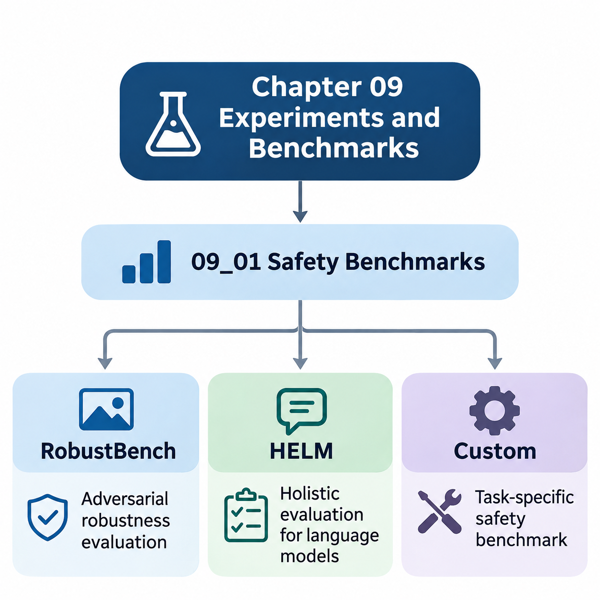
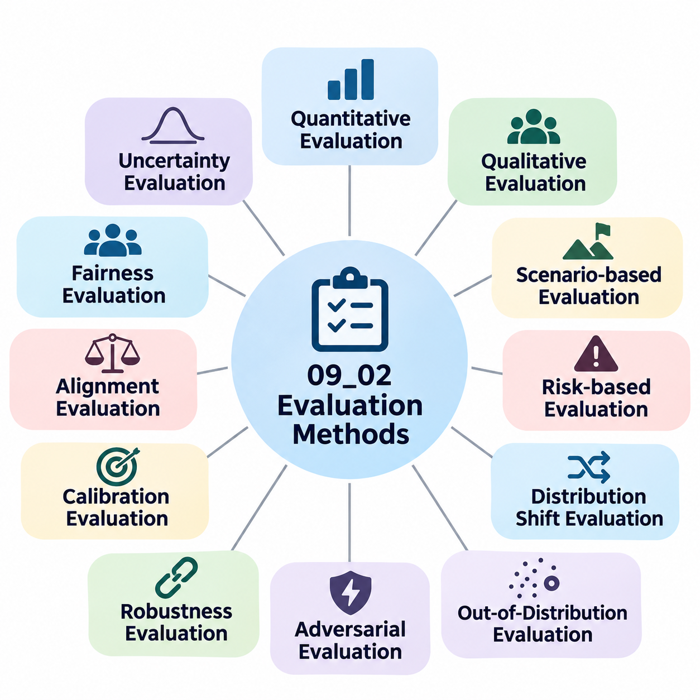
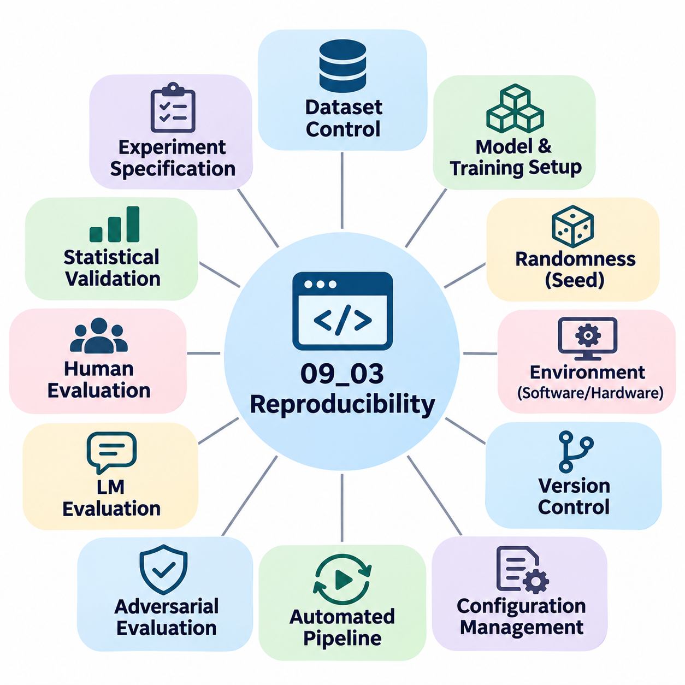
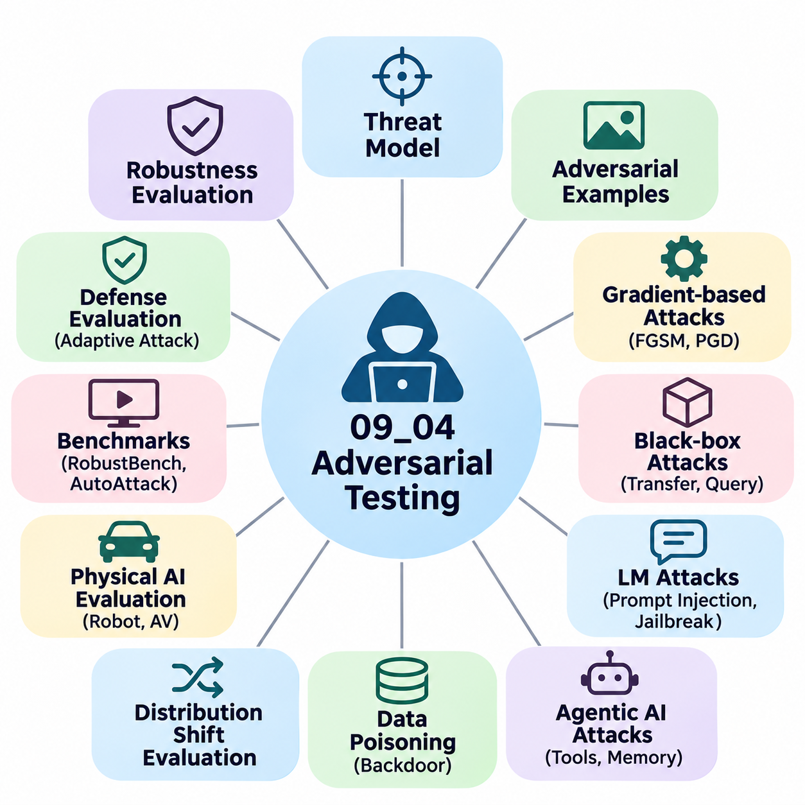
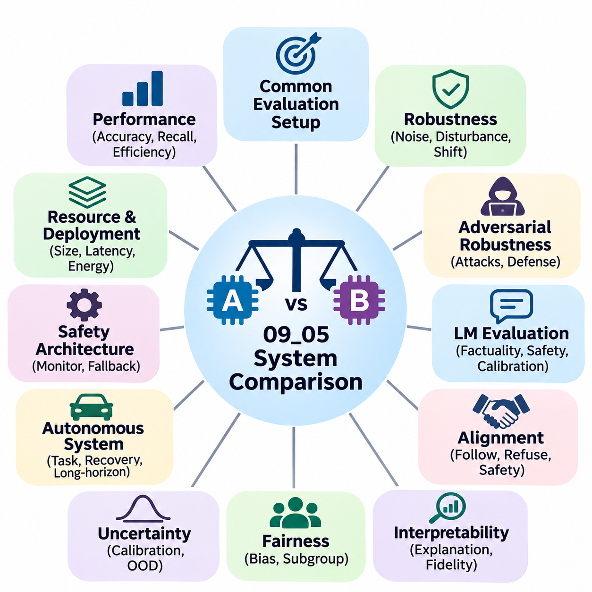

**Volume 42. AI Safety Alignment and Interpretability**

# 09. Experiments and Benchmarks

## 09.01 Safety Benchmarks

{width="7.268055555555556in" height="7.268055555555556in"}

Safety benchmarks provide systematic methods for evaluating whether artificial intelligence systems remain reliable, predictable, and secure under challenging operating conditions. Unlike conventional performance benchmarks that emphasize accuracy or computational efficiency, safety benchmarks examine failure behavior, adversarial vulnerability, uncertainty, and operational risk. Their purpose is to identify limitations before systems encounter consequential real-world situations.

A comprehensive safety benchmarking framework must evaluate multiple dimensions of model behavior rather than relying on a single performance score. These dimensions include robustness against input perturbations, resistance to malicious manipulation, consistency across demographic groups, reliability under distribution shifts, and compliance with safety constraints. Evaluations should distinguish ordinary prediction errors from failures that could produce significant operational or societal harm.

RobustBench is a standardized benchmarking platform designed primarily to evaluate adversarial robustness in image classification models. It provides established evaluation protocols, pretrained model collections, and reproducible comparisons across defensive architectures. By standardizing datasets, perturbation constraints, and attack procedures, RobustBench helps researchers distinguish genuine improvements in robustness from results caused by inconsistent experimental settings.

Adversarial robustness measures a model\'s ability to maintain correct predictions when inputs undergo deliberately constructed perturbations. Such perturbations may be visually imperceptible yet sufficient to change a neural network\'s output. RobustBench commonly evaluates models under bounded perturbation constraints, particularly L-infinity and L2 norms, allowing researchers to quantify how prediction reliability changes within explicitly defined adversarial threat models.

One important component of RobustBench evaluation is AutoAttack, an ensemble of parameter-free adversarial attacks designed to reduce dependence on manually tuned attack configurations. AutoAttack combines complementary attack strategies, including adaptive gradient-based methods and decision-based approaches. This evaluation methodology helps expose weaknesses that may remain undetected when researchers rely exclusively on a single attack algorithm.

RobustBench distinguishes clean accuracy from robust accuracy because these measurements capture different aspects of model performance. Clean accuracy describes predictive correctness on unmodified test samples, while robust accuracy measures correctness under a specified adversarial evaluation procedure. A model may achieve excellent conventional accuracy while remaining vulnerable to small perturbations, demonstrating why ordinary predictive performance cannot establish safety.

Benchmark comparisons must carefully preserve the experimental conditions under which robustness scores are obtained. Dataset selection, perturbation magnitude, preprocessing procedures, attack configuration, and model architecture can substantially influence results. Robustness claims should therefore include the relevant threat model and evaluation protocol, rather than presenting numerical scores as universal indicators of security or reliability.

Although RobustBench provides valuable evidence about adversarial robustness, its scope does not encompass every dimension of AI safety. Strong resistance to bounded image perturbations does not automatically establish fairness, privacy protection, semantic reliability, or safe behavior in autonomous environments. Additional evaluation frameworks are necessary to examine language understanding, harmful generation, social consequences, and complex interactions between AI systems and human users.

Holistic Evaluation of Language Models, commonly known as HELM, provides a broader framework for assessing language models across multiple scenarios and evaluation metrics. Rather than ranking systems exclusively according to benchmark accuracy, HELM emphasizes multidimensional evaluation and transparent reporting. Its methodology supports comparisons involving task performance, robustness, fairness, calibration, efficiency, and other characteristics relevant to responsible language model deployment.

HELM organizes evaluation around scenarios that describe the tasks and conditions under which language models operate. A scenario may involve question answering, summarization, information extraction, classification, or other language processing activities. Different adaptation methods and metrics can then be applied systematically, allowing researchers to examine whether a model performs consistently across tasks, prompting strategies, and evaluation conditions.

The multidimensional perspective of HELM is particularly important because language model capabilities often involve competing objectives. Improvements in task accuracy do not necessarily produce corresponding improvements in fairness, calibration, robustness, or safety. A model that generates fluent and convincing responses may still produce unsupported claims, harmful instructions, or misleading information, requiring independent assessment of these distinct failure characteristics.

Safety-oriented language model evaluation should examine how systems respond to harmful requests, ambiguous instructions, misleading context, and adversarial prompting. Depending on the evaluation configuration, researchers may assess refusal behavior, factual reliability, sensitivity to prompt variations, and consistency with defined behavioral requirements. These measurements complement conventional language understanding benchmarks by examining conditions associated with practical deployment risks.

HELM also illustrates the importance of transparency in experimental reporting. Evaluation results become more meaningful when researchers disclose model versions, datasets, prompts, adaptation procedures, metrics, and computational settings. Transparent documentation helps identify differences caused by experimental methodology rather than intrinsic model capabilities. It also supports independent reproduction and more defensible comparisons between competing language model systems.

Neither RobustBench nor HELM can independently establish that an AI system is safe for every intended application. RobustBench concentrates on particular adversarial robustness settings, while HELM provides evaluation structures whose coverage depends on the selected scenarios and metrics. Safety assurance therefore requires combining standardized benchmarks with application-specific experiments, operational testing, and continuous monitoring throughout the system lifecycle.

Custom safety benchmarks address risks that standardized public benchmarks may not adequately represent. Organizations developing autonomous vehicles, industrial robots, healthcare systems, or infrastructure monitoring platforms frequently encounter specialized operating conditions and failure consequences. Custom evaluation suites translate these domain-specific concerns into measurable experiments that reflect actual deployment environments, system constraints, and stakeholder expectations.

The design of a custom benchmark begins with identifying the system\'s intended operating conditions, potential hazards, and acceptable performance boundaries. Engineers should define the operational design domain, anticipated disturbances, failure severity, and required recovery behavior. These definitions establish a connection between abstract safety objectives and observable experimental outcomes, allowing benchmark results to support concrete engineering decisions.

For autonomous driving systems, custom safety benchmarks may examine pedestrian detection failures, unexpected vehicle behavior, degraded visibility, sensor occlusion, and emergency braking performance. Evaluation scenarios should include both ordinary traffic situations and rare hazardous events. Important measurements include collision frequency, time to collision, intervention effectiveness, perception uncertainty, and the ability to transition safely into minimum-risk operating conditions.

Robotic systems require additional evaluation of physical interactions, actuator limitations, localization failures, and environmental uncertainty. A mobile robot may operate correctly under laboratory conditions but encounter difficulties on uneven surfaces, near moving obstacles, or during communication interruptions. Custom benchmarks should examine whether the robot maintains safe motion, detects abnormal conditions, and executes appropriate fallback procedures when normal autonomy becomes unreliable.

Healthcare AI benchmarks must consider clinical consequences rather than treating every prediction error as equally important. False negatives, false positives, calibration failures, and performance differences across patient populations may have substantially different implications. Evaluation procedures should incorporate representative clinical conditions, subgroup analysis, uncertainty assessment, and appropriate human oversight to determine whether model behavior satisfies application-specific safety requirements.

Infrastructure AI systems introduce challenges involving continuous operation, heterogeneous sensors, and geographically distributed environments. Monitoring platforms may need to detect structural anomalies, equipment degradation, or hazardous events despite incomplete observations and changing environmental conditions. Custom benchmarks should evaluate detection reliability, alert latency, false alarm frequency, sensor degradation tolerance, and the consequences of delayed or incorrect system responses.

A robust custom benchmark should combine nominal operating scenarios with stress tests, adversarial conditions, and deliberately introduced failures. Stress testing reveals how performance degrades as environmental complexity increases, while failure injection examines resilience when individual components become unavailable. Such experiments help distinguish systems that perform well under ideal conditions from systems capable of maintaining acceptable behavior during operational disturbances.

Benchmark datasets must represent meaningful variations in environments, users, operating conditions, and failure modes. Poorly constructed datasets can produce misleading safety conclusions when important edge cases are absent or underrepresented. Dataset development should therefore include systematic scenario coverage, documented sampling procedures, independent validation, and controls against contamination between training and evaluation data.

Quantitative safety metrics should reflect both the probability and consequences of failure. Depending on the application, relevant measurements may include robust accuracy, hazard detection recall, false negative rate, intervention latency, recovery success rate, and constraint violation frequency. Reporting confidence intervals and performance distributions provides additional information about uncertainty and prevents excessive reliance on isolated average scores.

Safety evaluation must also account for the temporal behavior of autonomous and interactive systems. A model may perform correctly on individual inputs while accumulating errors during extended operation. Long-horizon benchmarks can examine whether perception errors propagate into planning failures, whether uncertainty increases over time, and whether recovery mechanisms restore safe operation after disturbances or unexpected environmental changes.

Combining RobustBench, HELM, and custom benchmarks creates a layered evaluation strategy spanning standardized model-level testing and application-specific system validation. RobustBench contributes adversarial robustness measurements, HELM supports multidimensional language model assessment, and custom benchmarks address deployment-specific hazards. Their complementary roles provide broader evidence than any single benchmark can produce independently.

Benchmark outcomes should inform model selection, defensive architecture design, safety monitoring, and deployment decisions. When experiments reveal unacceptable vulnerabilities, engineers may revise training data, introduce adversarial defenses, improve uncertainty estimation, or strengthen runtime safeguards. Subsequent evaluations should determine whether these modifications reduce the identified risks without introducing new failure modes or unacceptable performance tradeoffs.

Reproducibility is essential for maintaining confidence in safety benchmark results. Experimental records should preserve dataset versions, model checkpoints, random seeds, software dependencies, hardware configurations, and evaluation procedures. Automated testing pipelines can execute standardized benchmark suites whenever models or system components change, helping development teams identify regressions and maintain traceable evidence throughout iterative engineering cycles.

Ultimately, safety benchmarks should be understood as instruments for structured risk evaluation rather than definitive certificates of safety. Their value depends on realistic assumptions, appropriate threat models, representative scenarios, and rigorous interpretation of experimental evidence. Integrating standardized benchmarks with domain-specific validation and continuous operational assessment establishes a stronger foundation for developing trustworthy, resilient, and accountable AI systems.

## 09.02 Evaluation Methods

{width="7.268055555555556in" height="7.268055555555556in"}

Evaluation methods provide the methodological foundation for determining whether artificial intelligence systems satisfy defined safety, reliability, and alignment requirements. Unlike conventional testing that focuses primarily on predictive accuracy, safety-oriented evaluation examines how models behave under uncertainty, adversarial interference, distribution shifts, and operational failures. A rigorous evaluation methodology connects measurable outcomes with explicitly defined risks and acceptable operating conditions.

The evaluation process begins by establishing clear objectives, system boundaries, and operational assumptions. Researchers must identify the intended application, expected users, environmental conditions, and consequences of incorrect decisions. These factors determine which evaluation methods are appropriate and how results should be interpreted. Without a clearly defined evaluation context, even statistically impressive benchmark scores may provide insufficient evidence of practical safety.

Quantitative evaluation methods measure system behavior through numerical indicators that support reproducible comparisons. Common measurements include accuracy, precision, recall, false positive rate, false negative rate, calibration error, and robustness under perturbations. Safety-critical applications require additional measurements such as hazard detection latency, constraint violation frequency, recovery success rate, and the probability of entering unsafe operational states.

Qualitative evaluation complements numerical measurements by examining failure characteristics that are difficult to express through fixed metrics. Expert reviewers may assess the severity of unsafe responses, the adequacy of explanations, the appropriateness of autonomous decisions, and the effectiveness of human oversight. Structured evaluation rubrics improve consistency by defining observable criteria and distinguishing minor deficiencies from failures with potentially serious consequences.

Scenario-based evaluation tests AI systems against carefully constructed operating situations representing both expected behavior and hazardous conditions. Each scenario defines initial conditions, environmental variables, system objectives, and evaluation criteria. Scenarios may involve sensor degradation, unexpected obstacles, conflicting instructions, or communication failures. This approach connects abstract safety requirements with concrete behaviors that can be observed and measured.

Risk-based evaluation prioritizes experiments according to the likelihood and severity of potential failures. High-consequence scenarios receive greater attention even when their occurrence probability is relatively low. Risk assessment techniques can identify critical hazards, causal pathways, and vulnerable system components. Evaluation resources are then allocated to conditions where failures could cause substantial physical, financial, operational, or societal harm.

Distribution shift evaluation examines whether model performance remains reliable when deployment data differs from training data. Changes may involve environmental conditions, sensor characteristics, user populations, or task distributions. Researchers can introduce controlled shifts in input characteristics and measure performance degradation. Such experiments help determine whether models generalize beyond familiar conditions or depend excessively on assumptions embedded in their training datasets.

Out-of-distribution evaluation focuses on inputs that differ meaningfully from the model\'s expected operating domain. A reliable system should recognize situations where its predictions may be uncertain or unsupported. Evaluation methods examine detection sensitivity, uncertainty calibration, and the ability to abstain or request assistance. Successful detection does not guarantee safety, but it can support mechanisms that prevent unreliable predictions from directly controlling consequential actions.

Adversarial evaluation investigates system behavior when inputs or interactions are deliberately manipulated to produce errors. For vision models, researchers may introduce bounded perturbations, physical artifacts, or environmental interference. For language models, adversarial testing may involve prompt injection, misleading instructions, or attempts to bypass behavioral restrictions. Evaluation must specify attacker capabilities, accessible interfaces, and success criteria to ensure meaningful interpretation.

Robustness evaluation measures how performance changes as disturbances increase in magnitude or complexity. Rather than testing only one perturbation level, researchers can construct degradation curves across multiple conditions. These curves reveal operational thresholds beyond which performance becomes unacceptable. Comparing degradation patterns also helps identify whether defensive mechanisms improve general resilience or merely optimize performance against narrowly defined disturbances.

Calibration evaluation determines whether a model\'s confidence estimates correspond to observed correctness frequencies. A well-calibrated model should assign higher confidence to predictions that are more likely to be correct. Methods such as reliability diagrams, expected calibration error, and proper scoring rules provide complementary perspectives. In safety-critical systems, calibration supports decisions about when automated predictions should be accepted, rejected, or reviewed.

Uncertainty evaluation distinguishes uncertainty associated with incomplete knowledge from uncertainty caused by inherent variability in observations. Epistemic uncertainty may decrease with additional representative training data, while aleatoric uncertainty reflects variability that cannot necessarily be eliminated. Evaluation techniques can examine predictive distributions, ensemble disagreement, and uncertainty estimates under changing conditions. Their practical value depends on whether uncertainty measurements improve operational decisions.

Fairness evaluation investigates whether system performance differs systematically across relevant populations or operating contexts. Metrics such as demographic parity, equalized odds, and subgroup calibration capture different fairness objectives. Because these objectives may conflict, evaluation must consider the application and potential consequences of unequal outcomes. Aggregate performance should be supplemented with subgroup analysis to identify disparities that overall averages may conceal.

Alignment evaluation examines whether model behavior remains consistent with intended objectives, authorized instructions, and applicable safety constraints. For language models and autonomous agents, evaluation may include instruction-following reliability, resistance to reward hacking, appropriate refusal behavior, and consistency across conflicting objectives. These tests should distinguish superficial compliance with evaluation prompts from robust adherence to intended behavior across unfamiliar situations.

Human evaluation remains important when safety judgments require contextual understanding, domain expertise, or ethical interpretation. Evaluators can review system outputs, simulated decisions, and operational traces using predefined assessment criteria. Inter-rater agreement provides evidence about evaluation consistency, while disagreement analysis identifies ambiguous requirements. Human judgments should be documented carefully because evaluator expectations and expertise can influence reported outcomes.

Simulation-based evaluation enables controlled testing of hazardous scenarios that would be expensive, impractical, or unsafe to reproduce physically. Simulators can vary environmental parameters, introduce component failures, and repeat identical scenarios across competing systems. However, simulation fidelity limits the conclusions that can be drawn. Differences between simulated and real environments must be assessed before simulated performance is treated as evidence of deployment readiness.

Real-world evaluation examines system behavior under physical and operational conditions that simulations may not reproduce accurately. Field testing can reveal unexpected interactions involving hardware limitations, environmental variability, human behavior, and infrastructure constraints. Controlled deployment stages reduce exposure to risk while collecting representative evidence. Evaluation protocols should establish intervention authority, emergency procedures, and stopping conditions before potentially hazardous experiments begin.

Long-horizon evaluation measures reliability across extended sequences of decisions rather than isolated predictions. Autonomous systems may accumulate localization errors, lose contextual information, or propagate incorrect assumptions into subsequent actions. Relevant metrics include mission completion rate, cumulative constraint violations, recovery frequency, and time spent in degraded operating modes. Such evaluation reveals failure patterns that remain invisible in short-duration benchmarks.

Statistical evaluation determines whether observed performance differences are meaningful rather than consequences of random variation. Confidence intervals, hypothesis tests, effect sizes, and repeated experimental trials help quantify uncertainty in reported results. Rare safety failures require particular caution because limited observations may not support strong reliability claims. Evaluation reports should distinguish measured outcomes from extrapolated failure probabilities and explicitly communicate statistical limitations.

Comparative evaluation examines multiple models or system configurations under equivalent experimental conditions. Fair comparisons require consistent datasets, threat models, preprocessing, computational constraints, and scoring procedures. Baseline systems provide reference points for interpreting improvements. Comparisons should also consider tradeoffs between predictive performance, robustness, latency, resource consumption, and operational complexity rather than identifying a universally superior model.

Continuous evaluation extends safety assessment beyond initial development into deployment and maintenance. Automated monitoring can detect performance drift, unusual inputs, increasing uncertainty, and emerging failure patterns. Periodic benchmark execution supports regression detection after model updates or configuration changes. Evaluation findings should feed into incident analysis, corrective actions, and controlled release procedures so that safety evidence remains relevant as systems evolve.

A comprehensive evaluation methodology integrates quantitative metrics, qualitative review, scenario testing, adversarial analysis, simulation, and real-world validation into a coherent evidence framework. Each method addresses different limitations, and agreement across independent approaches increases confidence in system behavior. The ultimate objective is not merely to demonstrate high benchmark performance, but to establish defensible evidence that AI systems operate within defined safety boundaries and respond appropriately when those boundaries are threatened.

## 09.03 Reproducibility [w/Code]

{width="7.268055555555556in" height="7.268055555555556in"}

Reproducibility is a fundamental requirement for trustworthy artificial intelligence research, particularly when experimental results influence safety-critical decisions. It refers to the ability to obtain consistent findings when an experiment is repeated using documented methods, datasets, and computational conditions. Without reproducibility, reported improvements in robustness, alignment, or reliability may reflect uncontrolled experimental variation rather than genuine advances in system safety.

Reproducibility in AI safety extends beyond obtaining identical accuracy scores. Researchers must demonstrate that safety properties remain consistent across repeated evaluations, independent implementations, and controlled environmental variations. This includes verifying adversarial resistance, uncertainty estimates, fairness measurements, and failure recovery behavior. Reproducible safety evidence strengthens confidence that observed performance is not an artifact of a particular experimental configuration.

A reproducible experiment begins with a complete specification of its objectives, hypotheses, evaluation criteria, and operating assumptions. Researchers should document the intended system behavior, relevant threat models, dataset characteristics, and acceptable safety thresholds. These specifications establish the conditions under which results can be interpreted and compared. Ambiguous experimental objectives make it difficult to determine whether independent evaluations address the same safety questions.

Dataset reproducibility requires precise control over data sources, preprocessing operations, labeling procedures, and partitioning strategies. Training, validation, and testing datasets should be identified through stable versions or cryptographic hashes. Researchers must document filtering rules, augmentation methods, class distributions, and exclusion criteria. These records help prevent unintended differences between experiments and reduce the risk of data leakage or benchmark contamination.

Model reproducibility depends on preserving architectural definitions, parameter initialization, optimization settings, and training procedures. Even small changes in learning rates, batch sizes, normalization layers, or regularization methods can influence model behavior. Complete experiment records should include optimizer configurations, learning rate schedules, checkpoint selection criteria, and stopping conditions. Such documentation enables independent researchers to reconstruct the training process with minimal ambiguity.

Randomness is a major source of experimental variability in machine learning systems. Random initialization, data shuffling, stochastic augmentation, dropout, and parallel computation can produce different results across repeated runs. Setting random seeds improves experimental consistency, but does not guarantee complete determinism. Some GPU operations and distributed algorithms exhibit nondeterministic behavior, requiring explicit documentation of remaining sources of variability.

Computational environment reproducibility requires recording software dependencies, framework versions, operating systems, hardware architectures, and accelerator configurations. Differences in CUDA libraries, numerical precision, compiler optimizations, or device drivers may alter experimental outcomes. Containerization technologies can package many software dependencies into portable environments. However, containers do not eliminate every hardware-dependent difference, making detailed environment documentation essential.

Version control provides a systematic mechanism for preserving the relationship between source code and experimental results. Each experiment should reference a specific repository commit, configuration file, and model checkpoint. Changes to preprocessing, evaluation scripts, or safety constraints must remain traceable throughout development. This practice enables researchers to determine exactly which implementation produced a reported result and supports reliable regression analysis.

Experiment configuration management separates experimental parameters from implementation logic. Structured configuration files can define datasets, model architectures, optimization settings, threat models, and evaluation metrics. Centralized configuration management reduces accidental inconsistencies and makes experiments easier to repeat. Recording resolved configurations is especially important when default values, environment variables, or inherited settings influence execution.

Automated experiment pipelines improve reproducibility by executing predefined procedures consistently. A pipeline may include data validation, preprocessing, model initialization, training, checkpoint generation, safety evaluation, and report creation. Workflow orchestration reduces dependence on undocumented manual actions. Automated validation can also detect missing artifacts, incompatible configurations, or unexpected changes before experimental results are accepted.

Reproducibility in adversarial robustness evaluation requires particular attention to attack configurations and threat models. Researchers must document perturbation constraints, attack iterations, optimization parameters, input normalization, and success criteria. An apparent improvement in robust accuracy may result from a weaker attack rather than a stronger defense. Standardized evaluation procedures, including established adversarial attack suites, help reduce these methodological inconsistencies.

Language model safety evaluation introduces additional reproducibility challenges because outputs may depend on sampling parameters, prompt formatting, system instructions, and model service updates. Experiments should record temperature, decoding settings, prompt templates, evaluation datasets, and available model identifiers. When proprietary services change without exposing complete version information, exact reproduction may become impossible. Researchers should acknowledge these limitations rather than implying unsupported experimental equivalence.

Human evaluation requires reproducible assessment procedures even when judgments cannot be perfectly deterministic. Evaluation rubrics should define rating categories, decision criteria, and examples of acceptable or unacceptable behavior. Reviewer training, sampling procedures, and disagreement resolution methods must be documented. Inter-rater agreement and uncertainty estimates help characterize the consistency of human judgments and identify ambiguous evaluation requirements.

Statistical reproducibility requires evaluating performance variability rather than relying on a single experimental run. Multiple random seeds, repeated trials, confidence intervals, and appropriate statistical comparisons help distinguish meaningful improvements from random fluctuations. Safety-critical metrics may involve rare events, making uncertainty particularly important. Reports should disclose sample sizes, observed failure counts, and limitations associated with estimating low-probability risks.

Independent replication provides stronger evidence than repeated execution within the original development environment. External researchers may reproduce experiments using the published methodology, independently reconstructed implementations, or alternative computational infrastructure. Differences between results can reveal hidden assumptions, undocumented dependencies, or methodological weaknesses. Successful replication increases confidence that findings generalize beyond the original experimental setup.

Reproducibility also applies to simulation-based safety testing. Simulation experiments should preserve environment configurations, scenario definitions, physics parameters, sensor models, and initial conditions. When randomized environments are used, researchers should record sampling distributions and random seeds. These records enable repeated investigation of hazardous scenarios and help distinguish genuine improvements in autonomous behavior from favorable simulation conditions.

Real-world robotic experiments present additional challenges because physical environments cannot always be restored to identical states. Weather, lighting, surface conditions, sensor calibration, battery state, and human activity may vary between trials. Researchers should document these factors and use standardized procedures whenever practical. Repeated testing across representative conditions provides stronger evidence than attempting to interpret a single successful demonstration as proof of reliability.

Safety benchmark reproducibility requires consistent metric definitions and scoring procedures. Evaluation scripts should specify how failures, partial successes, timeouts, interventions, and constraint violations are counted. Different interpretations of these events can produce incompatible results even when systems encounter identical scenarios. Reference implementations and automated scoring tests help maintain consistency across research teams and benchmark versions.

Artifact preservation is essential for long-term reproducibility. Experimental artifacts may include source code, configuration files, dataset manifests, model checkpoints, training logs, evaluation outputs, and statistical summaries. Stable storage locations, integrity checks, and access controls help prevent accidental modification or loss. Sensitive datasets and proprietary components may require restricted access, but their limitations should be documented transparently.

Continuous integration and continuous evaluation can transform reproducibility from a research objective into an engineering practice. Automated pipelines may execute safety regression tests whenever model code, dependencies, or configurations change. Historical results provide reference points for detecting unexpected performance degradation. This approach connects reproducible experimentation with operational safety assurance and controlled deployment processes.

Ultimately, reproducibility establishes the evidential foundation for credible AI safety claims. It enables researchers to distinguish genuine improvements from experimental artifacts, compare competing systems fairly, and investigate failures systematically. By integrating version control, deterministic procedures where feasible, statistical validation, independent replication, and comprehensive documentation, organizations can develop safety evaluation processes that remain transparent, auditable, and scientifically defensible.

## 09.04 Adversarial Testing [w/Code]

{width="7.268055555555556in" height="7.268055555555556in"}

Adversarial testing is a systematic evaluation methodology designed to identify vulnerabilities in artificial intelligence systems under deliberately challenging or malicious conditions. Unlike conventional testing, which measures performance on representative inputs, adversarial testing investigates how models respond to manipulated data, deceptive instructions, and unexpected interactions. Its primary objective is to expose weaknesses before they can cause operational failures, security breaches, or unsafe decisions.

The foundation of adversarial testing is a clearly defined threat model that specifies attacker objectives, capabilities, knowledge, and constraints. An attacker may control input data, modify environmental observations, inject instructions, or exploit accessible interfaces. Threat models distinguish white-box attacks, where internal model information is available, from black-box attacks, where only observable outputs can be examined. These assumptions determine which vulnerabilities an evaluation can meaningfully identify.

Adversarial examples are inputs intentionally constructed to cause incorrect predictions or undesirable behavior. In computer vision, small pixel-level perturbations can change classification results despite appearing nearly identical to ordinary images. Physical adversarial examples may involve modified signs, patterns, or objects that affect perception systems. Such examples demonstrate that high accuracy on conventional datasets does not necessarily imply resistance to targeted manipulation.

Gradient-based attacks exploit model derivatives to identify input modifications that increase prediction errors. The Fast Gradient Sign Method generates perturbations using the direction of the input loss gradient, while Projected Gradient Descent repeatedly updates inputs within defined constraints. These techniques evaluate local decision boundary sensitivity and provide standardized stress conditions. Their effectiveness depends on the threat model, optimization settings, and available gradient information.

Black-box adversarial testing examines systems without requiring direct access to internal parameters or gradients. Attackers may observe prediction scores, output labels, or behavioral responses while submitting carefully selected queries. Transfer-based attacks use adversarial inputs generated against surrogate models, whereas query-based attacks adapt according to observed outputs. These methods are particularly relevant to deployed services where internal model architectures are unavailable.

Robustness evaluation must distinguish successful attacks from weaknesses in the evaluation procedure itself. Defensive mechanisms can sometimes create gradient masking, making gradient-based attacks appear ineffective without providing genuine protection. Adaptive attacks that account for the defense mechanism are therefore essential. Evaluation should combine complementary attack strategies, sufficient optimization effort, and clearly documented success criteria to avoid overstating robustness.

Standardized adversarial benchmarks support consistent comparison between defensive architectures. Frameworks such as RobustBench use established datasets, perturbation budgets, and attack procedures to evaluate robust accuracy. AutoAttack combines complementary attack methods to reduce dependence on manually selected attack parameters. Nevertheless, benchmark scores remain conditional on their threat models and cannot establish protection against every possible adversarial strategy.

Adversarial testing for language models examines attempts to manipulate generated responses through malicious or misleading instructions. Prompt injection occurs when lower-trust content, such as retrieved documents or tool outputs, attempts to override higher-priority instructions. Jailbreak attempts seek to bypass behavioral safeguards through deceptive framing or instruction conflicts. Evaluation measures whether models preserve instruction boundaries while continuing to perform legitimate tasks.

Agentic AI systems introduce additional attack surfaces because models interact with external tools, memory systems, and execution environments. Malicious content may attempt to redirect tool calls, alter stored information, or induce unauthorized operations. Adversarial evaluation should examine whether agents distinguish trusted instructions from untrusted observations and enforce permission boundaries. Successful defense requires coordinated safeguards across the model, tool interfaces, and surrounding application architecture.

Data poisoning attacks target the integrity of training or adaptation processes rather than individual inference inputs. An attacker may introduce manipulated samples, misleading labels, or hidden behavioral triggers into datasets. Backdoor attacks attempt to create specific undesirable behavior when a trigger appears while preserving normal performance elsewhere. Testing should examine dataset provenance, suspicious patterns, trigger sensitivity, and the effectiveness of data validation procedures.

Distribution shift and adversarial manipulation are related but distinct evaluation concerns. Distribution shift may arise naturally from environmental changes, whereas adversarial attacks involve intentional attempts to exploit weaknesses. Testing both conditions helps determine whether defenses improve general reliability or address only narrowly constructed threats. Evaluation should report performance degradation across multiple perturbation strengths, environmental conditions, and attack objectives.

Physical AI systems require adversarial testing that considers real-world sensing and control. Autonomous vehicles and mobile robots may encounter deceptive visual patterns, sensor interference, localization disturbances, or manipulated environmental signals. Testing must examine how perception errors propagate into planning and actuation. Safety evaluation should measure collision risk, constraint violations, intervention latency, and the effectiveness of emergency fallback behavior.

Simulation environments provide controlled conditions for adversarial testing of autonomous systems. Researchers can introduce sensor faults, communication delays, unexpected obstacles, and coordinated disturbances without exposing people or equipment to unnecessary danger. Repeated simulation trials support systematic comparison across defensive configurations. However, simulation results must be validated against physical limitations and real-world environmental variability.

Adversarial testing should evaluate the complete system rather than isolated models whenever deployment risks involve multiple interacting components. A perception model may remain accurate while a planning module makes unsafe decisions from delayed observations. Similarly, a language model may reject malicious instructions while an external tool executes insufficiently validated commands. End-to-end testing reveals vulnerabilities arising from integration, timing, permissions, and system-level dependencies.

Red teaming provides a complementary evaluation approach in which specialists actively search for unexpected failure modes. Human testers combine domain knowledge, creative strategies, and iterative feedback to challenge assumptions embedded in automated benchmarks. Structured red-team exercises should define authorized boundaries, record attack attempts, and classify discovered vulnerabilities. Findings can inform new automated tests and improvements to defensive architectures.

Adversarial evaluation requires metrics that reflect both attack effectiveness and defensive consequences. Relevant measurements include attack success rate, robust accuracy, unsafe response frequency, constraint violation rate, detection latency, and recovery success. Evaluations should also measure false alarms and the impact of defenses on legitimate functionality. A defense that blocks most attacks but frequently disrupts authorized tasks may introduce unacceptable operational tradeoffs.

Reproducibility is essential for interpreting adversarial testing results. Experimental records should preserve model versions, attack implementations, perturbation limits, random seeds, datasets, and evaluation configurations. Repeated trials and statistical uncertainty estimates help distinguish systematic vulnerabilities from isolated outcomes. For stochastic language models, decoding settings and prompt templates must also be recorded to support meaningful comparisons.

Continuous adversarial testing is necessary because deployed systems evolve and attackers adapt their strategies. Model updates, new tools, changing data sources, and modified interfaces can introduce previously unseen vulnerabilities. Automated regression suites should incorporate confirmed attack cases and representative variations. Periodic independent assessments complement automated testing by identifying weaknesses that existing attack collections may overlook.

Ultimately, adversarial testing provides structured evidence about how artificial intelligence systems behave when their assumptions are intentionally challenged. It does not prove absolute security or safety, because attack coverage and threat models are necessarily incomplete. Its greatest value emerges when standardized attacks, adaptive evaluations, human red teaming, and system-level validation are integrated into an ongoing safety engineering process.

## 09.05 System Comparison

{width="7.268055555555556in" height="7.268055555555556in"}

System comparison is a fundamental evaluation process for determining how different artificial intelligence architectures, models, and deployment configurations perform under equivalent conditions. In AI safety research, comparison extends beyond predictive accuracy to include robustness, alignment, interpretability, fairness, and operational reliability. Its primary objective is to identify meaningful differences in safety behavior and determine which systems are appropriate for specific deployment requirements.

A rigorous comparison framework begins by defining common evaluation objectives, operational assumptions, and measurable performance criteria. Competing systems should be evaluated against the same datasets, scenarios, threat models, and safety constraints whenever technically feasible. Differences in input preprocessing, evaluation procedures, or computational resources must be documented. Without standardized conditions, apparent performance advantages may reflect experimental inconsistencies rather than genuine system capabilities.

System comparison should distinguish model-level capabilities from end-to-end system behavior. A model may demonstrate excellent classification accuracy while the complete application experiences failures caused by communication delays, software integration, or hardware limitations. Evaluation must therefore consider both individual components and their interactions. This distinction is particularly important in autonomous systems where perception, planning, control, and safety monitoring operate together.

Performance comparison typically begins with conventional metrics such as accuracy, precision, recall, task completion rate, and computational efficiency. These measurements establish a baseline for understanding functional capabilities. However, strong average performance does not necessarily indicate safe operation under unusual conditions. Safety-oriented comparisons must additionally evaluate rare failures, uncertainty, recovery behavior, and compliance with operational constraints.

Robustness comparison examines how competing systems respond to disturbances, adversarial perturbations, and distribution shifts. Researchers may evaluate performance across increasing levels of noise, sensor degradation, environmental variation, or malicious manipulation. Degradation curves reveal whether systems fail gradually or experience abrupt performance collapse. Comparing these patterns provides more meaningful evidence than reporting robustness at a single perturbation level.

Adversarial robustness comparisons require consistent threat models and attack procedures. For image classification systems, standardized benchmarks such as RobustBench can support comparisons under defined perturbation constraints. Attack strength, optimization settings, and evaluation budgets must remain comparable across models. A defense that appears effective against weak attacks may perform poorly against adaptive adversaries, making attack methodology essential to valid conclusions.

Language model comparisons require evaluation across multiple dimensions because fluency and task accuracy alone cannot establish reliability. Frameworks such as HELM illustrate how models can be examined using common scenarios and complementary metrics. Relevant dimensions include factual consistency, calibration, robustness, fairness, efficiency, and safety-related behavior. Comparisons should disclose prompt templates, decoding parameters, model versions, and evaluation conditions.

Alignment comparison investigates whether systems consistently follow authorized instructions while respecting defined safety boundaries. Evaluations may include conflicting instructions, ambiguous requests, harmful prompts, and attempts to manipulate instruction priorities. Researchers should distinguish appropriate refusal behavior from excessive rejection of legitimate tasks. A system that avoids unsafe outputs but frequently blocks authorized activities may impose substantial usability costs.

Interpretability comparison evaluates how effectively different systems support understanding of their predictions and decisions. Methods may include feature attribution, attention analysis, concept-based explanations, and inspection of intermediate representations. Explanation quality should be assessed through fidelity, stability, and usefulness rather than visual plausibility alone. Systems with understandable outputs are not necessarily safer unless explanations accurately reflect the mechanisms influencing decisions.

Fairness comparison examines whether performance and error distributions differ across relevant populations or operating contexts. Aggregate accuracy can conceal substantial disparities in false positive rates, false negative rates, or calibration. Researchers should select fairness metrics appropriate to the application and acknowledge conflicts between competing definitions. Comparisons must also consider dataset representativeness and uncertainty in subgroup measurements.

Uncertainty estimation provides another important dimension of system comparison. Models may produce similar predictions while assigning substantially different confidence levels. Calibration error, selective prediction performance, and out-of-distribution detection can reveal whether confidence estimates support safe decisions. Systems that recognize uncertain conditions and request assistance may be preferable in safety-critical applications, even when their raw accuracy is slightly lower.

Autonomous system comparison must incorporate temporal reliability and long-horizon behavior. Individual decisions may appear correct while accumulated errors eventually cause mission failure. Evaluation should measure task completion, constraint violations, recovery success, and operational continuity across extended sequences. These measurements are particularly relevant to mobile robots, autonomous vehicles, and agents that interact continuously with changing environments.

Simulation-based comparisons enable controlled evaluation of multiple systems under identical hazardous scenarios. Researchers can vary weather, lighting, obstacle behavior, sensor availability, and communication quality while preserving repeatable experimental conditions. Simulation supports extensive stress testing without exposing people or equipment to unnecessary risk. Nevertheless, differences between simulated and physical environments must be considered when interpreting results.

Real-world comparison validates whether advantages observed in controlled experiments persist under practical operating conditions. Hardware variability, environmental uncertainty, sensor calibration, and human interactions can influence system performance. Field evaluations should use comparable routes, workloads, operating periods, and intervention procedures. Repeated trials across representative conditions help prevent isolated demonstrations from being mistaken for reliable performance evidence.

Safety architecture comparison examines differences between systems that rely primarily on learned behavior and those incorporating explicit safety mechanisms. Runtime monitors, rule-based constraints, independent emergency controllers, and fallback procedures can provide additional protection when predictive models become unreliable. Evaluation should determine whether these mechanisms reduce hazardous outcomes without introducing excessive latency, unnecessary interventions, or new failure modes.

Computational efficiency and resource consumption are essential considerations when comparing deployable AI systems. Model size, inference latency, memory requirements, energy consumption, and hardware utilization influence practical feasibility. In embedded and robotic applications, computational delays may directly affect safety margins. Comparisons should therefore examine whether performance improvements justify additional resource demands and whether systems satisfy real-time operational constraints.

Statistical validity is necessary for distinguishing meaningful system differences from experimental noise. Multiple trials, random seeds, confidence intervals, and appropriate statistical tests should support reported conclusions. Rare safety failures require careful interpretation because limited observations cannot establish extremely low failure probabilities. Researchers should report both average performance and uncertainty, including the frequency and severity of observed adverse events.

Multi-objective comparison recognizes that no single system necessarily performs best across all evaluation dimensions. Improvements in robustness may increase computational cost, while stricter safety restrictions may reduce task completion rates. Pareto analysis can identify configurations where improving one objective requires sacrificing another. Final selection should reflect application-specific risk tolerance, operational priorities, and stakeholder requirements rather than a universal ranking.

Reproducibility strengthens system comparison by ensuring that reported differences can be independently verified. Evaluation records should preserve dataset versions, source code revisions, model checkpoints, software dependencies, hardware configurations, and scoring procedures. Automated comparison pipelines can execute identical benchmark suites whenever systems are updated. Traceable experimental artifacts make it possible to investigate regressions and reassess previous conclusions.

Ultimately, system comparison should produce evidence-based decisions rather than simplistic rankings. A comprehensive framework integrates functional performance, adversarial robustness, alignment, interpretability, fairness, uncertainty, operational safety, and resource efficiency. The most suitable system is the one whose demonstrated capabilities and limitations match the intended operating environment and acceptable risk boundaries. Continuous comparison supports responsible model selection, engineering improvement, and trustworthy AI deployment.
