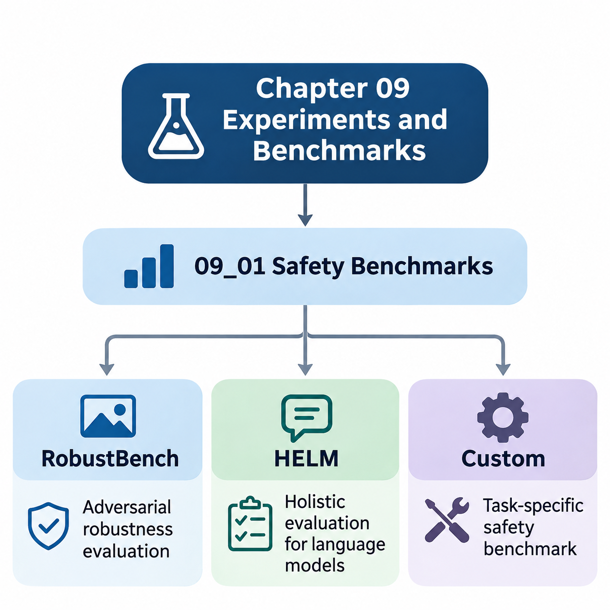
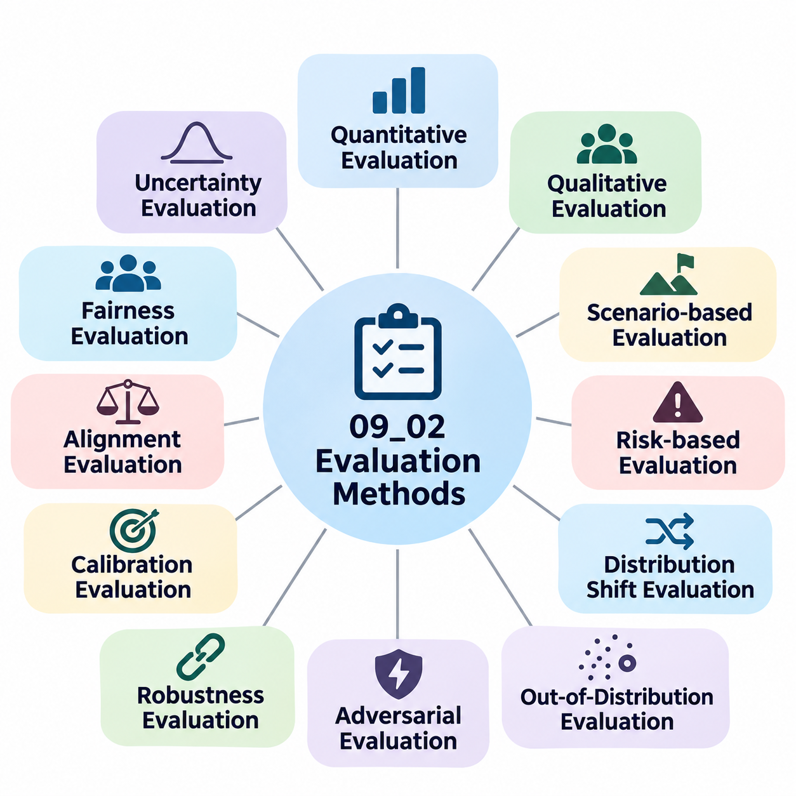
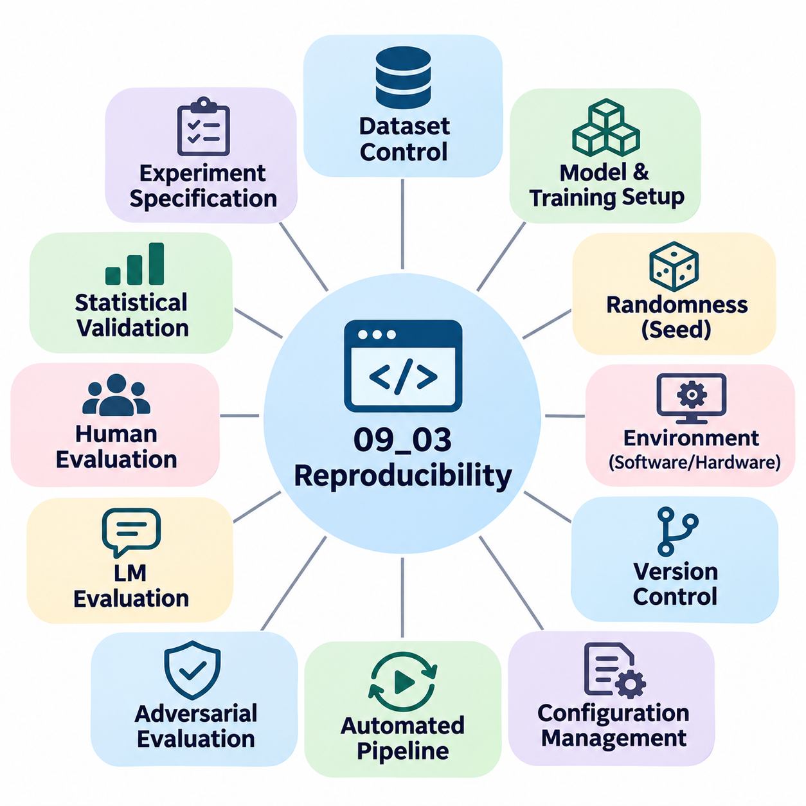
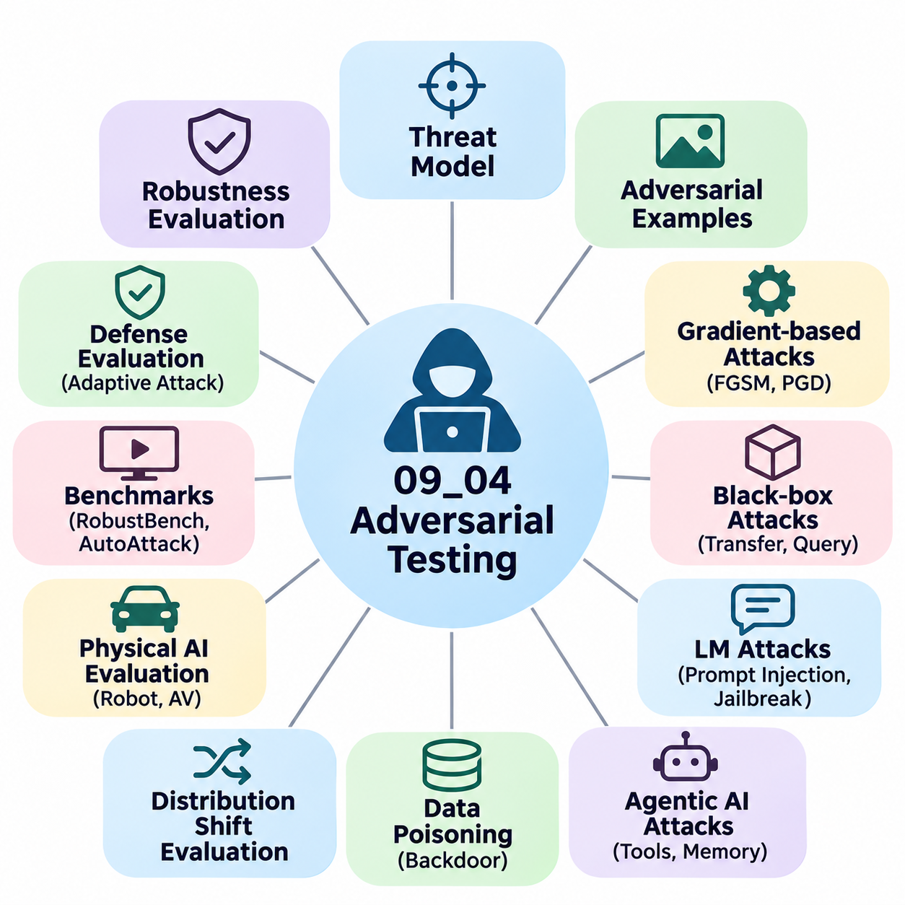
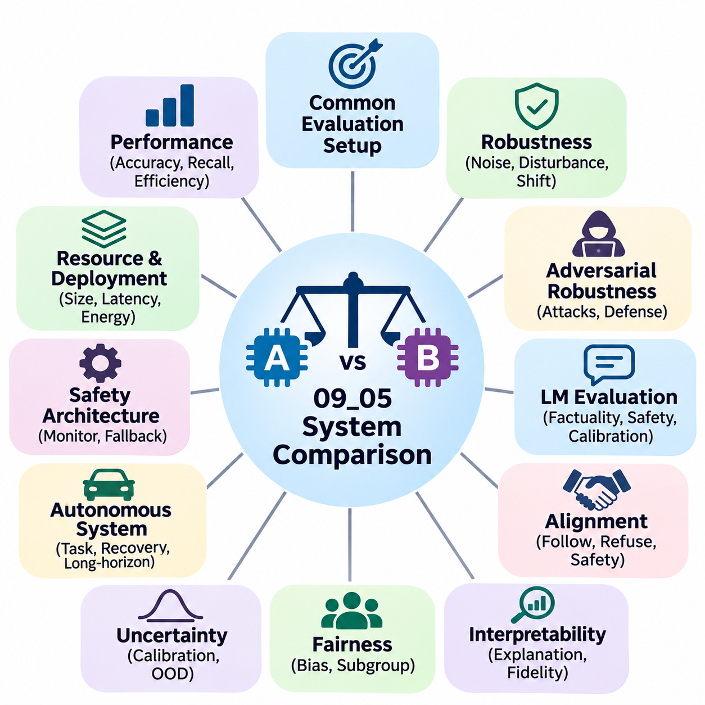

**Volume 42. AI Safety Alignment and Interpretability**

# 09. Experiments and Benchmarks

## 09.01 Safety Benchmarks

{width="7.268055555555556in" height="7.268055555555556in"}

안전성 벤치마크(Safety Benchmarks)는 인공지능(Artificial Intelligence, AI) 시스템이 까다로운 운영 조건에서도 신뢰성(Reliability), 예측 가능성(Predictability), 보안성(Security)을 유지하는지 체계적으로 평가하는 방법을 제공한다. 정확도(Accuracy)나 계산 효율성(Computational Efficiency)을 강조하는 기존 성능 벤치마크와 달리, 안전성 벤치마크는 실패 동작(Failure Behavior), 적대적 취약성(Adversarial Vulnerability), 불확실성(Uncertainty), 운영 위험(Operational Risk)을 분석한다. 주요 목적은 실제 환경에서 심각한 문제가 발생하기 전에 시스템의 한계를 식별하는 것이다.

포괄적인 안전성 벤치마킹 프레임워크(Safety Benchmarking Framework)는 단일 성능 점수에 의존하지 않고 모델 동작의 여러 차원을 평가해야 한다. 이러한 차원에는 입력 교란(Input Perturbation)에 대한 강건성(Robustness), 악의적 조작(Malicious Manipulation)에 대한 저항성, 인구통계학적 집단(Demographic Groups) 간 일관성, 분포 변화(Distribution Shift)에 따른 신뢰성, 안전 제약조건(Safety Constraints)의 준수 여부가 포함된다. 또한 일반적인 예측 오류(Prediction Error)와 심각한 운영적·사회적 피해를 초래할 수 있는 실패를 구분해야 한다.

RobustBench는 주로 이미지 분류 모델(Image Classification Models)의 적대적 강건성(Adversarial Robustness)을 평가하도록 설계된 표준화 벤치마킹 플랫폼(Standardized Benchmarking Platform)이다. 이 플랫폼은 확립된 평가 프로토콜(Evaluation Protocols), 사전 학습 모델(Pretrained Models), 방어 아키텍처(Defensive Architectures) 간 재현 가능한 비교 방법을 제공한다. 데이터셋(Datasets), 교란 제약조건(Perturbation Constraints), 공격 절차(Attack Procedures)를 표준화함으로써 실험 조건의 차이에서 발생하는 결과와 실제 강건성 향상을 구분하도록 지원한다.

적대적 강건성(Adversarial Robustness)은 의도적으로 구성된 교란(Perturbation)이 입력에 적용되었을 때 모델이 올바른 예측을 유지하는 능력을 의미한다. 이러한 교란은 사람의 시각으로 거의 구별할 수 없더라도 신경망(Neural Network)의 출력을 변경할 수 있다. RobustBench는 일반적으로 명시적으로 제한된 교란 조건에서 모델을 평가하며, 특히 L-infinity 노름(L-infinity Norm)과 L2 노름(L2 Norm)을 활용하여 정의된 적대적 위협 모델(Adversarial Threat Model) 내에서 예측 신뢰성이 어떻게 변화하는지 정량화한다.

RobustBench 평가의 중요한 구성 요소 중 하나는 수동으로 조정해야 하는 공격 설정에 대한 의존성을 줄이도록 설계된 적대적 공격 앙상블(Adversarial Attack Ensemble)인 AutoAttack이다. AutoAttack은 적응형 경사 기반 공격(Adaptive Gradient-Based Attacks)과 결정 기반 공격(Decision-Based Attacks)을 포함하는 상호 보완적인 공격 전략을 결합한다. 이러한 평가 방법론은 단일 공격 알고리즘(Attack Algorithm)에만 의존할 경우 발견되지 않을 수 있는 취약성을 드러내는 데 도움이 된다.

RobustBench는 모델 성능의 서로 다른 측면을 측정하기 위해 정상 정확도(Clean Accuracy)와 강건 정확도(Robust Accuracy)를 구분한다. 정상 정확도는 수정되지 않은 시험 샘플(Test Samples)에 대한 예측의 정확성을 나타내며, 강건 정확도는 지정된 적대적 평가 절차에서 올바른 예측을 유지하는 정도를 측정한다. 모델이 일반적인 조건에서는 높은 정확도를 달성하더라도 작은 교란에 취약할 수 있으므로, 기존 예측 성능만으로는 안전성을 입증할 수 없다.

벤치마크 비교(Benchmark Comparison)에서는 강건성 점수가 산출된 실험 조건(Experimental Conditions)을 신중하게 유지해야 한다. 데이터셋 선택(Dataset Selection), 교란 크기(Perturbation Magnitude), 전처리 절차(Preprocessing Procedures), 공격 설정(Attack Configuration), 모델 아키텍처(Model Architecture)는 평가 결과에 상당한 영향을 미칠 수 있다. 따라서 강건성에 관한 주장은 수치 점수를 보편적인 보안성 또는 신뢰성 지표로 제시하기보다 관련 위협 모델과 평가 프로토콜을 함께 명시해야 한다.

RobustBench는 적대적 강건성에 관한 유용한 근거를 제공하지만, 그 평가 범위가 인공지능 안전성(AI Safety)의 모든 차원을 포함하지는 않는다. 제한된 이미지 교란에 대한 높은 저항성이 공정성(Fairness), 개인정보 보호(Privacy Protection), 의미적 신뢰성(Semantic Reliability), 자율 환경(Autonomous Environments)에서의 안전한 동작까지 자동으로 보장하지는 않는다. 따라서 언어 이해(Language Understanding), 유해한 생성(Harmful Generation), 사회적 영향(Social Consequences), 인공지능 시스템과 인간 사용자 사이의 복잡한 상호작용을 평가하기 위한 추가적인 프레임워크가 필요하다.

언어 모델의 종합 평가(Holistic Evaluation of Language Models, HELM)는 언어 모델(Language Models)을 다양한 시나리오(Scenarios)와 평가 지표(Evaluation Metrics)에 걸쳐 평가하기 위한 폭넓은 프레임워크를 제공한다. HELM은 벤치마크 정확도만으로 시스템 순위를 결정하기보다 다차원 평가(Multidimensional Evaluation)와 투명한 결과 보고(Transparent Reporting)를 강조한다. 이러한 방법론은 작업 성능(Task Performance), 강건성, 공정성, 보정(Calibration), 효율성(Efficiency) 및 책임 있는 언어 모델 배포(Responsible Language Model Deployment)와 관련된 특성을 비교하도록 지원한다.

HELM은 언어 모델이 수행하는 작업과 조건을 설명하는 시나리오를 중심으로 평가를 구성한다. 시나리오에는 질의응답(Question Answering), 요약(Summarization), 정보 추출(Information Extraction), 분류(Classification) 및 기타 언어 처리(Language Processing) 활동이 포함될 수 있다. 이후 다양한 적응 방법(Adaptation Methods)과 평가 지표를 체계적으로 적용하여 모델이 작업, 프롬프트 전략(Prompting Strategies), 평가 조건 전반에서 일관된 성능을 보이는지 분석할 수 있다.

HELM의 다차원적 관점(Multidimensional Perspective)은 언어 모델의 능력이 서로 상충하는 목표를 포함하는 경우가 많기 때문에 특히 중요하다. 작업 정확도의 향상이 공정성, 보정, 강건성 또는 안전성의 향상으로 반드시 이어지는 것은 아니다. 유창하고 설득력 있는 응답을 생성하는 모델이라도 근거 없는 주장(Unsupported Claims), 유해한 지침(Harmful Instructions), 오해를 유발하는 정보(Misleading Information)를 생성할 수 있으므로 이러한 실패 특성을 독립적으로 평가해야 한다.

안전성 중심 언어 모델 평가(Safety-Oriented Language Model Evaluation)는 시스템이 유해한 요청(Harmful Requests), 모호한 지시(Ambiguous Instructions), 오해를 유발하는 문맥(Misleading Context), 적대적 프롬프트(Adversarial Prompting)에 어떻게 대응하는지 조사해야 한다. 평가 설정에 따라 거부 동작(Refusal Behavior), 사실적 신뢰성(Factual Reliability), 프롬프트 변화에 대한 민감도(Prompt Sensitivity), 정의된 행동 요구사항(Behavioral Requirements)과의 일관성을 측정할 수 있다. 이러한 측정은 실제 배포 위험과 관련된 조건을 평가함으로써 기존 언어 이해 벤치마크를 보완한다.

HELM은 실험 결과 보고(Experimental Reporting)에서 투명성이 중요하다는 점도 보여준다. 연구자가 모델 버전(Model Versions), 데이터셋, 프롬프트(Prompts), 적응 절차(Adaptation Procedures), 평가 지표, 계산 환경(Computational Settings)을 공개할 때 평가 결과의 의미가 더욱 명확해진다. 투명한 문서화(Transparent Documentation)는 모델 자체의 능력 차이와 실험 방법론(Experimental Methodology)의 차이에서 발생하는 결과를 구분하도록 돕는다. 또한 독립적인 재현(Independent Reproduction)과 경쟁 언어 모델 간의 객관적인 비교를 지원한다.

RobustBench와 HELM 중 어느 하나만으로는 인공지능 시스템이 모든 의도된 응용 분야에서 안전하다는 사실을 입증할 수 없다. RobustBench는 특정 적대적 강건성 평가 조건에 집중하며, HELM은 선택된 시나리오와 지표에 따라 평가 범위가 달라지는 구조를 제공한다. 따라서 안전성 보증(Safety Assurance)을 위해서는 표준화 벤치마크(Standardized Benchmarks), 응용 분야별 실험(Application-Specific Experiments), 운영 시험(Operational Testing), 시스템 수명주기(System Lifecycle) 전반에 걸친 지속적인 모니터링(Continuous Monitoring)을 결합해야 한다.

맞춤형 안전성 벤치마크(Custom Safety Benchmarks)는 표준화된 공개 벤치마크(Public Benchmarks)가 충분히 반영하지 못하는 위험을 평가하기 위해 사용된다. 자율주행차(Autonomous Vehicles), 산업용 로봇(Industrial Robots), 의료 시스템(Healthcare Systems), 인프라 모니터링 플랫폼(Infrastructure Monitoring Platforms)을 개발하는 조직은 특수한 운영 조건과 실패 결과에 직면한다. 맞춤형 평가 도구(Custom Evaluation Suites)는 이러한 도메인별 위험(Domain-Specific Risks)을 실제 배포 환경, 시스템 제약조건, 이해관계자의 기대를 반영하는 측정 가능한 실험으로 변환한다.

맞춤형 벤치마크의 설계는 시스템의 의도된 운영 조건(Intended Operating Conditions), 잠재적 위험요소(Potential Hazards), 허용 가능한 성능 경계(Acceptable Performance Boundaries)를 식별하는 과정에서 시작된다. 엔지니어는 운영 설계 영역(Operational Design Domain, ODD), 예상되는 교란(Anticipated Disturbances), 실패 심각도(Failure Severity), 요구되는 복구 동작(Recovery Behavior)을 정의해야 한다. 이러한 정의는 추상적인 안전 목표(Safety Objectives)와 관찰 가능한 실험 결과 사이의 연결을 형성하여 벤치마크 결과가 구체적인 엔지니어링 의사결정을 지원하도록 한다.

자율주행 시스템(Autonomous Driving Systems)의 맞춤형 안전성 벤치마크는 보행자 감지 실패(Pedestrian Detection Failures), 예상하지 못한 차량 동작(Unexpected Vehicle Behavior), 시야 저하(Degraded Visibility), 센서 가림(Sensor Occlusion), 긴급 제동 성능(Emergency Braking Performance)을 평가할 수 있다. 평가 시나리오는 일반적인 교통 상황과 드물게 발생하는 위험 사건(Rare Hazardous Events)을 모두 포함해야 한다. 중요한 측정 지표에는 충돌 빈도(Collision Frequency), 충돌 예상 시간(Time to Collision), 개입 효과(Intervention Effectiveness), 인지 불확실성(Perception Uncertainty), 최소 위험 상태(Minimum-Risk Conditions)로 안전하게 전환하는 능력이 포함된다.

로봇 시스템(Robotic Systems)은 물리적 상호작용(Physical Interactions), 구동기 한계(Actuator Limitations), 위치 추정 실패(Localization Failures), 환경 불확실성(Environmental Uncertainty)에 대한 추가적인 평가가 필요하다. 이동 로봇(Mobile Robot)은 실험실 조건에서 정상적으로 작동하더라도 불규칙한 지면, 움직이는 장애물, 통신 중단(Communication Interruptions) 상황에서 어려움을 겪을 수 있다. 맞춤형 벤치마크는 정상적인 자율 기능(Autonomy)이 불안정해졌을 때 로봇이 안전한 이동을 유지하고, 비정상 상태를 감지하며, 적절한 대체 동작(Fallback Procedures)을 수행하는지 평가해야 한다.

의료 인공지능 벤치마크(Healthcare AI Benchmarks)는 모든 예측 오류를 동일하게 취급하기보다 임상적 결과(Clinical Consequences)를 고려해야 한다. 위음성(False Negatives), 위양성(False Positives), 보정 실패(Calibration Failures), 환자 집단(Patient Populations) 간 성능 차이는 서로 다른 영향을 미칠 수 있다. 평가 절차에는 대표적인 임상 조건(Representative Clinical Conditions), 하위 집단 분석(Subgroup Analysis), 불확실성 평가(Uncertainty Assessment), 적절한 인간 감독(Human Oversight)을 포함하여 모델 동작이 응용 분야별 안전 요구사항을 충족하는지 판단해야 한다.

인프라 인공지능 시스템(Infrastructure AI Systems)은 연속 운영(Continuous Operation), 이기종 센서(Heterogeneous Sensors), 지리적으로 분산된 환경(Geographically Distributed Environments)과 관련된 문제를 가진다. 모니터링 플랫폼은 불완전한 관측(Incomplete Observations)과 변화하는 환경 조건에서도 구조적 이상(Structural Anomalies), 장비 성능 저하(Equipment Degradation), 위험 사건(Hazardous Events)을 감지해야 할 수 있다. 맞춤형 벤치마크는 탐지 신뢰성(Detection Reliability), 경고 지연시간(Alert Latency), 오경보 빈도(False Alarm Frequency), 센서 성능 저하 허용도(Sensor Degradation Tolerance), 지연되거나 잘못된 시스템 응답의 결과를 평가해야 한다.

강건한 맞춤형 벤치마크(Robust Custom Benchmark)는 정상 운영 시나리오(Nominal Operating Scenarios)에 스트레스 시험(Stress Tests), 적대적 조건(Adversarial Conditions), 의도적으로 주입된 실패(Deliberately Introduced Failures)를 결합해야 한다. 스트레스 시험은 환경 복잡성이 증가할 때 성능이 어떻게 저하되는지 보여주며, 결함 주입(Failure Injection)은 개별 구성 요소를 사용할 수 없을 때 시스템의 복원력(Resilience)을 평가한다. 이러한 실험은 이상적인 조건에서만 우수한 성능을 보이는 시스템과 운영 교란 상황에서도 허용 가능한 동작을 유지하는 시스템을 구분하도록 돕는다.

벤치마크 데이터셋(Benchmark Datasets)은 환경, 사용자, 운영 조건, 실패 유형(Failure Modes)의 의미 있는 변화를 대표해야 한다. 중요한 예외 사례(Edge Cases)가 누락되거나 충분히 반영되지 않으면 부적절하게 구성된 데이터셋이 잘못된 안전성 결론을 만들어낼 수 있다. 따라서 데이터셋 개발(Dataset Development)에는 체계적인 시나리오 범위(Scenario Coverage), 문서화된 표본 추출 절차(Sampling Procedures), 독립적인 검증(Independent Validation), 학습 데이터와 평가 데이터 사이의 오염(Data Contamination)을 방지하기 위한 통제가 포함되어야 한다.

정량적 안전성 지표(Quantitative Safety Metrics)는 실패 발생 확률(Failure Probability)과 실패 결과(Failure Consequences)를 모두 반영해야 한다. 응용 분야에 따라 강건 정확도(Robust Accuracy), 위험 탐지 재현율(Hazard Detection Recall), 위음성률(False Negative Rate), 개입 지연시간(Intervention Latency), 복구 성공률(Recovery Success Rate), 제약조건 위반 빈도(Constraint Violation Frequency)가 중요한 측정값이 될 수 있다. 신뢰구간(Confidence Intervals)과 성능 분포(Performance Distributions)를 함께 보고하면 불확실성에 관한 추가 정보를 제공하고 단일 평균 점수에 지나치게 의존하는 문제를 방지할 수 있다.

안전성 평가는 자율 시스템(Autonomous Systems)과 상호작용형 시스템(Interactive Systems)의 시간적 동작(Temporal Behavior)도 고려해야 한다. 모델이 개별 입력에서는 올바르게 작동하더라도 장시간 운영 중 오류가 누적될 수 있다. 장기 작업 벤치마크(Long-Horizon Benchmarks)는 인지 오류(Perception Errors)가 계획 실패(Planning Failures)로 전파되는지, 시간이 지남에 따라 불확실성이 증가하는지, 교란이나 예상하지 못한 환경 변화 이후 복구 메커니즘(Recovery Mechanisms)이 안전한 운영을 회복하는지 평가할 수 있다.

RobustBench, HELM, 맞춤형 벤치마크를 결합하면 표준화된 모델 수준 시험(Model-Level Testing)부터 응용 분야별 시스템 검증(System Validation)까지 포괄하는 계층형 평가 전략(Layered Evaluation Strategy)을 구축할 수 있다. RobustBench는 적대적 강건성 측정(Adversarial Robustness Measurements)을 제공하고, HELM은 다차원 언어 모델 평가(Multidimensional Language Model Assessment)를 지원하며, 맞춤형 벤치마크는 배포 환경별 위험(Deployment-Specific Hazards)을 평가한다. 이러한 상호 보완적 역할은 단일 벤치마크보다 폭넓은 평가 근거를 제공한다.

벤치마크 결과(Benchmark Outcomes)는 모델 선택(Model Selection), 방어 아키텍처 설계(Defensive Architecture Design), 안전 모니터링(Safety Monitoring), 배포 의사결정(Deployment Decisions)에 반영되어야 한다. 실험에서 허용할 수 없는 취약성이 발견되면 엔지니어는 학습 데이터(Training Data)를 수정하거나, 적대적 방어(Adversarial Defenses)를 도입하거나, 불확실성 추정(Uncertainty Estimation)을 개선하거나, 실행 중 안전장치(Runtime Safeguards)를 강화할 수 있다. 후속 평가는 이러한 변경이 새로운 실패 유형이나 허용할 수 없는 성능 상충관계(Performance Tradeoffs)를 만들지 않으면서 식별된 위험을 감소시키는지 확인해야 한다.

재현성(Reproducibility)은 안전성 벤치마크 결과에 대한 신뢰를 유지하는 데 필수적이다. 실험 기록(Experimental Records)에는 데이터셋 버전(Dataset Versions), 모델 체크포인트(Model Checkpoints), 난수 시드(Random Seeds), 소프트웨어 의존성(Software Dependencies), 하드웨어 구성(Hardware Configurations), 평가 절차(Evaluation Procedures)가 보존되어야 한다. 자동화 시험 파이프라인(Automated Testing Pipelines)은 모델이나 시스템 구성 요소가 변경될 때마다 표준화된 벤치마크를 실행하여 개발팀이 성능 회귀(Performance Regressions)를 식별하고 반복적인 엔지니어링 과정에서 추적 가능한 근거(Traceable Evidence)를 유지하도록 지원한다.

궁극적으로 안전성 벤치마크(Safety Benchmarks)는 안전성을 확정적으로 인증하는 수단이 아니라 구조화된 위험 평가(Structured Risk Evaluation)를 위한 도구로 이해해야 한다. 그 가치는 현실적인 가정(Realistic Assumptions), 적절한 위협 모델(Threat Models), 대표성 있는 시나리오(Representative Scenarios), 엄격한 실험 근거 해석(Rigorous Interpretation of Experimental Evidence)에 달려 있다. 표준화 벤치마크와 도메인별 검증(Domain-Specific Validation), 지속적인 운영 평가(Continuous Operational Assessment)를 통합하면 신뢰할 수 있고(Trustworthy), 복원력이 있으며(Resilient), 책임성을 갖춘(Accountable) 인공지능 시스템을 개발하기 위한 더욱 견고한 기반을 마련할 수 있다.

## 09.02 Evaluation Methods

{width="7.268055555555556in" height="7.268055555555556in"}

평가 방법(Evaluation Methods)은 인공지능(Artificial Intelligence, AI) 시스템이 정의된 안전성(Safety), 신뢰성(Reliability), 정렬(Alignment) 요구사항을 충족하는지 판단하기 위한 방법론적 기반(Methodological Foundation)을 제공한다. 주로 예측 정확도(Predictive Accuracy)에 초점을 맞추는 기존 시험과 달리, 안전성 중심 평가(Safety-Oriented Evaluation)는 불확실성(Uncertainty), 적대적 간섭(Adversarial Interference), 분포 변화(Distribution Shifts), 운영 실패(Operational Failures) 상황에서 모델이 어떻게 동작하는지 분석한다. 엄격한 평가 방법론은 측정 가능한 결과를 명시적으로 정의된 위험과 허용 가능한 운영 조건에 연결한다.

평가 과정(Evaluation Process)은 명확한 목표(Objectives), 시스템 경계(System Boundaries), 운영 가정(Operational Assumptions)을 설정하는 것에서 시작된다. 연구자는 의도된 응용 분야(Intended Application), 예상 사용자(Expected Users), 환경 조건(Environmental Conditions), 잘못된 의사결정의 결과(Consequences of Incorrect Decisions)를 식별해야 한다. 이러한 요소는 적절한 평가 방법을 결정하고 결과를 해석하는 기준이 된다. 평가 맥락(Evaluation Context)이 명확하게 정의되지 않으면 통계적으로 우수한 벤치마크 점수(Benchmark Scores)라도 실제 안전성을 입증하기에는 충분하지 않을 수 있다.

정량적 평가 방법(Quantitative Evaluation Methods)은 재현 가능한 비교(Reproducible Comparisons)를 지원하는 수치 지표(Numerical Indicators)를 통해 시스템 동작을 측정한다. 일반적인 측정 항목에는 정확도(Accuracy), 정밀도(Precision), 재현율(Recall), 위양성률(False Positive Rate), 위음성률(False Negative Rate), 보정 오차(Calibration Error), 교란에 대한 강건성(Robustness under Perturbations)이 포함된다. 안전 필수 응용 분야(Safety-Critical Applications)에서는 위험 탐지 지연시간(Hazard Detection Latency), 제약조건 위반 빈도(Constraint Violation Frequency), 복구 성공률(Recovery Success Rate), 불안전한 운영 상태(Unsafe Operational States)에 진입할 확률과 같은 추가적인 측정이 필요하다.

정성적 평가(Qualitative Evaluation)는 고정된 수치 지표로 표현하기 어려운 실패 특성(Failure Characteristics)을 분석하여 정량적 측정을 보완한다. 전문가 검토자(Expert Reviewers)는 불안전한 응답의 심각도(Severity of Unsafe Responses), 설명의 적절성(Adequacy of Explanations), 자율적 의사결정(Autonomous Decisions)의 타당성, 인간 감독(Human Oversight)의 효과를 평가할 수 있다. 구조화된 평가 기준표(Structured Evaluation Rubrics)는 관찰 가능한 기준을 정의하고 경미한 결함과 심각한 결과를 초래할 수 있는 실패를 구분함으로써 평가의 일관성을 향상시킨다.

시나리오 기반 평가(Scenario-Based Evaluation)는 예상되는 동작과 위험 조건을 모두 대표하도록 신중하게 구성된 운영 상황에서 인공지능 시스템을 시험한다. 각 시나리오(Scenario)는 초기 조건(Initial Conditions), 환경 변수(Environmental Variables), 시스템 목표(System Objectives), 평가 기준(Evaluation Criteria)을 정의한다. 시나리오에는 센서 성능 저하(Sensor Degradation), 예상하지 못한 장애물(Unexpected Obstacles), 상충하는 지시(Conflicting Instructions), 통신 장애(Communication Failures)가 포함될 수 있다. 이러한 접근법은 추상적인 안전 요구사항을 관찰하고 측정할 수 있는 구체적인 동작과 연결한다.

위험 기반 평가(Risk-Based Evaluation)는 잠재적 실패의 발생 가능성(Likelihood)과 심각도(Severity)에 따라 실험의 우선순위를 결정한다. 발생 확률이 상대적으로 낮더라도 결과가 심각한 시나리오에는 더 높은 평가 우선순위를 부여한다. 위험 평가 기법(Risk Assessment Techniques)은 주요 위험요소(Critical Hazards), 인과 경로(Causal Pathways), 취약한 시스템 구성 요소(Vulnerable System Components)를 식별할 수 있다. 이후 평가 자원(Evaluation Resources)은 물리적, 재정적, 운영적 또는 사회적으로 상당한 피해를 초래할 수 있는 조건에 집중적으로 배분된다.

분포 변화 평가(Distribution Shift Evaluation)는 배포 데이터(Deployment Data)가 학습 데이터(Training Data)와 달라질 때 모델 성능이 신뢰성을 유지하는지 조사한다. 이러한 변화에는 환경 조건, 센서 특성(Sensor Characteristics), 사용자 집단(User Populations), 작업 분포(Task Distributions)의 차이가 포함될 수 있다. 연구자는 입력 특성(Input Characteristics)에 통제된 변화를 도입하고 성능 저하(Performance Degradation)를 측정할 수 있다. 이러한 실험은 모델이 익숙한 조건을 넘어 일반화(Generalization)할 수 있는지, 또는 학습 데이터셋에 포함된 가정에 지나치게 의존하는지 판단하는 데 도움이 된다.

분포 외 평가(Out-of-Distribution Evaluation)는 모델이 예상하는 운영 영역(Expected Operating Domain)과 의미 있게 다른 입력에 초점을 맞춘다. 신뢰할 수 있는 시스템은 자신의 예측이 불확실하거나 충분한 근거를 갖지 못하는 상황을 인식해야 한다. 평가 방법은 탐지 민감도(Detection Sensitivity), 불확실성 보정(Uncertainty Calibration), 예측 보류(Abstention) 또는 지원 요청(Request for Assistance) 능력을 조사한다. 성공적인 분포 외 탐지가 안전성을 보장하지는 않지만, 신뢰할 수 없는 예측이 중대한 결과를 초래하는 동작을 직접 제어하지 못하도록 하는 메커니즘을 지원할 수 있다.

적대적 평가(Adversarial Evaluation)는 오류를 유발하기 위해 입력이나 상호작용을 의도적으로 조작했을 때 시스템이 어떻게 동작하는지 조사한다. 비전 모델(Vision Models)의 경우 연구자는 제한된 교란(Bounded Perturbations), 물리적 인공물(Physical Artifacts), 환경적 간섭(Environmental Interference)을 도입할 수 있다. 언어 모델(Language Models)의 경우 적대적 시험(Adversarial Testing)에 프롬프트 인젝션(Prompt Injection), 오해를 유발하는 지시(Misleading Instructions), 행동 제한(Behavioral Restrictions)을 우회하려는 시도가 포함될 수 있다. 의미 있는 결과 해석을 위해서는 공격자의 능력(Attacker Capabilities), 접근 가능한 인터페이스(Accessible Interfaces), 성공 기준(Success Criteria)을 명시해야 한다.

강건성 평가(Robustness Evaluation)는 교란의 크기나 복잡성이 증가할 때 성능이 어떻게 변화하는지 측정한다. 연구자는 단일 교란 수준만 시험하는 대신 여러 조건에 걸친 성능 저하 곡선(Degradation Curves)을 구성할 수 있다. 이러한 곡선은 성능이 허용할 수 없는 수준으로 떨어지는 운영 임계값(Operational Thresholds)을 보여준다. 또한 성능 저하 패턴(Degradation Patterns)을 비교하면 방어 메커니즘(Defensive Mechanisms)이 전반적인 복원력을 향상시키는지, 아니면 좁게 정의된 교란 조건에 대해서만 성능을 최적화하는지 식별할 수 있다.

보정 평가(Calibration Evaluation)는 모델의 신뢰도 추정값(Confidence Estimates)이 실제 관찰된 정답 빈도(Observed Correctness Frequencies)와 일치하는지 판단한다. 적절하게 보정된 모델(Well-Calibrated Model)은 정답일 가능성이 높은 예측에 더 높은 신뢰도를 부여해야 한다. 신뢰도 다이어그램(Reliability Diagrams), 기대 보정 오차(Expected Calibration Error), 적절한 점수 규칙(Proper Scoring Rules)과 같은 방법은 상호 보완적인 관점을 제공한다. 안전 필수 시스템에서 보정은 자동화된 예측을 수용하거나 거부하거나 검토해야 하는 시점을 결정하는 데 도움이 된다.

불확실성 평가(Uncertainty Evaluation)는 불완전한 지식에서 발생하는 불확실성과 관측 자체의 내재적 변동성(Inherent Variability)에서 발생하는 불확실성을 구분한다. 인식론적 불확실성(Epistemic Uncertainty)은 추가적인 대표 학습 데이터(Representative Training Data)를 통해 감소할 수 있지만, 우연적 불확실성(Aleatoric Uncertainty)은 반드시 제거할 수 없는 변동성을 반영한다. 평가 기법은 예측 분포(Predictive Distributions), 앙상블 불일치(Ensemble Disagreement), 변화하는 조건에서의 불확실성 추정값(Uncertainty Estimates)을 분석할 수 있다. 이러한 측정의 실질적인 가치는 운영 의사결정(Operational Decisions)을 얼마나 개선하는지에 달려 있다.

공정성 평가(Fairness Evaluation)는 관련 인구 집단이나 운영 환경에 따라 시스템 성능이 체계적으로 달라지는지 조사한다. 인구통계학적 동등성(Demographic Parity), 균등화된 승산(Equalized Odds), 하위 집단 보정(Subgroup Calibration)과 같은 지표는 서로 다른 공정성 목표(Fairness Objectives)를 측정한다. 이러한 목표는 서로 충돌할 수 있으므로 평가에서는 응용 분야와 불평등한 결과의 잠재적 영향을 고려해야 한다. 전체 평균에 가려질 수 있는 격차를 식별하기 위해 종합 성능(Aggregate Performance)에 하위 집단 분석(Subgroup Analysis)을 추가해야 한다.

정렬 평가(Alignment Evaluation)는 모델 동작이 의도된 목표(Intended Objectives), 승인된 지시(Authorized Instructions), 적용 가능한 안전 제약조건(Safety Constraints)과 일관성을 유지하는지 조사한다. 언어 모델과 자율 에이전트(Autonomous Agents)의 경우 지시 이행 신뢰성(Instruction-Following Reliability), 보상 해킹(Reward Hacking)에 대한 저항성, 적절한 거부 동작(Appropriate Refusal Behavior), 상충하는 목표 사이의 일관성을 평가할 수 있다. 이러한 시험은 평가 프롬프트(Evaluation Prompts)에 대한 표면적 준수와 익숙하지 않은 상황에서도 의도된 행동을 안정적으로 유지하는 능력을 구분해야 한다.

인간 평가(Human Evaluation)는 안전성 판단에 맥락적 이해(Contextual Understanding), 도메인 전문성(Domain Expertise), 윤리적 해석(Ethical Interpretation)이 필요한 경우 여전히 중요하다. 평가자는 사전에 정의된 평가 기준(Assessment Criteria)을 사용하여 시스템 출력(System Outputs), 시뮬레이션된 의사결정(Simulated Decisions), 운영 추적 기록(Operational Traces)을 검토할 수 있다. 평가자 간 일치도(Inter-Rater Agreement)는 평가 일관성에 관한 근거를 제공하며, 불일치 분석(Disagreement Analysis)은 모호한 요구사항을 식별한다. 평가자의 기대와 전문성이 보고된 결과에 영향을 미칠 수 있으므로 인간의 판단은 신중하게 문서화해야 한다.

시뮬레이션 기반 평가(Simulation-Based Evaluation)는 실제 환경에서 재현하기에 비용이 많이 들거나 비현실적이거나 위험한 시나리오를 통제된 조건에서 시험할 수 있도록 한다. 시뮬레이터(Simulators)는 환경 매개변수(Environmental Parameters)를 변경하고, 구성 요소의 실패(Component Failures)를 도입하며, 경쟁 시스템에 동일한 시나리오를 반복 적용할 수 있다. 그러나 시뮬레이션 충실도(Simulation Fidelity)는 도출할 수 있는 결론의 범위를 제한한다. 시뮬레이션 성능을 실제 배포 준비도(Deployment Readiness)의 근거로 사용하기 전에 가상 환경과 실제 환경 사이의 차이를 평가해야 한다.

실세계 평가(Real-World Evaluation)는 시뮬레이션이 정확하게 재현하지 못할 수 있는 물리적·운영적 조건에서 시스템 동작을 조사한다. 현장 시험(Field Testing)은 하드웨어 제약(Hardware Limitations), 환경 변동성(Environmental Variability), 인간 행동(Human Behavior), 인프라 제약(Infrastructure Constraints)과 관련된 예상하지 못한 상호작용을 드러낼 수 있다. 통제된 단계별 배포(Controlled Deployment Stages)는 위험 노출을 줄이면서 대표성 있는 근거를 수집하도록 한다. 잠재적으로 위험한 실험을 시작하기 전에 평가 프로토콜(Evaluation Protocols)은 개입 권한(Intervention Authority), 비상 절차(Emergency Procedures), 시험 중단 조건(Stopping Conditions)을 확립해야 한다.

장기 작업 평가(Long-Horizon Evaluation)는 개별 예측이 아니라 확장된 의사결정 순서(Extended Sequences of Decisions) 전반에서 신뢰성을 측정한다. 자율 시스템은 위치 추정 오류(Localization Errors)를 누적하거나, 문맥 정보(Contextual Information)를 잃거나, 잘못된 가정을 후속 동작으로 전파할 수 있다. 관련 지표에는 임무 완료율(Mission Completion Rate), 누적 제약조건 위반(Cumulative Constraint Violations), 복구 빈도(Recovery Frequency), 성능 저하 운영 모드(Degraded Operating Modes)에서 소요된 시간이 포함된다. 이러한 평가는 단기간 벤치마크에서는 드러나지 않는 실패 패턴을 식별한다.

통계적 평가(Statistical Evaluation)는 관찰된 성능 차이가 무작위 변동(Random Variation)의 결과가 아니라 의미 있는 차이인지 판단한다. 신뢰구간(Confidence Intervals), 가설 검정(Hypothesis Tests), 효과 크기(Effect Sizes), 반복 실험(Repeated Experimental Trials)은 보고된 결과의 불확실성을 정량화하는 데 도움이 된다. 드물게 발생하는 안전 실패(Rare Safety Failures)는 제한된 관측만으로 강한 신뢰성 주장을 뒷받침하기 어려우므로 특별한 주의가 필요하다. 평가 보고서는 측정된 결과(Measured Outcomes)와 외삽된 실패 확률(Extrapolated Failure Probabilities)을 구분하고 통계적 한계(Statistical Limitations)를 명시적으로 전달해야 한다.

비교 평가(Comparative Evaluation)는 동등한 실험 조건에서 여러 모델이나 시스템 구성을 분석한다. 공정한 비교(Fair Comparisons)를 위해서는 일관된 데이터셋(Datasets), 위협 모델(Threat Models), 전처리(Preprocessing), 계산 제약조건(Computational Constraints), 점수 산정 절차(Scoring Procedures)가 필요하다. 기준 시스템(Baseline Systems)은 개선 정도를 해석하기 위한 참조점을 제공한다. 또한 비교 과정에서는 보편적으로 우수한 단일 모델을 선정하기보다 예측 성능(Predictive Performance), 강건성, 지연시간(Latency), 자원 소비(Resource Consumption), 운영 복잡성(Operational Complexity) 사이의 상충관계(Tradeoffs)를 고려해야 한다.

지속적 평가(Continuous Evaluation)는 초기 개발 단계의 안전성 평가를 배포와 유지보수 단계까지 확장한다. 자동화된 모니터링(Automated Monitoring)은 성능 드리프트(Performance Drift), 비정상적인 입력(Unusual Inputs), 증가하는 불확실성, 새롭게 나타나는 실패 패턴을 탐지할 수 있다. 주기적인 벤치마크 실행(Periodic Benchmark Execution)은 모델 업데이트(Model Updates)나 구성 변경(Configuration Changes) 이후 성능 회귀(Regression Detection)를 탐지하도록 지원한다. 평가 결과는 사고 분석(Incident Analysis), 시정 조치(Corrective Actions), 통제된 릴리스 절차(Controlled Release Procedures)에 반영되어 시스템이 변화하더라도 안전성 근거의 유효성을 유지해야 한다.

포괄적인 평가 방법론(Comprehensive Evaluation Methodology)은 정량적 지표(Quantitative Metrics), 정성적 검토(Qualitative Review), 시나리오 시험(Scenario Testing), 적대적 분석(Adversarial Analysis), 시뮬레이션(Simulation), 실세계 검증(Real-World Validation)을 일관된 근거 프레임워크(Evidence Framework)로 통합한다. 각 방법은 서로 다른 한계를 다루며, 독립적인 접근법 사이에서 일치하는 결과가 나타날수록 시스템 동작에 대한 신뢰도가 높아진다. 궁극적인 목표는 단순히 높은 벤치마크 성능을 입증하는 것이 아니라 인공지능 시스템이 정의된 안전 경계(Safety Boundaries) 내에서 작동하고, 이러한 경계가 위협받을 때 적절하게 대응한다는 방어 가능한 근거(Defensible Evidence)를 확립하는 것이다.

## 09.03 Reproducibility [w/Code]

{width="7.268055555555556in" height="7.268055555555556in"}

재현성(Reproducibility)은 신뢰할 수 있는 인공지능(Artificial Intelligence, AI) 연구의 기본 요구사항이며, 특히 실험 결과가 안전 필수 의사결정(Safety-Critical Decisions)에 영향을 미치는 경우 더욱 중요하다. 재현성은 문서화된 방법론(Methods), 데이터셋(Datasets), 계산 환경(Computational Conditions)을 사용하여 실험을 반복했을 때 일관된 결과를 얻을 수 있는 능력을 의미한다. 재현성이 확보되지 않으면 강건성(Robustness), 정렬(Alignment), 신뢰성(Reliability)의 향상이 실제 시스템 안전성의 발전이 아니라 통제되지 않은 실험적 변동(Experimental Variation)을 반영할 수 있다.

인공지능 안전성(AI Safety)에서 재현성은 동일한 정확도 점수(Accuracy Scores)를 얻는 것 이상의 의미를 가진다. 연구자는 반복 평가(Repeated Evaluations), 독립적인 구현(Independent Implementations), 통제된 환경 변화(Controlled Environmental Variations) 전반에서 안전 특성(Safety Properties)이 일관되게 유지됨을 입증해야 한다. 여기에는 적대적 공격 저항성(Adversarial Resistance), 불확실성 추정(Uncertainty Estimates), 공정성 측정(Fairness Measurements), 실패 복구 동작(Failure Recovery Behavior)의 검증이 포함된다. 재현 가능한 안전성 근거(Reproducible Safety Evidence)는 관찰된 성능이 특정 실험 설정의 산물이 아니라는 신뢰를 강화한다.

재현 가능한 실험(Reproducible Experiment)은 목표(Objectives), 가설(Hypotheses), 평가 기준(Evaluation Criteria), 운영 가정(Operating Assumptions)을 완전하게 명세하는 것에서 시작된다. 연구자는 의도된 시스템 동작(Intended System Behavior), 관련 위협 모델(Threat Models), 데이터셋 특성(Dataset Characteristics), 허용 가능한 안전 임계값(Safety Thresholds)을 문서화해야 한다. 이러한 명세는 결과를 해석하고 비교할 수 있는 조건을 확립한다. 실험 목표가 모호하면 독립적인 평가가 동일한 안전성 문제를 다루고 있는지 판단하기 어려워진다.

데이터셋 재현성(Dataset Reproducibility)은 데이터 출처(Data Sources), 전처리 작업(Preprocessing Operations), 레이블링 절차(Labeling Procedures), 데이터 분할 전략(Partitioning Strategies)에 대한 정밀한 통제를 요구한다. 학습 데이터셋(Training Datasets), 검증 데이터셋(Validation Datasets), 시험 데이터셋(Testing Datasets)은 안정적인 버전(Stable Versions) 또는 암호학적 해시(Cryptographic Hashes)를 통해 식별해야 한다. 연구자는 필터링 규칙(Filtering Rules), 데이터 증강 방법(Augmentation Methods), 클래스 분포(Class Distributions), 제외 기준(Exclusion Criteria)을 문서화해야 한다. 이러한 기록은 실험 간 의도하지 않은 차이를 방지하고 데이터 누출(Data Leakage)이나 벤치마크 오염(Benchmark Contamination)의 위험을 줄인다.

모델 재현성(Model Reproducibility)은 아키텍처 정의(Architectural Definitions), 매개변수 초기화(Parameter Initialization), 최적화 설정(Optimization Settings), 학습 절차(Training Procedures)를 보존하는 데 달려 있다. 학습률(Learning Rates), 배치 크기(Batch Sizes), 정규화 계층(Normalization Layers), 규제화 방법(Regularization Methods)의 작은 변화도 모델 동작에 영향을 줄 수 있다. 완전한 실험 기록에는 최적화 알고리즘 설정(Optimizer Configurations), 학습률 스케줄(Learning Rate Schedules), 체크포인트 선택 기준(Checkpoint Selection Criteria), 종료 조건(Stopping Conditions)이 포함되어야 한다. 이러한 문서화는 독립적인 연구자가 모호성을 최소화하면서 학습 과정을 재구성하도록 지원한다.

무작위성(Randomness)은 기계학습(Machine Learning) 시스템에서 실험 변동성(Experimental Variability)을 발생시키는 주요 원인이다. 무작위 초기화(Random Initialization), 데이터 셔플링(Data Shuffling), 확률적 데이터 증강(Stochastic Augmentation), 드롭아웃(Dropout), 병렬 계산(Parallel Computation)은 반복 실행마다 서로 다른 결과를 생성할 수 있다. 난수 시드(Random Seeds)를 설정하면 실험의 일관성을 높일 수 있지만 완전한 결정성(Determinism)을 보장하지는 않는다. 일부 GPU 연산(GPU Operations)과 분산 알고리즘(Distributed Algorithms)은 비결정적 동작(Nondeterministic Behavior)을 나타내므로 남아 있는 변동성의 원인을 명시적으로 문서화해야 한다.

계산 환경 재현성(Computational Environment Reproducibility)은 소프트웨어 의존성(Software Dependencies), 프레임워크 버전(Framework Versions), 운영체제(Operating Systems), 하드웨어 아키텍처(Hardware Architectures), 가속기 구성(Accelerator Configurations)을 기록해야 한다. CUDA 라이브러리(CUDA Libraries), 수치 정밀도(Numerical Precision), 컴파일러 최적화(Compiler Optimizations), 장치 드라이버(Device Drivers)의 차이는 실험 결과를 변화시킬 수 있다. 컨테이너화 기술(Containerization Technologies)은 다양한 소프트웨어 의존성을 이식 가능한 환경(Portable Environments)으로 패키징할 수 있다. 그러나 컨테이너가 모든 하드웨어 의존적 차이를 제거하지는 못하므로 상세한 환경 문서화가 필수적이다.

버전 관리(Version Control)는 소스 코드(Source Code)와 실험 결과(Experimental Results) 사이의 관계를 보존하기 위한 체계적인 메커니즘을 제공한다. 각 실험은 특정 저장소 커밋(Repository Commit), 설정 파일(Configuration File), 모델 체크포인트(Model Checkpoint)를 참조해야 한다. 전처리(Preprocessing), 평가 스크립트(Evaluation Scripts), 안전 제약조건(Safety Constraints)의 변경 사항은 개발 전 과정에서 추적 가능해야 한다. 이러한 방식은 연구자가 보고된 결과를 생성한 구현을 정확하게 식별하고 신뢰할 수 있는 회귀 분석(Regression Analysis)을 수행하도록 지원한다.

실험 설정 관리(Experiment Configuration Management)는 실험 매개변수(Experimental Parameters)를 구현 로직(Implementation Logic)과 분리한다. 구조화된 설정 파일(Structured Configuration Files)은 데이터셋, 모델 아키텍처(Model Architectures), 최적화 설정, 위협 모델, 평가 지표(Evaluation Metrics)를 정의할 수 있다. 중앙집중식 설정 관리(Centralized Configuration Management)는 우발적인 불일치를 줄이고 실험 반복을 용이하게 한다. 특히 기본값(Default Values), 환경 변수(Environment Variables), 상속된 설정(Inherited Settings)이 실행에 영향을 미치는 경우 최종적으로 적용된 설정(Resolved Configurations)을 기록하는 것이 중요하다.

자동화된 실험 파이프라인(Automated Experiment Pipelines)은 사전에 정의된 절차를 일관되게 실행하여 재현성을 향상시킨다. 파이프라인(Pipeline)에는 데이터 검증(Data Validation), 전처리, 모델 초기화(Model Initialization), 학습(Training), 체크포인트 생성(Checkpoint Generation), 안전성 평가(Safety Evaluation), 보고서 생성(Report Creation)이 포함될 수 있다. 워크플로 오케스트레이션(Workflow Orchestration)은 문서화되지 않은 수동 작업에 대한 의존성을 줄인다. 자동화된 검증(Automated Validation)은 실험 결과를 승인하기 전에 누락된 산출물(Missing Artifacts), 호환되지 않는 설정(Incompatible Configurations), 예상하지 못한 변경 사항을 탐지할 수 있다.

적대적 강건성 평가(Adversarial Robustness Evaluation)의 재현성은 공격 설정(Attack Configurations)과 위협 모델에 특별한 주의를 요구한다. 연구자는 교란 제약조건(Perturbation Constraints), 공격 반복 횟수(Attack Iterations), 최적화 매개변수(Optimization Parameters), 입력 정규화(Input Normalization), 성공 기준(Success Criteria)을 문서화해야 한다. 강건 정확도(Robust Accuracy)의 외형적인 향상은 더 강력한 방어가 아니라 약한 공격에서 비롯될 수 있다. 확립된 적대적 공격 도구 모음(Adversarial Attack Suites)을 포함한 표준화된 평가 절차(Standardized Evaluation Procedures)는 이러한 방법론적 불일치를 줄이는 데 도움이 된다.

언어 모델 안전성 평가(Language Model Safety Evaluation)는 출력이 샘플링 매개변수(Sampling Parameters), 프롬프트 형식(Prompt Formatting), 시스템 지시(System Instructions), 모델 서비스 업데이트(Model Service Updates)에 따라 달라질 수 있기 때문에 추가적인 재현성 문제를 발생시킨다. 실험에서는 온도(Temperature), 디코딩 설정(Decoding Settings), 프롬프트 템플릿(Prompt Templates), 평가 데이터셋(Evaluation Datasets), 사용 가능한 모델 식별자(Model Identifiers)를 기록해야 한다. 독점 서비스(Proprietary Services)가 완전한 버전 정보를 공개하지 않고 변경되는 경우 정확한 재현이 불가능해질 수 있다. 연구자는 근거 없는 실험적 동등성(Experimental Equivalence)을 주장하기보다 이러한 한계를 인정해야 한다.

인간 평가(Human Evaluation)는 판단을 완전히 결정적으로 만들 수 없더라도 재현 가능한 평가 절차(Reproducible Assessment Procedures)를 필요로 한다. 평가 기준표(Evaluation Rubrics)는 평가 범주(Rating Categories), 의사결정 기준(Decision Criteria), 허용 가능한 동작과 허용할 수 없는 동작의 사례를 정의해야 한다. 평가자 교육(Reviewer Training), 표본 추출 절차(Sampling Procedures), 의견 불일치 해결 방법(Disagreement Resolution Methods)을 문서화해야 한다. 평가자 간 일치도(Inter-Rater Agreement)와 불확실성 추정(Uncertainty Estimates)은 인간 판단의 일관성을 특성화하고 모호한 평가 요구사항을 식별하는 데 도움이 된다.

통계적 재현성(Statistical Reproducibility)은 단일 실험 결과에 의존하지 않고 성능 변동성(Performance Variability)을 평가해야 한다. 여러 난수 시드(Multiple Random Seeds), 반복 시행(Repeated Trials), 신뢰구간(Confidence Intervals), 적절한 통계적 비교(Statistical Comparisons)는 의미 있는 개선과 무작위 변동(Random Fluctuations)을 구분하는 데 도움이 된다. 안전 필수 지표(Safety-Critical Metrics)는 드문 사건(Rare Events)을 포함할 수 있으므로 불확실성을 고려하는 것이 특히 중요하다. 보고서에는 표본 크기(Sample Sizes), 관찰된 실패 횟수(Observed Failure Counts), 낮은 발생 확률의 위험(Low-Probability Risks)을 추정할 때의 한계를 공개해야 한다.

독립적 재현(Independent Replication)은 원래 개발 환경(Original Development Environment)에서 실험을 반복 실행하는 것보다 더 강력한 근거를 제공한다. 외부 연구자(External Researchers)는 공개된 방법론(Published Methodology), 독립적으로 재구성한 구현(Independently Reconstructed Implementations), 대체 계산 인프라(Alternative Computational Infrastructure)를 사용하여 실험을 재현할 수 있다. 결과의 차이는 숨겨진 가정(Hidden Assumptions), 문서화되지 않은 의존성(Undocumented Dependencies), 방법론적 약점(Methodological Weaknesses)을 드러낼 수 있다. 성공적인 독립적 재현은 연구 결과가 최초 실험 환경을 넘어 일반화된다는 신뢰를 높인다.

재현성은 시뮬레이션 기반 안전성 시험(Simulation-Based Safety Testing)에도 적용된다. 시뮬레이션 실험(Simulation Experiments)은 환경 설정(Environment Configurations), 시나리오 정의(Scenario Definitions), 물리 매개변수(Physics Parameters), 센서 모델(Sensor Models), 초기 조건(Initial Conditions)을 보존해야 한다. 무작위화된 환경(Randomized Environments)을 사용하는 경우 연구자는 표본 추출 분포(Sampling Distributions)와 난수 시드를 기록해야 한다. 이러한 기록은 위험 시나리오(Hazardous Scenarios)를 반복적으로 조사하고 자율 동작(Autonomous Behavior)의 실제 개선과 유리한 시뮬레이션 조건을 구분하도록 지원한다.

실세계 로봇 실험(Real-World Robotic Experiments)은 물리적 환경(Physical Environments)을 항상 동일한 상태로 복원할 수 없기 때문에 추가적인 문제를 가진다. 날씨(Weather), 조명(Lighting), 노면 상태(Surface Conditions), 센서 보정(Sensor Calibration), 배터리 상태(Battery State), 인간 활동(Human Activity)은 시험마다 달라질 수 있다. 연구자는 이러한 요소를 문서화하고 가능한 경우 표준화된 절차(Standardized Procedures)를 사용해야 한다. 대표적인 조건에서 반복 시험을 수행하는 것은 단일 성공 시연(Successful Demonstration)을 신뢰성의 증거로 해석하는 것보다 더 강력한 근거를 제공한다.

안전성 벤치마크 재현성(Safety Benchmark Reproducibility)은 일관된 지표 정의(Metric Definitions)와 점수 산정 절차(Scoring Procedures)를 요구한다. 평가 스크립트(Evaluation Scripts)는 실패(Failures), 부분적 성공(Partial Successes), 시간 초과(Timeouts), 개입(Interventions), 제약조건 위반(Constraint Violations)을 어떻게 계산하는지 명시해야 한다. 동일한 시나리오를 경험하더라도 이러한 사건에 대한 해석이 다르면 서로 호환되지 않는 결과가 생성될 수 있다. 참조 구현(Reference Implementations)과 자동화된 점수 검증 시험(Automated Scoring Tests)은 연구팀과 벤치마크 버전 전반에서 일관성을 유지하도록 지원한다.

산출물 보존(Artifact Preservation)은 장기적인 재현성(Long-Term Reproducibility)을 위해 필수적이다. 실험 산출물(Experimental Artifacts)에는 소스 코드, 설정 파일, 데이터셋 목록(Dataset Manifests), 모델 체크포인트, 학습 로그(Training Logs), 평가 출력(Evaluation Outputs), 통계 요약(Statistical Summaries)이 포함될 수 있다. 안정적인 저장 위치(Stable Storage Locations), 무결성 검사(Integrity Checks), 접근 통제(Access Controls)는 우발적인 수정이나 손실을 방지하는 데 도움이 된다. 민감한 데이터셋(Sensitive Datasets)과 독점 구성 요소(Proprietary Components)는 제한된 접근(Restricted Access)이 필요할 수 있지만, 그에 따른 한계는 투명하게 문서화해야 한다.

지속적 통합(Continuous Integration)과 지속적 평가(Continuous Evaluation)는 재현성을 연구 목표에서 엔지니어링 실무(Engineering Practice)로 전환할 수 있다. 자동화된 파이프라인(Automated Pipelines)은 모델 코드(Model Code), 의존성(Dependencies), 설정(Configurations)이 변경될 때마다 안전성 회귀 시험(Safety Regression Tests)을 실행할 수 있다. 과거 실험 결과(Historical Results)는 예상하지 못한 성능 저하(Performance Degradation)를 탐지하기 위한 기준점을 제공한다. 이러한 접근법은 재현 가능한 실험(Reproducible Experimentation)을 운영 안전성 보증(Operational Safety Assurance) 및 통제된 배포 프로세스(Controlled Deployment Processes)와 연결한다.

궁극적으로 재현성(Reproducibility)은 신뢰할 수 있는 인공지능 안전성 주장(Credible AI Safety Claims)을 뒷받침하는 증거적 기반(Evidential Foundation)을 확립한다. 재현성은 연구자가 실제 개선(Genuine Improvements)과 실험적 인공 효과(Experimental Artifacts)를 구분하고, 경쟁 시스템을 공정하게 비교하며, 실패를 체계적으로 조사하도록 지원한다. 버전 관리(Version Control), 가능한 범위에서의 결정적 절차(Deterministic Procedures), 통계적 검증(Statistical Validation), 독립적 재현(Independent Replication), 포괄적인 문서화(Comprehensive Documentation)를 통합함으로써 조직은 투명성(Transparency), 감사 가능성(Auditability), 과학적 타당성(Scientific Defensibility)을 유지하는 안전성 평가 프로세스를 개발할 수 있다.

## 09.04 Adversarial Testing [w/Code]

{width="7.268055555555556in" height="7.268055555555556in"}

적대적 시험(Adversarial Testing)은 의도적으로 어렵거나 악의적으로 구성된 조건에서 인공지능(Artificial Intelligence, AI) 시스템의 취약성(Vulnerabilities)을 식별하기 위한 체계적인 평가 방법론(Systematic Evaluation Methodology)이다. 대표적인 입력(Representative Inputs)에 대한 성능을 측정하는 기존 시험과 달리, 적대적 시험은 조작된 데이터(Manipulated Data), 기만적인 지시(Deceptive Instructions), 예상하지 못한 상호작용(Unexpected Interactions)에 모델이 어떻게 대응하는지 조사한다. 주요 목적은 취약성이 운영 실패(Operational Failures), 보안 침해(Security Breaches), 불안전한 의사결정(Unsafe Decisions)을 초래하기 전에 이를 발견하는 것이다.

적대적 시험의 기반은 공격자의 목표(Attacker Objectives), 능력(Capabilities), 지식(Knowledge), 제약조건(Constraints)을 명시하는 위협 모델(Threat Model)을 명확하게 정의하는 것이다. 공격자는 입력 데이터(Input Data)를 제어하거나, 환경 관측값(Environmental Observations)을 수정하거나, 지시를 주입(Instruction Injection)하거나, 접근 가능한 인터페이스(Accessible Interfaces)를 악용할 수 있다. 위협 모델은 내부 모델 정보에 접근할 수 있는 화이트박스 공격(White-Box Attacks)과 관찰 가능한 출력만 분석할 수 있는 블랙박스 공격(Black-Box Attacks)을 구분한다. 이러한 가정은 평가를 통해 의미 있게 식별할 수 있는 취약성의 범위를 결정한다.

적대적 예제(Adversarial Examples)는 잘못된 예측(Incorrect Predictions)이나 바람직하지 않은 동작(Undesirable Behavior)을 유발하도록 의도적으로 구성된 입력이다. 컴퓨터 비전(Computer Vision)에서는 작은 픽셀 수준 교란(Pixel-Level Perturbations)이 일반 이미지와 거의 동일하게 보이면서도 분류 결과(Classification Results)를 변경할 수 있다. 물리적 적대적 예제(Physical Adversarial Examples)는 인지 시스템(Perception Systems)에 영향을 미치는 변형된 표지판(Modified Signs), 패턴(Patterns), 물체(Objects)를 포함할 수 있다. 이러한 사례는 기존 데이터셋에서 높은 정확도를 달성하더라도 표적화된 조작(Targeted Manipulation)에 대한 저항성이 반드시 확보되는 것은 아님을 보여준다.

경사 기반 공격(Gradient-Based Attacks)은 모델의 미분값(Model Derivatives)을 활용하여 예측 오류를 증가시키는 입력 변경을 식별한다. 빠른 경사 부호 방법(Fast Gradient Sign Method, FGSM)은 입력 손실 함수의 경사 방향(Input Loss Gradient Direction)을 사용하여 교란을 생성하며, 투영 경사 하강법(Projected Gradient Descent, PGD)은 정의된 제약조건 내에서 입력을 반복적으로 갱신한다. 이러한 기법은 국소 결정 경계 민감도(Local Decision Boundary Sensitivity)를 평가하고 표준화된 스트레스 조건(Standardized Stress Conditions)을 제공한다. 공격 효과는 위협 모델, 최적화 설정(Optimization Settings), 이용 가능한 경사 정보(Gradient Information)에 따라 달라진다.

블랙박스 적대적 시험(Black-Box Adversarial Testing)은 내부 매개변수(Internal Parameters)나 경사(Gradients)에 직접 접근하지 않고 시스템을 평가한다. 공격자는 신중하게 선택한 질의(Queries)를 제출하면서 예측 점수(Prediction Scores), 출력 레이블(Output Labels), 행동 응답(Behavioral Responses)을 관찰할 수 있다. 전이 기반 공격(Transfer-Based Attacks)은 대리 모델(Surrogate Models)에 대해 생성한 적대적 입력을 활용하며, 질의 기반 공격(Query-Based Attacks)은 관찰된 출력에 따라 공격을 조정한다. 이러한 방법은 내부 모델 아키텍처(Model Architectures)를 확인할 수 없는 배포 서비스(Deployed Services)에서 특히 중요하다.

강건성 평가(Robustness Evaluation)는 성공적인 공격(Successful Attacks)과 평가 절차 자체의 약점(Weaknesses in Evaluation Procedures)을 구분해야 한다. 일부 방어 메커니즘(Defensive Mechanisms)은 경사 마스킹(Gradient Masking)을 발생시켜 실제 보호 효과가 없더라도 경사 기반 공격이 효과적이지 않은 것처럼 보이게 할 수 있다. 따라서 방어 메커니즘을 고려한 적응형 공격(Adaptive Attacks)이 필수적이다. 평가에서는 강건성(Robustness)을 과대평가하지 않도록 상호 보완적인 공격 전략(Complementary Attack Strategies), 충분한 최적화 과정(Sufficient Optimization Effort), 명확하게 문서화된 성공 기준(Success Criteria)을 결합해야 한다.

표준화된 적대적 벤치마크(Standardized Adversarial Benchmarks)는 방어 아키텍처(Defensive Architectures) 간 일관된 비교를 지원한다. RobustBench와 같은 프레임워크(Frameworks)는 확립된 데이터셋(Datasets), 교란 허용 범위(Perturbation Budgets), 공격 절차(Attack Procedures)를 사용하여 강건 정확도(Robust Accuracy)를 평가한다. AutoAttack은 상호 보완적인 공격 방법(Complementary Attack Methods)을 결합하여 수동으로 선택한 공격 매개변수(Attack Parameters)에 대한 의존성을 줄인다. 그러나 벤치마크 점수는 해당 위협 모델에 종속되며, 가능한 모든 적대적 전략에 대한 보호를 입증할 수는 없다.

언어 모델(Language Models)의 적대적 시험은 악의적이거나 오해를 유발하는 지시를 통해 생성된 응답(Generated Responses)을 조작하려는 시도를 조사한다. 프롬프트 인젝션(Prompt Injection)은 검색된 문서(Retrieved Documents)나 도구 출력(Tool Outputs)과 같은 신뢰 수준이 낮은 콘텐츠(Lower-Trust Content)가 상위 우선순위 지시(Higher-Priority Instructions)를 무시하도록 유도할 때 발생한다. 탈옥 시도(Jailbreak Attempts)는 기만적인 상황 설정(Deceptive Framing)이나 지시 충돌(Instruction Conflicts)을 이용하여 행동 안전장치(Behavioral Safeguards)를 우회하려는 것이다. 평가는 모델이 정당한 작업(Legitimate Tasks)을 계속 수행하면서 지시의 신뢰 경계(Instruction Boundaries)를 유지하는지 측정한다.

에이전트형 인공지능 시스템(Agentic AI Systems)은 모델이 외부 도구(External Tools), 메모리 시스템(Memory Systems), 실행 환경(Execution Environments)과 상호작용하므로 추가적인 공격 표면(Attack Surfaces)을 형성한다. 악의적인 콘텐츠(Malicious Content)는 도구 호출(Tool Calls)의 방향을 변경하거나, 저장된 정보(Stored Information)를 변조하거나, 승인되지 않은 작업(Unauthorized Operations)을 유도할 수 있다. 적대적 평가는 에이전트(Agents)가 신뢰할 수 있는 지시(Trusted Instructions)와 신뢰할 수 없는 관측값(Untrusted Observations)을 구분하고 권한 경계(Permission Boundaries)를 적용하는지 조사해야 한다. 성공적인 방어를 위해서는 모델, 도구 인터페이스(Tool Interfaces), 주변 응용 아키텍처(Application Architecture) 전반에 걸친 조정된 안전장치(Coordinated Safeguards)가 필요하다.

데이터 오염 공격(Data Poisoning Attacks)은 개별 추론 입력(Inference Inputs)이 아니라 학습 또는 적응 과정(Training or Adaptation Processes)의 무결성(Integrity)을 표적으로 한다. 공격자는 조작된 샘플(Manipulated Samples), 오해를 유발하는 레이블(Misleading Labels), 숨겨진 행동 트리거(Hidden Behavioral Triggers)를 데이터셋에 삽입할 수 있다. 백도어 공격(Backdoor Attacks)은 일반적인 상황에서는 정상 성능을 유지하면서 특정 트리거(Trigger)가 나타날 때 바람직하지 않은 동작을 유발하도록 시도한다. 시험에서는 데이터 출처(Dataset Provenance), 의심스러운 패턴(Suspicious Patterns), 트리거 민감도(Trigger Sensitivity), 데이터 검증 절차(Data Validation Procedures)의 효과를 조사해야 한다.

분포 변화(Distribution Shift)와 적대적 조작(Adversarial Manipulation)은 서로 관련되어 있지만 구별되는 평가 대상이다. 분포 변화는 환경 변화(Environmental Changes)에 따라 자연스럽게 발생할 수 있는 반면, 적대적 공격(Adversarial Attacks)은 취약성을 악용하려는 의도적인 시도를 포함한다. 두 조건을 모두 시험하면 방어 기술이 전반적인 신뢰성(General Reliability)을 향상시키는지, 아니면 제한적으로 구성된 위협에만 대응하는지 판단할 수 있다. 평가에서는 여러 교란 강도(Perturbation Strengths), 환경 조건(Environmental Conditions), 공격 목표(Attack Objectives)에 걸친 성능 저하(Performance Degradation)를 보고해야 한다.

피지컬 인공지능 시스템(Physical AI Systems)은 실세계 센싱(Real-World Sensing)과 제어(Control)를 고려한 적대적 시험이 필요하다. 자율주행차(Autonomous Vehicles)와 이동 로봇(Mobile Robots)은 기만적인 시각 패턴(Deceptive Visual Patterns), 센서 간섭(Sensor Interference), 위치 추정 교란(Localization Disturbances), 조작된 환경 신호(Manipulated Environmental Signals)에 직면할 수 있다. 시험에서는 인지 오류(Perception Errors)가 경로 계획(Planning)과 구동(Actuation)에 어떻게 전파되는지 조사해야 한다. 안전성 평가는 충돌 위험(Collision Risk), 제약조건 위반(Constraint Violations), 개입 지연시간(Intervention Latency), 비상 대체 동작(Emergency Fallback Behavior)의 효과를 측정해야 한다.

시뮬레이션 환경(Simulation Environments)은 자율 시스템(Autonomous Systems)의 적대적 시험을 위한 통제된 조건을 제공한다. 연구자는 사람이나 장비를 불필요한 위험에 노출하지 않고 센서 결함(Sensor Faults), 통신 지연(Communication Delays), 예상하지 못한 장애물(Unexpected Obstacles), 복합적인 교란(Coordinated Disturbances)을 도입할 수 있다. 반복적인 시뮬레이션 시험(Repeated Simulation Trials)은 방어 구성(Defensive Configurations) 간 체계적인 비교를 지원한다. 그러나 시뮬레이션 결과는 물리적 제약(Physical Limitations)과 실제 환경 변동성(Real-World Environmental Variability)을 고려하여 검증해야 한다.

적대적 시험은 배포 위험(Deployment Risks)이 여러 상호작용 구성 요소(Interacting Components)와 관련되는 경우 개별 모델이 아니라 전체 시스템(Complete System)을 평가해야 한다. 인지 모델(Perception Model)이 정확성을 유지하더라도 경로 계획 모듈(Planning Module)은 지연된 관측값(Delayed Observations)을 바탕으로 불안전한 결정을 내릴 수 있다. 마찬가지로 언어 모델이 악의적인 지시를 거부하더라도 외부 도구(External Tool)는 충분히 검증되지 않은 명령(Insufficiently Validated Commands)을 실행할 수 있다. 종단 간 시험(End-to-End Testing)은 시스템 통합(Integration), 타이밍(Timing), 권한(Permissions), 시스템 수준 의존성(System-Level Dependencies)에서 발생하는 취약성을 드러낸다.

레드팀 평가(Red Teaming)는 전문가들이 예상하지 못한 실패 유형(Failure Modes)을 적극적으로 탐색하는 상호 보완적인 평가 접근법이다. 인간 시험자(Human Testers)는 도메인 지식(Domain Knowledge), 창의적인 전략(Creative Strategies), 반복적인 피드백(Iterative Feedback)을 결합하여 자동화된 벤치마크(Automated Benchmarks)에 내재된 가정에 도전한다. 구조화된 레드팀 훈련(Structured Red-Team Exercises)은 승인된 시험 범위(Authorized Boundaries)를 정의하고 공격 시도(Attack Attempts)를 기록하며 발견된 취약성을 분류해야 한다. 이러한 결과는 새로운 자동화 시험(Automated Tests)과 방어 아키텍처 개선에 활용될 수 있다.

적대적 평가(Adversarial Evaluation)는 공격 효과(Attack Effectiveness)와 방어로 인한 결과(Defensive Consequences)를 모두 반영하는 지표가 필요하다. 관련 측정 항목에는 공격 성공률(Attack Success Rate), 강건 정확도(Robust Accuracy), 불안전한 응답 빈도(Unsafe Response Frequency), 제약조건 위반율(Constraint Violation Rate), 탐지 지연시간(Detection Latency), 복구 성공률(Recovery Success Rate)이 포함된다. 또한 오경보(False Alarms)와 방어 기술이 정상적인 기능(Legitimate Functionality)에 미치는 영향도 측정해야 한다. 대부분의 공격을 차단하더라도 승인된 작업(Authorized Tasks)을 빈번하게 방해하는 방어 기술은 허용하기 어려운 운영상 상충관계(Operational Tradeoffs)를 초래할 수 있다.

재현성(Reproducibility)은 적대적 시험 결과를 해석하는 데 필수적이다. 실험 기록(Experimental Records)에는 모델 버전(Model Versions), 공격 구현(Attack Implementations), 교란 한계(Perturbation Limits), 난수 시드(Random Seeds), 데이터셋, 평가 설정(Evaluation Configurations)을 보존해야 한다. 반복 시험(Repeated Trials)과 통계적 불확실성 추정(Statistical Uncertainty Estimates)은 체계적인 취약성(Systematic Vulnerabilities)과 개별적인 결과(Isolated Outcomes)를 구분하는 데 도움이 된다. 확률적 언어 모델(Stochastic Language Models)의 경우 의미 있는 비교를 지원하기 위해 디코딩 설정(Decoding Settings)과 프롬프트 템플릿(Prompt Templates)도 기록해야 한다.

배포된 시스템(Deployed Systems)은 지속적으로 변화하고 공격자도 전략을 조정하므로 지속적인 적대적 시험(Continuous Adversarial Testing)이 필요하다. 모델 업데이트(Model Updates), 새로운 도구(New Tools), 변화하는 데이터 출처(Changing Data Sources), 수정된 인터페이스(Modified Interfaces)는 이전에 발견되지 않았던 취약성을 도입할 수 있다. 자동화된 회귀 시험 도구 모음(Automated Regression Suites)에는 확인된 공격 사례(Confirmed Attack Cases)와 대표적인 변형(Representative Variations)을 포함해야 한다. 주기적인 독립 평가(Periodic Independent Assessments)는 기존 공격 모음(Attack Collections)이 놓칠 수 있는 약점을 식별함으로써 자동화 시험을 보완한다.

궁극적으로 적대적 시험(Adversarial Testing)은 인공지능 시스템의 가정(Assumptions)이 의도적으로 도전받을 때 시스템이 어떻게 동작하는지에 관한 구조화된 근거(Structured Evidence)를 제공한다. 공격 범위(Attack Coverage)와 위협 모델(Threat Models)은 필연적으로 불완전하므로 적대적 시험만으로 절대적인 보안성(Absolute Security)이나 안전성(Safety)을 입증할 수는 없다. 적대적 시험의 가장 큰 가치는 표준화된 공격(Standardized Attacks), 적응형 평가(Adaptive Evaluations), 인간 레드팀 평가(Human Red Teaming), 시스템 수준 검증(System-Level Validation)을 지속적인 안전성 엔지니어링 프로세스(Ongoing Safety Engineering Process)에 통합할 때 나타난다.

## 09.05 System Comparison

{width="7.268055555555556in" height="7.268055555555556in"}

시스템 비교(System Comparison)는 서로 다른 인공지능(Artificial Intelligence, AI) 아키텍처(Architectures), 모델(Models), 배포 구성(Deployment Configurations)이 동등한 조건에서 어떻게 작동하는지 판단하기 위한 핵심 평가 과정이다. 인공지능 안전성 연구(AI Safety Research)에서 시스템 비교는 예측 정확도(Predictive Accuracy)를 넘어 강건성(Robustness), 정렬(Alignment), 해석 가능성(Interpretability), 공정성(Fairness), 운영 신뢰성(Operational Reliability)을 포함한다. 주요 목적은 안전 동작(Safety Behavior)의 의미 있는 차이를 식별하고 특정 배포 요구사항(Deployment Requirements)에 적합한 시스템을 결정하는 것이다.

엄격한 비교 프레임워크(Rigorous Comparison Framework)는 공통 평가 목표(Evaluation Objectives), 운영 가정(Operational Assumptions), 측정 가능한 성능 기준(Measurable Performance Criteria)을 정의하는 것에서 시작된다. 경쟁 시스템(Competing Systems)은 기술적으로 가능한 범위에서 동일한 데이터셋(Datasets), 시나리오(Scenarios), 위협 모델(Threat Models), 안전 제약조건(Safety Constraints)을 기준으로 평가해야 한다. 입력 전처리(Input Preprocessing), 평가 절차(Evaluation Procedures), 계산 자원(Computational Resources)의 차이는 반드시 문서화해야 한다. 표준화된 조건이 없으면 외형적인 성능 우위가 실제 시스템 능력이 아니라 실험적 불일치(Experimental Inconsistencies)를 반영할 수 있다.

시스템 비교는 모델 수준 능력(Model-Level Capabilities)과 종단 간 시스템 동작(End-to-End System Behavior)을 구분해야 한다. 모델이 뛰어난 분류 정확도(Classification Accuracy)를 보여주더라도 전체 응용 시스템(Complete Application)은 통신 지연(Communication Delays), 소프트웨어 통합(Software Integration), 하드웨어 제약(Hardware Limitations)으로 인해 실패할 수 있다. 따라서 평가에서는 개별 구성 요소(Individual Components)와 구성 요소 간 상호작용(Interactions)을 모두 고려해야 한다. 이러한 구분은 인지(Perception), 경로 계획(Planning), 제어(Control), 안전 모니터링(Safety Monitoring)이 함께 작동하는 자율 시스템(Autonomous Systems)에서 특히 중요하다.

성능 비교(Performance Comparison)는 일반적으로 정확도(Accuracy), 정밀도(Precision), 재현율(Recall), 작업 완료율(Task Completion Rate), 계산 효율성(Computational Efficiency)과 같은 기존 지표에서 시작된다. 이러한 측정은 기능적 능력(Functional Capabilities)을 이해하기 위한 기준선(Baseline)을 확립한다. 그러나 높은 평균 성능(Average Performance)이 비정상적인 조건에서도 안전하게 작동한다는 의미는 아니다. 안전성 중심 비교(Safety-Oriented Comparison)는 드문 실패(Rare Failures), 불확실성(Uncertainty), 복구 동작(Recovery Behavior), 운영 제약조건(Operational Constraints)의 준수 여부를 추가로 평가해야 한다.

강건성 비교(Robustness Comparison)는 경쟁 시스템이 교란(Disturbances), 적대적 교란(Adversarial Perturbations), 분포 변화(Distribution Shifts)에 어떻게 대응하는지 조사한다. 연구자는 잡음(Noise), 센서 성능 저하(Sensor Degradation), 환경 변화(Environmental Variation), 악의적 조작(Malicious Manipulation)의 수준을 점진적으로 높이면서 성능을 평가할 수 있다. 성능 저하 곡선(Degradation Curves)은 시스템이 점진적으로 실패하는지 또는 갑작스러운 성능 붕괴(Abrupt Performance Collapse)를 경험하는지 보여준다. 이러한 패턴을 비교하면 단일 교란 수준에서의 강건성만 보고하는 것보다 의미 있는 근거를 얻을 수 있다.

적대적 강건성 비교(Adversarial Robustness Comparison)는 일관된 위협 모델과 공격 절차(Attack Procedures)를 요구한다. 이미지 분류 시스템(Image Classification Systems)의 경우 RobustBench와 같은 표준화 벤치마크(Standardized Benchmarks)는 정의된 교란 제약조건(Perturbation Constraints)에서 비교를 지원할 수 있다. 공격 강도(Attack Strength), 최적화 설정(Optimization Settings), 평가 예산(Evaluation Budgets)은 모델 간에 비교 가능한 수준으로 유지해야 한다. 약한 공격에는 효과적으로 보이는 방어 기술(Defense)이 적응형 공격자(Adaptive Adversaries)에게는 취약할 수 있으므로, 유효한 결론을 도출하기 위해서는 공격 방법론(Attack Methodology)이 필수적이다.

언어 모델 비교(Language Model Comparison)는 유창성(Fluency)과 작업 정확도(Task Accuracy)만으로 신뢰성(Reliability)을 입증할 수 없으므로 여러 차원에서 평가해야 한다. HELM과 같은 프레임워크(Frameworks)는 공통 시나리오(Common Scenarios)와 상호 보완적인 지표(Complementary Metrics)를 사용하여 모델을 평가하는 방법을 보여준다. 관련 평가 차원에는 사실적 일관성(Factual Consistency), 보정(Calibration), 강건성, 공정성, 효율성(Efficiency), 안전 관련 동작(Safety-Related Behavior)이 포함된다. 비교 과정에서는 프롬프트 템플릿(Prompt Templates), 디코딩 매개변수(Decoding Parameters), 모델 버전(Model Versions), 평가 조건(Evaluation Conditions)을 공개해야 한다.

정렬 비교(Alignment Comparison)는 시스템이 정의된 안전 경계(Safety Boundaries)를 준수하면서 승인된 지시(Authorized Instructions)를 일관되게 따르는지 조사한다. 평가에는 상충하는 지시(Conflicting Instructions), 모호한 요청(Ambiguous Requests), 유해한 프롬프트(Harmful Prompts), 지시 우선순위(Instruction Priorities)를 조작하려는 시도가 포함될 수 있다. 연구자는 적절한 거부 동작(Appropriate Refusal Behavior)과 정당한 작업(Legitimate Tasks)에 대한 과도한 거부(Excessive Rejection)를 구분해야 한다. 불안전한 출력을 방지하더라도 승인된 활동을 빈번하게 차단하는 시스템은 상당한 사용성 비용(Usability Costs)을 발생시킬 수 있다.

해석 가능성 비교(Interpretability Comparison)는 서로 다른 시스템이 자신의 예측(Predictions)과 의사결정(Decisions)에 대한 이해를 얼마나 효과적으로 지원하는지 평가한다. 관련 방법에는 특징 기여도 분석(Feature Attribution), 어텐션 분석(Attention Analysis), 개념 기반 설명(Concept-Based Explanations), 중간 표현(Intermediate Representations)의 검토가 포함될 수 있다. 설명 품질(Explanation Quality)은 시각적 타당성(Visual Plausibility)만이 아니라 충실도(Fidelity), 안정성(Stability), 유용성(Usefulness)을 기준으로 평가해야 한다. 이해하기 쉬운 출력을 제공하는 시스템이라도 설명이 실제 의사결정에 영향을 미치는 메커니즘을 정확하게 반영하지 않는다면 반드시 더 안전한 것은 아니다.

공정성 비교(Fairness Comparison)는 관련 인구 집단(Relevant Populations)이나 운영 환경(Operating Contexts)에 따라 성능과 오류 분포(Error Distributions)가 달라지는지 조사한다. 전체 정확도(Aggregate Accuracy)는 위양성률(False Positive Rates), 위음성률(False Negative Rates), 보정의 상당한 격차를 감출 수 있다. 연구자는 응용 분야에 적합한 공정성 지표(Fairness Metrics)를 선택하고 서로 다른 공정성 정의(Fairness Definitions) 사이의 충돌을 인정해야 한다. 또한 데이터셋 대표성(Dataset Representativeness)과 하위 집단 측정(Subgroup Measurements)의 불확실성도 고려해야 한다.

불확실성 추정(Uncertainty Estimation)은 시스템 비교의 또 다른 중요한 차원이다. 모델들은 유사한 예측을 생성하면서도 상당히 다른 신뢰도 수준(Confidence Levels)을 부여할 수 있다. 보정 오차(Calibration Error), 선택적 예측 성능(Selective Prediction Performance), 분포 외 탐지(Out-of-Distribution Detection)는 신뢰도 추정값(Confidence Estimates)이 안전한 의사결정(Safe Decisions)을 지원하는지 보여준다. 불확실한 조건을 인식하고 지원을 요청하는 시스템은 원시 정확도(Raw Accuracy)가 약간 낮더라도 안전 필수 응용 분야(Safety-Critical Applications)에서 더 적합할 수 있다.

자율 시스템 비교(Autonomous System Comparison)는 시간적 신뢰성(Temporal Reliability)과 장기 동작(Long-Horizon Behavior)을 포함해야 한다. 개별 의사결정은 올바르게 보이더라도 누적된 오류(Accumulated Errors)가 결국 임무 실패(Mission Failure)를 초래할 수 있다. 평가에서는 확장된 작업 순서(Extended Sequences)에 걸쳐 작업 완료(Task Completion), 제약조건 위반(Constraint Violations), 복구 성공(Recovery Success), 운영 연속성(Operational Continuity)을 측정해야 한다. 이러한 측정은 변화하는 환경과 지속적으로 상호작용하는 이동 로봇(Mobile Robots), 자율주행차(Autonomous Vehicles), 에이전트(Agents)에서 특히 중요하다.

시뮬레이션 기반 비교(Simulation-Based Comparison)는 동일한 위험 시나리오(Hazardous Scenarios)에서 여러 시스템을 통제된 조건으로 평가할 수 있도록 한다. 연구자는 반복 가능한 실험 조건(Repeatable Experimental Conditions)을 유지하면서 날씨(Weather), 조명(Lighting), 장애물 동작(Obstacle Behavior), 센서 가용성(Sensor Availability), 통신 품질(Communication Quality)을 변경할 수 있다. 시뮬레이션(Simulation)은 사람이나 장비를 불필요한 위험에 노출하지 않고 광범위한 스트레스 시험(Stress Testing)을 지원한다. 그러나 결과를 해석할 때는 시뮬레이션 환경(Simulated Environments)과 물리적 환경(Physical Environments) 사이의 차이를 고려해야 한다.

실세계 비교(Real-World Comparison)는 통제된 실험에서 관찰된 장점이 실제 운영 조건(Practical Operating Conditions)에서도 유지되는지 검증한다. 하드웨어 변동성(Hardware Variability), 환경 불확실성(Environmental Uncertainty), 센서 보정(Sensor Calibration), 인간과의 상호작용(Human Interactions)은 시스템 성능에 영향을 미칠 수 있다. 현장 평가(Field Evaluations)에서는 비교 가능한 경로(Routes), 작업 부하(Workloads), 운영 시간(Operating Periods), 개입 절차(Intervention Procedures)를 사용해야 한다. 대표적인 조건에서 반복 시험(Repeated Trials)을 수행하면 단일 시연(Isolated Demonstrations)을 신뢰할 수 있는 성능 근거로 잘못 해석하는 것을 방지할 수 있다.

안전 아키텍처 비교(Safety Architecture Comparison)는 주로 학습된 동작(Learned Behavior)에 의존하는 시스템과 명시적 안전 메커니즘(Explicit Safety Mechanisms)을 포함하는 시스템 사이의 차이를 조사한다. 실행시간 모니터(Runtime Monitors), 규칙 기반 제약조건(Rule-Based Constraints), 독립적인 비상 제어기(Independent Emergency Controllers), 대체 동작 절차(Fallback Procedures)는 예측 모델(Predictive Models)이 불안정해질 때 추가적인 보호 기능을 제공할 수 있다. 평가는 이러한 메커니즘이 과도한 지연시간(Excessive Latency), 불필요한 개입(Unnecessary Interventions), 새로운 실패 유형(New Failure Modes)을 발생시키지 않으면서 위험한 결과를 감소시키는지 판단해야 한다.

계산 효율성(Computational Efficiency)과 자원 소비(Resource Consumption)는 배포 가능한 인공지능 시스템(Deployable AI Systems)을 비교할 때 필수적인 고려사항이다. 모델 크기(Model Size), 추론 지연시간(Inference Latency), 메모리 요구량(Memory Requirements), 에너지 소비(Energy Consumption), 하드웨어 활용률(Hardware Utilization)은 실제 적용 가능성(Practical Feasibility)에 영향을 미친다. 임베디드 시스템(Embedded Systems)과 로봇 응용 분야(Robotic Applications)에서는 계산 지연(Computational Delays)이 안전 여유도(Safety Margins)에 직접적인 영향을 줄 수 있다. 따라서 비교에서는 성능 향상이 추가적인 자원 요구를 정당화하는지, 시스템이 실시간 운영 제약조건(Real-Time Operational Constraints)을 충족하는지 조사해야 한다.

통계적 타당성(Statistical Validity)은 의미 있는 시스템 차이(System Differences)와 실험 잡음(Experimental Noise)을 구분하기 위해 필요하다. 보고된 결론은 반복 시험(Multiple Trials), 난수 시드(Random Seeds), 신뢰구간(Confidence Intervals), 적절한 통계 검정(Statistical Tests)을 통해 뒷받침되어야 한다. 드물게 발생하는 안전 실패(Rare Safety Failures)는 제한된 관측만으로 극히 낮은 실패 확률(Failure Probabilities)을 입증할 수 없으므로 신중하게 해석해야 한다. 연구자는 평균 성능(Average Performance)과 불확실성을 함께 보고하고, 관찰된 부정적 사건(Adverse Events)의 빈도(Frequency)와 심각도(Severity)를 포함해야 한다.

다목적 비교(Multi-Objective Comparison)는 모든 평가 차원에서 반드시 최고의 성능을 보이는 단일 시스템이 존재하는 것은 아니라는 점을 인정한다. 강건성 향상은 계산 비용(Computational Cost)을 증가시킬 수 있으며, 더욱 엄격한 안전 제한(Safety Restrictions)은 작업 완료율(Task Completion Rates)을 감소시킬 수 있다. 파레토 분석(Pareto Analysis)은 한 목표를 개선하려면 다른 목표를 희생해야 하는 구성(Configuration)을 식별할 수 있다. 최종 시스템 선택(Final System Selection)은 보편적인 순위(Universal Ranking)가 아니라 응용 분야별 위험 허용도(Application-Specific Risk Tolerance), 운영 우선순위(Operational Priorities), 이해관계자 요구사항(Stakeholder Requirements)을 반영해야 한다.

재현성(Reproducibility)은 보고된 차이를 독립적으로 검증할 수 있도록 하여 시스템 비교의 신뢰성을 강화한다. 평가 기록(Evaluation Records)에는 데이터셋 버전(Dataset Versions), 소스 코드 개정 이력(Source Code Revisions), 모델 체크포인트(Model Checkpoints), 소프트웨어 의존성(Software Dependencies), 하드웨어 구성(Hardware Configurations), 점수 산정 절차(Scoring Procedures)를 보존해야 한다. 자동화된 비교 파이프라인(Automated Comparison Pipelines)은 시스템이 업데이트될 때마다 동일한 벤치마크 도구 모음(Benchmark Suites)을 실행할 수 있다. 추적 가능한 실험 산출물(Traceable Experimental Artifacts)은 성능 회귀(Performance Regressions)를 조사하고 이전 결론을 재평가할 수 있도록 한다.

궁극적으로 시스템 비교(System Comparison)는 단순한 순위(Simple Rankings)가 아니라 근거 기반 의사결정(Evidence-Based Decisions)을 도출해야 한다. 포괄적인 프레임워크(Comprehensive Framework)는 기능적 성능(Functional Performance), 적대적 강건성(Adversarial Robustness), 정렬(Alignment), 해석 가능성(Interpretability), 공정성(Fairness), 불확실성(Uncertainty), 운영 안전성(Operational Safety), 자원 효율성(Resource Efficiency)을 통합한다. 가장 적합한 시스템은 입증된 능력(Demonstrated Capabilities)과 한계(Limitations)가 의도된 운영 환경(Intended Operating Environment) 및 허용 가능한 위험 경계(Acceptable Risk Boundaries)에 부합하는 시스템이다. 지속적인 비교(Continuous Comparison)는 책임 있는 모델 선택(Responsible Model Selection), 엔지니어링 개선(Engineering Improvement), 신뢰할 수 있는 인공지능 배포(Trustworthy AI Deployment)를 지원한다.
